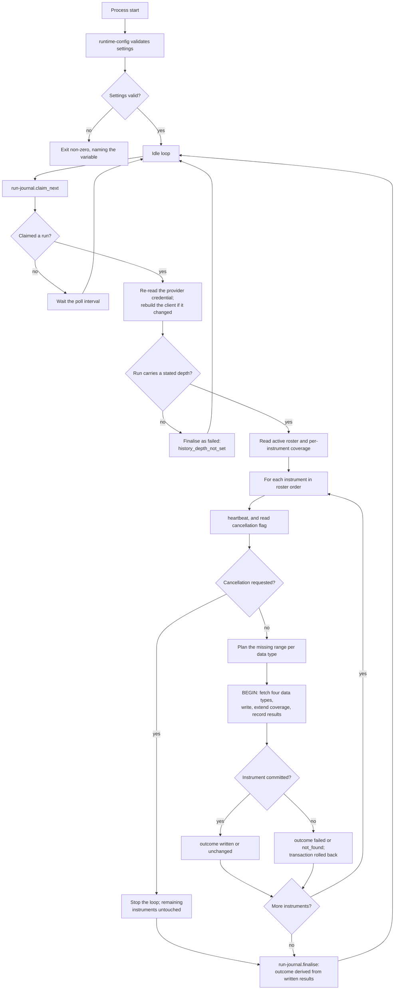

# Component: Acquisition Runner

**Status:** draft
**Capability:** CAP-001
**Owner:** Alvaro de Jodra
**Last Updated:** 2026-09-05

## 1. Overview

The acquisition runner is the ingestion container's main loop. It claims a run
request, reads the roster of active instruments and the stated history depth,
and walks the roster one instrument at a time, driving `massive-client` for four
data types and writing through `observation-writer`. Each instrument is its own
transaction, which is the property every honesty requirement in the capability
ultimately rests on.

It is the component that decides what a failure means. A provider that does not
recognise an instrument must not stop the run (AC-11). A provider that times out
repeatedly must fail that instrument and continue. A cancellation must take
effect within one instrument's work rather than at the end of the run (AC-19).
And a run that ends must be recorded as what it actually achieved, never as a
success it did not earn (AC-9).

Use cases addressed:

- Claim and execute an acquisition run, FIFO, one at a time (AC-23).
- Refuse to claim a run with no stated history depth (AC-2).
- Acquire four data types per instrument over the stated depth (AC-3).
- Complete a run of up to 3000 instruments without intervention (AC-4).
- Fetch only the range not already covered, including a deepening backfill
  (AC-6, AC-22).
- Isolate a per-instrument failure and continue (AC-10, AC-11).
- Observe cancellation between instruments (AC-19).
- Refresh the claim heartbeat so a dead runner is reclaimable (AC-20).

Support matrix: one process in the ingestion container. Exactly one runner is
expected; a second would find no work, because the claim admits one active run.

Dependencies: `run-journal`, `instrument-list-service` (roster and depth read
through the shared store), `massive-client`, `rate-limit-governor`,
`observation-writer`, `runtime-config`.

## 2. Design Details

### 2.1 Placement

```
src/factorflow/ingestion/runner.py         the claim loop and the instrument loop
src/factorflow/ingestion/plan.py           the range each data type needs
src/factorflow/ingestion/outcomes.py       per-instrument outcome classification
src/factorflow/ingestion_main.py           the container entrypoint
```

### 2.2 The run loop

The diagram below is the runner's whole behaviour and it is drawn because the
loop's exit conditions, not its happy path, are what the acceptance criteria
constrain. The outer loop idles until it can claim a run, and it claims only
when no other run is active, which is where FIFO ordering is enforced. The inner
loop walks the roster; at the top of every iteration it checks for cancellation
and refreshes its heartbeat, which is why cancellation takes effect within one
instrument and why a dead runner becomes reclaimable. Each instrument's four
fetches and its writes happen inside one transaction, so the only two outcomes
for an instrument are fully committed or nothing at all. The run's outcome is
computed at the end from what was written rather than from how the loop
terminated.



### 2.3 Planning the range to fetch

`plan.py` computes, per instrument and data type, the range that still needs
acquiring. This is what makes AC-6, AC-22 and the capability's fifth flow work
without re-fetching.

```python
# src/factorflow/ingestion/plan.py
from dataclasses import dataclass
from datetime import date


@dataclass(frozen=True)
class FetchRange:
    data_type: str
    start: date
    end: date


def plan_fetches(
    covered: list[tuple[date, date]],
    depth_start: date,
    today: date,
) -> list[FetchRange]:
    """The sub-ranges of [depth_start, today] not already covered.

    An instrument with no coverage yields the whole range. An instrument
    covered from a later date than depth_start yields the earlier gap, which
    is AC-22's deepening backfill. An instrument already covering the whole
    range yields only the trailing range since its covered_to.
    """
```

`depth_start` is `today` minus the run's `history_depth_years`, computed from
the depth snapshotted onto the run row at request time rather than from the
current setting, so a depth changed mid-queue does not redefine a run already
requested.

Re-fetching the trailing range on every run is deliberate and cheap: the last
covered day may have been a partial session, and `observation-writer`'s
idempotence means re-fetching a day already held writes nothing (AC-6).

### 2.4 Per-instrument outcome classification

| Provider result | Recorded outcome | Run effect | Source |
|-----------------|------------------|------------|--------|
| Data returned, rows appended | `written` | counts toward `succeeded` | AC-3 |
| Data returned, every value already held | `unchanged` | counts toward `succeeded` | AC-6 |
| Instrument unknown to the provider | `not_found` | run continues, outcome becomes `partial` | AC-11 |
| Transport or server error, attempts exhausted | `failed` | run continues, outcome becomes `partial` | system design constraint 5.13 |
| Not reached because the run was cancelled | no row written | no coverage, no failure | AC-19 |

`not_found` is recorded per data type as well as per instrument, because Massive
may recognise an instrument for prices and hold no fundamentals for it. The UX
design's run detail expands an instrument to four data types precisely to show
this.

Rate limiting never appears in this table. A `429` means the request was never
served, so `rate-limit-governor` waits it out and it is not an attempt (system
design constraint 5.13). Conflating the two would abandon instruments over
ordinary throttling.

### 2.5 Cancellation and heartbeat

Both happen at the same point, the top of each instrument iteration, in one
round trip to `run-journal`. Putting them together means the runner touches the
journal once per instrument rather than twice, and it means a runner that is
making progress is proving it at the same moment it is checking whether to stop.

A `heartbeat` that returns `False` means the claim was reclaimed while this
runner was working, most likely because the process was paused long enough for
the staleness window to expire. The runner stops immediately and writes nothing
further against that run, because another claim may now own it and a finalised
run must not gain new results.

### 2.6 Messages

N/A, not applicable for this component. The run journal table is the handoff.

## 3. Constraints and Assumptions

- **Ingestion is its own process** (C1, system design constraint 5.1). The
  runner is never called by the API and never calls it.
- **One instrument, one transaction** (AC-12). Coverage is extended in the same
  transaction as the observations that justify it, so a run that dies partway
  leaves no false history.
- **A per-instrument failure is not a run failure** (AC-11). The loop continues.
- **Cancellation is cooperative and observed between instruments** (AC-19). The
  runner does not abort mid-instrument, and the interface must not present
  cancellation as immediate.
- **The claim carries a heartbeat** (AC-20, system design constraint 5.7).
- **Depth is stated, never assumed** (AC-2). A run with no depth is finalised as
  failed rather than defaulting.
- **Runs are resumable** (system design constraint 5.14). A run interrupted at
  instrument 1500 loses nothing already committed, and the next run's planning
  step naturally fetches only what is missing.
- **Assumption: exactly one runner process.** A second would idle. Nothing
  breaks, but nothing is gained.
- **The provider credential is re-read at claim time** (SEC-SEC-002, owner
  decision 2026-09-05). Before touching the roster, the runner re-reads the key
  from the environment and rebuilds `massive-client` when its fingerprint has
  changed. This is what makes the credential rotatable without a restart, and
  claim time is chosen because it is the one point where no provider connection
  and no partial instrument write is in flight. The mechanism belongs to
  `runtime-config` section 2.2b; this component is where it is invoked.
- **The roster is a snapshot taken at claim time** (AC-25, system design
  constraint 5.19, owner decision 2026-09-05). Order is stable within a run, and
  an instrument retired mid-run is still reached by that run and excluded from
  every later one. No longer an assumption: the capability states it, because a
  run that changes shape underneath itself cannot be explained from its own
  record. The extra observation this may write is retained under AC-21.

## 4. Security

- **The credential never leaves `massive-client`.** The runner holds settings
  objects, not the secret, and never formats a provider URL itself (AC-13).
- **Failure reasons are redacted before they are recorded**, because a provider
  error message is the most plausible route for a credential to reach a stored
  field and then the interface. The runner passes every reason through
  `runtime-config`'s redaction before writing it (AC-13).
- **Data classification.** Everything the runner handles is Internal. It holds
  observation payloads in memory only for the length of one instrument's
  transaction.
- **Injection (SEC-INP-002).** All writes go through `observation-writer` and
  `run-journal`, both parameterised. The runner builds no SQL.
- **External input validation (SEC-INP-001).** Provider payloads are validated
  by `massive-client` before the runner sees them. The runner treats provider
  data as data and never as instruction (AGT-PROHIB-003), which in practice means
  no provider field selects a code path beyond the documented outcome mapping.
- **Errors are never swallowed (OPS-ERR-001).** Every caught exception results
  in a recorded per-instrument outcome with a reason, or in a run finalised as
  failed. There is no path in which an error produces no observable consequence.
- **Repetitive failure (OPS-LOOP-001).** The attempt limit bounds retries per
  instrument and data type at 3 by default, so the runner cannot enter an
  unbounded retry loop.
- **Privacy impact: none.**
- **OSS inventory:** the components it composes; no direct third-party
  dependency of its own beyond `psycopg` 3 and the `massive` client through those.

## 5. Scalability and Performance

- **The sizing case is AC-4: 3000 instruments in one run.** Four data types per
  instrument means up to 12000 provider requests, paced by
  `rate-limit-governor` to the owner's configured budget. Run duration is
  therefore a function of that budget rather than of this component, which is
  why no duration is asserted here and why the capability records the duration
  question as open.
- **One transaction per instrument** means 3000 commits. Batching several
  instruments per transaction would reduce commit overhead and would break
  AC-12, so it is rejected.
- **Memory.** One instrument's payloads at a time, released at commit. Peak
  memory is a function of the largest single instrument's history, not of the
  roster size, which is what makes 3000 instruments no harder than 30.
- **The roster is read once per run** as a list of identifiers, at most 3000
  integers.
- **Concurrency (SA-CONC-001).** The runner is single-threaded through the
  roster, and the provider SDK's REST client is synchronous, so concurrency
  would mean threads rather than coroutines. Deliberately not specified here:
  it interacts with the rate budget and no requirement asks for it. Recorded in
  section 14.
- **Timeouts.** Every provider call carries a 30-second connect and read
  timeout, supplied by `runtime-config` section 2.2a (SA-RES-001).

## 6. Upgrade

- **No previous release.**
- **Resumability is the upgrade property that matters.** A run interrupted by a
  container restart during a deployment is reclaimed as `abandoned` by the
  sweeper, and the next run fetches only what is missing. No manual step, which
  is what AC-20 requires.
- **Data migration: none owned here.**
- **Behaviour change after upgrade: none in this capability.**
- **Manual actions required: none.**
- **Rollback (OPS-MIG-003).** Reverting the ingestion image reverts the runner.
  Because coverage and results are data, an older runner resumes correctly
  against work a newer one committed.
- **The M3 live feed** attaches behind the same provider contract. This
  component acquires history and does not hold a long-lived connection; the M3
  capability adds that alongside rather than by changing this loop (C4, system
  design constraint 5.6).

## 7. Testing

Provider interaction is tested against a stubbed `massive-client`, so the
runner's logic is exercised without network access. The client's own fidelity to
Massive is tested in its component.

| Test | File | What it proves |
|------|------|----------------|
| Four data types per instrument | `tests/integration/test_runner_acquires.py` | A successful run writes reference, prices, fundamentals and corporate actions (AC-3) |
| A rotated credential is used by the next run | `tests/integration/test_runner_credential.py` | Changing the environment value between two runs has the second use the new key in the same process, with no restart (SEC-SEC-002, runtime-config 2.2b) |
| An unchanged credential keeps one client | `tests/integration/test_runner_credential.py` | Two consecutive runs with the same key reuse one SDK `RESTClient` rather than discarding the connection pool |
| Unknown instrument does not stop the run | `tests/integration/test_runner_isolation.py` | With instrument 2 of 3 unknown, instruments 1 and 3 are written and the run is `partial` (AC-11) |
| Exhausted attempts fail one instrument | `tests/integration/test_runner_isolation.py` | Three timeouts on one instrument record `failed` and the run continues (5.13) |
| Rate limiting is not an attempt | `tests/integration/test_runner_isolation.py` | Repeated 429 responses do not exhaust the attempt budget (5.13) |
| A failed instrument leaves no coverage | `tests/integration/test_runner_transactions.py` | A failure after the first write leaves no rows and no coverage segment for that instrument (AC-12) |
| Cancellation stops between instruments | `tests/integration/test_runner_cancel.py` | Cancelling during instrument 2 leaves 1 covered, 3 untouched, run `cancelled` (AC-19) |
| Cancellation retains coverage | `tests/integration/test_runner_cancel.py` | Instruments already committed keep their coverage (AC-19) |
| A lost claim stops the runner | `tests/integration/test_runner_reclaim.py` | After a reclaim, `heartbeat` false ends the loop and no further result is written (AC-20) |
| Depth absent fails the run | `tests/integration/test_runner_depth.py` | A run with no stated depth is finalised failed and acquires nothing (AC-2) |
| Backfill on deepening | `tests/integration/test_runner_backfill.py` | Raising the depth fetches only the earlier missing range and re-fetches nothing (AC-22, AC-6) |
| New instrument reaches the same depth | `tests/integration/test_runner_backfill.py` | An instrument added later is populated to the roster's depth without disturbing the others (capability flow 5) |
| Re-run writes nothing new | `tests/integration/test_runner_rerun.py` | A second identical run records `unchanged` and the run is `succeeded` (AC-6, AC-9) |
| Volume | `tests/integration/test_runner_volume.py` | 3000 stubbed instruments complete one run without intervention (AC-4) |
| Reason redaction | `tests/unit/test_runner_reason.py` | A provider error containing a credential is recorded without it (AC-13) |

## 8. Acceptance Criteria

1. A claimed run acquires reference data, daily prices, fundamentals and
   corporate actions for each active instrument over the run's stated depth.
2. A run with no stated history depth acquires nothing and is finalised as
   failed.
3. An instrument the provider does not recognise is recorded and the run
   continues to the remaining instruments.
4. An instrument whose fetches exhaust the attempt limit is recorded as failed
   and the run continues.
5. Rate-limit responses do not consume the attempt budget.
6. An instrument whose transaction fails leaves neither observations nor a
   coverage segment for the attempted range.
7. A cancellation requested during a run stops it before the next instrument
   starts, retains the coverage already written, and finalises as cancelled.
8. A runner whose claim has been reclaimed stops without writing further results
   against that run.
9. Raising the stated history depth causes the next run to fetch only the
   earlier missing range for each instrument.
10. A repeated run over an already-covered period writes no new observations and
    is finalised as succeeded.
11. A run of 3000 instruments completes without manual intervention.
12. No recorded failure reason contains the provider credential.
13. Failure scenario: the ingestion process is killed mid-run; the run is later
    reclaimed as abandoned and a subsequent run completes the remaining
    instruments without re-fetching the committed ones.

## 9. Workflows

- **New workflow: acquire for the first time.** The capability's first flow,
  steps 3 to 5. The run reports progress through the journal and completes.
- **New workflow: add an instrument afterwards.** The capability's fifth flow.
  Planning fetches the new instrument's full depth and nothing for the others
  beyond their trailing range.
- **New workflow: recover from a failed run.** The capability's third flow, step
  5. The re-run completes and the affected instrument shows complete coverage,
  with nothing duplicated or overwritten.
- **New workflow: stop a run.** The capability's fourth flow, steps 3 and 4.
- **New workflow: deepen history.** AC-22. The next run backfills.
- **Intersecting workflow: operate and upgrade.** A deployment that restarts the
  ingestion container mid-run relies on reclaim and resumability, which is the
  capability's sixth flow meeting AC-20.

## 10. UX / GUI

This component renders nothing, and two interface behaviours are only honest
because of how it works:

- **Progress on the Run detail screen.** The UX design shows instruments
  completed against instruments named, polled every 10 seconds, and deliberately
  shows no estimated time remaining because no duration target exists. The
  counter is meaningful because the runner advances it per committed instrument
  rather than per attempted one.
- **The cancellation confirmation copy**, *The run stops after the instrument it
  is working on now*, is accurate only because cancellation is observed at the
  top of the instrument loop rather than at the end of the run.

Section 3 of the UX design records one remaining component-spec gap, the
indeterminate progress indicator, which is an interface concern and is carried
in the `owner-web-app` design.

Internationalization: none.

## 11. API Endpoints

This component exposes no HTTP surface. It consumes one external interface and
several internal ones.

| Endpoint | Method/Operation | Auth/Privilege | Request | Response | Notes |
|----------|-----------------|----------------|---------|----------|-------|
| `run-journal.claim_next` | in-process call | ingestion database credential | Runner identity | Claimed run or none | The cross-container handoff (AC-23) |
| `run-journal.heartbeat` | in-process call | ingestion database credential | Run id, runner identity | Claim still held | Per instrument (AC-20) |
| `run-journal.cancellation_requested` | in-process call | ingestion database credential | Run id | Boolean | Per instrument (AC-19) |
| `run-journal.finalise` | in-process call | ingestion database credential | Run id | Terminal state | Outcome derived from results (AC-9) |
| `instrument-list-service.active_instrument_ids` | in-process call | ingestion database credential | none | Active roster | Read once per run |
| `massive-client` reads | in-process call | provider API key, held by the client | Symbol and date range | Parsed observations, or a typed error | Four reads per instrument (AC-3) |
| `observation-writer.write_instrument` | in-process call | ingestion database credential | Parsed observations and the range written | Rows appended and coverage extended | One transaction per instrument (AC-12) |

## 12. References

| Type | Document Name | Description | Link |
|------|---------------|-------------|------|
| Capability | CAP-001 v6 | AC-2 to AC-6, AC-9 to AC-12, AC-19, AC-20, AC-22, AC-23; user flows 1, 3, 4, 5 | `docs/capabilities/CAP-001-market-data-acquisition-foundation/Capability-CAP-001.md` |
| System design | CAP-001 system design v3 | Control flow section 3, constraints 5.1, 5.7, 5.13, 5.14 | `docs/capabilities/CAP-001-market-data-acquisition-foundation/design/system-design.md` |
| UX design | CAP-001 UX design v4 | Section 1.5, progress and cancellation copy | `docs/capabilities/CAP-001-market-data-acquisition-foundation/design/ux-design.md` |
| Component design | Run Journal | Claim, heartbeat, cancellation and outcome derivation | `docs/capabilities/CAP-001-market-data-acquisition-foundation/design/component-design-run-journal.md` |
| Component design | Observation Writer | The per-instrument transaction and idempotent append | `docs/capabilities/CAP-001-market-data-acquisition-foundation/design/component-design-observation-writer.md` |
| Constitution | Operational Safety v1.3 | OPS-ERR-001, OPS-LOOP-001 | `docs/constitutions/operational-safety.constitution.md` |

## 13. Traceability

| Capability AC | System Design Element | Component Design Element | Section |
|--------------|----------------------|--------------------------|---------|
| AC-2 | Runner refuses to claim a run with no depth set | Depth check at claim, finalised failed rather than defaulted | 2.2 |
| AC-3 | Four provider reads per instrument | The instrument loop's four fetches | 2.2, 2.4 |
| AC-4 | Per-instrument transactions and budget pacing | 3000-instrument run loop with constant memory | 5 |
| AC-6 | Re-run safety | `plan_fetches` fetching only uncovered ranges; idempotent writes | 2.3 |
| AC-9 | Outcome computed from written coverage | Outcome classification feeding `finalise` | 2.4 |
| AC-10 | Per-instrument failure records | A `run_instrument_result` row per data type with a reason | 2.4 |
| AC-11 | Per-instrument isolation | `not_found` recorded, loop continues | 2.2, 2.4 |
| AC-12 | Coverage extended inside the write transaction | One transaction per instrument, rolled back whole on failure | 2.2 |
| AC-19 | Cancellation observed between instruments | Cancellation check at the top of each iteration | 2.2, 2.5 |
| AC-20 | Claim heartbeat and staleness window | Heartbeat refreshed per instrument; a lost claim stops the loop | 2.5 |
| AC-22 | Backfill the missing earlier range | `plan_fetches` yielding the earlier gap on a deepened run | 2.3 |
| AC-23 | FIFO claim, one active run | The claim loop, delegating ordering to `run-journal` | 2.2 |

## 14. Open Questions

1. **Should the four data types for one instrument be fetched concurrently?**
   The rate budget bounds it either way, and it interacts with the governor's
   pacing in ways that would need specifying. Adopting the official SDK makes
   this slightly harder rather than easier: its REST client is synchronous, so
   concurrency would mean a thread pool rather than coroutines. This design
   fetches sequentially and records the option. *Owner: system design owner.
   Blocks: nothing; sequential fetching meets every stated criterion.*
2. ~~What poll interval should an idle runner use between claim attempts?~~
   **Resolved 2026-09-05 by owner decision: 5 seconds**, as
   `FACTORFLOW_RUN_POLL_INTERVAL_SECONDS` in
   `component-design-runtime-config.md` section 2.2a. A queued run therefore
   starts within five seconds of being requested, which is well inside the UX
   design's ten-second run poll, and one claim query every five seconds is
   negligible against a store sized for 3000 instruments.
3. ~~Should a run finalise as failed when the roster is empty?~~ **Resolved
   2026-09-05: the case cannot arise.** `ingestion-api` now refuses a run
   request when no instrument is active, returning `409 no_active_instruments`
   and creating no run (AC-24, system design constraint 5.18). Section 2.4's
   derive-from-what-was-written rule therefore needs no special case, which was
   the point of refusing at the boundary rather than encoding an exception here.

   One residual case remains and is deliberately left as `failed`: every
   instrument is retired *after* the run is claimed, so the roster snapshot is
   non-empty but every instrument fails or returns nothing. That is a real run
   that did real work and came back with nothing, and `failed` is the honest
   outcome for it.
