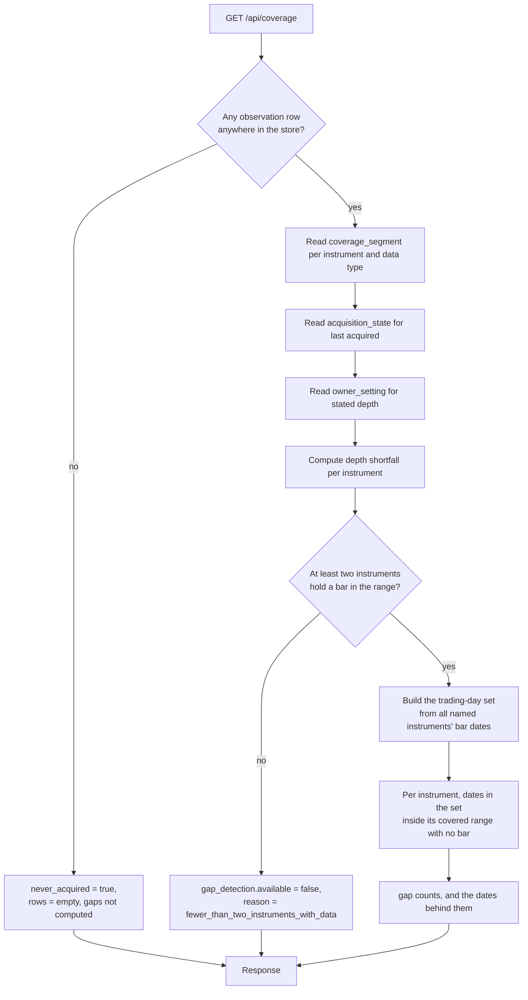

# Component: Coverage Service

**Status:** draft
**Capability:** CAP-001
**Owner:** Alvaro de Jodra
**Last Updated:** 2026-09-05

## 1. Overview

Coverage service answers the question the capability exists to make answerable:
which instruments hold data the owner can rely on, over what range, as of when,
and with what missing inside it. It derives every answer from rows that exist,
never from what a run intended to write, which is what makes AC-12 true from the
reader's side as well as the writer's.

It also owns the capability's most unusual piece of reasoning. Massive publishes
no historical trading calendar, so there is no authority against which a missing
day can be judged. The owner decided on 2026-09-03 that a date counts as a
trading day when any named instrument has a daily bar for it, and a gap is a
date in that set that falls inside an instrument's own covered range and has no
bar for that instrument. Two limits follow, and this component is required to
state them rather than hide them: gap detection is unavailable below two
instruments holding data, and a market-wide outage cannot be detected at all.

Use cases addressed:

- Per-instrument coverage: which data types are present, over what range, and
  when last acquired (AC-7).
- Missing trading days inside an acquired range (AC-8).
- Gap detection reported as unavailable, with a reason, rather than as zero
  (AC-8, STD-UI-14).
- The never-acquired state, distinct from an empty result (AC-17).
- Retired instruments reported with their retained coverage, distinguishable
  from active ones (AC-21).
- Shortfall against the stated history depth, which the interface renders as
  *Short by n years* (AC-22).

Support matrix: read-only, in the application container. It writes nothing.

Dependencies: `market-data-store` (`coverage_segment`, `acquisition_state`,
`daily_bar`, `instrument`, `owner_setting`), `psycopg` 3.

## 2. Design Details

### 2.1 Placement

```
src/factorflow/coverage/service.py    the read API
src/factorflow/coverage/gaps.py       the trading-day set and gap derivation
src/factorflow/coverage/sql/          the statements, as .sql files loaded at import
```

### 2.2 Derivation flowchart

The chart below shows how one coverage read is assembled, and it is drawn
because three of the response's fields are honest only if they are computed in
this order. Presence and ranges come from `coverage_segment`, which exists only
where rows were written. Last acquired comes from `acquisition_state`, which
records attempts including those that brought nothing back. Gaps are computed
last and only after an availability check, because computing them first and then
discovering the set is meaningless would produce a zero the interface is
forbidden to render. The never-acquired branch short-circuits everything, since
a product that has acquired nothing must say so rather than return an empty
list that reads as healthy.



### 2.3 The trading-day set and gaps

```sql
-- src/factorflow/coverage/sql/gaps.sql
WITH in_range AS (
    SELECT b.instrument_id, b.session_date
      FROM daily_bar b
     WHERE b.session_date BETWEEN %(from_date)s AND %(to_date)s
),
availability AS (
    SELECT count(DISTINCT instrument_id) >= 2 AS available
      FROM in_range
),
trading_day AS (
    SELECT DISTINCT session_date FROM in_range
),
covered AS (
    SELECT cs.instrument_id, cs.covered_from, cs.covered_to
      FROM coverage_segment cs
     WHERE cs.data_type = 'prices'
)
SELECT c.instrument_id,
       t.session_date AS missing_date
  FROM covered c
  JOIN trading_day t
    ON t.session_date BETWEEN c.covered_from AND c.covered_to
  LEFT JOIN in_range b
    ON b.instrument_id = c.instrument_id
   AND b.session_date  = t.session_date
 WHERE b.instrument_id IS NULL
   AND (SELECT available FROM availability)
 ORDER BY c.instrument_id, t.session_date;
```

Three properties of this statement are load-bearing:

- The trading-day set is built from **all** instruments' bars, not from the
  instrument being checked. Checking an instrument against its own dates would
  report zero gaps for every instrument, always.
- A missing date is only a gap when it falls **inside that instrument's own
  covered range**. A date before an instrument was first acquired is not a gap;
  it is simply outside coverage, which is what AC-8's "within a date range it
  has acquired" means.
- The availability predicate is applied inside the statement, so an unavailable
  check returns no rows and the service reports unavailability rather than a
  zero count.

Gap detection applies to `prices` only. Fundamentals are quarterly and
corporate actions are sporadic, so a missing trading day is not a meaningful
notion for either, and the capability's AC-8 speaks of trading days.

### 2.4 Interface

```python
# src/factorflow/coverage/service.py
from dataclasses import dataclass
from datetime import date, datetime
from enum import StrEnum


class Presence(StrEnum):
    PRESENT = "present"
    ABSENT = "absent"
    UNKNOWN = "unknown"


@dataclass(frozen=True)
class GapDetection:
    available: bool
    reason: str | None   # "fewer_than_two_instruments_with_data" when unavailable
    missing_days: int | None


@dataclass(frozen=True)
class InstrumentCoverage:
    symbol: str
    lifecycle: str                       # active | retired
    presence: dict[str, Presence]        # one entry per data type
    covered_from: date | None
    covered_to: date | None
    last_acquired_at: datetime | None
    depth_shortfall_years: int | None    # None when the depth is met (AC-22)
    gaps: GapDetection


@dataclass(frozen=True)
class CoverageView:
    never_acquired: bool                 # AC-17
    gap_detection: GapDetection          # the whole-view availability
    instruments: list[InstrumentCoverage]
    next_cursor: str | None
```

`Presence.UNKNOWN` exists because the interface needs a third state. It is used
where a data type has never been attempted for an instrument, which is different
from having been attempted and found absent, and the UX design maps the three to
`badge` `coverage-present`, `coverage-absent` and `coverage-unknown`.

`depth_shortfall_years` is `None` when the instrument meets the stated depth,
never zero, so the interface renders no marker rather than a redundant
confirmation. This matches the UX design's Depth column, which carries a marker
only on rows that fall short.

### 2.5 Never acquired, and why it is a separate query

`never_acquired` is true when no observation row exists in the store at all, not
when the current filter returns nothing. The two are different states and the
UX design renders different copy for each: *No data has been acquired yet.* with
the run action beside it, against *No instrument matches this filter.* with a
reset control. Conflating them would produce AC-17's exact failure, an empty
table that reads as healthy.

### 2.6 Messages

N/A, not applicable for this component.

## 3. Constraints and Assumptions

- **Coverage is derived, never asserted** (system design constraint 5.9). This
  component reads; it never writes a coverage row and never reports a range
  because a run said it would acquire one.
- **Gaps are computed at read time, not stored** (system design 3, step 40).
  Storing them would create a second thing to keep true.
- **Trading days come from acquired data, not from a calendar** (system design
  constraint 5.5, owner decision 2026-09-03). No calendar dependency enters the
  stack.
- **Gap detection is unavailable below two instruments holding data in the
  range**, and the service says so rather than reporting zero. STD-UI-14 forbids
  the binary presentation.
- **A market-wide outage is undetectable** by this method, because every
  instrument is missing that day so the day never enters the set. STD-UI-18
  requires the check to state what it does not cover, and the UX design places
  that sentence once below the table.
- **Retired instruments are included** in coverage reads, marked (AC-21,
  system design constraint 5.8). Omitting them would make retained history
  invisible.
- **Assumption: US-listed equities with one session per day.** A single
  unqualified session date is meaningful only under that assumption.
- **Assumption: the owner's instrument list is the population.** The trading-day
  set is a property of the list rather than of the market, which is why its
  signal depends on the list's size.

## 4. Security

- **Data classification.** Coverage is Internal, derived from Internal
  observations. No Restricted value is read or returned.
- **Injection (SEC-INP-002).** Every statement is a parameterised `.sql` file
  loaded at import. The date range, instrument filter and cursor are bound
  parameters. The one dynamic element, the sort column, resolves through an
  allowlist rather than being interpolated.
- **Input validation (SEC-INP-001).** `from_date` and `to_date` are validated as
  dates with `from_date <= to_date`; `lifecycle` is validated against an
  enumeration; `limit` is bounded.
- **Authorization: none.** One owner, loopback interface.
- **Errors (OPS-ERR-001).** An unavailable gap check is a reported state, not a
  swallowed error. A database failure propagates to the API's error envelope
  rather than being caught and rendered as zero gaps, which would be the silent
  failure this rule exists to prevent.
- **Privacy impact: none.**
- **Crypto usage: none.**
- **OSS inventory:** `psycopg` 3 only.

## 5. Scalability and Performance

- **The trading-day set query is the capability's heaviest read.** At AC-4's
  3000 instruments over five years it scans roughly 3.8 million `daily_bar` rows
  in the worst case, a full-range request with no instrument filter. It is served
  by `idx_daily_bar_session` for the range predicate and
  `idx_daily_bar_instrument_session` for the per-instrument anti-join.
- **Pagination.** Coverage is keyset paginated by symbol, so a page computes
  gaps for the instruments on that page only. The trading-day set, however, is a
  property of the whole list and is computed once per request rather than per
  page row.
- **The gap dates are behind row expansion** in the interface, so the default
  read returns counts and the specific dates are fetched only when the owner
  expands a row. This is the UX design's progressive disclosure decision and it
  is also the performance decision that keeps the default read small.
- **Resource utilization.** Read-only, no caching, no materialised view. A
  materialised gap table was rejected because it would be a stored derivation
  that can disagree with the rows, which is the failure mode constraint 5.9
  exists to prevent.
- **Concurrency.** Read-only, so no shared mutable state (SA-CONC-001). A read
  concurrent with an acquisition run sees a consistent snapshot per PostgreSQL's
  default isolation, which may be mid-run; that is correct, since coverage is
  whatever has committed.
- **No latency target is stated** by the capability or the system design.
  Recorded in section 14.

## 6. Upgrade

- **No previous release.**
- **Data migration: none owned here.** This component reads tables created by
  migrations `0002` and `0003`.
- **Behaviour change after upgrade: none in this capability.**
- **Forward compatibility.** M1 classification will read the same observations.
  Nothing here constrains that, because this component stores no derivation the
  later capability would have to keep in step.
- **A future capability that acquires a real trading calendar** would replace
  the derivation in section 2.3 with a calendar join and would remove both stated
  limits. That is a change to this component only, which is the point of keeping
  the derivation in one query rather than spread across the codebase.
- **Manual actions required: none.**
- **Rollback (OPS-MIG-003).** No component-specific rollback; the component
  holds no state.

## 7. Testing

| Test | File | What it proves |
|------|------|----------------|
| Coverage reflects written rows only | `tests/integration/test_coverage_reads.py` | An instrument with bars but no coverage segment reports no range, and one with both reports the range (AC-7, AC-12) |
| Last acquired includes failed attempts | `tests/integration/test_coverage_reads.py` | An attempt that wrote nothing still advances `last_acquired_at` (AC-7) |
| Never acquired is distinct from filtered-empty | `tests/integration/test_coverage_empty.py` | Two different responses for an empty store and a non-matching filter (AC-17) |
| Gaps found inside a covered range | `tests/integration/test_coverage_gaps.py` | Three instruments, one missing a session the other two have, produces exactly one gap (AC-8) |
| Dates outside coverage are not gaps | `tests/integration/test_coverage_gaps.py` | A session before an instrument's `covered_from` is not reported (AC-8) |
| Gap detection unavailable below two | `tests/integration/test_coverage_gaps.py` | One instrument with data yields `available: false` with a reason, and no zero count (AC-8, STD-UI-14) |
| A market-wide missing day is not reported | `tests/integration/test_coverage_gaps.py` | A session absent for every instrument produces no gap, documenting the stated limit |
| Retired instruments keep coverage | `tests/integration/test_coverage_retired.py` | A retired instrument appears with its range and is marked retired (AC-21) |
| Depth shortfall is computed | `tests/integration/test_coverage_depth.py` | Raising the stated depth marks short instruments and leaves compliant ones unmarked (AC-22) |
| Shortfall is absent, not zero | `tests/unit/test_coverage_shapes.py` | An instrument meeting the depth carries `None`, never 0 |
| Presence has three states | `tests/unit/test_coverage_shapes.py` | Never attempted, attempted and absent, and present are distinguishable |
| Gap query at volume | `tests/integration/test_coverage_volume.py` | 3000 instruments over one year returns within the suite timeout (AC-4) |

## 8. Acceptance Criteria

1. For each instrument, the response reports which of the four data types are
   present, the covered range, and when it was last acquired.
2. A covered range is reported only where observation rows exist for it.
3. Missing trading days are reported only for dates inside the instrument's own
   covered range.
4. When fewer than two instruments hold a bar in the requested range, gap
   detection is reported as unavailable with a reason, and no gap count is
   returned.
5. Before any acquisition has run, the response reports never-acquired, which is
   distinguishable from a filter that matched nothing.
6. A retired instrument appears in the response with its retained coverage and is
   marked retired.
7. An instrument whose coverage falls short of the stated history depth reports
   the shortfall in years; one that meets it reports no shortfall value.
8. This component issues no `INSERT`, `UPDATE` or `DELETE`.
9. Failure scenario: a database error during a coverage read propagates as an
   error rather than being rendered as zero gaps or empty coverage.
10. Failure scenario: a session date missing for every instrument produces no
    gap for any of them, which is the stated and accepted limit of the method.

## 9. Workflows

- **New workflow: confirm the data is fit to rely on.** The whole of the
  capability's second flow. The owner opens the ingestion view and reads
  coverage, ranges, last acquired and gaps.
- **New workflow: the honest empty state.** Step 5 of that flow. Nothing
  acquired says so plainly.
- **Intersecting workflow: after a failed run.** The capability's third flow
  ends with the owner confirming complete coverage for the affected instrument.
  That confirmation is this component's read.
- **Intersecting workflow: after cancellation.** The capability's fourth flow
  requires that instruments already acquired keep their coverage. This component
  is where the owner sees that.
- **Intersecting workflow: after deepening.** AC-22's shortfall marker tells the
  owner which instruments the next run will backfill.

## 10. UX / GUI

This component backs the Coverage overview screen, UX design section 1.1, which
is the landing screen once any data exists.

| Interface element | Component | Variant | What this design supplies |
|-------------------|-----------|---------|---------------------------|
| Instrument coverage table | `data-table` | `expandable` | One row per instrument, collapsed by default |
| Data type presence | `badge` | `coverage-present`, `coverage-absent`, `coverage-unknown` | The three-state `Presence` enum |
| Lifecycle | `badge` | `secondary` for retired | The `lifecycle` field |
| Covered from, Covered to | table cells | `--font-numeric` | ISO-8601 dates, absent rendered as an em dash by the interface (STD-UI-4) |
| Gaps | count, or `badge` `coverage-unknown` | `coverage-unknown` carries `--pattern-indeterminate` | `GapDetection`, whose `available: false` is what forbids rendering a zero |
| Depth | `badge` | `status-warning` when short | `depth_shortfall_years`, absent when met |
| Last acquired | table cell | `--text-xs` | `last_acquired_at`, timestamp with zone |
| Row expansion | `data-table` `expandable` | n/a | Stable identity, per-data-type ranges, and the specific missing dates behind the count |

Two obligations this component makes satisfiable:

- **STD-UI-14 and STD-UI-18.** The unavailable state is a first-class value in
  the response rather than an interface fallback, and the reason travels with
  it, so the interface can say *Gap detection needs at least two instruments
  holding data in this range.* without inferring it.
- **AC-17.** `never_acquired` is a field, so the interface does not have to
  infer an empty store from an empty list.

Internationalization: none. Dates are ISO-8601 in the response; zone rendering
is the interface's concern per STD-UI-5.

## 11. API Endpoints

This component exposes no HTTP surface of its own.

| Endpoint | Method/Operation | Auth/Privilege | Request | Response | Notes |
|----------|-----------------|----------------|---------|----------|-------|
| `read_coverage` | in-process call | application database credential | Symbol filter, lifecycle, date range, cursor | `CoverageView` | Backs `GET /api/coverage` (AC-7, AC-8, AC-17, AC-21, AC-22) |
| `read_gap_dates` | in-process call | application database credential | Instrument, date range | The specific missing dates | Backs row expansion; not fetched for the collapsed table |
| Coverage read | `SELECT` over `coverage_segment`, `acquisition_state`, `daily_bar` | application database credential | Bound parameters | Rows | The system design's declared interface, 4.2 |

## 12. References

| Type | Document Name | Description | Link |
|------|---------------|-------------|------|
| Capability | CAP-001 v6 | AC-7, AC-8, AC-12, AC-17, AC-21, AC-22 | `docs/capabilities/CAP-001-market-data-acquisition-foundation/Capability-CAP-001.md` |
| System design | CAP-001 system design v3 | Gap computation steps 40 to 43, constraints 5.5 and 5.9 | `docs/capabilities/CAP-001-market-data-acquisition-foundation/design/system-design.md` |
| UX design | CAP-001 UX design v4 | Section 1.1, the Coverage overview and its unavailable state | `docs/capabilities/CAP-001-market-data-acquisition-foundation/design/ux-design.md` |
| Component design | Market Data Store | `coverage_segment`, `acquisition_state`, `daily_bar` and their indexes | `docs/capabilities/CAP-001-market-data-acquisition-foundation/design/component-design-market-data-store.md` |
| Standard | STD-UI v4 | STD-UI-4, STD-UI-14, STD-UI-15, STD-UI-16, STD-UI-18 | `docs/constitution/standards/ui-conventions.md` |
| Constitution | Tech Stack v2 | Massive supplies no historical trading calendar | `docs/constitution/tech-stack.md` |

## 13. Traceability

| Capability AC | System Design Element | Component Design Element | Section |
|--------------|----------------------|--------------------------|---------|
| AC-7 | `coverage-service` derives per-instrument coverage and last-acquired | `InstrumentCoverage` fields read from `coverage_segment` and `acquisition_state` | 2.4 |
| AC-8 | Gaps against the trading-day set from all named instruments | The `gaps.sql` statement and its three load-bearing properties | 2.3 |
| AC-8 | Unavailable below two instruments | `GapDetection.available` with a reason, computed before any count | 2.2, 2.3 |
| AC-12 | Coverage derived, never asserted | Reads `coverage_segment` only, which is written inside the observation transaction | 3 |
| AC-17 | Coverage distinguishes never acquired from acquired and empty | `never_acquired` as a distinct field with its own query | 2.5 |
| AC-21 | Coverage reports active and retired | Retired instruments included and marked | 2.4, 3 |
| AC-22 | Compare coverage to the stated depth | `depth_shortfall_years`, absent when met | 2.4 |

## 14. Open Questions

1. ~~Does gap detection apply to any data type other than prices?~~ **Resolved
   2026-09-05: prices only**, now stated in system design v3 step 42 and in the
   `coverage-service` responsibility in section 4.1. The mechanism was already
   unambiguous, since steps 41 and 42 and constraint 5.5 are defined in terms of
   daily bars throughout; what the clarification adds is that a covered range for
   fundamentals or corporate actions asserts nothing about completeness within
   it, which a reader of the four presence columns could otherwise over-read.
2. **What default date range does a coverage read use when the owner supplies
   none?** The UX design's Coverage screen shows covered ranges per instrument
   without naming a query range, but gap detection needs one. This design
   computes gaps over the union of all covered ranges when no range is supplied,
   which is the widest honest answer. *Owner: capability owner. Blocks: the
   default in the request model.*
3. **What read latency is acceptable for a coverage read at 3000 instruments?**
   No value is stated anywhere. Section 5 sizes the work without asserting a
   target. *Owner: capability owner. Blocks: a performance acceptance
   criterion.*
