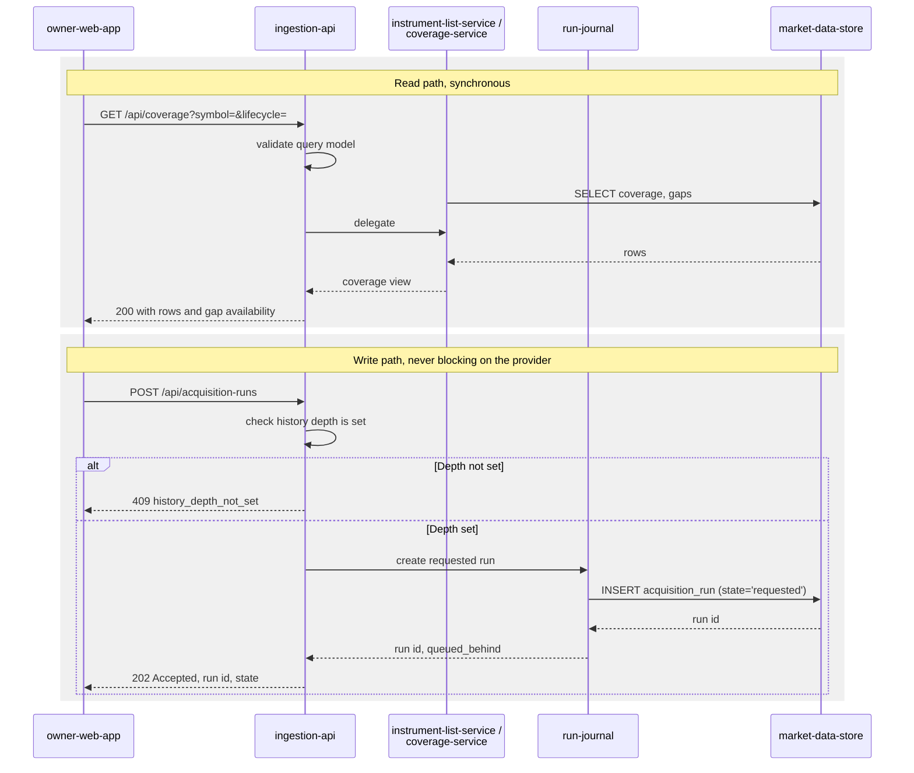

# Component: Ingestion API

**Status:** draft
**Capability:** CAP-001
**Owner:** Alvaro de Jodra
**Last Updated:** 2026-09-05

## 1. Overview

The FastAPI application serving the owner interface: seven JSON endpoints and
the built React bundle, bound to loopback, with no authentication. It is the
only network entry point in the capability and the only component the browser
can reach. It never calls Massive and never blocks on a provider request, which
is what keeps the provider's failure modes out of the interface (C1, system
design constraint 5.1).

The API is thin by design. It validates requests, delegates to
`instrument-list-service`, `run-journal` and `coverage-service`, and shapes
responses. It holds no acquisition logic and no coverage arithmetic of its own.

Use cases addressed:

- Name, list and retire instruments, including bulk entry (AC-1, AC-21).
- State the history depth and read it back (AC-2).
- Request an acquisition run, which queues rather than blocks (AC-23).
- List runs and open one, with per-instrument failure detail (AC-9, AC-10,
  AC-11).
- Request cancellation of a run in progress (AC-19).
- Read coverage, gaps and the never-acquired empty state (AC-7, AC-8, AC-17).
- Report liveness, credential presence and the most recent run outcome (AC-18).

Support matrix: one uvicorn worker in the application container, bound to
`127.0.0.1`, published to the host loopback only. One browser client, one owner.

Dependencies: FastAPI, Starlette, Pydantic, uvicorn, `psycopg` 3 connection
pool, and the three services it delegates to. It depends on `schema-migrator`
having exited zero before it binds.

## 2. Design Details

### 2.1 Placement

```
src/factorflow/api/app.py                  application factory, lifespan, middleware
src/factorflow/api/routes/instruments.py
src/factorflow/api/routes/settings.py
src/factorflow/api/routes/runs.py
src/factorflow/api/routes/coverage.py
src/factorflow/api/routes/health.py
src/factorflow/api/models.py               Pydantic request and response models
src/factorflow/api/errors.py               the error envelope and handlers
src/factorflow/api/static/                 Vite build output, served as the SPA
src/factorflow/app_main.py                 uvicorn entrypoint
```

### 2.2 Request handling flow

The diagram below traces the two request shapes that matter, because the
capability's interface is almost entirely one of them or the other. A read is
synchronous end to end: the route validates, the service queries PostgreSQL, and
the response is shaped. A run request is not: the route records a `requested`
row and returns `202 Accepted` immediately, so the browser has a run identifier
before any provider call has been made and never waits on Massive. The decision
point that carries AC-23 is inside `run-journal`, which inserts a `requested`
row whether or not another run is active, leaving the FIFO claim to the runner.
The expected outcome is that no request handler in this component can block on
anything slower than a local PostgreSQL query.



### 2.3 Error envelope

Every non-2xx response carries the same body, so the interface has one shape to
render and STD-UI-19's three parts, operation, resource and reason, always have
somewhere to come from.

```json
{
  "error": {
    "code": "history_depth_not_set",
    "message": "History depth is not set. Set it in Settings before acquiring.",
    "resource": "acquisition-run",
    "request_id": "0f2f1c2e-9a44-4f0f-9f1e-2b7b0d0f1a55"
  }
}
```

`code` is a stable snake_case identifier the interface may branch on. `message`
is owner-facing prose. `request_id` is generated per request by middleware and
included in every log record for that request, which is what makes a reported
failure findable in the container log.

The messages are owner-facing and detailed because the interface is loopback
only and its single user is the operator. SEC-ERR-001 requires that internal
detail not reach external clients; there is no external client here, and the
boundary the rule protects is the one the deployment closes. Stack traces and
driver messages are still never returned: a `500` returns
`{"code": "internal_error", "request_id": ...}` and the detail goes to the log.

### 2.4 Endpoint semantics

The full contract is in section 11. Three behaviours need more than a table row.

**Bulk instrument add.** `POST /api/instruments` accepts
`{"symbols": [...]}` for both the single-field add and the *Add many* region the
UX design specifies in section 1.2. The response reports a disposition per
symbol rather than failing the batch, because the UX design requires that
rejected entries never discard accepted ones. Status is `201` when at least one
symbol was added or reactivated, `409` when every symbol was rejected as a
duplicate of an active instrument, and `422` when every symbol was malformed.

**Run request.** `POST /api/acquisition-runs` returns `202` with the run
identifier and `queued_behind`, the identifier of the active run when one
exists and `null` otherwise. The interface uses it to render *A run is in
progress. This will start when it finishes.* The endpoint never rejects a
request because a run is active; that would contradict AC-23.

**Cancellation.** `POST /api/acquisition-runs/{id}/cancel` returns `202` and
state `cancelling` when the run was `running`, and `409` with code
`run_already_terminal` and the run's actual state when it was not. The `409`
is what the UX design's *This run had already completed.* renders, and it is
the reason the endpoint reports the state rather than only refusing.

### 2.5 Serving the interface bundle

The Vite build writes to `src/factorflow/api/static/`. The API mounts it with
Starlette's `StaticFiles` at `/`, after the `/api` routes, with an SPA fallback
that returns `index.html` for any unmatched non-API path so client-side routing
works on reload. Requests under `/api` never fall through to the bundle; an
unknown API path returns the error envelope with code `not_found`.

### 2.6 Messages

N/A, not applicable for this component. No broker, topic or queue. The interface
learns of run completion by polling, per the UX design's 10-second run poll and
30-second health poll.

## 3. Constraints and Assumptions

- **Loopback only, no authentication** (AC-14, system design constraint 5.11).
  uvicorn binds `FACTORFLOW_API_HOST`, defaulted to `127.0.0.1`, and the compose
  file publishes the port to `127.0.0.1` only. No endpoint assumes an
  authenticated principal, and no session, cookie or token exists, so a later
  capability adding authentication adds it rather than retrofitting around an
  assumption.
- **The API never calls the provider** (C1). No route imports `massive-client`.
  A repository test asserts this, because the constraint is architectural and
  easy to break with one convenient import.
- **The API never blocks on a run.** `POST /api/acquisition-runs` returns before
  any acquisition work happens.
- **The API binds only after migration succeeds** (AC-16). Enforced by the
  container entrypoint, not by the API.
- **Coverage is read, never computed here.** `coverage-service` owns the
  arithmetic; the API shapes its output.
- **Assumption: one browser client.** No rate limiting, no CORS configuration
  beyond same-origin, no pagination pressure from concurrent readers.
- **Assumption: the bundle is built into the image.** The API does not build or
  fetch frontend assets at runtime.

## 4. Security

- **Authentication and authorization: none, deliberately.** The owner decided on
  2026-09-03 that the interface is loopback-bound and unauthenticated.
  SEC-AUTH-001 requires authentication on every externally reachable endpoint;
  these endpoints are not externally reachable, which is the specific condition
  the decision rests on. The capability records that this ceases to hold the
  moment the interface is exposed to any network, and the capability's own open
  questions carry when to revisit it. This design adds no dependency on the
  absence of authentication, so adding it later is additive.
- **Network exposure (AC-14).** Two independent controls: the uvicorn bind
  address and the published port. An integration test asserts the process is not
  listening on a non-loopback interface.
- **Input validation (SEC-INP-001).** Every request body and query string is a
  Pydantic model. Symbols are validated against the same pattern the database
  check constraint enforces, with a maximum length; `symbols` arrays are capped;
  `limit` is bounded; `state` and `outcome` filters are validated against
  enumerations rather than passed through.
- **Injection (SEC-INP-002).** No query is built by concatenation. The one
  dynamic element, sort column, resolves through an allowlist in the service
  layer.
- **Error disclosure (SEC-ERR-001).** Section 2.3. A `500` returns a code and a
  request identifier only.
- **The credential is never echoed (AC-13).** No endpoint accepts it, returns
  it, or has a field for it. `GET /api/health` reports presence as a boolean.
  A response-model test asserts no response model contains a secret-shaped
  field.
- **Data classification.** Everything the API returns is Internal. No Restricted
  value crosses the boundary.
- **Privacy impact: none.** No PII, no customer data, one owner.
- **SAST and SCA.** FastAPI, Starlette, Pydantic and uvicorn are scanned through
  `pyproject.toml`. `ruff` and `mypy` run as blocking checks per the tech
  stack's validation commands.
- **Crypto usage: none in this component.** TLS is not terminated here; traffic
  is loopback only, which is why SEC-ENC-001 does not engage on this hop.

## 5. Scalability and Performance

- **Concurrency: one user.** A single uvicorn worker is sufficient (C8). No
  horizontal scale requirement exists anywhere in this capability.
- **The heaviest read is coverage at 3000 instruments** (AC-4). It is paginated
  by keyset cursor so the interface's virtualised table can request what it
  displays rather than the whole set in one response.
- **Polling load.** The UX design specifies a 10-second run poll while any run is
  non-terminal and a 30-second health poll. Both read the run journal, which is a
  small indexed table, rather than deriving coverage.
- **Connection pool** is bounded by `runtime-config` at a maximum of 4
  connections (SA-RES-001). One user polling two endpoints does not approach it.
- **Timeouts.** Every database call inherits the pool's statement timeout. No
  external call exists in this component to time out.
- **No latency SLA is stated** by the capability or the system design, so none is
  asserted here. Recorded in section 14.

## 6. Upgrade

- **No previous release.** This capability introduces the API.
- **Contract stability.** Every endpoint is declared "stable within this
  capability" by the system design's section 4.2. A later capability adding a
  field to a response is compatible; removing or renaming one is not, and must
  be treated as a breaking interface change in that capability's design.
- **Data migration: none owned here.** The API reads a schema
  `schema-migrator` has already brought forward.
- **Behaviour change after upgrade: none in this capability.**
- **Manual actions required: none.**
- **Rollback (OPS-MIG-003).** Reverting the application image reverts the API
  and the bundle together, because they ship in one image. The constraint is the
  schema: an older API against a newer schema is refused by the migrator, so the
  rollback path is image and data restore together, as recorded in the
  `market-data-store` design.

## 7. Testing

FastAPI's `TestClient` for route-level tests, `testcontainers[postgres]` for the
integration tests that need a real store.

| Test | File | What it proves |
|------|------|----------------|
| Bulk add reports per-symbol disposition | `tests/integration/test_api_instruments.py` | A batch of valid, duplicate and malformed symbols adds the valid ones and reports the rest (AC-1) |
| Duplicate of a retired instrument reactivates | `tests/integration/test_api_instruments.py` | Response offers reactivation rather than an error (AC-21) |
| Retire keeps coverage | `tests/integration/test_api_instruments.py` | After `DELETE`, coverage still lists the instrument as retired (AC-21) |
| Depth is required before a run | `tests/integration/test_api_runs.py` | `POST /api/acquisition-runs` with no depth returns 409 `history_depth_not_set` (AC-2) |
| Run request returns immediately | `tests/integration/test_api_runs.py` | 202 with a run id, and the run row is `requested` (AC-23) |
| Second request queues | `tests/integration/test_api_runs.py` | With one run `running`, a second request returns 202 and `queued_behind` naming the first (AC-23) |
| Cancel on a terminal run | `tests/integration/test_api_runs.py` | 409 `run_already_terminal` carrying the actual state (AC-19) |
| Never-acquired coverage is distinct from empty | `tests/integration/test_api_coverage.py` | The response marks never-acquired explicitly rather than returning an empty list (AC-17) |
| Gap detection unavailable below two instruments | `tests/integration/test_api_coverage.py` | `gap_detection.available` is false with a reason, and no zero is reported (AC-8) |
| Health reports the most recent run outcome | `tests/integration/test_api_health.py` | Liveness, credential presence and last run state (AC-18) |
| No response model leaks the credential | `tests/unit/test_api_no_secrets.py` | Static inspection of every response model finds no credential field (AC-13) |
| The API does not import the provider client | `tests/unit/test_api_isolation.py` | No module under `api/` imports `massive_client` (C1) |
| Bind address is loopback | `tests/integration/test_api_binding.py` | The server is not listening on a non-loopback interface (AC-14) |
| Unknown API path returns the envelope | `tests/unit/test_api_errors.py` | 404 with code `not_found`, not the SPA bundle |
| Internal error hides detail | `tests/unit/test_api_errors.py` | A raised exception returns code and request id only, and the detail is in the log (SEC-ERR-001) |

End-to-end coverage of these flows through the browser belongs to
`owner-web-app`'s Playwright suite and is specified there.

## 8. Acceptance Criteria

1. `POST /api/instruments` with a mixed batch adds every valid symbol and
   reports each rejected one with a reason, adding none of the rejected.
2. `DELETE /api/instruments/{symbol}` retires the instrument and it remains
   present in `GET /api/coverage` marked retired.
3. `POST /api/acquisition-runs` before any history depth is set returns 409 with
   code `history_depth_not_set` and creates no run.
4. `POST /api/acquisition-runs` while a run is active returns 202 and reports
   the active run in `queued_behind`.
5. `POST /api/acquisition-runs/{id}/cancel` on a terminal run returns 409
   carrying that run's state.
6. `GET /api/coverage` before any acquisition distinguishes never-acquired from
   an empty result.
7. `GET /api/coverage` reports gap detection as unavailable, with a reason, when
   fewer than two instruments hold data in the range.
8. `GET /api/health` returns liveness, credential presence as a boolean, and the
   most recent run's outcome.
9. No response body from any endpoint contains the provider credential.
10. The server accepts no connection on a non-loopback interface.
11. Failure scenario: a database failure during a read returns 500 with a code
    and request identifier, and the driver message appears only in the log.
12. Failure scenario: a malformed request body returns 422 with the field named
    and no stack trace.

## 9. Workflows

- **Acquire for the first time.** Settings sets depth, Instruments names
  symbols, and the run request returns a run id the interface routes to. Steps 2
  to 4 of the capability's first flow.
- **Confirm the data is fit to rely on.** `GET /api/coverage` answers the whole
  of the second flow.
- **Diagnose a failure.** `GET /api/acquisition-runs` then
  `GET /api/acquisition-runs/{id}` answer the third flow's steps 2 and 3.
- **Stop a run.** The cancel endpoint and its 409 branch answer the fourth flow,
  including step 5, where the run had already finished.
- **Add an instrument after the first acquisition.** `POST /api/instruments`
  then a run request, answering the fifth flow.
- **Intersection with later capabilities.** M1 classification will need reads
  over the same store. Whether it extends this API or introduces its own surface
  is that capability's decision; nothing here forecloses either.

## 10. UX / GUI

This component renders no markup of its own beyond serving the built bundle, and
every screen in the UX design depends on its contracts. Three couplings are
tight enough to record:

- **The `blocked` Start action.** The UX design renders Start as `button`
  `blocked` with the reason *History depth is not set. Set it in Settings before
  acquiring.* The API's 409 code `history_depth_not_set` and its message are the
  same fact, and the message text here matches the interface copy so a race
  between the two produces one sentence rather than two.
- **The queued-run notice.** `queued_behind` is what lets the interface say *A
  run is in progress. This will start when it finishes.* without a second
  request.
- **The already-completed cancellation.** The 409's state field is what the
  interface renders as *This run had already completed.*

Internationalization: none. The API emits English owner-facing messages, and the
interface renders them. Dates and timestamps are ISO-8601 in responses; zone
rendering is the interface's concern per STD-UI-5.

## 11. API Endpoints

| Endpoint | Method/Operation | Auth/Privilege | Request | Response | Notes |
|----------|-----------------|----------------|---------|----------|-------|
| `/api/instruments` | GET | none, loopback only | `symbol` prefix filter, `lifecycle`, `limit`, `cursor` | `200` with instruments, counts of active and retired, `next_cursor` | AC-1 |
| `/api/instruments` | POST | none | `{"symbols": ["AAPL", "MSFT"]}` | `201` with `added`, `reactivated`, `rejected` each carrying a reason; `409` when all duplicate; `422` when all malformed | AC-1; bulk and single share one endpoint |
| `/api/instruments/{symbol}` | DELETE | none | path symbol | `200` with `lifecycle: retired` and `retired_at`; `404` unknown; `409` already retired | AC-21, retires and never deletes |
| `/api/settings/history-depth` | PUT | none | `{"years": 5}` | `200` with `years` and `updated_at`; `422` when not a positive integer | AC-2 |
| `/api/settings/history-depth` | GET | none | none | `200` with `years` or `null` when never set | AC-2; declared in system design v3 section 4.2 |
| `/api/acquisition-runs` | POST | none | empty body | `202` with `run_id`, `state: requested`, `queued_behind`; `409` `history_depth_not_set` | AC-23, never blocks |
| `/api/acquisition-runs` | GET | none | `state` filter, `limit`, `cursor` | `200` with runs in reverse chronological order and `next_cursor` | AC-9 |
| `/api/acquisition-runs/{id}` | GET | none | path id, `outcome` filter, `limit`, `cursor` | `200` with the run, its counts, and per-instrument per-data-type results; `404` unknown | AC-10, AC-11 |
| `/api/acquisition-runs/{id}/cancel` | POST | none | path id | `202` with `state: cancelling`; `409` `run_already_terminal` with the actual state; `404` unknown | AC-19 |
| `/api/coverage` | GET | none | `symbol` filter, `lifecycle`, `from`, `to`, `limit`, `cursor` | `200` with per-instrument data-type presence, covered ranges, last acquired, gap counts, `never_acquired`, and `gap_detection` availability with a reason | AC-7, AC-8, AC-17, AC-21 |
| `/api/health` | GET | none | none | `200` with `status`, `database`, `credential_present`, `schema_version`, `most_recent_run` | AC-18; `credential_present` declared in system design v3 section 4.2, sourced from the application's own environment per constraint 5.12 |
| `/` and any non-API path | GET | none | none | `200` `index.html`, or the built asset | SPA fallback, section 2.5 |

Interfaces consumed by this component: `instrument-list-service`, `run-journal`
and `coverage-service`, all in-process; and `market-data-store` through the
connection pool. It consumes no external integration.

## 12. References

| Type | Document Name | Description | Link |
|------|---------------|-------------|------|
| Capability | CAP-001 v6 | AC-1, AC-2, AC-7 to AC-11, AC-13, AC-14, AC-17 to AC-19, AC-21, AC-23 | `docs/capabilities/CAP-001-market-data-acquisition-foundation/Capability-CAP-001.md` |
| System design | CAP-001 system design v3 | Interfaces 4.2, control flow 3, constraints 5.1, 5.11, 5.17 | `docs/capabilities/CAP-001-market-data-acquisition-foundation/design/system-design.md` |
| UX design | CAP-001 UX design v4 | Screens 1.1 to 1.5, cross-screen navigation, the copy this API's messages must match | `docs/capabilities/CAP-001-market-data-acquisition-foundation/design/ux-design.md` |
| Standard | STD-UI v4 | STD-UI-19 error parts, STD-UI-25 polling and last-updated | `docs/constitution/standards/ui-conventions.md` |
| Constitution | Tech Stack v2 | FastAPI on uvicorn, Pydantic, validation commands | `docs/constitution/tech-stack.md` |

## 13. Traceability

| Capability AC | System Design Element | Component Design Element | Section |
|--------------|----------------------|--------------------------|---------|
| AC-1 | `GET/POST/DELETE /api/instruments` | Bulk-tolerant POST with per-symbol disposition | 2.4, 11 |
| AC-2 | `PUT /api/settings/history-depth` | PUT plus the GET this design adds for the Settings screen | 11, 14 |
| AC-7 | `GET /api/coverage` | Coverage response shape with presence, ranges and last acquired | 11 |
| AC-8 | Gap detection, unavailable below two instruments | `gap_detection` object carrying availability and reason | 2.4, 11 |
| AC-9 | `run-journal` computes outcome from written coverage | Run list and detail responses reporting the recorded outcome only | 11 |
| AC-10 | Per-instrument failure records | Run detail returning per-instrument per-data-type outcome and reason | 11 |
| AC-11 | Per-instrument isolation | `not_found` reported distinctly from `failed` in run detail | 11 |
| AC-13 | No API echo of the credential | No request or response model carries it; health reports a boolean | 4, 11 |
| AC-14 | Port published to `127.0.0.1`; uvicorn bound to loopback | Bind address and published port, both asserted by test | 3, 4, 7 |
| AC-17 | Coverage distinguishes never acquired from acquired and empty | `never_acquired` field in the coverage response | 11 |
| AC-18 | `GET /api/health` | Liveness, credential presence, most recent run outcome | 11 |
| AC-19 | `POST /api/acquisition-runs/{id}/cancel` | 202 `cancelling`, 409 `run_already_terminal` with state | 2.4, 11 |
| AC-21 | Retire rather than delete; coverage reports retired | DELETE returns `retired`; coverage carries lifecycle | 11 |
| AC-23 | `POST` creates `requested`; FIFO claim by the runner | 202 with `queued_behind`, never a rejection | 2.4, 11 |

## 14. Open Questions

1. ~~`GET /api/settings/history-depth` is not in the system design's interface
   table.~~ **Resolved 2026-09-05: the endpoint was added to system design v3
   section 4.2**, on the owner's decision, as a separate route rather than folded
   into `GET /api/health`. Owner configuration does not belong in an endpoint
   polled every 30 seconds for operational status.
2. ~~`credential_present` on `GET /api/health` is not in the system design's
   interface text.~~ **Resolved 2026-09-05: system design v3 declares it**, and
   constraint 5.12 now states that the credential is supplied to both containers
   with the application reading only whether it is set. The alternative, having
   ingestion record presence in the store, was rejected because health would then
   report a credential as supplied after ingestion had stopped, and AC-18 exists
   so the owner can trust that answer.
3. **What happens when a run is requested with no active instruments?** Nothing
   in the capability or the system design says. This design accepts the request
   and lets the run complete with zero instruments named rather than inventing a
   refusal, because a new refusal is a product decision. It is arguably a
   vacuous success and AC-9's honesty requirement is at least adjacent.
   *Owner: capability owner. Blocks: an acceptance criterion, not the
   implementation.*
4. **What page size should the paginated endpoints use?** The UX design requires
   server-side filtering across the full result set and a virtualised table, so
   pagination is by keyset cursor. No capability or design value sizes the page.
   `[REQUIRES INPUT: what default and maximum page size for coverage, runs and
   instruments?]` *Owner: capability owner. Blocks: the request models.*
5. **What API latency is acceptable at 3000 instruments?** No value is stated
   anywhere, so section 5 sizes the work without asserting a target. *Owner:
   capability owner. Blocks: a performance acceptance criterion.*
