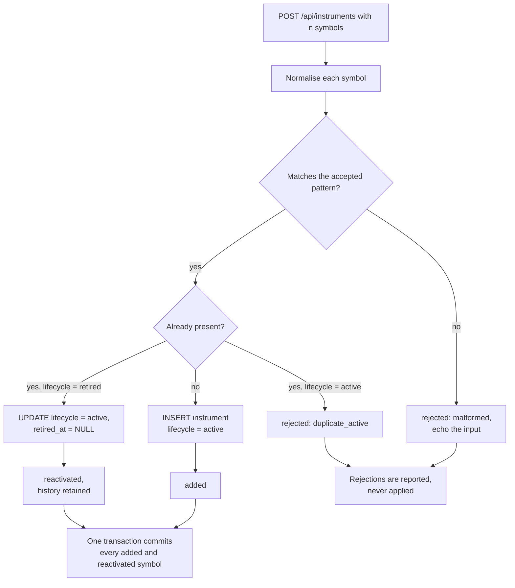

# Component: Instrument List Service

**Status:** draft
**Capability:** CAP-001
**Owner:** Alvaro de Jodra
**Last Updated:** 2026-09-05

## 1. Overview

The owner's instrument list and the stated history depth. This is the component
that decides what gets acquired and how far back, and it holds the capability's
single most consequential lifecycle rule: removal retires, it never deletes
(AC-21, system design constraint 5.8). Point-in-time history cannot be
re-acquired as it was observed, so a delete here is unrecoverable in the same
way an overwritten observation is.

It also owns the precondition that governs whether acquisition may start at all.
AC-2 says the product must require the owner to state history depth before the
first run and must not acquire to a depth the owner has not stated, which makes
the absence of a value a first-class state rather than a missing default.

Use cases addressed:

- Add instruments, one at a time or in bulk, with per-symbol disposition
  (AC-1, AC-4).
- List instruments with their lifecycle and counts (AC-1).
- Retire an instrument, stopping future acquisition and retaining every
  observation (AC-21).
- Reactivate a retired instrument rather than erroring on a duplicate.
- Set and read the stated history depth (AC-2, AC-22).
- Supply the active instrument list and the current depth to
  `acquisition-runner` at claim time.

Support matrix: in-process library inside the application container, and read by
`acquisition-runner` in the ingestion container through the shared store rather
than through a call.

Dependencies: `market-data-store` (`instrument`, `owner_setting`), `psycopg` 3.

## 2. Design Details

### 2.1 Placement

```
src/factorflow/instruments/service.py    add, retire, reactivate, list
src/factorflow/instruments/symbols.py    normalisation and validation
src/factorflow/instruments/settings.py   history depth read and write
```

### 2.2 Symbol normalisation

One rule, applied in one place, so the API, the database check constraint and
the provider client cannot disagree about what a symbol is.

- Trim surrounding whitespace.
- Uppercase.
- Accept `^[A-Z][A-Z0-9.-]{0,15}$`, which admits the dot and hyphen forms US
  listings use for share classes and preferred issues.
- Reject anything else as `malformed`, with the offending input echoed back so
  the owner can find it in a pasted list of three thousand.

`symbols.py` is the only module that normalises, and the database's
`instrument_symbol_uppercase` and `instrument_symbol_shape` constraints are the
backstop that makes a bypass fail loudly rather than silently storing a variant.

### 2.3 Add flowchart

The chart below is drawn because adding a symbol has four outcomes rather than
two, and the UX design in section 1.2 renders each differently. A symbol is
normalised, then matched against the existing list. An unknown symbol is added
as active. A duplicate of an active instrument is rejected, because adding it
twice means nothing. A duplicate of a retired instrument is reactivated rather
than rejected, since the owner's evident intent is to resume acquiring it and
the retained history is still there. A malformed symbol is rejected with its
input echoed. The decisive property is that the four outcomes are computed per
symbol inside one transaction, so a batch of three thousand pasted symbols
never discards the accepted ones over one bad line.



### 2.4 Interface

```python
# src/factorflow/instruments/service.py
from dataclasses import dataclass
from enum import StrEnum

import psycopg


class Disposition(StrEnum):
    ADDED = "added"
    REACTIVATED = "reactivated"
    DUPLICATE_ACTIVE = "duplicate_active"
    MALFORMED = "malformed"


@dataclass(frozen=True)
class SymbolOutcome:
    input_symbol: str
    normalised_symbol: str | None
    disposition: Disposition


def add_symbols(connection: psycopg.Connection, raw_symbols: list[str]) -> list[SymbolOutcome]:
    """Add or reactivate each symbol. One transaction; rejections apply nothing."""


def retire_symbol(connection: psycopg.Connection, symbol: str) -> None:
    """Set lifecycle to retired and stamp retired_at. Deletes nothing.

    Raises InstrumentNotFound when unknown, AlreadyRetired when already retired.
    """


def list_instruments(
    connection: psycopg.Connection, filters: "InstrumentFilters"
) -> "InstrumentPage":
    """Return one keyset page of instruments with lifecycle and total counts."""


def active_instrument_ids(connection: psycopg.Connection) -> list[int]:
    """The acquisition roster: active instruments only, ordered by symbol.

    Read by acquisition-runner at claim time. A retired instrument is absent,
    which is the whole mechanism by which retirement stops acquisition.
    """
```

Retirement is a lifecycle transition and nothing else. It writes no observation,
touches no coverage segment, and cancels no run in progress. A run that has
already started and is part way through the roster it read at claim time will
still reach an instrument retired mid-run; this is recorded in section 14
because the capability does not say which behaviour it wants.

### 2.5 History depth

```python
# src/factorflow/instruments/settings.py
HISTORY_DEPTH_KEY = "history_depth_years"


def read_history_depth(connection: psycopg.Connection) -> int | None:
    """The stated depth in years, or None when the owner has never stated one."""


def write_history_depth(connection: psycopg.Connection, years: int) -> None:
    """Record the stated depth. Raises ValueError below 1."""
```

`None` is a real state, not an error and not a zero (AC-2). Every caller
distinguishes it: `ingestion-api` returns 409 `history_depth_not_set` on a run
request, the interface renders Start as `button` `blocked` with the reason, and
`acquisition-runner` refuses to claim a run whose recorded depth is absent.

The depth is snapshotted onto the run row at request time, in
`acquisition_run.history_depth_years`, so a depth changed while a run is queued
does not silently redefine what that run acquires. Deepening therefore takes
effect on the next requested run, which is exactly what AC-22 describes.

### 2.6 Messages

N/A, not applicable for this component.

## 3. Constraints and Assumptions

- **Removal retires, it never deletes** (AC-21, system design constraint 5.8).
  No code path in this component issues `DELETE FROM instrument`.
- **Depth is stated, never assumed** (AC-2). There is no default, and no
  fallback. A missing depth blocks acquisition rather than selecting one.
- **Retired instruments stay visible.** Coverage reads include them, marked, so
  the owner can see the retained history AC-21 promises. Omitting them would
  make retention invisible and therefore worthless.
- **One normalisation rule.** Any component needing a canonical symbol calls
  `symbols.py`. The database constraints are the backstop.
- **Assumption: US-listed equities.** The accepted symbol pattern follows from
  it. A different market would change the pattern and the reference data.
- **Assumption: the owner pastes symbols from an external source.** The bulk
  path exists because AC-4's 3000 instruments and AC-1's prohibition on editing
  configuration files leave no other way to reach that volume.

## 4. Security

- **Input validation (SEC-INP-001).** Symbols are validated against an explicit
  pattern with a maximum length before any query. The bulk array is length
  capped by the API's request model. History depth is validated as a positive
  integer.
- **Injection (SEC-INP-002).** Every statement uses `psycopg` 3 bound
  parameters, including the bulk insert, which uses `executemany` over a single
  prepared statement rather than a constructed `VALUES` list.
- **Data classification.** The instrument list is Internal. It reveals what the
  owner is interested in, which is commercially meaningful to the owner but is
  not personal data and not customer data.
- **Authorization: none.** One owner, loopback interface. Nothing in this
  component assumes a principal.
- **Destructive operation prevention (OPS-DEST-001, OPS-DEST-002).** The
  destructive alternative to retirement was evaluated and rejected at capability
  level, and the schema removes the option: there is no delete path. The
  interface reinforces it by using `dialog` `confirm` rather than `destructive`,
  since nothing is discarded.
- **Privacy impact: none.**
- **Crypto usage: none.**
- **OSS inventory:** `psycopg` 3 only.

## 5. Scalability and Performance

- **Bulk add at AC-4 volume.** Three thousand symbols in one request. Insertion
  uses `executemany` inside one transaction; the duplicate check is a single
  indexed lookup per symbol against `idx_instrument_symbol`. This is
  sub-second work on local PostgreSQL and avoids the quadratic shape of checking
  each symbol against a growing in-memory list (SA-RES-001).
- **Listing** is keyset paginated on `symbol`, so the interface's virtualised
  table requests what it renders.
- **`active_instrument_ids`** returns at most 3000 integers and is read once per
  run claim, not per instrument.
- **Concurrency.** One owner. The only interesting case is a retirement
  committed while a run holds an older roster, which section 14 records.
- **No SLA is stated** by the capability, so none is asserted.

## 6. Upgrade

- **No previous release.**
- **Data migration: none owned here.** The `instrument` and `owner_setting`
  tables are created by migration `0001`.
- **Behaviour change after upgrade: none in this capability.**
- **Forward compatibility.** A later capability composing universes by rule
  (explicitly out of scope here) will need to add instruments by a different
  route. Nothing in this component prevents that: the list is a table with a
  lifecycle, and rule-based composition writes to it the same way.
- **Manual actions required: none.**
- **Rollback (OPS-MIG-003).** No component-specific rollback. Reverting the
  image reverts the service; the list itself is data and is unaffected.

## 7. Testing

| Test | File | What it proves |
|------|------|----------------|
| Mixed batch adds the valid ones | `tests/integration/test_instrument_add.py` | Valid, duplicate and malformed symbols in one request produce three dispositions and the valid ones are committed (AC-1, AC-4) |
| Rejections apply nothing | `tests/integration/test_instrument_add.py` | After a batch with rejections, no rejected symbol exists in the table |
| Duplicate of a retired instrument reactivates | `tests/integration/test_instrument_add.py` | Lifecycle returns to active and `retired_at` is cleared (AC-21) |
| Reactivation keeps observations | `tests/integration/test_instrument_lifecycle.py` | Bars written before retirement are present and unchanged after reactivation (AC-21, AC-5) |
| Retire stops acquisition | `tests/integration/test_instrument_lifecycle.py` | `active_instrument_ids` excludes the retired instrument (AC-21) |
| Retire retains coverage | `tests/integration/test_instrument_lifecycle.py` | Coverage segments and observations are untouched by retirement (AC-21) |
| Retire twice is refused | `tests/integration/test_instrument_lifecycle.py` | The second call raises `AlreadyRetired` rather than restamping |
| No delete statement exists | `tests/unit/test_no_instrument_delete.py` | Static scan finds no `DELETE FROM instrument` in the repository (AC-21) |
| Normalisation is total | `tests/unit/test_symbol_normalisation.py` | Whitespace, case, dot and hyphen forms normalise; a symbol failing the pattern is rejected with its input echoed |
| Depth absent is distinct from zero | `tests/unit/test_history_depth.py` | `read_history_depth` returns `None`, never 0, when never set (AC-2) |
| Depth below one is refused | `tests/unit/test_history_depth.py` | `write_history_depth(0)` raises |
| Bulk at volume | `tests/integration/test_instrument_volume.py` | 3000 symbols add in one request within the suite timeout (AC-4) |

## 8. Acceptance Criteria

1. Adding a batch containing valid, duplicate-active and malformed symbols adds
   every valid symbol, reactivates every retired match, and reports each
   rejection with a reason and the input it came from.
2. No rejected symbol appears in the instrument list afterwards.
3. Retiring an instrument sets its lifecycle to retired, stamps `retired_at`,
   and removes it from the acquisition roster.
4. Every observation, coverage segment and acquisition state row for a retired
   instrument is unchanged after retirement.
5. A retired instrument remains visible in coverage reads, marked retired.
6. No statement anywhere in the repository deletes a row from `instrument`.
7. Reading history depth before it has ever been stated returns an absent value
   distinguishable from zero.
8. Writing a history depth below one year is refused.
9. A run records the depth in force at request time, so a later change does not
   redefine a queued run.
10. Failure scenario: a batch of 3000 symbols containing one malformed line adds
    the other 2999.
11. Failure scenario: retiring an unknown symbol raises rather than silently
    succeeding.

## 9. Workflows

- **New workflow: name the instruments.** Step 2 of the capability's first flow.
  The owner adds symbols singly or in bulk.
- **New workflow: state the history depth.** Also step 2, and the precondition
  for every run.
- **New workflow: retire an instrument.** The capability's AC-21 path. The owner
  confirms in a `dialog` `confirm`, acquisition stops, history stays.
- **New workflow: add an instrument after the first acquisition.** The
  capability's fifth flow. The new instrument is populated to the same depth as
  the others on the next run, which is `acquisition-runner`'s behaviour reading
  this component's roster and depth.
- **Intersecting workflow: deepening.** Raising the depth marks already-acquired
  instruments short of it on the Coverage screen and backfills on the next run
  (AC-22). This component supplies the new depth; the comparison and the
  backfill belong to `coverage-service` and `acquisition-runner`.

## 10. UX / GUI

This component backs the UX design's Instruments screen, section 1.2, and the
History depth region of Settings, section 1.3.

| Interface element | Component | Variant | What this design supplies |
|-------------------|-----------|---------|---------------------------|
| Instrument table | `data-table` | `expandable` | Rows with lifecycle, and the active and retired counts in the toolbar |
| Add instrument field | `form` + `input` | `inline` + `text` | Single-symbol add through the same batch path |
| Add many | `textarea` | `list` | Bulk parse and per-symbol disposition, reported before anything is added |
| Lifecycle marker | `badge` | `secondary` for retired | The `lifecycle` value |
| Retire action | `button` | `ghost` | `retire_symbol` |
| Retire confirmation | `dialog` | `confirm` | The confirmation is `confirm` and never `destructive`, because retirement discards nothing. STD-UI-2 forbids a word the product does not mean |
| History depth | `form` + `input` | `stacked` + `numeric` | Depth in years, with absent distinct from zero |

The UX design states that the add field validates format only and cannot
validate against the provider, because recognition is not known until a run
reaches the instrument (AC-11). This design honours that: `add_symbols` performs
no provider call and the recognition state of a newly added instrument is
unknown until a run records it.

Internationalization: none.

## 11. API Endpoints

This component exposes no HTTP surface of its own. It backs the endpoints
`ingestion-api` publishes.

| Endpoint | Method/Operation | Auth/Privilege | Request | Response | Notes |
|----------|-----------------|----------------|---------|----------|-------|
| `add_symbols` | in-process call | application database credential | Raw symbol list | Per-symbol disposition | Backs `POST /api/instruments` |
| `retire_symbol` | in-process call | application database credential | Symbol | None, or a raised error | Backs `DELETE /api/instruments/{symbol}` |
| `list_instruments` | in-process call | application database credential | Filters and cursor | One keyset page and counts | Backs `GET /api/instruments` |
| `read_history_depth` | in-process call | application database credential | none | Years or absent | Backs `GET /api/settings/history-depth` and the run precondition |
| `write_history_depth` | in-process call | application database credential | Years | None | Backs `PUT /api/settings/history-depth` |
| `active_instrument_ids` | in-process call, ingestion side | ingestion database credential | none | Active instrument identifiers | Read by `acquisition-runner` at claim time |

## 12. References

| Type | Document Name | Description | Link |
|------|---------------|-------------|------|
| Capability | CAP-001 v6 | AC-1, AC-2, AC-4, AC-21, AC-22 | `docs/capabilities/CAP-001-market-data-acquisition-foundation/Capability-CAP-001.md` |
| System design | CAP-001 system design v3 | `instrument-list-service` in 4.1, constraint 5.8 | `docs/capabilities/CAP-001-market-data-acquisition-foundation/design/system-design.md` |
| UX design | CAP-001 UX design v4 | Section 1.2 Instruments, section 1.3 Settings | `docs/capabilities/CAP-001-market-data-acquisition-foundation/design/ux-design.md` |
| Component design | Market Data Store | `instrument` and `owner_setting` definitions and their constraints | `docs/capabilities/CAP-001-market-data-acquisition-foundation/design/component-design-market-data-store.md` |
| Standard | STD-UI v4 | STD-UI-2, words describe real behaviour | `docs/constitution/standards/ui-conventions.md` |

## 13. Traceability

| Capability AC | System Design Element | Component Design Element | Section |
|--------------|----------------------|--------------------------|---------|
| AC-1 | `instrument-list-service` maintains the list | `add_symbols`, `retire_symbol`, `list_instruments` | 2.3, 2.4 |
| AC-2 | Depth required before a run is claimed | `read_history_depth` returning an absent value, snapshotted onto the run | 2.5 |
| AC-4 | Runs of up to 3000 instruments | Bulk add path and `executemany` insertion | 2.3, 5 |
| AC-11 | Unrecognised instrument reported, run continues | Add performs no provider validation; recognition is a run outcome | 2.4, 10 |
| AC-21 | Retire rather than delete; retained coverage visible | Lifecycle transition, no delete path, retired instruments in coverage reads | 2.4, 3 |
| AC-22 | Deepening backfills on the next run | Depth snapshotted at request time, so a queued run keeps its stated depth | 2.5 |

## 14. Open Questions

1. **What happens to an instrument retired while a run is in progress?** The
   runner reads its roster when it claims the run. A retirement committed after
   that will not stop the run from reaching that instrument, so one more
   observation may be written for an instrument the owner has just retired. The
   alternative, re-reading the roster before each instrument, makes the roster
   inconsistent within a run. Neither the capability nor the system design says
   which is wanted. This design takes the first, because a run that changes
   shape underneath itself is harder to explain than one extra observation, and
   surfaces the choice rather than treating it as settled. *Owner: capability
   owner. Blocks: an acceptance criterion.*
2. **Is there a maximum instrument count?** AC-4 states the product must handle
   up to 3000 without manual intervention, which is a floor on capability rather
   than a ceiling on the list. This design enforces no maximum. *Owner:
   capability owner. Blocks: the bulk request model's array cap.*
3. **What upper bound applies to history depth?** Shared with the
   `market-data-store` and `ingestion-api` designs.
   `[REQUIRES INPUT: what maximum history depth in years should be accepted?]`
   *Owner: capability owner. Blocks: `write_history_depth` validation.*
