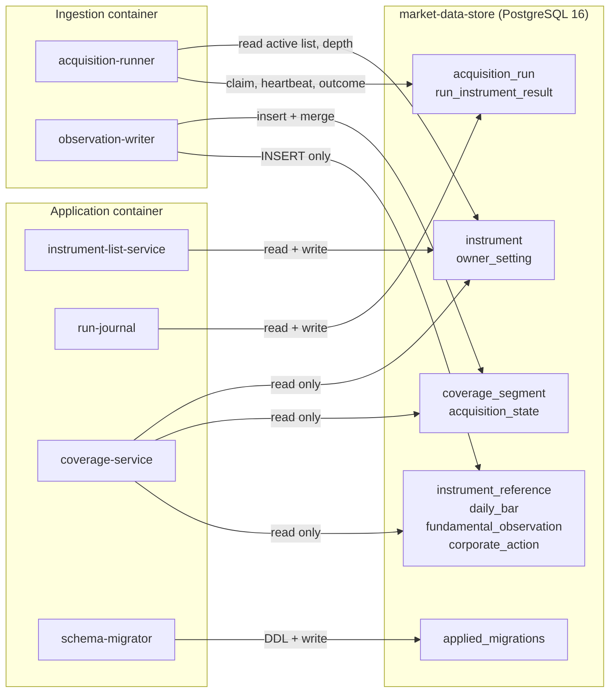
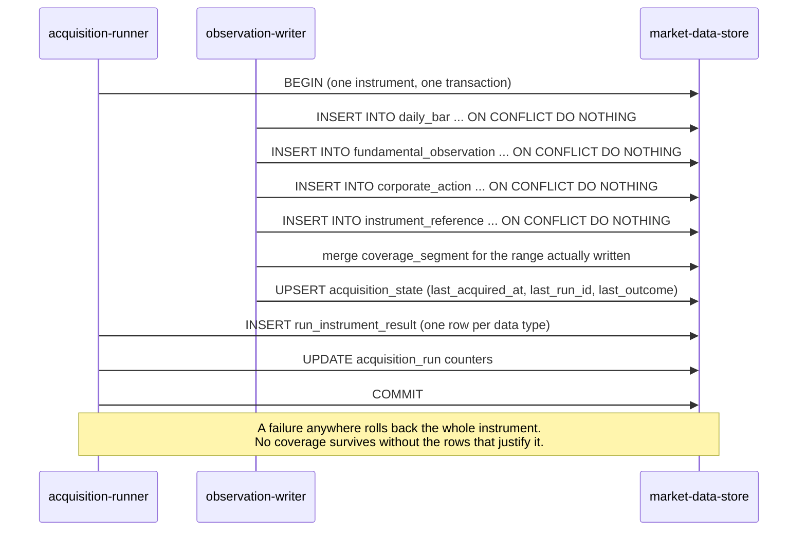

# Component: Market Data Store

**Status:** draft
**Capability:** CAP-001
**Owner:** Alvaro de Jodra
**Last Updated:** 2026-09-05

## 1. Overview

The single PostgreSQL 16 schema for FactorFlow, holding the owner's instrument
list, the point-in-time observations acquired from Massive, the derived coverage
segments, and the acquisition run journal. This component owns the constraints
that make the rest of the capability's promises enforceable rather than
aspirational: append-only observation history keyed on a value hash, coverage
that cannot be asserted ahead of the write that justifies it, and exactly one
active acquisition run.

It is the first schema in the project. Nothing exists to migrate from, so every
table below is created by a numbered migration in this capability, and the shape
chosen here is the shape M1 classification and M4 backtesting will read.

Use cases addressed:

- Hold the owner's named instruments and their active or retired lifecycle
  (AC-1, AC-21).
- Hold the stated history depth as durable owner-set state (AC-2).
- Record every acquired value with the date FactorFlow observed it, appending on
  restatement rather than replacing (AC-5).
- Reject a duplicate write of an identical value so a re-run adds nothing
  (AC-6).
- Hold coverage segments and last-acquired timestamps that describe only what
  was written (AC-7, AC-12).
- Hold enough observation detail for gap detection to be computed at read time
  (AC-8).
- Hold the run journal, its per-instrument results, and the single-active-run
  and claim-heartbeat state (AC-9, AC-10, AC-19, AC-20, AC-23).

Support matrix: PostgreSQL 16 running as a container on a single machine the
owner controls. One database, one schema (`public`), no partitioning, no
read replica, no multi-tenancy (C2, C8).

Dependencies: PostgreSQL 16; the `btree_gist` extension, which ships with the
standard PostgreSQL distribution and is required by the coverage overlap
constraint in section 2.3; `psycopg` 3 as the only driver. No ORM (tech stack).

## 2. Design Details

### 2.1 Component block diagram

The diagram below shows which processes reach which tables and with which
privileges, because the append-only guarantee is a property of the access paths
and not only of the table definitions. The application container reads
everything and writes only the owner-set state and the run journal; the
ingestion container is the sole writer of observations and coverage. The two
never share a connection pool and never call each other, so the run journal
table is the only place their work meets, which is the cross-container handoff
the system design draws as a dashed edge. Reads and writes both flow through
`psycopg` 3 connection pools sized per process. The expected outcome is that no
code path outside `observation-writer` can append an observation, and no code
path at all can update or delete one.



### 2.2 Migrations

Numbered, forward only, one file per migration, applied in ascending order and
recorded in `applied_migrations` (C5, tech stack, AC-15). A correction is a new
file, never an edit to a file that has been applied.

```
migrations/
├── 0001_extensions_owner_state.sql
├── 0002_observations.sql
├── 0003_coverage.sql
└── 0004_runs.sql
```

`applied_migrations` is created by `schema-migrator` before the first file runs,
not by a migration file, because the migrator has to read it to decide what to
apply. Its definition belongs to this component and is reproduced here so the
two designs cannot drift:

```sql
CREATE TABLE IF NOT EXISTS applied_migrations (
    version     integer     PRIMARY KEY,
    name        text        NOT NULL,
    checksum    text        NOT NULL,
    applied_at  timestamptz NOT NULL DEFAULT now()
);
```

### 2.3 Schema definitions

**0001_extensions_owner_state.sql** creates the extension the coverage
constraint needs, the instrument list, and the owner-set state.

```sql
CREATE EXTENSION IF NOT EXISTS btree_gist;

CREATE TABLE instrument (
    instrument_id bigint GENERATED ALWAYS AS IDENTITY PRIMARY KEY,
    symbol        text        NOT NULL,
    lifecycle     text        NOT NULL,
    added_at      timestamptz NOT NULL DEFAULT now(),
    retired_at    timestamptz,
    CONSTRAINT instrument_symbol_uppercase CHECK (symbol = upper(symbol)),
    CONSTRAINT instrument_symbol_shape     CHECK (symbol ~ '^[A-Z][A-Z0-9.-]{0,15}$'),
    CONSTRAINT instrument_lifecycle_known  CHECK (lifecycle IN ('active', 'retired')),
    CONSTRAINT instrument_retired_at_agrees
        CHECK ((lifecycle = 'retired') = (retired_at IS NOT NULL))
);

CREATE UNIQUE INDEX idx_instrument_symbol ON instrument (symbol);
CREATE INDEX idx_instrument_active ON instrument (instrument_id) WHERE lifecycle = 'active';

CREATE TABLE owner_setting (
    setting_key   text        PRIMARY KEY,
    setting_value jsonb       NOT NULL,
    updated_at    timestamptz NOT NULL DEFAULT now()
);
```

`instrument` carries no delete path. AC-21 and system design constraint 5.8 make
removal a lifecycle transition to `retired`, and `instrument_retired_at_agrees`
makes a retired row without a retirement timestamp impossible to write.

`owner_setting` holds one row today, `history_depth_years`, whose value is a
JSON integer. A single-row typed table was rejected because the settings surface
is expected to grow and a keyed table absorbs that without a migration per
setting; a JSONB value was chosen over a text value so the API layer validates
against a type rather than parsing a string.

**0002_observations.sql** creates the four observation tables. All four share
one shape: the natural key of the observation, the value hash, and
`observed_on`, which is the date FactorFlow observed the value and never a
provider-supplied date (C5, system design constraint 5.4).

```sql
CREATE TABLE instrument_reference (
    instrument_id  bigint      NOT NULL REFERENCES instrument (instrument_id),
    observed_on    date        NOT NULL,
    value_hash     bytea       NOT NULL,
    company_name   text,
    cik            text,
    composite_figi text,
    share_class_figi text,
    is_active      boolean,
    list_date      date,
    delisted_utc   timestamptz,
    payload        jsonb       NOT NULL,
    recorded_at    timestamptz NOT NULL DEFAULT now(),
    CONSTRAINT instrument_reference_hash_len CHECK (octet_length(value_hash) = 32),
    CONSTRAINT instrument_reference_natural_key
        UNIQUE (instrument_id, value_hash)
);

CREATE TABLE daily_bar (
    instrument_id bigint      NOT NULL REFERENCES instrument (instrument_id),
    session_date  date        NOT NULL,
    observed_on   date        NOT NULL,
    value_hash    bytea       NOT NULL,
    open_price    numeric(18, 6) NOT NULL,
    high_price    numeric(18, 6) NOT NULL,
    low_price     numeric(18, 6) NOT NULL,
    close_price   numeric(18, 6) NOT NULL,
    volume        numeric(20, 4) NOT NULL,
    recorded_at   timestamptz NOT NULL DEFAULT now(),
    CONSTRAINT daily_bar_hash_len CHECK (octet_length(value_hash) = 32),
    CONSTRAINT daily_bar_natural_key
        UNIQUE (instrument_id, session_date, value_hash)
);

CREATE INDEX idx_daily_bar_instrument_session ON daily_bar (instrument_id, session_date);
CREATE INDEX idx_daily_bar_session ON daily_bar (session_date);

CREATE TABLE fundamental_observation (
    instrument_id        bigint NOT NULL REFERENCES instrument (instrument_id),
    fiscal_period_end    date   NOT NULL,
    fiscal_period        text   NOT NULL,
    statement_type       text   NOT NULL,
    observed_on          date   NOT NULL,
    value_hash           bytea  NOT NULL,
    provider_filing_date date,
    payload              jsonb  NOT NULL,
    recorded_at          timestamptz NOT NULL DEFAULT now(),
    CONSTRAINT fundamental_hash_len CHECK (octet_length(value_hash) = 32),
    CONSTRAINT fundamental_statement_known
        CHECK (statement_type IN ('balance_sheet', 'income_statement',
                                  'cash_flow_statement', 'ratios')),
    CONSTRAINT fundamental_natural_key
        UNIQUE (instrument_id, fiscal_period_end, statement_type, value_hash)
);

CREATE INDEX idx_fundamental_instrument_period
    ON fundamental_observation (instrument_id, fiscal_period_end);

CREATE TABLE corporate_action (
    instrument_id bigint NOT NULL REFERENCES instrument (instrument_id),
    action_type   text   NOT NULL,
    effective_on  date   NOT NULL,
    observed_on   date   NOT NULL,
    value_hash    bytea  NOT NULL,
    payload       jsonb  NOT NULL,
    recorded_at   timestamptz NOT NULL DEFAULT now(),
    CONSTRAINT corporate_action_hash_len CHECK (octet_length(value_hash) = 32),
    CONSTRAINT corporate_action_type_known
        CHECK (action_type IN ('split', 'dividend', 'ticker_change', 'ipo')),
    CONSTRAINT corporate_action_natural_key
        UNIQUE (instrument_id, action_type, effective_on, value_hash)
);

CREATE INDEX idx_corporate_action_instrument ON corporate_action (instrument_id, effective_on);
```

`provider_filing_date` is stored because it is descriptive of the provider's
record, and it is never read as the date a value became known. System design
constraint 5.4 states this and the tech stack's provider evaluation explains
why: Massive's `filing_date` conflates restatements of the same period.

The natural key on each table includes `value_hash`, which is what gives AC-6
its meaning. A re-run returning a value already held collides on the unique
constraint and the `ON CONFLICT DO NOTHING` write appends nothing; a restated
value hashes differently, so it appends a new row carrying today's
`observed_on` and the earlier row stands unchanged (AC-5).

`instrument_reference` keys on the hash alone rather than on a date, because
reference data has no natural period. A reference payload that has not changed
produces no row on any subsequent run, which is the correct outcome: the row
already present records when FactorFlow first observed that identity.

**0003_coverage.sql** creates the derived-coverage tables.

```sql
CREATE TABLE coverage_segment (
    coverage_segment_id bigint GENERATED ALWAYS AS IDENTITY PRIMARY KEY,
    instrument_id bigint NOT NULL REFERENCES instrument (instrument_id),
    data_type     text   NOT NULL,
    covered_from  date   NOT NULL,
    covered_to    date   NOT NULL,
    CONSTRAINT coverage_data_type_known
        CHECK (data_type IN ('reference', 'prices', 'fundamentals', 'corporate_actions')),
    CONSTRAINT coverage_range_ordered CHECK (covered_from <= covered_to),
    CONSTRAINT coverage_no_overlap EXCLUDE USING gist (
        instrument_id WITH =,
        data_type WITH =,
        daterange(covered_from, covered_to, '[]') WITH &&
    )
);

CREATE INDEX idx_coverage_instrument ON coverage_segment (instrument_id, data_type);

CREATE TABLE acquisition_state (
    instrument_id    bigint      NOT NULL REFERENCES instrument (instrument_id),
    data_type        text        NOT NULL,
    last_acquired_at timestamptz NOT NULL,
    last_run_id      uuid        NOT NULL,
    last_outcome     text        NOT NULL,
    PRIMARY KEY (instrument_id, data_type),
    CONSTRAINT acquisition_state_data_type_known
        CHECK (data_type IN ('reference', 'prices', 'fundamentals', 'corporate_actions')),
    CONSTRAINT acquisition_state_outcome_known
        CHECK (last_outcome IN ('written', 'not_found', 'failed'))
);
```

Multiple disjoint segments per instrument and data type are permitted on
purpose. AC-22 deepens the stated history and backfills an earlier range, which
creates a second segment that only merges with the first once the two touch;
forcing one row per instrument would either lose the discontinuity or assert
coverage over a range nothing was written for, which system design constraint
5.9 prohibits. `coverage_no_overlap` is the constraint that keeps a merge bug
from silently double-counting a range, and it is the reason `btree_gist` is
required.

`acquisition_state` records when an instrument and data type were last reached,
including when the outcome was `not_found` or `failed`, because AC-7 asks when
the instrument was last acquired and the honest answer to that includes an
attempt that brought nothing back. Coverage itself is untouched by a failed
attempt.

**0004_runs.sql** creates the run journal.

```sql
CREATE TABLE acquisition_run (
    run_id              uuid PRIMARY KEY DEFAULT gen_random_uuid(),
    state               text        NOT NULL,
    history_depth_years integer     NOT NULL,
    requested_at        timestamptz NOT NULL DEFAULT now(),
    started_at          timestamptz,
    ended_at            timestamptz,
    cancel_requested_at timestamptz,
    claimed_by          text,
    heartbeat_at        timestamptz,
    instruments_named   integer     NOT NULL DEFAULT 0,
    instruments_written integer     NOT NULL DEFAULT 0,
    instruments_failed  integer     NOT NULL DEFAULT 0,
    failure_reason      text,
    CONSTRAINT acquisition_run_state_known CHECK (state IN (
        'requested', 'running', 'cancelling',
        'succeeded', 'partial', 'failed', 'cancelled', 'abandoned')),
    CONSTRAINT acquisition_run_depth_positive CHECK (history_depth_years >= 1),
    CONSTRAINT acquisition_run_claim_agrees
        CHECK ((state IN ('running', 'cancelling'))
               = (claimed_by IS NOT NULL AND heartbeat_at IS NOT NULL)),
    CONSTRAINT acquisition_run_terminal_has_end
        CHECK ((state IN ('succeeded', 'partial', 'failed', 'cancelled', 'abandoned'))
               = (ended_at IS NOT NULL))
);

CREATE UNIQUE INDEX idx_acquisition_run_single_active
    ON acquisition_run ((true)) WHERE state IN ('running', 'cancelling');

CREATE INDEX idx_acquisition_run_requested
    ON acquisition_run (requested_at) WHERE state = 'requested';

CREATE INDEX idx_acquisition_run_recent ON acquisition_run (requested_at DESC);

CREATE TABLE run_instrument_result (
    run_id        uuid   NOT NULL REFERENCES acquisition_run (run_id),
    instrument_id bigint NOT NULL REFERENCES instrument (instrument_id),
    data_type     text   NOT NULL,
    outcome       text   NOT NULL,
    reason        text,
    attempts      integer NOT NULL DEFAULT 1,
    completed_at  timestamptz NOT NULL DEFAULT now(),
    PRIMARY KEY (run_id, instrument_id, data_type),
    CONSTRAINT run_result_data_type_known
        CHECK (data_type IN ('reference', 'prices', 'fundamentals', 'corporate_actions')),
    CONSTRAINT run_result_outcome_known
        CHECK (outcome IN ('written', 'unchanged', 'not_found', 'failed', 'skipped'))
);

CREATE INDEX idx_run_result_failures
    ON run_instrument_result (run_id) WHERE outcome IN ('not_found', 'failed');
```

`idx_acquisition_run_single_active` is the schema-level enforcement of system
design constraint 5.17. A partial unique index on a constant expression permits
at most one row in `running` or `cancelling` across the whole table, so a second
runner attempting to claim concurrently fails on a unique violation rather than
starting a parallel run. This is the one place in the design where correctness
under concurrency does not depend on application logic being right.

`gen_random_uuid()` is a PostgreSQL 13 and later core function, so no extension
is required for run identifiers.

### 2.4 Write-path data flow

The flow below traces one instrument through one acquisition run and shows where
each table is touched, because AC-12 turns entirely on which writes share a
transaction. Everything for one instrument commits together: the observations,
the coverage segment that describes them, the acquisition state, and the
per-instrument run result. A crash before commit leaves nothing, and a crash
after commit leaves a coverage claim backed by rows that exist. The run counters
are the only cross-instrument state, and they are advanced in the same
transaction so a run's totals never exceed what was written.



### 2.5 Append-only enforcement

Three mechanisms, because the constraint is unrecoverable if it is broken (C5):

1. **No update or delete statement is written.** `observation-writer` issues
   `INSERT ... ON CONFLICT DO NOTHING` only. No other component holds a write
   path to the four observation tables.
2. **A repository test asserts it.** `tests/unit/test_sql_is_append_only.py`
   scans every `.sql` file under `migrations/` and every SQL string in
   `src/factorflow/` for `UPDATE` or `DELETE` naming `daily_bar`,
   `fundamental_observation`, `corporate_action` or `instrument_reference`, and
   fails on a match. This catches the case the first mechanism relies on a human
   to notice.
A third mechanism, database role grants, was **considered and rejected by the
owner on 2026-09-05**. The proposal was an ingestion role holding `INSERT` but
not `UPDATE` or `DELETE` on the four observation tables, with the application
role holding `SELECT` only. It would have converted the most plausible future
mistake, a cleanup that reads restatement rows as duplicates, from silent
permanent corruption into a failing test.

It was rejected on cost against reach. The grants cannot be role-wide: the
ingestion role still needs `DELETE` on `coverage_segment` for the merge in the
`observation-writer` design, `UPDATE` on `acquisition_state` for the upsert, and
`UPDATE` on `acquisition_run` for the claim and heartbeat, so the deny is
table-scoped across six rules. Role passwords cannot live in a numbered SQL
migration without committing a secret (AGT-PROHIB-001), so role creation splits
into a bootstrap step outside the forward-only migration sequence. Three
credentials replace one. And every database-backed test must connect as the role
its code under test uses, or the suite passes while the grant is absent in
production, which is worse than not having it. Against that, the grant does not
reach a data-fix migration or the owner acting as superuser, which is how the two
most likely mistakes would actually arrive.

The two mechanisms above stand. C8 gives one owner-operator and no separation of
duties, so role machinery has no other use in this product, and the design's own
reasoning elsewhere rejects layers built for scenarios nobody plans. What remains
genuinely unaddressed is that no backup procedure is specified anywhere, which is
what makes an overwrite unrepairable in the first place; that is section 14's
question 1 and it is the higher-value gap.

### 2.6 Messages

N/A, not applicable for this component. There is no message broker, topic or
queue anywhere in this capability. The run journal table is the only handoff
between processes, and it is a table rather than a queue by system design
constraint 5.1.

## 3. Constraints and Assumptions

- **C2, one transactional store.** Every table above lives in one PostgreSQL
  database. No part of this schema may be split into another store.
- **C5, append-only point-in-time history.** No `UPDATE` and no `DELETE` against
  `instrument_reference`, `daily_bar`, `fundamental_observation` or
  `corporate_action`, in any migration, story or query path, ever. System design
  constraint 5.3 states this as unrecoverable if broken.
- **The observation date is FactorFlow's.** `observed_on` is set by
  `observation-writer` from the acquisition date. `provider_filing_date` is
  descriptive only (system design constraint 5.4).
- **Forward-only schema evolution.** There is no down migration and no reversal
  path. A migration that loses data is unrecoverable (system design constraint
  5.10, AC-15).
- **Coverage is derived, never asserted.** A `coverage_segment` row may only be
  written in the same transaction as the observations that justify it (system
  design constraint 5.9, AC-12).
- **Removal retires, it never deletes.** `instrument` has no delete path (system
  design constraint 5.8, AC-21).
- **No ORM.** Tables are defined in SQL files and read through `psycopg` 3 with
  parameterised queries only (tech stack; SEC-INP-002).
- **btree_gist is available.** It is bundled with the standard PostgreSQL 16
  distribution and with the `postgres:16` container image. If a deployment
  cannot install it, `coverage_no_overlap` cannot be created and overlap
  prevention falls to application logic, which is weaker.
- **Assumption: one owner-operator (C8).** No row-level security, no tenant
  column, no per-user isolation anywhere in this schema.
- **Assumption: US-listed equities.** Symbol shape, `numeric(18, 6)` price
  precision and a single unqualified session date all follow from a single
  market with one session per day. A second market would change all three.

## 4. Security

- **Data classification.** Market prices, fundamentals, corporate actions and
  instrument reference data are **Internal** under SEC-DAT-001. None of it is
  personal data, and none of it is customer data: the product has one user and
  the data describes public companies. No Restricted data is stored, so
  SEC-DAT-002 encryption at rest and SEC-DAT-003 log prohibition do not engage
  on the contents of these tables.
- **The provider credential is not in this schema.** There is no column for it
  anywhere. It is held in process memory by `runtime-config` only (AC-13,
  SEC-SEC-001).
- **Privacy impact: none.** No PII is stored. `company_name`, `cik` and the FIGI
  identifiers describe legal entities, not people.
- **Injection.** Every statement issued against this schema uses `psycopg` 3
  parameter binding. No query is assembled by string concatenation
  (SEC-INP-002). The one dynamic element is the sort column on coverage and run
  listings, which is resolved through an allowlist of column names in
  `coverage-service` and `run-journal` rather than interpolated.
- **Authentication and authorization.** The database accepts connections only
  from the container network; the application publishes no database port to the
  host. There is no application-level authorization model, because there is one
  owner-operator and the interface is loopback-bound (system design constraint
  5.11). SEC-AUTH-001 does not engage on the database because it is not an
  externally reachable endpoint.
- **Credentials for the database itself** are supplied to both processes from
  the environment by `runtime-config` and never committed.
- **SAST and SCA.** The SQL files are covered by review rather than by a
  scanner. `psycopg` 3 and the PostgreSQL image are covered by dependency
  scanning on the Python and container manifests (SEC-DEP-001).
- **Crypto usage.** SHA-256 is used to compute `value_hash`, in
  `observation-writer` rather than in the database, using the Python standard
  library `hashlib`. It is used as a content fingerprint for idempotence, not as
  a security primitive, and no custom construction is introduced (SEC-ENC-002).

## 5. Scalability and Performance

- **Sizing basis (AC-4).** 3000 instruments. At the owner's stated history depth
  of, for example, five years, daily bars dominate: 3000 instruments times
  roughly 252 sessions per year times five years is approximately 3.8 million
  rows in `daily_bar`. Fundamentals add four statement types per quarter per
  instrument, roughly 240 thousand rows over the same span. Corporate actions
  and reference data are smaller by an order of magnitude. This is a small
  PostgreSQL workload on one machine.
- **Index strategy.** `idx_daily_bar_instrument_session` serves per-instrument
  range reads and gap detection. `idx_daily_bar_session` serves the trading-day
  set query, which scans distinct session dates across all instruments in a
  range and is the single most expensive read in the capability.
- **Write path.** One transaction per instrument per run. At 3000 instruments a
  run performs 3000 commits, which is well within a single PostgreSQL instance
  on local storage. Batch inserts within a transaction use `psycopg` 3
  `executemany` with a single prepared statement rather than one round trip per
  row.
- **Resource utilization.** Connection pools are bounded, sized separately per
  process, and configured by `runtime-config`. Neither process opens an
  unbounded pool (SA-RES-001).
- **Concurrency.** Exactly one writer of observations at a time, because exactly
  one run is active. The partial unique index enforces that at the schema level,
  so there is no lock ordering to establish and no shared mutable state beyond
  the run journal row (SA-CONC-001).
- **No target for run duration.** The capability fixes no duration for a run of
  3000 instruments and the system design invents none. Read latency for coverage
  is likewise unstated. Both are recorded in section 14.

## 6. Upgrade

- **There is nothing to upgrade from.** This capability creates the schema. The
  first deployment applies `0001` through `0004` against an empty database.
- **Forward evolution (AC-15).** A later version adds a higher-numbered file.
  `schema-migrator` applies files not recorded in `applied_migrations`, in
  order, each in its own transaction, and records each on success.
- **Refusing an inconsistent start (AC-16).** When the store carries a migration
  number this build does not know, the migrator exits non-zero and the API never
  binds. That decision belongs to `schema-migrator`; what this component
  contributes is `applied_migrations` being the single authority for what has
  been applied.
- **Behaviour change after upgrade: none in this capability**, because there is
  no previous release.
- **Manual actions required: none.** The owner deploys new container images and
  starts them. Migration is automatic at application container start.
- **Rollback (OPS-MIG-003).** There is no schema-reversal path, by design. The
  rollback posture for a bad migration is: stop the containers, restore the
  PostgreSQL data directory from a backup taken before the deployment, and
  redeploy the previous image.

  That posture depends on a backup procedure **no capability specifies**, so
  OPS-MIG-003 is satisfied here under branch (b) — rollback documented as not
  currently possible, with the compensating mitigation stated — rather than
  branch (a). The owner accepted this risk on 2026-09-05 and deferred the
  procedure to a future operations capability.

  **What is accepted, precisely.** CAP-001's first deployment applies `0001`
  through `0004` against an **empty** database, so a failed first migration
  destroys nothing and the accepted risk is close to zero. The exposure begins
  at the *second* deployment, once acquired history exists: from that point a
  data-losing migration is **unrecoverable**, because C5 makes point-in-time
  history impossible to re-acquire as observed. The two mechanisms in section
  2.5 prevent an application code path from overwriting history; neither reaches
  a data-fix migration or the owner acting as superuser, which is how the
  likeliest mistake arrives.

  **Trigger.** The procedure must be specified before the second deployment of
  this product — that is, before any deployment onto a store holding acquired
  observations. Until then this is a recorded accepted risk rather than an open
  question, and section 14 question 1 records it as such.

## 7. Testing

Python, pytest, and `testcontainers[postgres]` against a real PostgreSQL 16
container (tech stack). Tests that need the container carry the `postgres`
marker so `uv run pytest -m 'not postgres'` still runs the rest.

| Test | File | What it proves |
|------|------|----------------|
| Migrations apply to an empty database | `tests/integration/test_migrations_apply.py` | `0001` to `0004` apply in order and record four rows in `applied_migrations` (AC-15) |
| Migrations are idempotent on a populated database | `tests/integration/test_migrations_apply.py` | A second application applies nothing and loses no rows (AC-15) |
| Identical observation appends nothing | `tests/integration/test_observation_append.py` | Two inserts with the same `value_hash` leave one row (AC-6) |
| Restated observation appends a row | `tests/integration/test_observation_append.py` | A different `value_hash` for the same period leaves two rows, the earlier unchanged (AC-5) |
| Overlapping coverage is rejected | `tests/integration/test_coverage_constraints.py` | `coverage_no_overlap` raises on an overlapping insert |
| Two active runs are impossible | `tests/integration/test_run_constraints.py` | A second `running` insert raises a unique violation (AC-23, system design 5.17) |
| A retired instrument keeps its rows | `tests/integration/test_instrument_lifecycle.py` | Retirement changes `lifecycle` and leaves every observation (AC-21) |
| Terminal state requires an end timestamp | `tests/integration/test_run_constraints.py` | `acquisition_run_terminal_has_end` rejects a terminal row without `ended_at` (AC-9) |
| No update or delete against observations | `tests/unit/test_sql_is_append_only.py` | Static scan of SQL files and SQL strings; no container needed (C5) |
| Volume smoke test | `tests/integration/test_store_volume.py` | 3000 instruments and one year of bars insert and read back within the suite's timeout (AC-4) |

Backward compatibility is not testable in this capability, since there is no
prior schema. The first capability that adds a migration inherits the idempotent
re-application test above as its regression.

## 8. Acceptance Criteria

1. Applying `0001` through `0004` to an empty PostgreSQL 16 database succeeds
   and records four rows in `applied_migrations`.
2. Inserting an observation whose `value_hash` already exists for the same
   natural key leaves the row count unchanged and modifies no existing row.
3. Inserting an observation with a new `value_hash` for a natural key already
   present adds a row and leaves the earlier row's `observed_on` unchanged.
4. No statement in the repository updates or deletes a row in
   `instrument_reference`, `daily_bar`, `fundamental_observation` or
   `corporate_action`.
5. An attempt to insert a `coverage_segment` overlapping an existing segment for
   the same instrument and data type is rejected by the database.
6. An attempt to insert a second `acquisition_run` in `running` or `cancelling`
   is rejected by the database.
7. Retiring an instrument sets `lifecycle` to `retired` and `retired_at` to a
   timestamp, and deletes no row from any table.
8. A `coverage_segment` row exists only where observations exist for the range
   it names.
9. The schema contains no column holding the provider credential.
10. Failure scenario: a transaction that fails after writing observations but
    before writing its coverage segment leaves neither, so the instrument
    reports no coverage for the range.
11. Failure scenario: a run interrupted between instruments leaves the
    instruments already committed fully covered and the rest with no coverage at
    all.

## 9. Workflows

- **First deployment.** The owner starts the containers. The application
  container applies all four migrations against an empty database before the API
  binds. No manual step.
- **Acquire.** `observation-writer` appends observations and merges coverage,
  one instrument per transaction.
- **Read coverage.** `coverage-service` reads `coverage_segment`,
  `acquisition_state` and `daily_bar` to answer AC-7 and AC-8.
- **Retire.** `instrument-list-service` transitions the row and touches nothing
  else, which is what makes retained history visible on the coverage screen.
- **Intersection with later capabilities.** M1 classification reads `daily_bar`
  and `fundamental_observation`; M4 backtesting replays both. Neither is
  delivered here, and neither requires a schema change to read what this
  capability writes.

## 10. UX / GUI

N/A, not applicable for this component. This component renders nothing. Two
schema decisions are visible through the interface and are recorded here so the
UX contract is not broken by a later schema change: `acquisition_state` supplies
the Last acquired column on the Coverage screen, and the eight values of
`acquisition_run.state` are exactly the eight badge variants the UX design maps
to STD-UI-12 severity tiers. Adding a ninth run state is a UX change as well as
a schema change.

Internationalization: none. The interface is single-locale, single-owner, and
dates are stored as `date` and `timestamptz` and rendered ISO-8601 by the
interface (STD-UI-5).

## 11. API Endpoints

This component exposes no HTTP surface. Its interfaces are SQL, and the table
below records them as the system design's section 4.2 declares them.

| Endpoint | Method/Operation | Auth/Privilege | Request | Response | Notes |
|----------|-----------------|----------------|---------|----------|-------|
| Observation append | `INSERT ... ON CONFLICT DO NOTHING` | ingestion process database credential | Observation rows with `observed_on` and `value_hash` | Rows inserted count | Consumer is `observation-writer`. No `UPDATE`, no `DELETE`, ever (C5) |
| Coverage read | `SELECT` over `coverage_segment`, `acquisition_state`, `daily_bar` | application process database credential | Instrument filter and date range | Coverage rows and gap dates | Consumer is `coverage-service` |
| Run request claim | `UPDATE acquisition_run SET state='running'` guarded by the partial unique index | ingestion process database credential | Runner identity | Claimed run row or none | Consumer is `acquisition-runner`. The only cross-container handoff |
| Migration application | DDL plus `INSERT INTO applied_migrations` | application process database credential | Numbered SQL file | Applied version | Consumer is `schema-migrator` |
| Instrument list read and write | `SELECT`, `INSERT`, `UPDATE` on `instrument` and `owner_setting` | application process database credential | Symbols, lifecycle, depth | Instrument rows | Consumer is `instrument-list-service`. `UPDATE` is permitted here and only here, on lifecycle |

## 12. References

| Type | Document Name | Description | Link |
|------|---------------|-------------|------|
| Capability | CAP-001 v6 | Acceptance criteria AC-1, AC-2, AC-5 to AC-9, AC-12, AC-15, AC-21, AC-22 | `docs/capabilities/CAP-001-market-data-acquisition-foundation/Capability-CAP-001.md` |
| System design | CAP-001 system design v3 | Components 4.1, interfaces 4.2, constraints 5.2 to 5.10 | `docs/capabilities/CAP-001-market-data-acquisition-foundation/design/system-design.md` |
| Constitution | Tech Stack v2 | PostgreSQL 16, no ORM, numbered forward-only migrations, validation commands | `docs/constitution/tech-stack.md` |
| Constitution | Product Charter v2 | C2 single transactional store, C5 append-only point-in-time history | `docs/constitution/product-charter.md` |
| Architecture | Architecture inventory | `market-data-store` component identity and its declared interfaces | `docs/architecture.md` |

## 13. Traceability

| Capability AC | System Design Element | Component Design Element | Section |
|--------------|----------------------|--------------------------|---------|
| AC-1 | `instrument-list-service` | `instrument` table, symbol uniqueness, lifecycle check | 2.3 |
| AC-2 | `PUT /api/settings/history-depth` | `owner_setting` keyed table holding `history_depth_years` | 2.3 |
| AC-3 | `massive-client` four reads | Four observation tables, one per data type | 2.3 |
| AC-4 | Per-instrument transactions | Index strategy and volume sizing | 5, 7 |
| AC-5 | `observation-writer` appends with `observed_on` | `observed_on` column; `provider_filing_date` descriptive only | 2.3 |
| AC-6 | `INSERT ... ON CONFLICT DO NOTHING` on the natural key | `value_hash` in every natural key constraint | 2.3, 2.5 |
| AC-7 | `coverage-service` | `coverage_segment`, `acquisition_state.last_acquired_at` | 2.3 |
| AC-8 | Gap detection at read time | `idx_daily_bar_session` supporting the trading-day set query | 2.3, 5 |
| AC-9 | `run-journal` computes outcome from written coverage | `acquisition_run` state check and terminal-end constraint | 2.3 |
| AC-10 | Per-instrument failure records | `run_instrument_result` with `outcome` and `reason` | 2.3 |
| AC-11 | Per-instrument isolation | `run_instrument_result.outcome = 'not_found'` distinct from `failed` | 2.3 |
| AC-12 | Coverage extended inside the write transaction | Single-transaction write path | 2.4 |
| AC-13 | `runtime-config` holds the credential | No credential column exists in this schema | 4 |
| AC-15 | `schema-migrator`, `applied_migrations` | `applied_migrations` definition and forward-only files | 2.2, 6 |
| AC-16 | Migrator exits non-zero | `applied_migrations` as the single authority on applied state | 6 |
| AC-19 | Cancellation request recorded against the run | `cancel_requested_at`, `cancelling` state | 2.3 |
| AC-20 | Claim heartbeat and staleness window | `claimed_by`, `heartbeat_at`, `abandoned` state | 2.3 |
| AC-21 | Retire rather than delete | No delete path on `instrument`; `retired_at` | 2.3 |
| AC-22 | Backfill the missing earlier range | Multiple disjoint `coverage_segment` rows per instrument | 2.3 |
| AC-23 | At most one active run, FIFO claim | `idx_acquisition_run_single_active`, `idx_acquisition_run_requested` | 2.3 |

## 14. Open Questions

1. ~~What backup procedure protects against a data-losing migration, or an
   overwrite of observation history?~~ **Decided 2026-09-05: deferred, with the
   interim risk accepted.** The owner deferred the backup procedure to a future
   operations capability rather than specifying it here. OPS-MIG-003 is
   therefore satisfied under branch (b) — rollback documented as not currently
   possible with the compensating mitigation described — and section 6 carries
   that record.

   The reasoning: CAP-001's first deployment runs against an empty database, so
   there is nothing to lose on the deployment this capability actually performs.
   The risk engages at the second deployment, once history exists, and from that
   point a data-losing migration is unrecoverable under C5. The procedure must
   therefore be specified **before any deployment onto a store holding acquired
   observations**.

   This is recorded as an accepted risk with a trigger, not as an open question,
   so that a later review sees a decision rather than re-raising the gap.
   *Owner: capability owner. Trigger: before the second deployment.*
2. **What upper bound, if any, applies to `history_depth_years`?**
   `acquisition_run_depth_positive` enforces a lower bound of 1. No source
   states a maximum, and Massive's plan tiers cap history in a way that is not
   knowable from the schema. `[REQUIRES INPUT: what maximum history depth should
   the store accept?]` *Owner: capability owner. Blocks: the validation rule in
   `ingestion-api`.*
3. **What read latency is acceptable for a coverage read at 3000 instruments?**
   No capability or design value exists, so section 5 sizes the workload without
   asserting a target. *Owner: capability owner. Blocks: a performance
   acceptance criterion, not the implementation.*
