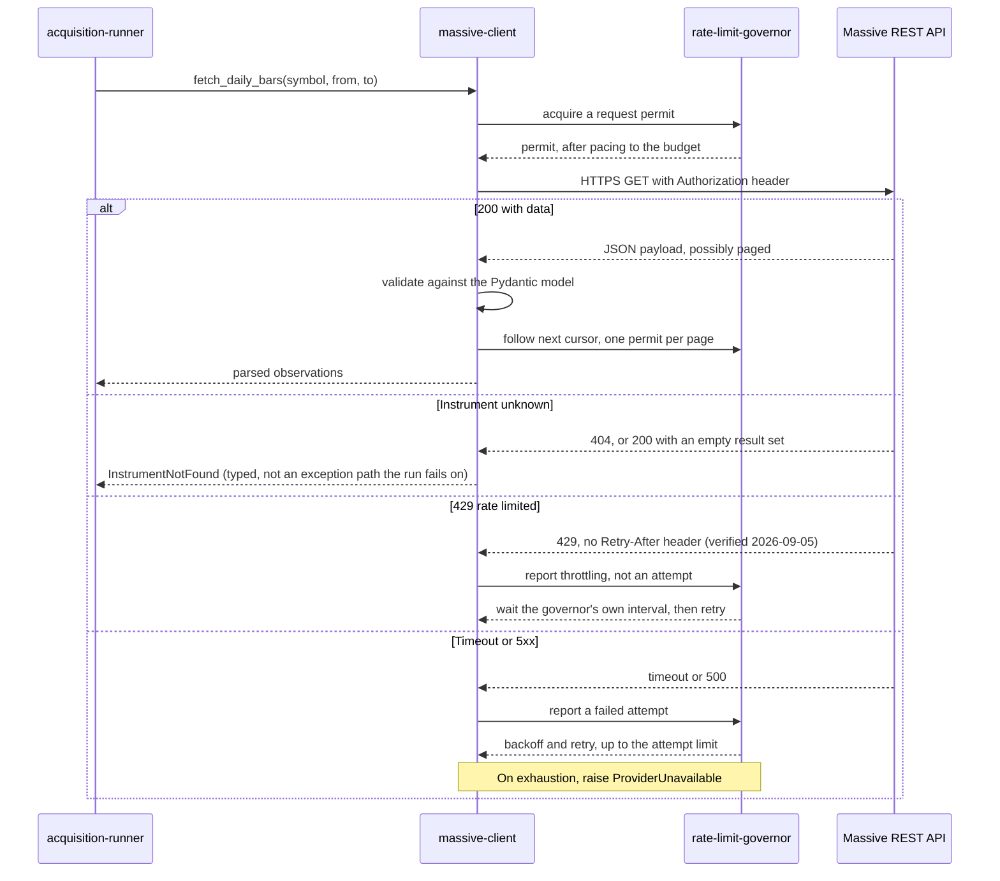

# Component: Massive Client

**Status:** draft
**Capability:** CAP-001
**Owner:** Alvaro de Jodra
**Last Updated:** 2026-10-10

## 1. Overview

The project-owned boundary around Massive's official Python client (`massive`),
covering four historical reads: instrument reference data, daily aggregates,
company financials and corporate actions. The SDK owns transport,
authentication and protocol handling; this component owns what the SDK does not
provide — the typed error taxonomy the runner depends on, the pacing seam the
governor needs, credential rotation, and a substitution point for tests (tech
stack v3, adopted 2026-09-05).

It is **not** a provider-portability layer. Massive's response shapes may remain
vendor-shaped inside ingestion, consistent with C4 and the deliberate
single-provider choice. What it abstracts is operational behaviour, not the
vendor.

This component is the only place in the capability that holds the provider
credential in usable form and the only place that knows Massive's response
shapes.

Three decisions from the tech stack shape it more than anything else. First, the
market data source is deliberately **not** abstracted behind a vendor-neutral
port: Massive is the provider, there is no plan to replace it, and building a
translation layer against a migration nobody plans would be cost paid now for an
option nobody wants. This client may therefore use Massive's own shapes
directly. Second, C4 requires one contract spanning historical reads and the M3
live feed, so the interface this client exposes must leave room for the
streaming half without being redefined when M3 arrives — and the SDK covers the
WebSocket half too, which is what makes that promise cheap to keep. Third, the
official client is the integration library, which removes hand-written transport
but introduces two defaults that must be overridden; section 2.2b records them
because both silently break decisions made elsewhere in this capability.

Use cases addressed:

- Fetch instrument reference data including CIK, composite FIGI and share class
  FIGI, so identity does not rest on the ticker (AC-3).
- Fetch daily aggregates over a date range (AC-3).
- Fetch company financials, retaining the provider's filing date as a
  descriptive attribute only (AC-3, C5).
- Fetch corporate actions: splits, dividends, ticker changes and IPOs (AC-3).
- Distinguish an unrecognised instrument from a transport failure, which is what
  makes AC-11 implementable.
- Surface rate limiting as flow control rather than as an error, which is what
  makes system design constraint 5.13 implementable.

Support matrix: the ingestion container only. The API never imports this module,
which a test asserts.

Dependencies: `massive` (the official REST and WebSocket client, which uses
`urllib3` internally), Pydantic for validating what crosses this boundary,
`rate-limit-governor` for pacing and retry, `runtime-config` for the credential
and the base URL.

## 2. Design Details

### 2.1 Placement

```
src/factorflow/ingestion/massive/client.py     the four reads
src/factorflow/ingestion/massive/models.py     Pydantic models of the responses
src/factorflow/ingestion/massive/errors.py     the typed error taxonomy
src/factorflow/ingestion/massive/paging.py     cursor following
```

### 2.2 Request flow

The sequence below shows one read and the three outcomes it can produce, and it
is drawn because the distinction between them is the whole reason this component
exists as a separate unit. Every request is paced by the governor before it is
issued, which is where the owner's configured budget is honoured. A successful
response is validated against a Pydantic model and returned as parsed
observations, so no unvalidated provider field reaches the writer. A response
saying the instrument is unknown becomes a typed `InstrumentNotFound`, which the
runner records without failing the run. Everything else, a timeout or a server
error, is retried by the governor and, on exhaustion, becomes a typed
`ProviderUnavailable`. The expected outcome is that the runner never has to
interpret an HTTP status code.

Rate limiting is the one branch the provider does not help with: its 429 carries
no `Retry-After`, so the wait is the governor's own. Section 2.6b records the
verification and its consequence.



### 2.2b SDK construction: defaults that must be overridden

The SDK's defaults are reasonable for a general consumer and wrong for this
capability. Both were found by reading `massive/rest/base.py` on 2026-09-05, and
both fail silently rather than loudly, which is why they are specified here
rather than left to the implementing story.

```python
from massive import RESTClient

client = RESTClient(
    api_key=settings.api_key.get_secret_value(),
    base=settings.base_url,          # validated https at start, see below
    retries=0,                       # MUST be 0 — see below
    connect_timeout=settings.timeout_seconds,
    read_timeout=settings.timeout_seconds,
    pagination=False,                # follow pages under governor permits
    trace=False,                     # never log requests; they carry the key
)
```

**`retries=0` is mandatory.** The SDK builds
`Retry(total=self.retries, status_forcelist=[413, 429, 499, 500, 502, 503, 504],
backoff_factor=0.1)` and passes it to `urllib3.PoolManager`. Left at its
default this breaks two things at once:

- It retries **429**, which `rate-limit-governor` treats as flow control rather
  than an attempt (system design constraint 5.13). The SDK's exponential
  `backoff_factor=0.1` retries at 0.1s, 0.2s, 0.4s — inside a fixed
  per-minute window that only refills on the minute, so every one of those
  retries is spent before the quota returns. It also sets no
  `respect_retry_after_header`, which is moot against Massive but records that
  the SDK would not honour one if a future provider sent it.
- It retries **5xx** underneath the governor's own bounded attempts, so
  effective attempts multiply. The per-instrument worst case that
  `component-design-runtime-config.md` section 2.2a derives — about 11.4
  minutes — is what the 15-minute staleness window was sized against. Silently
  multiplying attempts pushes a healthy run past that window and the sweeper
  reclaims it, which is exactly the failure AC-20 exists to prevent.

Retry belongs to the governor, in one place, where the minute-boundary wait and
the attempt bound are already specified and tested. A test asserts
`retries == 0` on the constructed client, because a default reasserting itself
in a future SDK release would degrade run timing without any error.

**No redirect is ever followed.** The SDK calls `PoolManager.request` without
a `redirect` argument, so urllib3 follows redirects by default and counts them
against the `Retry` total. With the SDK's default `retries` a `302` is
followed: a loopback probe on 2026-10-09 (SDK 2.8.0, urllib3 2.7.0) saw the
second request land at the `Location` target. With `retries=0` the redirect is
refused rather than followed. urllib3 raises `MaxRetryError` and the target
never receives a request. `massive-client`'s classifier in `_through_governor`
maps any error that is not a `BadResponse`, `MaxRetryError` included, to
`RETRYABLE`, so the governor repeats the same refused request up to
`max_attempts` times, every one
to the configured host, and then fails with `ProviderUnavailable` rather than
succeeding from another host (specification review v7 FINDING-19 (b),
DEC-0042). This component requires that behaviour in every build. Massive's API
does not redirect, so a redirect is never a legitimate answer. Following one
could move a request to another host, or from `https` to plain HTTP. Under
`component-design-runtime-config.md` clause 2a it could take a plain-HTTP
request off loopback, which CONST-SEC 1.2 SEC-ENC-001 condition 2 forbids. No
construction path may pass `redirect=True` or replace the SDK's `Retry`. A test
in section 7 drives a redirect on the default `https` base, for a main-pool read
and a `vx` read, without opening a socket and without any plain-HTTP channel,
and asserts that the redirect target receives no request (DEC-0038, DEC-0042).

**No proxy is ever used.** The SDK builds a plain `urllib3.PoolManager` for the
main client and another for `vx`, never a `ProxyManager`, and neither the SDK
(which reads only `MASSIVE_API_KEY` from the environment) nor urllib3 2.7.0
(which reads only `SSLKEYLOGFILE`) consults `HTTP_PROXY`, `HTTPS_PROXY`,
`ALL_PROXY` or `NO_PROXY`. A probe on 2026-10-09 with all of them pointing at a
loopback listener saw the listener receive no request and the target receive
every one (DEC-0038). This component requires that behaviour in every build: no
construction path may pass a proxy or replace the SDK's pool with a
`ProxyManager`. A proxy would add a hop this component does not govern, and
under clause 2a it would break CONST-SEC 1.2 SEC-ENC-001 condition 2, which
forbids routing the channel through a proxy whatever the environment says. A
test in section 7 asserts it with the proxy variables set.

**`pagination=False` is deliberate.** The SDK follows `next_url` automatically
and returns every page. That is convenient and wrong here for two reasons: each
page is a provider request that must take a governor permit, and a five-year bar
fetch auto-paginated holds every page in memory at once, where section 5 sizes
peak memory as one instrument's history. This component follows pages itself,
one permit per page.

**`trace=False`.** The SDK's trace mode logs full request detail including
headers, and the header carries the credential (AC-13).

**`base=settings.base_url` is mandatory.** Without it the SDK uses its own
built-in `https://api.massive.com`, and `FACTORFLOW_MASSIVE_BASE_URL` has no
effect. `RESTClient.__init__` passes the same `base` to its `vx` sub-client,
which serves the IPO read in section 2.5 (`/vX/reference/ipos`), so one argument
redirects every request. Pages followed from `next_url` reuse only its path
against this base. The value reaching this argument has already been validated
at process start by `component-design-runtime-config.md` section 2.2c: `https`
only, a host, no userinfo, path, query or fragment, and no trailing slash. This
component does not re-validate or rewrite it. The one exception is clause 2a
there, the loopback `http` allowance the owner asked for. It relies on the
SEC-ENC-001 loopback test-double exception of CONST-SEC 1.2 (with SEC-NDG-001),
recorded for this project in DEC-0036. It takes effect only as
`component-design-runtime-config.md` section 2.2c, *When clause 2a is in
force*, states: CONST-SEC 1.3 in force under its own rule (the owner's
`approval` block and the harness default branch) at the pinned content revision
`sha256:0f5659addf64eb6aff78fcc810f92673f348d7f8d943061cb5ca225fff15b0c7`. It is confined to the
test-only entry point `tests/e2e/support/ingestion_e2e_main.py` (DEC-0033,
DEC-0034, PROVISIONAL). There `http` is accepted only when the host is exactly
`127.0.0.1`, `::1` or `localhost`, and `localhost` must resolve only to
loopback. Every other clause still applies. The entry point refuses any key
that is not a designated test credential (`^TEST-ONLY-[0-9a-f]{32,}$`,
generated per run, DEC-0037), at start and again each time the credential is
re-read at a claim. The release artifact never contains that entry point, so in
the release build no value this component receives is plain HTTP.

### 2.3 Interface

The interface is named in the product's vocabulary for the operations, while the
payload models follow Massive's shapes, which is what the tech stack's
non-abstraction decision permits and what C4's single contract requires.

```python
# src/factorflow/ingestion/massive/client.py
from datetime import date

from factorflow.ingestion.massive import models


class MassiveClient:
    """Historical reads against Massive. The live feed (M3) attaches here."""

    def fetch_reference(self, symbol: str) -> models.TickerReference:
        """Ticker reference: CIK, composite FIGI, share class FIGI, list and
        delist dates. Raises InstrumentNotFound when the provider does not
        recognise the symbol."""

    def fetch_daily_bars(
        self, symbol: str, start: date, end: date
    ) -> list[models.DailyBar]:
        """Daily aggregates over an inclusive range. Follows paging."""

    def fetch_financials(
        self, symbol: str, start: date, end: date
    ) -> list[models.FinancialStatement]:
        """Company financials. filing_date is carried as a descriptive
        attribute and is never the as-of date (C5)."""

    def fetch_corporate_actions(
        self, symbol: str, start: date, end: date
    ) -> list[models.CorporateAction]:
        """Splits, dividends, ticker changes and IPOs over a range."""
```

Four methods, one per data type, rather than one generic `get(path)`. A generic
method would push Massive's URL shapes into the runner and would make the M3
streaming addition a change to every caller rather than a fifth method here.

### 2.4 Error taxonomy

The SDK raises one exception for every non-200: `BadResponse(resp.data.decode())`
— the body string only, **with the status code discarded**. The taxonomy below
discriminates on status, and AC-11 depends on telling a 404 from a 401, so this
component reconstructs the distinction from the body.

That is workable because the envelope was observed directly (section 2.6a), and
fragile because it was never documented. Two properties make it so:

- The failure field is **not stably named**: a 404 carries `message`, while 401
  and 429 carry `error`. The parser accepts either and requires neither.
- `status` is `"NOT_FOUND"` on a missing ticker and `"ERROR"` on everything
  else, which is the field that actually separates the two cases the runner must
  distinguish.

The mapping is therefore: parse the `BadResponse` payload as JSON; a `status` of
`"NOT_FOUND"`, or a message matching the documented not-found text, becomes
`InstrumentNotFound`; an `error` naming an API-key problem becomes
`CredentialRejected`; anything else becomes `ProviderUnavailable`. A payload
that will not parse as JSON at all is `ProviderUnavailable`, never
`InstrumentNotFound`, because guessing "not found" from an unparseable error
would let a provider outage silently look like an empty instrument — the false
negative AC-12 exists to prevent.

This mapping is the most fragile code in the component and carries the most
tests. If the SDK later preserves the status code on the exception, this section
should be reduced to reading it.

```python
# src/factorflow/ingestion/massive/errors.py
class MassiveError(Exception):
    """Base for every provider failure.

    Carries the provider's own request_id, which is present on every Massive
    response including errors (section 2.6a). It is the identifier the provider
    can trace, so it is recorded alongside the symbol and data type on every
    stored failure reason.
    """

    def __init__(self, message: str, *, provider_request_id: str | None = None):
        super().__init__(message)
        self.provider_request_id = provider_request_id


class InstrumentNotFound(MassiveError):
    """The provider does not recognise this symbol, or holds no data of this
    type for it. Recorded per instrument; the run continues (AC-11)."""


class ProviderUnavailable(MassiveError):
    """Transport failure or server error, attempts exhausted. The instrument
    is recorded as failed; the run continues."""


class ProviderContractViolation(MassiveError):
    """A 200 response that does not validate against the model, or an error
    envelope this component cannot parse. Distinct from unavailability because
    it means the provider changed, not that it is down, and retrying will not
    help."""


class CredentialRejected(MassiveError):
    """401 or 403. The run fails rather than continuing, because every
    remaining instrument would fail the same way."""
```

`CredentialRejected` is the one provider error that is not per-instrument.
Continuing a 3000-instrument run against a rejected credential would produce
3000 identical failures and a `partial` outcome that hides a single cause, so
the runner finalises the run as `failed` with that reason. This matches the
capability's first flow, step 5: *If the credential is rejected or the provider
cannot be reached, the run reports that it failed and why.*

`ProviderContractViolation` still exists, and the SDK reduces its likelihood
without removing its need. The SDK returns typed models, so a renamed or
retyped field surfaces there rather than reaching this component as a raw dict —
that is real protection this component previously had to provide itself. What it
does not protect against is a shape that parses cleanly and means something
different, or an SDK version whose models have drifted from the deployed API.
Values still cross into append-only history that cannot be repaired, so this
component validates what it writes rather than trusting the SDK's models
transitively (SEC-INP-001).

The `vX`-prefixed endpoints are where this matters most. Massive marks them
unstable, and `VXClient` is composed into the SDK separately from the stable
mixins, so the corporate-action reads that depend on it carry more contract risk
than the rest.

### 2.5 Endpoint paths

One Massive path is confirmed but deliberately unused:
`GET /v1/marketstatus/upcoming`, recorded in the tech stack's provider
evaluation as forward-looking only, which is why this capability derives trading
days from acquired data instead. **This component does not call it.**

The paths, parameters and paging for the four reads were read from Massive's
published documentation on 2026-09-05, via `https://massive.com/docs/llms.txt`
and the per-endpoint pages it links. They are recorded here rather than left to
the implementing story.

**Ticker reference (AC-3).** `GET /v3/reference/tickers/{ticker}`, the ticker
case-sensitive in the path, with an optional `date` for a point-in-time
snapshot that defaults to the most recent. It returns a single `results`
object, not a list, and is therefore not paged. The fields this component needs
are present and confirmed: `active`, `cik`, `composite_figi`,
`share_class_figi`, `list_date`, `delisted_utc`, `primary_exchange`, `name`,
`type` and `currency_name`. A delisted instrument remains queryable and carries
`active: false` with `delisted_utc` set, which is the property the tech stack's
evaluation relied on and the reason survivorship bias does not enter here.

`GET /v3/reference/tickers` is the list form, filterable by `ticker`, `type`,
`market`, `exchange`, `cusip`, `cik`, `date`, `search` and `active`, with
`limit` defaulting to 100 and capped at 1000, and paged by `next_url`. **This
component does not call it in this capability:** the instrument list is the
owner's, held by `instrument-list-service`, and reference data is fetched per
named symbol. It is recorded because a later capability building a universe
from the provider rather than from the owner will need it.

**Daily aggregates (AC-3).**
`GET /v2/aggs/ticker/{stocksTicker}/range/{multiplier}/{timespan}/{from}/{to}`.
For this capability the multiplier is `1` and the timespan is `day`; `from` and
`to` are inclusive and accept `YYYY-MM-DD`. Optional `adjusted` (boolean),
`sort` (`asc`/`desc`) and `limit` (default 5000, maximum 50000). Bars use
short field names: `t` Unix milliseconds, `o` open, `h` high, `l` low, `c`
close, `v` volume, `vw` volume-weighted average price, `n` transaction count,
and an optional `otc` boolean. The models in `models.py` name these in the
product's vocabulary; the wire names stay in this component, which is what the
non-abstraction decision permits without letting `t`/`o`/`h`/`l`/`c` reach the
writer.

`adjusted` is a decision this component must make explicitly rather than accept
by default, because it changes what the stored history means. It is carried in
section 14.

**Company financials (AC-3).** In this capability, company fundamentals are
the three financial statements (owner decision, 2026-10-10, section 14 item 7),
read from three sibling endpoints under one shape:
`GET /stocks/financials/v1/balance-sheets`,
`GET /stocks/financials/v1/income-statements` and
`GET /stocks/financials/v1/cash-flow-statements`. Every parameter is optional,
which means a request must be constrained deliberately or it returns the whole
corpus.
Selection is by `cik` or `tickers`, the period by `period_end` or
`filing_date`, both accepting `.gt`/`.gte`/`.lt`/`.lte` suffixes, plus
`fiscal_year`, `fiscal_quarter` and `timeframe` (`quarterly` or `annual`).
`limit` defaults to 100 and caps at 50000. Paged by `next_url`.

Each result carries `cik`, `tickers`, `period_end`, `filing_date`,
`fiscal_year`, `fiscal_quarter` and `timeframe` alongside the statement values.
`filing_date` is present exactly as the tech stack's evaluation described it —
the most recent filing including the period, conflating restatements — which is
why C5 requires this component to carry it as a descriptive attribute and never
as the as-of date.

**Financial ratios: not acquired in this capability.**
`GET /stocks/financials/v1/ratios` sits under the same add-on but does not share
the statements' shape, and **this component does not call it**. In the locked
SDK (massive 2.8.0), `list_financials_ratios` selects by `ticker` or `cik` and
filters only on ratio values, never on a date or period, and its
`FinancialRatio` result carries `ticker`, `cik` and `date` but no `period_end`,
`filing_date`, `fiscal_year`, `fiscal_quarter` or `timeframe`. Ratios are
values as of a date, not values of a fiscal period: most are price-derived
(`price_to_earnings`, `price_to_book`, `ev_to_ebitda`, `dividend_yield`), and
the rest are computed from statement lines (`current`, `quick`,
`debt_to_equity`). A request therefore cannot be bounded to the requested range,
and a result has no `fiscal_period_end` to key a `fundamental_observation` row
on. Every ratio is computable later from the stored statements and daily bars,
which is why the owner excluded the read rather than designing a second
contract for it.
`fetch_financials` therefore issues exactly the three statement reads per
instrument and never invokes `list_financials_ratios`. A later capability that
needs ratios derives them from stored data, or reopens the read with its own
contract and storage. Section 11 records the endpoint as not called, as it does
`/v3/reference/tickers`.

**Corporate actions (AC-3).** Four endpoints, not one:

- `GET /stocks/v1/splits` — filter by `ticker` and `execution_date` (with
  comparison suffixes) and `adjustment_type` (`forward_split`, `reverse_split`,
  `stock_dividend`). `limit` defaults to 100, caps at 5000, sorted
  `execution_date.desc` by default. Results carry `id`, `ticker`,
  `execution_date`, `split_from`, `split_to`, `adjustment_type` and
  `historical_adjustment_factor`. Paged by `next_url`.
- `GET /stocks/v1/dividends` — filter by `ticker`, `ex_dividend_date` (with
  comparison suffixes), `frequency` and `distribution_type` (`recurring`,
  `special`, `supplemental`, `irregular`, `unknown`). Same `limit` bounds.
  Results carry `id`, `ticker`, `currency`, `cash_amount`,
  `split_adjusted_cash_amount`, `declaration_date`, `ex_dividend_date`,
  `record_date`, `pay_date`, `frequency`, `distribution_type` and
  `historical_adjustment_factor`. Paged by `next_url`.
- `GET /vX/reference/ipos` — filter by `ticker`, `listing_date` (with
  comparison suffixes), `ipo_status`, `us_code` and `isin`. Results carry
  `ticker`, `issuer_name`, `listing_date`, `announced_date`, `ipo_status`,
  `final_issue_price`, `security_type`, `primary_exchange` and share counts.
  Paged by `next_url`.
- `GET /vX/reference/tickers/{id}/events` — `id` is a ticker, CUSIP or
  composite FIGI, and `types` currently supports only `ticker_change`. Returns
  `results.events[]` of `{date, type, ticker_change}`. **No pagination is
  documented**, and the endpoint is documented as experimental.

Two properties of this set constrain the design. The `vX` prefix on IPOs and
ticker events is Massive's own marker for a non-stable contract, so
`ProviderContractViolation` is likelier on these two than on the others, and
the corporate-action model treats them as the fragile half. And because ticker
events documents no paging, this component must not assume `next_url` is
universally present; the pager treats its absence as a complete result rather
than an error.

The base URL, authentication mechanism, error envelope and rate-limit behaviour
are undocumented on Massive's public pages. They were established by probe on
2026-09-05 and are recorded in sections 2.6, 2.6a and 2.6b rather than left
open.

### 2.6 Authentication

Base URL: `https://api.massive.com`. Confirmed by probe on 2026-09-05; Massive's
documentation states no base URL, so this is recorded here as the governed one.
It is the default of `FACTORFLOW_MASSIVE_BASE_URL`, which overrides it only
with a value that passes `component-design-runtime-config.md` section 2.2c
(section 2.2b).

Massive accepts the key **two** ways, both verified: `Authorization: Bearer
<key>`, and an `apiKey=<key>` query parameter. Nothing else works —
`Authorization: <key>` without the `Bearer` prefix returns 401 *"authorization
header was malformed"*, and `X-API-Key` and `api_key=` both return 401 *"API Key
was not provided"*.

**This component uses `Authorization: Bearer` and must never use the query
parameter.** The choice matters more now that both are known to work, because
the insecure option is available rather than hypothetical. A key in a query
parameter appears in the URL; the URL appears in transport exception messages,
which the runner records as failure reasons and the interface renders; and URLs
reach access logs and proxies. The header removes that path entirely. The
`SecretStr` from `runtime-config` is unwrapped once per client, when the SDK's
`RESTClient` is constructed (section 2.2b). The SDK places it in an
`Authorization: Bearer` header, matching what the probe verified, and the
redaction filter is the backstop (AC-13, SEC-SEC-001).

The client is rebuilt when the credential rotates. `acquisition-runner` re-reads
the key at each run claim and constructs a new client when it has changed
(`component-design-runtime-config.md` section 2.2b), which is what satisfies
SEC-SEC-002 without a restart. This component therefore holds the credential for
the life of *a* `RESTClient` rather than the life of the process, and must not
cache it anywhere outside that client — a module-level copy would survive the
rebuild and silently keep using the revoked key.

A test asserts no request URL contains `apiKey`, which is a real risk rather
than a theoretical one precisely because that form is supported by the provider.

### 2.6a Provider response envelope

Every response, success and failure alike, carries `request_id` and — on failure
— `status`. Confirmed by probe on 2026-09-05:

| Condition | HTTP | Body |
|-----------|------|------|
| Success | `200` | `{"request_id": ..., "results": {...}}`, no `status` field on this endpoint |
| Unknown ticker | `404` | `{"status": "NOT_FOUND", "request_id": ..., "message": "Ticker not found."}` |
| Missing or unknown key | `401` | `{"status": "ERROR", "request_id": ..., "error": "Unknown API Key"}` |
| Malformed auth header | `401` | `{"status": "ERROR", "request_id": ..., "error": "authorization header was malformed"}` |
| Rate limited | `429` | `{"status": "ERROR", "request_id": ..., "error": "You've exceeded the maximum requests per minute..."}` |

Two properties shape the error taxonomy. The failure field is **not stably
named**: a 404 uses `message`, while 401 and 429 use `error`. Parsing must
accept either and must not require both. And `status` is `"NOT_FOUND"` for a
missing ticker but `"ERROR"` for everything else, which means status code and
`status` field agree well enough that the taxonomy in section 2.4 can continue
to discriminate on the HTTP status, with the body read only for the message the
interface renders.

`request_id` is present on every response including errors. This component
records it on every typed error, because it is the identifier Massive support
can trace — the provider-side equivalent of the API's own request id.

### 2.6b Rate limiting: no Retry-After

**A 429 carries no `Retry-After` header.** Verified by probe on 2026-09-05: a
burst of six requests tripped the limit on the sixth, and the response carried
only `Content-Type` and `X-Request-Id`. No `X-RateLimit-*` headers appear on
success responses either, so there is no quota telemetry to read ahead of time.

This falsifies an assumption in section 2.2 and in system design constraint
5.13, both of which were written expecting `Retry-After` to be present. The
governor therefore cannot wait for a provider-stated duration, because none is
stated. It must apply its own wait on 429, and since the limit is documented and
observed as *requests per minute*, a wait to the next minute boundary is the
behaviour the provider's own semantics imply.

The consequence for this component is small — it reports throttling to the
governor exactly as before — but the governor's design must change, and section
14 records that as a cross-component correction rather than leaving it to
implementation.

### 2.7 Messages

N/A, not applicable for this component. The M3 live feed will add a WebSocket
consumer alongside these reads, behind the same contract (C4); it is out of
scope here.

## 3. Constraints and Assumptions

- **Massive is the single provider** (tech stack). No second source, no
  cross-provider identity mapping.
- **No vendor-neutral abstraction** (tech stack). Massive's shapes may appear in
  this component's models. They may not appear above it: the runner and the
  writer see parsed product-shaped observations.
- **One contract spanning history and the live feed** (C4, system design
  constraint 5.6). The M3 streaming half attaches to this client rather than
  replacing it.
- **`filing_date` is never the as-of date** (C5, system design constraint 5.4).
  It is carried as an attribute so it can be seen, and the writer stamps
  `observed_on` itself.
- **Rate limiting is flow control, not failure** (system design constraint
  5.13). A 429 is not an attempt.
- **The attempt limit is 3 per instrument and data type by default** (owner
  decision, 2026-09-04, recorded in system design constraint 5.13).
- **The credential is never logged and never in a URL** (AC-13).
- **The owner's plan is Stocks Starter plus the Financials & Ratios add-on**
  (decided 2026-09-05, recorded in the tech stack). Three properties follow and
  each binds this component: the rate limit is unlimited, so pacing is a
  configured budget rather than a ceiling; fundamentals are included via the
  add-on, without which `fetch_financials` would return nothing; and history is
  capped at **five years**, so a stated depth beyond that returns short. The cap
  is deliberately not enforced here (owner decision) — the client requests the
  range it is given and returns what the provider holds. What it must not do is
  report a plan-truncated range as an error, because it is not one.
- **Assumption: US-listed equities.** Reference data and corporate action
  handling follow from it.

## 4. Security

- **This component is the only holder of the credential in usable form.** It
  unwraps the `SecretStr` at client construction and the value lives inside one
  SDK `RESTClient` for the life of that client (AC-13, SEC-SEC-001).
  When the credential rotates the client is replaced rather than mutated, so the
  old value goes out of scope with it (SEC-SEC-002, section 2.6).
- **Header authentication, never query parameters.** Section 2.6 explains why
  this is a security control rather than a convention.
- **TLS (SEC-ENC-001).** Every request in the release build is HTTPS. The SDK
  constructs its `urllib3.PoolManager` with `cert_reqs="CERT_REQUIRED"` and `certifi` roots,
  and this component never overrides that, which is asserted by a test because
  disabling verification is the single-line change that quietly removes
  transport security. The scheme is guaranteed upstream: in the release build
  the configured base URL reaches the SDK only after `runtime-config` has
  rejected anything but `https` at start (section 2.2b). A test also asserts
  that the default base is `https`. The loopback `http` allowance in the
  owner's direction of 2026-10-09 (`component-design-runtime-config.md`
  section 2.2c clause 2a, section 14 item 4) is the one exception, and it is
  the SEC-ENC-001 loopback test-double exception CONST-SEC 1.2 adds, with
  SEC-NDG-001 (DEC-0036). It allows plain HTTP only to a local test double on
  `127.0.0.1`, `::1` or `localhost`, with `localhost` resolving only to
  loopback, and only with a designated test credential, checked at start and at
  every claim. It takes effect only at the pinned text, as section 2.2b states.
  It is reachable only through the test-only entry point
  `tests/e2e/support/ingestion_e2e_main.py`, which the release artifact never
  contains (DEC-0033, DEC-0034, PROVISIONAL). It never applies in a release
  build or a production environment.
- **Redirects are never followed and no proxy is used (SEC-ENC-001).**
  `retries=0` makes urllib3 refuse a redirect rather than follow it, and the
  SDK's pools are plain `PoolManager`s that read no proxy variable (section
  2.2b), so neither a response nor the environment can move a request to
  another host or downgrade it to plain HTTP. Under clause 2a this is what keeps
  the plain-HTTP channel on loopback.
- **External input validation (SEC-INP-001).** Every response is validated
  against a Pydantic model before it leaves this component: field types, value
  ranges where the domain has them, and enumerations for action types. A
  response that does not validate raises `ProviderContractViolation` rather than
  being coerced.
- **Provider data is data, never instruction (AGT-PROHIB-003).** No field in a
  provider response selects a code path, names a file, or is interpolated into a
  query or a log format string.
- **Error disclosure.** Exception messages are constructed from the symbol, the
  data type and the mapped error class, not from the raw SDK exception, so a URL
  never reaches a stored failure reason. This matters more with the SDK than it
  did before: `BadResponse` carries the provider's response body verbatim
  (section 2.4), so passing it through unedited would put provider text into a
  stored failure reason. The redaction filter is the second
  layer.
- **Data classification.** Responses are Internal. The credential is Restricted
  and never written anywhere.
- **Dependency posture (SEC-DEP-001, SEC-DEP-003).** `massive` and Pydantic are
  approved in the tech stack v3 and scanned through `pyproject.toml`. The SDK is
  MIT-licensed and actively maintained; adopting a vendor client moves transport
  code out of this repository and its CVE surface into a scanned dependency,
  which is the posture SEC-DEP-001 prefers.
- **Privacy impact: none.**
- **Crypto usage: none of its own.** TLS is provided by the SDK's `urllib3`
  pool over `certifi` roots.

## 5. Scalability and Performance

- **Request volume at AC-4.** Up to four reads per instrument for 3000
  instruments, plus paging, so on the order of 12000 requests plus pages per
  full run. Every one of them passes through the governor, so the run's duration
  is set by the owner's configured budget.
- **Connection pooling (SA-RES-001).** One SDK `RESTClient`, holding one
  `urllib3.PoolManager`, reused across every request until the credential
  rotates. Constructing a client per request would add a TLS handshake to every
  call; `num_pools` is left at the SDK default, which is ample for one
  sequential runner.
- **Timeouts.** `connect_timeout` and `read_timeout` are both set explicitly
  from `runtime-config` at 30 seconds (section 2.2b). The SDK's own defaults are
  not relied on.
- **Paging.** Ranges of several years return paged aggregates. Pages are
  followed with one governor permit per page, and results are accumulated per
  instrument rather than per run, keeping peak memory a function of one
  instrument's history.
- **Concurrency.** The runner drives this component sequentially in this
  capability. The SDK's REST client is synchronous and its `PoolManager` is
  thread-safe; C7's async requirement bites on the M3 live feed, which the SDK
  serves through its separate WebSocket client (SA-CONC-001).
- **No throughput target is stated** by the capability, and the provider's rate
  limits have not been tested, so none is asserted.

## 6. Upgrade

- **No previous release.**
- **The M3 live feed is the planned extension.** It adds a WebSocket consumer to
  this component behind the same contract (C4). Nothing in the four historical
  methods needs to change for it, which is the property system design constraint
  5.6 requires and which this design preserves by exposing operations rather
  than a generic HTTP method.
- **A provider contract change** surfaces as `ProviderContractViolation` rather
  than as silently wrong data. That is the upgrade risk this component carries,
  and it is why validation is strict.
- **Data migration: none owned here.**
- **Behaviour change after upgrade: none in this capability.**
- **Manual actions required: none**, beyond the owner holding a plan that
  includes fundamentals.
- **Rollback (OPS-MIG-003).** Reverting the ingestion image reverts the client.
  Because it writes nothing directly, a rollback has no data consequence.

## 7. Testing

Provider interaction is tested against recorded response fixtures served by a
local stub, never against the live provider, so the suite is deterministic and
consumes no rate budget.

Fixtures encode the field names recorded in section 2.5 — the aggregate bars'
`t`/`o`/`h`/`l`/`c`/`v`, the reference object's `composite_figi` and
`delisted_utc`, the financials' `period_end` and `filing_date`, and `next_url`
paging — and the error envelopes in section 2.6a, which are transcribed from
observed responses rather than from documentation.

The success shapes are still written from the published documentation, so they
demonstrate conformance to the documented contract rather than the live one. The
reference endpoint is the exception: its 200 body was observed during the probe.
The gap that leaves is section 14's item 6.

| Test | File | What it proves |
|------|------|----------------|
| Reference parse | `tests/unit/test_massive_reference.py` | CIK, composite FIGI and share class FIGI are extracted; a delisted instrument's `list_date` and `delisted_utc` survive (AC-3) |
| Daily bars parse and page | `tests/unit/test_massive_bars.py` | A two-page range returns all bars in date order (AC-3) |
| Financials keep filing date as an attribute | `tests/unit/test_massive_financials.py` | `filing_date` is present on the model and is not used as an as-of date (C5) |
| Ratios are never requested | `tests/unit/test_massive_financials.py` | `fetch_financials` calls `list_financials_balance_sheets`, `list_financials_income_statements` and `list_financials_cash_flow_statements` once each for the first page (later pages follow `next_url`), never calls `list_financials_ratios`, sends no request to `/stocks/financials/v1/ratios`, and every returned statement's type is one of `balance_sheet`, `income_statement` or `cash_flow_statement` (section 2.5, section 14 item 7) |
| Corporate actions parse | `tests/unit/test_massive_actions.py` | All four action types map to the product's enumeration (AC-3) |
| SDK retries are disabled | `tests/unit/test_massive_sdk_config.py` | The constructed `RESTClient` carries `retries == 0`, and so does its `vx` sub-client, so the governor owns retry alone (section 2.2b; specification review v7 FINDING-19). Guards against an SDK default reasserting itself on upgrade |
| A redirect is never followed | `tests/unit/test_massive_redirects.py` | No socket and no plain HTTP (DEC-0038, DEC-0042). A `MassiveClient` built as in section 2.2b on the default base `https://api.massive.com`, with a key generated in the test as `"TEST-ONLY-" + secrets.token_hex(16)`. `socket.create_connection` and `socket.getaddrinfo` are patched to fail the test, and `urllib3.connectionpool.HTTPConnectionPool._make_request` is replaced by a fake that records each request's scheme, host and path, answers `302` with `Location: https://198.51.100.7/`, and returns its response with `retries` set to the `retries` value it was passed, as urllib3 does. The reads run through a `RateLimitGovernor` built with `GovernorSettings.from_massive_settings` from production settings (`max_attempts` at its default of 3), with `requests_per_minute` set no smaller than the requests the test sends through one governor (3 for the main-pool read, 5 for the `fetch_corporate_actions` route), or with `monotonic` injected as well, and with `sleep` and `jitter` injected, so the test never waits on the real clock. For a main-pool read (`fetch_reference`): it raises `ProviderUnavailable`, not `MaxRetryError`, the recorded requests number `max_attempts` because `massive-client`'s classifier maps the refused redirect's `MaxRetryError` to `RETRYABLE` and the governor retries it, every one is `https` to `api.massive.com`, and none is to `198.51.100.7`. For a `vx` read, driven so that the first redirect it meets is on a `/vX/` request (either `vx.list_ipos` called through `MassiveClient._through_governor`, the client's governor seam, or `fetch_corporate_actions` with the fake answering an empty `200` page to the main-pool `/stocks/v1/splits` and `/stocks/v1/dividends` requests and `302` only to `/vX/` paths): it raises `ProviderUnavailable`, the recorded `/vX/reference/ipos` requests number `max_attempts` and are sent through the `vx` sub-client's `PoolManager`, every request is to `api.massive.com`, none is to `198.51.100.7`, and the test fails when no `/vX/reference/ipos` request is recorded. A `/vX/` path alone does not identify the `vx` sub-client, because the SDK's ticker-events read is a `/vX/` path on the main pool. A control, a bare SDK `RESTClient(retries=3)` calling `get_ticker_details` (a `MassiveClient` takes no `retries` argument), records requests to `198.51.100.7`, proving the fake exercises urllib3's real redirect path. Everything above `_make_request`, the SDK and urllib3's `PoolManager.urlopen` redirect and retry logic included, is unpatched (section 2.2b; CONST-SEC 1.2 SEC-ENC-001 condition 2; specification review v7 FINDING-19) |
| No proxy is ever used | `tests/unit/test_massive_redirects.py` | No socket (DEC-0038). With `HTTP_PROXY`, `HTTPS_PROXY` and `ALL_PROXY` (and their lowercase forms) set to `http://127.0.0.1:9` and `NO_PROXY` unset, a `MassiveClient` built as in section 2.2b has an SDK pool and a `vx` pool that are both `urllib3.PoolManager` and neither a `urllib3.ProxyManager`, and the connection pool each returns for the base URL is an `HTTPSConnectionPool` for `api.massive.com` whose `proxy` is `None`. On the same two pools, `connection_from_url("http://127.0.0.1:8126")` returns an `HTTPConnectionPool` whose `proxy` is `None`, which is the clause 2a channel's form (DEC-0041). Building a pool sends nothing (section 2.2b; CONST-SEC 1.2 SEC-ENC-001 condition 2 and Verification (e)) |
| SDK pagination is disabled | `tests/unit/test_massive_sdk_config.py` | `pagination` is False, so pages are followed under governor permits rather than eagerly (section 2.2b) |
| Trace logging is off | `tests/unit/test_massive_sdk_config.py` | `trace` is False, so request headers carrying the credential are never logged (AC-13) |
| BadResponse maps to the taxonomy | `tests/unit/test_massive_errors.py` | A `NOT_FOUND` envelope becomes `InstrumentNotFound`, an API-key envelope becomes `CredentialRejected`, and an unrecognised one becomes `ProviderUnavailable` (section 2.4) |
| An unparseable error body is never not-found | `tests/unit/test_massive_errors.py` | A non-JSON `BadResponse` payload becomes `ProviderUnavailable`, never `InstrumentNotFound`, so an outage cannot look like an empty instrument (AC-12) |
| Either error field name maps | `tests/unit/test_massive_errors.py` | A body using `message` and one using `error` both classify correctly; neither field is required (section 2.6a) |
| 404 becomes InstrumentNotFound | `tests/unit/test_massive_errors.py` | A typed result the runner can record without failing the run (AC-11) |
| Empty result becomes InstrumentNotFound | `tests/unit/test_massive_errors.py` | A 200 with no rows is not silently an empty success for reference data |
| 401 becomes CredentialRejected | `tests/unit/test_massive_errors.py` | Distinct from unavailability, so the run fails rather than producing 3000 identical failures |
| Malformed 200 becomes a contract violation | `tests/unit/test_massive_errors.py` | An unexpected shape raises rather than writing partial values |
| 429 is not an attempt | `tests/unit/test_massive_retry.py` | Repeated 429 responses do not exhaust the attempt budget (5.13) |
| Timeout retries to the limit | `tests/unit/test_massive_retry.py` | Three attempts then `ProviderUnavailable` (5.13) |
| The credential is not cached outside the client | `tests/unit/test_massive_auth.py` | No module-level or class-level attribute holds the key, so a rebuilt client cannot keep using a revoked one (SEC-SEC-002) |
| Credential is in a header, never a URL | `tests/unit/test_massive_auth.py` | The request URL contains no credential and no `apiKey` parameter, which the provider does accept and this component must not use (AC-13, section 2.6) |
| Auth header is `Bearer`-prefixed | `tests/unit/test_massive_auth.py` | The header is `Authorization: Bearer <key>`; a bare key is rejected by the provider as malformed (section 2.6) |
| Errors carry the provider request id | `tests/unit/test_massive_errors.py` | Each typed error exposes `provider_request_id` taken from the response body (AC-10, section 2.6a) |
| Either error field name parses | `tests/unit/test_massive_errors.py` | A 404 body using `message` and a 401 body using `error` both yield a message; neither field is required (section 2.6a) |
| A 429 without Retry-After is still throttling | `tests/unit/test_massive_retry.py` | The absence of the header does not turn a 429 into a failed attempt (section 2.6b) |
| Exception messages carry no URL | `tests/unit/test_massive_auth.py` | A failure message names the symbol and status, not the request URL (AC-13) |
| TLS verification is not disabled | `tests/unit/test_massive_tls.py` | No construction path sets `verify=False`, and the constructed SDK pool keeps `cert_reqs="CERT_REQUIRED"` (SEC-ENC-001). Not yet written: the expedited review of 2026-10-09 found this file missing (ER-001, ER-004) |
| The default base URL is `https` | `tests/unit/test_massive_tls.py` | With `FACTORFLOW_MASSIVE_BASE_URL` unset, the constructed client's `BASE` and its `vx` sub-client's `BASE` are both `https://api.massive.com` (SEC-ENC-001, section 2.2b) |
| The configured base URL is passed to the SDK | `tests/unit/test_massive_sdk_config.py` | The `RESTClient` is constructed with `base=settings.base_url`, and on the real, unpatched SDK both `BASE` and `vx.BASE` equal a configured `https` value such as `https://stub.example:8443` (section 2.2b). An `https` value is used because `runtime-config` rejects `http` at start (`component-design-runtime-config.md` section 2.2c) |
| A normalised base produces no double slash | `tests/unit/test_massive_sdk_config.py` | A configured `https://api.massive.com/` reaches the SDK as `https://api.massive.com`, so the first request path is `https://api.massive.com/v3/...`, never `//v3/...` (runtime-config section 2.2c, clause 6) |
| The API does not import this module | `tests/unit/test_api_isolation.py` | Shared with the API design; enforces C1 |

Live-provider verification is deliberately excluded from the automated suite and
is recorded in section 14 as a manual evaluation step, because it consumes the
owner's rate budget and depends on a credential that must not be in CI.

## 8. Acceptance Criteria

1. Each of the four reads returns validated, product-shaped observations for a
   recognised instrument.
2. Reference data carries CIK, composite FIGI and share class FIGI.
3. Financial statements carry the provider's filing date as an attribute, and
   this component sets no as-of date.
4. An unrecognised instrument produces `InstrumentNotFound`, distinguishable
   from a transport failure.
5. A rejected credential produces `CredentialRejected`, distinguishable from
   both of the above.
6. A 200 response that does not validate produces `ProviderContractViolation`
   and no partial observations.
7. A rate-limit response does not consume the attempt budget.
8. A transport failure is retried to the configured attempt limit and then
   produces `ProviderUnavailable`.
9. No request URL contains the credential, and no exception message contains a
   request URL.
10. Certificate verification is enabled on every request.
11. A multi-page range returns every page's rows.
12. Failure scenario: the provider returns a partial page and then fails; the
    method raises rather than returning the partial set as complete.
13. The SDK client and its `vx` sub-client are constructed with the configured
    `FACTORFLOW_MASSIVE_BASE_URL`, which `runtime-config` guarantees is
    `https`; with the variable unset they use `https://api.massive.com`.

## 9. Workflows

- **New workflow: acquire the four data types.** Steps 8 to 14 of the system
  design's control flow, for every instrument in every run.
- **New workflow: report an unrecognised instrument.** The capability's fifth
  flow, step 5, where the owner is told which instrument and why while the rest
  of the run completes.
- **New workflow: report a rejected credential.** The capability's first flow,
  step 5, where the run reports that it failed and why and leaves no
  partially-written data mistaken for complete history.
- **Intersecting workflow: the M3 live feed.** Out of scope here. It attaches to
  this component behind the same contract, which is why the interface exposes
  operations rather than a generic HTTP verb.

## 10. UX / GUI

N/A, not applicable for this component. It renders nothing. Its error taxonomy
is visible through the interface, because the UX design's Run detail screen
requires every error to state STD-UI-19's three parts, the operation, the
resource and the reason. This component supplies the reason, and it supplies it
as a typed error with a message built from the symbol, the data type and the
status, so the interface can render all three without parsing prose.

The UX design also requires an unrecognised instrument to be distinguished from
other failures, because it is a data problem the owner fixes rather than a run
failure. `InstrumentNotFound` being a distinct type rather than a message
substring is what makes that distinction survive to the screen.

Internationalization: none.

## 11. API Endpoints

This component consumes an external interface and exposes none.

Paths, parameters and paging verified against Massive's published documentation
on 2026-09-05; see section 2.5. Base URL `https://api.massive.com` and the
`Authorization: Bearer` scheme were verified by probe the same day; see section
2.6. Massive also accepts an `apiKey` query parameter, which this component
never uses (section 2.6).

| Endpoint | Method/Operation | Auth/Privilege | Request | Response | Notes |
|----------|-----------------|----------------|---------|----------|-------|
| `/v3/reference/tickers/{ticker}` | GET | `Authorization: Bearer` | Path `ticker`; optional `date` | `results` object with `active`, `cik`, `composite_figi`, `share_class_figi`, `list_date`, `delisted_utc` | Single object, not paged. `fetch_reference` (AC-3) |
| `/v2/aggs/ticker/{ticker}/range/1/day/{from}/{to}` | GET | `Authorization: Bearer` | Path ticker and inclusive range; optional `adjusted`, `sort`, `limit` (max 50000) | Bars as `t`,`o`,`h`,`l`,`c`,`v`,`vw`,`n` | Paged by `next_url`. `adjusted` is an open decision, section 14. `fetch_daily_bars` (AC-3) |
| `/stocks/financials/v1/balance-sheets` | GET | `Authorization: Bearer` | `tickers` or `cik`; `period_end`/`filing_date` with `.gte`/`.lte`; `timeframe`; `limit` (max 50000) | Statements with `period_end`, `filing_date`, `fiscal_year`, `fiscal_quarter` | Paged by `next_url`. `filing_date` is descriptive only (C5) |
| `/stocks/financials/v1/income-statements` | GET | `Authorization: Bearer` | as above | as above | Same shape and constraints |
| `/stocks/financials/v1/cash-flow-statements` | GET | `Authorization: Bearer` | as above | as above | Same shape and constraints |
| `/stocks/financials/v1/ratios` | GET | `Authorization: Bearer` | `ticker` or `cik`; ratio-value filters only, no date or period filter | `FinancialRatio` with `ticker`, `cik` and `date`; no `period_end`, `filing_date`, `fiscal_year` or `timeframe` | **Not called by this capability** (owner decision, 2026-10-10). Mostly price-derived and not period-keyed; computable later from stored statements and bars. See section 2.5 and section 14 item 7 |
| `/stocks/v1/splits` | GET | `Authorization: Bearer` | `ticker`, `execution_date` with suffixes, `adjustment_type`; `limit` (max 5000) | `execution_date`, `split_from`, `split_to`, `adjustment_type`, `historical_adjustment_factor` | Paged by `next_url`. `fetch_corporate_actions` (AC-3) |
| `/stocks/v1/dividends` | GET | `Authorization: Bearer` | `ticker`, `ex_dividend_date` with suffixes, `frequency`, `distribution_type`; `limit` (max 5000) | `cash_amount`, `ex_dividend_date`, `record_date`, `pay_date`, `declaration_date`, `distribution_type` | Paged by `next_url` |
| `/vX/reference/ipos` | GET | `Authorization: Bearer` | `ticker`, `listing_date` with suffixes, `ipo_status` | `listing_date`, `announced_date`, `ipo_status`, `final_issue_price`, `issuer_name` | Paged by `next_url`. `vX` — unstable contract |
| `/vX/reference/tickers/{id}/events` | GET | `Authorization: Bearer` | Path `id` (ticker, CUSIP or composite FIGI); `types` (only `ticker_change`) | `results.events[]` of `{date, type, ticker_change}` | **No paging documented**; experimental. `vX` — unstable contract |
| `/v3/reference/tickers` | GET | `Authorization: Bearer` | `ticker`, `type`, `cik`, `active`, `date`; `limit` (max 1000) | Ticker list | **Not called by this capability.** Recorded for a later universe-building capability; see section 2.5 |
| `/v1/marketstatus/upcoming` | GET | `Authorization: Bearer` | none | Forward-looking holidays only | **Not called by this capability.** Recorded because it is the endpoint that does not solve the trading-calendar problem, verified 2026-09-03 |

## 12. References

| Type | Document Name | Description | Link |
|------|---------------|-------------|------|
| Capability | CAP-001 v6 | AC-3, AC-4, AC-11, AC-13; assumptions on provider coverage | `docs/capabilities/CAP-001-market-data-acquisition-foundation/Capability-CAP-001.md` |
| System design | CAP-001 system design v3 | Control flow steps 8 to 28, constraints 5.4, 5.6, 5.13 | `docs/capabilities/CAP-001-market-data-acquisition-foundation/design/system-design.md` |
| Constitution | Tech Stack v3 | Official `massive` client adopted 2026-09-05; `MassiveClient` retained as the operational boundary, not a portability layer; provider evaluation and plan tiers | `docs/constitution/tech-stack.md` |
| Constitution | Product Charter v2 | C4, one market data contract; C5, point-in-time history; C7, long-lived connections | `docs/constitution/product-charter.md` |
| Constitution | Security Constitution v1.3 (CONST-SEC 1.3 at content revision `sha256:0f5659addf64eb6aff78fcc810f92673f348d7f8d943061cb5ca225fff15b0c7`; in force for clause 2a only as `component-design-runtime-config.md` section 2.2c states) | SEC-INP-001, SEC-ENC-001, SEC-SEC-001, SEC-NDG-001; the SEC-ENC-001 loopback test-double exception that clause 2a of `component-design-runtime-config.md` section 2.2c relies on, including its no-redirect and no-proxy condition; Definitions (designated test credential) | `docs/constitutions/security.constitution.md` in the AI-agents harness |
| Decision | DEC-0036, DEC-0037, DEC-0038, DEC-0041, DEC-0042 | This project's record of relying on the SEC-ENC-001 loopback test-double exception and the pinned text; the per-run designated test credential; the socket-free redirect and proxy tests (all PROVISIONAL); the no-proxy test's loopback `http` pool assertion; the redirect test's outcome under the production governor, which supersedes DEC-0038's redirect-outcome clause | `projects/factorflow-v2/decisions/` in the AI-agents harness |
| Review | CAP-001 specification review v7 | FINDING-19: the redirect test's fake must return the retries it was passed, the production governor retries a refused redirect `max_attempts` times and raises `ProviderUnavailable`, the `vx` read must be driven so that it reaches `/vX/`, and `vx.retries` is asserted (sections 2.2b and 7) | `docs/capabilities/CAP-001-market-data-acquisition-foundation/specifications-review-report-v7.md` |
| Review | CAP-001 specification review v6 | FINDING-2 (ratios, closed by owner decision in section 14 item 7), FINDING-3, FINDING-4 | `docs/capabilities/CAP-001-market-data-acquisition-foundation/specifications-review-report-v6.md` |
| Review | EXP-20261009-1 expedited review v1 | ER-001, ER-002, ER-004: the base URL was unvalidated, §2.2b lacked `base=`, and `tests/unit/test_massive_tls.py` did not exist | `docs/changes/EXP-20261009-1-review-v1.md` (branch carrying EXP-20261009-1, commit `1d12e67`) |
| External | Massive REST documentation | Endpoint paths, query parameters, response fields and `next_url` paging for all four reads, recorded in sections 2.5 and 11. Read 2026-09-05 | `https://massive.com/docs/llms.txt` and the per-endpoint pages it links |
| Verification | Live provider probe, 2026-09-05 | Base URL, `Authorization: Bearer` scheme, the 401/404/429 error envelope, and the absence of `Retry-After` and `X-RateLimit-*` headers. Recorded in sections 2.6, 2.6a and 2.6b because Massive documents none of it | One authenticated request per case against `https://api.massive.com` |

## 13. Traceability

| Capability AC | System Design Element | Component Design Element | Section |
|--------------|----------------------|--------------------------|---------|
| AC-3 | `massive-client` reference, aggregate, fundamental and corporate-action reads | Four typed methods with validated models | 2.3 |
| AC-4 | Budget pacing, resumable runs | One pooled SDK client, permits per request and per page | 5 |
| AC-5 | `observation-writer` stamps `observed_on` | This component sets no as-of date; `filing_date` is an attribute | 2.3, 3 |
| AC-11 | Unrecognised instrument reported, run continues | `InstrumentNotFound` as a distinct type | 2.4 |
| AC-12 | A failed run leaves no false history | `ProviderContractViolation` rather than lenient parsing | 2.4 |
| AC-13 | Credential never logged or echoed | `Authorization: Bearer`, never the supported `apiKey` query form; messages built from safe fields | 2.6, 4 |
| AC-13 | Provider reads over HTTPS (§4.2 provider row) | `base=settings.base_url`, validated `https` by `runtime-config` §2.2c; certificate verification never disabled | 2.2b, 4 |
| AC-10 | Per-instrument failure detail | Typed errors carrying symbol, data type, status and the provider's `request_id` | 2.4, 2.6a, 10 |

## 14. Open Questions

1. ~~**What are Massive's endpoint paths, authentication, rate-limit and error
   shapes?**~~ **Closed 2026-09-05.** Paths, parameters, response fields and
   paging were read from the provider's documentation and recorded in section
   2.5 and the section 11 table. The base URL, authentication scheme, error
   envelope and rate-limit behaviour are undocumented publicly and were
   established by probe against the live provider, recorded in sections 2.6,
   2.6a and 2.6b. One assumption was falsified rather than confirmed — see item
   2, which the probe created.
2. **The governor must not wait on `Retry-After`, because Massive does not send
   one.** A verified 429 carries only `Content-Type` and `X-Request-Id`
   (section 2.6b), and no `X-RateLimit-*` headers appear on success responses,
   so there is neither a stated wait nor quota telemetry to read. Section 2.2
   and system design constraint 5.13 were both written expecting `Retry-After`.
   This component needs no change beyond reporting throttling as it already
   does, but `rate-limit-governor` must define its own wait, and the provider's
   *requests-per-minute* semantics imply waiting to the next minute boundary
   rather than applying exponential backoff, which would be the wrong shape for
   a fixed-window limit. *Owner: capability owner, as a correction to
   `component-design-rate-limit-governor.md` and system design constraint 5.13.
   Blocks: the governor's throttle path.*
3. **Should daily aggregates be requested adjusted or unadjusted?** The
   `adjusted` parameter defaults to Massive's own choice, and the two answers
   store different history. Unadjusted with separately acquired splits and
   dividends preserves what was actually traded and lets adjustment be derived
   at read time, which suits an append-only point-in-time store (C5); adjusted
   bars are immediately comparable but silently restate on every future split,
   which is the same class of problem as the fundamentals restatement the tech
   stack already accepted. This component acquires corporate actions anyway, so
   the unadjusted path is available. *Owner: capability owner. Blocks: the
   meaning of stored price history, and therefore AC-5 and AC-6.*
4. **Does Massive's instrument coverage hold for 3000 named instruments?**
   The rate-limit half of this question closed on 2026-09-05: the target plan
   (Stocks Starter + Financials & Ratios) has no rate limit, so AC-4 is not
   throughput-bound. What remains is coverage — whether Massive holds all four
   data types for every instrument the owner names. A shortfall changes AC-3.
   *Owner: capability owner, by evaluation against the live provider once
   subscribed. Blocks: treating AC-3 as fixed.*
5. ~~What connect, read and write timeouts should the client use?~~ **Resolved
   2026-09-05 by owner decision: 30 seconds**, applied to connect, read and
   write alike as `FACTORFLOW_MASSIVE_TIMEOUT_SECONDS`. Generous for the
   heaviest single call — a five-year daily-bar page — while still failing a
   hung request inside a run rather than stalling it. See
   `component-design-runtime-config.md` section 2.2a, which also enforces that
   raising this value raises the run staleness window with it.
6. **Should a live-provider smoke test exist, and where?** The automated suite
   deliberately excludes it. Some manual or gated verification is needed before
   the first real run, because every fixture-based test passes against a provider
   contract that has never been observed. *Owner: capability owner. Blocks:
   confidence in the first acquisition, not the implementation.*
7. ~~**What is the ratios contract, and how are ratios stored?**~~ **Closed
   2026-10-10 by owner decision: CAP-001 does not acquire Massive ratios.**
   Company fundamentals in this capability are the balance sheet, the income
   statement and the cash-flow statement. Ratios are mostly price-derived, the
   ratios endpoint takes no period filter, and every ratio can be computed later from
   the stored statements and daily bars, so acquiring them would add a second
   contract and a storage key for values the store can already reproduce.
   Specification review v6 FINDING-2 reported that section 2.5 and the section
   11 ratios row ("as above", "Same shape and constraints") contradicted the
   locked SDK: massive 2.8.0 `list_financials_ratios` takes `ticker` or `cik`
   and no period filter, and `FinancialRatio` carries `ticker`, `cik` and
   `date` but no `period_end`, `filing_date`, `fiscal_year` or `timeframe`,
   while
   `component-design-market-data-store.md` keys `fundamental_observation` on
   `fiscal_period_end`. Section 2.5 now names three statement endpoints and
   records the ratios endpoint as not called, and the section 11 ratios row
   states its real shape and that it is not called, which is the section 11
   ratios correction EXP-20261009-1's ER-004 called for and removes the
   contradiction its ER-003 recorded. Section 7 adds the test that holds the
   decision. The store's `statement_type` check keeps
   `'ratios'` as an allowed but unused value
   (`component-design-market-data-store.md`), so no migration follows.
   **Implementation consequence:** the code on the current branch line does
   not yet match: `fetch_financials` in
   `src/factorflow/ingestion/massive/client.py` still iterates
   `list_financials_ratios` with a ratios-specific `_financial_page` branch,
   its docstring and the `FinancialStatement` docstring in
   `src/factorflow/ingestion/massive/models.py` still name ratios, and
   `tests/unit/test_massive_financials.py`,
   `tests/unit/test_massive_sdk_config.py`,
   `tests/unit/test_massive_client_governor_integration.py`,
   `tests/fixtures/massive/financial_quarterly.json` and
   `tests/e2e/support/massive_stub.py` reference ratios. Removing the read is
   follow-up implementation work, not part of this design revision.
   *Owner: capability owner. Resolved.*
