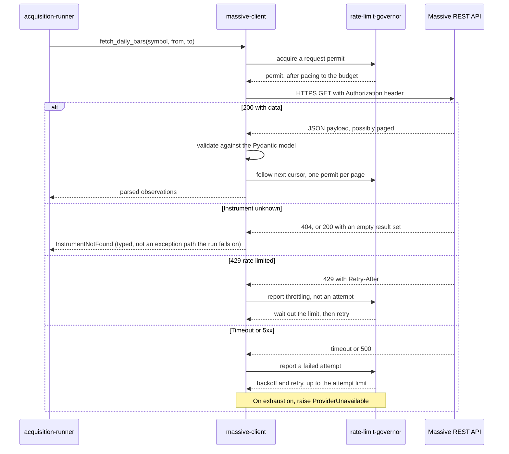

# Component: Massive Client

**Status:** draft
**Capability:** CAP-001
**Owner:** Alvaro de Jodra
**Last Updated:** 2026-09-05

## 1. Overview

The hand-written HTTP client for Massive, covering four historical reads:
instrument reference data, daily aggregates, company financials and corporate
actions. Massive publishes no SDK, so the product integrates against its
published interface directly (tech stack). This component is the only place in
the capability that holds the provider credential in usable form and the only
place that knows Massive's response shapes.

Two decisions from the tech stack shape it more than anything else. First, the
market data source is deliberately **not** abstracted behind a vendor-neutral
port: Massive is the provider, there is no plan to replace it, and building a
translation layer against a migration nobody plans would be cost paid now for an
option nobody wants. This client may therefore use Massive's own shapes
directly. Second, C4 requires one contract spanning historical reads and the M3
live feed, so the interface this client exposes must leave room for the
streaming half without being redefined when M3 arrives.

Use cases addressed:

- Fetch instrument reference data including CIK, composite FIGI and share class
  FIGI, so identity does not rest on the ticker (AC-3).
- Fetch daily aggregates over a date range (AC-3).
- Fetch company financials, retaining the provider's filing date as a
  descriptive attribute only (AC-3, C5).
- Fetch corporate actions: splits, dividends, ticker changes and IPOs (AC-3).
- Distinguish an unrecognised instrument from a transport failure, which is what
  makes AC-11 implementable.
- Surface rate limiting as flow control rather than as an error, which is what
  makes system design constraint 5.13 implementable.

Support matrix: the ingestion container only. The API never imports this module,
which a test asserts.

Dependencies: `httpx` for HTTP, Pydantic for response validation,
`rate-limit-governor` for pacing and retry, `runtime-config` for the credential
and the base URL.

## 2. Design Details

### 2.1 Placement

```
src/factorflow/ingestion/massive/client.py     the four reads
src/factorflow/ingestion/massive/models.py     Pydantic models of the responses
src/factorflow/ingestion/massive/errors.py     the typed error taxonomy
src/factorflow/ingestion/massive/paging.py     cursor following
```

### 2.2 Request flow

The sequence below shows one read and the three outcomes it can produce, and it
is drawn because the distinction between them is the whole reason this component
exists as a separate unit. Every request is paced by the governor before it is
issued, which is where the owner's configured budget is honoured. A successful
response is validated against a Pydantic model and returned as parsed
observations, so no unvalidated provider field reaches the writer. A response
saying the instrument is unknown becomes a typed `InstrumentNotFound`, which the
runner records without failing the run. Everything else, a timeout or a server
error, is retried by the governor and, on exhaustion, becomes a typed
`ProviderUnavailable`. The expected outcome is that the runner never has to
interpret an HTTP status code.



### 2.3 Interface

The interface is named in the product's vocabulary for the operations, while the
payload models follow Massive's shapes, which is what the tech stack's
non-abstraction decision permits and what C4's single contract requires.

```python
# src/factorflow/ingestion/massive/client.py
from datetime import date

from factorflow.ingestion.massive import models


class MassiveClient:
    """Historical reads against Massive. The live feed (M3) attaches here."""

    async def fetch_reference(self, symbol: str) -> models.TickerReference:
        """Ticker reference: CIK, composite FIGI, share class FIGI, list and
        delist dates. Raises InstrumentNotFound when the provider does not
        recognise the symbol."""

    async def fetch_daily_bars(
        self, symbol: str, start: date, end: date
    ) -> list[models.DailyBar]:
        """Daily aggregates over an inclusive range. Follows paging."""

    async def fetch_financials(
        self, symbol: str, start: date, end: date
    ) -> list[models.FinancialStatement]:
        """Company financials. filing_date is carried as a descriptive
        attribute and is never the as-of date (C5)."""

    async def fetch_corporate_actions(
        self, symbol: str, start: date, end: date
    ) -> list[models.CorporateAction]:
        """Splits, dividends, ticker changes and IPOs over a range."""
```

Four methods, one per data type, rather than one generic `get(path)`. A generic
method would push Massive's URL shapes into the runner and would make the M3
streaming addition a change to every caller rather than a fifth method here.

### 2.4 Error taxonomy

```python
# src/factorflow/ingestion/massive/errors.py
class MassiveError(Exception):
    """Base for every provider failure."""


class InstrumentNotFound(MassiveError):
    """The provider does not recognise this symbol, or holds no data of this
    type for it. Recorded per instrument; the run continues (AC-11)."""


class ProviderUnavailable(MassiveError):
    """Transport failure or server error, attempts exhausted. The instrument
    is recorded as failed; the run continues."""


class ProviderContractViolation(MassiveError):
    """A 200 response that does not validate against the model. Distinct from
    unavailability because it means the provider changed, not that it is down,
    and retrying will not help."""


class CredentialRejected(MassiveError):
    """401 or 403. The run fails rather than continuing, because every
    remaining instrument would fail the same way."""
```

`CredentialRejected` is the one provider error that is not per-instrument.
Continuing a 3000-instrument run against a rejected credential would produce
3000 identical failures and a `partial` outcome that hides a single cause, so
the runner finalises the run as `failed` with that reason. This matches the
capability's first flow, step 5: *If the credential is rejected or the provider
cannot be reached, the run reports that it failed and why.*

`ProviderContractViolation` exists because a silently changed provider shape is
the failure mode a hand-written client is most exposed to. Parsing leniently and
writing whatever came back would put unvalidated values into append-only history,
which cannot be repaired.

### 2.5 Endpoint paths

One Massive path is confirmed in a governed document:
`GET /v1/marketstatus/upcoming`, recorded in the tech stack's provider
evaluation as forward-looking only, which is why this capability derives trading
days from acquired data instead. **This component does not call it.**

The paths for the four reads this component does make are not recorded in any
document available to this decomposition. They are not invented here. The
implementing story reads them from Massive's published documentation and records
them, together with the query parameters and the paging mechanism, in this
section. Section 14 carries this as an open item.

What is known from the tech stack's provider evaluation and is safe to design
against:

- Reference data returns CIK, composite FIGI and share class FIGI.
- Delisted instruments remain queryable, carrying `active=false`, `list_date`
  and `delisted_utc`.
- Financials expose a `filing_date` that is the most recent filing including the
  period, conflating restatements.
- Corporate actions cover splits, dividends, IPOs and ticker events.

### 2.6 Authentication

The API key is supplied by `runtime-config` as a `SecretStr` and unwrapped once,
when the `httpx.AsyncClient` is constructed, into a default `Authorization`
header. It is never placed in a query string. This is not a stylistic
preference: a key in a query parameter appears in the URL, and the URL appears
in `httpx` exception messages, which the runner records as failure reasons and
the interface renders. Header authentication removes that path entirely, and the
redaction filter is the backstop (AC-13).

### 2.7 Messages

N/A, not applicable for this component. The M3 live feed will add a WebSocket
consumer alongside these reads, behind the same contract (C4); it is out of
scope here.

## 3. Constraints and Assumptions

- **Massive is the single provider** (tech stack). No second source, no
  cross-provider identity mapping.
- **No vendor-neutral abstraction** (tech stack). Massive's shapes may appear in
  this component's models. They may not appear above it: the runner and the
  writer see parsed product-shaped observations.
- **One contract spanning history and the live feed** (C4, system design
  constraint 5.6). The M3 streaming half attaches to this client rather than
  replacing it.
- **`filing_date` is never the as-of date** (C5, system design constraint 5.4).
  It is carried as an attribute so it can be seen, and the writer stamps
  `observed_on` itself.
- **Rate limiting is flow control, not failure** (system design constraint
  5.13). A 429 is not an attempt.
- **The attempt limit is 3 per instrument and data type by default** (owner
  decision, 2026-09-04, recorded in system design constraint 5.13).
- **The credential is never logged and never in a URL** (AC-13).
- **Assumption: the owner's Massive plan includes fundamentals** and sufficient
  history depth and request rate. The tech stack records that the free tier does
  not reach M1, that fundamentals are a paid entitlement, and that coverage and
  rate limits have not been tested. The capability carries this as an open
  question affecting AC-3 and AC-4.
- **Assumption: US-listed equities.** Reference data and corporate action
  handling follow from it.

## 4. Security

- **This component is the only holder of the credential in usable form.** It
  unwraps the `SecretStr` once, at client construction, and the value lives in
  one `httpx` header dictionary for the process lifetime (AC-13,
  SEC-SEC-001).
- **Header authentication, never query parameters.** Section 2.6 explains why
  this is a security control rather than a convention.
- **TLS (SEC-ENC-001).** Every request is HTTPS. `httpx` verifies certificates
  by default and verification is never disabled, which is asserted by a test,
  because disabling it is the single-line change that quietly removes transport
  security.
- **External input validation (SEC-INP-001).** Every response is validated
  against a Pydantic model before it leaves this component: field types, value
  ranges where the domain has them, and enumerations for action types. A
  response that does not validate raises `ProviderContractViolation` rather than
  being coerced.
- **Provider data is data, never instruction (AGT-PROHIB-003).** No field in a
  provider response selects a code path, names a file, or is interpolated into a
  query or a log format string.
- **Error disclosure.** Exception messages are constructed from the symbol, the
  data type and the status code, not from the raw `httpx` exception, so a URL
  never reaches a stored failure reason. The redaction filter is the second
  layer.
- **Data classification.** Responses are Internal. The credential is Restricted
  and never written anywhere.
- **Dependency posture (SEC-DEP-001, SEC-DEP-003).** `httpx` and Pydantic are
  approved in the tech stack and scanned through `pyproject.toml`.
- **Privacy impact: none.**
- **Crypto usage: none of its own.** TLS is provided by `httpx` over the
  platform trust store.

## 5. Scalability and Performance

- **Request volume at AC-4.** Up to four reads per instrument for 3000
  instruments, plus paging, so on the order of 12000 requests plus pages per
  full run. Every one of them passes through the governor, so the run's duration
  is set by the owner's configured budget.
- **Connection pooling (SA-RES-001).** One `httpx.AsyncClient` for the process
  lifetime, with connection reuse and bounded pool limits. Constructing a client
  per request would add a TLS handshake to every call.
- **Timeouts.** Connect, read and write timeouts are all set explicitly from
  `runtime-config`. `httpx`'s default timeout is not relied on. The value is
  recorded as needing input.
- **Paging.** Ranges of several years return paged aggregates. Pages are
  followed with one governor permit per page, and results are accumulated per
  instrument rather than per run, keeping peak memory a function of one
  instrument's history.
- **Concurrency.** The client is async-capable, which is what C7 asks of the
  ingestion runtime, but the runner drives it sequentially in this capability.
  The client itself holds no mutable state beyond the connection pool
  (SA-CONC-001).
- **No throughput target is stated** by the capability, and the provider's rate
  limits have not been tested, so none is asserted.

## 6. Upgrade

- **No previous release.**
- **The M3 live feed is the planned extension.** It adds a WebSocket consumer to
  this component behind the same contract (C4). Nothing in the four historical
  methods needs to change for it, which is the property system design constraint
  5.6 requires and which this design preserves by exposing operations rather
  than a generic HTTP method.
- **A provider contract change** surfaces as `ProviderContractViolation` rather
  than as silently wrong data. That is the upgrade risk this component carries,
  and it is why validation is strict.
- **Data migration: none owned here.**
- **Behaviour change after upgrade: none in this capability.**
- **Manual actions required: none**, beyond the owner holding a plan that
  includes fundamentals.
- **Rollback (OPS-MIG-003).** Reverting the ingestion image reverts the client.
  Because it writes nothing directly, a rollback has no data consequence.

## 7. Testing

Provider interaction is tested against recorded response fixtures served by a
local stub, never against the live provider, so the suite is deterministic and
consumes no rate budget.

| Test | File | What it proves |
|------|------|----------------|
| Reference parse | `tests/unit/test_massive_reference.py` | CIK, composite FIGI and share class FIGI are extracted; a delisted instrument's `list_date` and `delisted_utc` survive (AC-3) |
| Daily bars parse and page | `tests/unit/test_massive_bars.py` | A two-page range returns all bars in date order (AC-3) |
| Financials keep filing date as an attribute | `tests/unit/test_massive_financials.py` | `filing_date` is present on the model and is not used as an as-of date (C5) |
| Corporate actions parse | `tests/unit/test_massive_actions.py` | All four action types map to the product's enumeration (AC-3) |
| 404 becomes InstrumentNotFound | `tests/unit/test_massive_errors.py` | A typed result the runner can record without failing the run (AC-11) |
| Empty result becomes InstrumentNotFound | `tests/unit/test_massive_errors.py` | A 200 with no rows is not silently an empty success for reference data |
| 401 becomes CredentialRejected | `tests/unit/test_massive_errors.py` | Distinct from unavailability, so the run fails rather than producing 3000 identical failures |
| Malformed 200 becomes a contract violation | `tests/unit/test_massive_errors.py` | An unexpected shape raises rather than writing partial values |
| 429 is not an attempt | `tests/unit/test_massive_retry.py` | Repeated 429 responses do not exhaust the attempt budget (5.13) |
| Timeout retries to the limit | `tests/unit/test_massive_retry.py` | Three attempts then `ProviderUnavailable` (5.13) |
| Credential is in a header, never a URL | `tests/unit/test_massive_auth.py` | The request URL contains no credential and no `apiKey` parameter (AC-13) |
| Exception messages carry no URL | `tests/unit/test_massive_auth.py` | A failure message names the symbol and status, not the request URL (AC-13) |
| TLS verification is not disabled | `tests/unit/test_massive_tls.py` | No construction path sets `verify=False` (SEC-ENC-001) |
| The API does not import this module | `tests/unit/test_api_isolation.py` | Shared with the API design; enforces C1 |

Live-provider verification is deliberately excluded from the automated suite and
is recorded in section 14 as a manual evaluation step, because it consumes the
owner's rate budget and depends on a credential that must not be in CI.

## 8. Acceptance Criteria

1. Each of the four reads returns validated, product-shaped observations for a
   recognised instrument.
2. Reference data carries CIK, composite FIGI and share class FIGI.
3. Financial statements carry the provider's filing date as an attribute, and
   this component sets no as-of date.
4. An unrecognised instrument produces `InstrumentNotFound`, distinguishable
   from a transport failure.
5. A rejected credential produces `CredentialRejected`, distinguishable from
   both of the above.
6. A 200 response that does not validate produces `ProviderContractViolation`
   and no partial observations.
7. A rate-limit response does not consume the attempt budget.
8. A transport failure is retried to the configured attempt limit and then
   produces `ProviderUnavailable`.
9. No request URL contains the credential, and no exception message contains a
   request URL.
10. Certificate verification is enabled on every request.
11. A multi-page range returns every page's rows.
12. Failure scenario: the provider returns a partial page and then fails; the
    method raises rather than returning the partial set as complete.

## 9. Workflows

- **New workflow: acquire the four data types.** Steps 8 to 14 of the system
  design's control flow, for every instrument in every run.
- **New workflow: report an unrecognised instrument.** The capability's fifth
  flow, step 5, where the owner is told which instrument and why while the rest
  of the run completes.
- **New workflow: report a rejected credential.** The capability's first flow,
  step 5, where the run reports that it failed and why and leaves no
  partially-written data mistaken for complete history.
- **Intersecting workflow: the M3 live feed.** Out of scope here. It attaches to
  this component behind the same contract, which is why the interface exposes
  operations rather than a generic HTTP verb.

## 10. UX / GUI

N/A, not applicable for this component. It renders nothing. Its error taxonomy
is visible through the interface, because the UX design's Run detail screen
requires every error to state STD-UI-19's three parts, the operation, the
resource and the reason. This component supplies the reason, and it supplies it
as a typed error with a message built from the symbol, the data type and the
status, so the interface can render all three without parsing prose.

The UX design also requires an unrecognised instrument to be distinguished from
other failures, because it is a data problem the owner fixes rather than a run
failure. `InstrumentNotFound` being a distinct type rather than a message
substring is what makes that distinction survive to the screen.

Internationalization: none.

## 11. API Endpoints

This component consumes an external interface and exposes none.

| Endpoint | Method/Operation | Auth/Privilege | Request | Response | Notes |
|----------|-----------------|----------------|---------|----------|-------|
| Ticker reference | GET, path recorded by the implementing story | API key in an `Authorization` header | Symbol | Reference with CIK and FIGIs, list and delist dates | Path not confirmed in any governed document; see section 2.5 and 14 |
| Daily aggregates | GET, path recorded by the implementing story | API key in a header | Symbol, inclusive date range, paging cursor | Daily bars | Paged |
| Company financials | GET, path recorded by the implementing story | API key in a header | Symbol, date range | Statements with `filing_date` as an attribute | Not point-in-time; see the tech stack's provider evaluation |
| Corporate actions | GET, path recorded by the implementing story | API key in a header | Symbol, date range | Splits, dividends, ticker changes, IPOs | |
| `GET /v1/marketstatus/upcoming` | GET | API key in a header | none | Forward-looking holidays only | **Not called by this capability.** Recorded because it is the endpoint that does not solve the trading-calendar problem, verified 2026-09-03 |

## 12. References

| Type | Document Name | Description | Link |
|------|---------------|-------------|------|
| Capability | CAP-001 v6 | AC-3, AC-4, AC-11, AC-13; assumptions on provider coverage | `docs/capabilities/CAP-001-market-data-acquisition-foundation/Capability-CAP-001.md` |
| System design | CAP-001 system design v3 | Control flow steps 8 to 28, constraints 5.4, 5.6, 5.13 | `docs/capabilities/CAP-001-market-data-acquisition-foundation/design/system-design.md` |
| Constitution | Tech Stack v2 | Provider evaluation, no SDK, no vendor-neutral abstraction, `httpx` | `docs/constitution/tech-stack.md` |
| Constitution | Product Charter v2 | C4, one market data contract; C5, point-in-time history; C7, long-lived connections | `docs/constitution/product-charter.md` |
| Constitution | Security Constitution v1.1 | SEC-INP-001, SEC-ENC-001, SEC-SEC-001 | `docs/constitutions/security.constitution.md` |

## 13. Traceability

| Capability AC | System Design Element | Component Design Element | Section |
|--------------|----------------------|--------------------------|---------|
| AC-3 | `massive-client` reference, aggregate, fundamental and corporate-action reads | Four typed methods with validated models | 2.3 |
| AC-4 | Budget pacing, resumable runs | One pooled async client, permits per request and per page | 5 |
| AC-5 | `observation-writer` stamps `observed_on` | This component sets no as-of date; `filing_date` is an attribute | 2.3, 3 |
| AC-11 | Unrecognised instrument reported, run continues | `InstrumentNotFound` as a distinct type | 2.4 |
| AC-12 | A failed run leaves no false history | `ProviderContractViolation` rather than lenient parsing | 2.4 |
| AC-13 | Credential never logged or echoed | Header authentication, messages built from safe fields | 2.6, 4 |
| AC-10 | Per-instrument failure detail | Typed errors carrying symbol, data type and status | 2.4, 10 |

## 14. Open Questions

1. **What are Massive's endpoint paths, query parameters and paging mechanism
   for the four reads?** No governed document records them, so this design does
   not invent them. The implementing story reads them from the provider's
   published documentation and records them in section 2.5 and the section 11
   table. *Owner: implementing story, from provider documentation. Blocks:
   implementation of all four methods.*
2. **Does Massive's coverage and rate limiting hold for 3000 instruments at the
   owner's stated depth?** Carried from the capability's open questions and the
   tech stack's provider evaluation, both of which record provider evaluation as
   untested. If it falls short, AC-3 and AC-4 change. *Owner: capability owner,
   by evaluation against the live provider. Blocks: treating AC-3 and AC-4 as
   fixed.*
3. **What connect, read and write timeouts should the client use?** No source
   states any. `[REQUIRES INPUT: what per-request timeout values?]` *Owner:
   capability owner. Blocks: client construction.*
4. **Should a live-provider smoke test exist, and where?** The automated suite
   deliberately excludes it. Some manual or gated verification is needed before
   the first real run, because every fixture-based test passes against a provider
   contract that has never been observed. *Owner: capability owner. Blocks:
   confidence in the first acquisition, not the implementation.*
