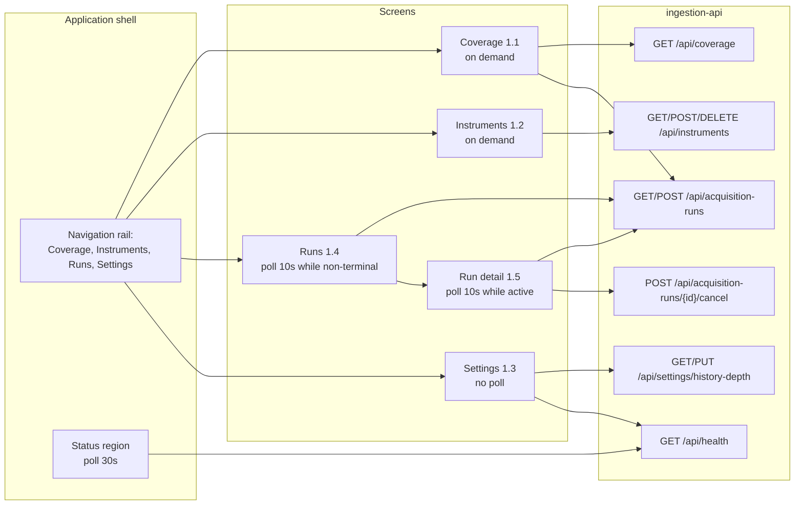

# Component: Owner Web App

**Status:** draft
**Capability:** CAP-001
**Owner:** Alvaro de Jodra
**Last Updated:** 2026-09-05

## 1. Overview

The React single-page application the owner-operator uses to name instruments,
start and watch acquisition runs, read coverage, and diagnose failures. It is
the product's first interface surface, so every rule in STD-UI that governs a
surface it renders binds it, and the patterns it establishes are the ones later
capabilities inherit.

It is built from the UX design, which specifies four destinations, one child
route, an application shell, and the states each region must render. This
component design translates that into a file structure, a data-fetching
strategy, and a test plan. It changes nothing the UX design decided; where the
UX design left something open, this design says so rather than choosing.

Use cases addressed:

- Coverage overview, the landing screen once data exists (AC-7, AC-8, AC-17,
  AC-21, AC-22).
- Instruments, including bulk entry and retirement (AC-1, AC-4, AC-21).
- Settings, history depth and credential presence (AC-2, AC-13).
- Runs and Run detail, including cancellation and failure diagnosis (AC-9,
  AC-10, AC-11, AC-19, AC-20).
- The application shell's status region, which reports liveness and the most
  recent run outcome from every screen (AC-18).
- The unreachable state, which is what a refused start looks like to the owner
  (AC-16).

Support matrix: a modern desktop browser on the owner's machine, reaching
`http://127.0.0.1` only. No mobile layout is specified by the UX design, which
describes a desktop tool read for long stretches. No authentication, no account
area, no user menu (AC-14).

Dependencies: React 18, Vite, TypeScript 5.x, Tailwind CSS, shadcn/ui on Radix
primitives, and the twelve component specifications under `design-system/` with
the theme in `design-system/theme.css`. TradingView `lightweight-charts` is in
the approved stack and is **not used here**: CAP-001 renders no chart.

## 2. Design Details

### 2.1 Placement

```
package.json                       npm scripts the tech stack's validation table names
vite.config.ts                     root: web, build output into the API package
web/index.html
web/src/main.tsx
web/src/app/shell.tsx              the application shell, UX design section 0
web/src/app/routes.tsx             four destinations plus the run detail child route
web/src/app/status-region.tsx      liveness and last run outcome, polled at 30s
web/src/screens/coverage/          UX design 1.1
web/src/screens/instruments/       UX design 1.2
web/src/screens/settings/          UX design 1.3
web/src/screens/runs/              UX design 1.4 and 1.5
web/src/components/                vendored shadcn/ui components
web/src/api/client.ts              typed fetch layer over the JSON API
web/src/api/types.ts               response types mirroring the API contracts
tests/e2e/                         Playwright specs
```

Vite is configured with `root: "web"` and `build.outDir` pointing into
`src/factorflow/api/static`, so the application container ships one image
carrying both the API and the bundle. `npm ci`, `npm run build`, `npm run test`,
`npm run test:e2e`, `npm run lint` and `npm run format` are defined at the
repository root, matching the names the tech stack's validation table already
records.

### 2.2 Application shell

The UX design specifies the shell as a composition rather than a design-system
component: a fixed left navigation rail holding four destinations in order,
Coverage, Instruments, Runs, Settings, a main region, and a persistent status
region pinned to the bottom of the rail. Run detail is a child route of Runs and
not a fifth destination.

The status region reports two facts from `GET /api/health`, polling every 30
seconds and showing its last-updated time (STD-UI-25): whether the product is
answering, and how the most recent acquisition run ended. It is sized to take a
third line later without restructuring, because STD-UI-11's trading-environment
indicator lands there when a capability introduces one. CAP-001 has no paper or
live environment, so it carries only the two facts today.

### 2.3 Screen and data-fetch map

The diagram below shows which screen reads which endpoint and at what cadence,
because polling cadence is a specified behaviour under STD-UI-25 rather than an
implementation detail. Coverage does not auto-poll and shows a last-updated
time, since deriving coverage is the most expensive read in the product. Runs
polls every 10 seconds while any run is in a non-terminal state and stops when
none is. The status region polls health every 30 seconds from every screen. Run
detail polls the same run endpoint while its run is active. The expected outcome
is that the interface is current where it matters and quiet where it does not.



### 2.4 State rendering

STD-UI-23 requires eight states per region, and the UX design enumerates them
for each of the six regions, recording the inapplicable ones with a reason
rather than omitting them. This design implements them as an explicit
discriminated union in the fetch layer rather than as booleans, because a
`loading` flag combined with an `error` flag can represent states that must not
render and cannot represent the two empty states the capability distinguishes.

```typescript
// web/src/api/types.ts
export type ScreenState<T> =
  | { kind: "loading" }
  | { kind: "empty-never-populated" }   // AC-17: nothing has ever been acquired
  | { kind: "empty-no-match" }          // a filter matched nothing
  | { kind: "populated"; data: T; fetchedAt: string }
  | { kind: "partial"; data: T; fetchedAt: string }
  | { kind: "unavailable"; reason: string }  // per column, never per screen
  | { kind: "error"; message: string; requestId: string }
  | { kind: "unreachable" };
```

`empty-never-populated` and `empty-no-match` are separate variants because
AC-17's failure is exactly conflating them, and the API returns
`never_acquired` as a field so the interface does not have to infer it.

`unavailable` carries a reason, which is what lets the Gaps column render
*Unknown* with the explanation *Gap detection needs at least two instruments
holding data in this range* without the interface inventing the sentence.

### 2.5 Component usage

Ten of the twelve design-system components are used. `chart` and `tabs` are not:
CAP-001 renders no chart and no tabbed region. The mapping below is the UX
design's, reproduced because it is the contract this component implements.

| Screen | Element | Component | Variant |
|--------|---------|-----------|---------|
| 1.1 Coverage | Instrument coverage table | `data-table` | `expandable` |
| 1.1 | Symbol filter | `data-table` toolbar filter | n/a |
| 1.1 | Lifecycle filter | `select` | `inline` |
| 1.1 | Data type presence | `badge` | `coverage-present`, `coverage-absent`, `coverage-unknown` |
| 1.1 | Start acquisition run | `button` | `default`, or `blocked` when depth is unset |
| 1.2 Instruments | Instrument table | `data-table` | `expandable` |
| 1.2 | Add instrument field | `form` + `input` | `inline` + `text` |
| 1.2 | Add many | `textarea` | `list` |
| 1.2 | Retire action | `button` | `ghost` |
| 1.2 | Retire confirmation | `dialog` | `confirm`, never `destructive` |
| 1.2 | Provider recognition | `badge` | `status-warning` when unrecognised |
| 1.3 Settings | History depth form | `form` + `input` | `stacked` + `numeric` |
| 1.3 | Credential region | `card` | `summary` |
| 1.3 | Credential status | `badge` | `status-good` or `status-critical` |
| 1.4 Runs | Run table | `data-table` | `history` |
| 1.4 | Run outcome | `badge` | the six `status-*` variants |
| 1.4 | Outcome filter | `select` | `inline` |
| 1.5 Run detail | Run summary | `card` | `summary` |
| 1.5 | Instrument roster | `data-table` | `expandable` |
| 1.5 | Cancel run | `button` | `secondary` |
| 1.5 | Cancel confirmation | `dialog` | `confirm` |
| 1.5 | Run finished elsewhere | `toast` | `success`, `warning` or `error` by outcome |
| 1.5 | Progress while running | **component-spec gap** | see section 14 |

Three usages are load-bearing rather than cosmetic and must survive
implementation unchanged:

- **`button` `blocked`, not `disabled`.** The blocked variant stays focusable and
  exposes its reason through `aria-describedby`. A plain disabled control hides
  the reason from keyboard and screen-reader users entirely, which is why the UX
  design chose it.
- **`dialog` `confirm`, not `destructive`,** for both retirement and
  cancellation. Neither discards data, and STD-UI-2 forbids a word the product
  does not mean.
- **Run detail opens from a link on the run id**, not from a row click. The
  `data-table` `history` variant defines no row target, and a link makes
  middle-click and open-in-new-tab work, which is what the `button` specification
  directs for navigation.

### 2.6 Table volume

AC-4's 3000 instruments is the sizing case for three tables. The UX design
requires filtering to apply server-side across the full result set, never the
current page, because sorting or filtering only the loaded page produces a
silently wrong ranking.

The capability's STD-UI-30 conformance entry records this as **partial**: the
`data-table` specification offers pagination and not virtualisation, so the
component does not discharge the rule alone. This design implements the table as
a keyset-paginated list with windowed rendering over the loaded pages, and
records the gap between what the component specification offers and what
STD-UI-30 requires in section 14 rather than treating the rule as satisfied.

### 2.7 Messages

N/A, not applicable for this component. There is no push channel. The interface
learns of state change by polling at the cadences in section 2.3, which is what
STD-UI-25 requires to be stated and shown.

## 3. Constraints and Assumptions

- **Loopback only, no authentication** (AC-14). No sign-in, no user menu, no
  account area, and nothing in the shell assumes a principal.
- **STD-UI v4 is binding, not advisory.** Thirty rules; the capability's section
  5.4 records which apply and where each is satisfied, and the UX design cites
  them at the point they decide something.
- **The design system is the vocabulary.** Twelve component specifications and
  one theme. No component is invented here, and no token outside `theme.css` is
  used (STD-UI-29 permits selecting a density tier, not introducing a value).
- **No chart** (STD-UI-9, STD-UI-27, STD-UI-28 do not engage). CAP-001 renders
  tables, forms and status only.
- **The interface never validates a symbol against the provider.** Recognition
  is not known until a run reaches the instrument (AC-11), and a field that
  appeared to validate would be lying.
- **The interface never presents cancellation as immediate.** It is cooperative
  and takes effect after the current instrument (AC-19).
- **No estimated time remaining.** No duration target exists for a run, so any
  estimate would be invented.
- **Assumption: one browser tab.** No cross-tab coordination is specified.
- **Assumption: the density tier is inherited.** The UX design selects no tier
  and inherits the current `--row-height` default, which the design system
  records as a port-time placeholder.

## 4. Security

- **No authentication, by owner decision of 2026-09-03**, sound solely because
  the interface is loopback-bound. This component adds no dependency on that
  absence: there is no place a principal would have to be retrofitted.
- **No credential is ever rendered** (AC-13). There is no credential field
  anywhere in the design, and the Settings screen shows presence only, never
  masked, never truncated, never a last-four. When health is unreachable,
  presence renders as `coverage-unknown` rather than as missing, so the interface
  never reports a credential absent on the strength of a failed request.
- **Output encoding.** React escapes text by default. `dangerouslySetInnerHTML`
  is not used anywhere, which a lint rule and a test assert, because provider
  failure reasons are rendered on the Run detail screen and they originate
  outside the product (AGT-PROHIB-003: provider text is data, never markup and
  never instruction).
- **No client-side storage of anything sensitive.** No token, no key, nothing in
  `localStorage` beyond, at most, interface preferences.
- **Same-origin only.** The bundle is served by the same process as the API, so
  no cross-origin configuration exists to widen.
- **Data classification.** Everything rendered is Internal.
- **Privacy impact: none.** No PII, no analytics, no telemetry to any third
  party.
- **Dependency posture (SEC-DEP-001, SEC-DEP-003).** React, Vite, Tailwind and
  the vendored shadcn/ui sources are scanned through `package.json`. shadcn/ui
  vendors components into the repository rather than locking them behind a
  dependency, which the tech stack notes keeps the later promotion ceremony
  controllable and which also means those sources are reviewed like first-party
  code.
- **Accessibility enforcement is human review.** The tech stack records that
  Biome has no direct equivalent of `eslint-plugin-jsx-a11y`, so a11y
  expectations are enforced by review rather than by a linter. Radix supplies
  keyboard and ARIA behaviour underneath, which is part of why it was chosen.

## 5. Scalability and Performance

- **The sizing case is 3000 rows in three tables** (AC-4). Keyset pagination
  plus windowed rendering keeps the DOM bounded regardless of the result set.
- **Filtering is server-side**, so a filter over 3000 instruments is a request
  rather than a client-side scan, and it is correct across the whole set rather
  than the loaded page.
- **Existing rows stay visible and dimmed during a refresh** rather than
  collapsing to a spinner, which the `data-table` contract requires and which
  also avoids a full re-render on every poll.
- **Polling cost.** Runs at 10 seconds while non-terminal and health at 30
  seconds. Both read small indexed tables. Coverage does not auto-poll, because
  it is the expensive read.
- **Row expansion does not fetch** on Coverage: the collapsed row already
  carries presence, range and gap count, and expansion reveals identity and the
  specific gap dates, which are fetched once per expansion rather than
  pre-loaded for 3000 rows.
- **Bundle size.** One bundle, code-split by route, built by Vite. No target is
  stated by any governed document, so none is asserted.
- **Concurrency: none.** One user, one tab.

## 6. Upgrade

- **No previous release.**
- **The bundle ships with the API in one image**, so an upgrade replaces both
  together and there is no version skew between the interface and the contracts
  it consumes.
- **A response-shape change in a later capability** is a breaking change for
  this component and must be treated as one in that capability's design, since
  the two are built and deployed together.
- **Data migration: none.** The interface stores nothing durable.
- **Behaviour change after upgrade: none in this capability.**
- **Manual actions required: none.** The owner reloads the page.
- **Rollback (OPS-MIG-003).** Reverting the application image reverts the
  interface and the API together. The constraint is the schema, as recorded in
  the `market-data-store` design.
- **The status region's reserved third line** is the one forward-compatibility
  affordance built in deliberately, so STD-UI-11's trading-environment indicator
  can land without restructuring the shell.

## 7. Testing

Vitest with React Testing Library for component and screen tests, Playwright for
end-to-end, matching the tech stack. The end-to-end suite runs against the real
API and a real PostgreSQL container with a stubbed provider, so the flows are
exercised without consuming the owner's rate budget.

| Test | File | What it proves |
|------|------|----------------|
| Never-populated is not nothing-found | `web/src/screens/coverage/coverage.test.tsx` | Two distinct empty states with distinct copy (AC-17) |
| Gaps render Unknown, never zero | `web/src/screens/coverage/coverage.test.tsx` | An unavailable gap check renders the word and the pattern, and no zero (AC-8, STD-UI-14) |
| Absent renders an em dash | `web/src/screens/coverage/coverage.test.tsx` | Absent, zero and inapplicable are three renderings (STD-UI-4) |
| Retired rows are marked and retained | `web/src/screens/coverage/coverage.test.tsx` | A retired instrument shows its coverage and its lifecycle badge (AC-21) |
| Depth shortfall marks only short rows | `web/src/screens/coverage/coverage.test.tsx` | Compliant rows carry no marker (AC-22) |
| Start is blocked, not disabled | `web/src/screens/coverage/start-run.test.tsx` | The control stays focusable and its reason is exposed through `aria-describedby` (AC-2) |
| Queued run notice renders | `web/src/screens/coverage/start-run.test.tsx` | `queued_behind` produces the in-progress sentence (AC-23) |
| Bulk entry reports before adding | `web/src/screens/instruments/add-many.test.tsx` | Recognised and unrecognised counts are shown before anything is added, and rejects do not discard accepts (AC-1, AC-4) |
| Retire uses confirm, not destructive | `web/src/screens/instruments/retire.test.tsx` | The dialog variant and the wording, and initial focus on cancel (AC-21, STD-UI-2) |
| Retire action names its row | `web/src/screens/instruments/retire.test.tsx` | Accessible name is *Stop acquiring AAPL*, not a bare repeated label |
| Settings shows presence only | `web/src/screens/settings/credential.test.tsx` | No field, no mask, no last-four; unknown when health is unreachable (AC-13) |
| Outcome tiers are correct | `web/src/screens/runs/outcome-badge.test.tsx` | All eight states map to their STD-UI-12 tier; `partial` is warning and `cancelled` is neutral (AC-9, AC-19) |
| Every status carries text | `web/src/screens/runs/outcome-badge.test.tsx` | Greyscale readability: no status conveyed by colour alone (STD-UI-8) |
| Cancellation is not immediate | `web/src/screens/runs/cancel.test.tsx` | `cancelling` renders as a distinct state and the action becomes unavailable (AC-19) |
| Already-completed cancellation | `web/src/screens/runs/cancel.test.tsx` | A 409 renders *This run had already completed.* and the outcome (AC-19) |
| Abandoned run carries its explanation | `web/src/screens/runs/run-detail.test.tsx` | The sentence, not a bare state (AC-20) |
| Failure states three parts | `web/src/screens/runs/run-detail.test.tsx` | Operation, resource and reason (STD-UI-19, AC-10) |
| Unrecognised is distinguished | `web/src/screens/runs/run-detail.test.tsx` | Not rendered as a run failure (AC-11) |
| No estimated time remaining | `web/src/screens/runs/run-detail.test.tsx` | Progress shows completed against named and nothing else |
| Unreachable takes the screen | `web/src/app/shell.test.tsx` | The designed state with its copy, rail still rendered (AC-16) |
| No raw HTML injection | `web/src/api/render.test.tsx` | `dangerouslySetInnerHTML` appears nowhere; a reason containing markup renders as text |
| First-run journey | `tests/e2e/first-run.spec.ts` | Settings, Instruments, Start, Run detail, Coverage, end to end (capability flow 1) |
| Diagnose and re-run | `tests/e2e/diagnose-failure.spec.ts` | A partial run is opened from the status region, the failure is read, and the re-run completes (capability flow 3) |
| Cancel a run | `tests/e2e/cancel-run.spec.ts` | Cancellation, retained coverage, and the already-finished branch (capability flow 4) |
| Keyboard-only traversal | `tests/e2e/accessibility.spec.ts` | Every action reachable and operable by keyboard, focus returned after dialogs (STD-UI-24) |
| Volume | `tests/e2e/volume.spec.ts` | 3000 instruments render, filter and scroll without the DOM growing unbounded (AC-4) |

Accessibility beyond the keyboard traversal above remains human review, per the
tech stack's note that Biome carries no `jsx-a11y` equivalent.

## 8. Acceptance Criteria

1. Before any acquisition, Coverage states that no data has been acquired, with
   the run action beside it, and this is visibly different from a filter that
   matched nothing.
2. A data type with no observation renders an em dash, never a zero and never a
   blank.
3. When gap detection is unavailable, the Gaps column renders the word Unknown
   with its pattern and the reason on expansion, and never a zero.
4. A retired instrument appears on Coverage with its retained range and a
   lifecycle marker.
5. An instrument short of the stated depth is marked; one meeting it is not.
6. With no history depth set, every Start action renders blocked, stays
   focusable, and exposes its reason to assistive technology.
7. Starting a run while one is active shows the queued notice and does not
   disable the action.
8. Bulk entry reports recognised and unrecognised counts before anything is
   added, and a rejected line does not discard the accepted ones.
9. Retirement is confirmed with the confirm dialog, worded as stopping
   acquisition, with initial focus on cancel.
10. The Settings screen shows credential presence only, with no field anywhere in
    the interface, and shows unknown rather than missing when health is
    unreachable.
11. All eight run states render with their STD-UI-12 tier, each carrying a word
    and an icon rather than colour alone.
12. A cancellation renders the cancelling state and does not present itself as
    immediate; a cancellation of an already-finished run says so.
13. An abandoned run carries its written explanation rather than a bare state.
14. Every rendered failure states the operation, the resource and the reason.
15. When health does not answer, the shell replaces the main region on every
    route with the designed unreachable state and keeps the navigation rail.
16. No screen renders provider-supplied text as markup.
17. Failure scenario: a 500 from any endpoint leaves the screen's header and
    toolbar rendered and replaces the body with an error and a retry.
18. Failure scenario: 3000 instruments render and filter without the page
    scrolling horizontally or the DOM growing with the result set.

## 9. Workflows

Every user flow in the capability passes through this component.

- **Acquire for the first time.** Settings, then Instruments, then Start from
  Coverage or Runs, then Run detail. The UX design routes to Settings when depth
  is unset rather than presenting an empty Coverage screen whose only resolution
  is elsewhere. This is three operations rather than one, so STD-UI-26's guided
  setup contract does not engage; making it a wizard would engage it.
- **Confirm the data is fit to rely on.** Coverage, in the collapsed row, with
  ranges, identifiers and specific gap dates behind expansion.
- **Diagnose and recover.** The status region links directly to the most recent
  run's detail from any screen, without passing through the Runs list.
- **Stop a run.** Run detail's cancel action, its confirmation, the cancelling
  state, and the already-finished branch.
- **Add an instrument afterwards.** Instruments, then Start.
- **Operate and upgrade.** The status region answers whether the product is
  running and whether the last run failed (AC-18); the unreachable state answers
  what a refused start looks like (AC-16).

## 10. UX / GUI

This component is the UX surface, so the whole of the UX design applies. What
follows records the parts a reader of this file alone would otherwise miss.

**Shell.** A fixed left rail of `--space-7`, four destinations in fixed order,
main region padding `--space-5`, dense table regions at `--space-3`, no value
outside the spacing scale (STD-UI-29).

**Type.** `--text-base` as the default at 14px, `--text-sm` for dense table
bodies, `--text-xs` for timestamps and table metadata, `--text-xl` for screen
titles.

**Tokens.** Every colour comes from `theme.css`. Status uses the six severity
tiers as `--status-<tier>` on `--status-<tier>-muted`. Presence uses
`--status-good`, `--value-missing` and `--value-indeterminate` with
`--pattern-indeterminate` on the indeterminate case. Numerals use
`--font-numeric`. No token is introduced by this capability.

**Dates and numbers.** ISO-8601 throughout, timestamps in America/Chicago with
their zone shown, session dates unconverted (STD-UI-5). Counts render in full,
never abbreviated (STD-UI-6). Precision is fixed per column (STD-UI-3).

**Status without colour.** Every status carries a text label plus an icon or
shape, and greyscale readability is the test (STD-UI-8). This matters most on
the run outcomes, where five of the eight states are not success and the
`partial` against `succeeded` distinction is the one AC-9 exists to protect.

**Accessibility (STD-UI-24, WCAG 2.1 AA).** Column and row headers
programmatically associated on every table, because a cell's meaning depends on
both the instrument and the data type. Expander accessible names identify their
row. Filtering does not move focus and announces the new row count politely.
Dialog focus is trapped and returned to the trigger. Polled regions announce
politely and never steal focus.

**Internationalization.** None. One locale, one owner, one timezone. Dates are
ISO-8601, which is the format STD-UI-5 fixes rather than a locale default.

## 11. API Endpoints

This component consumes the API and exposes none.

| Endpoint | Method/Operation | Auth/Privilege | Request | Response | Notes |
|----------|-----------------|----------------|---------|----------|-------|
| `/api/health` | GET | none, loopback | none | Liveness, credential presence, most recent run | Status region, every 30s (AC-18, STD-UI-25) |
| `/api/coverage` | GET | none | Filters, range, cursor | Coverage rows, gap availability, never-acquired | Coverage screen, on demand (AC-7, AC-8, AC-17) |
| `/api/instruments` | GET | none | Filters, cursor | Instruments and counts | Instruments screen |
| `/api/instruments` | POST | none | Symbol array | Per-symbol disposition | Single add and Add many share it (AC-1, AC-4) |
| `/api/instruments/{symbol}` | DELETE | none | Path symbol | Retired lifecycle | Retire action (AC-21) |
| `/api/settings/history-depth` | GET, PUT | none | Years | Current depth | Settings screen (AC-2) |
| `/api/acquisition-runs` | POST | none | none | 202, run id, queued behind | Start action (AC-23) |
| `/api/acquisition-runs` | GET | none | Filters, cursor | Run history | Runs screen, every 10s while non-terminal |
| `/api/acquisition-runs/{id}` | GET | none | Path id, filters | Run and per-instrument results | Run detail, every 10s while active (AC-10, AC-11) |
| `/api/acquisition-runs/{id}/cancel` | POST | none | Path id | 202 cancelling, or 409 with state | Cancel action (AC-19) |

## 12. References

| Type | Document Name | Description | Link |
|------|---------------|-------------|------|
| Capability | CAP-001 v6 | AC-1, AC-2, AC-4, AC-7 to AC-11, AC-13, AC-14, AC-16 to AC-23; section 5.4 STD-UI conformance | `docs/capabilities/CAP-001-market-data-acquisition-foundation/Capability-CAP-001.md` |
| UX design | CAP-001 UX design v3 | Shell, five screens, cross-screen navigation, component-spec gaps, EDG compliance | `docs/capabilities/CAP-001-market-data-acquisition-foundation/design/ux-design.md` |
| UX brief | CAP-001 UX brief v5 | Regions, states, conformance record | `docs/capabilities/CAP-001-market-data-acquisition-foundation/design/ux-brief.md` |
| Standard | STD-UI v4 | Thirty owner-interface rules | `docs/constitution/standards/ui-conventions.md` |
| Design system | Component specifications | Twelve specifications; ten used here | `design-system/components/` |
| Design system | Theme | Every token this design names | `design-system/theme.css` |
| System design | CAP-001 system design v3 | Interfaces 4.2, constraint 5.11 | `docs/capabilities/CAP-001-market-data-acquisition-foundation/design/system-design.md` |
| Constitution | Tech Stack v2 | React 18, Vite, Tailwind, shadcn/ui on Radix, Vitest, Playwright, Biome; a11y enforced by review | `docs/constitution/tech-stack.md` |

## 13. Traceability

| Capability AC | System Design Element | Component Design Element | Section |
|--------------|----------------------|--------------------------|---------|
| AC-1 | `owner-web-app` presents the instrument list | Instruments screen, add field, Add many, retire | 2.5 |
| AC-2 | Depth required before the first run | `button` `blocked` with its reason, and the Settings form | 2.5 |
| AC-4 | 3000 instruments | Keyset pagination, windowed rendering, server-side filtering, bulk entry | 2.6 |
| AC-7 | `GET /api/coverage` rendered | Coverage table, presence badges, ranges, last acquired | 2.5, 10 |
| AC-8 | Gap detection, unavailable below two instruments | Unknown rendering with pattern and reason, never zero | 2.4, 2.5 |
| AC-9 | Honest run outcome | Eight states, six tiers, `partial` never good | 2.5, 10 |
| AC-10 | Per-instrument failure detail | Run detail expansion with the three error parts | 2.5, 10 |
| AC-11 | Unrecognised instrument distinguished | Recognition badge and a distinct run-detail rendering | 2.5 |
| AC-13 | Credential never in any view | Presence only, no field anywhere, unknown when health is unreachable | 4 |
| AC-14 | Loopback, no authentication | No sign-in, no user menu, no account area in the shell | 2.2, 4 |
| AC-16 | Refuse an inconsistent start | The unreachable state, naming the migration cause | 2.4, 9 |
| AC-17 | Honest empty state | Two distinct empty variants in the state union | 2.4 |
| AC-18 | `GET /api/health` | Status region on every screen, polled at 30s | 2.2, 2.3 |
| AC-19 | Cancel a run in progress | Cancel action, confirm dialog, cancelling state, already-finished branch | 2.5 |
| AC-20 | Reclaim as abandoned | The abandoned-run explanation on run detail | 2.5, 7 |
| AC-21 | Removal retains history | Retire wording, confirm variant, retired rows kept and marked | 2.5 |
| AC-22 | Deepening backfills | The Depth column's short-by marker | 2.5 |
| AC-23 | Concurrent requests queue | The queued notice, Start staying available | 2.5 |

## 14. Open Questions

1. **The indeterminate progress indicator is still a component-spec gap.** The
   UX design's section 3 records it as the one remaining gap: the run-detail
   progress region and its polling are specified, but the indicator itself is
   not, because `design-system/intake.md` requires its interaction and
   accessibility contracts to be derived from the upstream Radix documentation
   rather than from memory. Until it exists, run detail renders progress as
   completed against named in text, which is honest and sufficient but is not
   what the UX design specifies. *Owner: design system owner, through the intake
   process. Blocks: the progress region's final form, not the screen.*
2. **STD-UI-30 is only partially discharged.** The rule requires virtualisation
   at AC-4's volume; the `data-table` specification offers pagination and not
   virtualisation. This design implements windowed rendering over paginated
   results, which meets the rule's intent, but the component specification and
   the rule remain out of step and the capability's own conformance table
   records the partial. *Owner: design system owner with the capability owner.
   Blocks: a clean conformance record, not the implementation.*
3. **Which density tier?** The UX design selects none and inherits the current
   `--row-height` default, which the design system records as a port-time
   placeholder under its own OQ-UI-4. Selecting a tier is permitted by
   STD-UI-29; introducing a value is not. *Owner: design system owner. Blocks:
   nothing; inheriting is the honest position until the question is answered.*
4. **No mobile or narrow-viewport layout is specified.** The UX design describes
   a desktop tool and specifies no breakpoint behaviour. Tables at this column
   count will not fit a narrow viewport, and the tables scroll horizontally
   inside their own container rather than the page doing so. *Owner: capability
   owner. Blocks: nothing; recorded because the absence is a decision.*
5. **Should the owner see the configured provider request budget?** Carried
   unchanged from the UX design's still-open questions. Run duration follows from
   it and the owner has no other way to anticipate how long a run will take, but
   no endpoint exposes it and adding one exceeds this capability. *Owner:
   whichever capability next takes up ingestion operations. Blocks: nothing
   here.*
