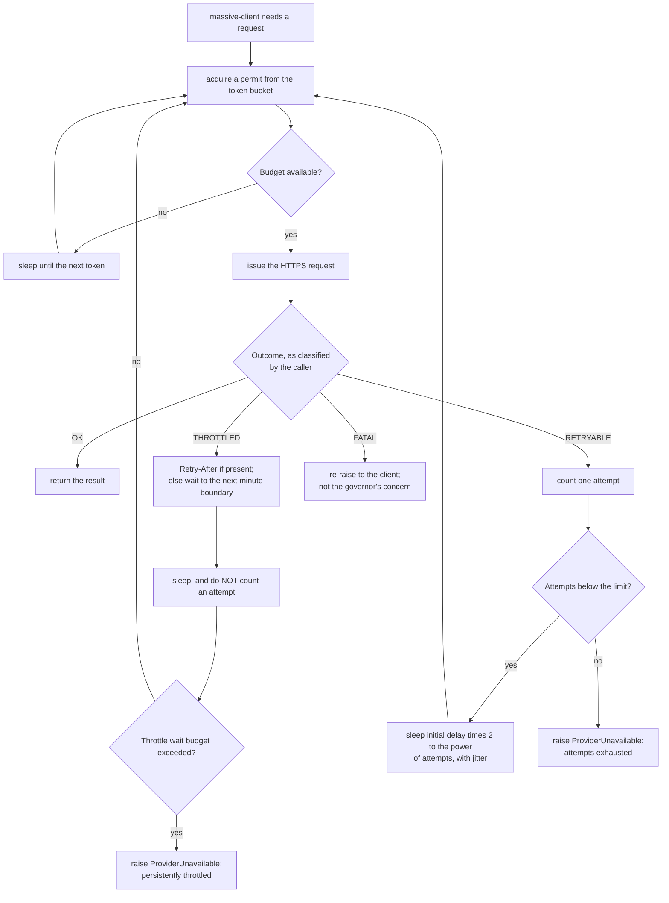

# Component: Rate Limit Governor

**Status:** draft
**Capability:** CAP-001
**Owner:** Alvaro de Jodra
**Last Updated:** 2026-09-05

## 1. Overview

The governor paces every provider request to the owner's configured budget,
waits out rate limiting as flow control, and applies bounded exponential backoff
to transport and server errors. It is a small component carrying one of the
system design's sharper distinctions: a `429` and a `500` look alike to a naive
retry loop and mean opposite things.

System design constraint 5.13 states it directly. A `429` means the request was
never served, so the governor waits and does not count the wait as an attempt.
It honours `Retry-After` where a provider supplies one; Massive does not, so
the live path waits to the next minute boundary instead — section 2.5.
Timeouts and server errors are retried with exponential backoff up to a
configured attempt limit, default 3 per instrument and data type by owner
decision of 2026-09-04, after
which the instrument is recorded as failed and the run continues. Conflating the
two would either abandon instruments over ordinary throttling or retry a genuine
outage until the run never ends.

Use cases addressed:

- Pace requests to a budget the owner configures, because the design is
  tier-agnostic and the plan determines the rate (system design constraint
  5.14).
- Wait out throttling without consuming the attempt budget (5.13).
- Retry transport and server failures with bounded backoff (5.13).
- Bound retries so a run cannot loop forever (OPS-LOOP-001).
- Keep a long run viable at AC-4's 3000 instruments.

Support matrix: the ingestion container only. One instance per process, shared
by every `massive-client` request.

Dependencies: `runtime-config` for the budget, the attempt limit, the initial
backoff and the request timeout.

## 2. Design Details

### 2.1 Placement

```
src/factorflow/ingestion/rate_limit.py    the governor
```

### 2.2 Pacing and retry flow

The chart below shows the governor's two responsibilities and the decision that
separates them, and it is drawn because that decision is the component's entire
reason for existing. Before any request, the caller waits for a permit from the
token bucket, which is what holds the process to the configured budget. After
the request, the outcome routes one of three ways: success returns immediately,
throttling waits — to the next minute boundary against Massive, which sends no
`Retry-After` — and retries without counting an attempt, and a transport or
server error consumes one attempt and backs off exponentially. The expected outcome is that throttling slows a run and never
fails it, while a genuine outage fails one instrument after a bounded number of
tries and lets the run continue.



### 2.3 Interface

```python
# src/factorflow/ingestion/rate_limit.py
from collections.abc import Callable
from dataclasses import dataclass
from enum import StrEnum
from typing import TypeVar

T = TypeVar("T")


class Outcome(StrEnum):
    """How the caller classified one attempt. The governor never inspects a
    provider response itself."""
    OK = "ok"
    THROTTLED = "throttled"        # never an attempt (5.13)
    RETRYABLE = "retryable"        # transport failure or 5xx; costs an attempt
    FATAL = "fatal"                # do not retry; return to the caller


@dataclass(frozen=True)
class GovernorSettings:
    requests_per_minute: int      # required; the owner's plan (5.14)
    max_attempts: int             # default 3 (5.13, owner decision 2026-09-04)
    initial_backoff_seconds: float
    max_throttle_wait_seconds: float


class RateLimitGovernor:
    """Paces provider requests and classifies retryable failures."""

    def execute(
        self,
        send: Callable[[], T],
        classify: Callable[[BaseException], Outcome],
    ) -> T:
        """Run one request under the budget, retrying per section 2.2.

        `send` performs one attempt. `classify` maps an exception raised by it
        onto an Outcome; the governor decides what to do with that Outcome and
        never examines the exception itself.

        Raises ProviderUnavailable when attempts are exhausted or the request
        is throttled beyond the throttle wait budget.
        """
```

The governor takes a callable rather than a URL, so it knows nothing about
Massive. That keeps the provider's shapes inside `massive-client` and makes the
governor testable without any HTTP at all.

**It also no longer sees a response object.** The provider SDK raises
`BadResponse` on every non-200 and discards the status code
(`component-design-massive-client.md` section 2.4), so there is no status for
the governor to switch on. Classification therefore moves to the caller, which
is the only component that can reconstruct the distinction from the error body,
and the governor consumes the `Outcome` it returns. This keeps the two
responsibilities where the knowledge is: `massive-client` knows what a provider
error means, and the governor knows what to do about it.

`execute` is synchronous because the SDK's REST client is. The async form was
written for `httpx` and is not needed by a runner that drives instruments
sequentially; C7's async requirement lands on the M3 live feed, which the SDK
serves through a separate WebSocket client.

### 2.4 The token bucket

A token bucket rather than a fixed window, because a fixed window permits a
burst at each boundary that a provider's own limiter will reject, producing
throttling the governor exists to avoid.

- Capacity equals `requests_per_minute`, refilled continuously at
  `requests_per_minute / 60` tokens per second.
- One token per request, including each page of a paged response.
- Acquisition is `await`ed, so a caller blocks rather than failing when the
  budget is spent. There is one runner and one active run, so blocking is the
  correct behaviour: nothing else needs the process.

### 2.5 Throttling is not an attempt

The rule stated once, because it is the component's whole point:

| Outcome (classified by the caller) | Attempt counter | Wait | Then |
|------------------------------------|-----------------|------|------|
| `THROTTLED`, provider stated a delay | unchanged | the provider's stated delay | retry |
| `THROTTLED`, no stated delay — **the Massive case** | unchanged | to the next minute boundary, with jitter | retry |
| `RETRYABLE` (timeout or 5xx) | plus one | initial delay times two to the power of attempts, with jitter | retry while attempts remain |
| `OK` | unchanged | none | return the result |
| `FATAL` (404, 401, anything not retryable) | unchanged | none | re-raise to the caller |

**Massive sends no `Retry-After`.** Verified against the live provider on
2026-09-05 and recorded in `component-design-massive-client.md` section 2.6b: a
429 carries only `Content-Type` and `X-Request-Id`, and no `X-RateLimit-*`
header appears on success responses either. The first row is therefore dead
code against the only provider this capability has, retained because the
governor is provider-agnostic and a future provider may populate it.

The second row is the live path, and its wait is **not** the exponential backoff
delay. Massive's limit is a fixed *requests per minute* window, so the quota
refills at the next minute boundary regardless of how long the client waits;
exponential backoff would either wait far past the refill, idling the run, or
retry before it and consume a second 429. Waiting to the boundary matches the
limit's actual shape. Jitter still applies, because several retries queued
behind the same boundary would otherwise resynchronise onto it.

This distinction only matters because throttling is not an attempt: a wait that
is too short burns no attempt budget but does burn the throttle wait budget
below, which is what would eventually fail the instrument.

A throttle wait budget bounds the first two rows, so a provider that returns
`429` indefinitely, which is what an exhausted monthly quota looks like, fails
the instrument rather than stalling the run forever. Without it the "not an
attempt" rule would have no exit condition, which is the failure OPS-LOOP-001
guards against.

Jitter is full jitter over the computed delay, so a run that hits a provider
limit does not resynchronise every retry to the same instant.

### 2.6 Messages

N/A, not applicable for this component.

## 3. Constraints and Assumptions

- **The budget is configured, not defaulted** (system design constraint 5.14).
  `FACTORFLOW_MASSIVE_REQUESTS_PER_MINUTE` is required, because the design is
  tier-agnostic and a default would guess the owner's plan.
- **A `429` is never an attempt** (5.13). Stated in the system design and
  enforced here.
- **The attempt limit is 3 by default** (5.13, owner decision 2026-09-04),
  overridable by configuration.
- **Retries are bounded** (OPS-LOOP-001). Both the attempt counter and the
  throttle wait budget have ceilings, so no path retries indefinitely.
- **The governor is provider-agnostic.** It takes a callable and an `Outcome`
  from the caller, and inspects no provider type at all. Massive supplies no
  `Retry-After`, verified
  2026-09-05, so the boundary wait is the live path and the header path is
  retained for a future provider.
- **The provider's limit is expressible as requests per minute.** No longer an
  assumption: a probe on 2026-09-05 tripped the limit on the sixth rapid request
  and the 429 body names "maximum requests per minute" explicitly, consistent
  with the tech stack's record of five calls per minute on the free tier. This is
  what makes the minute boundary the correct wait. A provider expressing limits
  per day as well would need a second bucket, which section 14 records.
- **Assumption: one process consumes the budget.** With one ingestion container
  and one active run, a process-local bucket is the whole budget. A second
  ingestion process would exceed it, because nothing coordinates buckets across
  processes.

## 4. Security

- **The governor never sees the credential.** It receives a callable that
  already carries authentication, so the secret does not enter this module
  (AC-13).
- **It never logs a URL.** Log records name the attempt index, the delay and the
  status code. A retry log that included the request URL would be a credential
  disclosure path if a future change ever moved authentication into a query
  parameter, which `massive-client` prohibits for the same reason.
- **Errors are never swallowed (OPS-ERR-001).** Every exhausted path raises a
  typed error the runner records as a per-instrument failure with a reason.
  There is no branch in which a failed request returns quietly.
- **Denial of service, inbound: not applicable.** The governor protects the
  provider from this product, not the reverse. It has no external interface.
- **Data classification.** It handles HTTP responses in transit only, and stores
  nothing.
- **Privacy impact: none.**
- **Crypto usage: none.**
- **OSS inventory:** no provider or transport types at all; the governor's
  signature is generic and its classification comes from the caller. No
  additional dependency.

## 5. Scalability and Performance

- **The governor is the run's throttle.** At AC-4's 3000 instruments and four
  data types, a run issues on the order of 12000 requests plus paging. At a
  budget of, for example, 100 requests per minute that is roughly two hours; at
  five per minute it is roughly forty hours. This is the arithmetic behind the
  capability's open question about acceptable run duration, and it is why this
  design asserts no duration: the answer is a function of the owner's plan.
- **Resumability matters more than speed** (system design constraint 5.14). A
  long run must not be lost to an interruption, which the runner's
  per-instrument commits and the reclaim mechanism provide.
- **Overhead.** Token accounting is arithmetic on two floats. The cost of the
  governor is the waiting it is there to do.
- **Concurrency (SA-CONC-001).** The bucket is shared mutable state. It is
  guarded by an `asyncio.Lock` around the token accounting, so a future
  concurrent fetcher cannot double-spend a token. The lock is held only for the
  accounting, never across a sleep or a request.
- **No throughput target is stated** by the capability, and the provider's real
  limits are untested.

## 6. Upgrade

- **No previous release.**
- **A plan change is a configuration change.** Raising the owner's Massive tier
  changes `FACTORFLOW_MASSIVE_REQUESTS_PER_MINUTE` and requires no code change,
  which is what tier-agnosticism buys.
- **The M3 live feed** consumes a different quota shape, a long-lived connection
  rather than requests per minute. It will need its own control; this governor
  is not extended to cover it, and nothing here assumes it must be.
- **Data migration: none.**
- **Behaviour change after upgrade: none in this capability.**
- **Manual actions required:** the owner sets the budget to match their plan on
  first deployment, and again if the plan changes.
- **Rollback (OPS-MIG-003).** No state, so no rollback consequence.

## 7. Testing

Every test uses a fake clock and a stub sender, so the suite exercises pacing
and backoff without sleeping in real time and without any network.

| Test | File | What it proves |
|------|------|----------------|
| Requests are paced to the budget | `tests/unit/test_governor_pacing.py` | Ten requests at a budget of five per minute span at least the expected virtual time (5.14) |
| A burst does not exceed capacity | `tests/unit/test_governor_pacing.py` | No more than `requests_per_minute` requests issue in any one virtual minute |
| 429 does not consume an attempt | `tests/unit/test_governor_retry.py` | Five consecutive 429 responses then a 200 succeeds with the attempt counter at zero (5.13) |
| Retry-After is honoured when present | `tests/unit/test_governor_retry.py` | The wait matches the header rather than the boundary. Provider-agnostic path; Massive never exercises it |
| 429 without Retry-After waits to the boundary | `tests/unit/test_governor_retry.py` | The wait reaches the next minute boundary, not the exponential backoff delay. This is the Massive path (section 2.5) |
| Boundary waits are jittered | `tests/unit/test_governor_retry.py` | Two callers throttled in the same window do not resume at the identical instant |
| Throttle wait is bounded | `tests/unit/test_governor_retry.py` | Endless 429 responses raise once the throttle budget is exceeded rather than waiting forever (OPS-LOOP-001) |
| Timeouts consume attempts | `tests/unit/test_governor_retry.py` | Three timeouts raise `ProviderUnavailable` and the fourth request is never issued (5.13) |
| 5xx consumes attempts | `tests/unit/test_governor_retry.py` | Same bound as timeouts |
| Backoff grows exponentially with jitter | `tests/unit/test_governor_backoff.py` | Delays grow as a power of two and vary within the jitter range |
| FATAL is re-raised unretried | `tests/unit/test_governor_retry.py` | An outcome the caller classified FATAL is re-raised without retry or delay, so `massive-client` can map it to `InstrumentNotFound` or `CredentialRejected` (AC-11) |
| The governor never inspects the exception | `tests/unit/test_governor_retry.py` | Given a classifier returning fixed outcomes, behaviour is identical for unrelated exception types, proving no provider knowledge leaked in |
| No log record carries a URL | `tests/unit/test_governor_logging.py` | Retry logs name status, attempt and delay only (AC-13) |
| The lock is not held across a sleep | `tests/unit/test_governor_concurrency.py` | Two concurrent callers interleave rather than serialising on the whole request (SA-CONC-001) |

All tests here run without a container and without a network, so they carry no
`postgres` marker.

## 8. Acceptance Criteria

1. Requests issue at no more than the configured budget over any one-minute
   window.
2. A `429` response is retried without incrementing the attempt counter.
3. A `429` carrying `Retry-After` waits the provider's stated delay, and a `429`
   without one waits to the next minute boundary rather than the backoff delay.
4. Persistent throttling raises a typed failure once the throttle wait budget is
   exceeded rather than waiting indefinitely.
5. A timeout or `5xx` increments the attempt counter and is retried with an
   exponentially growing, jittered delay.
6. After the configured attempt limit, a typed failure is raised and no further
   request is issued for that call.
7. The default attempt limit is 3.
8. A `4xx` other than `429` is returned to the caller without retry.
9. No log record emitted by this component contains a request URL or a
   credential.
10. Failure scenario: the provider returns `429` for every request in a run;
    each instrument fails after the throttle budget, the run continues, and the
    run is recorded `partial` or `failed` rather than hanging.
11. Failure scenario: two concurrent callers never issue more requests together
    than the budget permits.

## 9. Workflows

- **Intersecting workflow: every acquisition run.** The governor sits on the
  path of every provider request in the capability. It introduces no workflow of
  its own.
- **Intersecting workflow: diagnose a failed run.** The capability's third flow.
  When an instrument fails because attempts were exhausted or throttling
  persisted, the reason the owner reads on the Run detail screen originates
  here, phrased as an operation, a resource and a reason per STD-UI-19.
- **Intersecting workflow: stop a run.** A run waiting on the governor is still
  between instruments only at the top of the loop, so a cancellation requested
  during a long backoff takes effect after the current instrument, which the UX
  design's cancellation copy already states.

## 10. UX / GUI

N/A, not applicable for this component. Two indirect couplings are worth
recording. The Run detail screen shows no estimated time remaining, which is
correct partly because the governor's pacing makes duration a function of the
owner's plan rather than of the work. And the UX design's still-open question
about whether the owner should see the configured provider request budget refers
to this component's setting; the UX design records that no endpoint exposes it
and that adding one exceeds this capability.

Internationalization: none.

## 11. API Endpoints

This component exposes no HTTP surface.

| Endpoint | Method/Operation | Auth/Privilege | Request | Response | Notes |
|----------|-----------------|----------------|---------|----------|-------|
| `RateLimitGovernor.execute` | in-process call | none; the callable carries its own authentication | A callable issuing one provider request | The provider response, or a typed failure | Consumer is `massive-client`; one permit per request and per page |

## 12. References

| Type | Document Name | Description | Link |
|------|---------------|-------------|------|
| Capability | CAP-001 v6 | AC-4 volume, AC-11 unrecognised instrument, open question on run duration | `docs/capabilities/CAP-001-market-data-acquisition-foundation/Capability-CAP-001.md` |
| System design | CAP-001 system design v3 | Constraints 5.13 and 5.14; control flow steps 22 to 28 | `docs/capabilities/CAP-001-market-data-acquisition-foundation/design/system-design.md` |
| Component design | Massive Client | The caller, its error taxonomy, and header authentication | `docs/capabilities/CAP-001-market-data-acquisition-foundation/design/component-design-massive-client.md` |
| Constitution | Tech Stack v3 | Provider plan limits; official `massive` client adopted 2026-09-05 | `docs/constitution/tech-stack.md` |
| Constitution | Operational Safety v1.3 | OPS-LOOP-001 repetitive action bounds, OPS-ERR-001 | `docs/constitutions/operational-safety.constitution.md` |

## 13. Traceability

| Capability AC | System Design Element | Component Design Element | Section |
|--------------|----------------------|--------------------------|---------|
| AC-4 | `rate-limit-governor` budget pacing | Token bucket sized to the configured budget | 2.4 |
| AC-11 | Unrecognised instrument does not stop the run | A `404` is returned unretried so the client can classify it | 2.5 |
| AC-10 | Per-instrument failure detail | Typed exhaustion failures carrying attempt count and status | 2.3, 2.5 |
| AC-13 | Credential never logged | Retry logs carry status, attempt and delay only | 4 |
| AC-9 | Honest run outcome | An exhausted instrument fails and the run continues, becoming `partial` | 2.2 |

## 14. Open Questions

1. ~~What initial backoff delay, throttle wait budget and request timeout?~~
   **Resolved 2026-09-05 by owner decision:** initial backoff 2s, throttle wait
   budget 300s, request timeout 30s. The canonical set and its derivation are in
   `component-design-runtime-config.md` section 2.2a, which this component reads
   rather than defining its own. The throttle budget was the consequential one,
   and the plan decision changed its meaning: on an unlimited tier a sustained
   429 signals a real problem rather than normal pacing, so five minutes surfaces
   it instead of absorbing it.
2. ~~Does Massive express a limit per day or per month as well as per minute?~~
   **Resolved 2026-09-05.** The verified pricing tiers state a per-minute call
   limit on Basic and **unlimited** on Starter and above, with no daily or
   monthly cap published at any tier. One bucket is sufficient. The owner's plan
   is Starter, so the bucket paces to a configured budget rather than to a
   provider ceiling — see the tech stack's provider evaluation.
3. **Should the configured budget be visible in the interface?** Carried from
   the UX design's still-open questions. Run duration follows from the budget
   and the owner has no other way to anticipate it, but no endpoint exposes it
   and the UX design records that adding one exceeds this capability. *Owner:
   capability owner. Blocks: nothing here.*
