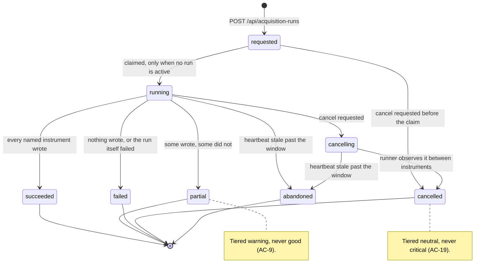
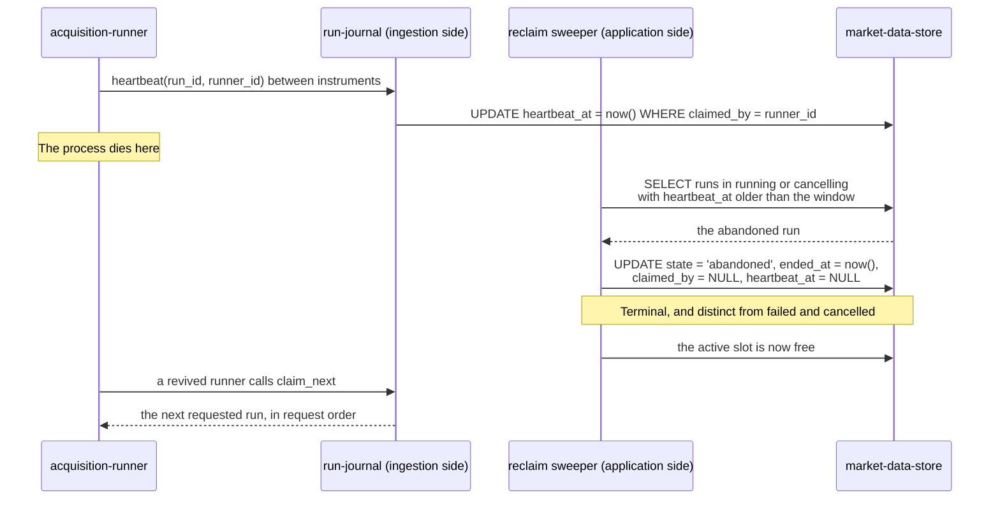

# Component: Run Journal

**Status:** draft
**Capability:** CAP-001
**Owner:** Alvaro de Jodra
**Last Updated:** 2026-09-05

## 1. Overview

The run journal owns the acquisition run record and its whole lifecycle: eight
states, the FIFO claim that starts a run, the heartbeat that proves a runner is
alive, the cancellation request, and the reclaim that rescues a run whose
process died. It is also the only cross-container handoff in the capability. The
application inserts a `requested` row; the ingestion process claims it. The two
never call each other.

Three acceptance criteria live almost entirely here. AC-9 requires a run to be
recorded as succeeded, failed or partial, and never as succeeded when any named
instrument failed. AC-20 requires that a run whose process stops unexpectedly
reaches a terminal state without the owner editing the data store. AC-23
requires a run requested while another is active to queue and to start in
request order.

Use cases addressed:

- Record a run request and return immediately (AC-23).
- Claim the oldest requested run, only when none is active (AC-23).
- Refresh a claim heartbeat while a run works.
- Record a cancellation request against a run rather than against a process
  (AC-19).
- Reclaim a run whose heartbeat has gone stale, as `abandoned` (AC-20).
- Compute the terminal outcome from what was written, not from what was intended
  (AC-9, AC-12).
- Serve run history and per-instrument failure detail (AC-10, AC-11).

Support matrix: the write and claim paths run in the ingestion container; the
request, cancel and read paths run in the application container. Both reach the
same tables.

Dependencies: `market-data-store` (`acquisition_run`, `run_instrument_result`),
`psycopg` 3, `runtime-config` for the heartbeat period and staleness window.

## 2. Design Details

### 2.1 Placement

```
src/factorflow/runs/journal.py     request, claim, heartbeat, cancel, finalise
src/factorflow/runs/states.py      the state enum and the legal transitions
src/factorflow/runs/reclaim.py     the stale-claim sweeper
src/factorflow/runs/queries.py     history and detail reads
```

### 2.2 State machine

The diagram below is the complete lifecycle, and it is drawn because the
capability's honesty requirements are expressed as which transitions are
forbidden rather than as which are allowed. A run begins `requested` and is
claimed only when no other run is active, which is what makes request order the
execution order. From `running` there are five terminal exits and they are not
interchangeable: `succeeded` requires every named instrument to have written,
`partial` is the honest outcome when some did not, `cancelled` records the
owner's decision and is never `failed`, and `abandoned` records a runner that
died and is distinct from both. The expected outcome is that every claimed run
reaches a terminal state without anyone editing the database.



`states.py` encodes the legal transitions as a mapping and every write goes
through a function that checks it, so an illegal transition raises rather than
being written. The database's `acquisition_run_state_known`,
`acquisition_run_claim_agrees` and `acquisition_run_terminal_has_end`
constraints are the backstop.

### 2.3 The claim, and why it is a single statement

```sql
-- Claim the oldest requested run, only when nothing is active.
UPDATE acquisition_run
   SET state        = 'running',
       started_at   = now(),
       claimed_by   = %(runner_id)s,
       heartbeat_at = now()
 WHERE run_id = (
       SELECT run_id
         FROM acquisition_run
        WHERE state = 'requested'
          AND NOT EXISTS (
              SELECT 1 FROM acquisition_run
               WHERE state IN ('running', 'cancelling'))
        ORDER BY requested_at
        LIMIT 1
        FOR UPDATE SKIP LOCKED)
RETURNING run_id, history_depth_years;
```

One statement, one transaction, no read-then-write window. The `NOT EXISTS`
clause is the one-active-run rule, and
`idx_acquisition_run_single_active` makes a race that slipped past it fail on a
unique violation rather than start a second run. `ORDER BY requested_at` is
AC-23's FIFO requirement and `idx_acquisition_run_requested` serves it.

A runner that gets no row simply waits and polls again. The poll interval is a
configured value recorded in section 14.

### 2.4 Interface

```python
# src/factorflow/runs/journal.py
from dataclasses import dataclass
from uuid import UUID

import psycopg


@dataclass(frozen=True)
class ClaimedRun:
    run_id: UUID
    history_depth_years: int


def request_run(connection: psycopg.Connection, history_depth_years: int) -> tuple[UUID, UUID | None]:
    """Insert a requested run. Returns its id and the active run's id, if any.

    Never rejects because a run is active: that is what queueing means (AC-23).
    """


def claim_next(connection: psycopg.Connection, runner_id: str) -> ClaimedRun | None:
    """Claim the oldest requested run when none is active. Section 2.3."""


def heartbeat(connection: psycopg.Connection, run_id: UUID, runner_id: str) -> bool:
    """Refresh the claim. Returns False when the claim was lost to a reclaim."""


def request_cancel(connection: psycopg.Connection, run_id: UUID) -> str:
    """Record a cancellation request. Returns the resulting state.

    Raises RunAlreadyTerminal carrying the actual state when the run has
    finished, which is what AC-19's already-completed edge renders.
    """


def cancellation_requested(connection: psycopg.Connection, run_id: UUID) -> bool:
    """Read by the runner between instruments."""


def finalise(connection: psycopg.Connection, run_id: UUID) -> str:
    """Compute and record the terminal outcome from written results. Section 2.5."""
```

### 2.5 Outcome computed from what was written

`finalise` never takes an outcome as an argument. It derives one:

```sql
SELECT
    count(*) FILTER (WHERE outcome IN ('written', 'unchanged'))            AS wrote,
    count(*) FILTER (WHERE outcome IN ('failed', 'not_found'))             AS did_not,
    count(DISTINCT instrument_id)                                           AS reached
  FROM run_instrument_result
 WHERE run_id = %(run_id)s;
```

The rule, in order:

1. A cancellation was requested and observed: `cancelled`.
2. No instrument was reached at all, or the run failed before the loop:
   `failed`.
3. Every named instrument wrote every data type: `succeeded`.
4. Anything else: `partial`.

Rule 3 is deliberately the narrow one. AC-9 forbids recording `succeeded` when
any named instrument failed to acquire, so the default is `partial` and
`succeeded` has to be earned. `unchanged` counts as written because a re-run
that appends nothing because the value is already held has acquired that
instrument successfully; treating it as a failure would make every second run
partial.

An instrument the provider does not recognise is `not_found`, which lands the
run in `partial` rather than `succeeded`. This is the correct reading of AC-11,
which requires the run to continue rather than requiring it to be considered a
success.

### 2.6 Reclaim of an abandoned run

The sequence below shows the mechanism AC-20 depends on, and it is the only
recovery path in the capability for a runner that dies. A running runner
refreshes its heartbeat between instruments. A sweeper, running in the
application container on a timer, looks for a claimed run whose heartbeat has
not advanced past the configured staleness window and marks it `abandoned`,
which is terminal. That releases the one-active-run slot, so the next requested
run can be claimed. The expected outcome is that a killed container, a crash or
a reboot never leaves acquisition wedged, and that the coverage written before
the interruption stands, because it was committed per instrument.



A revived runner whose old claim was reclaimed learns of it from `heartbeat`
returning `False`, and stops working on that run rather than continuing to write
against a run someone else has finalised.

### 2.7 Messages

N/A, not applicable for this component. The run journal table is the handoff,
and it is a table rather than a queue by system design constraint 5.1.

## 3. Constraints and Assumptions

- **At most one run is active** (system design constraint 5.17). Enforced by the
  claim statement and by a partial unique index, so application logic is not the
  only guard.
- **Request order is execution order** (AC-23). `ORDER BY requested_at`.
- **A request never fails because a run is active** (AC-23). Queueing is the
  specified behaviour, not backpressure.
- **Every claimed run reaches a terminal state** (system design constraint 5.7).
  The reclaim sweeper is what makes this true when a process dies.
- **`partial` is never `succeeded`** (AC-9). The outcome is derived, and the
  derivation defaults to `partial`.
- **`cancelled` is not `failed`, and `abandoned` is neither** (AC-19, AC-20).
  Three distinct terminal states because they mean three different things to the
  owner, and STD-UI-12 tiers them differently.
- **Cancellation is cooperative.** The request is recorded against the run; the
  runner observes it between instruments. The interface must not present it as
  immediate.
- **Assumption: the sweeper runs in the application container.** It is a small
  periodic task and the application is the process that is always up. Putting it
  in the ingestion container would mean the component that dies is the one
  responsible for noticing.
- **Assumption: clocks are one machine's.** Heartbeat comparison uses the
  database's `now()` on both sides, so no cross-host clock skew enters.

## 4. Security

- **Data classification.** Run records are Internal. They contain instrument
  symbols, timestamps, counts and provider-reported failure reasons.
- **Failure reasons are the disclosure risk.** A provider error message stored
  in `run_instrument_result.reason` and rendered in the interface could in
  principle contain a URL carrying the API key as a query parameter. The reason
  is therefore passed through the same redaction filter `runtime-config`
  installs before it is written, and the provider client is specified to
  authenticate by header rather than by query parameter. Both are required, and
  the test in section 7 asserts the stored reason for a synthetic credential-
  bearing error contains no credential (AC-13).
- **Injection (SEC-INP-002).** Every statement uses bound parameters. The state
  and outcome filters on the read paths validate against enumerations.
- **Authorization: none.** One owner, loopback interface.
- **Errors (OPS-ERR-001).** No error path here is silent. A failed transition
  raises, a lost claim returns `False` and stops the runner, and a reclaim writes
  a terminal state that the interface renders with an explanation.
- **Privacy impact: none.**
- **Crypto usage: none.**
- **OSS inventory:** `psycopg` 3 only.

## 5. Scalability and Performance

- **Table size.** One row per run, plus up to four rows per instrument per run.
  At 3000 instruments a run writes up to 12000 `run_instrument_result` rows.
  After a hundred runs that is a small table by any measure.
- **Read paths.** Run history is keyset paginated on `requested_at DESC`, served
  by `idx_acquisition_run_recent`. Run detail is paginated per instrument, with
  `idx_run_result_failures` serving the failure-first default sort the UX design
  specifies in section 1.5.
- **Polling load.** The UX design polls run state every 10 seconds while any run
  is non-terminal. That is one indexed read of a small table, which is why the
  design polls the journal rather than deriving coverage.
- **The claim statement** takes one row lock with `SKIP LOCKED` and holds it for
  the length of one `UPDATE`. There is no lock convoy because there is at most
  one runner.
- **The sweeper** runs on a timer and scans at most one active row, served by
  the partial unique index.
- **Concurrency (SA-CONC-001).** The claim is the only check-then-act in the
  capability, and it is expressed as one atomic statement guarded by a unique
  index rather than as a read followed by a write.
- **No duration target exists** for a run, which the capability records as an
  open question. This component therefore asserts none.

## 6. Upgrade

- **No previous release.**
- **Adding a run state later is a breaking change** to the interface as well as
  the schema, because the UX design maps exactly eight states to STD-UI-12
  severity tiers. A ninth state requires a tier assignment, a badge variant and a
  migration, together.
- **Data migration: none owned here.** `acquisition_run` and
  `run_instrument_result` are created by migration `0004`.
- **Behaviour change after upgrade: none in this capability.**
- **Manual actions required: none.** In particular, AC-20 exists so that no
  manual database edit is ever required to recover from an interrupted run.
- **Rollback (OPS-MIG-003).** No component-specific rollback. A run left
  `running` by a version that is rolled back is reclaimed by the sweeper in the
  older version, because the mechanism is data rather than code state.

## 7. Testing

| Test | File | What it proves |
|------|------|----------------|
| Request while active queues | `tests/integration/test_run_queue.py` | The second request is `requested`, not rejected, and `queued_behind` names the active run (AC-23) |
| Claim order is request order | `tests/integration/test_run_queue.py` | Three requests are claimed oldest first (AC-23) |
| Claim refuses while a run is active | `tests/integration/test_run_queue.py` | `claim_next` returns `None` while a run is `running` (AC-23) |
| Concurrent claims start one run | `tests/integration/test_run_queue.py` | Two claims against one requested run leave exactly one `running` |
| Outcome is derived, not asserted | `tests/integration/test_run_outcome.py` | With one instrument failed, the run is `partial` even though the runner completed (AC-9) |
| Succeeded requires everything | `tests/integration/test_run_outcome.py` | Every instrument and data type written yields `succeeded` (AC-9) |
| Unchanged counts as written | `tests/integration/test_run_outcome.py` | A re-run appending nothing yields `succeeded`, not `partial` (AC-6, AC-9) |
| Not found yields partial | `tests/integration/test_run_outcome.py` | An unrecognised instrument yields `partial` and the run completed (AC-11) |
| Cancel before the claim | `tests/integration/test_run_cancel.py` | A `requested` run cancelled becomes `cancelled` without ever running (AC-19) |
| Cancel is cooperative | `tests/integration/test_run_cancel.py` | The run becomes `cancelling` and only then `cancelled` (AC-19) |
| Cancel on a terminal run raises | `tests/integration/test_run_cancel.py` | `RunAlreadyTerminal` carries the actual state (AC-19) |
| A queued run cancels without being claimed | `tests/integration/test_run_cancel.py` | A `requested` run moves straight to `cancelled`, and a subsequent `claim_next` does not return it (AC-26) |
| Cancelling a queued run leaves the active one alone | `tests/integration/test_run_cancel.py` | With one run `running` and one `requested`, cancelling the second leaves the first `running` (AC-26) |
| Stale claim is reclaimed | `tests/integration/test_run_reclaim.py` | A run whose heartbeat is older than the window becomes `abandoned` and the slot frees (AC-20) |
| A reclaimed runner stops | `tests/integration/test_run_reclaim.py` | `heartbeat` returns `False` after a reclaim (AC-20) |
| Reclaim keeps coverage | `tests/integration/test_run_reclaim.py` | Coverage written before the interruption is unchanged (AC-12, AC-20) |
| Illegal transitions raise | `tests/unit/test_run_states.py` | `succeeded` to `running` and `cancelled` to `partial` both raise; no container needed |
| Failure reason is redacted | `tests/unit/test_run_reason_redaction.py` | A provider error containing a credential is stored without it (AC-13) |

## 8. Acceptance Criteria

1. Requesting a run while another is `running` records the new run as
   `requested` and does not reject it.
2. Requested runs are claimed in ascending order of request time.
3. No two runs are ever in `running` or `cancelling` at the same time.
4. A run is recorded `succeeded` only when every named instrument wrote every
   data type it was asked for.
5. A run in which any instrument failed or was not recognised is recorded
   `partial` or `failed`, never `succeeded`.
6. A cancellation request against a `running` run moves it to `cancelling` and
   then to `cancelled`, never to `failed`.
7. A cancellation request against a terminal run reports the run's actual state
   and does not change it.
7a. A run cancelled while `requested` reaches `cancelled` without ever being
    claimed, and a run already `running` is unaffected by it.
8. A run whose heartbeat has not advanced past the staleness window reaches
   `abandoned` without any manual database change.
9. After a reclaim, a subsequent run can be claimed and started.
10. Coverage written by a run before it was abandoned is retained unchanged.
11. No stored failure reason contains the provider credential.
12. Failure scenario: a runner that continues after losing its claim is stopped
    by `heartbeat` returning false rather than writing against a finalised run.

## 9. Workflows

- **New workflow: start a run.** The capability's first flow, step 3. The
  request returns immediately with an identifier.
- **New workflow: queue a run.** AC-23. The owner starts a run while one is
  active and is told it will begin when the current one finishes.
- **New workflow: diagnose a failed run.** The capability's third flow. Run
  history shows the run as failed or partial rather than successful, and run
  detail names the instrument, the data type and the reason.
- **New workflow: stop a run.** The capability's fourth flow, including step 5,
  where the run had already finished and the owner is told so.
- **New workflow: recover from an interrupted run.** AC-20. The owner does
  nothing; the sweeper reclaims and the next run starts.
- **Intersecting workflow: operational visibility.** `GET /api/health` reports
  the most recent run's outcome, which is a read of this component's table and
  is what AC-18 requires without inspecting the data store.

## 10. UX / GUI

This component backs the Runs screen and the Run detail screen in the UX design,
sections 1.4 and 1.5. The mapping between its eight states and the interface is
fixed by STD-UI-12 and reproduced here because a state added here without a tier
breaks the interface:

| Run state | Tier | `badge` variant |
|-----------|------|-----------------|
| `requested` | neutral | `status-neutral` |
| `running` | active | `status-active` |
| `cancelling` | warning | `status-warning` |
| `succeeded` | good | `status-good` |
| `partial` | warning, never good | `status-warning` |
| `failed` | critical | `status-critical` |
| `cancelled` | neutral, never critical | `status-neutral` |
| `abandoned` | serious | `status-serious` |

Two copy obligations follow from this component's behaviour and are specified in
the UX design rather than here, but depend on it being true:

- The abandoned-run explanation, *The process running this acquisition stopped
  before it finished, and the run was reclaimed. Coverage written before it
  stopped is kept. Start a new run to continue.* is only honest because the
  reclaim is terminal and the coverage is committed per instrument.
- The cancellation confirmation, *The run stops after the instrument it is
  working on now.* is only honest because cancellation is observed between
  instruments rather than mid-instrument.

Internationalization: none. States are stable identifiers; the interface
supplies their labels.

## 11. API Endpoints

This component exposes no HTTP surface of its own.

| Endpoint | Method/Operation | Auth/Privilege | Request | Response | Notes |
|----------|-----------------|----------------|---------|----------|-------|
| `request_run` | in-process call, application side | application database credential | History depth in force | New run id and the active run id | Backs `POST /api/acquisition-runs` (AC-23) |
| `claim_next` | single `UPDATE`, ingestion side | ingestion database credential | Runner identity | Claimed run or none | The only cross-container handoff, system design 4.2 |
| `heartbeat` | in-process call, ingestion side | ingestion database credential | Run id, runner identity | Whether the claim is still held | Section 2.6 |
| `request_cancel` | in-process call, application side | application database credential | Run id | Resulting state, or a raised terminal-state error | Backs `POST /api/acquisition-runs/{id}/cancel` (AC-19) |
| `cancellation_requested` | in-process call, ingestion side | ingestion database credential | Run id | Boolean | Read between instruments |
| `finalise` | in-process call, ingestion side | ingestion database credential | Run id | Terminal state | Derived from written results (AC-9) |
| Reclaim sweep | periodic `UPDATE`, application side | application database credential | none | Runs reclaimed | AC-20 |
| Run history and detail reads | `SELECT` | application database credential | Filters and cursor | Run rows and per-instrument results | Backs `GET /api/acquisition-runs` and its detail |

## 12. References

| Type | Document Name | Description | Link |
|------|---------------|-------------|------|
| Capability | CAP-001 v6 | AC-9, AC-10, AC-11, AC-18, AC-19, AC-20, AC-23 | `docs/capabilities/CAP-001-market-data-acquisition-foundation/Capability-CAP-001.md` |
| System design | CAP-001 system design v3 | Queued start requests, cancellation, reclaim, constraints 5.7 and 5.17 | `docs/capabilities/CAP-001-market-data-acquisition-foundation/design/system-design.md` |
| UX design | CAP-001 UX design v4 | Sections 1.4 and 1.5, the run outcome tier mapping | `docs/capabilities/CAP-001-market-data-acquisition-foundation/design/ux-design.md` |
| Component design | Market Data Store | `acquisition_run`, `run_instrument_result`, the single-active-run index | `docs/capabilities/CAP-001-market-data-acquisition-foundation/design/component-design-market-data-store.md` |
| Standard | STD-UI v4 | STD-UI-12, the state and tier table | `docs/constitution/standards/ui-conventions.md` |

## 13. Traceability

| Capability AC | System Design Element | Component Design Element | Section |
|--------------|----------------------|--------------------------|---------|
| AC-9 | Outcome computed from written coverage | `finalise` derives from `run_instrument_result`, defaulting to `partial` | 2.5 |
| AC-10 | Per-instrument failure records | `run_instrument_result` rows with outcome and reason, served by the detail read | 2.4, 11 |
| AC-11 | Per-instrument isolation | `not_found` recorded distinctly and yielding `partial`, never stopping the run | 2.5 |
| AC-12 | Coverage extended inside the write transaction | Reclaim leaves committed coverage untouched | 2.6 |
| AC-13 | Credential never in any view | Failure reasons redacted before they are stored | 4 |
| AC-18 | `GET /api/health` most recent run outcome | Run history read serving health | 11 |
| AC-19 | Cancellation request observed between instruments | `request_cancel`, `cancelling` state, terminal-state error | 2.2, 2.4 |
| AC-20 | Claim heartbeat and staleness window | `heartbeat`, the reclaim sweeper, the `abandoned` terminal state | 2.6 |
| AC-23 | FIFO claim only after a terminal transition | The single claim statement in 2.3 and the one-active-run index | 2.3 |

## 14. Open Questions

1. **What staleness window, heartbeat period and claim poll interval?** The
   system design requires all three mechanisms and states no value for any of
   them. The staleness window is the consequential one: too short reclaims a
   healthy but slow run, too long leaves acquisition blocked after a crash.
   **Resolved 2026-09-05 by owner decision:** staleness window 900s, heartbeat
   period 60s, idle poll interval 5s. The window is derived rather than chosen —
   it must exceed the worst case for one instrument, because the heartbeat fires
   between instruments and not on a timer. `component-design-runtime-config.md`
   section 2.2a carries the arithmetic and enforces the relationship at load, so
   raising the request timeout later cannot silently bring the window below the
   worst case.
2. ~~Where does the reclaim sweeper run?~~ **Resolved 2026-09-05: the
   application container**, now stated in system design v3 section 3 and
   constraint 5.7. It runs as a periodic `asyncio` task in the FastAPI lifespan
   rather than under a scheduler: one query on a timer does not warrant
   `APScheduler`, and adopting it here would pre-commit the choice the tech stack
   leaves to the capability that first needs strategy evaluation. The sweep is
   idempotent, so the placement is a default rather than a correctness
   requirement.
3. ~~Should a run requested and then cancelled before it is claimed be
   `cancelled`?~~ **Resolved 2026-09-05: yes**, and the capability now states it
   as AC-26 with the system design as constraint 5.20. The `requested -->
   cancelled` transition this design already carried is therefore ratified
   rather than assumed. It is a direct state transition rather than cooperative
   cancellation, because there is no runner holding the claim to signal; the
   runner simply never claims it. A run already `running` is unaffected.
