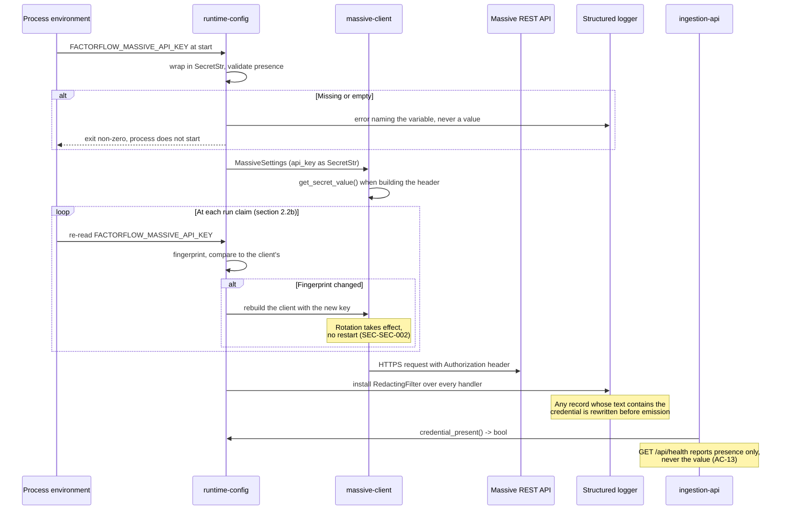

# Component: Runtime Configuration

**Status:** draft
**Capability:** CAP-001
**Owner:** Alvaro de Jodra
**Last Updated:** 2026-09-05

## 1. Overview

Runtime configuration loads and validates every setting both processes need from
the environment, and holds the Massive API key in memory without ever writing
it anywhere. It is a small component carrying one of the capability's sharper
requirements: AC-13 says the provider credential must not appear in the
repository, in log output, or in any view the product renders, and the only way
to keep that true is to make the value unreachable by every code path that
serialises.

It is shared by the application and ingestion containers, which read overlapping
but not identical sets of variables. Both fail their start when a required value
is missing, naming the variable and never its value.

Use cases addressed:

- Load database connection settings for both processes.
- Load the Massive API key for the ingestion process (AC-13).
- Load the interface bind address so the API cannot be published beyond loopback
  by accident (AC-14).
- Load the operational values the design leaves configurable: the provider
  request budget, the retry attempt limit, and the run claim staleness window.
- Report credential presence to `ingestion-api` as a boolean, so the Settings
  screen can say *Provider credential supplied* without the value existing
  outside the ingestion process.

Support matrix: both containers, one machine, environment variables supplied by
the owner's `docker compose` file or shell. No configuration file is read and
none is written.

Dependencies: Pydantic, used for settings validation, which is already in the
stack for API models (tech stack).

## 2. Design Details

### 2.1 Placement

```
src/factorflow/config/settings.py    the settings models and loader
src/factorflow/config/redaction.py   the logging filter
```

### 2.2 Variables

Every variable carries the prefix `FACTORFLOW_`. Every value cites its source.
The operational timings were the last to be decided — they carried
`[REQUIRES INPUT]` markers rather than invented defaults per AGT-EVIDENCE-002
until the owner set them on 2026-09-05; section 2.2a records the derivation and
the relationships between them.

| Variable | Process | Required | Default | Source |
|----------|---------|----------|---------|--------|
| `FACTORFLOW_DATABASE_URL` | both | yes | none | C2, one PostgreSQL store |
| `FACTORFLOW_DATABASE_POOL_MIN` | both | no | 1 | SA-RES-001, pools must be bounded |
| `FACTORFLOW_DATABASE_POOL_MAX` | both | no | 4 | SA-RES-001; one owner, one active run |
| `FACTORFLOW_API_HOST` | application | no | `127.0.0.1` | AC-14, system design constraint 5.11 |
| `FACTORFLOW_API_PORT` | application | no | 8000 | conventional; no capability value |
| `FACTORFLOW_MASSIVE_API_KEY` | **both** | yes | none | AC-13; system design v3 constraint 5.12. Ingestion uses the value; the application reads presence only |
| `FACTORFLOW_MASSIVE_BASE_URL` | ingestion | no | `https://api.massive.com` | Verified by probe 2026-09-05; Massive documents no base URL. See `component-design-massive-client.md` section 2.6 |
| `FACTORFLOW_MASSIVE_REQUESTS_PER_MINUTE` | ingestion | yes | none | system design constraint 5.14, the budget is the owner's plan and cannot be defaulted |
| `FACTORFLOW_MASSIVE_MAX_ATTEMPTS` | ingestion | no | 3 | system design constraint 5.13, owner decision 2026-09-04 |
| `FACTORFLOW_MASSIVE_TIMEOUT_SECONDS` | ingestion | no | 30 | Owner decision 2026-09-05; section 2.2a |
| `FACTORFLOW_MASSIVE_BACKOFF_INITIAL_SECONDS` | ingestion | no | 2 | Owner decision 2026-09-05; section 2.2a |
| `FACTORFLOW_MASSIVE_MAX_THROTTLE_WAIT_SECONDS` | ingestion | no | 300 | Owner decision 2026-09-05; section 2.2a |
| `FACTORFLOW_RUN_HEARTBEAT_SECONDS` | ingestion | no | 60 | Owner decision 2026-09-05; section 2.2a |
| `FACTORFLOW_RUN_STALE_AFTER_SECONDS` | both | no | 900 | Owner decision 2026-09-05; section 2.2a. Must exceed the heartbeat period by a wide margin |
| `FACTORFLOW_RUN_POLL_INTERVAL_SECONDS` | ingestion | no | 5 | Owner decision 2026-09-05; section 2.2a. How often an idle runner looks for work |
| `FACTORFLOW_LOG_LEVEL` | both | no | `INFO` | SA-LOG-001 |

`FACTORFLOW_MASSIVE_REQUESTS_PER_MINUTE` is required rather than defaulted on
purpose. The design is tier-agnostic (system design constraint 5.14), so a
default would be a guess at the owner's plan, and guessing high means the
provider throttles every run while guessing low means every run is slower than
it needs to be.

### 2.2a Operational timing: the canonical set

Every timing value above is decided here and nowhere else. Components read them
from this component rather than defining their own, which is what makes the
relationships below checkable in one place.

The values were set by owner decision on 2026-09-05, and they derive from one
another rather than being chosen independently:

| Value | Default | Why this number |
|-------|---------|-----------------|
| Request timeout | 30s | Generous for the heaviest single call — a five-year daily-bar page — while still failing a hung request inside a run. With 3 attempts, one call is bounded at ~90s plus backoff |
| Initial backoff | 2s | Gives 2s, 4s, 8s across the three attempts. Long enough to ride out a brief provider blip, short enough not to slow a 3000-instrument run materially |
| Throttle wait budget | 300s (5 min) | The plan is unlimited (tech stack), so sustained throttling means something is wrong — the wrong plan is active, or the provider has an incident. Failing the instrument after five minutes surfaces that rather than burying it in a run that never ends |
| Heartbeat period | 60s | Refreshed between instruments, so this is an upper bound on how stale a healthy claim can look, not a timer |
| Staleness window | 900s (15 min) | Must exceed the worst case for one instrument. See below |
| Idle poll interval | 5s | A queued run starts within five seconds, and one query every five seconds is negligible against a store sized for 3000 instruments |

**The staleness window is derived, not chosen.** The heartbeat fires *between*
instruments, so a runner working on one slow instrument cannot refresh its claim
until that instrument finishes. The window must therefore exceed the worst-case
time for a single instrument, or the sweeper reclaims a healthy run — the exact
failure AC-20 exists to prevent.

Worst case for one instrument, with the values above:

- Four data types, each retried up to 3 attempts at a 30s timeout: 4 × 3 × 30s =
  **360s**
- Backoff between those attempts, 2s + 4s per data type: 4 × 6s = **24s**
- A throttle wait, bounded by the budget: up to **300s**

That totals roughly **11 minutes**. The 15-minute window clears it with about
four minutes of margin. The margin matters because paging is not in the
calculation: a five-year bar fetch may span several pages, each its own request,
and a pathological instrument could exceed the estimate.

**Invariants, enforced at load (section 2.4).** These are validated rather than
documented, because a violated relationship produces a run that fails
intermittently under load rather than an error at start:

1. `stale_after > heartbeat × 3`. A window narrower than a few heartbeats turns
   one slow instrument or one delayed sweep into a false reclaim. At the
   defaults this is 900 > 180.
2. `stale_after > (max_attempts × timeout × 4) + max_throttle_wait`. The
   derivation above, stated as a rule so it survives a change to any input. At
   the defaults this is 900 > 660.
3. `poll_interval < stale_after`. An idle runner that polls less often than the
   staleness window leaves claimable work sitting.
4. Every value is greater than zero, and `timeout`, `heartbeat` and
   `poll_interval` are each at least 1 second.

Invariant 2 is the one that binds: raising the timeout or the throttle budget
without raising the staleness window is the change most likely to look harmless
and to cause reclaim of healthy runs under a slow provider. The check makes that
combination refuse to start.

### 2.2b Credential reload: rotation without downtime

SEC-SEC-002 requires every secret to be rotatable without service downtime and
prohibits designs that need redeployment to rotate. This design meets it by
re-reading the provider credential from the environment at the one moment where
no work is in flight: when the runner claims a run.

**The mechanism.**

```python
# src/factorflow/config/settings.py

def read_provider_credential() -> SecretStr:
    """Re-read the provider key from the environment.

    Called by the runner at claim time, not at import. The value is never
    cached at module level, which is what makes rotation observable.
    """


def credential_fingerprint(key: SecretStr) -> str:
    """A short, non-reversible digest used only to detect change.

    SHA-256 of the value, truncated. It is never the value, never logged in
    full, and never compared against anything but another fingerprint.
    """
```

At claim time the runner computes the fingerprint of the current environment
value and compares it to the one its client was built with. When they differ it
closes the existing SDK `RESTClient` and constructs a new one; when they
match it keeps the client and its connection pool. A rotated key therefore takes
effect on the next run, with no restart and no interruption to a run already
under way.

**Why claim time, and not sooner or later.** Between runs the ingestion process
holds no provider connection that matters and no partially-written instrument,
so swapping the client there cannot corrupt anything. Re-reading mid-run would
mean changing credentials partway through a sequence of writes attributed to one
run, which makes a failure harder to explain than the restart it replaces.
Re-reading only at process start is what the rule prohibits.

**Rotation is therefore bounded by run duration, not by deployment.** The window
between rotating the key and the product using it is at most one run — and if
the old key is revoked during that run, the run fails on `CredentialRejected`
with the whole run marked `failed` rather than producing 3000 identical
per-instrument failures (`component-design-massive-client.md` section 2.4).
That is the honest outcome, and the next run picks up the new key.

**Why a fingerprint rather than comparing the values.** Comparing `SecretStr`
values directly would require unwrapping both, putting the plaintext into a
comparison expression and, on failure, potentially into a traceback. The
fingerprint is derived once, is not reversible, and is safe to hold in the
runner's state and to log at debug level as evidence that a rotation was
detected. It never substitutes for the key and is never sent anywhere.

**What is not covered.** The database URL is not reloaded. It is a secret under
SEC-SEC-001 and is held as a `SecretStr`, but the connection pool is
established at start and rotating it means recycling every connection, which is
a different problem with a different blast radius. No capability requires it,
and CAP-001 does not solve it; a capability that needs database credential
rotation owns that outcome. This is a scope statement, not a claim that the
requirement does not apply.

### 2.3 Settings models

```python
# src/factorflow/config/settings.py
from pydantic import Field, SecretStr
from pydantic_settings import BaseSettings, SettingsConfigDict


class DatabaseSettings(BaseSettings):
    model_config = SettingsConfigDict(env_prefix="FACTORFLOW_DATABASE_")

    url: SecretStr
    pool_min: int = Field(default=1, ge=1)
    pool_max: int = Field(default=4, ge=1)


class ApiSettings(BaseSettings):
    model_config = SettingsConfigDict(env_prefix="FACTORFLOW_API_")

    host: str = "127.0.0.1"
    port: int = Field(default=8000, ge=1, le=65535)


class MassiveSettings(BaseSettings):
    model_config = SettingsConfigDict(env_prefix="FACTORFLOW_MASSIVE_")

    api_key: SecretStr
    base_url: str = "https://api.massive.com"
    requests_per_minute: int = Field(ge=1)
    max_attempts: int = Field(default=3, ge=1)
    timeout_seconds: float = Field(default=30.0, gt=0)
    backoff_initial_seconds: float = Field(default=2.0, gt=0)
    max_throttle_wait_seconds: float = Field(default=300.0, gt=0)


class RunSettings(BaseSettings):
    model_config = SettingsConfigDict(env_prefix="FACTORFLOW_RUN_")

    heartbeat_seconds: float = Field(default=60.0, ge=1)
    stale_after_seconds: float = Field(default=900.0, gt=0)
    poll_interval_seconds: float = Field(default=5.0, ge=1)


@model_validator(mode="after")
def _check_timing_invariants(self) -> "Settings":
    """Section 2.2a's invariants, enforced at load.

    A violated relationship produces a run that fails intermittently under a
    slow provider rather than an error at start, so these refuse to start.
    """
    run, massive = self.run, self.massive

    if run.stale_after_seconds <= run.heartbeat_seconds * 3:
        raise ValueError(
            "FACTORFLOW_RUN_STALE_AFTER_SECONDS must exceed "
            "FACTORFLOW_RUN_HEARTBEAT_SECONDS * 3; a window narrower than a few "
            "heartbeats reclaims healthy runs"
        )

    worst_case = (
        massive.max_attempts * massive.timeout_seconds * 4
    ) + massive.max_throttle_wait_seconds
    if run.stale_after_seconds <= worst_case:
        raise ValueError(
            f"FACTORFLOW_RUN_STALE_AFTER_SECONDS must exceed {worst_case:.0f}s, "
            "the worst case for one instrument (4 data types x max_attempts x "
            "timeout, plus the throttle wait budget)"
        )

    if run.poll_interval_seconds >= run.stale_after_seconds:
        raise ValueError(
            "FACTORFLOW_RUN_POLL_INTERVAL_SECONDS must be less than "
            "FACTORFLOW_RUN_STALE_AFTER_SECONDS"
        )

    return self
```

The worst-case expression multiplies by four because an instrument carries four
data types, each independently retried. It is written as an expression rather
than as the literal 660 so that raising the timeout or the throttle budget
raises the required window with it, which is the change most likely to be made
without thinking about reclaim.

`SecretStr` is the mechanism, not a convention. Pydantic's `SecretStr` renders
as `**********` in `repr`, in `str`, and in `model_dump()` unless
`model_dump(mode="python")` is called with explicit secret exposure, so a
credential cannot reach a log record or a JSON response by the ordinary route of
someone logging a settings object. The value is read exactly once, by
`massive-client`, through `get_secret_value()`.

### 2.4 Credential load and redaction flow

The sequence below shows the credential's entire lifetime, which is short and
has exactly one consumer. It is drawn because AC-13 is a negative requirement,
and a negative requirement is only verifiable if the positive path is small
enough to enumerate. The environment supplies the key — at process start, and
again at each run claim, which is what makes rotation work (section 2.2b); the
settings model wraps it in `SecretStr` immediately; the only unwrapping happens
inside the provider client when it builds an Authorization header; and a logging
filter sits across every log record as a second line of defence in case a future
story formats the raw value by mistake. The expected outcome is that the string
exists in exactly two places, the environment and one HTTP header, and nowhere
that is written to disk or returned to a client.



### 2.5 The redaction filter

```python
# src/factorflow/config/redaction.py
import logging


class RedactingFilter(logging.Filter):
    """Replace known secret values anywhere in a formatted log record."""

    def __init__(self, secrets: list[str]) -> None:
        super().__init__()
        self._secrets = [s for s in secrets if s]

    def filter(self, record: logging.LogRecord) -> bool:
        message = record.getMessage()
        for secret in self._secrets:
            if secret in message:
                record.msg = message.replace(secret, "[redacted]")
                record.args = ()
        return True
```

The filter is installed on every handler at process start, in both processes.
It exists because `SecretStr` protects the object and not a string someone
extracted from it; the filter catches the extracted case. Both mechanisms are
required, and the test in section 7 exercises the filter with a deliberately
leaked value.

### 2.6 Credential presence, and where it is answered

The ingestion process uses the credential. The application process, which serves
`GET /api/health`, holds it only to report presence: it reads whether
`FACTORFLOW_MASSIVE_API_KEY` is set in its own environment and returns
`credential_present` as a boolean. It never reads the value, and no code path in
the application unwraps the `SecretStr`.

System design v3 constraint 5.12 settles this, on the owner's decision of
2026-09-05: the variable is supplied to both containers, and health reports an
observed fact rather than a recorded one. The alternative considered and rejected
was for ingestion to record presence in `owner_setting`, which would keep the
secret in one process but would let health report a credential as supplied after
ingestion had stopped. AC-18 exists so the owner can distinguish a healthy system
from a failing one without inspecting the store, and an endpoint that can be
confidently wrong undercuts it.

### 2.7 Messages

N/A, not applicable for this component.

## 3. Constraints and Assumptions

- **The credential is supplied at runtime and never committed** (AC-13, C12 in
  the system design's constraint list, SEC-SEC-001). No `.env` file is committed
  and no default value exists for `FACTORFLOW_MASSIVE_API_KEY`.
- **The interface binds to loopback** (AC-14, system design constraint 5.11).
  `FACTORFLOW_API_HOST` defaults to `127.0.0.1`. The variable is settable, which
  means the owner can break AC-14 by setting it; the deployment also publishes
  the container port to `127.0.0.1` only, so both would have to be changed. The
  compose file is the enforcing layer and the default here is the second.
- **A missing required value fails the start** (system design step 38). The
  process exits non-zero with a message naming the variable. It does not start
  with a partial configuration.
- **No configuration file.** Everything comes from the environment, which is
  what makes the credential's handling auditable.
- **Assumption: the owner supplies the environment through `docker compose`.**
  The compose file references host environment variables rather than embedding
  values, so nothing secret is committed.
- **The provider credential is re-read between runs** (SEC-SEC-002, owner
  decision 2026-09-05). Rotating the Massive key does not require a restart:
  the runner re-reads it when it claims a run, and rebuilds the provider client
  when it has changed. Section 2.4a specifies the mechanism. Configuration other
  than the credential is still read once at start, because nothing requires
  those to be rotatable and re-reading them mid-life would let a process drift
  from the settings it validated.

## 4. Security

- **This component is the capability's credential boundary.** Every control that
  makes AC-13 true lives here: `SecretStr` wrapping, the logging filter, the
  absence of any serialisation path, and the presence-only health report.
- **Data classification.** The Massive API key and the database URL are
  **Restricted** under SEC-DAT-001. Both are held in memory only, never written
  to any store (SEC-DAT-002 does not engage, since neither is persisted), and
  never logged (SEC-DAT-003 is enforced by section 2.5).
- **No hardcoded secrets** (SEC-SEC-001). There is no default for either
  Restricted value, so a missing environment variable fails the start rather
  than falling back to a committed value.
- **Rotatability (SEC-SEC-002).** Met. The provider credential is re-read from
  the environment when the runner claims a run and the provider client is
  rebuilt when it has changed, so rotation needs no restart and no
  redeployment. Section 2.2b specifies the mechanism and states what it does not
  cover.
- **Input validation (SEC-INP-001).** Every variable is validated by a Pydantic
  model with a type and, where meaningful, a range: pool sizes at least 1, port
  within 1 to 65535, requests per minute at least 1, attempts at least 1. An
  invalid value fails the start.
- **No dynamic code execution.** No variable is evaluated, imported by name, or
  used to construct a code path (SEC-INP-003).
- **Error disclosure (SEC-ERR-001).** Validation failures are written to the
  container log the owner reads, naming the variable and the constraint it
  failed. They reach no HTTP response.
- **Privacy impact: none.** No PII.
- **RBAC and authentication: unchanged.** There is no authentication in this
  capability, by the owner's loopback decision, and this component introduces
  none.
- **OSS inventory.** Pydantic and `pydantic-settings`, both already in the
  approved stack, covered by dependency scanning on `pyproject.toml`.

## 5. Scalability and Performance

- Loaded once per process at start. No runtime cost after that.
- The redaction filter runs on every log record and performs a substring scan
  over a list of at most two secrets. At the log volumes this product produces,
  one owner and one run at a time, this is immaterial.
- Resource utilization: a few kilobytes of process memory.
- No SLA. No concurrency: settings objects are frozen after load and shared
  read-only, which is the immutability default SA-CONC-001 asks for.

## 6. Upgrade

- **Adding a variable in a later capability** adds a field with a default, so an
  existing deployment continues to start. Adding a variable without a default is
  a breaking deployment change and must be called out in that capability's
  release notes.
- **No data migration.** This component persists nothing.
- **Behaviour change after upgrade: none in this capability**, there being no
  previous release.
- **Manual actions required on first deployment:** the owner sets
  `FACTORFLOW_DATABASE_URL`, `FACTORFLOW_MASSIVE_API_KEY` and
  `FACTORFLOW_MASSIVE_REQUESTS_PER_MINUTE`. The other variables have defaults or
  are recorded as needing input.
- **Rollback (OPS-MIG-003).** Reverting the image reverts the settings model. A
  variable added by a newer build is simply unread by an older one, so no
  rollback action is required for this component.

## 7. Testing

| Test | File | What it proves |
|------|------|----------------|
| Missing credential fails the start | `tests/unit/test_settings_required.py` | Absent `FACTORFLOW_MASSIVE_API_KEY` raises, and the message names the variable (AC-13) |
| The failure message carries no value | `tests/unit/test_settings_required.py` | A malformed value's error text does not contain the value (AC-13) |
| Credential does not survive serialisation | `tests/unit/test_settings_secrecy.py` | `repr`, `str`, `model_dump()` and `model_dump_json()` of the settings object contain no part of the key (AC-13) |
| The redaction filter rewrites a leaked value | `tests/unit/test_redaction.py` | A log call formatting the raw credential emits `[redacted]` (AC-13) |
| Default bind address is loopback | `tests/unit/test_settings_defaults.py` | `ApiSettings().host == "127.0.0.1"` with no environment set (AC-14) |
| Bounds are enforced | `tests/unit/test_settings_validation.py` | Pool size 0, port 0, requests per minute 0 and attempts 0 each raise |
| Attempt limit default | `tests/unit/test_settings_defaults.py` | `max_attempts` is 3, matching system design constraint 5.13 |
| Timing defaults are the canonical set | `tests/unit/test_settings_defaults.py` | Timeout 30s, backoff 2s, throttle budget 300s, heartbeat 60s, staleness 900s, poll 5s (section 2.2a) |
| Staleness must exceed three heartbeats | `tests/unit/test_settings_validation.py` | Staleness 100s against a 60s heartbeat raises, naming both variables (invariant 1) |
| Staleness must exceed the per-instrument worst case | `tests/unit/test_settings_validation.py` | Raising the timeout to 120s without raising staleness raises, and the message states the computed worst case (invariant 2) |
| Poll interval must be below the staleness window | `tests/unit/test_settings_validation.py` | A poll interval of 900s against a 900s window raises (invariant 3) |
| Timing bounds are enforced | `tests/unit/test_settings_validation.py` | Zero or negative timeout, backoff, throttle budget, heartbeat, staleness and poll interval each raise (invariant 4) |
| A rotated credential is picked up without a restart | `tests/unit/test_credential_reload.py` | Changing the environment value between two claims builds a new client on the second, in the same process (SEC-SEC-002) |
| An unchanged credential reuses the client | `tests/unit/test_credential_reload.py` | Two claims with the same value keep one SDK `RESTClient`, so the connection pool is not discarded needlessly |
| The fingerprint is not the credential | `tests/unit/test_credential_reload.py` | The fingerprint of a known value contains no substring of it and is stable across calls (SEC-SEC-001) |
| The credential is not cached at module level | `tests/unit/test_credential_reload.py` | `read_provider_credential()` reflects a changed environment without reimport, which is what makes rotation observable |
| No committed credential | `tests/unit/test_no_committed_secrets.py` | No tracked file contains a value matching the provider key shape, and no `.env` is tracked (SEC-SEC-001) |

Every test in this component runs without a container, so all carry no
`postgres` marker and run under `uv run pytest -m 'not postgres'`.

Negative-path coverage is the substance here: the component's value is what it
refuses to do, and most of these tests assert an absence or a refusal. The
invariant tests are the newest of them, and they exist because section 2.2a's
relationships fail silently at runtime rather than loudly at start unless
something checks them.

## 8. Acceptance Criteria

1. With `FACTORFLOW_MASSIVE_API_KEY` unset, the ingestion process exits non-zero
   before making any provider request, and the message names the variable.
2. No message emitted by either process at any log level contains the provider
   credential or the database password.
3. `repr`, `str`, and both dump forms of every settings object contain no part
   of either Restricted value.
4. With no environment set, the API bind host is `127.0.0.1`.
5. With `FACTORFLOW_MASSIVE_REQUESTS_PER_MINUTE` unset, the ingestion process
   exits non-zero rather than choosing a rate.
6. `FACTORFLOW_MASSIVE_MAX_ATTEMPTS` defaults to 3.
7. No tracked file in the repository contains a provider credential.
8. Failure scenario: a value that fails validation, such as a negative pool
   size, prevents the process from starting rather than being clamped.
9. Failure scenario: a credential deliberately formatted into a log call is
   emitted as `[redacted]`.

## 9. Workflows

- **New workflow: owner supplies configuration.** The owner exports the three
  required variables and runs `docker compose up`. This is step 2 of the
  capability's *Operate and upgrade the running product* flow.
- **New workflow: a missing value stops the start.** The owner sees a message
  naming the variable and sets it. This is the diagnosable form of flow step 5.
- **Intersecting workflow: the first acquisition run.** The capability's *Acquire
  market data for the first time* flow has the owner supplying the credential
  before naming instruments. There is no interface field for the credential
  anywhere, by AC-13, so this step happens entirely in the environment and the
  interface reports only whether it succeeded.

## 10. UX / GUI

This component renders nothing itself, and it constrains one screen. The UX
design's Settings screen, section 1.3, specifies the credential region as
read-only presence with no field, no mask, no truncation and no last-four,
stating either *Provider credential supplied* or *Provider credential missing*,
and naming the environment variable when missing. That copy is satisfiable only
because this component exposes presence as a boolean and the value nowhere.

When health is unreachable, the UX design requires presence to render as
`coverage-unknown` rather than as missing, so the interface never reports a
credential absent on the strength of a failed request.

Internationalization: none.

## 11. API Endpoints

This component exposes no HTTP surface. It supplies values to components that
do.

| Endpoint | Method/Operation | Auth/Privilege | Request | Response | Notes |
|----------|-----------------|----------------|---------|----------|-------|
| Settings load | Process start, read environment | process environment | Environment variables | Validated settings objects, or a non-zero exit | Consumers are every other component in both processes |
| `credential_present()` | In-process call | none | none | boolean | Consumer is `ingestion-api`, feeding `GET /api/health`. Returns presence, never the value (AC-13) |

## 12. References

| Type | Document Name | Description | Link |
|------|---------------|-------------|------|
| Capability | CAP-001 v6 | AC-13 credential handling, AC-14 network exposure | `docs/capabilities/CAP-001-market-data-acquisition-foundation/Capability-CAP-001.md` |
| System design | CAP-001 system design v3 | Steps 37 to 39, constraints 5.11 to 5.15 | `docs/capabilities/CAP-001-market-data-acquisition-foundation/design/system-design.md` |
| UX design | CAP-001 UX design v4 | Section 1.3, the credential region and its copy | `docs/capabilities/CAP-001-market-data-acquisition-foundation/design/ux-design.md` |
| Constitution | Security Constitution v1.1 | SEC-SEC-001, SEC-SEC-002, SEC-DAT-001, SEC-DAT-003 | `docs/constitutions/security.constitution.md` |
| Constitution | Tech Stack v3 | Pydantic in the approved stack; credential supplied at runtime | `docs/constitution/tech-stack.md` |

## 13. Traceability

| Capability AC | System Design Element | Component Design Element | Section |
|--------------|----------------------|--------------------------|---------|
| AC-13 | `runtime-config` environment load, redaction, no API echo | `SecretStr` wrapping, `RedactingFilter`, presence-only reporting | 2.3, 2.5, 2.6 |
| AC-14 | Port published to `127.0.0.1`; uvicorn bound to loopback | `ApiSettings.host` default `127.0.0.1` | 2.2, 2.3 |
| AC-16 | Refuse an inconsistent start | A missing required value exits before any work is done | 2.4, 3 |
| AC-18 | `GET /api/health` | `credential_present()` supplying the health payload | 2.6 |
| AC-4 | Rate budget pacing | `requests_per_minute` required, not defaulted | 2.2 |
| AC-11 | Retry attempt limit before an instrument is failed | `max_attempts` default 3, sourced to the owner decision | 2.2 |
| AC-20 | Claim heartbeat and staleness window | Heartbeat and staleness variables, values recorded as needing input | 2.2, 14 |

## 14. Open Questions

1. ~~What per-request timeout, initial backoff delay, heartbeat period and
   staleness window should be used?~~ **Resolved 2026-09-05 by owner decision.**
   Timeout 30s, initial backoff 2s, throttle wait budget 300s, heartbeat 60s,
   staleness window 900s, idle poll interval 5s. Section 2.2a records why each
   number was chosen, derives the staleness window from the per-instrument worst
   case rather than picking it, and states four invariants that are enforced at
   load so a later change to one value cannot silently break reclaim.
2. ~~Rotating the provider credential requires a container restart, so
   SEC-SEC-002 is not met.~~ **Resolved 2026-09-05: the credential is reloaded
   between runs**, so the rule is met rather than waived. The owner chose
   implementation over a documented waiver, which the constitution would have
   permitted — the rule is High rather than Critical, and its enforcement clause
   allows an owner-approved waiver. Implementation was preferred because the
   credential is already unwrapped in exactly one place, making the change
   small, and because a waiver would have had to be re-justified at every
   security review and inherited by M3's live feed, where a restart genuinely
   does interrupt service. Section 2.2b carries the design.
3. ~~Should `FACTORFLOW_MASSIVE_API_KEY` be supplied to the application
   container as well as the ingestion container?~~ **Resolved 2026-09-05: yes,
   both containers**, recorded in system design v3 constraint 5.12. The
   application reads only whether the variable is set and must never read the
   value. The alternative, having ingestion record presence in the store, was
   rejected because health would then report a credential as supplied after
   ingestion had stopped, and AC-18 exists so the owner can trust that answer
   without inspecting the store. The exposure this accepts is one process holding
   a string it never sends anywhere; the test in section 7 asserting that no
   response model carries a secret-shaped field is what keeps that true.
