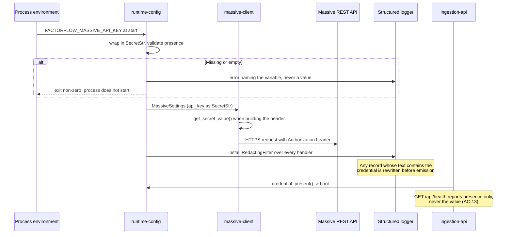

# Component: Runtime Configuration

**Status:** draft
**Capability:** CAP-001
**Owner:** Alvaro de Jodra
**Last Updated:** 2026-09-05

## 1. Overview

Runtime configuration loads and validates every setting both processes need from
the environment, and holds the Massive API key in memory without ever writing
it anywhere. It is a small component carrying one of the capability's sharper
requirements: AC-13 says the provider credential must not appear in the
repository, in log output, or in any view the product renders, and the only way
to keep that true is to make the value unreachable by every code path that
serialises.

It is shared by the application and ingestion containers, which read overlapping
but not identical sets of variables. Both fail their start when a required value
is missing, naming the variable and never its value.

Use cases addressed:

- Load database connection settings for both processes.
- Load the Massive API key for the ingestion process (AC-13).
- Load the interface bind address so the API cannot be published beyond loopback
  by accident (AC-14).
- Load the operational values the design leaves configurable: the provider
  request budget, the retry attempt limit, and the run claim staleness window.
- Report credential presence to `ingestion-api` as a boolean, so the Settings
  screen can say *Provider credential supplied* without the value existing
  outside the ingestion process.

Support matrix: both containers, one machine, environment variables supplied by
the owner's `docker compose` file or shell. No configuration file is read and
none is written.

Dependencies: Pydantic, used for settings validation, which is already in the
stack for API models (tech stack).

## 2. Design Details

### 2.1 Placement

```
src/factorflow/config/settings.py    the settings models and loader
src/factorflow/config/redaction.py   the logging filter
```

### 2.2 Variables

Every variable carries the prefix `FACTORFLOW_`. Values whose source is a
capability or design decision are cited; values with no source carry a
`[REQUIRES INPUT]` marker rather than an invented default, per AGT-EVIDENCE-002.

| Variable | Process | Required | Default | Source |
|----------|---------|----------|---------|--------|
| `FACTORFLOW_DATABASE_URL` | both | yes | none | C2, one PostgreSQL store |
| `FACTORFLOW_DATABASE_POOL_MIN` | both | no | 1 | SA-RES-001, pools must be bounded |
| `FACTORFLOW_DATABASE_POOL_MAX` | both | no | 4 | SA-RES-001; one owner, one active run |
| `FACTORFLOW_API_HOST` | application | no | `127.0.0.1` | AC-14, system design constraint 5.11 |
| `FACTORFLOW_API_PORT` | application | no | 8000 | conventional; no capability value |
| `FACTORFLOW_MASSIVE_API_KEY` | **both** | yes | none | AC-13; system design v3 constraint 5.12. Ingestion uses the value; the application reads presence only |
| `FACTORFLOW_MASSIVE_BASE_URL` | ingestion | no | the provider's published base URL | tech stack; the literal value is set by the implementing story from provider documentation, not from this design |
| `FACTORFLOW_MASSIVE_REQUESTS_PER_MINUTE` | ingestion | yes | none | system design constraint 5.14, the budget is the owner's plan and cannot be defaulted |
| `FACTORFLOW_MASSIVE_MAX_ATTEMPTS` | ingestion | no | 3 | system design constraint 5.13, owner decision 2026-09-04 |
| `FACTORFLOW_MASSIVE_TIMEOUT_SECONDS` | ingestion | no | `[REQUIRES INPUT: what per-request timeout should the provider client use?]` | none; see section 14 |
| `FACTORFLOW_MASSIVE_BACKOFF_INITIAL_SECONDS` | ingestion | no | `[REQUIRES INPUT: what initial backoff delay?]` | none; see section 14 |
| `FACTORFLOW_RUN_HEARTBEAT_SECONDS` | ingestion | no | `[REQUIRES INPUT: how often should a runner refresh its claim?]` | none; system design says a heartbeat exists, not its period |
| `FACTORFLOW_RUN_STALE_AFTER_SECONDS` | both | no | `[REQUIRES INPUT: after how long without a heartbeat is a run abandoned?]` | none; system design calls it "the configured staleness window" |
| `FACTORFLOW_LOG_LEVEL` | both | no | `INFO` | SA-LOG-001 |

`FACTORFLOW_MASSIVE_REQUESTS_PER_MINUTE` is required rather than defaulted on
purpose. The design is tier-agnostic (system design constraint 5.14), so a
default would be a guess at the owner's plan, and guessing high means the
provider throttles every run while guessing low means every run is slower than
it needs to be.

### 2.3 Settings models

```python
# src/factorflow/config/settings.py
from pydantic import Field, SecretStr
from pydantic_settings import BaseSettings, SettingsConfigDict


class DatabaseSettings(BaseSettings):
    model_config = SettingsConfigDict(env_prefix="FACTORFLOW_DATABASE_")

    url: SecretStr
    pool_min: int = Field(default=1, ge=1)
    pool_max: int = Field(default=4, ge=1)


class ApiSettings(BaseSettings):
    model_config = SettingsConfigDict(env_prefix="FACTORFLOW_API_")

    host: str = "127.0.0.1"
    port: int = Field(default=8000, ge=1, le=65535)


class MassiveSettings(BaseSettings):
    model_config = SettingsConfigDict(env_prefix="FACTORFLOW_MASSIVE_")

    api_key: SecretStr
    base_url: str
    requests_per_minute: int = Field(ge=1)
    max_attempts: int = Field(default=3, ge=1)
```

`SecretStr` is the mechanism, not a convention. Pydantic's `SecretStr` renders
as `**********` in `repr`, in `str`, and in `model_dump()` unless
`model_dump(mode="python")` is called with explicit secret exposure, so a
credential cannot reach a log record or a JSON response by the ordinary route of
someone logging a settings object. The value is read exactly once, by
`massive-client`, through `get_secret_value()`.

### 2.4 Credential load and redaction flow

The sequence below shows the credential's entire lifetime, which is short and
has exactly one consumer. It is drawn because AC-13 is a negative requirement,
and a negative requirement is only verifiable if the positive path is small
enough to enumerate. The environment supplies the key at process start; the
settings model wraps it in `SecretStr` immediately; the only unwrapping happens
inside the provider client when it builds an Authorization header; and a logging
filter sits across every log record as a second line of defence in case a future
story formats the raw value by mistake. The expected outcome is that the string
exists in exactly two places, the environment and one HTTP header, and nowhere
that is written to disk or returned to a client.



### 2.5 The redaction filter

```python
# src/factorflow/config/redaction.py
import logging


class RedactingFilter(logging.Filter):
    """Replace known secret values anywhere in a formatted log record."""

    def __init__(self, secrets: list[str]) -> None:
        super().__init__()
        self._secrets = [s for s in secrets if s]

    def filter(self, record: logging.LogRecord) -> bool:
        message = record.getMessage()
        for secret in self._secrets:
            if secret in message:
                record.msg = message.replace(secret, "[redacted]")
                record.args = ()
        return True
```

The filter is installed on every handler at process start, in both processes.
It exists because `SecretStr` protects the object and not a string someone
extracted from it; the filter catches the extracted case. Both mechanisms are
required, and the test in section 7 exercises the filter with a deliberately
leaked value.

### 2.6 Credential presence, and where it is answered

The ingestion process uses the credential. The application process, which serves
`GET /api/health`, holds it only to report presence: it reads whether
`FACTORFLOW_MASSIVE_API_KEY` is set in its own environment and returns
`credential_present` as a boolean. It never reads the value, and no code path in
the application unwraps the `SecretStr`.

System design v3 constraint 5.12 settles this, on the owner's decision of
2026-09-05: the variable is supplied to both containers, and health reports an
observed fact rather than a recorded one. The alternative considered and rejected
was for ingestion to record presence in `owner_setting`, which would keep the
secret in one process but would let health report a credential as supplied after
ingestion had stopped. AC-18 exists so the owner can distinguish a healthy system
from a failing one without inspecting the store, and an endpoint that can be
confidently wrong undercuts it.

### 2.7 Messages

N/A, not applicable for this component.

## 3. Constraints and Assumptions

- **The credential is supplied at runtime and never committed** (AC-13, C12 in
  the system design's constraint list, SEC-SEC-001). No `.env` file is committed
  and no default value exists for `FACTORFLOW_MASSIVE_API_KEY`.
- **The interface binds to loopback** (AC-14, system design constraint 5.11).
  `FACTORFLOW_API_HOST` defaults to `127.0.0.1`. The variable is settable, which
  means the owner can break AC-14 by setting it; the deployment also publishes
  the container port to `127.0.0.1` only, so both would have to be changed. The
  compose file is the enforcing layer and the default here is the second.
- **A missing required value fails the start** (system design step 38). The
  process exits non-zero with a message naming the variable. It does not start
  with a partial configuration.
- **No configuration file.** Everything comes from the environment, which is
  what makes the credential's handling auditable.
- **Assumption: the owner supplies the environment through `docker compose`.**
  The compose file references host environment variables rather than embedding
  values, so nothing secret is committed.
- **Assumption: secrets rotate by restart.** SEC-SEC-002 requires secrets be
  rotatable without service downtime. This design does not meet that: rotating
  the Massive key requires restarting the ingestion container. Recorded in
  section 14 as a surfaced security consideration rather than accepted silently,
  per AGT-SPEC-002.

## 4. Security

- **This component is the capability's credential boundary.** Every control that
  makes AC-13 true lives here: `SecretStr` wrapping, the logging filter, the
  absence of any serialisation path, and the presence-only health report.
- **Data classification.** The Massive API key and the database URL are
  **Restricted** under SEC-DAT-001. Both are held in memory only, never written
  to any store (SEC-DAT-002 does not engage, since neither is persisted), and
  never logged (SEC-DAT-003 is enforced by section 2.5).
- **No hardcoded secrets** (SEC-SEC-001). There is no default for either
  Restricted value, so a missing environment variable fails the start rather
  than falling back to a committed value.
- **Rotatability (SEC-SEC-002).** Not met without a restart. Surfaced in section
  14 rather than judged acceptable by this agent.
- **Input validation (SEC-INP-001).** Every variable is validated by a Pydantic
  model with a type and, where meaningful, a range: pool sizes at least 1, port
  within 1 to 65535, requests per minute at least 1, attempts at least 1. An
  invalid value fails the start.
- **No dynamic code execution.** No variable is evaluated, imported by name, or
  used to construct a code path (SEC-INP-003).
- **Error disclosure (SEC-ERR-001).** Validation failures are written to the
  container log the owner reads, naming the variable and the constraint it
  failed. They reach no HTTP response.
- **Privacy impact: none.** No PII.
- **RBAC and authentication: unchanged.** There is no authentication in this
  capability, by the owner's loopback decision, and this component introduces
  none.
- **OSS inventory.** Pydantic and `pydantic-settings`, both already in the
  approved stack, covered by dependency scanning on `pyproject.toml`.

## 5. Scalability and Performance

- Loaded once per process at start. No runtime cost after that.
- The redaction filter runs on every log record and performs a substring scan
  over a list of at most two secrets. At the log volumes this product produces,
  one owner and one run at a time, this is immaterial.
- Resource utilization: a few kilobytes of process memory.
- No SLA. No concurrency: settings objects are frozen after load and shared
  read-only, which is the immutability default SA-CONC-001 asks for.

## 6. Upgrade

- **Adding a variable in a later capability** adds a field with a default, so an
  existing deployment continues to start. Adding a variable without a default is
  a breaking deployment change and must be called out in that capability's
  release notes.
- **No data migration.** This component persists nothing.
- **Behaviour change after upgrade: none in this capability**, there being no
  previous release.
- **Manual actions required on first deployment:** the owner sets
  `FACTORFLOW_DATABASE_URL`, `FACTORFLOW_MASSIVE_API_KEY` and
  `FACTORFLOW_MASSIVE_REQUESTS_PER_MINUTE`. The other variables have defaults or
  are recorded as needing input.
- **Rollback (OPS-MIG-003).** Reverting the image reverts the settings model. A
  variable added by a newer build is simply unread by an older one, so no
  rollback action is required for this component.

## 7. Testing

| Test | File | What it proves |
|------|------|----------------|
| Missing credential fails the start | `tests/unit/test_settings_required.py` | Absent `FACTORFLOW_MASSIVE_API_KEY` raises, and the message names the variable (AC-13) |
| The failure message carries no value | `tests/unit/test_settings_required.py` | A malformed value's error text does not contain the value (AC-13) |
| Credential does not survive serialisation | `tests/unit/test_settings_secrecy.py` | `repr`, `str`, `model_dump()` and `model_dump_json()` of the settings object contain no part of the key (AC-13) |
| The redaction filter rewrites a leaked value | `tests/unit/test_redaction.py` | A log call formatting the raw credential emits `[redacted]` (AC-13) |
| Default bind address is loopback | `tests/unit/test_settings_defaults.py` | `ApiSettings().host == "127.0.0.1"` with no environment set (AC-14) |
| Bounds are enforced | `tests/unit/test_settings_validation.py` | Pool size 0, port 0, requests per minute 0 and attempts 0 each raise |
| Attempt limit default | `tests/unit/test_settings_defaults.py` | `max_attempts` is 3, matching system design constraint 5.13 |
| No committed credential | `tests/unit/test_no_committed_secrets.py` | No tracked file contains a value matching the provider key shape, and no `.env` is tracked (SEC-SEC-001) |

Every test in this component runs without a container, so all carry no
`postgres` marker and run under `uv run pytest -m 'not postgres'`.

Negative-path coverage is the substance here: the component's value is what it
refuses to do, so seven of the eight tests assert an absence.

## 8. Acceptance Criteria

1. With `FACTORFLOW_MASSIVE_API_KEY` unset, the ingestion process exits non-zero
   before making any provider request, and the message names the variable.
2. No message emitted by either process at any log level contains the provider
   credential or the database password.
3. `repr`, `str`, and both dump forms of every settings object contain no part
   of either Restricted value.
4. With no environment set, the API bind host is `127.0.0.1`.
5. With `FACTORFLOW_MASSIVE_REQUESTS_PER_MINUTE` unset, the ingestion process
   exits non-zero rather than choosing a rate.
6. `FACTORFLOW_MASSIVE_MAX_ATTEMPTS` defaults to 3.
7. No tracked file in the repository contains a provider credential.
8. Failure scenario: a value that fails validation, such as a negative pool
   size, prevents the process from starting rather than being clamped.
9. Failure scenario: a credential deliberately formatted into a log call is
   emitted as `[redacted]`.

## 9. Workflows

- **New workflow: owner supplies configuration.** The owner exports the three
  required variables and runs `docker compose up`. This is step 2 of the
  capability's *Operate and upgrade the running product* flow.
- **New workflow: a missing value stops the start.** The owner sees a message
  naming the variable and sets it. This is the diagnosable form of flow step 5.
- **Intersecting workflow: the first acquisition run.** The capability's *Acquire
  market data for the first time* flow has the owner supplying the credential
  before naming instruments. There is no interface field for the credential
  anywhere, by AC-13, so this step happens entirely in the environment and the
  interface reports only whether it succeeded.

## 10. UX / GUI

This component renders nothing itself, and it constrains one screen. The UX
design's Settings screen, section 1.3, specifies the credential region as
read-only presence with no field, no mask, no truncation and no last-four,
stating either *Provider credential supplied* or *Provider credential missing*,
and naming the environment variable when missing. That copy is satisfiable only
because this component exposes presence as a boolean and the value nowhere.

When health is unreachable, the UX design requires presence to render as
`coverage-unknown` rather than as missing, so the interface never reports a
credential absent on the strength of a failed request.

Internationalization: none.

## 11. API Endpoints

This component exposes no HTTP surface. It supplies values to components that
do.

| Endpoint | Method/Operation | Auth/Privilege | Request | Response | Notes |
|----------|-----------------|----------------|---------|----------|-------|
| Settings load | Process start, read environment | process environment | Environment variables | Validated settings objects, or a non-zero exit | Consumers are every other component in both processes |
| `credential_present()` | In-process call | none | none | boolean | Consumer is `ingestion-api`, feeding `GET /api/health`. Returns presence, never the value (AC-13) |

## 12. References

| Type | Document Name | Description | Link |
|------|---------------|-------------|------|
| Capability | CAP-001 v6 | AC-13 credential handling, AC-14 network exposure | `docs/capabilities/CAP-001-market-data-acquisition-foundation/Capability-CAP-001.md` |
| System design | CAP-001 system design v3 | Steps 37 to 39, constraints 5.11 to 5.15 | `docs/capabilities/CAP-001-market-data-acquisition-foundation/design/system-design.md` |
| UX design | CAP-001 UX design v4 | Section 1.3, the credential region and its copy | `docs/capabilities/CAP-001-market-data-acquisition-foundation/design/ux-design.md` |
| Constitution | Security Constitution v1.1 | SEC-SEC-001, SEC-SEC-002, SEC-DAT-001, SEC-DAT-003 | `docs/constitutions/security.constitution.md` |
| Constitution | Tech Stack v2 | Pydantic in the approved stack; credential supplied at runtime | `docs/constitution/tech-stack.md` |

## 13. Traceability

| Capability AC | System Design Element | Component Design Element | Section |
|--------------|----------------------|--------------------------|---------|
| AC-13 | `runtime-config` environment load, redaction, no API echo | `SecretStr` wrapping, `RedactingFilter`, presence-only reporting | 2.3, 2.5, 2.6 |
| AC-14 | Port published to `127.0.0.1`; uvicorn bound to loopback | `ApiSettings.host` default `127.0.0.1` | 2.2, 2.3 |
| AC-16 | Refuse an inconsistent start | A missing required value exits before any work is done | 2.4, 3 |
| AC-18 | `GET /api/health` | `credential_present()` supplying the health payload | 2.6 |
| AC-4 | Rate budget pacing | `requests_per_minute` required, not defaulted | 2.2 |
| AC-11 | Retry attempt limit before an instrument is failed | `max_attempts` default 3, sourced to the owner decision | 2.2 |
| AC-20 | Claim heartbeat and staleness window | Heartbeat and staleness variables, values recorded as needing input | 2.2, 14 |

## 14. Open Questions

1. **What per-request timeout, initial backoff delay, heartbeat period and
   staleness window should be used?** The system design requires each mechanism
   and states no value for any of them. Four variables in section 2.2 carry
   `[REQUIRES INPUT]` markers rather than invented defaults. The staleness
   window is the consequential one: too short and a slow but healthy run is
   reclaimed as abandoned, too long and a dead runner blocks acquisition for
   that period. *Owner: capability owner, with the system design owner for the
   staleness window. Blocks: the implementing stories for
   `rate-limit-governor` and `run-journal`.*
2. **Rotating the provider credential requires a container restart, so
   SEC-SEC-002 is not met.** Surfaced rather than accepted: a single-owner
   self-hosted deployment may find a restart acceptable, but that is a security
   tradeoff for the owner to make, not for this design to assume. *Owner:
   capability owner. Blocks: nothing in this capability.*
3. ~~Should `FACTORFLOW_MASSIVE_API_KEY` be supplied to the application
   container as well as the ingestion container?~~ **Resolved 2026-09-05: yes,
   both containers**, recorded in system design v3 constraint 5.12. The
   application reads only whether the variable is set and must never read the
   value. The alternative, having ingestion record presence in the store, was
   rejected because health would then report a credential as supplied after
   ingestion had stopped, and AC-18 exists so the owner can trust that answer
   without inspecting the store. The exposure this accepts is one process holding
   a string it never sends anywhere; the test in section 7 asserting that no
   response model carries a secret-shaped field is what keeps that true.
