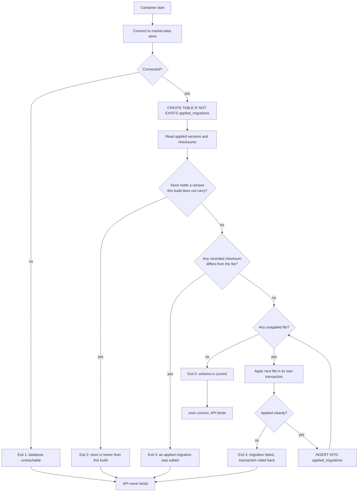

# Component: Schema Migrator

**Status:** draft
**Capability:** CAP-001
**Owner:** Alvaro de Jodra
**Last Updated:** 2026-09-05

## 1. Overview

The schema migrator applies numbered, forward-only SQL migration files to
`market-data-store` and maintains the `applied_migrations` table. It runs once
at application container start and exits before the API binds its socket. It is
the component that decides whether the product is allowed to run at all against
the data it finds.

Two acceptance criteria rest entirely on it. AC-15 requires that deploying a
newer build onto an existing store brings the data forward without losing or
rewriting acquired history. AC-16 requires that when the store cannot be brought
forward, the product reports the failure and serves and writes nothing. The
second is the harder one, because the tempting behaviour, starting anyway and
hoping, is exactly what produces an inconsistent store.

Use cases addressed:

- First deployment against an empty database: apply every migration in order.
- Redeployment of the same build: apply nothing, exit zero.
- Deployment of a newer build: apply only the files not yet recorded.
- Deployment of an older build onto a newer store: refuse to start.
- A migration that fails partway: refuse to start, leaving the failed file's
  transaction rolled back.

Support matrix: runs inside the application container only. The ingestion
container never migrates, because two processes racing to apply DDL is a defect
with no upside. Environments: the owner's single self-hosted Docker host.

Dependencies: PostgreSQL 16, `psycopg` 3, the migration files under
`migrations/`, and `runtime-config` for the database connection settings.

## 2. Design Details

### 2.1 Placement

```
src/factorflow/db/migrator.py       the migrator
src/factorflow/db/migrate_main.py   the container entrypoint
migrations/0001_extensions_owner_state.sql
migrations/0002_observations.sql
migrations/0003_coverage.sql
migrations/0004_runs.sql
```

The application container's entrypoint runs `python -m factorflow.db.migrate_main`
and only then execs uvicorn. Running the migrator as a separate command rather
than inside the FastAPI lifespan hook is deliberate: a lifespan failure would
still leave a bound socket for a moment, and AC-16 says the API must never bind.

### 2.2 Migration file contract

- Filename is `NNNN_snake_case_name.sql`, four digits, ascending, no gaps
  permitted.
- One file is one transaction. The migrator opens the transaction; the file must
  not contain `BEGIN` or `COMMIT`.
- A file that has been applied is never edited. A correction is a new file.
- The checksum recorded in `applied_migrations` is the SHA-256 of the file bytes.

### 2.3 Start decision flowchart

The chart below is the whole of the migrator's decision logic, and it is drawn
because AC-16's refusal path has four distinct causes that must not be collapsed
into a single generic failure. The migrator first reads what the store says has
been applied, then compares that against what the build carries. Three
comparisons can fail: the store holds a version this build does not know, which
means an older build has been deployed onto a newer store; a recorded migration's
checksum does not match the file this build carries, which means an applied file
was edited; or a file fails while applying. Every failure exits non-zero with a
message naming the specific cause, and the container entrypoint therefore never
reaches uvicorn.



### 2.4 Interface

```python
# src/factorflow/db/migrator.py
from dataclasses import dataclass
from pathlib import Path

import psycopg


class MigrationError(Exception):
    """Raised when the store cannot be brought forward to this build."""


@dataclass(frozen=True)
class MigrationFile:
    version: int
    name: str
    checksum: str
    sql: str


def discover(directory: Path) -> list[MigrationFile]:
    """Return every migration this build carries, ordered by version.

    Raises MigrationError when a filename is malformed or a version repeats.
    """


def apply_pending(connection: psycopg.Connection, files: list[MigrationFile]) -> list[int]:
    """Apply every file not recorded in applied_migrations, in order.

    Returns the versions applied, empty when the schema is already current.
    Raises MigrationError when the store is ahead of this build, when a
    recorded checksum does not match, or when a file fails to apply.
    """
```

`apply_pending` opens one transaction per file and inserts the
`applied_migrations` row inside that same transaction, so a file either applies
and is recorded together or neither happens. Recording outside the transaction
would allow a crash between the two to leave a store no future run can classify.

### 2.5 Exit codes and messages

| Exit | Cause | Message shape | Acceptance criterion |
|------|-------|---------------|----------------------|
| 0 | Schema current or brought forward | `schema current at version N` or `applied migrations: N, M` | AC-15 |
| 1 | Database unreachable or credentials rejected | `database unreachable: <driver message>`, naming the host and database but never the password | AC-16, AC-13 |
| 2 | Store holds a version this build does not carry | `store is at version N, this build carries up to M; deploy a build that knows version N` | AC-16 |
| 3 | A recorded migration's checksum does not match | `migration N was applied with a different definition than this build carries` | AC-16 |
| 4 | A migration failed to apply | `migration N failed: <driver message>; no change was committed` | AC-16 |

Every message is emitted through the structured logger at `error` level with the
migration version as a field, never through `print` (SA-LOG-001).

### 2.6 Messages

N/A, not applicable for this component. No broker, topic or queue.

## 3. Constraints and Assumptions

- **Forward only.** There is no down migration, no reversal, and no
  `--rollback` flag. System design constraint 5.10 states there is no
  rollback-by-schema-reversal path, so offering one would be a lie.
- **One writer.** Only the application container runs the migrator. If the owner
  runs two application containers, the second one's migrator would race the
  first. This is prevented by a PostgreSQL advisory lock, section 2.4's
  `apply_pending` taking `pg_advisory_lock` on a fixed key for the duration, so
  the second waits and then finds nothing to apply.
- **A failed migration leaves no partial DDL.** PostgreSQL supports
  transactional DDL, which is what makes one-file-one-transaction viable. A
  migration containing a statement PostgreSQL cannot run transactionally, such
  as `CREATE INDEX CONCURRENTLY`, would break this and is prohibited.
- **`CREATE EXTENSION btree_gist` in `0001` requires database owner or superuser
  privileges** on first application. The `postgres:16` image's default superuser
  satisfies this in the owner's deployment.
- **Assumption: the migration files are shipped inside the image.** They are
  read from the filesystem at a path resolved relative to the package, not
  fetched at runtime.
- **Assumption: the owner deploys images in order.** The migrator refuses a
  backwards deployment rather than attempting to handle it, which is the correct
  behaviour but does mean a rollback of the application image after a migration
  requires a data restore.

## 4. Security

- **Credential handling (AC-13, SEC-SEC-001).** The database connection string
  comes from `runtime-config`, which reads it from the environment. The migrator
  logs the host, port and database name and never the password. Its failure
  messages are the highest-risk disclosure point in the component, because a
  `psycopg` connection error can include the connection string; the message is
  therefore constructed from known-safe fields rather than by formatting the
  driver's exception directly.
- **Data classification.** The migrator handles no market data values. It reads
  and writes `applied_migrations`, which holds Internal metadata only.
- **Injection.** Migration files are trusted repository content executed as SQL
  by design. No user input reaches them, and no filename or version from outside
  the repository is interpolated into a statement. The
  `applied_migrations` insert uses bound parameters (SEC-INP-002).
- **Privilege.** The migrator holds the same database credential as the
  application, which is the only credential the deployment defines. Section 14
  records whether a separate DDL credential is worth introducing.
- **Errors do not leak internals to a client (SEC-ERR-001).** The migrator has
  no external clients; it writes to the container log the owner reads. Detailed
  causes are appropriate there and appear nowhere the interface renders.
- **Privacy impact: none.** No PII, no customer data.
- **OSS inventory.** `psycopg` 3 only, covered by dependency scanning on
  `pyproject.toml`.

## 5. Scalability and Performance

- Four migration files against an empty database complete in well under a
  second. The dominant cost is `CREATE EXTENSION btree_gist`.
- On a populated store, a future migration's duration is a property of that
  migration, not of this component. The migrator holds an advisory lock for the
  duration, so a long migration delays the API start rather than corrupting it.
- Resource utilization: one connection, held for the length of the run, then
  closed. No pool.
- Concurrency: serialised by advisory lock. There is no shared mutable state
  (SA-CONC-001).
- No SLA applies. Container start time is not a stated requirement anywhere in
  the capability.

## 6. Upgrade

This component is the upgrade mechanism, so its own upgrade story is the
capability's.

- **Adding a migration in a later capability.** Add the next numbered file. No
  code change to the migrator.
- **AC-15 in practice.** Bring-forward is proven by the integration test in
  section 7 that applies `0001` to `0004`, writes observation rows, applies again
  and asserts every row is unchanged.
- **AC-16 in practice.** The four non-zero exits in section 2.5 are the refusal.
  The container entrypoint uses `&&` between the migrate command and the uvicorn
  exec, so a non-zero exit prevents the API from starting without any additional
  supervision logic.
- **Manual actions required: none** on a forward deployment. A backwards
  deployment requires the owner to restore a backup, which section 14 of the
  `market-data-store` design records as an unspecified procedure.

## 7. Testing

| Test | File | What it proves |
|------|------|----------------|
| Empty database applies all files | `tests/integration/test_migrator_empty.py` | Four versions recorded, exit 0 (AC-15) |
| Second run applies nothing | `tests/integration/test_migrator_idempotent.py` | No versions applied, exit 0, no row modified (AC-15) |
| Existing data survives re-application | `tests/integration/test_migrator_preserves_data.py` | Bars written before re-running are byte-identical after (AC-15) |
| Store ahead of build refuses | `tests/integration/test_migrator_refuses.py` | A synthetic `applied_migrations` row at version 99 produces exit 2 and no DDL (AC-16) |
| Edited applied migration refuses | `tests/integration/test_migrator_refuses.py` | A mismatched checksum produces exit 3 (AC-16) |
| Failing migration rolls back | `tests/integration/test_migrator_refuses.py` | A deliberately broken file leaves no table and no `applied_migrations` row, exit 4 (AC-16) |
| Filenames are well formed | `tests/unit/test_migration_filenames.py` | Every file matches the four-digit pattern, versions are contiguous, no file contains `BEGIN` or `COMMIT`; no container needed |
| No transactional-DDL violation | `tests/unit/test_migration_filenames.py` | No file contains `CREATE INDEX CONCURRENTLY` or `VACUUM` |
| Password never logged | `tests/unit/test_migrator_logging.py` | A connection failure with a password in the URL produces a log record not containing it (AC-13) |
| Advisory lock serialises | `tests/integration/test_migrator_concurrent.py` | Two migrators against one empty store both exit 0 and apply each version once |

Security testing: the password-redaction test above is the security-relevant
case. Performance and scalability testing do not apply at four files.

## 8. Acceptance Criteria

1. Against an empty database, the migrator applies all four files in ascending
   order and records one row per file in `applied_migrations`.
2. Run twice against the same database, the second run applies nothing and exits
   zero.
3. Observation rows written between two runs are unchanged after the second.
4. When `applied_migrations` holds a version this build does not carry, the
   migrator exits non-zero and applies no DDL.
5. When a recorded checksum does not match the file this build carries, the
   migrator exits non-zero and applies no DDL.
6. When a migration file fails, no part of that file is committed and no
   `applied_migrations` row is written for it.
7. On any non-zero exit, the application process does not bind its listening
   socket.
8. No log record emitted by the migrator contains the database password or the
   provider credential.
9. Two migrators started concurrently against one empty store each exit zero and
   each version is applied exactly once.

## 9. Workflows

- **New workflow: first start.** The owner runs `docker compose up`. The
  application container migrates, then serves. The owner sees the applied
  versions in the container log.
- **New workflow: upgrade.** The owner pulls a newer image and restarts. The
  migrator applies the difference.
- **New workflow: refused start.** The owner sees a non-zero exit and a message
  naming the cause. The interface, if open, shows the shell's unreachable state
  described in the UX design section 2, which names a failed migration as a
  likely cause. This is the only place in the capability where a backend refusal
  is designed into the interface copy, and the two must stay in step.
- **Intersecting workflow: the ingestion container.** It starts independently and
  does not migrate. If it starts before the application container has migrated,
  it finds no tables and fails its own start check, which is
  `acquisition-runner`'s concern rather than this component's.

## 10. UX / GUI

N/A, not applicable for this component. It renders nothing and has no endpoint.
Its failure is what the interface's unreachable state describes: *FactorFlow is
not answering. The application container may have stopped, or a database
migration may have failed and prevented it from starting. Check the container
logs.* That copy is specified in the UX design section 2 and is the user-visible
consequence of exits 1 through 4 in section 2.5.

Internationalization: none. Log output is English and read by the owner.

## 11. API Endpoints

This component exposes no HTTP surface.

| Endpoint | Method/Operation | Auth/Privilege | Request | Response | Notes |
|----------|-----------------|----------------|---------|----------|-------|
| Migration application | Read `applied_migrations`, execute DDL, insert applied row | application database credential | Numbered SQL files carried in the image | Applied versions, or a non-zero exit | Provider is `market-data-store`; this component is the consumer, per system design 4.2 |
| Advisory lock | `pg_advisory_lock` on a fixed key | application database credential | Lock key | Held for the run | Serialises concurrent migrators |

## 12. References

| Type | Document Name | Description | Link |
|------|---------------|-------------|------|
| Capability | CAP-001 v6 | AC-15 forward data evolution, AC-16 refuse an inconsistent start | `docs/capabilities/CAP-001-market-data-acquisition-foundation/Capability-CAP-001.md` |
| System design | CAP-001 system design v3 | Application start steps 32 to 36, constraint 5.10 | `docs/capabilities/CAP-001-market-data-acquisition-foundation/design/system-design.md` |
| Component design | Market Data Store | `applied_migrations` definition and the four migration files | `docs/capabilities/CAP-001-market-data-acquisition-foundation/design/component-design-market-data-store.md` |
| UX design | CAP-001 UX design v3 | Section 2, the unreachable state naming a failed migration | `docs/capabilities/CAP-001-market-data-acquisition-foundation/design/ux-design.md` |
| Constitution | Tech Stack v2 | Numbered forward-only migrations, no ORM, validation commands | `docs/constitution/tech-stack.md` |

## 13. Traceability

| Capability AC | System Design Element | Component Design Element | Section |
|--------------|----------------------|--------------------------|---------|
| AC-15 | `schema-migrator`, numbered migrations, `applied_migrations` | `apply_pending`, one transaction per file, checksum recording | 2.3, 2.4 |
| AC-16 | Migrator exits non-zero; API never binds | Exit codes 1 to 4 and the entrypoint chaining in 2.1 | 2.5, 6 |
| AC-13 | `runtime-config` redaction | Failure messages built from known-safe fields, never from the raw driver exception | 4 |
| AC-18 | `GET /api/health` liveness | A refused migration presents as the interface's unreachable state rather than as a running product | 9, 10 |

## 14. Open Questions

1. ~~Should DDL use a separate database credential from the application's
   runtime credential?~~ **Resolved 2026-09-05: no, one credential.** The
   separation was proposed to support the database role grants in the
   `market-data-store` design section 2.5, and the owner rejected those on cost
   against reach. With no grant to enforce, a second credential would add a
   deployment variable and buy nothing. The application connects as one role that
   both applies DDL and reads data, and the append-only guarantee rests on the two
   software controls recorded in that design.
2. **What advisory lock key?** Section 2.4 specifies a fixed key without naming
   its value, because any constant works and inventing one here would put a
   magic number in a design rather than in the constant it belongs in.
   `[REQUIRES INPUT: none needed if the implementing story defines a named
   constant; recorded so the value is not invented twice.]` *Owner:
   implementing story. Blocks: nothing.*
