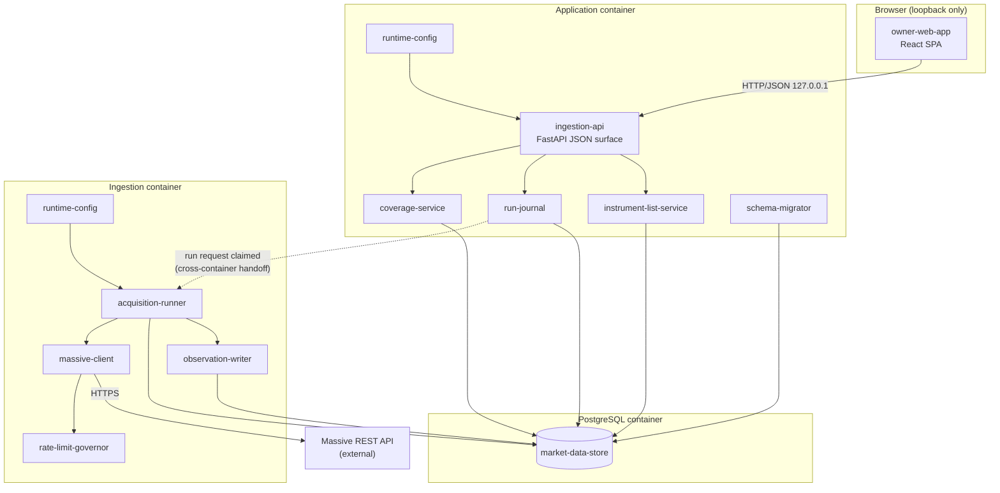

# System Design: Market Data Acquisition Foundation

## 1. Design Overview

This design delivers the first running FactorFlow system. It acquires instrument
reference data, daily prices, company fundamentals and corporate actions from
Massive into an append-only point-in-time store, and gives the owner-operator a
browser interface showing what was acquired, what is missing from it, and which
runs failed.

The shape follows charter constraint C1 directly: two containers built from one
repository, plus PostgreSQL. The **application container** serves the JSON API
and the built interface bundle, and applies schema migrations at start. The
**ingestion container** performs acquisition runs. They share one PostgreSQL
database and never call each other in-process; the handoff is a claimed row in a
run journal table, which is what keeps ingestion's failure modes — slow provider
responses, exhausted rate budgets, upstream outages — from reaching the API.

Three design commitments carry most of the correctness risk, and each traces to a
constraint that cannot be repaired later. Observations are appended with the date
FactorFlow observed them and never with a provider-supplied filing date, because
Massive's fundamentals conflate restatements (C5, and the provider evaluation in
`tech-stack.md`). Coverage is derived from what was actually written rather than
from what a run intended to write, so a run that dies partway cannot leave
history that looks complete (AC-12). And every write is idempotent on the value
itself, so a re-run adds nothing when the provider returns what is already held
but does add a row when the provider returns something different (AC-5, AC-6).

The interface is bound to the loopback address and performs no authentication, on
the owner's decision of 2026-09-03. This design treats that as a constraint on
deployment rather than an absence of a requirement: the containers run in the
host network namespace, the API binds `127.0.0.1` and PostgreSQL listens on
`127.0.0.1` only, so nothing listens on another interface
(`component-design-runtime-config.md` section 2.8.1). Nothing in the API assumes
an authenticated principal that a later capability would have to retrofit.

The block diagram below is described in Section 2, and the components it names
are declared in Section 4.1. Read Section 4 first: it is the vocabulary the rest
of this document uses.

## 2. Architectural Block Diagram

The diagram shows the three deployed units and the components inside them. The
`owner-web-app` in the browser talks only to `ingestion-api` over HTTP on the
loopback interface; there is no path from the browser to the ingestion process.
Inside the application container, `ingestion-api` delegates to three services
that own distinct concerns: the instrument list, the run journal, and coverage
computation. `schema-migrator` runs once at container start and then exits,
before the API accepts traffic. The ingestion container holds `acquisition-runner`,
which claims work from the run journal and drives `massive-client` — paced by
`rate-limit-governor` — writing results through `observation-writer`. Every
component that touches persistent state reaches the same `market-data-store`,
which is the single PostgreSQL database required by C2. The only boundary
crossing between the two containers is the run journal table, drawn as the dashed
edge; the only external dependency is the Massive REST API.



## 3. Architectural Control Flow

The sequence below traces one owner-triggered acquisition run from the browser to
the store, and it is the path that carries every failure mode this capability must
survive. Steps 1 to 4 are synchronous: the API records a run request and returns
immediately, so the browser never waits on the provider. Steps 5 onward happen in
the ingestion container, where the runner claims the oldest request only when no
other run is active and then processes instruments one at a time, each in its own
transaction. The two decision
points that matter are step 9, where a single instrument's failure is isolated so
the run continues (AC-11), and step 14, where the run's final outcome is computed
from what was actually written rather than from what was requested (AC-9, AC-12).
The dashed return path shows the owner observing progress by polling coverage and
run state, which is the only way the browser learns of completion.

```mermaid
sequenceDiagram
    participant O as 1. Owner (browser)
    participant W as 2. owner-web-app
    participant A as 3. ingestion-api
    participant J as 4. run-journal
    participant R as 5. acquisition-runner
    participant M as 6. massive-client
    participant G as 7. rate-limit-governor
    participant X as 8. Massive REST API
    participant B as 9. observation-writer
    participant S as 10. market-data-store

    O->>W: 1. Start acquisition run
    W->>A: 2. POST /api/acquisition-runs
    A->>J: 3. Insert run request (state=requested)
    A-->>W: 4. 202 Accepted + run id

    R->>J: 5. When no run is running, claim oldest<br/>requested run (FIFO)
    J-->>R: 6. Run claimed (state=running)

    loop 7. For each named instrument
        R->>J: 7a. Check for cancellation request<br/>and refresh claim heartbeat
        alt 7b. Cancellation requested
            R->>J: 7c. Mark run cancelled,<br/>keep coverage already written
            Note over R,J: 7d. Loop exits; remaining<br/>instruments untouched
        end
        R->>M: 8. Fetch reference, prices,<br/>fundamentals, corporate actions
        M->>G: 9. Await rate budget
        G-->>M: 10. Permit
        M->>X: 11. HTTPS request
        alt 12. Provider returns data
            X-->>M: 13. Payload
            M-->>R: 14. Parsed observations
            R->>B: 15. Append observations
            B->>S: 16. INSERT ... ON CONFLICT DO NOTHING<br/>(observed_on = today)
            B->>S: 17. Extend coverage segment<br/>(same transaction)
        else 18. Instrument unknown to provider
            X-->>M: 19. 404 / empty
            M-->>R: 20. NotFound
            R->>S: 21. Record per-instrument failure,<br/>continue loop
        else 22. Rate limited
            X-->>M: 23. 429 (no Retry-After from Massive)
            M->>G: 24. Wait out the limit,<br/>not counted as an attempt
        else 25. Transport or server error
            X-->>M: 26. Timeout / 5xx
            M->>G: 27. Exponential backoff,<br/>retry up to the attempt limit
            Note over M,G: 28. On exhaustion mark this<br/>instrument failed and continue
        end
    end

    R->>J: 26. Compute outcome from<br/>written coverage
    Note over R,J: 27. succeeded only if every instrument wrote;<br/>otherwise partial or failed

    O->>W: 28. Refresh view
    W->>A: 29. GET /api/coverage, GET /api/acquisition-runs
    A-->>W: 30. Coverage, gaps, run outcomes
    W-->>O: 31. Per-instrument coverage and failure detail
```

Two control flows outside the run path complete the picture.

**Queued start requests (AC-23).** `POST /api/acquisition-runs` always records
a new request as `requested` and returns it immediately. If a run is already
`running`, the new request remains `requested`; it is not rejected, merged into
the active run, or processed concurrently. When the active run reaches a
terminal state (`succeeded`, `failed`, `partial`, `cancelled`, or `abandoned`),
`acquisition-runner` atomically claims the oldest remaining request and changes
it to `running`. The claim must exclude a second active run, making the request
order the execution order.

**Application start (AC-15, AC-16).** 32. The application container starts. 33.
`schema-migrator` reads the `applied_migrations` table. 34. It applies each
numbered migration not yet recorded, in order, each in its own transaction. 35.
On success it records the migration and the API begins accepting traffic. 36. On
failure, or when the store carries a migration number this build does not know,
the container exits non-zero and the API never binds, so no component reads or
writes an inconsistent store.

**Cancellation.** 44. The owner requests cancellation from the interface, which
records the request against the run rather than acting on the process. 45. The
runner observes it between instruments, at the same point it refreshes its claim
heartbeat, so cancellation takes effect within one instrument's work rather than
at the end of the run. 46. The run terminates as `cancelled`, distinct from
`failed`, and the coverage already written is retained because it was committed
per instrument. 47. Instruments not yet reached are simply absent from coverage,
which is indistinguishable from never having been requested — there is no partial
state to unwind.

**Reclaiming an abandoned run.** 48. A runner refreshes a heartbeat on the run it
holds. 49. A periodic sweep in the **application container** finds any run whose
heartbeat has not advanced beyond the configured staleness window, releases its
claim, and records it as `abandoned`, terminal and distinct from both `failed` and
`cancelled`. 50. This is what prevents a killed container, a crash or a reboot from
wedging acquisition in `running` forever, which no other mechanism in this design
recovers from. 51. Coverage written before the interruption stands, because AC-12's
per-instrument commit boundary makes it independently valid.

The sweep runs in the application container rather than the ingestion container
because the failure it recovers from is the ingestion process dying, and a
component cannot be relied on to notice its own death. AC-20 requires the run to
reach a terminal state without the owner touching the data store, and a sweep that
only runs when the dead process restarts would not deliver that for a container
that is stopped or crash-looping. The sweep is idempotent and safe to run
anywhere, so this is a placement decision rather than a correctness requirement.

**Gap computation (AC-8).** 40. Gaps are computed at read time by
`coverage-service`, not stored. 41. It forms the trading-day set as the union of
dates on which any named instrument has a daily bar within the requested range.
42. For each instrument it reports dates in that set that fall inside the
instrument's own covered range but carry no bar for it. Gap detection is a
**prices-only** notion, because a trading day is: quarterly fundamentals and
sporadic corporate actions carry no per-day expectation, so a covered range for
either asserts nothing about completeness within it. 43. When fewer than two
instruments hold data in the range, it returns gap detection as unavailable
rather than an empty gap list, so the interface never presents a vacuous zero.

**Credential and configuration load (AC-13).** 37. `runtime-config` reads
configuration and the Massive API key from the process environment at start. 38.
A missing required value fails the start with a message naming the variable but
never its value. 39. The credential is held in memory only, is redacted from every
log record, and appears in no API response. Its **presence** is reported as a
boolean by `GET /api/health`, which is what the Settings screen renders and what
lets the interface distinguish a missing credential from a health check that did
not answer; a boolean is not the credential, and no interface exposes the value.

## 4. Components, Interfaces and Technology

### 4.1 Components Introduced

| Component ID | Name | Responsibility | Owned by |
|--------------|------|----------------|----------|
| `owner-web-app` | Owner interface | React SPA presenting the instrument list, coverage, gaps, run history and failure detail | this design |
| `ingestion-api` | Ingestion JSON API | FastAPI surface serving the interface; the only network entry point | this design |
| `instrument-list-service` | Instrument list service | Maintains the owner's instrument list, each entry active or retired, and the history depth setting | this design |
| `run-journal` | Run journal | Owns the acquisition run record and its lifecycle — requested, running, cancelling, succeeded, partial, failed, cancelled, abandoned — including cancellation requests and reclaim of runs whose runner died | this design |
| `coverage-service` | Coverage service | Derives per-instrument coverage and last-acquired dates, and detects gaps in daily prices against the trading-day set formed from all named instruments' observed dates | this design |
| `schema-migrator` | Schema migrator | Applies numbered forward-only SQL migrations and maintains `applied_migrations` | this design |
| `runtime-config` | Runtime configuration | Loads and validates configuration and the provider credential from the environment; redacts secrets; owns the deployment definition (`Dockerfile`, `compose.yaml`, `.dockerignore`) | this design |
| `acquisition-runner` | Acquisition runner | Claims a run request and drives acquisition instrument by instrument, isolating per-instrument failure | this design |
| `massive-client` | Massive client | Hand-written HTTP client for Massive reference, aggregate, fundamental and corporate-action reads | this design |
| `rate-limit-governor` | Rate limit governor | Paces provider requests to the configured budget, waits out rate limiting as flow control, and applies bounded exponential backoff to transport and server errors | this design |
| `observation-writer` | Observation writer | Appends observations point-in-time with the observation date and extends coverage segments in the same transaction | this design |
| `market-data-store` | Market data store | The PostgreSQL schema holding instruments, observations, coverage segments and run records | this design |

### 4.2 Interfaces

Every HTTP operation below is unauthenticated by deliberate design: the API
binds loopback-only and publishes no port beyond it (AC-14), so no endpoint
declares a credential, session or token requirement — see constraint 5.11 and
`component-design-ingestion-api.md` §4. The full request schema, response
schema, and status codes for each operation are the authoritative contract in
`component-design-ingestion-api.md` §11; the rows below summarize it and must
not be read as a competing source.

| Interface | Provider component | Consumer component | Shape | Auth | Status codes | Stability |
|-----------|--------------------|--------------------|-------|------|---------------|-----------|
| `GET /api/instruments` | `ingestion-api` | `owner-web-app` | Request: `symbol` prefix filter, `lifecycle`, `limit`, `cursor` (query). Response: instruments, active/retired counts, `next_cursor`. Full schema: ingestion-api §11 | none, loopback only | `200` | stable within this capability |
| `POST /api/instruments` | `ingestion-api` | `owner-web-app` | Request: `{"symbols": [...]}`. Response: `added`, `reactivated`, `rejected` (each with a reason). Full schema: ingestion-api §11 | none, loopback only | `201` at least one added/reactivated; `409` all duplicate; `422` all malformed | stable within this capability |
| `DELETE /api/instruments/{symbol}` | `ingestion-api` | `owner-web-app` | Request: path `symbol`. Response: `lifecycle: retired`, `retired_at`. Full schema: ingestion-api §11 | none, loopback only | `200`; `404` unknown; `409` already retired | stable within this capability |
| `PUT /api/settings/history-depth` | `ingestion-api` | `owner-web-app` | Request: `{"years": <positive integer>}`. Response: `years`, `updated_at`. Full schema: ingestion-api §11 | none, loopback only | `200`; `422` not a positive integer | stable within this capability |
| `GET /api/settings/history-depth` | `ingestion-api` | `owner-web-app` | Request: none. Response: `years` or `null` when never set — the Settings screen reads it, and null is distinct from zero (AC-2). Full schema: ingestion-api §11 | none, loopback only | `200` | stable within this capability |
| `POST /api/acquisition-runs` | `ingestion-api` | `owner-web-app` | Request: empty body. Response: `run_id`, `state: requested`, `queued_behind` (the active run's id when one exists, else `null`, per AC-23 — the endpoint never rejects for an active run). Full schema: ingestion-api §11 | none, loopback only | `202`; `409` `history_depth_not_set`; `409` `no_active_instruments` (AC-24) | stable within this capability |
| `GET /api/acquisition-runs` | `ingestion-api` | `owner-web-app` | Request: `state` filter, `limit`, `cursor`. Response: runs reverse-chronological, `next_cursor`. Full schema: ingestion-api §11 | none, loopback only | `200` | stable within this capability |
| `GET /api/acquisition-runs/{id}` | `ingestion-api` | `owner-web-app` | Request: path `id`, `outcome` filter, `limit`, `cursor`. Response: the run, counts, per-instrument per-data-type results. Full schema: ingestion-api §11 | none, loopback only | `200`; `404` unknown | stable within this capability |
| `POST /api/acquisition-runs/{id}/cancel` | `ingestion-api` | `owner-web-app` | Request: path `id`. Response: `state: cancelling` when the run was running, or `state: cancelled` when it was still queued (AC-26); the run's actual terminal state on conflict. Full schema: ingestion-api §11 | none, loopback only | `202`; `409` `run_already_terminal` with actual state; `404` unknown | stable within this capability |
| `GET /api/coverage` | `ingestion-api` | `owner-web-app` | Request: `symbol` filter, `lifecycle`, `from`, `to`, `limit`, `cursor`. Response: per-instrument data-type presence, covered ranges, last acquired, gap counts, `never_acquired`, `gap_detection` availability with a reason. Full schema: ingestion-api §11 | none, loopback only | `200` | stable within this capability |
| `GET /api/health` | `ingestion-api` | `owner-web-app` | Request: none. Response: `status`, `database`, `credential_present` (boolean, never the value — AC-13), `schema_version`, `most_recent_run` (AC-18). Full schema: ingestion-api §11 | none, loopback only | `200` | stable within this capability |
| Run request claim | `run-journal` | `acquisition-runner` | PostgreSQL transaction claims the oldest `requested` row only when no row is `running`; the only cross-container handoff and the FIFO queue boundary | n/a — in-process | n/a | stable within this capability |
| Observation append | `market-data-store` | `observation-writer` | SQL `INSERT ... ON CONFLICT DO NOTHING` on the observation natural key; no UPDATE or DELETE | n/a — in-process | n/a | **critical — C5, unrecoverable if wrong** |
| Coverage read | `market-data-store` | `coverage-service` | SQL reads over coverage segments and observations | n/a — in-process | n/a | stable within this capability |
| Migration application | `market-data-store` | `schema-migrator` | Numbered SQL files plus the `applied_migrations` table | n/a — in-process | n/a | stable within this capability |
| Provider reads | Massive REST API (external) | `massive-client` | HTTPS/JSON; ticker reference, daily aggregates, financials, corporate actions. Full schema: not yet available, tracked by `component-design-massive-client.md` §14 | API-key, vendor-controlled | vendor-defined, not yet documented | external, vendor-controlled |

### 4.3 Technology Selections

| Component repo | Language | Framework | Store | Key libraries | Source |
|----------------|----------|-----------|-------|---------------|--------|
| FactorFlow-v2 (application + ingestion) | Python 3.12+ | FastAPI on uvicorn | PostgreSQL 16, no ORM | `psycopg` 3, `massive` (official provider client), Pydantic, `ruff`, `mypy`, `pytest`, `testcontainers[postgres]` | tech-stack v3 |
| FactorFlow-v2 (owner interface) | TypeScript 5.x | React 18 with Vite | — | Tailwind CSS, **shadcn/ui on Radix primitives**, **TradingView Lightweight Charts**, `vitest`, `@testing-library/react`, `@playwright/test`, `biome` | tech-stack v2, approved (OQ-TS-6 closed 2026-09-03) |

The component and charting libraries were open as OQ-TS-6 in `tech-stack.md`,
deferred to the first capability carrying a UX design. CAP-001 is that capability.
The owner selected shadcn/ui on Radix primitives and TradingView Lightweight
Charts on 2026-09-03, and **OQ-TS-6 was closed in `tech-stack.md` v2, approved
2026-09-04**, so this design cites an authoritative source rather than recording a
decision ahead of it.

Charting is not used anywhere in CAP-001, which needs tables, forms and status
only. The library is selected here because the tech stack's deferral named this
trigger, and it is recorded so the M4 and M5 evidence screens inherit a decision
rather than reopening one.

Massive is an external dependency, not an internal repository: no tech stack row
applies to it, and this design specifies the integration contract only. Per
`tech-stack.md`, the market data source is deliberately **not** abstracted behind
a vendor-neutral port — `massive-client` may use Massive's own shapes directly.

## 5. Architectural Constraints

1. **Two containers, one repository, and a handoff that is not a function call
   (C1).** The application and ingestion processes deploy separately and share
   only `market-data-store`. Ingestion must not be reachable from the browser, and
   the API must not block on provider calls.
2. **One transactional store (C2).** All state lives in a single PostgreSQL
   database. Splitting any part of it across stores is prohibited.
3. **Append-only, point-in-time history (C5).** Observations are inserted with the
   date FactorFlow observed them. No migration, story or query path may introduce
   an `UPDATE` or `DELETE` against observation history. This is the constraint that
   cannot be repaired retrospectively.
4. **The observation date is FactorFlow's, never the provider's.** Massive's
   `filing_date` conflates restatements of the same period. It may be stored as a
   descriptive attribute; it must never serve as the as-of date.
5. **Trading days are derived from acquired data, not from a calendar.** Massive
   supplies no historical trading calendar — its market-holidays endpoint is
   forward-looking only (verified 2026-09-03), and no plan tier changes that. By
   owner decision of 2026-09-03, a date counts as a trading day when **any** named
   instrument has a daily bar for it, and a gap is a date in that set falling
   inside an instrument's covered range for which that instrument has no bar. No
   calendar dependency enters the stack and no threshold is invented. Two
   consequences must be honoured rather than hidden: gap detection is
   **unavailable** when fewer than two named instruments hold data in the range,
   because the set then equals the single instrument's own dates and reports zero
   gaps vacuously; and a market-wide provider outage cannot be detected, because
   every instrument is missing that day.
6. **One market-data contract spanning historical reads and the live feed (C4).**
   Only the historical half is built here. The interface `massive-client` exposes
   must leave room for the M3 streaming half without redefinition.
7. **Every claimed run reaches a terminal state.** A runner that dies must not
   leave a run claimed indefinitely. Claims carry a heartbeat and a staleness
   window, and a periodic sweep in the application container reclaims an expired
   claim as `abandoned`. Without this, the only recovery from an interrupted run
   is editing the database by hand, which AC-18 exists to make unnecessary.
8. **Removal retires, it never deletes.** An instrument removed from the list is
   marked retired: `acquisition-runner` stops acquiring it, and every observation
   already recorded for it stands. This follows from C5 — point-in-time history
   cannot be re-acquired as observed, so a delete is unrecoverable — and it means
   coverage reads must distinguish retired instruments rather than omit them.
9. **Coverage is derived, never asserted.** A range is reported as covered only
   because rows exist for it. No component may record intended coverage ahead of
   the write that justifies it.
10. **Forward-only schema evolution.** Numbered SQL migrations recorded in
   `applied_migrations`. There is no reversal path, so a migration that loses data
   is unrecoverable.
11. **Loopback-only interface, no authentication.** Owner decision of 2026-09-03.
   The API binds `127.0.0.1`, and the deployment runs every container in the
   host network namespace with no published port, so the bind is the machine's
   own loopback (owner decision 2026-10-12; `runtime-config` section 2.8.1).
   The absence of authentication is sound solely because of that binding. The
   plaintext host-local channels this creates (browser to API, both processes to
   PostgreSQL) rely on the `SEC-ENC-001 host-local loopback exception` of
   CONST-SEC 1.3 (DEC-0050), in force only once that version is approved and
   merged.
12. **The provider credential is supplied at runtime.** It is never committed, never
   logged, and never returned by any interface (AC-13, SEC-SEC-001). It is supplied
   to **both containers**: the ingestion process uses it, and the application
   process reads only whether it is set so that `GET /api/health` can report
   presence. The application must never read the value. The alternative, having
   ingestion record presence in the store, was rejected because it would let health
   report a credential as supplied after ingestion had stopped, and AC-18 exists so
   the owner can trust that answer without inspecting the store.

   **It is rotatable without a restart** (SEC-SEC-002). The ingestion process
   re-reads the credential when it claims a run and rebuilds its provider client
   when the value has changed, so a rotated key takes effect on the next run
   with no redeployment and no interruption to a run already under way. Claim
   time is chosen because it is the only point at which no provider connection
   and no partial instrument write is in flight. See
   `component-design-runtime-config.md` section 2.2b.
13. **Rate limiting is flow control; errors are failures.** A `429` means the
    request was never served, so the governor waits and does not count the wait
    as an attempt. It honours `Retry-After` where a provider supplies one, but
    **Massive does not** — verified against the live provider on 2026-09-05 —
    so the live path waits to the next minute boundary, matching the fixed
    per-minute window the provider actually enforces. See
    `component-design-rate-limit-governor.md` section 2.5.
    Timeouts and server errors are retried with exponential backoff up to a
    configured attempt limit, **default 3 per instrument and data type** (owner
    decision, 2026-09-04). On exhaustion the instrument is recorded as failed and
    the run continues, which AC-11 already establishes as non-fatal. Conflating
    the two would either abandon instruments over ordinary throttling or retry a
    genuine outage until the run never ends.
14. **Provider request rate is a configured budget.** The design is tier-agnostic:
    the owner's plan determines the budget, and `rate-limit-governor` paces to it.
    Runs must be resumable so that a long run is not lost to an interruption.
15. **Structured logging only.** No direct console output in either process
    (SA-LOG-001), and no restricted value in any log record.
16. **One owner-operator.** No multi-tenancy, no per-user isolation, no horizontal
    scale requirement anywhere in this design.
17. **One active acquisition run, FIFO requests.** The run journal permits at
    most one `running` run. `POST /api/acquisition-runs` inserts a `requested`
    run and returns `202 Accepted`; after each terminal transition, the runner
    claims the oldest requested run. A request while a run is active queues; it
    never starts work concurrently or replaces the active request.
18. **A run with nothing to acquire is refused, not recorded** (AC-24, owner
    decision 2026-09-05). `POST /api/acquisition-runs` returns `409` with code
    `no_active_instruments` and creates no run when no instrument is active. The
    refusal sits alongside the existing `history_depth_not_set` refusal and for
    the same reason: both are preconditions the owner can act on, and both are
    cheaper to state at the boundary than to encode as a run outcome. Without
    it, a zero-instrument run would finalise as `failed` under constraint 5.3's
    derive-from-what-was-written rule, which would report a system fault for
    what is an empty list.
19. **A run's scope is fixed when it starts** (AC-25, owner decision
    2026-09-05). `acquisition-runner` reads the active roster once, at claim
    time. An instrument retired while that run is under way is still reached by
    it, and is excluded from every later run. The alternative, re-reading the
    roster before each instrument, was rejected because a run that changes shape
    underneath itself cannot be explained from its own record: the run detail
    would list instruments the roster no longer contains, with no way to say
    why. One extra observation for a just-retired instrument is truthful
    point-in-time data and is retained under AC-21.
20. **A queued run can be cancelled before it is claimed** (AC-26, owner
    decision 2026-09-05). `POST /api/acquisition-runs/{id}/cancel` on a
    `requested` run moves it directly to the terminal `cancelled` state, so the
    runner never claims it. This is a state transition in the journal rather
    than cooperative cancellation: there is no runner to signal. A run already
    `running` is unaffected, which is what keeps cancelling a queued request
    from disturbing work in progress.

## 6. Architectural Assumptions

1. **The Massive plan in use includes company fundamentals and sufficient history
   depth and request rate for the owner's stated instrument list.** Confirmed by
   the owner on 2026-09-03: the subscription will be in place, and an
   intermediate tier with 15-minute delayed data is acceptable because CAP-001
   reads history rather than real-time quotes. Real-time entitlement is an M3
   concern.
2. **Massive's ticker reference endpoint supplies stable instrument identity**
   (CIK, composite FIGI, share class FIGI), so identity does not rest on the
   ticker. Recorded in the provider evaluation in `tech-stack.md`.
3. **Delisted instruments remain queryable** with list and delist dates, which is
   what keeps survivorship bias out of the history this capability records.
4. **Enough instruments are named for gap detection to mean anything.** The
   trading-day set is derived from the named instruments themselves, so it carries
   signal only when at least two hold data over the range. This is a property of
   the owner's list rather than of the design, which is why the interface reports
   gap detection as unavailable instead of reporting zero gaps.
5. **The owner-operator runs the containers on a single machine they control**,
   with Docker available, and holds valid provider credentials before the first
   run.
6. **US-listed equities**, consistent with the capability's stated assumption.

## 7. Traceability

| AC # | Acceptance Criterion | Design Element(s) | Section |
|------|---------------------|--------------------|---------|
| AC-1 | Named instrument list | `instrument-list-service`, `GET/POST/DELETE /api/instruments`, `owner-web-app` | 4.1, 4.2 |
| AC-2 | History depth stated, not assumed | `PUT` and `GET /api/settings/history-depth`; `acquisition-runner` refuses to claim a run with no depth set | 4.2, 3 |
| AC-3 | Data types acquired | `massive-client` reference, aggregate, fundamental and corporate-action reads | 4.1, 4.2 |
| AC-4 | Acquisition volume up to 3000 instruments | `rate-limit-governor` budget pacing; per-instrument transactions; resumable runs | 3, 5.13, 5.14 |
| AC-5 | Point-in-time record | `observation-writer` appends with `observed_on`; provider `filing_date` stored as attribute only | 3, 5.3, 5.4 |
| AC-6 | Re-run safety | `INSERT ... ON CONFLICT DO NOTHING` on the observation natural key including a value hash | 3 step 16, 4.2 |
| AC-7 | Coverage visibility | `coverage-service`, `GET /api/coverage`, `owner-web-app` | 4.1, 4.2 |
| AC-8 | Gap visibility | `coverage-service` compares each instrument's covered range against the trading-day set derived from all named instruments' observed dates; reports unavailable below two instruments | 4.1, 5.5 |
| AC-9 | Honest run outcome | `run-journal` computes outcome from written coverage, not from intent | 3 steps 26-27 |
| AC-10 | Failure diagnosis | Per-instrument failure records; `GET /api/acquisition-runs/{id}` | 3 step 21, 4.2 |
| AC-11 | Unrecognised instrument does not stop the run | Per-instrument isolation in the runner loop | 3 steps 18-21 |
| AC-12 | A failed run leaves no false history | Coverage segments extended only inside the committed write transaction | 3 step 17, 5.9 |
| AC-13 | Credential handling | `runtime-config` environment load with reload at claim time, redaction, no API echo | 3 steps 37-39, 5.12 |
| AC-14 | Network exposure | Host-network deployment with nothing published; uvicorn bound to loopback | 5.11 |
| AC-15 | Forward data evolution | `schema-migrator`, numbered migrations, `applied_migrations` | 3 steps 32-35 |
| AC-16 | Refuse an inconsistent start | Migrator exits non-zero; API never binds | 3 step 36 |
| AC-17 | Honest empty state | `GET /api/coverage` distinguishes "never acquired" from "acquired, empty"; `owner-web-app` renders it | 4.2 |
| AC-18 | Operational visibility | `GET /api/health` exposing liveness, most recent run outcome and credential presence | 4.2 |
| AC-19 | Cancel a run in progress | `POST /api/acquisition-runs/{id}/cancel`; `run-journal` cancellation request observed by `acquisition-runner` between instruments | 3 steps 44-47, 4.2 |
| AC-20 | An interrupted run does not block the next one | Claim heartbeat and staleness window; a periodic sweep in the application container reclaims an expired claim as `abandoned` | 3 steps 48-51, 5.7 |
| AC-21 | Removal retains history | `instrument-list-service` retires rather than deletes; `GET /api/coverage` reports active and retired instruments | 4.1, 4.2, 5.8 |
| AC-22 | Deepening backfills history | `acquisition-runner` compares active-instrument coverage to the current stated depth and fetches only the missing earlier range; `observation-writer` preserves already-covered history | 3, 5.3, 5.9 |
| AC-23 | Concurrent run requests queue | `POST /api/acquisition-runs` creates `requested` records; `run-journal` atomically claims the oldest request only after the active run is terminal | 3, 4.2, 5.17 |
| AC-24 | A run with nothing to acquire is refused | `POST /api/acquisition-runs` returns `409 no_active_instruments` and creates no run, alongside the existing `history_depth_not_set` refusal | 4.2, 5.18 |
| AC-25 | Retiring takes effect from the next run | `acquisition-runner` reads the roster once at claim time, so the run's scope is fixed when it starts; `instrument-list-service` retirement stops acquisition from the next run onward | 3, 5.19 |
| AC-26 | A queued run can be cancelled before it starts | `POST /api/acquisition-runs/{id}/cancel` moves a `requested` run directly to `cancelled`; the runner never claims it, and an active run is unaffected | 3, 4.2, 5.20 |

## 8. Open Questions

None. All questions raised during design were resolved on 2026-09-03 and
2026-09-04; the resolutions are recorded in the sections above.

## 9. Source Documents

| Document | Path | Key findings used |
|----------|------|-------------------|
| Capability CAP-001 v7 | `docs/capabilities/CAP-001-market-data-acquisition-foundation/Capability-CAP-001.md` | 26 acceptance criteria; scope excludes live feed, classification and universe composition; acquisition is owner-triggered; history depth is owner-stated; deepening backfills and concurrent requests queue; loopback-only decision |
| Product Charter v2 | `docs/constitution/product-charter.md` | Modular monolith with ingestion split out; point-in-time persistence; single owner-operator; M1 is Universe and Factors, 2026-Q4 |
| Tech Stack v3 | `docs/constitution/tech-stack.md` | C1-C11; Python/FastAPI/PostgreSQL without ORM; React/Vite/Tailwind; Massive as single provider via its official `massive` client, with `massive-client` retained as the operational boundary rather than a portability layer; fundamentals are not as-reported; validation commands; OQ-TS-3 and OQ-TS-9 |
| Architecture inventory | `docs/architecture.md` | Empty: 0 designs, 0 components. CAP-001 declares the first component identifiers in the project |
| Context cache | `cache/context_feeder/factorflow-v2/factorflow-v2/summary.md` | Refreshed 2026-09-03; confirms the three documents above are the whole corpus |

## 10. Design Readiness

**Design Readiness Score: 95/100**

All ten sections carry substantive content. Section 4 declares twelve components
with stable identifiers, records every cross-boundary interface with named
provider and consumer components, and names concrete approved technologies for
both halves of the repository, so the design is implementable rather than
technology-agnostic.

No open questions remain. The four raised during design were resolved on
2026-09-03 and 2026-09-04, and three of them changed the artifacts rather than
merely being answered.

How trading days are known was the question with real design consequence: the
provider supplies no historical calendar, so they are derived from the named
instruments' own observed dates — no dependency, no capability change, no invented
threshold, at the cost of two limits the design states plainly. Cancellation
exposed a defect rather than a gap: a run claimed by a process that then died
would have stayed `running` for ever, recoverable only by editing the data store,
so reclaim was added alongside cancellation and both became acceptance criteria
in the capability. Removal semantics were settled toward retention, because
point-in-time history cannot be re-acquired as observed once discarded.

What keeps this below 100 is that the design has not yet been read by anyone but
its author. Specification review is the gate that earns the remaining points.

**Revision 3, 2026-09-05.** Four changes, all raised by `$design-decomposition`
while decomposing this design into component designs, and each applied on the
owner's explicit decision rather than by the decomposing agent's own judgement.
`GET /api/settings/history-depth` was added to section 4.2, because the Settings
screen renders the current depth and nothing let it read one. `GET /api/health`
now declares credential presence, and constraint 5.12 states that the credential
is supplied to both containers with the application reading only whether it is
set; the alternative, ingestion recording presence in the store, was rejected
because health would then be able to report a credential as supplied after
ingestion had stopped. The abandoned-run reclaim, previously written in the
passive voice with no actor, is now assigned to a periodic sweep in the
application container, on the reasoning that a component cannot be relied on to
notice its own death. And gap detection is stated as a prices-only notion, which
the mechanism already implied but no summary said.

A fifth recommendation, enforcing append-only history through database role
grants, was considered and **rejected by the owner**: the deny would have to be
table-scoped across six rules, role passwords cannot live in a numbered migration
without committing a secret, and the grant does not reach a data-fix migration or
the owner acting as superuser, which is how the likeliest mistakes would arrive.
The reasoning is recorded in the `market-data-store` component design section
2.5, and the unspecified backup procedure was raised in its place as the
higher-value gap.
