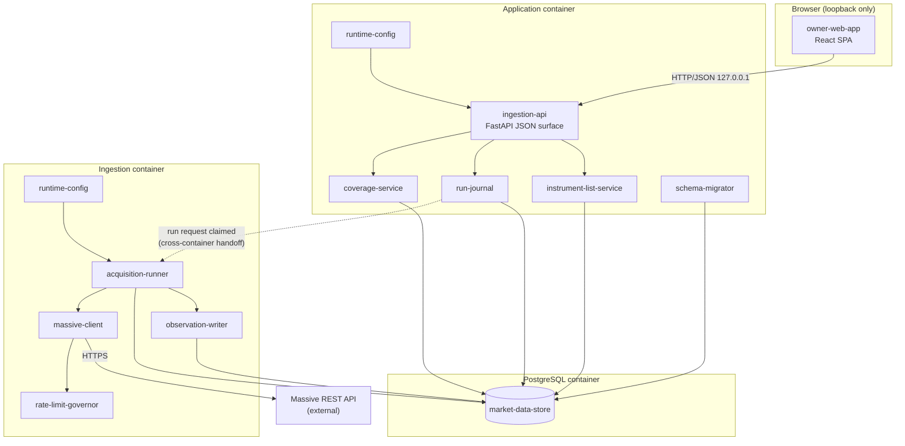

# System Design: Market Data Acquisition Foundation

## 1. Design Overview

This design delivers the first running FactorFlow system. It acquires instrument
reference data, daily prices, company fundamentals and corporate actions from
Massive into an append-only point-in-time store, and gives the owner-operator a
browser interface showing what was acquired, what is missing from it, and which
runs failed.

The shape follows charter constraint C1 directly: two containers built from one
repository, plus PostgreSQL. The **application container** serves the JSON API
and the built interface bundle, and applies schema migrations at start. The
**ingestion container** performs acquisition runs. They share one PostgreSQL
database and never call each other in-process; the handoff is a claimed row in a
run journal table, which is what keeps ingestion's failure modes — slow provider
responses, exhausted rate budgets, upstream outages — from reaching the API.

Three design commitments carry most of the correctness risk, and each traces to a
constraint that cannot be repaired later. Observations are appended with the date
FactorFlow observed them and never with a provider-supplied filing date, because
Massive's fundamentals conflate restatements (C5, and the provider evaluation in
`tech-stack.md`). Coverage is derived from what was actually written rather than
from what a run intended to write, so a run that dies partway cannot leave
history that looks complete (AC-12). And every write is idempotent on the value
itself, so a re-run adds nothing when the provider returns what is already held
but does add a row when the provider returns something different (AC-5, AC-6).

The interface is bound to the loopback address and performs no authentication, on
the owner's decision of 2026-09-03. This design treats that as a constraint on
deployment rather than an absence of a requirement: the port is published to
`127.0.0.1` only, and nothing in the API assumes an authenticated principal that
a later capability would have to retrofit.

The block diagram below is described in Section 2, and the components it names
are declared in Section 4.1. Read Section 4 first: it is the vocabulary the rest
of this document uses.

## 2. Architectural Block Diagram

The diagram shows the three deployed units and the components inside them. The
`owner-web-app` in the browser talks only to `ingestion-api` over HTTP on the
loopback interface; there is no path from the browser to the ingestion process.
Inside the application container, `ingestion-api` delegates to three services
that own distinct concerns: the instrument list, the run journal, and coverage
computation. `schema-migrator` runs once at container start and then exits,
before the API accepts traffic. The ingestion container holds `acquisition-runner`,
which claims work from the run journal and drives `massive-client` — paced by
`rate-limit-governor` — writing results through `observation-writer`. Every
component that touches persistent state reaches the same `market-data-store`,
which is the single PostgreSQL database required by C2. The only boundary
crossing between the two containers is the run journal table, drawn as the dashed
edge; the only external dependency is the Massive REST API.



## 3. Architectural Control Flow

The sequence below traces one owner-triggered acquisition run from the browser to
the store, and it is the path that carries every failure mode this capability must
survive. Steps 1 to 4 are synchronous: the API records a run request and returns
immediately, so the browser never waits on the provider. Steps 5 onward happen in
the ingestion container, where the runner claims exactly one request and then
processes instruments one at a time, each in its own transaction. The two decision
points that matter are step 9, where a single instrument's failure is isolated so
the run continues (AC-11), and step 14, where the run's final outcome is computed
from what was actually written rather than from what was requested (AC-9, AC-12).
The dashed return path shows the owner observing progress by polling coverage and
run state, which is the only way the browser learns of completion.

```mermaid
sequenceDiagram
    participant O as 1. Owner (browser)
    participant W as 2. owner-web-app
    participant A as 3. ingestion-api
    participant J as 4. run-journal
    participant R as 5. acquisition-runner
    participant M as 6. massive-client
    participant G as 7. rate-limit-governor
    participant X as 8. Massive REST API
    participant B as 9. observation-writer
    participant S as 10. market-data-store

    O->>W: 1. Start acquisition run
    W->>A: 2. POST /api/acquisition-runs
    A->>J: 3. Insert run request (state=requested)
    A-->>W: 4. 202 Accepted + run id

    R->>J: 5. Claim oldest requested run<br/>(FOR UPDATE SKIP LOCKED)
    J-->>R: 6. Run claimed (state=running)

    loop 7. For each named instrument
        R->>M: 8. Fetch reference, prices,<br/>fundamentals, corporate actions
        M->>G: 9. Await rate budget
        G-->>M: 10. Permit
        M->>X: 11. HTTPS request
        alt 12. Provider returns data
            X-->>M: 13. Payload
            M-->>R: 14. Parsed observations
            R->>B: 15. Append observations
            B->>S: 16. INSERT ... ON CONFLICT DO NOTHING<br/>(observed_on = today)
            B->>S: 17. Extend coverage segment<br/>(same transaction)
        else 18. Instrument unknown to provider
            X-->>M: 19. 404 / empty
            M-->>R: 20. NotFound
            R->>S: 21. Record per-instrument failure,<br/>continue loop
        else 22. Rate budget exhausted or transport error
            X-->>M: 23. 429 / timeout
            M->>G: 24. Back off, retry within budget
            Note over M,G: 25. Exhausted retries mark<br/>this instrument failed
        end
    end

    R->>J: 26. Compute outcome from<br/>written coverage
    Note over R,J: 27. succeeded only if every instrument wrote;<br/>otherwise partial or failed

    O->>W: 28. Refresh view
    W->>A: 29. GET /api/coverage, GET /api/acquisition-runs
    A-->>W: 30. Coverage, gaps, run outcomes
    W-->>O: 31. Per-instrument coverage and failure detail
```

Two control flows outside the run path complete the picture.

**Application start (AC-15, AC-16).** 32. The application container starts. 33.
`schema-migrator` reads the `applied_migrations` table. 34. It applies each
numbered migration not yet recorded, in order, each in its own transaction. 35.
On success it records the migration and the API begins accepting traffic. 36. On
failure, or when the store carries a migration number this build does not know,
the container exits non-zero and the API never binds, so no component reads or
writes an inconsistent store.

**Gap computation (AC-8).** 40. Gaps are computed at read time by
`coverage-service`, not stored. 41. It forms the trading-day set as the union of
dates on which any named instrument has a daily bar within the requested range.
42. For each instrument it reports dates in that set that fall inside the
instrument's own covered range but carry no bar for it. 43. When fewer than two
instruments hold data in the range, it returns gap detection as unavailable
rather than an empty gap list, so the interface never presents a vacuous zero.

**Credential and configuration load (AC-13).** 37. `runtime-config` reads
configuration and the Massive API key from the process environment at start. 38.
A missing required value fails the start with a message naming the variable but
never its value. 39. The credential is held in memory only, is redacted from every
log record, and appears in no API response.

## 4. Components, Interfaces and Technology

### 4.1 Components Introduced

| Component ID | Name | Responsibility | Owned by |
|--------------|------|----------------|----------|
| `owner-web-app` | Owner interface | React SPA presenting the instrument list, coverage, gaps, run history and failure detail | this design |
| `ingestion-api` | Ingestion JSON API | FastAPI surface serving the interface; the only network entry point | this design |
| `instrument-list-service` | Instrument list service | Maintains the owner's named instrument list and its history depth setting | this design |
| `run-journal` | Run journal | Owns the acquisition run record and its lifecycle: requested, running, succeeded, partial, failed | this design |
| `coverage-service` | Coverage service | Derives per-instrument coverage and last-acquired dates, and detects gaps against the trading-day set formed from all named instruments' observed dates | this design |
| `schema-migrator` | Schema migrator | Applies numbered forward-only SQL migrations and maintains `applied_migrations` | this design |
| `runtime-config` | Runtime configuration | Loads and validates configuration and the provider credential from the environment; redacts secrets | this design |
| `acquisition-runner` | Acquisition runner | Claims a run request and drives acquisition instrument by instrument, isolating per-instrument failure | this design |
| `massive-client` | Massive client | Hand-written HTTP client for Massive reference, aggregate, fundamental and corporate-action reads | this design |
| `rate-limit-governor` | Rate limit governor | Paces provider requests to the configured budget and applies backoff on 429 and transport errors | this design |
| `observation-writer` | Observation writer | Appends observations point-in-time with the observation date and extends coverage segments in the same transaction | this design |
| `market-data-store` | Market data store | The PostgreSQL schema holding instruments, observations, coverage segments and run records | this design |

### 4.2 Interfaces

| Interface | Provider component | Consumer component | Shape | Stability |
|-----------|--------------------|--------------------|-------|-----------|
| `GET/POST/DELETE /api/instruments` | `ingestion-api` | `owner-web-app` | JSON; list, add and remove named instruments | stable within this capability |
| `PUT /api/settings/history-depth` | `ingestion-api` | `owner-web-app` | JSON; the owner's stated history depth, required before first run | stable within this capability |
| `POST /api/acquisition-runs` | `ingestion-api` | `owner-web-app` | JSON; returns 202 and a run id | stable within this capability |
| `GET /api/acquisition-runs`, `GET /api/acquisition-runs/{id}` | `ingestion-api` | `owner-web-app` | JSON; run history, outcome, and per-instrument failure detail | stable within this capability |
| `GET /api/coverage` | `ingestion-api` | `owner-web-app` | JSON; per-instrument data types, covered ranges, last acquired, missing trading days | stable within this capability |
| `GET /api/health` | `ingestion-api` | `owner-web-app` | JSON; process liveness and most recent run outcome | stable within this capability |
| Run request claim | `run-journal` | `acquisition-runner` | PostgreSQL row claimed with `SELECT ... FOR UPDATE SKIP LOCKED`; the only cross-container handoff | stable within this capability |
| Observation append | `market-data-store` | `observation-writer` | SQL `INSERT ... ON CONFLICT DO NOTHING` on the observation natural key; no UPDATE or DELETE | **critical — C5, unrecoverable if wrong** |
| Coverage read | `market-data-store` | `coverage-service` | SQL reads over coverage segments and observations | stable within this capability |
| Migration application | `market-data-store` | `schema-migrator` | Numbered SQL files plus the `applied_migrations` table | stable within this capability |
| Provider reads | Massive REST API (external) | `massive-client` | HTTPS/JSON; ticker reference, daily aggregates, financials, corporate actions; API-key auth | external, vendor-controlled |

### 4.3 Technology Selections

| Component repo | Language | Framework | Store | Key libraries | Source |
|----------------|----------|-----------|-------|---------------|--------|
| FactorFlow-v2 (application + ingestion) | Python 3.12+ | FastAPI on uvicorn | PostgreSQL 16, no ORM | `psycopg` 3, `httpx`, Pydantic, `ruff`, `mypy`, `pytest`, `testcontainers[postgres]` | tech-stack |
| FactorFlow-v2 (owner interface) | TypeScript 5.x | React 18 with Vite | — | Tailwind CSS, **shadcn/ui on Radix primitives**, **TradingView Lightweight Charts**, `vitest`, `@testing-library/react`, `@playwright/test`, `biome` | tech-stack + OQ-TS-6 resolved 2026-09-03 |

The component and charting libraries were open as OQ-TS-6 in `tech-stack.md`,
deferred to the first capability carrying a UX design. CAP-001 is that capability.
The owner selected shadcn/ui on Radix primitives and TradingView Lightweight
Charts on 2026-09-03. **This design records that decision; it does not make it
authoritative.** `tech-stack.md` is a constitution artifact and must be updated
through `$tech-stack` to close OQ-TS-6 — see Section 8.

Charting is not used anywhere in CAP-001, which needs tables, forms and status
only. The library is selected here because the tech stack's deferral named this
trigger, and it is recorded so the M4 and M5 evidence screens inherit a decision
rather than reopening one.

Massive is an external dependency, not an internal repository: no tech stack row
applies to it, and this design specifies the integration contract only. Per
`tech-stack.md`, the market data source is deliberately **not** abstracted behind
a vendor-neutral port — `massive-client` may use Massive's own shapes directly.

## 5. Architectural Constraints

1. **Two containers, one repository, and a handoff that is not a function call
   (C1).** The application and ingestion processes deploy separately and share
   only `market-data-store`. Ingestion must not be reachable from the browser, and
   the API must not block on provider calls.
2. **One transactional store (C2).** All state lives in a single PostgreSQL
   database. Splitting any part of it across stores is prohibited.
3. **Append-only, point-in-time history (C5).** Observations are inserted with the
   date FactorFlow observed them. No migration, story or query path may introduce
   an `UPDATE` or `DELETE` against observation history. This is the constraint that
   cannot be repaired retrospectively.
4. **The observation date is FactorFlow's, never the provider's.** Massive's
   `filing_date` conflates restatements of the same period. It may be stored as a
   descriptive attribute; it must never serve as the as-of date.
5. **Trading days are derived from acquired data, not from a calendar.** Massive
   supplies no historical trading calendar — its market-holidays endpoint is
   forward-looking only (verified 2026-09-03), and no plan tier changes that. By
   owner decision of 2026-09-03, a date counts as a trading day when **any** named
   instrument has a daily bar for it, and a gap is a date in that set falling
   inside an instrument's covered range for which that instrument has no bar. No
   calendar dependency enters the stack and no threshold is invented. Two
   consequences must be honoured rather than hidden: gap detection is
   **unavailable** when fewer than two named instruments hold data in the range,
   because the set then equals the single instrument's own dates and reports zero
   gaps vacuously; and a market-wide provider outage cannot be detected, because
   every instrument is missing that day.
6. **One market-data contract spanning historical reads and the live feed (C4).**
   Only the historical half is built here. The interface `massive-client` exposes
   must leave room for the M3 streaming half without redefinition.
7. **Coverage is derived, never asserted.** A range is reported as covered only
   because rows exist for it. No component may record intended coverage ahead of
   the write that justifies it.
8. **Forward-only schema evolution.** Numbered SQL migrations recorded in
   `applied_migrations`. There is no reversal path, so a migration that loses data
   is unrecoverable.
9. **Loopback-only interface, no authentication.** Owner decision of 2026-09-03.
   The container publishes its port to `127.0.0.1` only. The absence of
   authentication is sound solely because of that binding.
10. **The provider credential is supplied at runtime.** It is never committed, never
   logged, and never returned by any interface (AC-13, SEC-SEC-001).
11. **Provider request rate is a configured budget.** The design is tier-agnostic:
    the owner's plan determines the budget, and `rate-limit-governor` paces to it.
    Runs must be resumable so that a long run is not lost to an interruption.
12. **Structured logging only.** No direct console output in either process
    (SA-LOG-001), and no restricted value in any log record.
13. **One owner-operator.** No multi-tenancy, no per-user isolation, no horizontal
    scale requirement anywhere in this design.

## 6. Architectural Assumptions

1. **The Massive plan in use includes company fundamentals and sufficient history
   depth and request rate for the owner's stated instrument list.** Confirmed by
   the owner on 2026-09-03: the subscription will be in place, and an
   intermediate tier with 15-minute delayed data is acceptable because CAP-001
   reads history rather than real-time quotes. Real-time entitlement is an M3
   concern.
2. **Massive's ticker reference endpoint supplies stable instrument identity**
   (CIK, composite FIGI, share class FIGI), so identity does not rest on the
   ticker. Recorded in the provider evaluation in `tech-stack.md`.
3. **Delisted instruments remain queryable** with list and delist dates, which is
   what keeps survivorship bias out of the history this capability records.
4. **Enough instruments are named for gap detection to mean anything.** The
   trading-day set is derived from the named instruments themselves, so it carries
   signal only when at least two hold data over the range. This is a property of
   the owner's list rather than of the design, which is why the interface reports
   gap detection as unavailable instead of reporting zero gaps.
5. **The owner-operator runs the containers on a single machine they control**,
   with Docker available, and holds valid provider credentials before the first
   run.
6. **US-listed equities**, consistent with the capability's stated assumption.

## 7. Traceability

| AC # | Acceptance Criterion | Design Element(s) | Section |
|------|---------------------|--------------------|---------|
| AC-1 | Named instrument list | `instrument-list-service`, `GET/POST/DELETE /api/instruments`, `owner-web-app` | 4.1, 4.2 |
| AC-2 | History depth stated, not assumed | `PUT /api/settings/history-depth`; `acquisition-runner` refuses to claim a run with no depth set | 4.2, 3 |
| AC-3 | Data types acquired | `massive-client` reference, aggregate, fundamental and corporate-action reads | 4.1, 4.2 |
| AC-4 | Acquisition volume up to 3000 instruments | `rate-limit-governor` budget pacing; per-instrument transactions; resumable runs | 3, 5.11 |
| AC-5 | Point-in-time record | `observation-writer` appends with `observed_on`; provider `filing_date` stored as attribute only | 3, 5.3, 5.4 |
| AC-6 | Re-run safety | `INSERT ... ON CONFLICT DO NOTHING` on the observation natural key including a value hash | 3 step 16, 4.2 |
| AC-7 | Coverage visibility | `coverage-service`, `GET /api/coverage`, `owner-web-app` | 4.1, 4.2 |
| AC-8 | Gap visibility | `coverage-service` compares each instrument's covered range against the trading-day set derived from all named instruments' observed dates; reports unavailable below two instruments | 4.1, 5.5 |
| AC-9 | Honest run outcome | `run-journal` computes outcome from written coverage, not from intent | 3 steps 26-27 |
| AC-10 | Failure diagnosis | Per-instrument failure records; `GET /api/acquisition-runs/{id}` | 3 step 21, 4.2 |
| AC-11 | Unrecognised instrument does not stop the run | Per-instrument isolation in the runner loop | 3 steps 18-21 |
| AC-12 | A failed run leaves no false history | Coverage segments extended only inside the committed write transaction | 3 step 17, 5.7 |
| AC-13 | Credential handling | `runtime-config` environment load, redaction, no API echo | 3 steps 37-39, 5.10 |
| AC-14 | Network exposure | Port published to `127.0.0.1` only; uvicorn bound to loopback | 5.9 |
| AC-15 | Forward data evolution | `schema-migrator`, numbered migrations, `applied_migrations` | 3 steps 32-35 |
| AC-16 | Refuse an inconsistent start | Migrator exits non-zero; API never binds | 3 step 36 |
| AC-17 | Honest empty state | `GET /api/coverage` distinguishes "never acquired" from "acquired, empty"; `owner-web-app` renders it | 4.2 |
| AC-18 | Operational visibility | `GET /api/health` exposing liveness and most recent run outcome | 4.2 |

## 8. Open Questions

1. **OQ-TS-6 must be closed in `tech-stack.md`.** The owner selected shadcn/ui on
   Radix primitives and TradingView Lightweight Charts on 2026-09-03, recorded in
   Section 4.3. That file is a constitution artifact and this design cannot amend
   it. *Answerer: owner, by running `$tech-stack`. Blocks: nothing in this design;
   leaves governance out of step until done.*
2. **How does the owner-operator interrupt or cancel a long-running acquisition?**
   A 3000-instrument run against a constrained rate budget may run for hours. The
   capability defines no cancel behaviour and no acceptance criterion covers it.
   *Answerer: capability owner. Blocks: run lifecycle states in `run-journal`.*
3. **What is the retry and backoff posture on provider errors?** Section 3 step 24
   assumes retry within the rate budget, but no capability criterion states how
   long a run should persist against a failing provider before marking an
   instrument failed. *Answerer: owner. Blocks: `rate-limit-governor` behaviour.*
4. **Does removing an instrument from the list remove its acquired history?** This
   is open in the capability document itself (Section 7) and the design cannot
   resolve it: append-only history (C5) argues for retention, the owner's intent
   may argue otherwise. *Answerer: capability owner. Blocks: `instrument-list-service`
   deletion semantics.*

## 9. Source Documents

| Document | Path | Key findings used |
|----------|------|-------------------|
| Capability CAP-001 | `docs/capabilities/CAP-001-market-data-acquisition-foundation/Capability-CAP-001.md` | 18 acceptance criteria; scope excludes live feed, classification and universe composition; acquisition is owner-triggered; history depth is owner-stated; loopback-only decision |
| Product Charter v2 | `docs/constitution/product-charter.md` | Modular monolith with ingestion split out; point-in-time persistence; single owner-operator; M1 is Universe and Factors, 2026-Q4 |
| Tech Stack v1 | `docs/constitution/tech-stack.md` | C1-C11; Python/FastAPI/PostgreSQL without ORM; React/Vite/Tailwind; Massive as single provider; fundamentals are not as-reported; market data source deliberately not abstracted; validation commands; OQ-TS-3 and OQ-TS-6 |
| Architecture inventory | `docs/architecture.md` | Empty: 0 designs, 0 components. CAP-001 declares the first component identifiers in the project |
| Context cache | `cache/context_feeder/factorflow-v2/factorflow-v2/summary.md` | Refreshed 2026-09-03; confirms the three documents above are the whole corpus |

## 10. Design Readiness

**Design Readiness Score: 84/100**

All ten sections carry substantive content. Section 4 declares twelve components
with stable identifiers, records every cross-boundary interface with named
provider and consumer components, and names concrete approved technologies for
both halves of the repository, so the design is implementable rather than
technology-agnostic.

Four open questions remain and none blocks decomposition into component designs.
The question with real design consequence — how trading days are known, given that
the provider supplies no historical calendar — was resolved on 2026-09-03 by
deriving them from the named instruments' own observed dates, which needs no
dependency, no capability change and no invented threshold, at the cost of two
limits the design states plainly rather than conceals. What remains is two lifecycle
details the capability itself left open (cancellation, instrument removal), one
behavioural threshold needing an owner's number (retry posture), and one governance
follow-up that leaves `tech-stack.md` out of step with the OQ-TS-6 decision already
taken.
