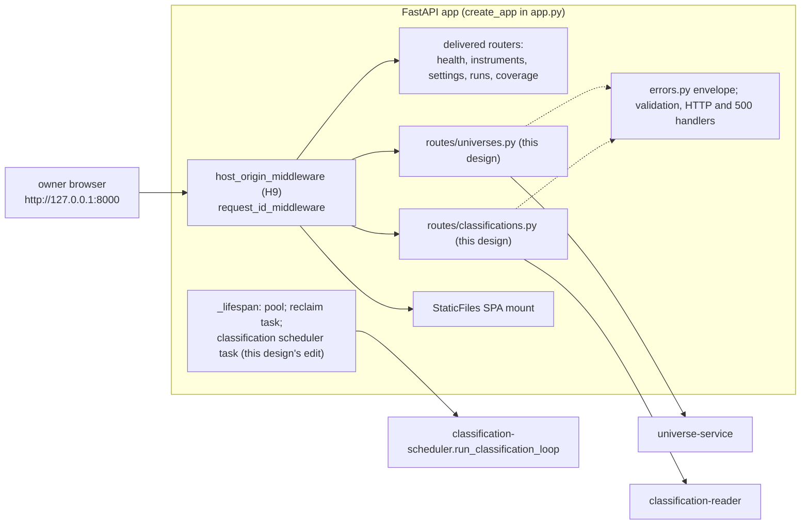

# Component: Classification API

**Status:** draft
**Capability:** CAP-002
**Owner:** Alvaro de Jodra
**Last Updated:** 2026-10-16

This design was produced in an unattended `$design-run`. Choices no artifact
fixes are recorded as decisions under `projects/factorflow-v2/decisions/`
(DEC-0064 to DEC-0067) and marked **PROVISIONAL**. One owner question blocks
one constant and is carried, not answered: the universe name length (section
14).

## 1. Overview

The classification API is the pair of FastAPI routers that give the owner
interface its JSON contract for universes and classifications: thirteen HTTP
operations across eight paths under `/api/universes` and
`/api/classifications`, registered on the application the delivered
`ingestion-api` factory builds, and therefore behind its request-id, Host and
Origin middleware, its error envelope and its SPA mount (system design 4.2).
It validates every request against the bounds the first capability fixed,
delegates to `universe-service` and `classification-reader`, maps their typed
exceptions to stable error codes, and shapes responses. It holds no universe
rule and no classification arithmetic of its own.

It is also, by DEC-0064 (PROVISIONAL), the one owner of CAP-002's edit to
`src/factorflow/api/app.py`: two `include_router` calls and the creation and
cancellation of the classification scheduler task in the lifespan, placed
beside the reclaim task. Nothing else in the delivered API changes.

Use cases addressed:

- Create, list, read, rename, retire universes and add or remove members, with
  every refusal naming its operation, resource and reason (AC-1 to AC-6,
  STD-UI-19).
- Save a reviewed filter result as a universe (AC-2).
- Read the classified-stock list with sort, thresholds, scope and paging; read
  side by side; read one stock's evidence and history; read sets (AC-9, AC-12,
  AC-14 to AC-23).
- Report currency and the honest empty state (AC-20 to AC-22).

Support matrix: one uvicorn worker in the application container, bound to
`127.0.0.1:8000`, plain HTTP on loopback, no authentication (capability section
5.3; system design constraint 12). One browser client.

Dependencies: `ingestion-api`'s factory, middleware, `errors.py` envelope and
`bounds.py`; `universe-service`; `classification-reader`;
`classification-scheduler`'s `run_classification_loop` and
`ClassificationSettings`; Pydantic for request and response models.

## 2. Design Details

### 2.1 Placement

```
src/factorflow/api/routes/universes.py             GET/POST /api/universes, GET/PATCH/DELETE /api/universes/{id},
                                                   GET /api/universes/{id}/events, POST .../members, DELETE .../members/{symbol}
src/factorflow/api/routes/classifications.py       GET /api/classifications, /sets, /sets/{set_id},
                                                   /stocks/{symbol}, /stocks/{symbol}/history
src/factorflow/api/classification_models.py        Pydantic request and response models for both routers
src/factorflow/api/classification_bounds.py        MAX_UNIVERSE_NAME_LENGTH (owner input), MAX_COMPARE_SYMBOLS = MAX_PAGE_SIZE
src/factorflow/api/app.py                          two include_router calls; scheduler task in _lifespan (DEC-0064)
tests/unit/test_api_universes_routes.py
tests/unit/test_api_classifications_routes.py
tests/unit/test_api_classification_models.py
tests/unit/test_api_classification_error_mapping.py
tests/unit/test_api_classification_lifespan.py
tests/integration/test_api_universes.py
tests/integration/test_api_classifications.py
tests/integration/test_api_classification_host_origin.py
```

`classification_models.py` is a new module rather than an addition to the
delivered `api/models.py`, and `classification_bounds.py` a new module beside
`bounds.py`, so the only delivered file this component edits is `app.py`
(DEC-0064).

### 2.2 Component block diagram

The diagram below shows where the two routers sit in the delivered
application and what they call. Requests pass the Host and Origin middleware
and the request-id middleware before reaching a router, so every CAP-002 route
inherits condition H9 and the request id in its envelope without code of its
own. The routers call the two domain modules and nothing else; the lifespan,
edited by this component, starts the scheduler task beside the reclaim task.
The expected outcome is that the new surface is indistinguishable in posture
from the delivered one.



### 2.3 The edit to `app.py`

Owned by this component (DEC-0064, PROVISIONAL). Three insertions, nothing
removed or reordered:

```python
# src/factorflow/api/app.py
from factorflow.api.routes import classifications, coverage, health, instruments, runs, settings, universes
from factorflow.classification.scheduler import run_classification_loop
from factorflow.classification.settings import ClassificationSettings

# in _lifespan, after reclaim_task is created:
    classification_task = asyncio.create_task(
        run_classification_loop(pool=pool, settings=ClassificationSettings())
    )
    try:
        yield
    finally:
        for task in (classification_task, reclaim_task):
            task.cancel()
            try:
                await task
            except asyncio.CancelledError:
                pass
        pool.close()

# in create_app, with the existing include_router calls:
    app.include_router(universes.router)
    app.include_router(classifications.router)
```

The routers are included before `_add_host_origin_middleware`,
`_add_request_id_middleware` and `_add_static_mount` run, as the five delivered
routers are, so they sit behind the middleware and ahead of the SPA mount
(system design 4.2, Router registration). `_VALIDATION_ERROR_RESOURCES` is not
edited: a FastAPI validation error on a CAP-002 path takes the handler's
fallback resource, the path's last segment (`universes`, `members`,
`classifications`, `history`), which is accurate for every CAP-002 path and
avoids a second edit to delivered code.

### 2.4 Request bounds and validation

Every bound is the first capability's unless stated (system design 4.2):

| Bound | Value | Applies to | Source |
|-------|-------|-----------|--------|
| `DEFAULT_PAGE_SIZE` | 50 | every paginated route | `bounds.py`, owner 2026-09-05 |
| `MAX_PAGE_SIZE` | 500 | every paginated route; the `symbols` list on `GET /api/classifications` | `bounds.py`; system design 3.3 step 16 |
| `MAX_SYMBOLS_PER_REQUEST` | 1000 | `symbols` on `POST /api/universes` and `POST /api/universes/{id}/members` | `bounds.py`; system design 4.2 |
| `MAX_UNIVERSE_NAME_LENGTH` | `[REQUIRES INPUT: maximum universe name length in characters]` | `name` on `POST` and `PATCH /api/universes` | system design section 8 question 2, abstained; section 14 |
| `MAX_COMPARE_SYMBOLS` | 500, equal to `MAX_PAGE_SIZE` | `symbols` on `GET /api/classifications` | system design 3.3 step 16; a lower cap is the owner's open question, carried in `classification-ui` |
| Symbol shape | `^[A-Z][A-Z0-9.-]{0,15}$` after upper casing | every symbol | migration `0001`; system design constraint 15 |
| Percentile thresholds | 0 to 100 inclusive | `{factor}_percentile_min`, `_max` | AC-9; constraint 15 |
| Score thresholds | finite decimal | `{factor}_score_min`, `_max` | constraint 15 |
| `sort` | `symbol`, `{factor}_score`, `{factor}_percentile` | `GET /api/classifications` | constraint 15 allowlist |
| `order` | `asc`, `desc` | `GET /api/classifications` | |
| `lifecycle` | `active`, `retired`, `all` | `GET /api/universes` | system design 4.2 |
| `as_of` | ISO-8601 date | `GET /api/universes/{id}` | STD-UI-5 |

Names are trimmed and must be non-empty; until the owner states the length
bound, `MAX_UNIVERSE_NAME_LENGTH` is declared in `classification_bounds.py`
with the `[REQUIRES INPUT]` marker in its docstring and the model enforces
trimmed and non-empty only, so the gap is visible in one place and the
implementing story is blocked on exactly one constant.

Request models (`classification_models.py`):

```python
class CreateUniverseRequest(BaseModel):
    name: str                                    # trimmed, non-empty; max length pending (section 14)
    symbols: list[str] | None = None             # by hand: 1 to MAX_SYMBOLS_PER_REQUEST, upper-cased, shape-checked
    filter: Thresholds | None = None             # from a filter: exactly one of symbols or filter
    set_id: UUID | None = None                   # required with filter

class RenameUniverseRequest(BaseModel):
    name: str

class AddMembersRequest(BaseModel):
    symbols: list[str]                           # 1 to MAX_SYMBOLS_PER_REQUEST

class Thresholds(BaseModel):                     # the twelve bounds, all optional
    value_score_min: Decimal | None = None       # finite
    value_score_max: Decimal | None = None
    value_percentile_min: Decimal | None = None  # 0..100
    value_percentile_max: Decimal | None = None
    # growth_*, momentum_* likewise
```

`CreateUniverseRequest` rejects a body with both `symbols` and `filter`, or
neither, and a `filter` without `set_id`, as `422 validation_error` naming the
field (system design 4.2). Every model is `extra="forbid"`.

### 2.5 Error mapping

Every non-2xx response is the envelope of `component-design-ingestion-api.md`
section 2.3, `{"error": {"code", "message", "resource", "request_id"}}`, with
`resource` `universe`, `universe-member`, `classification` or `classification-set`.
Messages are owner-facing sentences in product vocabulary, naming the
operation, the resource and the reason (STD-UI-19); the interface selects its
wording by `code` and never shows `message` raw (UX design section 4), so the
two texts may differ and the code is the contract.

| Service exception | Status | `code` | `message` carries |
|-------------------|--------|--------|-------------------|
| `InstrumentNotAcquired` | 409 | `instrument_not_acquired` | every uncovered symbol, sorted; `symbols` also returned as a list field in the envelope's `error` object |
| `EmptyUniverse` | 422 | `empty_universe` | whether no symbol was given or the filter matched nothing |
| `UniverseNameInUse` | 409 | `universe_name_in_use` | the conflicting name |
| `ClassificationSetChanged` | 409 | `classification_set_changed` | the requested and current `set_id`s |
| `UniverseNotFound` | 404 | `universe_not_found` | the id |
| `UniverseRetired` | 409 | `universe_retired` | the universe name |
| `NotAMember` | 404 | `not_a_member` | the symbol and universe |
| `LastMember` | 409 | `last_member` | the symbol, and that retiring the universe is the alternative (AC-5) |
| `InstrumentNotFound` | 404 | `instrument_not_found` | the symbol |
| `CursorError` | 422 | `cursor_invalid`, or `cursor_stale` when the cursor names another set or ordering | nothing beyond the code |
| unknown `set_id` on `GET /api/classifications/sets/{set_id}` | 404 | `classification_set_not_found` | the id |
| Pydantic validation | 422 | `validation_error` | the field names, through the delivered handler |
| any other exception | 500 | `internal_error` | request id only (SEC-ERR-001) |

The `instrument_not_acquired` envelope adds one field, `symbols`, so the
interface names every uncovered symbol without parsing prose; `ErrorDetail` in
`errors.py` is not edited for it: the route builds the envelope through
`error_response` and extends the `error` object, the way `state` is carried
for `run_already_terminal`.

### 2.6 Write request flow

The diagram below follows `POST /api/universes` from the browser to the
response, and it is system design 3.2 seen from the HTTP boundary. The
middleware refuses a foreign Host or Origin before the route runs; the model
refuses a malformed body before the service is called; the service's typed
exception, if any, is mapped to one code. The decision points are the three
refusals, each of which writes nothing. The expected outcome is a `201` whose
body is the replayed universe, which the interface routes to without a second
request.

```mermaid
sequenceDiagram
    participant W as classification-ui
    participant M as middleware (H9, request id)
    participant R as routes/universes.py
    participant S as universe-service
    participant DB as PostgreSQL

    W->>M: POST /api/universes {name, symbols | filter+set_id}
    alt foreign Host or Origin
        M-->>W: 400 host_not_allowed | 403 origin_not_allowed
    else
        M->>R: request with request_id
        R->>R: CreateUniverseRequest validation (422 validation_error)
        R->>S: create_by_hand | create_from_filter (one transaction)
        alt typed refusal
            S-->>R: InstrumentNotAcquired | EmptyUniverse | UniverseNameInUse | ClassificationSetChanged
            R-->>W: 409 | 422 envelope with code, message, resource, request_id
        else created
            S->>DB: INSERT universe, universe_event rows; COMMIT
            S-->>R: Universe
            R-->>W: 201 UniverseResponse
        end
    end
```

### 2.7 Response shapes

Field names are snake_case on the wire, as the delivered API's are; the
interface maps them to camelCase in its fetch layer.

**`UniverseResponse`** (`GET /api/universes/{id}`, `POST`, `PATCH`, `DELETE`):
`universe_id`, `name`, `lifecycle`, `created_at`, `retired_at`, `member_count`,
`as_of`, `as_of_before_creation`, `origin {kind, set_id, classification_date,
thresholds}`, `members[] {symbol, lifecycle, member_since, factors {value,
growth, momentum: FactorCellResponse}}`, and `set` (the current set block of
`ClassificationListResponse`, or null) so members' cells are dated. `origin`
is DEC-0065's addition (PROVISIONAL); `classification_date` inside it is read
from the set the filter was evaluated against, for the origin line *Created
from a filter on the classifications of 2026-10-15* (UX design section 1.3).

**`UniverseListResponse`** (`GET /api/universes`): `universes[] {universe_id,
name, lifecycle, member_count, created_at, retired_at}`, `active_count`,
`retired_count`, `next_cursor`.

**`UniverseEventsResponse`**: `events[] {event_id, event_type, name, symbol,
recorded_at, recorded_on}`, `next_cursor`.

**`AddMembersResponse`**: `added[]`, `already_member[]`. **`RemoveMemberResponse`**:
`removed_at`. **`RetireUniverseResponse`**: `lifecycle: "retired"`, `retired_at`.

**`ClassificationListResponse`** (`GET /api/classifications`): `never_classified`;
`set` (null when never classified) `{set_id, classification_date, run_id,
run_outcome, state, started_at, ended_at, latest_trading_day,
active_instruments, not_current {set_id, state, run_id, started_at, ended_at,
failure_reason} | null}`; `factors {value, growth, momentum: {qualified_count,
ranked, min_peer_set_size}}`; `stocks[] {symbol, lifecycle, factors {value,
growth, momentum: FactorCellResponse}}`; `unknown_symbols[]`; `next_cursor`.

**`FactorCellResponse`**: `status`, `score`, `percentile`, `reason_code`,
`reason_input`, `reason_detail`, `restated_possible`. Scores and percentiles
are serialised as decimal strings at stored precision; rendering precision is
the interface's (DEC-0063) and sort and thresholds run on stored values.

**`StockEvidenceResponse`** (`GET /api/classifications/stocks/{symbol}`):
`symbol`, `lifecycle`, `set` (as above, or null), `factors {... FactorCellResponse}`,
`inputs[] {factor, input_name, label, status, value, as_of, known_on,
restated_possible, detail}`.

**`StockHistoryResponse`**: `symbol`, `sets[] {set_id, classification_date,
run_id, run_outcome, factors {...}}`, `next_cursor`.

**`SetListResponse`** and **`SetResponse`**: `set_id`, `state`,
`classification_date`, `run_id`, `run_outcome`, `started_at`, `ended_at`,
`failure_reason`, `latest_trading_day`, `active_instruments`, `factors {...
{qualified_count, ranked, min_peer_set_size}}`, plus `next_cursor` on the list.

Dates are ISO-8601 dates; timestamps are ISO-8601 with offset; zone rendering
is the interface's (STD-UI-5).

### 2.8 Messages

N/A, not applicable for this component. No broker, topic or queue; the
interface polls (UX design section 1.2).

## 3. Constraints and Assumptions

- **Loopback only, no authentication** (capability section 5.3; system design
  constraint 12). The routers add no dependency on that absence: no route
  assumes a principal, so a later capability adding authentication adds it
  rather than retrofitting around an assumption (`ingestion-api` section 3).
- **Behind the delivered middleware** (system design 4.2). Every CAP-002 route
  is covered by the Host check, and every state-changing route uses `POST`,
  `PATCH` or `DELETE`, so the Origin check covers all of them (H9). No CAP-002
  route changes state on `GET`.
- **The API never calls the provider** (capability section 5.2). The existing
  `tests/unit/test_api_isolation.py` assertion that nothing under `api/`
  imports the Massive client covers the new modules the day they exist.
- **The API holds no rule.** Universe rules are `universe-service`'s; read
  semantics are `classification-reader`'s. The routes validate, delegate,
  map, shape.
- **Bounds are the first capability's**, imported from `bounds.py`, never
  redeclared; the one new constant is the name length, which is the owner's.
- **The edit to `app.py` is this component's and is three insertions**
  (DEC-0064, PROVISIONAL). No other delivered file is edited.
- **Settings for the scheduler are constructed here**, in the lifespan, from
  `ClassificationSettings()`, as `RunSettings()` is for the reclaim task.
- **Python 3.12, FastAPI, Pydantic, `pytest` with `TestClient`** (tech stack).
  `TestClient` instances pass `base_url="http://127.0.0.1:8000"` as the fifteen
  delivered test modules do, so the Host check passes.
- **Assumption:** the `universes` and `classifications` module names do not
  collide with anything under `factorflow.api.routes`; the tree today holds
  `coverage`, `health`, `instruments`, `runs`, `settings`.

## 4. Security

- **Authentication and authorization: none, deliberately** (owner decisions
  2026-09-03 and 2026-10-12; capability section 5.3). The endpoints are not
  externally reachable, which is the condition SEC-AUTH-001's non-engagement
  rests on; the deployment publishes no port (`runtime-config` section 2.8.1).
- **Transport.** Plain HTTP on `http://127.0.0.1:8000`, carrying Internal
  data, under the `SEC-ENC-001 host-local loopback exception` of CONST-SEC 1.3
  (DEC-0050, extended to CAP-002 by DEC-0058). No channel, bind or port is
  added; conditions H1 to H9 are met by the deployment definition and the
  middleware the first capability delivered, which these routes inherit by
  registration. Reliance holds only while CONST-SEC 1.3 is in force.
- **Cross-site and DNS-rebinding requests (H9).** Rejected by the delivered
  Host and Origin middleware. `tests/integration/test_api_classification_host_origin.py`
  asserts that `POST /api/universes` with a foreign `Origin` is `403` and
  creates nothing, and that a foreign `Host` on `GET /api/classifications` is
  `400`.
- **Input validation (SEC-INP-001).** Section 2.4: every body and query is a
  Pydantic model with `extra="forbid"`; string lengths are bounded (the name
  pending the owner); numeric ranges are enforced; enumerations are
  allowlists; list sizes are capped; identifiers are `UUID`s.
- **Injection (SEC-INP-002).** No SQL in this component. `sort` reaches the
  reader as an allowlist key.
- **Error disclosure (SEC-ERR-001).** Envelope only; a `500` carries code and
  request id. Messages name symbols, names and ids the owner supplied, never a
  driver message or path.
- **Data classification.** Everything returned is Internal; no Restricted
  value exists in the capability (SEC-DAT-001). A universe name is owner text
  returned as JSON; the interface renders it as text.
- **Audit (SEC-AUD-001).** No listed event class occurs: no authentication,
  privilege or configuration change. Every write is an appended, timestamped
  event in the store and a log line with the request id.
- **SAST and SCA.** FastAPI, Starlette and Pydantic are already scanned;
  `ruff` and `mypy` are blocking. `tests/unit/test_api_no_secrets.py`'s
  inspection of response models covers the new module when it is added to its
  module list by the implementing story.
- **Crypto usage: none. Privacy impact: none.**

## 5. Scalability and Performance

- **Concurrency: one user, one worker** (C8). No rate limiting, no CORS
  beyond same-origin.
- **The heaviest read is the classified-stock list at 3000 rows**, keyset
  paginated at 50 to 500 rows; the reader sizes it (its section 5).
- **Polling.** The currency region polls `GET /api/classifications` every 10
  seconds while a set is building or a run is non-terminal and stops
  otherwise (DEC-0054); each poll is two index probes and one bounded page.
- **Write size.** A create with 1000 symbols is one request; the roster of
  3000 is three.
- **Connection pool.** The delivered pool, maximum 4; a route checks a
  connection out for one call and releases it. During a build one connection
  is held by the engine; three remain.
- **Timeouts.** Database calls inherit the pool's settings; no external call
  exists.
- **No latency SLA is stated**; none is asserted (section 14).

## 6. Upgrade

- **Previous release.** The delivered API with five routers. This component
  adds two routers and one lifespan task; every delivered route and its
  contract are unchanged.
- **Contract stability.** Every endpoint is stable within this capability
  (system design 4.2). `origin` on the universe detail and `run_outcome`,
  `unknown_symbols` and `min_peer_set_size` on classification reads are fields
  this design adds within the schemas the system design delegates to it;
  adding a field later is compatible, removing one is breaking.
- **Data migration: none owned here.**
- **Behaviour change after upgrade.** The two new paths answer; `GET
  /api/classifications` answers `never_classified` until the first set.
- **Manual actions required: none.** Both scheduler settings default.
- **Rollback (OPS-MIG-003).** Reverting the application image removes the
  routes and the bundle together, since they ship in one image; the store
  rollback is `runtime-config` section 2.8.4's.

## 7. Testing

FastAPI `TestClient` with `base_url="http://127.0.0.1:8000"` for route tests
with doubled services; `testcontainers[postgres]` for integration tests
against the real store under the `postgres` marker.

| Test | File | What it proves |
|------|------|----------------|
| Create by hand | `tests/integration/test_api_universes.py` | `201` with the universe and members; the interface can route to detail from the body (AC-1) |
| Create refused whole on an uncovered symbol | `tests/integration/test_api_universes.py` | `409 instrument_not_acquired` naming every uncovered symbol in `symbols`; no universe created (AC-1) |
| Create from a filter | `tests/integration/test_api_universes.py` | `{"name", "filter", "set_id"}` saves exactly the thresholded result; `origin.kind = from_filter` with thresholds and date (AC-2) |
| Filter against a stale set | `tests/integration/test_api_universes.py` | `409 classification_set_changed` (AC-2) |
| Empty create | `tests/integration/test_api_universes.py` | No symbols, or a filter matching nothing: `422 empty_universe` (AC-5) |
| Both or neither of symbols and filter | `tests/unit/test_api_classification_models.py` | `422 validation_error` naming the fields |
| Name in use | `tests/integration/test_api_universes.py` | `409 universe_name_in_use` on create and on rename (DEC-0057) |
| Rename, add, remove, retire | `tests/integration/test_api_universes.py` | `200` each; `already_member` reported; `removed_at` returned; `lifecycle: retired`; events show each (AC-4, AC-6) |
| Last member | `tests/integration/test_api_universes.py` | `409 last_member` with the retirement alternative in the message (AC-5) |
| Writes to a retired universe | `tests/integration/test_api_universes.py` | `409 universe_retired` on rename, add, remove, retire |
| Unknown universe or member | `tests/integration/test_api_universes.py` | `404 universe_not_found`; `404 not_a_member` |
| As-of membership | `tests/integration/test_api_universes.py` | `?as_of=` returns the members on that date; a date before creation returns none with `as_of_before_creation: true`; a malformed date is `422` (AC-6) |
| Universe list filters | `tests/integration/test_api_universes.py` | `lifecycle` default `active`; `retired`, `all`; counts; paging |
| Symbol list bounds | `tests/unit/test_api_classification_models.py` | 1000 symbols accepted, 1001 refused naming the cap; malformed symbols `422`; upper casing applied |
| Classification list shape | `tests/integration/test_api_classifications.py` | `set` with `not_current`, `factors` with `min_peer_set_size` 30, `stocks` cells, `next_cursor` (AC-9, AC-14, AC-20, AC-21) |
| Never classified | `tests/integration/test_api_classifications.py` | `never_classified: true`, `set: null`, `stocks: []` (AC-22) |
| Sort and thresholds pass through | `tests/integration/test_api_classifications.py` | `sort=value_score&order=desc` and twelve bounds reach the reader; `sort=other` is `422`; a percentile of 101 is `422` (AC-16, constraint 15) |
| Universe scope | `tests/integration/test_api_classifications.py` | `universe_id` scopes; unknown id `404 universe_not_found` |
| Compare | `tests/integration/test_api_classifications.py` | `symbols=` returns every instrument symbol with its cells and `unknown_symbols`; 501 symbols `422` (AC-16) |
| Evidence and history | `tests/integration/test_api_classifications.py` | Inputs with labels and dates; `set: null` before any set; history newest first; unknown symbol `404 instrument_not_found` (AC-17, AC-18, AC-23) |
| Sets | `tests/integration/test_api_classifications.py` | List newest first with reasons; `get` of an unknown id `404 classification_set_not_found` (AC-20, AC-21) |
| Cursor misuse | `tests/unit/test_api_classifications_routes.py` | A cursor from another sort is `422 cursor_stale` |
| Page bounds | `tests/integration/test_api_classifications.py` | `limit` default 50, `500` accepted, `501` is `422` (section 2.4a precedent) |
| Error mapping is complete | `tests/unit/test_api_classification_error_mapping.py` | Every typed exception in `universe-service` and `classification-reader` maps to exactly one code; an unmapped exception reaches `internal_error` |
| Routers registered behind middleware | `tests/unit/test_api_classification_lifespan.py` | `create_app()` serves both routers; a foreign `Host` is `400` on a CAP-002 path; the SPA fallback is not reached for an unknown `/api/universes/...` path |
| Scheduler task lifecycle | `tests/unit/test_api_classification_lifespan.py` | The lifespan creates the classification task with the pool and settings and cancels and awaits it before `pool.close()`, as `test_api_reclaim_lifespan.py` proves for the reclaim task |
| Host and Origin on CAP-002 routes | `tests/integration/test_api_classification_host_origin.py` | `POST /api/universes` with `Origin: https://evil.example` is `403 origin_not_allowed` and creates nothing; `GET /api/classifications` with `Host: evil.example:8000` is `400 host_not_allowed` (H9) |
| No provider import, no secret field | existing `tests/unit/test_api_isolation.py`, `tests/unit/test_api_no_secrets.py` | Extended to the new modules by the implementing story |

## 8. Acceptance Criteria

1. `POST /api/universes` with covered symbols returns `201` and the universe;
   with any uncovered symbol returns `409 instrument_not_acquired` naming each
   and creates nothing.
2. `POST /api/universes` with `filter` and `set_id` saves the thresholded
   result against that set, and returns `409 classification_set_changed` when
   the set is no longer current.
3. A create with no members or an empty filter result returns
   `422 empty_universe`; removing a last member returns `409 last_member`.
4. `PATCH`, `POST .../members`, `DELETE .../members/{symbol}` and
   `DELETE /api/universes/{id}` behave as section 2.5 maps, and every write to
   a retired universe returns `409 universe_retired`.
5. `GET /api/universes/{id}?as_of=` returns membership on that date and flags a
   date before creation.
6. `GET /api/classifications` returns the current set with its currency and
   counts, or `never_classified: true`, sorts only by allowlisted keys, applies
   thresholds server-side, scopes to a universe, and compares an explicit list
   of at most 500 symbols.
7. `GET /api/classifications/stocks/{symbol}` returns cells and inputs with
   dates and marks; `/history` returns earlier sets newest first.
8. Every CAP-002 route is refused on a foreign Host, and every state-changing
   route on a foreign Origin.
9. The lifespan starts the classification scheduler beside the reclaim loop
   and cancels both on shutdown.
10. Failure scenario: a database failure during any route returns `500` with
    code and request id only.
11. Failure scenario: a malformed body or query returns `422` naming the field
    and no stack trace.

## 9. Workflows

- **Build a universe by hand** (flow 2): `POST /api/universes` with `symbols`;
  step 4 is `409 instrument_not_acquired`.
- **Build a universe from a factor filter** (flow 3): `GET /api/classifications`
  with thresholds, then `POST /api/universes` with `filter` and `set_id`; step 5
  is `422 empty_universe`.
- **See stocks classified after an acquisition** (flow 1): `GET
  /api/classifications`, polled while building.
- **Compare stocks and inspect the evidence** (flow 4): `GET /api/classifications`
  with `universe_id`, `sort`, thresholds and `symbols`; `GET
  /api/classifications/stocks/{symbol}`.
- **Understand and fix insufficient evidence** (flow 5): evidence and history
  reads; the recovery is CAP-001's run, started through its own API.
- **Maintain universes over time** (flow 6): the five universe write routes and
  the events read; step 6 is `409 last_member`.
- **Intersection with CAP-001.** `GET /api/instruments` and `GET
  /api/acquisition-runs/{id}` are reused unchanged by the interface (system
  design 4.2); this component adds nothing to them.

## 10. UX / GUI

This component renders nothing; every CAP-002 screen depends on its contract.
Couplings tight enough to record, so the API and the copy stay one fact:

- **`instrument_not_acquired` carries `symbols`**, so the dialog names every
  uncovered stock and keeps the entered list (UX design sections 1.3, 1.4).
- **`last_member`'s message offers retirement**, the sentence the dialog shows
  as its backstop (section 1.4).
- **`classification_set_changed`** is what *classifications changed while you
  were reviewing them* renders (section 1.1).
- **`not_current` with `started_at` and `failure_reason`** feeds the currency
  region's three headline states (section 1.2).
- **`min_peer_set_size`** beside `qualified_count` lets *18 of 30 stocks
  qualified* carry no literal in the interface (sections 1.1, 1.5, 1.6).
- **`origin`** on the universe detail is the origin line (sections 1.3, 1.4).
- **Precision is not the API's**: scores and percentiles travel at stored
  precision as decimal strings; the interface renders DEC-0063's.

Internationalization: none. English owner-facing messages; ISO-8601 dates and
timestamps on the wire; zone rendering is the interface's (STD-UI-5).

## 11. API Endpoints

| Endpoint | Method/Operation | Auth/Privilege | Request | Response | Notes |
|----------|-----------------|----------------|---------|----------|-------|
| `/api/universes` | GET | none, loopback only | `lifecycle` (`active` default, `retired`, `all`), `name` prefix, `limit` (default 50, max 500), `cursor` | `200` `UniverseListResponse` | AC-3, AC-4 |
| `/api/universes` | POST | none | `CreateUniverseRequest`: `{"name", "symbols"}` or `{"name", "filter", "set_id"}` | `201` `UniverseResponse`; `422` `empty_universe`, `validation_error`; `409` `universe_name_in_use`, `instrument_not_acquired` (with `symbols`), `classification_set_changed` | AC-1, AC-2, AC-5; section 2.4 bounds |
| `/api/universes/{id}` | GET | none | path `id` (uuid); `as_of` date | `200` `UniverseResponse` with members, cells, origin; `404` `universe_not_found`; `422` malformed date | AC-3, AC-6, AC-15 |
| `/api/universes/{id}` | PATCH | none | `{"name"}` | `200` `UniverseResponse`; `404`; `409` `universe_retired`, `universe_name_in_use`; `422` | AC-4 |
| `/api/universes/{id}` | DELETE | none | path `id` | `200` `{"lifecycle": "retired", "retired_at"}`; `404`; `409` `universe_retired` | AC-4, AC-6; retires, never deletes (STD-UI-2) |
| `/api/universes/{id}/events` | GET | none | `limit`, `cursor` | `200` `UniverseEventsResponse` newest first; `404` | AC-6 |
| `/api/universes/{id}/members` | POST | none | `{"symbols"}`, 1 to 1000 | `200` `{"added", "already_member"}`; `404`; `409` `universe_retired`, `instrument_not_acquired`; `422` | AC-1, AC-4 |
| `/api/universes/{id}/members/{symbol}` | DELETE | none | path `id`, `symbol` | `200` `{"removed_at"}`; `404` `universe_not_found`, `not_a_member`; `409` `last_member`, `universe_retired` | AC-4, AC-5, AC-6 |
| `/api/classifications` | GET | none | `universe_id`, `symbol` prefix, `symbols` (at most 500), `sort` (allowlist), `order`, twelve threshold bounds, `limit`, `cursor` | `200` `ClassificationListResponse`; `404` `universe_not_found`; `422` malformed filter, `cursor_invalid`, `cursor_stale` | AC-9, AC-12, AC-14 to AC-16, AC-20 to AC-23 |
| `/api/classifications/sets` | GET | none | `limit`, `cursor` | `200` `SetListResponse` newest first | AC-20, AC-21 |
| `/api/classifications/sets/{set_id}` | GET | none | path `set_id` | `200` `SetResponse`; `404` `classification_set_not_found` | AC-21 |
| `/api/classifications/stocks/{symbol}` | GET | none | path `symbol` | `200` `StockEvidenceResponse` (`set: null` before any set); `404` `instrument_not_found` | AC-12, AC-17, AC-23 |
| `/api/classifications/stocks/{symbol}/history` | GET | none | path `symbol`, `limit`, `cursor` | `200` `StockHistoryResponse` newest first; `404` | AC-18, AC-19 |

Interfaces consumed: `universe-service` and `classification-reader`,
in-process; `classification-scheduler`'s loop coroutine and settings, started
from the lifespan; `ingestion-api`'s factory, middleware, envelope and bounds.
No external integration.

## 12. References

| Type | Document Name | Description | Link |
|------|---------------|-------------|------|
| Capability | CAP-002 v1 | AC-1 to AC-6, AC-9, AC-12, AC-14 to AC-23; section 5.3 loopback posture | `docs/capabilities/CAP-002-universe-and-factor-classification/Capability-CAP-002.md` |
| System design | CAP-002 system design v1 | Section 4.2 interfaces and codes; 3.2, 3.3; constraints 12, 15; section 8 questions 2, 4 | `docs/capabilities/CAP-002-universe-and-factor-classification/design/system-design.md` |
| UX design | CAP-002 UX design v1 | Error wording by code; currency states; origin line; compare entry | `docs/capabilities/CAP-002-universe-and-factor-classification/design/ux-design.md` |
| Component design | CAP-001 ingestion API v8 | Sections 2.3 envelope, 2.4a bounds, 2.5 SPA mount, 2.5a Host and Origin, 11 endpoint table | `docs/capabilities/CAP-001-market-data-acquisition-foundation/design/component-design-ingestion-api.md` |
| Component design | CAP-002 universe service v1, classification reader v1, classification scheduler v1 | Exceptions mapped here; loop started here | `docs/capabilities/CAP-002-universe-and-factor-classification/design/` |
| Implemented code | `src/factorflow/api/app.py`, `errors.py`, `bounds.py`, `routes/instruments.py` | The factory, envelope, bounds and route shape followed | `src/factorflow/api/` |
| Decision records | DEC-0050, DEC-0058, DEC-0064, DEC-0065 | Loopback exception; seam ownership; `origin` field | `projects/factorflow-v2/decisions/` (harness repository) |

## 13. Traceability

| Capability AC | System Design Element | Component Design Element | Section |
|--------------|----------------------|--------------------------|---------|
| AC-1 | `POST /api/universes` with `symbols`; `409 instrument_not_acquired` | `CreateUniverseRequest`; mapping with `symbols` in the envelope | 2.4, 2.5, 11 |
| AC-2 | `POST` with `filter` and `set_id`; `409 classification_set_changed` | Request model requiring `set_id` with `filter`; mapping | 2.4, 2.5 |
| AC-3 | `GET /api/universes` | `UniverseListResponse` | 2.7, 11 |
| AC-4 | `PATCH`, members, `DELETE` | Four routes and their codes | 11 |
| AC-5 | `422 empty_universe`, `409 last_member` | Mapping; message offering retirement | 2.5 |
| AC-6 | `GET .../events`; `as_of` | Events route; `as_of` query with `as_of_before_creation` | 2.7, 11 |
| AC-9 | Score and percentile in responses | `FactorCellResponse` at stored precision | 2.7 |
| AC-12 | Reason code and input in responses | `FactorCellResponse` | 2.7 |
| AC-14 | `factors` with counts | `factors {qualified_count, ranked, min_peer_set_size}` | 2.7 |
| AC-15 | Lifecycle on stocks and members | `lifecycle` on `stocks[]` and `members[]` | 2.7 |
| AC-16 | `sort`, thresholds, `universe_id`, `symbols` | Query parameters and bounds; allowlist | 2.4, 11 |
| AC-17 | `GET .../stocks/{symbol}` | `StockEvidenceResponse.inputs` | 2.7, 11 |
| AC-18 | `GET .../history` | `StockHistoryResponse` | 2.7, 11 |
| AC-19 | Rows as recorded | No computation in this component | 3 |
| AC-20 | `set.not_current` with reason | `not_current` block | 2.7 |
| AC-21 | `classification_date`, `run_id`; sets | `set` block; `/sets` routes | 2.7, 11 |
| AC-22 | `never_classified: true` | `ClassificationListResponse.never_classified` | 2.7 |
| AC-23 | `restated_possible` | On cells and inputs | 2.7 |

## 14. Open Questions

1. **Maximum universe name length** (system design section 8 question 2,
   abstained; carried). `[REQUIRES INPUT: maximum universe name length in
   characters]`. *Owner: capability owner. Blocks: `MAX_UNIVERSE_NAME_LENGTH`
   in `classification_bounds.py` and the `422` it produces; the create and
   rename routes otherwise proceed with trimmed, non-empty validation.*
2. **The composition edit to `app.py`** is this component's by DEC-0064
   (PROVISIONAL), pending the owner's confirmation of the system design's
   reading of AGT-SCOPE-002 (section 8 question 4). *Owner: capability owner.
   Blocks: the story that edits `app.py`, not the routes.*
3. **Should a cap on compared stocks below 500 exist?** Carried from the UX
   brief and UX design; it would be one constant here,
   `MAX_COMPARE_SYMBOLS`, today equal to `MAX_PAGE_SIZE`. *Owner: capability
   owner. Blocks: nothing.*
4. **No API latency target** at 3000 rows (system design section 8 question
   8). *Owner: capability owner. Blocks: a performance acceptance criterion.*
