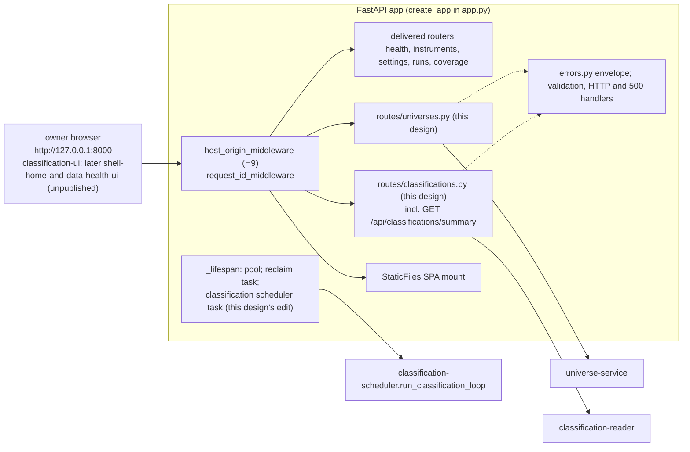

# Component: Classification API

**Status:** draft
**Capability:** CAP-002
**Owner:** Alvaro de Jodra
**Last Updated:** 2026-10-17

This design was produced in an unattended `$design-run`. Choices no artifact
fixes are recorded as decisions under `projects/factorflow-v2/decisions/` and
marked **PROVISIONAL**. One owner question blocks one constant and is carried,
not answered: the universe name length (section 14).

**Version 2 (2026-10-16)** aligns this design with the system design v2, which
followed the product UX blueprint (`PRODUCT-UX` v6) and the Research screen
specification (`PRODUCT-UX-S03` v4), both approved on 2026-10-16. The read
surface gains what S03 and the shell capability's screens need (DEC-0071,
PROVISIONAL): `hide_incomplete` and `match_count` on `GET /api/classifications`,
`memberships` on `GET /api/classifications/stocks/{symbol}`, and the new
`GET /api/classifications/summary`; the compare bound closes at 2 to 6
(`MAX_COMPARE_SYMBOLS` = 6, DEC-0070, from the approved specification); the
`filter` of `POST /api/universes` carries `hide_incomplete` so the snapshot
equals the display (DEC-0076); S03's `{measure, direction, value}` sentences
map onto the twelve bounds without a new filter model (system design v2 §3.3
step 15). Write semantics, the error envelope, the bounds the first capability
fixed and the edit to `app.py` are unchanged. The read-side mechanics the
system design leaves to the component designs are DEC-0079 (PROVISIONAL).

**Version 3 (2026-10-17)** is the consistency pass the owner directed on
specification review v2
(`docs/capabilities/CAP-002-universe-and-factor-classification/specifications-review-report-v2.md`)
and applies seven of its findings to this design, each exactly as the system
design v3 (pinned here) resolved it: FINDING-3 (`hide_incomplete` excludes
input reasons only and the unscoped list is the active roster, now stated by
the system design, which supersedes DEC-0071 (1) on this point by DEC-0079 (a)
and (b); sections 3, 14), FINDING-4 (the `filter` reaches `universe-service`
v2 as the reader's `Thresholds` object and `origin` carries `hide_incomplete`,
`symbol` and `classification_date`; sections 2.4, 2.6, 2.7; DEC-0085),
FINDING-5 (`Thresholds` gains the *Find a stock* `symbol` prefix; the save
posts it; tests gain the search-then-save case; sections 2.4, 2.7, 7, 10),
FINDING-6 (a threshold excludes only stocks classified on that factor that
fail it; sections 3, 7; DEC-0081), FINDING-7 (one `set` plus `later` shape on
`ClassificationListResponse` and `ClassificationSummaryResponse`,
`not_current` true exactly when `later` is non-null; sections 2.7, 5, 7;
DEC-0082), FINDING-8 (`run_started_at` on every set block and set row; the
download named by its start time, never a number or the raw `run_id`;
sections 2.7, 10, 14; DEC-0083) and FINDING-12 (this component's two delivered
files, `app.py` and `tests/unit/test_api_no_secrets.py`, named from the one
list the owner confirms; sections 1, 2.1, 3, 4, 7; DEC-0084). The records are
the system design v3's and are cited, not re-decided: DEC-0081 follows from
the approved S03-1 and supersedes the threshold-exclusion statements of
DEC-0071 and DEC-0076; DEC-0082, DEC-0083 (superseding DEC-0079 (e)),
DEC-0084 (superseding DEC-0069's "nothing else in the shell is edited" and
extending DEC-0064) and DEC-0085 (the filter as one object end to end,
superseding DEC-0079 (f)) are **PROVISIONAL**. Review v2's other findings
naming this design (FINDING-13, FINDING-19, FINDING-22, FINDING-25) are
carried, not fixed. This version records no decision of its own.

## 1. Overview

The classification API is the pair of FastAPI routers that give the owner
interface its JSON contract for universes and classifications: fourteen HTTP
operations across nine paths under `/api/universes` and
`/api/classifications`, registered on the application the delivered
`ingestion-api` factory builds, and therefore behind its request-id, Host and
Origin middleware, its error envelope and its SPA mount (system design 4.2).
It validates every request against the bounds the first capability fixed,
delegates to `universe-service` and `classification-reader`, maps their typed
exceptions to stable error codes, and shapes responses. It holds no universe
rule and no classification arithmetic of its own.

It is also, by DEC-0064 (PROVISIONAL; the `app.py` assignment stands under
DEC-0069), the one owner of CAP-002's edit to `src/factorflow/api/app.py`: two
`include_router` calls and the creation and cancellation of the classification
scheduler task in the lifespan, placed beside the reclaim task, and of the
extension to the delivered `tests/unit/test_api_no_secrets.py`. Those two are
this component's share of the nine delivered files CAP-002 edits (DEC-0084,
PROVISIONAL; the list is system design v3 §8 question 4); no delivered route,
model or behaviour changes.

Use cases addressed:

- Create, list, read, rename, retire universes and add or remove members, with
  every refusal naming its operation, resource and reason (AC-1 to AC-6,
  STD-UI-19).
- Save a reviewed result as a universe, incomplete stocks included unless the
  owner hid them and only the stocks a search matched when one was active
  (AC-2, S03-7).
- Read the Research list with sort, thresholds, search, scope, hide-incomplete,
  the full-set match count and paging; read 2 to 6 stocks side by side; read
  one stock's evidence with its memberships and its history; read sets (AC-9,
  AC-12, AC-14 to AC-23; S03-1 to S03-3).
- Report the set's state and currency and the current-stock count in one small
  read for the Research header and banner and for the shell capability's Home
  and Data health screens (AC-20 to AC-22; DEC-0071).

Support matrix: one uvicorn worker in the application container, bound to
`127.0.0.1:8000`, plain HTTP on loopback, no authentication (capability section
5.3; system design constraint 12). One browser client today; the shell
capability's screens are a second consumer of one read when they exist.

Dependencies: `ingestion-api`'s factory, middleware, `errors.py` envelope and
`bounds.py`; `universe-service`; `classification-reader`;
`classification-scheduler`'s `run_classification_loop` and
`ClassificationSettings`; Pydantic for request and response models.

## 2. Design Details

### 2.1 Placement

```
src/factorflow/api/routes/universes.py             GET/POST /api/universes, GET/PATCH/DELETE /api/universes/{id},
                                                   GET /api/universes/{id}/events, POST .../members, DELETE .../members/{symbol}
src/factorflow/api/routes/classifications.py       GET /api/classifications, /summary, /sets, /sets/{set_id},
                                                   /stocks/{symbol}, /stocks/{symbol}/history
src/factorflow/api/classification_models.py        Pydantic request and response models for both routers
src/factorflow/api/classification_bounds.py        MAX_UNIVERSE_NAME_LENGTH (owner input), MIN_COMPARE_SYMBOLS = 2, MAX_COMPARE_SYMBOLS = 6
src/factorflow/api/app.py                          two include_router calls; scheduler task in _lifespan (DEC-0064, DEC-0084)
tests/unit/test_api_no_secrets.py                  delivered; extended with the same no-credential assertion over the new routes (DEC-0084)
tests/unit/test_api_universes_routes.py
tests/unit/test_api_classifications_routes.py
tests/unit/test_api_classification_models.py
tests/unit/test_api_classification_error_mapping.py
tests/unit/test_api_classification_lifespan.py
tests/integration/test_api_universes.py
tests/integration/test_api_classifications.py
tests/integration/test_api_classification_summary.py
tests/integration/test_api_classification_host_origin.py
```

`classification_models.py` is a new module rather than an addition to the
delivered `api/models.py`, and `classification_bounds.py` a new module beside
`bounds.py`, so the delivered files this component edits are `app.py` and
`tests/unit/test_api_no_secrets.py` and no other (DEC-0064; DEC-0084; section
3). `/summary` is declared before `/stocks/{symbol}` and `/sets/{set_id}`
in the router so the literal segment is never captured by a path parameter.

### 2.2 Component block diagram

The diagram below shows where the two routers sit in the delivered
application and what they call. Requests pass the Host and Origin middleware
and the request-id middleware before reaching a router, so every CAP-002 route
inherits condition H9 and the request id in its envelope without code of its
own. The routers call the two domain modules and nothing else; the lifespan,
edited by this component, starts the scheduler task beside the reclaim task.
The summary read has two consumers, the Research screen and the shell
capability's screens, both through the same router. The expected outcome is
that the new surface is indistinguishable in posture from the delivered one.



### 2.3 The edit to `app.py`

Owned by this component (DEC-0064, PROVISIONAL; stands under DEC-0069). Three
insertions, nothing removed or reordered:

```python
# src/factorflow/api/app.py
from factorflow.api.routes import classifications, coverage, health, instruments, runs, settings, universes
from factorflow.classification.scheduler import run_classification_loop
from factorflow.classification.settings import ClassificationSettings

# in _lifespan, after reclaim_task is created:
    classification_task = asyncio.create_task(
        run_classification_loop(pool=pool, settings=ClassificationSettings())
    )
    try:
        yield
    finally:
        for task in (classification_task, reclaim_task):
            task.cancel()
            try:
                await task
            except asyncio.CancelledError:
                pass
        pool.close()

# in create_app, with the existing include_router calls:
    app.include_router(universes.router)
    app.include_router(classifications.router)
```

The routers are included before `_add_host_origin_middleware`,
`_add_request_id_middleware` and `_add_static_mount` run, as the five delivered
routers are, so they sit behind the middleware and ahead of the SPA mount
(system design 4.2, Router registration). `_VALIDATION_ERROR_RESOURCES` is not
edited: a FastAPI validation error on a CAP-002 path takes the handler's
fallback resource, the path's last segment (`universes`, `members`,
`classifications`, `summary`, `history`), which is accurate for every CAP-002
path and avoids a second edit to delivered code.

### 2.4 Request bounds and validation

Every bound is the first capability's unless stated (system design v3 4.2):

| Bound | Value | Applies to | Source |
|-------|-------|-----------|--------|
| `DEFAULT_PAGE_SIZE` | 50 | every paginated route | `bounds.py`, owner 2026-09-05 |
| `MAX_PAGE_SIZE` | 500 | every paginated route | `bounds.py` |
| `MAX_SYMBOLS_PER_REQUEST` | 1000 | `symbols` on `POST /api/universes` and `POST /api/universes/{id}/members` | `bounds.py`; system design 4.2 |
| `MAX_UNIVERSE_NAME_LENGTH` | `[REQUIRES INPUT: maximum universe name length in characters]` | `name` on `POST` and `PATCH /api/universes` | system design section 8 question 2, abstained; section 14 |
| `MIN_COMPARE_SYMBOLS`, `MAX_COMPARE_SYMBOLS` | 2, 6 | `symbols` on `GET /api/classifications`; a list outside the bound is `422 validation_error` naming `symbols` | S03 §6 (approved); system design v3 3.3 step 16, constraint 15; DEC-0070 |
| Symbol shape | `^[A-Z][A-Z0-9.-]{0,15}$` after upper casing | every symbol, incl. the `symbol` prefix on `GET /api/classifications` and `filter.symbol` on `POST /api/universes` | migration `0001`; system design constraint 15 |
| Percentile thresholds | 0 to 100 inclusive | `{factor}_percentile_min`, `_max` | AC-9; constraint 15 |
| Score thresholds | finite decimal | `{factor}_score_min`, `_max` | constraint 15 |
| `hide_incomplete` | boolean, default `false` | `GET /api/classifications`; `filter.hide_incomplete` on `POST /api/universes` | system design v3 3.3 step 15; constraint 15; DEC-0079 (a), DEC-0076 |
| `sort` | `symbol`, `{factor}_score`, `{factor}_percentile` | `GET /api/classifications` | constraint 15 allowlist |
| `order` | `asc`, `desc` | `GET /api/classifications` | |
| `lifecycle` | `active`, `retired`, `all` | `GET /api/universes` | system design 4.2 |
| `as_of` | ISO-8601 date | `GET /api/universes/{id}` | STD-UI-5 |

Names are trimmed and must be non-empty; until the owner states the length
bound, `MAX_UNIVERSE_NAME_LENGTH` is declared in `classification_bounds.py`
with the `[REQUIRES INPUT]` marker in its docstring and the model enforces
trimmed and non-empty only, so the gap is visible in one place and the
implementing story is blocked on exactly one constant.

**S03's filter model is a mapping, not a model.** The Research screen's per
factor sentence *[percentile | standardised score] [at least | at most] [n]*
(S03 §3, §5) maps one-to-one onto the twelve bounds this route already accepts:
`percentile` + `at least` → `{factor}_percentile_min`, `percentile` + `at
most` → `{factor}_percentile_max`, `standardised score` + `at least` →
`{factor}_score_min`, `standardised score` + `at most` → `{factor}_score_max`
(system design v3 §3.3 step 15). The interface performs the mapping in its URL
codec; this API accepts the twelve bounds, `hide_incomplete` and the *Find a
stock* `symbol` prefix and nothing else, so the `filter` a universe is saved
from and the query the list was read with are the same `Thresholds` object
(DEC-0076; DEC-0085; review v2 FINDING-5).

Request models (`classification_models.py`):

```python
class Thresholds(BaseModel):                     # mirrors the reader's Thresholds: twelve optional bounds, hide_incomplete, symbol
    value_score_min: Decimal | None = None       # finite
    value_score_max: Decimal | None = None
    value_percentile_min: Decimal | None = None  # 0..100
    value_percentile_max: Decimal | None = None
    # growth_*, momentum_* likewise
    hide_incomplete: bool = False                # exclude stocks whose not_classified reason on any factor is an input reason (DEC-0079 (a), DEC-0076)
    symbol: str | None = None                    # the Find a stock prefix, shape-checked, upper-cased; null when none (DEC-0074; review v2 FINDING-5)

class CreateUniverseRequest(BaseModel):
    name: str                                    # trimmed, non-empty; max length pending (section 14)
    symbols: list[str] | None = None             # by hand: 1 to MAX_SYMBOLS_PER_REQUEST, upper-cased, shape-checked
    filter: Thresholds | None = None             # from a result: exactly one of symbols or filter; carries hide_incomplete and symbol
    set_id: UUID | None = None                   # required with filter

class RenameUniverseRequest(BaseModel):
    name: str

class AddMembersRequest(BaseModel):
    symbols: list[str]                           # 1 to MAX_SYMBOLS_PER_REQUEST

class ClassificationListQuery(BaseModel):        # GET /api/classifications query parameters
    universe_id: UUID | None = None
    symbols: list[str] | None = None             # compare: MIN_COMPARE_SYMBOLS to MAX_COMPARE_SYMBOLS (2 to 6)
    sort: Literal["symbol", "value_score", ...] = "symbol"
    order: Literal["asc", "desc"] = "asc"
    thresholds: Thresholds                       # flattened from the query: the twelve bounds, hide_incomplete and the symbol prefix
    limit: int = DEFAULT_PAGE_SIZE               # 1..MAX_PAGE_SIZE
    cursor: str | None = None
```

`CreateUniverseRequest` rejects a body with both `symbols` and `filter`, or
neither, and a `filter` without `set_id`, as `422 validation_error` naming the
field (system design 4.2). `symbols` on the list read with 1 or with 7 or more
entries is `422 validation_error` naming `symbols` (DEC-0070). Every model is
`extra="forbid"`.

**The handshake with `universe-service`** (review v2 FINDING-4; DEC-0085,
PROVISIONAL). The route converts `CreateUniverseRequest.filter` field for
field into `classification-reader`'s `Thresholds` dataclass (bounds,
`hide_incomplete`, `symbol`) and passes that object, with `set_id`, to
`universe-service` v2's `create_from_filter`, which accepts the reader's type
in place of version 1's `dict[str, Decimal]`, hands it unchanged to
`evaluate_filter(conn, set_id, thresholds)` and serialises it whole, with the
set's `classification_date`, into the `created` event's `filter_provenance`
(system design v3 §4.2 *Universe operations*, §4.4). Nothing is dropped at
this boundary, so the saved members are exactly the stocks the results header
counted (S03-7; DEC-0076). DEC-0079 (f), under which the service needed no
edit, is superseded by DEC-0085.

### 2.5 Error mapping

Every non-2xx response is the envelope of `component-design-ingestion-api.md`
section 2.3, `{"error": {"code", "message", "resource", "request_id"}}`, with
`resource` `universe`, `universe-member`, `classification` or `classification-set`.
Messages are owner-facing sentences in the display labels of STD-UI-1 v6,
naming the operation, the resource and the reason (STD-UI-19); the interface
selects its wording by `code` and never shows `message` raw (UX design section
4), so the two texts may differ and the code is the contract.

| Service exception | Status | `code` | `message` carries |
|-------------------|--------|--------|-------------------|
| `InstrumentNotAcquired` | 409 | `instrument_not_acquired` | every unfollowed symbol, sorted; `symbols` also returned as a list field in the envelope's `error` object |
| `EmptyUniverse` | 422 | `empty_universe` | whether no symbol was given or the filter matched nothing |
| `UniverseNameInUse` | 409 | `universe_name_in_use` | the conflicting name |
| `ClassificationSetChanged` | 409 | `classification_set_changed` | the requested and current `set_id`s |
| `UniverseNotFound` | 404 | `universe_not_found` | the id |
| `UniverseRetired` | 409 | `universe_retired` | the universe name |
| `NotAMember` | 404 | `not_a_member` | the symbol and universe |
| `LastMember` | 409 | `last_member` | the symbol, and that retiring the universe is the alternative (AC-5) |
| `InstrumentNotFound` | 404 | `instrument_not_found` | the symbol |
| `CursorError` | 422 | `cursor_invalid`, or `cursor_stale` when the cursor names another set or ordering | nothing beyond the code |
| unknown `set_id` on `GET /api/classifications/sets/{set_id}` | 404 | `classification_set_not_found` | the id |
| Pydantic validation, incl. a compare `symbols` list outside 2 to 6 | 422 | `validation_error` | the field names, through the delivered handler |
| any other exception | 500 | `internal_error` | request id only (SEC-ERR-001) |

The `instrument_not_acquired` envelope adds one field, `symbols`, so the
interface names every unfollowed symbol without parsing prose; `ErrorDetail` in
`errors.py` is not edited for it: the route builds the envelope through
`error_response` and extends the `error` object, the way `state` is carried
for `run_already_terminal`.

### 2.6 Write request flow

The diagram below follows `POST /api/universes` from the browser to the
response, and it is system design 3.2 seen from the HTTP boundary. The
middleware refuses a foreign Host or Origin before the route runs; the model
refuses a malformed body before the service is called; the service's typed
exception, if any, is mapped to one code. For a save from a result the
`filter` carries the thresholds, `hide_incomplete` and the *Find a stock*
prefix the owner reviewed, as one `Thresholds` object, so the snapshot
`universe-service` takes through `classification-reader`'s `evaluate_filter`
is exactly the displayed result (S03-7; DEC-0085). The decision points
are the three refusals, each of which writes nothing. The expected outcome is a
`201` whose body is the replayed universe, which the interface confirms by a
toast linking to it (DEC-0076).

```mermaid
sequenceDiagram
    participant W as classification-ui
    participant M as middleware (H9, request id)
    participant R as routes/universes.py
    participant S as universe-service
    participant DB as PostgreSQL

    W->>M: POST /api/universes {name, symbols | filter(bounds, hide_incomplete, symbol)+set_id}
    alt foreign Host or Origin
        M-->>W: 400 host_not_allowed | 403 origin_not_allowed
    else
        M->>R: request with request_id
        R->>R: CreateUniverseRequest validation (422 validation_error)
        R->>S: create_by_hand | create_from_filter(name, thresholds: reader Thresholds, set_id) (one transaction; evaluate_filter(set_id, thresholds))
        alt typed refusal
            S-->>R: InstrumentNotAcquired | EmptyUniverse | UniverseNameInUse | ClassificationSetChanged
            R-->>W: 409 | 422 envelope with code, message, resource, request_id
        else created
            S->>DB: INSERT universe, universe_event rows (filter_provenance: bounds, hide_incomplete, symbol, set_id, classification_date); COMMIT
            S-->>R: Universe
            R-->>W: 201 UniverseResponse
        end
    end
```

### 2.7 Response shapes

Field names are snake_case on the wire, as the delivered API's are; the
interface maps them to camelCase in its fetch layer. Domain terms stay on the
wire (`instrument`, `not_classified`, `run_id`); display labels are the
interface's (STD-UI-1 v6).

**`UniverseResponse`** (`GET /api/universes/{id}`, `POST`, `PATCH`, `DELETE`):
`universe_id`, `name`, `lifecycle`, `created_at`, `retired_at`, `member_count`,
`as_of`, `as_of_before_creation`, `origin {kind, set_id, classification_date,
thresholds, hide_incomplete, symbol}`, `members[] {symbol, name, lifecycle,
member_since, factors {value, growth, momentum: FactorCellResponse}}`, and
`set` (the current set block of `ClassificationListResponse`, or null) so
members' cells are dated. `origin` is DEC-0065's addition (PROVISIONAL); its
`classification_date`, `thresholds`, `hide_incomplete` and `symbol` (null when
no search was active) are the `Origin` `universe-service` v2 replays from the
`created` event's `filter_provenance`, which records all of them (system
design v3 §4.2, §4.4; DEC-0085; review v2 FINDING-4, FINDING-5), for the
origin line *saved from a filter on 2026-10-15: value percentile at least 80,
…; search "AA"; stocks with an incomplete score hidden*, each clause only when
it applies (UX design v3 §1.3, §1.4; DEC-0076).

**`UniverseListResponse`** (`GET /api/universes`): `universes[] {universe_id,
name, lifecycle, member_count, created_at, retired_at}`, `active_count`,
`retired_count`, `next_cursor`.

**`UniverseEventsResponse`**: `events[] {event_id, event_type, name, symbol,
recorded_at, recorded_on, filter_provenance}`, `next_cursor`.

**`AddMembersResponse`**: `added[]`, `already_member[]`. **`RemoveMemberResponse`**:
`removed_at`. **`RetireUniverseResponse`**: `lifecycle: "retired"`, `retired_at`.

**`SetBlock`**, shared by the list, summary, evidence and universe reads:
`{set_id, classification_date, run_id, run_started_at, run_outcome, state,
started_at, ended_at, latest_trading_day, active_instruments, not_current:
bool}`. `ended_at` is the as-of line's *Scores from {date} {time}*,
`run_started_at` (`acquisition_run.started_at`) is how every surface names the
download, *from the download started 2026-10-15 17:30 CDT*, linked to
`/runs/:runId` (DEC-0083), and `active_instruments` is S03's
`peerCounts.followed` and the summary's `followed_count` (DEC-0071).

**`LaterBlock`**, carried beside `set` by the list and the summary as `later`
(DEC-0082, PROVISIONAL; system design v3 §3.3 steps 13, 14, 18, §4.2): the
most recent set newer than `set`, or the first set while none is complete, as
`{set_id, state: building | failed, started_at, ended_at, failure_reason,
run_id, run_started_at}`, or null when no such set exists. `set.not_current`
is true exactly when `later` is non-null, and `never_classified` exactly when
`set` is null, so the interface and the shell's screens read one shape before
and after the first set.

**`ClassificationListResponse`** (`GET /api/classifications`): `never_classified`;
`set` (`SetBlock`, null when never classified); `later` (`LaterBlock` or
null); `factors {value, growth, momentum: {qualified_count, ranked,
min_peer_set_size}}`; `match_count`, the
count of stocks matching the scope, thresholds, search and `hide_incomplete`
over the whole set, never the page (S03-2; 0 when never classified);
`stocks[] {symbol, name, lifecycle, factors {value, growth, momentum:
FactorCellResponse}}`; `unknown_symbols[]` (compare only); `next_cursor`.

**`FactorCellResponse`**: `status`, `score`, `percentile`, `reason_code`,
`reason_input`, `reason_detail`, `restated_possible`. Scores and percentiles
are serialised as decimal strings at stored precision; rendering precision is
the interface's (DEC-0063) and sort and thresholds run on stored values.

**`ClassificationSummaryResponse`** (`GET /api/classifications/summary`;
DEC-0071, PROVISIONAL): `never_classified`; `set` (`SetBlock` or null);
`later` (`LaterBlock` or null, exactly as on the list read); `factors {...
{qualified_count, ranked, min_peer_set_size}}`; `stocks_current
{current_count, followed_count} | null`, where a stock is current when none of
its `factor_input` rows in the current set is `missing` or `outdated` (AC-12
presence, AC-13 currency; `not_computable` does not count against currency)
and `followed_count` is the set's `active_instruments` (system design v3 §3.3
step 18). No stock rows. It is the read the Research as-of line, banner and
10-second poll use, polled from first load while `later.state` is `building`
or the latest download is non-terminal, and the one the shell capability's
Home and Data health screens consume (system design v3 §4.2:
`shell-home-and-data-health-ui (unpublished)`, §8 question 10). While a first
set is `building` or has `failed` and none is complete, `never_classified` is
true, `set` is null and `later` carries that set, so the Research
never-populated state and S01 Home render *Updating* or *Score update failed*
with its `failure_reason` from the same field as a later set's (AC-20, AC-22;
DEC-0082, closing review v2 FINDING-7). Version 2's shape, the building set
nested in `set.not_current` while `set` was otherwise null, is withdrawn.

**`StockEvidenceResponse`** (`GET /api/classifications/stocks/{symbol}`):
`symbol`, `name`, `lifecycle`, `set` (`SetBlock`, or null), `factors {...
FactorCellResponse}`, `inputs[] {factor, input_name, label, status, value,
as_of, known_on, restated_possible, detail}`, and `memberships[] {universe_id,
name}`, the active universes the stock currently belongs to, in name order
(S03 §5 inspector; DEC-0071).

**`StockHistoryResponse`**: `symbol`, `sets[] {set_id, classification_date,
run_id, run_outcome, ended_at, factors {...}}`, `next_cursor`.

**`SetListResponse`** and **`SetResponse`**: `set_id`, `state`,
`classification_date`, `run_id`, `run_started_at`, `run_outcome`, `started_at`,
`ended_at`, `failure_reason`, `latest_trading_day`, `active_instruments`,
`factors {... {qualified_count, ranked, min_peer_set_size}}`, plus
`next_cursor` on the list; `run_started_at` is the download's start time, by
which the set history dialog names it (DEC-0083).

Dates are ISO-8601 dates; timestamps are ISO-8601 with offset; zone rendering
is the interface's (STD-UI-5).

### 2.8 Messages

N/A, not applicable for this component. No broker, topic or queue; the
interface polls the summary read (UX design section 1.2).

## 3. Constraints and Assumptions

- **Loopback only, no authentication** (capability section 5.3; system design
  constraint 12). The routers add no dependency on that absence: no route
  assumes a principal, so a later capability adding authentication adds it
  rather than retrofitting around an assumption (`ingestion-api` section 3).
- **Behind the delivered middleware** (system design 4.2). Every CAP-002 route
  is covered by the Host check, and every state-changing route uses `POST`,
  `PATCH` or `DELETE`, so the Origin check covers all of them (H9). No CAP-002
  route changes state on `GET`.
- **The API never calls the provider** (capability section 5.2). The existing
  `tests/unit/test_api_isolation.py` assertion that nothing under `api/`
  imports the Massive client covers the new modules the day they exist.
- **The API holds no rule.** Universe rules are `universe-service`'s; read
  semantics, including what `hide_incomplete` excludes and what *current*
  means, are `classification-reader`'s. The routes validate, delegate, map,
  shape.
- **Bounds are the first capability's**, imported from `bounds.py`, never
  redeclared; this design's two constants are the compare bound (2 to 6,
  DEC-0070) and the name length, which is the owner's.
- **No new filter model** (system design v3 §3.3 step 15). S03's sentences are
  the interface's mapping onto the twelve bounds; `hide_incomplete` and the
  `symbol` prefix are the two additions, and both travel inside `Thresholds`
  so the saved `filter`, the list query and the provenance are one object
  (DEC-0076; DEC-0085).
- **This component edits two delivered files**, and the list the owner
  confirms under AGT-SCOPE-002 is system design v3 §8 question 4 (DEC-0084,
  PROVISIONAL, superseding DEC-0069's "nothing else in the shell is edited"
  and extending DEC-0064; review v2 FINDING-13 stays the owner's):
  `src/factorflow/api/app.py`, three insertions (section 2.3; DEC-0064,
  standing under DEC-0069), and `tests/unit/test_api_no_secrets.py`, which
  gains the same no-credential assertion over the new routes (sections 4 and
  7). The other seven delivered files CAP-002 edits are `classification-ui`'s.
- **Settings for the scheduler are constructed here**, in the lifespan, from
  `ClassificationSettings()`, as `RunSettings()` is for the reclaim task.
- **Three read semantics, stated by the system design v3 and implemented by
  the reader**, are documented in the route's OpenAPI description so a
  consumer reads the one meaning: `hide_incomplete` excludes stocks whose
  `not_classified` reason is an input reason only, never `not_enough_stocks`
  and never `retired`, and the unscoped list is active instruments only
  (DEC-0079 (a), (b), PROVISIONAL; system design v3 §3.3 step 15 and §4.2,
  which supersede DEC-0071 (1) on this point); and a threshold excludes only
  stocks classified on that factor that fail it, never a stock incomplete or
  unranked on it (DEC-0081, from the approved S03-1).
- **Python 3.12, FastAPI, Pydantic, `pytest` with `TestClient`** (tech stack).
  `TestClient` instances pass `base_url="http://127.0.0.1:8000"` as the fifteen
  delivered test modules do, so the Host check passes.
- **Assumption:** the `universes` and `classifications` module names do not
  collide with anything under `factorflow.api.routes`; the tree today holds
  `coverage`, `health`, `instruments`, `runs`, `settings`.

## 4. Security

- **Authentication and authorization: none, deliberately** (owner decisions
  2026-09-03 and 2026-10-12; capability section 5.3). The endpoints are not
  externally reachable, which is the condition SEC-AUTH-001's non-engagement
  rests on; the deployment publishes no port (`runtime-config` section 2.8.1).
- **Transport.** Plain HTTP on `http://127.0.0.1:8000`, carrying Internal
  data, under the `SEC-ENC-001 host-local loopback exception` of CONST-SEC 1.3
  (DEC-0050, extended to CAP-002 by DEC-0058). No channel, bind or port is
  added; conditions H1 to H9 are met by the deployment definition and the
  middleware the first capability delivered, which these routes inherit by
  registration. Reliance holds only while CONST-SEC 1.3 is in force.
- **Cross-site and DNS-rebinding requests (H9).** Rejected by the delivered
  Host and Origin middleware. `tests/integration/test_api_classification_host_origin.py`
  asserts that `POST /api/universes` with a foreign `Origin` is `403` and
  creates nothing, and that a foreign `Host` on `GET /api/classifications` and
  on `GET /api/classifications/summary` is `400`.
- **Input validation (SEC-INP-001).** Section 2.4: every body and query is a
  Pydantic model with `extra="forbid"`; string lengths are bounded (the name
  pending the owner); numeric ranges are enforced; enumerations are
  allowlists; list sizes are capped (1000 members; 2 to 6 compared);
  `hide_incomplete` is a boolean; identifiers are `UUID`s.
- **Injection (SEC-INP-002).** No SQL in this component. `sort` reaches the
  reader as an allowlist key; the `symbol` prefix reaches it shape-checked.
- **Error disclosure (SEC-ERR-001).** Envelope only; a `500` carries code and
  request id. Messages name symbols, names and ids the owner supplied, never a
  driver message or path.
- **Data classification.** Everything returned is Internal; no Restricted
  value exists in the capability (SEC-DAT-001). A universe name is owner text
  returned as JSON; the interface renders it as text.
- **Audit (SEC-AUD-001).** No listed event class occurs: no authentication,
  privilege or configuration change. Every write is an appended, timestamped
  event in the store and a log line with the request id.
- **SAST and SCA.** FastAPI, Starlette and Pydantic are already scanned;
  `ruff` and `mypy` are blocking. The delivered
  `tests/unit/test_api_no_secrets.py` holds one test that builds the app and
  asserts `GET /api/health` never echoes the credential, and no module list;
  this component extends that file so the new CAP-002 routes' responses are
  checked the same way (DEC-0084; section 7).
- **Crypto usage: none. Privacy impact: none.**

## 5. Scalability and Performance

- **Concurrency: one user, one worker** (C8). No rate limiting, no CORS
  beyond same-origin.
- **The heaviest read is the Research list at 3000 rows**, keyset paginated at
  50 to 500 rows, with a full-set count per request; the reader sizes it (its
  section 5).
- **Polling.** The interface polls `GET /api/classifications/summary`, not the
  list, every 10 seconds from first load, including before any set exists,
  while `later.state` is `building` or the latest download is non-terminal,
  and stops otherwise (DEC-0054; DEC-0082; UX design v3 §1.2); each poll is
  the set probe,
  three factor rows and one aggregate over the set's `factor_input` rows, no
  stock rows (DEC-0071). The shell capability's screens add at most the same
  cadence.
- **Compare** is one list call bounded at 6 symbols (DEC-0070), down from 500
  in version 1.
- **The inspector** issues one `GET /api/classifications/stocks/{symbol}` per
  selection after a 150 ms debounce (S03 §6); each is a primary-key read plus
  one membership replay for the instrument.
- **Write size.** A create with 1000 symbols is one request; the roster of
  3000 is three.
- **Connection pool.** The delivered pool, maximum 4; a route checks a
  connection out for one call and releases it. During a build one connection
  is held by the engine; three remain.
- **Timeouts.** Database calls inherit the pool's settings; no external call
  exists.
- **No latency SLA is stated**; none is asserted (section 14).

## 6. Upgrade

- **Previous release.** The delivered API with five routers. This component
  adds two routers and one lifespan task; every delivered route and its
  contract are unchanged.
- **Contract stability.** Every endpoint is stable within this capability
  (system design 4.2). Version 2 adds, within the schemas the system design
  delegates to this design, `match_count`, `hide_incomplete`, `name` on stock
  rows, `memberships` and `origin.hide_incomplete`, and one route, `/summary`;
  version 3 adds `later` on the list and summary reads, `run_started_at` on
  every set block and set row, and `symbol` in `Thresholds` and `origin`;
  nothing shipped under either, so nothing is migrated. Adding a field
  later is compatible, removing one is breaking.
- **Data migration: none owned here.**
- **Behaviour change after upgrade.** The two new paths answer; `GET
  /api/classifications` and `/summary` answer `never_classified` until the
  first set.
- **Manual actions required: none.** Both scheduler settings default.
- **Rollback (OPS-MIG-003).** Reverting the application image removes the
  routes and the bundle together, since they ship in one image; the store
  rollback is `runtime-config` section 2.8.4's.
- **A second consumer.** When the *App shell & data health* capability's
  design publishes its consumer identifier, the summary read's contract is
  already stable; that design cites it rather than this one changing.

## 7. Testing

FastAPI `TestClient` with `base_url="http://127.0.0.1:8000"` for route tests
with doubled services; `testcontainers[postgres]` for integration tests
against the real store under the `postgres` marker (DEC-0080 places the
S03-derived checks: contract-level checks here, rendering checks in
`classification-ui`).

| Test | File | What it proves |
|------|------|----------------|
| Create by hand | `tests/integration/test_api_universes.py` | `201` with the universe and members; the interface can route to detail from the body (AC-1) |
| Create refused whole on an unfollowed symbol | `tests/integration/test_api_universes.py` | `409 instrument_not_acquired` naming every unfollowed symbol in `symbols`; no universe created (AC-1) |
| Create from a result | `tests/integration/test_api_universes.py` | `{"name", "filter", "set_id"}` saves exactly the thresholded result, the same ids `GET /api/classifications` returned; a stock incomplete on an unthresholded factor is a member and so is one incomplete on a thresholded factor (DEC-0081); `origin.kind = from_filter` with `thresholds`, `hide_incomplete`, `symbol` null and `classification_date` (AC-2, S03-7; DEC-0076, DEC-0085) |
| Create from a result with hide-incomplete | `tests/integration/test_api_universes.py` | `filter.hide_incomplete: true` saves only stocks with no input reason on any factor; the `created` event's `filter_provenance` carries `hide_incomplete` (S03-7; DEC-0076) |
| Create from a result under a search | `tests/integration/test_api_universes.py` | `filter.symbol: "AA"` with the same bounds saves only the matching stocks whose symbol carries the prefix; the universe's `member_count` equals the list's `match_count` for the same query; `origin.symbol` and the event's `filter_provenance` carry the prefix (S03-7; review v2 FINDING-5; DEC-0085) |
| Filter against a stale set | `tests/integration/test_api_universes.py` | `409 classification_set_changed` (AC-2) |
| Empty create | `tests/integration/test_api_universes.py` | No symbols, or a filter matching nothing: `422 empty_universe` (AC-5) |
| Both or neither of symbols and filter | `tests/unit/test_api_classification_models.py` | `422 validation_error` naming the fields |
| Name in use | `tests/integration/test_api_universes.py` | `409 universe_name_in_use` on create and on rename (DEC-0057) |
| Rename, add, remove, retire | `tests/integration/test_api_universes.py` | `200` each; `already_member` reported; `removed_at` returned; `lifecycle: retired`; events show each (AC-4, AC-6) |
| Last member | `tests/integration/test_api_universes.py` | `409 last_member` with the retirement alternative in the message (AC-5) |
| Writes to a retired universe | `tests/integration/test_api_universes.py` | `409 universe_retired` on rename, add, remove, retire |
| Unknown universe or member | `tests/integration/test_api_universes.py` | `404 universe_not_found`; `404 not_a_member` |
| As-of membership | `tests/integration/test_api_universes.py` | `?as_of=` returns the members on that date; a date before creation returns none with `as_of_before_creation: true`; a malformed date is `422` (AC-6) |
| Universe list filters | `tests/integration/test_api_universes.py` | `lifecycle` default `active`; `retired`, `all`; counts; paging |
| Symbol list bounds | `tests/unit/test_api_classification_models.py` | 1000 symbols accepted, 1001 refused naming the cap; malformed symbols `422`; upper casing applied |
| Classification list shape | `tests/integration/test_api_classifications.py` | `set` with `ended_at`, `run_started_at`, `active_instruments` and `not_current`, `later` null when nothing newer exists, `factors` with `min_peer_set_size` 30, `match_count`, `stocks` cells with `name`, `next_cursor` (AC-9, AC-14, AC-20, AC-21; S03 §5; DEC-0082, DEC-0083) |
| Match count is over the whole set | `tests/integration/test_api_classifications.py` | 120 matching rows at `limit=50`: `match_count` is 120 on every page; thresholds and `hide_incomplete` change it; `symbol` prefix changes it (S03-2) |
| Hide incomplete and the threshold rule | `tests/integration/test_api_classifications.py` | Default lists a stock incomplete on one factor, under a threshold on that factor included; `hide_incomplete=true` excludes it; a stock unranked on a factor below 30 is not excluded by either (S03-1, AC-12; DEC-0079, DEC-0081) |
| Never classified | `tests/integration/test_api_classifications.py` | `never_classified: true`, `set: null`, `match_count: 0`, `stocks: []`; `later: null` with no set at all, and `later {state: building, run_started_at, …}` while the first set builds (AC-22; DEC-0082) |
| Sort and thresholds pass through | `tests/integration/test_api_classifications.py` | `sort=value_score&order=desc` and twelve bounds reach the reader; `sort=other` is `422`; a percentile of 101 is `422` (AC-16, constraint 15) |
| Universe scope | `tests/integration/test_api_classifications.py` | `universe_id` scopes and keeps a retired member; unknown id `404 universe_not_found`; the unscoped list omits retired instruments (AC-15, AC-16; DEC-0073, DEC-0079) |
| Compare bound | `tests/unit/test_api_classification_models.py`, `tests/integration/test_api_classifications.py` | `symbols=` with 2 and with 6 entries returns every instrument symbol with its cells and `unknown_symbols`; 1 entry and 7 entries are `422 validation_error` naming `symbols` (AC-16; DEC-0070) |
| Evidence with memberships | `tests/integration/test_api_classifications.py` | Inputs with labels and dates; `memberships` lists the stock's active universes in name order and omits retired universes and universes it was removed from; `set: null` before any set; unknown symbol `404 instrument_not_found` (AC-17, AC-23; S03-3; DEC-0071) |
| History | `tests/integration/test_api_classifications.py` | Newest first with `ended_at`; unknown symbol `404` (AC-18) |
| Summary shape and current count | `tests/integration/test_api_classification_summary.py` | `set`, `factors` and `stocks_current {current_count, followed_count}`; a stock with one `missing` or `outdated` input is not current, one with only `not_computable` is; `followed_count` equals `active_instruments`; no stock rows (AC-12, AC-13, AC-21; DEC-0071) |
| Summary currency and emptiness | `tests/integration/test_api_classification_summary.py` | `later` with `building` or `failed`, `failure_reason` and `run_started_at`, and `set.not_current` true exactly then, identical to the list read's; `never_classified: true`, `set: null` and `stocks_current: null` before any complete set, with the first set in `later` as `building` or `failed` (AC-20, AC-22; DEC-0082, DEC-0083) |
| Summary route precedence | `tests/unit/test_api_classifications_routes.py` | `GET /api/classifications/summary` reaches the summary handler, not `/stocks/{symbol}` or `/sets/{set_id}` |
| Sets | `tests/integration/test_api_classifications.py` | List newest first with reasons and `run_started_at` on every row; `get` of an unknown id `404 classification_set_not_found` (AC-20, AC-21; DEC-0083) |
| Cursor misuse | `tests/unit/test_api_classifications_routes.py` | A cursor from another sort is `422 cursor_stale` |
| Page bounds | `tests/integration/test_api_classifications.py` | `limit` default 50, `500` accepted, `501` is `422` (section 2.4a precedent) |
| Error mapping is complete | `tests/unit/test_api_classification_error_mapping.py` | Every typed exception in `universe-service` and `classification-reader` maps to exactly one code; an unmapped exception reaches `internal_error` |
| Routers registered behind middleware | `tests/unit/test_api_classification_lifespan.py` | `create_app()` serves both routers; a foreign `Host` is `400` on a CAP-002 path; the SPA fallback is not reached for an unknown `/api/universes/...` path |
| Scheduler task lifecycle | `tests/unit/test_api_classification_lifespan.py` | The lifespan creates the classification task with the pool and settings and cancels and awaits it before `pool.close()`, as `test_api_reclaim_lifespan.py` proves for the reclaim task |
| Host and Origin on CAP-002 routes | `tests/integration/test_api_classification_host_origin.py` | `POST /api/universes` with `Origin: https://evil.example` is `403 origin_not_allowed` and creates nothing; `GET /api/classifications` and `GET /api/classifications/summary` with `Host: evil.example:8000` are `400 host_not_allowed` (H9) |
| No provider import | existing `tests/unit/test_api_isolation.py`, unchanged | Its assertion that nothing under `api/` imports the Massive client covers the new modules the day they exist |
| No credential in any CAP-002 response | delivered `tests/unit/test_api_no_secrets.py`, extended | The delivered test builds the app and asserts `GET /api/health` never echoes the credential; it gains the same assertion over `GET /api/universes`, `GET /api/classifications` and `GET /api/classifications/summary` (DEC-0084; review v2 FINDING-12) |

## 8. Acceptance Criteria

1. `POST /api/universes` with followed symbols returns `201` and the universe;
   with any unfollowed symbol returns `409 instrument_not_acquired` naming
   each and creates nothing.
2. `POST /api/universes` with `filter` (the twelve bounds, `hide_incomplete`
   and the `symbol` prefix) and `set_id` saves exactly the stocks the list
   read would return for the same filter against that set, a search included,
   and returns `409 classification_set_changed` when the set is no longer
   current.
3. A create with no members or an empty filter result returns
   `422 empty_universe`; removing a last member returns `409 last_member`.
4. `PATCH`, `POST .../members`, `DELETE .../members/{symbol}` and
   `DELETE /api/universes/{id}` behave as section 2.5 maps, and every write to
   a retired universe returns `409 universe_retired`.
5. `GET /api/universes/{id}?as_of=` returns membership on that date and flags a
   date before creation; `origin` names the filter, `hide_incomplete`, the
   `symbol` prefix and the scores' date for a universe saved from a result.
6. `GET /api/classifications` returns the current set with `run_started_at`,
   its `later` block, counts and `match_count` over the whole filtered set, or
   `never_classified: true` with the first set in `later`, sorts only by
   allowlisted keys, applies thresholds (excluding only stocks classified on
   that factor that fail them), `symbol` and `hide_incomplete` server-side,
   scopes to a universe, and compares an explicit list of 2 to 6 symbols,
   refusing any other size with `422`.
7. `GET /api/classifications/summary` returns the `set` and `later` blocks
   exactly as the list read does, the per-factor counts and `stocks_current`
   under the AC-13 rule, with no stock rows.
8. `GET /api/classifications/stocks/{symbol}` returns cells, inputs with dates
   and marks, and the stock's active universe memberships; `/history` returns
   earlier sets newest first.
9. Every CAP-002 route is refused on a foreign Host, and every state-changing
   route on a foreign Origin.
10. The lifespan starts the classification scheduler beside the reclaim loop
    and cancels both on shutdown.
11. Failure scenario: a database failure during any route returns `500` with
    code and request id only.
12. Failure scenario: a malformed body or query returns `422` naming the field
    and no stack trace.

## 9. Workflows

- **Build a universe by hand** (flow 2): `POST /api/universes` with `symbols`;
  step 4 is `409 instrument_not_acquired`.
- **Build a universe from a factor filter** (flow 3): `GET /api/classifications`
  with thresholds, `hide_incomplete` and the `symbol` prefix, then `POST
  /api/universes` with the same `filter` and `set_id`; step 5 is `422
  empty_universe`.
- **See stocks scored after a download** (flow 1): `GET
  /api/classifications/summary`, polled from first load while `later.state`
  is `building` or a download is non-terminal; `GET /api/classifications`
  once on completion.
- **Compare stocks and inspect the evidence** (flow 4): `GET /api/classifications`
  with `universe_id`, `sort`, thresholds and `symbols` (2 to 6); `GET
  /api/classifications/stocks/{symbol}` for the inspector and each compare
  column.
- **Understand and fix insufficient evidence** (flow 5): evidence and history
  reads; the recovery is CAP-001's download, started through its own API.
- **Maintain universes over time** (flow 6): the five universe write routes and
  the events read; step 6 is `409 last_member`.
- **Intersection with CAP-001.** `GET /api/instruments` and `GET
  /api/acquisition-runs/{id}` are reused unchanged by the interface (system
  design 4.2); this component adds nothing to them.
- **Intersection with the App shell & data health capability.** Its Home and
  Data health screens consume `GET /api/classifications/summary` for the score
  as-of, the set state and *{n} of {m} stocks current* (blueprint §8, §10);
  this component serves it and names the consumer as the system design does
  until that design publishes an identifier.

## 10. UX / GUI

This component renders nothing; every CAP-002 screen depends on its contract.
Couplings tight enough to record, so the API and the copy stay one fact:

- **`match_count`** is the Results `h1` *{n} stocks match* and *{n} of {m}
  members match* (S03 §3, S03-2); the interface never counts a page.
- **`hide_incomplete`** is the *Hide stocks with an incomplete score* checkbox
  and travels in the saved `filter`, so the origin line can say *stocks with an
  incomplete score hidden* (S03-1, S03-7; DEC-0076).
- **`filter.symbol`** is the *Find a stock* prefix, saved with the filter so
  the saved members are the stocks the header counted under a search and the
  origin line can say *search "AA"* (S03-7; DEC-0085; review v2 FINDING-5).
- **`memberships`** is the inspector's *In Tech and Dividend growers* line
  (S03 §5; DEC-0071).
- **`SetBlock.ended_at`, `run_started_at`, `run_id`, `run_outcome`** are the
  as-of line *Scores from 2026-10-15 17:46 CDT · from the download started
  2026-10-15 17:30 CDT* with its *Complete* or *Partial* badge, the start time
  being the link to `/runs/:runId`; `later` with `state`, `started_at`,
  `failure_reason` and `run_started_at` feeds the banner *Showing scores
  produced {time} from the download started {time}. A newer set is being
  produced and replaces this one when complete.* and *Score update failed
  {time}: {reason}*, and the never-populated state's *Updating* or *Score
  update failed* (blueprint §8; DEC-0072, DEC-0073, DEC-0082). No download
  number exists on the wire and none is rendered: every surface names a
  download by its start time in America/Chicago, never by a number and never
  by the raw `run_id` (DEC-0083, superseding DEC-0079 (e); system design v3
  §8 question 11).
- **`stocks_current`** is S01's *{n} of {m} stocks current* and S09's *Factor
  scores* card result; its meaning is AC-13's (DEC-0071).
- **`instrument_not_acquired` carries `symbols`**, so the dialog names every
  unfollowed stock and keeps the entered list (UX design §1.3, §1.4).
- **`last_member`'s message offers retirement**, the sentence the dialog shows
  as its backstop (§1.4).
- **`classification_set_changed`** is what *the scores changed while you were
  reviewing them* renders (§1.1).
- **`min_peer_set_size`** beside `qualified_count` lets *{n} qualified, 30
  needed* carry no literal in the interface (§1.1, §1.5, §1.6).
- **The compare bound** is one constant here and one `blocked` reason there
  (*Check 2 to 6 stocks to compare them.*; DEC-0070).
- **Precision is not the API's**: scores and percentiles travel at stored
  precision as decimal strings; the interface renders DEC-0063's.

Internationalization: none. English owner-facing messages in STD-UI-1 v6
display labels; ISO-8601 dates and timestamps on the wire; zone rendering is
the interface's (STD-UI-5).

## 11. API Endpoints

| Endpoint | Method/Operation | Auth/Privilege | Request | Response | Notes |
|----------|-----------------|----------------|---------|----------|-------|
| `/api/universes` | GET | none, loopback only | `lifecycle` (`active` default, `retired`, `all`), `name` prefix, `limit` (default 50, max 500), `cursor` | `200` `UniverseListResponse` | AC-3, AC-4 |
| `/api/universes` | POST | none | `CreateUniverseRequest`: `{"name", "symbols"}` or `{"name", "filter": {twelve bounds, "hide_incomplete", "symbol"}, "set_id"}` | `201` `UniverseResponse` with `origin` incl. `hide_incomplete`, `symbol`, `classification_date`; `422` `empty_universe`, `validation_error`; `409` `universe_name_in_use`, `instrument_not_acquired` (with `symbols`), `classification_set_changed` | AC-1, AC-2, AC-5, S03-7; section 2.4 bounds; DEC-0076, DEC-0085 |
| `/api/universes/{id}` | GET | none | path `id` (uuid); `as_of` date | `200` `UniverseResponse` with members, cells, `origin`; `404` `universe_not_found`; `422` malformed date | AC-3, AC-6, AC-15 |
| `/api/universes/{id}` | PATCH | none | `{"name"}` | `200` `UniverseResponse`; `404`; `409` `universe_retired`, `universe_name_in_use`; `422` | AC-4 |
| `/api/universes/{id}` | DELETE | none | path `id` | `200` `{"lifecycle": "retired", "retired_at"}`; `404`; `409` `universe_retired` | AC-4, AC-6; retires, never deletes (STD-UI-2) |
| `/api/universes/{id}/events` | GET | none | `limit`, `cursor` | `200` `UniverseEventsResponse` newest first; `404` | AC-6 |
| `/api/universes/{id}/members` | POST | none | `{"symbols"}`, 1 to 1000 | `200` `{"added", "already_member"}`; `404`; `409` `universe_retired`, `instrument_not_acquired`; `422` | AC-1, AC-4 |
| `/api/universes/{id}/members/{symbol}` | DELETE | none | path `id`, `symbol` | `200` `{"removed_at"}`; `404` `universe_not_found`, `not_a_member`; `409` `last_member`, `universe_retired` | AC-4, AC-5, AC-6 |
| `/api/classifications` | GET | none | `universe_id`, `symbol` prefix, `symbols` (2 to 6), `sort` (allowlist), `order`, twelve threshold bounds, `hide_incomplete` (default false), `limit`, `cursor` | `200` `ClassificationListResponse` with `set`, `later` and `match_count`; `404` `universe_not_found`; `422` malformed filter, a `symbols` list outside 2 to 6, `cursor_invalid`, `cursor_stale` | AC-9, AC-12, AC-14 to AC-16, AC-20 to AC-23; S03-1, S03-2; DEC-0070, DEC-0071, DEC-0081, DEC-0082 |
| `/api/classifications/summary` | GET | none | none | `200` `ClassificationSummaryResponse` with the same `set` and `later` blocks | AC-13, AC-20 to AC-22; consumers `classification-ui` and `shell-home-and-data-health-ui (unpublished)` (system design v3 §4.2, §8 question 10); DEC-0071, DEC-0082 |
| `/api/classifications/sets` | GET | none | `limit`, `cursor` | `200` `SetListResponse` newest first, `run_started_at` on every row | AC-20, AC-21; DEC-0083 |
| `/api/classifications/sets/{set_id}` | GET | none | path `set_id` | `200` `SetResponse` with `run_started_at`; `404` `classification_set_not_found` | AC-21; DEC-0083 |
| `/api/classifications/stocks/{symbol}` | GET | none | path `symbol` | `200` `StockEvidenceResponse` with `memberships` (`set: null` before any set); `404` `instrument_not_found` | AC-12, AC-17, AC-23; S03-3; DEC-0071 |
| `/api/classifications/stocks/{symbol}/history` | GET | none | path `symbol`, `limit`, `cursor` | `200` `StockHistoryResponse` newest first; `404` | AC-18, AC-19 |

Interfaces consumed: `universe-service` and `classification-reader`,
in-process; `classification-scheduler`'s loop coroutine and settings, started
from the lifespan; `ingestion-api`'s factory, middleware, envelope and bounds.
No external integration.

## 12. References

| Type | Document Name | Description | Link |
|------|---------------|-------------|------|
| Capability | CAP-002 v1 | AC-1 to AC-6, AC-9, AC-12, AC-14 to AC-23; section 5.3 loopback posture | `docs/capabilities/CAP-002-universe-and-factor-classification/Capability-CAP-002.md` |
| System design | CAP-002 system design v3 | §3.3 steps 13 to 18 (the `set` and `later` blocks, match count, the filter as one object of twelve bounds, `hide_incomplete` and the `symbol` prefix with its three rules, compare 2 to 6, memberships, the summary read, the current-stock rule, `run_started_at`); §4.2 interfaces, codes and consumers, the `POST /api/universes` filter and `origin`, the universe operations handshake; §4.4 `filter_provenance`; §3.2; constraints 12, 15; §8 questions 2, 4 (the delivered-file list), 10, 11 | `docs/capabilities/CAP-002-universe-and-factor-classification/design/system-design.md` |
| Specification review | CAP-002 specification review v2 | FINDING-3 to FINDING-8 and FINDING-12 applied here; FINDING-13, 19, 22, 25 carried | `docs/capabilities/CAP-002-universe-and-factor-classification/specifications-review-report-v2.md` |
| Screen specification | `PRODUCT-UX-S03` v4 (approved) | §5 view model (`matchCount`, `hideIncomplete`, `thresholds`, `inspector.memberships`); §6 compare 2 to 6; §10 checks S03-1, S03-2, S03-3, S03-7 | `docs/ux/screens/S03-research.md` |
| UX brief | CAP-002 UX brief v3 | §2.1 the view model mapped to the reads, the save carrying the prefix; §2.2 what the shell's screens read | `docs/capabilities/CAP-002-universe-and-factor-classification/design/ux-brief.md` |
| UX design | CAP-002 UX design v3 | Error wording by code; the as-of line and banner from `set` and `later`, the download named by its start time; the origin line with the search clause; the save dialog naming the search; the never-populated state from `later`; compare entry | `docs/capabilities/CAP-002-universe-and-factor-classification/design/ux-design.md` |
| Component design | CAP-001 ingestion API v8 | Sections 2.3 envelope, 2.4a bounds, 2.5 SPA mount, 2.5a Host and Origin, 11 endpoint table | `docs/capabilities/CAP-001-market-data-acquisition-foundation/design/component-design-ingestion-api.md` |
| Component design | CAP-002 universe service v2, classification reader v3, classification scheduler v1 | Exceptions mapped here; `create_from_filter` accepting the reader's `Thresholds` (bounds, `hide_incomplete`, `symbol`) and `Origin` carrying them with `classification_date`; the reader's `Thresholds`, `LaterSet`, `run_started_at`, the summary and memberships reads; loop started here | `docs/capabilities/CAP-002-universe-and-factor-classification/design/` |
| Implemented code | `src/factorflow/api/app.py`, `errors.py`, `bounds.py`, `routes/instruments.py` | The factory, envelope, bounds and route shape followed | `src/factorflow/api/` |
| Decision records | DEC-0050, DEC-0058, DEC-0064, DEC-0065, DEC-0069, DEC-0070, DEC-0071, DEC-0074, DEC-0076, DEC-0079, DEC-0080, DEC-0081, DEC-0082, DEC-0083, DEC-0084, DEC-0085 | Loopback exception; seam ownership (extended by DEC-0084); `origin` field; compare bound; read surface (superseded on `hide_incomplete`'s meaning and the threshold rule); the search field; hide-incomplete in the snapshot; read-side mechanics ((e) and (f) superseded); test placement; the threshold rule from approved S03-1; one `set` plus `later` shape; a download named by its start time; the delivered files CAP-002 edits; the filter as one object end to end | `projects/factorflow-v2/decisions/` (harness repository) |

## 13. Traceability

| Capability AC | System Design Element | Component Design Element | Section |
|--------------|----------------------|--------------------------|---------|
| AC-1 | `POST /api/universes` with `symbols`; `409 instrument_not_acquired` | `CreateUniverseRequest`; mapping with `symbols` in the envelope | 2.4, 2.5, 11 |
| AC-2 | `POST` with `filter` and `set_id`; `409 classification_set_changed`; S03-7 | `Thresholds` incl. `hide_incomplete` and `symbol` as the `filter`, passed to `universe-service` as the reader's type; `origin` carrying them with `classification_date` | 2.4, 2.5, 2.7 |
| AC-3 | `GET /api/universes` | `UniverseListResponse` | 2.7, 11 |
| AC-4 | `PATCH`, members, `DELETE` | Four routes and their codes | 11 |
| AC-5 | `422 empty_universe`, `409 last_member` | Mapping; message offering retirement | 2.5 |
| AC-6 | `GET .../events`; `as_of` | Events route; `as_of` query with `as_of_before_creation` | 2.7, 11 |
| AC-9 | Score and percentile in responses | `FactorCellResponse` at stored precision | 2.7 |
| AC-12 | Reason code and input in responses; S03-1 | `FactorCellResponse`; `hide_incomplete` default false; a threshold never removes a stock incomplete on that factor (DEC-0081) | 2.4, 2.7, 3 |
| AC-13 | The current-stock rule on the summary read | `ClassificationSummaryResponse.stocks_current` | 2.7, 11 |
| AC-14 | `factors` with counts | `factors {qualified_count, ranked, min_peer_set_size}` on list and summary | 2.7 |
| AC-15 | Lifecycle on stocks and members | `lifecycle` on `stocks[]` and `members[]` | 2.7 |
| AC-16 | `sort`, thresholds, `universe_id`, `symbols` 2 to 6; S03-2 | Query parameters and bounds; allowlist; `match_count` | 2.4, 2.7, 11 |
| AC-17 | `GET .../stocks/{symbol}` with `memberships`; S03-3 | `StockEvidenceResponse.inputs`, `.memberships` | 2.7, 11 |
| AC-18 | `GET .../history` | `StockHistoryResponse` | 2.7, 11 |
| AC-19 | Rows as recorded | No computation in this component | 3 |
| AC-20 | `set` and `later` blocks, one shape on list and summary (DEC-0082) | `LaterBlock` as `later`; `SetBlock.not_current` true exactly then | 2.7 |
| AC-21 | `classification_date`, `ended_at`, `run_id`, `run_started_at`; sets (DEC-0083) | `SetBlock`, `LaterBlock`; `/sets` routes with `run_started_at` | 2.7, 11 |
| AC-22 | `never_classified: true` on list and summary, the first set in `later` | `never_classified` with `set: null`, `later`, `match_count: 0` and `stocks_current: null` | 2.7 |
| AC-23 | `restated_possible` | On cells and inputs | 2.7 |

| S03 check | Component Design Element | Section |
|-----------|--------------------------|---------|
| S03-1 | `hide_incomplete` query parameter, default false; the threshold rule documented (DEC-0081) | 2.4, 3, 11 |
| S03-2 | `match_count` over the whole filtered set | 2.7, 7 |
| S03-3 | `inputs[].as_of`, `known_on` on the stock read | 2.7 |
| S03-7 | `filter.hide_incomplete` and `filter.symbol` saved with the thresholds as one object; `origin.hide_incomplete`, `origin.symbol` | 2.4, 2.7, 7 |

## 14. Open Questions

1. **Maximum universe name length** (system design section 8 question 2,
   abstained; carried). `[REQUIRES INPUT: maximum universe name length in
   characters]`. *Owner: capability owner. Blocks: `MAX_UNIVERSE_NAME_LENGTH`
   in `classification_bounds.py` and the `422` it produces; the create and
   rename routes otherwise proceed with trimmed, non-empty validation.*
2. **The composition edit to `app.py`** is this component's by DEC-0064
   (PROVISIONAL), which DEC-0069 leaves standing for `app.py`, pending the
   owner's confirmation of the system design's reading of AGT-SCOPE-002 over
   the complete delivered-file list of system design v3 §8 question 4
   (DEC-0084; review v2 FINDING-13). *Owner: capability owner. Blocks: the
   stories that edit `app.py` and `tests/unit/test_api_no_secrets.py`, not the
   routes.*
3. **The consumer identifier for the summary read.** Written as
   `shell-home-and-data-health-ui (unpublished)` after the system design v3
   (§4.2, §8 question 10) until the *App shell & data health* capability's
   design publishes one. *Owner: that capability's system design. Blocks:
   nothing here.*
4. **Closed in version 3** (the two read semantics; see below).
5. **Closed in version 3** (the download number; see below).
6. **No API latency target** at 3000 rows (system design section 8 question
   8). *Owner: capability owner. Blocks: a performance acceptance criterion.*

**Closed in version 2.** The compare cap: `MAX_COMPARE_SYMBOLS` is 6 and the
read accepts 2 to 6 (DEC-0070, from approved S03 §6).

**Closed in version 3.** Question 4, the two read semantics: version 2 asked
which rule wins between the system design v2's "any factor `not_classified`"
and DEC-0079 (a), (b); the system design v3 §3.3 step 15 and §4.2 now state
the reader's meaning and record that DEC-0071 (1) is superseded on this point
by DEC-0079 (review v2 FINDING-3). Question 5, the download number: no number
exists on the wire and none is invented; every surface names a download by
`run_started_at` in America/Chicago, linked to the run detail (DEC-0083,
PROVISIONAL, superseding DEC-0079 (e)), and whether downloads gain a short
visible number, and which capability owns it, is the owner's abstention in
system design v3 §8 question 11, not this design's question.
