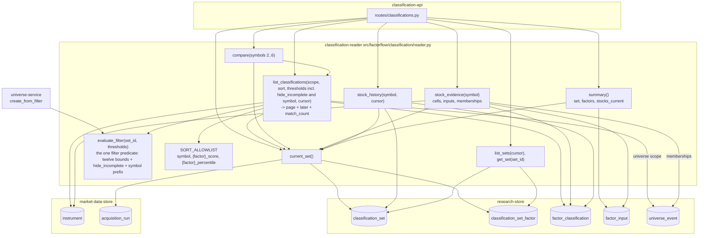

# Component: Classification Reader

**Status:** draft
**Capability:** CAP-002
**Owner:** Alvaro de Jodra
**Last Updated:** 2026-10-17

This design was produced in an unattended `$design-run`. Choices no artifact
fixes are recorded as decisions under `projects/factorflow-v2/decisions/` and
marked **PROVISIONAL**; where the UX design fixes a read semantics (sort order
of incomplete rows, exclusion under thresholds, which stocks the unscoped list
shows) this design cites it rather than deciding again.

**Version 2 (2026-10-16)** aligns this design with the system design v2, which
followed the product UX blueprint (`PRODUCT-UX` v6) and the Research screen
specification (`PRODUCT-UX-S03` v4), both approved on 2026-10-16. The reader
gains `match_count` over the full filtered set, `hide_incomplete` inside
`evaluate_filter` so the list and the universe snapshot share it, the compare
bound 2 to 6, `memberships` on the stock read, and the `summary` query with
its current-stock count under AC-13 (DEC-0070; DEC-0071, PROVISIONAL). The
read-side mechanics the system design leaves to this design, the count's SQL
shape, what `hide_incomplete` excludes, the unscoped list's treatment of
retired instruments, the summary's SQL and the memberships query, are DEC-0079
(PROVISIONAL). Nothing is written; no table changes.

**Version 3 (2026-10-17)** is the consistency pass the owner directed on
specification review v2
(`docs/capabilities/CAP-002-universe-and-factor-classification/specifications-review-report-v2.md`)
and applies six of its findings to this design, each exactly as the system
design v3 (pinned here) resolved it: FINDING-3 (`hide_incomplete` excludes
input reasons only and the unscoped list is the active roster, now stated by
the system design, which supersedes DEC-0071 (1) on this point by DEC-0079 (a)
and (b); sections 2.5, 3, 14), FINDING-4 (`evaluate_filter` keeps its
signature and `universe-service` v2 accepts the reader's `Thresholds` object;
sections 2.3, 11; DEC-0085), FINDING-5 (`Thresholds` gains the *Find a stock* `symbol`
prefix, so the list, `evaluate_filter` and the saved snapshot share it;
sections 2.3, 2.5, 7), FINDING-6 (a threshold excludes only stocks classified
on that factor that fail it; the predicate and its test change; sections 2.5,
3, 7, 8; DEC-0081), FINDING-7 (one `set` plus `later` shape on the list and the
summary, `not_current` true exactly when `later` is non-null;
`ClassificationPage` gains `later`; sections 2.3, 2.4, 7; DEC-0082) and
FINDING-8 (`run_started_at` on the set, `later` and set rows so every surface
names a download by its start time; sections 2.3, 2.4, 2.6; DEC-0083). The
records are the system design v3's and are cited, not re-decided: DEC-0081
follows from the approved S03-1 and supersedes the threshold-exclusion
statements of DEC-0071 and DEC-0076; DEC-0082, DEC-0083 (superseding
DEC-0079 (e)) and DEC-0085 (the filter as one object end to end, superseding
DEC-0079 (f)) are **PROVISIONAL**. Review v2's other findings naming this
design (FINDING-9, FINDING-10, FINDING-17, FINDING-28, FINDING-29) are
carried, not fixed. This version records no decision of its own.

## 1. Overview

The classification reader is the read side of classification: the Python
module that resolves which set is current and whether it reflects the latest
download, serves the sorted, threshold-filtered and searched list of scored
stocks over the whole current set or one universe with keyset pagination and a
match count over the full result, answers side-by-side comparison for an
explicit list of 2 to 6 symbols, returns one stock's evidence with its
universe memberships and its classification history, lists sets, and answers
the one small summary read the Research header, banner and poll and the shell
capability's Home and Data health screens consume. It also owns the one
definition of a filter match, `evaluate_filter`, covering the twelve threshold
bounds, `hide_incomplete` and the *Find a stock* `symbol` prefix, which the
list read and `universe-service`'s snapshot both use so a saved universe is
exactly what the owner reviewed (AC-2, S03-7).

It never computes a classification and never writes. Everything it returns is
a row the engine recorded, which is what lets the interface satisfy STD-UI-15,
nothing asserted beyond what is derived. Sorting, filtering and counting run in
SQL over the whole set, never over a loaded page (system design v3 3.3 step
15; S03 §6), because a ranking or a count over one page is silently wrong at
3000 stocks (STD-UI-30, S03-2).

Use cases addressed:

- Resolve the current set, its date, download and `ended_at`, and report the
  later set beside it, building or failed, so it is marked not current (AC-20,
  AC-21); report the first set the same way while none is complete.
- Say plainly that nothing has been scored yet (AC-22).
- List every scored stock with percentile and standardised score per factor,
  or the status and input named, sorted by any factor metric and narrowed by
  thresholds, symbol search and hide-incomplete, across all followed stocks or
  within a universe, with the count of the whole result (AC-9, AC-12, AC-14,
  AC-15, AC-16; S03-1, S03-2).
- Compare 2 to 6 chosen stocks side by side without dropping one that is
  incomplete (AC-16, flow 4 step 5; DEC-0070).
- Show the inputs behind a classification with their dates and the restatement
  mark, and the universes the stock belongs to (AC-17, AC-23; S03-3).
- Show a stock's earlier classifications, as recorded (AC-18, AC-19).
- Summarise the set's state and currency, the per-factor counts and how many
  followed stocks are current, with no stock rows (AC-13, AC-20 to AC-22;
  DEC-0071).

Support matrix: the application container's Python 3.12 process against
PostgreSQL 16 through the application pool.

Dependencies: `research-store` migrations `0005` and `0006`;
`market-data-store` tables `instrument` and `acquisition_run`; the replay SQL
of `universe-service` (`membership_as_of.sql`) for universe scope; `psycopg` 3;
the request bounds of `src/factorflow/api/bounds.py` and the compare bound of
`src/factorflow/api/classification_bounds.py`; the cursor contract of
`src/factorflow/runs/queries.py`.

## 2. Design Details

### 2.1 Placement

```
src/factorflow/classification/reader.py            current_set, summary, list_classifications, compare,
                                                   stock_evidence, stock_history, list_sets, get_set,
                                                   evaluate_filter; filter and sort models
src/factorflow/classification/sql/current_set.sql
src/factorflow/classification/sql/summary.sql       per-factor counts and the current-stock count (DEC-0079)
src/factorflow/classification/sql/list_classifications.sql   matched CTE, match_count, page
src/factorflow/classification/sql/stock_evidence.sql
src/factorflow/classification/sql/stock_memberships.sql      active universes holding the instrument
src/factorflow/classification/sql/stock_history.sql
src/factorflow/classification/sql/sets.sql
tests/unit/test_reader_sort_allowlist.py
tests/unit/test_reader_cursor.py
tests/unit/test_reader_filters.py                  Thresholds incl. hide_incomplete and symbol; compare bound
tests/integration/test_reader_current_set.py
tests/integration/test_reader_summary.py
tests/integration/test_reader_list.py
tests/integration/test_reader_compare.py
tests/integration/test_reader_evidence.py
tests/integration/test_reader_history.py
tests/integration/test_reader_volume.py            3000 stocks, slow marker
```

### 2.2 Component block diagram

The diagram below shows the reader's public functions, the one shared filter
definition beneath them, and the tables each reads. `current_set` is called by
every other read so one rule decides what "current" means. `list_classifications`
and `compare` are the same query with a different scope, and both use
`evaluate_filter`'s predicate, which carries `hide_incomplete` and the
`symbol` prefix; `universe-service` calls `evaluate_filter` directly for the
snapshot, so the saved members equal the displayed result. `summary` reads the set, its three
factor rows and one aggregate over `factor_input`, and nothing per stock.
`stock_evidence` adds a membership read over `universe_event`. The expected
outcome is that there is one definition of current, one of a filter match, one
of a current stock and one of the sort order, and every screen, including the
shell capability's, reads through them.



### 2.3 Interface

```python
# src/factorflow/classification/reader.py
from dataclasses import dataclass, field
from datetime import date, datetime
from decimal import Decimal
from uuid import UUID

import psycopg

from factorflow.api.bounds import DEFAULT_PAGE_SIZE, MAX_PAGE_SIZE
from factorflow.api.classification_bounds import MAX_COMPARE_SYMBOLS, MIN_COMPARE_SYMBOLS  # 6, 2 (DEC-0070)

FACTORS = ("value", "growth", "momentum")
INPUT_REASONS = ("input_missing", "input_outdated", "input_not_computable")   # what "incomplete" means (DEC-0079)
SORT_ALLOWLIST: dict[str, str] = {           # request value -> SQL expression, never interpolated from input
    "symbol": "i.symbol",
    **{f"{f}_score": f"c_{f}.score" for f in FACTORS},
    **{f"{f}_percentile": f"c_{f}.percentile" for f in FACTORS},
}


class CursorError(ValueError): ...
class UniverseNotFound(LookupError): ...
class InstrumentNotFound(LookupError): ...


@dataclass(frozen=True)
class Thresholds:
    """The filter, one object for the list query and the saved snapshot (DEC-0076; system design v3
    3.3 step 15): twelve optional bounds, {factor}_score_min/_max and {factor}_percentile_min/_max,
    percentiles 0 to 100 inclusive, scores finite Decimals (constraint 15); hide_incomplete (S03-1;
    DEC-0079 (a)); and symbol, the Find a stock prefix, None when none (DEC-0074; review v2 FINDING-5).
    universe-service v2 accepts this type and serialises it whole into filter_provenance (DEC-0085)."""
    bounds: dict[str, Decimal] = field(default_factory=dict)
    hide_incomplete: bool = False
    symbol: str | None = None        # upper-cased prefix, ^[A-Z][A-Z0-9.-]{0,15}$

    def factors_constrained(self) -> set[str]: ...


@dataclass(frozen=True)
class LaterSet:
    """The most recent set newer than the current one, or the first set while none is complete;
    one shape on the list and the summary (DEC-0082)."""
    set_id: UUID
    state: str                       # building | failed
    run_id: UUID
    run_started_at: datetime         # acquisition_run.started_at: how every surface names the download (DEC-0083)
    started_at: datetime
    ended_at: datetime | None
    failure_reason: str | None


@dataclass(frozen=True)
class CurrentSet:
    set_id: UUID
    classification_date: date
    run_id: UUID
    run_started_at: datetime         # acquisition_run.started_at (DEC-0083)
    run_outcome: str                 # succeeded | partial, from acquisition_run.state
    state: str                       # complete
    started_at: datetime
    ended_at: datetime               # the as-of line's "Scores from {date} {time}"
    latest_trading_day: date
    active_instruments: int          # followed_count; S03 peerCounts.followed
    factors: dict[str, "FactorSummary"]
    not_current: bool                # true exactly when the page's or summary's `later` is not None (DEC-0082)


@dataclass(frozen=True)
class FactorSummary:
    qualified_count: int
    ranked: bool
    min_peer_set_size: int           # 30, AC-14


@dataclass(frozen=True)
class StocksCurrent:
    current_count: int               # stocks with no factor_input row missing or outdated (AC-12, AC-13)
    followed_count: int              # the set's active_instruments


@dataclass(frozen=True)
class Summary:
    set: CurrentSet | None           # the latest complete set, or None
    never_classified: bool           # true exactly when set is None
    later: LaterSet | None           # the newer building or failed set, or the first while none is complete (DEC-0082)
    stocks_current: StocksCurrent | None


@dataclass(frozen=True)
class FactorCell:
    status: str                      # classified | not_classified
    score: Decimal | None
    percentile: Decimal | None
    reason_code: str | None
    reason_input: str | None
    reason_detail: str | None
    restated_possible: bool


@dataclass(frozen=True)
class StockRow:
    instrument_id: int
    symbol: str
    name: str
    lifecycle: str
    factors: dict[str, FactorCell]


@dataclass(frozen=True)
class Membership:
    universe_id: UUID
    name: str


@dataclass(frozen=True)
class ListFilters:
    universe_id: UUID | None = None
    symbols: list[str] | None = None            # compare; MIN_COMPARE_SYMBOLS to MAX_COMPARE_SYMBOLS
    sort: str = "symbol"                        # key of SORT_ALLOWLIST
    order: str = "asc"                          # asc | desc
    thresholds: Thresholds = field(default_factory=Thresholds)   # bounds, hide_incomplete and the symbol prefix
    limit: int = DEFAULT_PAGE_SIZE
    cursor: str | None = None


@dataclass(frozen=True)
class ClassificationPage:
    set: CurrentSet | None           # None when never classified
    never_classified: bool           # true exactly when set is None
    later: LaterSet | None           # the same block Summary carries; not_current is true exactly when it is set (DEC-0082)
    match_count: int                 # over the whole filtered scope, never the page (S03-2); 0 when never classified
    stocks: list[StockRow]
    unknown_symbols: list[str]       # compare only: requested symbols that are not instruments
    next_cursor: str | None


def current_set(conn: psycopg.Connection) -> CurrentSet | None: ...
def summary(conn: psycopg.Connection) -> Summary: ...
def list_classifications(conn: psycopg.Connection, filters: ListFilters) -> ClassificationPage: ...
def compare(conn: psycopg.Connection, symbols: list[str]) -> ClassificationPage: ...
def evaluate_filter(conn: psycopg.Connection, set_id: UUID, thresholds: Thresholds) -> list[int]: ...
def stock_evidence(conn: psycopg.Connection, symbol: str) -> "StockEvidence": ...
def stock_history(conn: psycopg.Connection, symbol: str, limit: int,
                  cursor: str | None) -> tuple[list["HistoryRow"], str | None]: ...
def list_sets(conn: psycopg.Connection, limit: int, cursor: str | None) -> tuple[list["SetRow"], str | None]: ...
def get_set(conn: psycopg.Connection, set_id: UUID) -> "SetRow": ...
```

`StockEvidence` carries the `CurrentSet` or `None`, the instrument's symbol,
name and lifecycle, one `FactorCell` per factor, one `InputRow` per
`factor_input` row of the current set (`input_name`, `label`, `status`,
`value`, `as_of`, `known_on`, `restated_possible`, `detail`) and
`memberships: list[Membership]`, the active universes the instrument currently
belongs to in name order. `HistoryRow` is one earlier set's result for the
stock: `set_id`, `classification_date`, `run_id`, `run_outcome`, `ended_at`,
three `FactorCell`s. `SetRow` is `classification_set` joined to its three
`classification_set_factor` rows and the run's `state` and `started_at`
(`run_outcome`, `run_started_at`; DEC-0083). `evaluate_filter`'s signature is
unchanged from version 1; what changes is what travels in
`thresholds`: the reader's `Thresholds` dataclass, twelve bounds,
`hide_incomplete` and the `symbol` prefix, is the type `universe-service` v2's
`create_from_filter` now accepts in place of `dict[str, Decimal]`, passes
through unchanged, and serialises whole into `filter_provenance` beside the
set's `classification_date`, so the saved filter and the list query are one
object and the origin line can name the search and the hidden stocks (system
design v3 §4.2 *Universe operations* and *Filter snapshot evaluation*, §4.4;
DEC-0085, PROVISIONAL; DEC-0076; review v2 FINDING-4, FINDING-5). Version 2's
claim, DEC-0079 (f), that `universe-service` carried `hide_incomplete`
"without an edit" is superseded by DEC-0085: that design is revised to v2 to
take this type.

### 2.4 Current set, currency and the summary

```sql
-- src/factorflow/classification/sql/current_set.sql
WITH current AS (
    SELECT s.*, r.state AS run_outcome
      FROM classification_set s JOIN acquisition_run r USING (run_id)
     WHERE s.state = 'complete'
     ORDER BY s.ended_at DESC
     LIMIT 1
),
later AS (
    SELECT s.set_id, s.state, s.run_id, r.started_at AS run_started_at,
           s.started_at, s.ended_at, s.failure_reason
      FROM classification_set s JOIN acquisition_run r USING (run_id)
     WHERE s.started_at > COALESCE((SELECT started_at FROM current), '-infinity')
     ORDER BY s.started_at DESC
     LIMIT 1
)
SELECT ... FROM current FULL JOIN later ON true;   -- current carries r.started_at AS run_started_at too
```

The current set is the latest `complete` set (system design 3.3 step 13;
constraint 11). `later` is the most recent set newer than it, `building` or
`failed`, or the first set while none is complete; a later `complete` set
cannot exist by construction. `not_current` is true exactly when `later` is
non-null, and both the `ClassificationPage` and the `Summary` carry `later`
beside `set`, one shape before and after the first set (system design v3 3.3
steps 13, 14, 18; DEC-0082, PROVISIONAL; closing review v2 FINDING-7). When no
complete set exists, `current_set` returns `None` and the page or summary
carries `never_classified: true` (AC-22, 3.3 step 14) with the building or
failed first set in `later`, so the Research never-populated state and the
shell's screens render *Updating* or *Score update failed* with its
`failure_reason` from the same field as a later set's (AC-20). `run_outcome`
is `acquisition_run.state`, `succeeded` or `partial`, rendered beside the date
as *Complete* or *Partial* (UX design §1.2), and `run_started_at` is
`acquisition_run.started_at`, by which every surface names the download
(*from the download started 2026-10-15 17:30 CDT*, linked to the run detail;
DEC-0083, PROVISIONAL, superseding DEC-0079 (e)); both are read here rather
than by a second request because they are one join on the unique `run_id`.
`ended_at` is what the as-of line dates the scores by (DEC-0073). `min_peer_set_size` is the constant 30 (AC-14), returned so the
interface renders *{n} qualified, 30 needed* without a literal of its own.

**The summary** (system design v3 3.3 step 18; DEC-0071, PROVISIONAL; SQL
shape DEC-0079, PROVISIONAL) is `current_set`, with its `later`, plus one
aggregate:

```sql
-- src/factorflow/classification/sql/summary.sql (run with the current set_id)
SELECT count(*) FILTER (WHERE NOT stale) AS current_count,
       count(*)                           AS scored_roster
  FROM (
    SELECT fi.instrument_id,
           bool_or(fi.status IN ('missing', 'outdated')) AS stale
      FROM factor_input fi
     WHERE fi.set_id = %(set_id)s
     GROUP BY fi.instrument_id
  ) per_stock;
```

A stock is **current** when none of its `factor_input` rows in the current
set is `missing` or `outdated`: AC-12's presence and AC-13's currency;
`not_computable` is a data-shape condition and does not count against
currency, and `not_enough_stocks` is a factor-level condition that touches no
input row. The denominator `followed_count` is the set's `active_instruments`,
read from `classification_set`, not the subquery's row count: the engine
writes `factor_input` rows for the active roster only (retired instruments get
`not_classified` rows with reason `retired` and no inputs,
`component-design-factor-engine.md` §7), so the two agree in a complete set and
the stored column is the one the set's own record vouches for. The aggregate
groups one set's rows through the `factor_input` primary key's `set_id`
prefix, at most 3000 × 8 rows, and runs once per 10-second poll while a set
builds and otherwise on demand (STD-UI-25; DEC-0054). The shell capability's
Home and Data health screens read the same function through the API, so the
current-set rule and the current-stock rule live here once (SA-DUP-001; system
design v3 assumption 8).

### 2.5 The list query

```sql
-- src/factorflow/classification/sql/list_classifications.sql (shape; the sort expression is substituted
-- from SORT_ALLOWLIST by the reader, never from the request)
WITH scope AS (
    SELECT i.instrument_id, i.symbol, i.name, i.lifecycle
      FROM instrument i
     WHERE (%(universe_id)s IS NOT NULL AND i.instrument_id IN (SELECT instrument_id FROM membership_now)
            OR %(universe_id)s IS NULL AND i.lifecycle = 'active')                 -- DEC-0073: unscoped = followed stocks
       AND (%(symbol)s IS NULL OR i.symbol LIKE %(symbol)s || '%%')                -- thresholds.symbol, the Find a stock prefix
       AND (%(symbols)s IS NULL OR i.symbol = ANY(%(symbols)s::text[]))
       AND EXISTS (SELECT 1 FROM factor_classification c
                    WHERE c.set_id = %(set_id)s AND c.instrument_id = i.instrument_id)
),
matched AS (
    SELECT s.instrument_id, s.symbol, s.name, s.lifecycle,
           c_value.*, c_growth.*, c_momentum.*
      FROM scope s
      LEFT JOIN factor_classification c_value    ON c_value.set_id = %(set_id)s AND c_value.instrument_id = s.instrument_id AND c_value.factor = 'value'
      LEFT JOIN factor_classification c_growth   ON ... 'growth'
      LEFT JOIN factor_classification c_momentum ON ... 'momentum'
     WHERE {threshold_predicate}          -- per bound present: c_f.status <> 'classified' OR c_f.<metric> <op> bound (DEC-0081)
       AND (NOT %(hide_incomplete)s OR NOT (
                c_value.reason_code    IN ('input_missing', 'input_outdated', 'input_not_computable')
             OR c_growth.reason_code   IN (...)
             OR c_momentum.reason_code IN (...)))                                     -- hide_incomplete (DEC-0079)
)
SELECT m.*, (SELECT count(*) FROM matched) AS match_count
  FROM matched m
 WHERE {keyset_predicate}
 ORDER BY ({sort_expr} IS NULL) ASC, {sort_expr} {order}, m.symbol ASC
 LIMIT %(limit_plus_one)s;
```

Five rules give the query its meaning:

- **Scope.** *All followed stocks* is every **active** instrument with a row in
  the current set; a stock the owner has stopped following is not a followed
  stock and is not listed there (UX design §1.1; DEC-0073, PROVISIONAL). A
  universe scope joins the replayed current membership from
  `universe-service`'s `membership_as_of.sql` with today's date and keeps
  retired members, so a member that is no longer followed still appears with
  `retired` on every factor (AC-15, flow 6 step 5); an unknown `universe_id`
  raises `UniverseNotFound`. Universes never enter the computation, only the
  scope (AC-8). The *Find a stock* prefix, `thresholds.symbol`, narrows the
  scope (DEC-0074), and because it is a field of `Thresholds` it reaches
  `evaluate_filter` and the saved snapshot by the same path, so a save under a
  search saves the stocks the header counted (review v2 FINDING-5). Version 1
  listed retired instruments unscoped; the UX design v2 and DEC-0073 changed
  that, and the system design v3 §3.3 step 15 and §4.2 now state the active
  roster as the unscoped list (DEC-0079 (b)).
- **Thresholds.** `evaluate_filter`'s predicate: for each bound present,
  `(c_{factor}.status <> 'classified' OR c_{factor}.score >= %(value_score_min)s)`
  and so on. A bound applies only where the stock is **classified** on that
  factor, so a threshold excludes only stocks classified on that factor that
  fail it; a stock incomplete on that factor (an input reason) or unranked on
  it (`not_enough_stocks`) stays listed, rendered *Incomplete* or *Not enough
  to rank*, and counted in `match_count`, unless `hide_incomplete` removes the
  incomplete ones. This is approved S03-1's text and what makes the S03 §3
  helper, *They're shown by default so nothing disappears silently.*, true
  (blueprint §1 principle 5); the same predicate serves the list, compare,
  `evaluate_filter` and therefore the saved snapshot (S03-7). Version 2's
  rule, `status = 'classified' AND` the bound, under which a stock with no
  value on a thresholded factor left the list with the checkbox off, is
  withdrawn (system design v3 3.3 step 15; DEC-0081, from the approved S03,
  superseding the threshold-exclusion statements of DEC-0071 and DEC-0076;
  closing review v2 FINDING-6). S03's `{measure, direction, value}` sentences
  arrive already mapped onto these twelve bounds by the interface; the reader
  knows no other filter model. Percentile bounds are checked 0 to 100 and
  score bounds finite by the API model before reaching here (constraint 15).
- **Hide incomplete.** When `hide_incomplete` is true, a stock whose
  `not_classified` reason on any factor is an input reason (`input_missing`,
  `input_outdated`, `input_not_computable`) is excluded; a stock unranked
  because its factor has fewer than 30 qualifying stocks (`not_enough_stocks`)
  is **not** excluded, because the checkbox reads *Hide stocks with an
  incomplete score* and *Incomplete* is the display label for an input reason
  (STD-UI-1 v6, blueprint §7; DEC-0072), and because excluding
  `not_enough_stocks` would empty the whole list whenever one factor is
  unranked (AC-14); `retired` rows are governed by the scope rule above. The
  system design v3 §3.3 step 15 and §4.2 state this rule in these words and
  record that DEC-0071 decision (1), "stocks with any factor `not_classified`",
  is superseded on this point by DEC-0079 (a) and (b) (closing review v2
  FINDING-3; section 14).
- **Match count.** `match_count` is `count(*)` over the `matched` CTE, scope,
  thresholds, search and hide-incomplete applied and the keyset and limit not,
  so every page of a result reports the same number and the `h1` *{n} stocks
  match* never reports a page (S03-2). When the page is empty the count is
  still returned; when there is no current set the page is `never_classified`
  with `match_count` 0.
- **Sort.** `sort` resolves through `SORT_ALLOWLIST` to a column expression;
  any other value is refused before SQL is built (SEC-INP-002). Sorting by a
  factor metric places rows not classified on that factor after every
  classified row in both directions (`ORDER BY (expr IS NULL) ASC` first), and
  ties break on symbol, so an absent score never sorts as zero (STD-UI-4; UX
  design §1.1). Default is `symbol ASC` (UX brief §2.1).

**Pagination.** Keyset, `DEFAULT_PAGE_SIZE` 50 and `MAX_PAGE_SIZE` 500 from
`api/bounds.py` (`component-design-ingestion-api.md` section 2.4a). The cursor
is the versioned, URL-safe, opaque composite the owner confirmed on 2026-09-17
for `runs/queries.py`, carrying the sort key, its null flag and the symbol of
the last row, together with the `set_id` and the sort and order it was issued
for; a cursor presented with different sort, order or set raises `CursorError`,
which the API maps to `422`, so a page cannot continue a different ordering.
The reader shares the encoder with `runs/queries.py` rather than duplicating
it (SA-DUP-001). When the set changes under a paging client, the cursor's
`set_id` mismatch surfaces as `422 cursor_stale`, and the interface, which
reloads once on completion (DEC-0062), restarts from the first page. The
`virtualised` table windows over these pages (S03 §4).

**Compare.** `compare(symbols)` is `list_classifications` with `symbols` set,
`sort = "symbol"`, a default `Thresholds` (no bounds, `hide_incomplete` false,
no prefix), no lifecycle restriction (a compared stock that is no longer followed keeps its column as
*Not followed*, UX design §1.5) and `limit = MAX_COMPARE_SYMBOLS`. The list
must hold `MIN_COMPARE_SYMBOLS` to `MAX_COMPARE_SYMBOLS` symbols, 2 to 6
(S03 §6; DEC-0070); the API model refuses other sizes and the dataclass
re-checks. Symbols that are not instruments are returned in `unknown_symbols`,
never silently dropped (STD-UI-16); a stock incomplete on a factor appears with
its reason.

### 2.6 Evidence, memberships, history and sets

`stock_evidence.sql` resolves the instrument by symbol (`InstrumentNotFound`
when none), the current set, its three `factor_classification` rows and every
`factor_input` row of the current set for the instrument, ordered by factor
then input name in the factor's definition order; before any set exists the
evidence carries `set: None` (system design 4.2). `label` for each input is
the product-vocabulary name (`book-to-price`, `earnings yield`, ...), the same
table `factor-engine` writes `reason_detail` from (STD-UI-1).

`stock_memberships.sql` (DEC-0071; shape DEC-0079) returns the active
universes the instrument currently belongs to, for the inspector's *In Tech
and Dividend growers* line and the evidence page (S03 §5):

```sql
-- src/factorflow/classification/sql/stock_memberships.sql
WITH latest_member_event AS (
    SELECT DISTINCT ON (e.universe_id) e.universe_id, e.event_type
      FROM universe_event e
     WHERE e.instrument_id = %(instrument_id)s
       AND e.event_type IN ('member_added', 'member_removed')
     ORDER BY e.universe_id, e.event_id DESC
)
SELECT u.universe_id, n.name
  FROM latest_member_event m
  JOIN universe u USING (universe_id)
  JOIN LATERAL (SELECT name FROM universe_event WHERE universe_id = u.universe_id
                  AND event_type IN ('created', 'renamed') ORDER BY event_id DESC LIMIT 1) n ON true
 WHERE m.event_type = 'member_added'
   AND NOT EXISTS (SELECT 1 FROM universe_event r WHERE r.universe_id = u.universe_id AND r.event_type = 'retired')
 ORDER BY n.name;
```

It is a replay over `universe_event` through `idx_universe_event_instrument`,
consistent with `universe-service`'s rule that current state is derived by
replay and never maintained (DEC-0057): the latest member event per universe
decides membership, the latest `created` or `renamed` event supplies the name,
and a retired universe is excluded because the stock's memberships line names
places the owner can still act in (UX design §1.1). It runs once per inspector
selection and once per evidence page, never per list row.

`stock_history.sql` pages the instrument's `factor_classification` rows in
sets other than the current one, newest `ended_at` first, grouped per set with
the set's `classification_date`, `run_id`, `run_outcome` and `ended_at`,
keyset on `(ended_at, set_id)`. Only `complete` sets appear: a failed set wrote
no rows (AC-18, AC-20). Each row is what was recorded; nothing is recomputed
(AC-19).

`sets.sql` lists `classification_set` newest `started_at` first with the three
factor counts and the run's `state` and `started_at` (`run_outcome`,
`run_started_at`, joined from `acquisition_run` on the unique `run_id`;
DEC-0083), keyset on `(started_at, set_id)`; `get_set(set_id)` returns one. A `building` set has `ended_at` null; a `failed`
set carries `failure_reason` as recorded (AC-20, AC-21). The set history
dialog (UX design §1.2) reads this.

### 2.7 Read sequence

The diagram below traces the interface's main read, the Research list scoped
to a universe with a sort, thresholds and hide-incomplete, through the reader.
The current set is resolved first, because every other step is relative to it;
the universe scope is a replay of membership; the list query applies scope,
thresholds, hide-incomplete, search, the count, sort and keyset in SQL and
returns one page plus one row to know whether a next page exists, with the
full-set count on every row. The decision points are whether a current set
exists, which short-circuits to `never_classified`, and whether the cursor
matches the set and ordering. The expected outcome is one response carrying
the set's currency, the per-factor counts, the match count and one page of
stocks.

```mermaid
sequenceDiagram
    participant A as classification-api
    participant R as classification-reader
    participant DB as PostgreSQL

    A->>R: list_classifications(ListFilters; thresholds incl. hide_incomplete and symbol)
    R->>R: resolve sort through SORT_ALLOWLIST; decode cursor (CursorError on mismatch)
    R->>DB: current_set.sql (set and later, each with run_started_at)
    alt no complete set
        R-->>A: ClassificationPage(set=None, never_classified=true, later (the first set, building or failed, or None), match_count=0, stocks=[])
    else current set
        R->>DB: membership_as_of.sql (universe scope only)
        R->>DB: list_classifications.sql: matched CTE (scope, thresholds, hide_incomplete, search), count, keyset page LIMIT limit+1
        R-->>A: ClassificationPage(set with not_current, later, match_count, stocks, next_cursor)
    end
```

### 2.8 Messages

N/A, not applicable for this component. The reader is called in-process; the
interface polls the API's summary read at the cadence the UX design records.

## 3. Constraints and Assumptions

- **Read-only.** No statement in this module writes. The append-only guard
  over `src/factorflow/` covers it.
- **Current means latest complete** (system design constraint 11); a building
  or failed later set is reported beside it as `later`, never instead of it
  (AC-20), in one shape on the list and on the summary, and `not_current` is
  true exactly when `later` is non-null; before any complete set, `later` is
  the first set (DEC-0082, PROVISIONAL).
- **Whole-set sort, filter and count in SQL** (3.3 step 15; STD-UI-30; S03-2),
  keyset pagination at the first capability's bounds, cursor bound to its set
  and ordering.
- **Sort is an allowlist** (constraint 15, SEC-INP-002). `symbol`,
  `{factor}_score`, `{factor}_percentile`; nothing else reaches SQL.
- **Incomplete rows sort last in both directions; a threshold excludes only
  stocks classified on that factor that fail it**, never a stock incomplete
  or unranked on it (UX design v3 §1.1; system design v3 3.3 step 15;
  STD-UI-4; DEC-0081). Both are implemented here so every scope behaves alike.
- **One filter predicate**, `evaluate_filter`, covering the twelve bounds,
  `hide_incomplete` and the `symbol` prefix, shared with `universe-service` so
  the saved snapshot equals the displayed result, under a search included
  (AC-2, S03-7; constraint 14; DEC-0076; DEC-0085; review v2 FINDING-4,
  FINDING-5).
- **`hide_incomplete` excludes input reasons only** (`input_missing`,
  `input_outdated`, `input_not_computable`), never `not_enough_stocks` and
  never `retired` (DEC-0079 (a), PROVISIONAL), as system design v3 §3.3 step
  15 and §4.2 state; DEC-0071 (1) is superseded on this point by DEC-0079.
- **The unscoped list is the followed stocks** (`lifecycle = 'active'`); a
  universe scope and compare keep retired instruments (AC-15; DEC-0073;
  DEC-0079 (b), PROVISIONAL; system design v3 §3.3 step 15).
- **A download is named by its start time.** The `set`, `later` and set rows
  carry `run_started_at` (`acquisition_run.started_at`) beside `run_id`, so
  the interface renders *from the download started {time}* in America/Chicago
  linked to the run detail and never a number or the raw UUID (DEC-0083,
  PROVISIONAL, superseding DEC-0079 (e); system design v3 §8 question 11).
- **A current stock has no `missing` or `outdated` input in the current set**
  (AC-12, AC-13; DEC-0071); `followed_count` is `active_instruments`.
- **Compare holds 2 to 6 symbols** (S03 §6; DEC-0070).
- **Universes scope, never compute** (AC-8; constraint 5).
- **Nothing recomputed** (AC-19; STD-UI-15). Every value returned is a stored
  row.
- **Bounds are the first capability's**: 50 default, 500 maximum page; the
  compare bound is this capability's (`classification_bounds.py`).
- **Python 3.12, `psycopg` 3, plain SQL, `pytest`** (tech stack). No ORM.
- **Assumption:** `membership_as_of.sql` is importable from
  `factorflow.universes.replay` as a SQL constant, so the reader joins it
  rather than restating the replay (SA-DUP-001).
- **Assumption:** `factor-engine` writes no `factor_input` row for a retired
  instrument (`component-design-factor-engine.md` §7, "no `factor_input`
  rows"), so the summary's per-stock aggregate covers exactly the active
  roster and `active_instruments` is its denominator.

## 4. Security

- **Input validation (SEC-INP-001).** `sort` and `order` are enumerations;
  `limit` is bounded 1 to 500; `symbols` holds 2 to 6 entries, each matching
  the instrument symbol shape; `thresholds.symbol` (the prefix) matches
  `^[A-Z][A-Z0-9.-]{0,15}$` after upper casing and is bound as a parameter to
  `LIKE` with its `%` and `_` escaped; `universe_id` and `set_id` are `UUID`s; threshold bounds are
  finite `Decimal`s with percentiles in 0 to 100; `hide_incomplete` is a
  boolean; cursors are versioned and refused on any mismatch. Validation runs
  in the API models and is re-checked by the dataclasses' `__post_init__`, as
  `runs/queries.py` does.
- **Injection (SEC-INP-002).** Every value is a bound parameter. The sort
  expression is the only text substituted into SQL and it comes from
  `SORT_ALLOWLIST`'s values, which are repository constants; the reason-code
  list in the hide-incomplete predicate is the repository constant
  `INPUT_REASONS`, bound as a parameter; `tests/unit/test_reader_sort_allowlist.py`
  asserts that every request value outside the allowlist is refused before
  any SQL is built and that the substituted text is always one of the seven
  expressions.
- **Error disclosure (SEC-ERR-001).** Typed exceptions carry a code and the
  identifier concerned; database errors propagate to the API's
  `internal_error_handler`.
- **Authentication and authorization.** None; loopback-only API, one owner
  (capability section 5.3).
- **Data classification.** Internal throughout; `reason_detail`,
  `failure_reason` and universe names are product-written or owner text, never
  a credential.
- **Transport.** PostgreSQL on the host-local channel under the
  `SEC-ENC-001 host-local loopback exception` (DEC-0050, DEC-0058).
- **Dependency posture, SAST.** No new dependency; `ruff`, `mypy` blocking.
- **Crypto usage: none. Privacy impact: none.**

## 5. Scalability and Performance

- **Sizing (AC-11, STD-UI-30).** 3000 rows per set, 9000 classification rows
  per set, pages of 50 to 500. The `matched` CTE touches one set's rows
  through `idx_factor_classification_set_factor_score` or `_percentile` for a
  factor sort and the primary key for the symbol sort, and never scans another
  set; the count is one pass over the same CTE, so a page costs one filtered
  scan plus one aggregate, not two independent queries.
- **Thresholds and hide-incomplete** are predicates on the same indexed
  columns; a filter over 3000 rows is a request, not a client-side scan
  (`owner-web-app` section 2.6).
- **Universe scope** adds one `DISTINCT ON` replay over the universe's member
  events, then an `IN` over at most 3000 instrument ids.
- **The summary** is `current_set.sql` (two index probes) plus one `GROUP BY`
  over at most 3000 × 8 `factor_input` rows through the primary key's `set_id`
  prefix; it is the read polled every 10 seconds while a set builds (DEC-0054)
  and the one the shell capability's screens will poll, so it carries no stock
  rows by design (DEC-0071).
- **Evidence** reads 3 classification rows and 8 input rows by primary key and
  one membership replay through `idx_universe_event_instrument`; it runs once
  per inspector selection after a 150 ms debounce (S03 §6), never per row.
- **History** pages by `idx_factor_classification_instrument`; **sets** by
  `idx_classification_set_started`.
- **Compare** is one list call bounded at 6 rows.
- **No latency target is stated** (system design section 8 question 8); the
  volume test exercises the shape without asserting a number.
- **Concurrency.** One owner; reads share the application pool; no process
  state (SA-CONC-001).

## 6. Upgrade

- **No previous release** of this component.
- **Data migration: none.**
- **Behaviour change after upgrade.** Reads answer `never_classified` until the
  first set completes; the summary says a first set is building when one is.
- **Manual actions required: none.**
- **Rollback (OPS-MIG-003).** Reverting the image removes the routes that call
  this module; the store rollback is `runtime-config` section 2.8.4's.
- **Contract stability.** Response shapes are declared stable within this
  capability (system design 4.2); version 2 adds `match_count`,
  `hide_incomplete`, `name`, `memberships` and `summary`, and version 3 adds
  `later` on the page, `run_started_at` on the set, `later` and set rows and
  `symbol` in `Thresholds`, all before anything shipped. Adding a field is compatible, removing one is a breaking change for
  `classification-ui` and for the shell capability's screens once they consume
  the summary, and must be treated as such in a later design (`ingestion-api`
  section 6).

## 7. Testing

`pytest`; `testcontainers[postgres]` under the `postgres` marker for every
query; fixtures insert sets and rows directly into `research-store` so the
reader is tested independently of the engine. The S03 checks that are read
semantics (S03-1, S03-2, S03-3, S03-7's snapshot equality) are proved here
against a real store (DEC-0080).

| Test | File | What it proves |
|------|------|----------------|
| Current is latest complete | `tests/integration/test_reader_current_set.py` | With two complete sets, the later `ended_at` is current and the earlier is history (constraint 11) |
| Not current while building | `tests/integration/test_reader_current_set.py` | A later `building` set yields `later` with its `state`, `started_at`, `run_id` and `run_started_at` and `set.not_current` true, identically on `list_classifications` and `summary`; the current set is still served (AC-20; DEC-0082, DEC-0083) |
| Not current after failure | `tests/integration/test_reader_current_set.py` | A later `failed` set yields `later` with `failure_reason`; the previous set is still served; with no later set `later` is None and `not_current` false (AC-20) |
| Never classified | `tests/integration/test_reader_current_set.py` | No complete set: `never_classified: true`, no stocks, `set` None, `match_count` 0; with no set at all `later` is None; a first set `building` or `failed` is `later` on both `list_classifications` and `summary`, and in `list_sets` (AC-20, AC-22; DEC-0082) |
| Run outcome, `ended_at`, `run_started_at` and counts | `tests/integration/test_reader_current_set.py` | `run_outcome` is the run's state and `run_started_at` the run's `started_at`, on `set`, on `later` and on every `SetRow`; `ended_at` and `active_instruments` are the set's; `factors` carry `qualified_count`, `ranked`, `min_peer_set_size` 30 (AC-14, AC-21; DEC-0083) |
| Summary current count | `tests/integration/test_reader_summary.py` | A stock with every input `present` or `not_computable` is current; one `missing` or one `outdated` input makes it not current; `followed_count` equals `active_instruments`; a factor below 30 changes no stock's currency (AC-12, AC-13, AC-14; DEC-0071) |
| Summary carries no rows and the set state | `tests/integration/test_reader_summary.py` | `set`, `factors`, `stocks_current` and nothing per stock; `never_classified` with `stocks_current` None and `later` set before any complete set (AC-20, AC-22) |
| Sort allowlist | `tests/unit/test_reader_sort_allowlist.py` | `sort=symbol;DROP` and `sort=score` are refused before SQL; the seven allowed values map to fixed expressions (SEC-INP-002) |
| Filters model | `tests/unit/test_reader_filters.py` | `Thresholds` accepts twelve bounds, `hide_incomplete` and a `symbol` prefix, refusing a prefix outside the symbol shape; `ListFilters.symbols` of 1 or 7 raises before SQL, 2 and 6 pass (DEC-0070) |
| Incomplete rows sort last | `tests/integration/test_reader_list.py` | Sorting by `value_score` asc and desc both place `not_classified` rows after every classified row, ties by symbol (STD-UI-4) |
| Default order is symbol | `tests/integration/test_reader_list.py` | No `sort`: symbol ascending |
| Thresholds exclude only stocks classified on that factor | `tests/integration/test_reader_list.py` | `value_percentile_min=80` returns every stock classified on value with percentile at least 80 and every stock incomplete or unranked on value, all counted in `match_count`; a stock classified on value at 60 is excluded; one incomplete on momentum is kept; with `hide_incomplete` the incomplete ones leave the list and the count (AC-16, S03-1; DEC-0081) |
| Hide incomplete | `tests/integration/test_reader_list.py` | Default lists a stock incomplete on one factor, under a threshold on that factor included; `hide_incomplete` excludes it; a stock with `not_enough_stocks` on an unranked factor is kept; a retired member under a universe scope is kept (S03-1; DEC-0079, DEC-0081) |
| Thresholds combine across factors | `tests/integration/test_reader_list.py` | Two bounds on two factors intersect |
| Match count is the full set | `tests/integration/test_reader_list.py` | 120 matching rows at `limit=50`: every page carries `match_count` 120; thresholds, `hide_incomplete` and the prefix change it; an empty page still carries it (S03-2) |
| Unscoped list is followed stocks | `tests/integration/test_reader_list.py` | A retired instrument with rows in the set is absent from the unscoped list and present under a universe it belongs to with `retired` on every factor; an unknown universe raises `UniverseNotFound` (AC-15, AC-16; DEC-0073, DEC-0079) |
| Same classification in every scope | `tests/integration/test_reader_list.py` | A stock's cells are identical scoped to a universe and unscoped (AC-8) |
| Symbol prefix | `tests/integration/test_reader_list.py` | `Thresholds.symbol = "AA"` matches `AAPL`, not `BAAP`; `%` in the prefix is literal; `match_count` follows (DEC-0074) |
| Keyset pages are stable | `tests/integration/test_reader_list.py`, `tests/unit/test_reader_cursor.py` | Pages of 50 over 120 rows under a factor sort cover every row once; a cursor with a different sort, order or set raises `CursorError` |
| Compare keeps incomplete and unfollowed stocks | `tests/integration/test_reader_compare.py` | Every requested symbol appears with its status, a retired one included; unknown symbols are returned in `unknown_symbols`; 1 and 7 symbols are refused, 2 and 6 accepted (AC-16; DEC-0070) |
| Evaluate filter equals the list | `tests/integration/test_reader_list.py` | `evaluate_filter` returns exactly the instrument ids `list_classifications` returns for the same `Thresholds`, with and without `hide_incomplete`, with and without a `symbol` prefix (the search-then-save case, review v2 FINDING-5), and with a stock incomplete on a thresholded factor among them (DEC-0081), unpaginated (AC-2, S03-7; DEC-0076) |
| Evidence rows and memberships | `tests/integration/test_reader_evidence.py` | Three cells and eight inputs with `label`, `status`, `value`, `as_of`, `known_on`, `restated_possible`, `detail`; `memberships` names the active universes the stock is in, in name order, after a rename uses the new name, omits a universe it was removed from and a retired universe; `set: None` before any set; unknown symbol raises `InstrumentNotFound` (AC-12, AC-17, AC-23; S03-3; DEC-0071) |
| History is as recorded | `tests/integration/test_reader_history.py` | Earlier sets newest first, each with its date, run and `ended_at`; the current set is excluded; a failed set does not appear; inserting later data changes no row (AC-18, AC-19) |
| Sets list | `tests/integration/test_reader_history.py` | Newest first with counts, `failure_reason` and `run_started_at` on every row; `get_set` of an unknown id raises (DEC-0083) |
| Volume | `tests/integration/test_reader_volume.py` (`slow`) | 3000 stocks: first and last pages under each of the seven sorts, with and without thresholds and hide-incomplete, return correct membership and the same `match_count`; the summary aggregates once; no full-table sort of another set |

## 8. Acceptance Criteria

1. The current set is the latest `complete` set, and a later `building` or
   `failed` set is reported beside it as `later` with its reason, never in
   place of it, in one shape on the list and the summary, with `not_current`
   true exactly then; the `set`, `later` and set rows carry `run_id` and
   `run_started_at`.
2. Before any complete set exists the list and the summary report
   `never_classified: true`, carry no stocks and carry the building or failed
   first set as `later`, or `later` None when no set exists.
3. The list sorts by any of `symbol`, `{factor}_score` or `{factor}_percentile`
   over the whole scope, with stocks incomplete on the sorted factor last in
   both directions, and refuses any other sort value.
4. Thresholds apply over the whole scope and exclude only stocks classified
   on the thresholded factor that fail the bound, never a stock incomplete or
   unranked on it; `hide_incomplete` excludes stocks with an input reason on
   any factor and nothing else; the `symbol` prefix narrows the list, the
   count and `evaluate_filter` alike.
5. `match_count` is the count over the whole filtered scope and is the same on
   every page.
6. The unscoped list returns followed stocks only; a universe scope returns
   its current members, retired instruments included, with cells identical to
   the unscoped list.
7. Compare returns every requested symbol that is an instrument, with its
   status and reasons, and names the rest; it accepts 2 to 6 symbols and
   refuses any other count.
8. Evidence returns the stock's three cells, eight inputs for the current set
   with their dates and marks, and its active universe memberships.
9. The summary returns the set, the per-factor counts and `stocks_current`,
   where a stock is current when none of its inputs is `missing` or
   `outdated`, with no stock rows.
10. History returns earlier complete sets' rows for the stock, newest first,
    unchanged by later data.
11. Failure scenario: a cursor from another sort, order or set is refused with
    `CursorError`, and no page is served under the wrong ordering.
12. Failure scenario: a database error during a read propagates to the API as
    a `500` with no row returned.

## 9. Workflows

- **See stocks scored after a download** (flow 1 steps 3 to 6): `summary`
  polled while building; `list_classifications` with `current_set` on
  completion.
- **Build a universe from a factor filter** (flow 3 step 2): the thresholded,
  searched, hide-incomplete-aware list with its count; step 3's snapshot
  shares `evaluate_filter` and the same `Thresholds` object.
- **Compare stocks and inspect the evidence** (flow 4): the universe-scoped
  list, sort and thresholds, `compare` at 2 to 6, `stock_evidence` for the
  inspector and each compare column.
- **Understand and fix insufficient evidence** (flow 5 steps 1, 2, 4):
  `stock_evidence` and `stock_history`.
- **Maintain universes over time** (flow 6 step 5): a retired member shown as
  `retired` in the universe scope; the inspector's memberships line.
- **Intersection with CAP-001.** `run_outcome` and `run_started_at` are read
  from `acquisition_run`; the interface names the download by that start time
  and opens it through CAP-001's `GET /api/acquisition-runs/{id}` unchanged
  (DEC-0083).
- **Intersection with the App shell & data health capability.** `summary` is
  the one function its Home and Data health screens depend on through the API
  (system design v3 assumption 8).

## 10. UX / GUI

N/A, not applicable for this component: it renders nothing. Seven things it
returns exist for the UX design's renderings: `match_count` for the `h1` *{n}
stocks match* (S03-2); `later` with `state`, `started_at`, `failure_reason`
and `run_started_at`, and the set's `ended_at` and `run_started_at`, for the
as-of line (*Scores from {time} · from the download started {time}*), the
banner's states and the never-populated state's *Updating* or *Score update
failed* (UX design v3 §1.1, §1.2; DEC-0082, DEC-0083);
`min_peer_set_size` beside `qualified_count` for *{n} qualified, 30 needed*;
`unknown_symbols` on compare so the entry field can name a symbol that is not
an instrument (§1.5); `label` on every input so the evidence list is in product
vocabulary (§1.6, STD-UI-1); `memberships` for the inspector's *In Tech and
Dividend growers* line (§1.1); `stocks_current` for S01's *{n} of {m} stocks
current* and S09's *Factor scores* card (§1.2). No internationalization.

## 11. API Endpoints

This component exposes no HTTP endpoint. It provides the `Classification
queries` interface of system design section 4.2 to `classification-api`, and
`evaluate_filter` to `universe-service`.

| Endpoint | Method/Operation | Auth/Privilege | Request | Response | Notes |
|----------|-----------------|----------------|---------|----------|-------|
| `current_set` | Python call | in-process | none | `CurrentSet` or `None` | AC-20, AC-21, AC-22 |
| `summary` | Python call | in-process | none | `Summary` | AC-13, AC-20 to AC-22; the read behind `GET /api/classifications/summary` (DEC-0071) |
| `list_classifications` | Python call | in-process | `ListFilters` | `ClassificationPage` with `match_count` | raises `UniverseNotFound`, `CursorError`, `ValueError` on a bad sort |
| `compare` | Python call | in-process | `symbols` (2 to 6) | `ClassificationPage` with `unknown_symbols` | raises `ValueError` outside the bound (DEC-0070) |
| `evaluate_filter` | Python call | in-process | `set_id`, `Thresholds` (twelve bounds + `hide_incomplete` + `symbol` prefix) | instrument ids | consumer `universe-service` v2, which accepts this type and records it in `filter_provenance`; the one filter predicate (DEC-0076; DEC-0085; review v2 FINDING-4, FINDING-5) |
| `stock_evidence` | Python call | in-process | `symbol` | `StockEvidence` with `memberships` | raises `InstrumentNotFound` |
| `stock_history` | Python call | in-process | `symbol`, `limit`, `cursor` | rows, `next_cursor` | raises `InstrumentNotFound`, `CursorError` |
| `list_sets`, `get_set` | Python call | in-process | `limit`, `cursor`; `set_id` | `SetRow`s with `run_started_at` | `get_set` raises on an unknown id (DEC-0083) |
| Classification read | SQL `SELECT` | database credential | set and filters | rows | `research-store` section 11; read-only |

## 12. References

| Type | Document Name | Description | Link |
|------|---------------|-------------|------|
| Capability | CAP-002 v1 | AC-2, AC-8, AC-9, AC-12 to AC-23; flows 1, 3, 4, 5 | `docs/capabilities/CAP-002-universe-and-factor-classification/Capability-CAP-002.md` |
| System design | CAP-002 system design v3 | Section 3.3 steps 13 to 18 (the `set` and `later` blocks, `never_classified`, match count, the filter as one object of twelve bounds, `hide_incomplete` and the `symbol` prefix with its three rules, compare 2 to 6, memberships, the summary, the current-stock rule, `run_started_at`); 4.2 classification reads and the filter snapshot evaluation; 4.4 `filter_provenance`; constraints 11, 14, 15; assumption 8; section 8 questions 8 and 11 | `docs/capabilities/CAP-002-universe-and-factor-classification/design/system-design.md` |
| Specification review | CAP-002 specification review v2 | FINDING-3 to FINDING-8 applied here; FINDING-9, 10, 17, 28, 29 carried | `docs/capabilities/CAP-002-universe-and-factor-classification/specifications-review-report-v2.md` |
| Screen specification | `PRODUCT-UX-S03` v4 (approved) | §5 view model; §6 server-side filter, sort and count, compare 2 to 6; §10 checks S03-1, S03-2, S03-3, S03-7 | `docs/ux/screens/S03-research.md` |
| UX design | CAP-002 UX design v3 | §1.1 sort of incomplete rows, the threshold rule (DEC-0081), the unscoped list as followed stocks (DEC-0073), the save under a search, the inspector's memberships, the never-populated state from `later`; §1.2 the as-of line and banner from `set` and `later`, the download named by its start time, polling from first load, what S01 and S09 consume; §1.5 compare keeps unfollowed stocks; §1.6 evidence labels | `docs/capabilities/CAP-002-universe-and-factor-classification/design/ux-design.md` |
| UX brief | CAP-002 UX brief v3 | §2.1 the view model mapped to the reads, the save carrying the prefix; §2.2 what the shell's screens read | `docs/capabilities/CAP-002-universe-and-factor-classification/design/ux-brief.md` |
| Component design | CAP-001 ingestion API v8 | Section 2.4a request bounds | `docs/capabilities/CAP-001-market-data-acquisition-foundation/design/component-design-ingestion-api.md` |
| Component design | CAP-002 research store v1 | Indexes the queries rely on; `factor_input` primary key; `idx_universe_event_instrument` | `docs/capabilities/CAP-002-universe-and-factor-classification/design/component-design-research-store.md` |
| Component design | CAP-002 universe service v2 | `membership_as_of.sql`; `create_from_filter` accepting the reader's `Thresholds` and calling `evaluate_filter(set_id, thresholds)`; `filter_provenance` and `Origin` carrying the bounds, `hide_incomplete`, `symbol` and `classification_date` | `docs/capabilities/CAP-002-universe-and-factor-classification/design/component-design-universe-service.md` |
| Component design | CAP-002 factor engine v1 | No `factor_input` rows for a retired instrument (§7), the summary's denominator rests on it | `docs/capabilities/CAP-002-universe-and-factor-classification/design/component-design-factor-engine.md` |
| Component design | CAP-002 classification API v3 | `classification_bounds.py` (`MIN_COMPARE_SYMBOLS`, `MAX_COMPARE_SYMBOLS`); the `Thresholds` model with `symbol`; the `set` and `later` blocks on the wire | `docs/capabilities/CAP-002-universe-and-factor-classification/design/component-design-classification-api.md` |
| Implemented code | `src/factorflow/runs/queries.py`, `src/factorflow/api/bounds.py` | The versioned opaque cursor contract (owner, 2026-09-17); page bounds | `src/factorflow/` |
| Decision records | DEC-0054, DEC-0057, DEC-0062, DEC-0063, DEC-0070, DEC-0071, DEC-0073, DEC-0074, DEC-0076, DEC-0079, DEC-0080, DEC-0081, DEC-0082, DEC-0083, DEC-0085 | Poll cadence; replay not maintained; refresh once; precision rendered by the interface; compare bound; read surface and the current-stock rule (superseded on the threshold rule and on `hide_incomplete`'s meaning); the unscoped list; the search field; hide-incomplete in the snapshot; read-side mechanics ((e) and (f) superseded); test placement; the threshold rule from approved S03-1; one `set` plus `later` shape; a download named by its start time; the filter as one object end to end, superseding DEC-0079 (f) | `projects/factorflow-v2/decisions/` (harness repository) |

## 13. Traceability

| Capability AC | System Design Element | Component Design Element | Section |
|--------------|----------------------|--------------------------|---------|
| AC-2 | Server-side snapshot against a named set; S03-7 | `evaluate_filter` with `Thresholds` incl. `hide_incomplete` and the `symbol` prefix, shared with `universe-service` v2 | 2.3, 2.5 |
| AC-8 | Universes never enter the computation | Universe is a scope predicate only | 2.5 |
| AC-9 | Score and percentile on `factor_classification` | `FactorCell.score`, `.percentile` returned as stored | 2.3 |
| AC-12 | `not_classified` with `reason_code`, `reason_input`; listed unless hidden (S03-1) | `FactorCell` reasons; `hide_incomplete` excludes input reasons only; a threshold never removes a stock incomplete on that factor (DEC-0081) | 2.3, 2.5 |
| AC-13 | The current-stock rule on the summary read | `summary.sql`: no `missing` or `outdated` input | 2.4 |
| AC-14 | `qualified_count`, `ranked` | `FactorSummary` with `min_peer_set_size`; `not_enough_stocks` never hidden | 2.4, 2.5 |
| AC-15 | Retired shown as such in universes | Universe scope and compare keep retired instruments as `retired`; the unscoped list is followed stocks | 2.5 |
| AC-16 | 3.3 steps 15, 16: sort, thresholds, universe, symbols 2 to 6, match count (S03-2) | `SORT_ALLOWLIST`, the `matched` CTE and its count, universe scope, `compare` | 2.5 |
| AC-17 | 3.3 step 17: `factor_input` rows and memberships (S03-3) | `stock_evidence` with `InputRow`s and `Membership`s | 2.6 |
| AC-18 | `/history` over earlier sets | `stock_history`, newest first | 2.6 |
| AC-19 | Rows as recorded | Nothing recomputed; history test | 2.6, 7 |
| AC-20 | 3.3 steps 13, 18: `set` and `later` blocks, one shape on list and summary (DEC-0082) | `later` on `ClassificationPage` and `Summary`; `CurrentSet.not_current` true exactly when `later` is set | 2.3, 2.4 |
| AC-21 | `classification_date`, `ended_at`, `run_id`, `run_started_at`; sets list (DEC-0083) | `CurrentSet`, `run_outcome`, `run_started_at`, `ended_at`, `list_sets` | 2.3, 2.4, 2.6 |
| AC-22 | 3.3 step 14: `never_classified` on list and summary, the first set in `later` | `ClassificationPage.never_classified`, `Summary.never_classified`, `later` | 2.4 |
| AC-23 | `restated_possible` | On every `FactorCell` and `InputRow` | 2.3 |

| S03 check | Component Design Element | Section |
|-----------|--------------------------|---------|
| S03-1 | `hide_incomplete` default false; input reasons only; a threshold applies to classified cells only (DEC-0081) | 2.5, 7 |
| S03-2 | `match_count` from the `matched` CTE on every page | 2.5, 7 |
| S03-3 | `InputRow.as_of`, `known_on` on `stock_evidence` | 2.6, 7 |
| S03-7 | `evaluate_filter` equals the list for the same `Thresholds`, prefix and `hide_incomplete` included | 2.5, 7 |

## 14. Open Questions

1. **No read-latency target at 3000 rows** (system design section 8 question
   8). *Owner: capability owner. Blocks: a performance acceptance criterion.*
2. **Closed in version 3** (the two read semantics; see below).
3. **Universe scope at a past date.** `GET /api/classifications?universe_id=`
   scopes to current membership; membership as of a past date is served by
   `GET /api/universes/{id}?as_of=` with classifications from the current set
   (UX design §1.4). No artifact asks for classifications as of a past set
   under a past membership; that is the M4 backtest's question, and this
   reader does not foreclose it because every set is retained. *Owner:
   capability owner. Blocks: nothing.*

**Closed in version 2.** The compare cap: `symbols` holds 2 to 6 (DEC-0070,
from approved S03 §6); version 1 bounded it at `MAX_PAGE_SIZE`.

**Closed in version 3.** Question 2, the two read semantics: version 2 asked
which rule wins between the system design v2's "any factor `not_classified`"
and DEC-0079 (a), and whether the unscoped list is the active roster (DEC-0079
(b)). The system design v3 §3.3 step 15 and §4.2 now state both in this
design's words and record that DEC-0071 decision (1) is superseded on this
point by DEC-0079 (a) and (b) (review v2 FINDING-3); the owner's verdict on
DEC-0079 is still pending, as on every provisional record, but no two
artifacts disagree.
