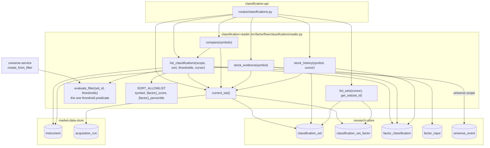

# Component: Classification Reader

**Status:** draft
**Capability:** CAP-002
**Owner:** Alvaro de Jodra
**Last Updated:** 2026-10-16

This design was produced in an unattended `$design-run`. Choices no artifact
fixes are recorded as decisions under `projects/factorflow-v2/decisions/`
(DEC-0064 to DEC-0067) and marked **PROVISIONAL**; where the UX design fixes a
read semantics (sort order of unclassified rows, exclusion under thresholds)
this design cites it rather than deciding again.

## 1. Overview

The classification reader is the read side of classification: the Python
module that resolves which set is current and whether it reflects the latest
acquisition, serves the sorted and threshold-filtered list of classified stocks
over the whole current set or one universe with keyset pagination, answers
side-by-side comparison for an explicit symbol list, returns one stock's
evidence and its classification history, and lists sets. It also owns the one
definition of a threshold match, `evaluate_filter`, which the list read and
`universe-service`'s filter snapshot both use so a saved universe is exactly
what the owner reviewed (AC-2).

It never computes a classification and never writes. Everything it returns is
a row the engine recorded, which is what lets the interface satisfy STD-UI-15,
nothing asserted beyond what is derived. Sorting and filtering run in SQL over
the whole set, never over a loaded page (system design 3.3 step 15), because a
ranking over one page is silently wrong at 3000 stocks (STD-UI-30).

Use cases addressed:

- Resolve the current set, its date and run, and mark it not current while a
  later set builds or after the latest attempt failed (AC-20, AC-21).
- Say plainly that nothing has been classified yet (AC-22).
- List every classified stock with score and percentile per factor, or the
  status and input named, sorted by any factor metric and narrowed by
  thresholds and symbol search, across all stocks or within a universe (AC-9,
  AC-12, AC-14, AC-15, AC-16).
- Compare chosen stocks side by side without dropping one that is not
  classified (AC-16, flow 4 step 5).
- Show the inputs behind a classification with their dates and the restatement
  mark (AC-17, AC-23).
- Show a stock's earlier classifications, as recorded (AC-18, AC-19).

Support matrix: the application container's Python 3.12 process against
PostgreSQL 16 through the application pool.

Dependencies: `research-store` migrations `0005` and `0006`;
`market-data-store` tables `instrument` and `acquisition_run`; the replay SQL
of `universe-service` (`membership_as_of.sql`) for universe scope; `psycopg` 3;
the request bounds of `src/factorflow/api/bounds.py` and the cursor contract
of `src/factorflow/runs/queries.py`.

## 2. Design Details

### 2.1 Placement

```
src/factorflow/classification/reader.py            current_set, list_classifications, compare,
                                                   stock_evidence, stock_history, list_sets, get_set,
                                                   evaluate_filter; filter and sort models
src/factorflow/classification/sql/current_set.sql
src/factorflow/classification/sql/list_classifications.sql
src/factorflow/classification/sql/stock_evidence.sql
src/factorflow/classification/sql/stock_history.sql
src/factorflow/classification/sql/sets.sql
tests/unit/test_reader_sort_allowlist.py
tests/unit/test_reader_cursor.py
tests/integration/test_reader_current_set.py
tests/integration/test_reader_list.py
tests/integration/test_reader_compare.py
tests/integration/test_reader_evidence.py
tests/integration/test_reader_history.py
tests/integration/test_reader_volume.py            3000 stocks, slow marker
```

### 2.2 Component block diagram

The diagram below shows the reader's public functions, the one shared filter
definition beneath them, and the tables each reads. `current_set` is called by
every other read so one rule decides what "current" means. `list_classifications`
and `compare` are the same query with a different scope, and both use
`evaluate_filter`'s predicate; `universe-service` calls `evaluate_filter`
directly for the snapshot. The expected outcome is that there is one
definition of current, one of a threshold match and one of the sort order, and
every screen reads through them.



### 2.3 Interface

```python
# src/factorflow/classification/reader.py
from dataclasses import dataclass, field
from datetime import date, datetime
from decimal import Decimal
from uuid import UUID

import psycopg

from factorflow.api.bounds import DEFAULT_PAGE_SIZE, MAX_PAGE_SIZE

FACTORS = ("value", "growth", "momentum")
SORT_ALLOWLIST: dict[str, str] = {           # request value -> SQL expression, never interpolated from input
    "symbol": "i.symbol",
    **{f"{f}_score": f"c_{f}.score" for f in FACTORS},
    **{f"{f}_percentile": f"c_{f}.percentile" for f in FACTORS},
}


class CursorError(ValueError): ...
class UniverseNotFound(LookupError): ...
class InstrumentNotFound(LookupError): ...


@dataclass(frozen=True)
class Thresholds:
    """Twelve optional bounds: {factor}_score_min/_max, {factor}_percentile_min/_max.
    Percentiles 0 to 100 inclusive; scores finite Decimals (system design constraint 15)."""
    bounds: dict[str, Decimal] = field(default_factory=dict)

    def factors_constrained(self) -> set[str]: ...


@dataclass(frozen=True)
class LaterSet:
    set_id: UUID
    state: str                       # building | failed
    run_id: UUID
    started_at: datetime
    ended_at: datetime | None
    failure_reason: str | None


@dataclass(frozen=True)
class CurrentSet:
    set_id: UUID
    classification_date: date
    run_id: UUID
    run_outcome: str                 # succeeded | partial, from acquisition_run.state
    state: str                       # complete
    started_at: datetime
    ended_at: datetime
    latest_trading_day: date
    active_instruments: int
    factors: dict[str, "FactorSummary"]
    not_current: LaterSet | None     # a later set building, or the latest attempt failed


@dataclass(frozen=True)
class FactorSummary:
    qualified_count: int
    ranked: bool
    min_peer_set_size: int           # 30, AC-14


@dataclass(frozen=True)
class FactorCell:
    status: str                      # classified | not_classified
    score: Decimal | None
    percentile: Decimal | None
    reason_code: str | None
    reason_input: str | None
    reason_detail: str | None
    restated_possible: bool


@dataclass(frozen=True)
class StockRow:
    instrument_id: int
    symbol: str
    lifecycle: str
    factors: dict[str, FactorCell]


@dataclass(frozen=True)
class ListFilters:
    universe_id: UUID | None = None
    symbol_prefix: str | None = None
    symbols: list[str] | None = None            # compare; at most MAX_PAGE_SIZE
    sort: str = "symbol"                        # key of SORT_ALLOWLIST
    order: str = "asc"                          # asc | desc
    thresholds: Thresholds = field(default_factory=Thresholds)
    limit: int = DEFAULT_PAGE_SIZE
    cursor: str | None = None


@dataclass(frozen=True)
class ClassificationPage:
    set: CurrentSet | None           # None when never classified
    never_classified: bool
    stocks: list[StockRow]
    unknown_symbols: list[str]       # compare only: requested symbols that are not instruments
    next_cursor: str | None


def current_set(conn: psycopg.Connection) -> CurrentSet | None: ...
def list_classifications(conn: psycopg.Connection, filters: ListFilters) -> ClassificationPage: ...
def compare(conn: psycopg.Connection, symbols: list[str]) -> ClassificationPage: ...
def evaluate_filter(conn: psycopg.Connection, set_id: UUID, thresholds: Thresholds) -> list[int]: ...
def stock_evidence(conn: psycopg.Connection, symbol: str) -> "StockEvidence": ...
def stock_history(conn: psycopg.Connection, symbol: str, limit: int,
                  cursor: str | None) -> tuple[list["HistoryRow"], str | None]: ...
def list_sets(conn: psycopg.Connection, limit: int, cursor: str | None) -> tuple[list["SetRow"], str | None]: ...
def get_set(conn: psycopg.Connection, set_id: UUID) -> "SetRow": ...
```

`StockEvidence` carries the `CurrentSet` or `None`, the instrument's lifecycle,
one `FactorCell` per factor and one `InputRow` per `factor_input` row of the
current set (`input_name`, `label`, `status`, `value`, `as_of`, `known_on`,
`restated_possible`, `detail`). `HistoryRow` is one earlier set's result for
the stock: `set_id`, `classification_date`, `run_id`, `run_outcome`, three
`FactorCell`s. `SetRow` is `classification_set` joined to its three
`classification_set_factor` rows and the run's state.

### 2.4 Current set and currency

```sql
-- src/factorflow/classification/sql/current_set.sql
WITH current AS (
    SELECT s.*, r.state AS run_outcome
      FROM classification_set s JOIN acquisition_run r USING (run_id)
     WHERE s.state = 'complete'
     ORDER BY s.ended_at DESC
     LIMIT 1
),
later AS (
    SELECT s.set_id, s.state, s.run_id, s.started_at, s.ended_at, s.failure_reason
      FROM classification_set s
     WHERE s.started_at > COALESCE((SELECT started_at FROM current), '-infinity')
     ORDER BY s.started_at DESC
     LIMIT 1
)
SELECT ... FROM current LEFT JOIN later ON true;
```

The current set is the latest `complete` set (system design 3.3 step 13;
constraint 11). `not_current` is populated when a later set exists and is
`building` or `failed`; a later `complete` set cannot exist by construction.
When no complete set exists, `current_set` returns `None` and the page carries
`never_classified: true` (AC-22, 3.3 step 14), with `not_current` still
reported through `list_sets` so the currency region can show a first set
building. `run_outcome` is `acquisition_run.state`, `succeeded` or `partial`,
which the currency region renders beside the date (UX design section 1.2); it
is read here rather than by a second request because it is one join on the
unique `run_id`. `min_peer_set_size` is the constant 30 (AC-14), returned so the
interface renders *18 of 30 stocks qualified* without a literal of its own.

### 2.5 The list query

```sql
-- src/factorflow/classification/sql/list_classifications.sql (shape; the sort expression is substituted
-- from SORT_ALLOWLIST by the reader, never from the request)
WITH scope AS (
    SELECT i.instrument_id, i.symbol, i.lifecycle
      FROM instrument i
     WHERE (%(universe_id)s IS NULL OR i.instrument_id IN (SELECT instrument_id FROM membership_now))
       AND (%(symbol_prefix)s IS NULL OR i.symbol LIKE %(symbol_prefix)s || '%%')
       AND (%(symbols)s IS NULL OR i.symbol = ANY(%(symbols)s::text[]))
       AND EXISTS (SELECT 1 FROM factor_classification c
                    WHERE c.set_id = %(set_id)s AND c.instrument_id = i.instrument_id)
)
SELECT s.instrument_id, s.symbol, s.lifecycle,
       c_value.*, c_growth.*, c_momentum.*
  FROM scope s
  LEFT JOIN factor_classification c_value    ON c_value.set_id = %(set_id)s AND c_value.instrument_id = s.instrument_id AND c_value.factor = 'value'
  LEFT JOIN factor_classification c_growth   ON ... 'growth'
  LEFT JOIN factor_classification c_momentum ON ... 'momentum'
 WHERE {threshold_predicate}
   AND {keyset_predicate}
 ORDER BY ({sort_expr} IS NULL) ASC, {sort_expr} {order}, s.symbol ASC
 LIMIT %(limit_plus_one)s;
```

Three rules give the query its meaning:

- **Scope.** All classified stocks is every instrument with a row in the
  current set, active and retired (AC-15 keeps retired stocks visible as
  `retired`). A universe scope joins the replayed current membership from
  `universe-service`'s `membership_as_of.sql` with today's date, so a universe
  member that is retired from acquisition still appears (AC-15, flow 6 step
  5); an unknown `universe_id` raises `UniverseNotFound`. Universes never enter
  the computation, only the scope (AC-8).
- **Thresholds.** `evaluate_filter`'s predicate: for each bound present,
  `c_{factor}.status = 'classified' AND c_{factor}.score >= %(value_score_min)s`
  and so on, so a stock not classified on a thresholded factor is excluded
  because it has no score to compare (UX design section 1.1, *stocks not
  classified on a thresholded factor are not shown*). Percentile bounds are
  checked 0 to 100 and score bounds finite by the API model before reaching
  here (constraint 15).
- **Sort.** `sort` resolves through `SORT_ALLOWLIST` to a column expression;
  any other value is refused before SQL is built (SEC-INP-002). Sorting by a
  factor metric places rows not classified on that factor after every
  classified row in both directions (`ORDER BY (expr IS NULL) ASC` first), and
  ties break on symbol, so an absent score never sorts as zero (STD-UI-4; UX
  design section 1.1). Default is `symbol ASC` (UX brief section 2.1).

**Pagination.** Keyset, `DEFAULT_PAGE_SIZE` 50 and `MAX_PAGE_SIZE` 500 from
`api/bounds.py` (`component-design-ingestion-api.md` section 2.4a). The cursor
is the versioned, URL-safe, opaque composite the owner confirmed on 2026-09-17
for `runs/queries.py`, carrying the sort key, its null flag and the symbol of
the last row, together with the `set_id` and the sort and order it was issued
for; a cursor presented with different sort, order or set raises `CursorError`,
which the API maps to `422`, so a page cannot continue a different ordering.
The reader shares the encoder with `runs/queries.py` rather than duplicating
it (SA-DUP-001). When the set changes under a paging client, the cursor's
`set_id` mismatch surfaces as `422 cursor_stale`, and the interface, which
reloads once on completion (DEC-0062), restarts from the first page.

**Compare.** `compare(symbols)` is `list_classifications` with `symbols` set,
`sort = "symbol"`, no thresholds and `limit = MAX_PAGE_SIZE`, the API bound
on the explicit list (system design 3.3 step 16). Symbols that are not
instruments are returned in `unknown_symbols`, never silently dropped
(STD-UI-16); a stock not classified on a factor appears with its reason.

### 2.6 Evidence, history and sets

`stock_evidence.sql` resolves the instrument by symbol (`InstrumentNotFound`
when none), the current set, its three `factor_classification` rows and every
`factor_input` row of the current set for the instrument, ordered by factor
then input name in the factor's definition order; before any set exists the
evidence carries `set: None` (system design 4.2). `label` for each input is
the product-vocabulary name (`book-to-price`, `earnings yield`, ...), the same
table `factor-engine` writes `reason_detail` from (STD-UI-1).

`stock_history.sql` pages the instrument's `factor_classification` rows in
sets other than the current one, newest `ended_at` first, grouped per set with
the set's `classification_date`, `run_id` and `run_outcome`, keyset on
`(ended_at, set_id)`. Only `complete` sets appear: a failed set wrote no rows
(AC-18, AC-20). Each row is what was recorded; nothing is recomputed (AC-19).

`sets.sql` lists `classification_set` newest `started_at` first with the three
factor counts and the run outcome, keyset on `(started_at, set_id)`;
`get_set(set_id)` returns one. A `building` set has `ended_at` null; a `failed`
set carries `failure_reason` as recorded (AC-20, AC-21).

### 2.7 Read sequence

The diagram below traces the interface's main read, the classified-stock list
scoped to a universe with a sort and thresholds, through the reader. The
current set is resolved first, because every other step is relative to it; the
universe scope is a replay of membership; the list query applies scope,
thresholds, sort and keyset in SQL and returns one page plus one row to know
whether a next page exists. The decision points are whether a current set
exists, which short-circuits to `never_classified`, and whether the cursor
matches the set and ordering. The expected outcome is one response carrying
the set's currency, the per-factor counts and one page of stocks.

```mermaid
sequenceDiagram
    participant A as classification-api
    participant R as classification-reader
    participant DB as PostgreSQL

    A->>R: list_classifications(ListFilters)
    R->>R: resolve sort through SORT_ALLOWLIST; decode cursor (CursorError on mismatch)
    R->>DB: current_set.sql
    alt no complete set
        R-->>A: ClassificationPage(never_classified=true, stocks=[])
    else current set
        R->>DB: membership_as_of.sql (universe scope only)
        R->>DB: list_classifications.sql with threshold and keyset predicates, LIMIT limit+1
        R-->>A: ClassificationPage(set with not_current, factors, stocks, next_cursor)
    end
```

### 2.8 Messages

N/A, not applicable for this component. The reader is called in-process; the
interface polls the API at the cadence the UX design records.

## 3. Constraints and Assumptions

- **Read-only.** No statement in this module writes. The append-only guard
  over `src/factorflow/` covers it.
- **Current means latest complete** (system design constraint 11); a building
  or failed later set is reported beside it, never instead of it (AC-20).
- **Whole-set sort and filter in SQL** (3.3 step 15; STD-UI-30), keyset
  pagination at the first capability's bounds, cursor bound to its set and
  ordering.
- **Sort is an allowlist** (constraint 15, SEC-INP-002). `symbol`,
  `{factor}_score`, `{factor}_percentile`; nothing else reaches SQL.
- **Unclassified rows sort last in both directions; thresholds exclude
  unclassified rows on the thresholded factor** (UX design section 1.1;
  STD-UI-4). Both are the UX design's rules, implemented here so every scope
  behaves alike.
- **One threshold predicate**, `evaluate_filter`, shared with
  `universe-service` so the saved snapshot equals the reviewed list (AC-2;
  constraint 14).
- **Universes scope, never compute** (AC-8; constraint 5).
- **Nothing recomputed** (AC-19; STD-UI-15). Every value returned is a stored
  row.
- **Bounds are the first capability's**: 50 default, 500 maximum page;
  `symbols` at most 500 (3.3 step 16). The Compare cap below 500 is the
  owner's open question, carried in `classification-ui`.
- **Python 3.12, `psycopg` 3, plain SQL, `pytest`** (tech stack). No ORM.
- **Assumption:** `membership_as_of.sql` is importable from
  `factorflow.universes.replay` as a SQL constant, so the reader joins it
  rather than restating the replay (SA-DUP-001).

## 4. Security

- **Input validation (SEC-INP-001).** `sort` and `order` are enumerations;
  `limit` is bounded 1 to 500; `symbols` at most 500 entries, each matching
  the instrument symbol shape; `symbol_prefix` matches `^[A-Z][A-Z0-9.-]{0,15}$`
  after upper casing and is bound as a parameter to `LIKE` with its `%` and
  `_` escaped; `universe_id` and `set_id` are `UUID`s; threshold bounds are
  finite `Decimal`s with percentiles in 0 to 100; cursors are versioned and
  refused on any mismatch. Validation runs in the API models and is re-checked
  by the dataclasses' `__post_init__`, as `runs/queries.py` does.
- **Injection (SEC-INP-002).** Every value is a bound parameter. The sort
  expression is the only text substituted into SQL and it comes from
  `SORT_ALLOWLIST`'s values, which are repository constants; `tests/unit/test_reader_sort_allowlist.py`
  asserts that every request value outside the allowlist is refused before
  any SQL is built and that the substituted text is always one of the seven
  expressions.
- **Error disclosure (SEC-ERR-001).** Typed exceptions carry a code and the
  identifier concerned; database errors propagate to the API's
  `internal_error_handler`.
- **Authentication and authorization.** None; loopback-only API, one owner
  (capability section 5.3).
- **Data classification.** Internal throughout; `reason_detail` and
  `failure_reason` are product-written text, never a credential.
- **Transport.** PostgreSQL on the host-local channel under the
  `SEC-ENC-001 host-local loopback exception` (DEC-0050, DEC-0058).
- **Dependency posture, SAST.** No new dependency; `ruff`, `mypy` blocking.
- **Crypto usage: none. Privacy impact: none.**

## 5. Scalability and Performance

- **Sizing (AC-11, STD-UI-30).** 3000 rows per set, 9,000 classification rows
  per set, pages of 50 to 500. The list query touches one set's rows through
  `idx_factor_classification_set_factor_score` or `_percentile` for a factor
  sort and the primary key for the symbol sort, and never scans another set.
- **Thresholds** are predicates on the same indexed columns; a filter over
  3000 rows is a request, not a client-side scan (`owner-web-app` section 2.6).
- **Universe scope** adds one `DISTINCT ON` replay over the universe's member
  events, then an `IN` over at most 3000 instrument ids.
- **Evidence** reads 3 classification rows and 8 input rows by primary key;
  **history** pages by `idx_factor_classification_instrument`; **sets** by
  `idx_classification_set_started`.
- **Polling load.** The currency region polls `GET /api/classifications` every
  10 seconds while a set is building (DEC-0054); `current_set.sql` is two
  index probes, and the list page behind it is bounded by `limit`.
- **No latency target is stated** (system design section 8 question 8); the
  volume test exercises the shape without asserting a number.
- **Concurrency.** One owner; reads share the application pool; no process
  state (SA-CONC-001).

## 6. Upgrade

- **No previous release** of this component.
- **Data migration: none.**
- **Behaviour change after upgrade.** Reads answer `never_classified` until the
  first set completes.
- **Manual actions required: none.**
- **Rollback (OPS-MIG-003).** Reverting the image removes the routes that call
  this module; the store rollback is `runtime-config` section 2.8.4's.
- **Contract stability.** Response shapes are declared stable within this
  capability (system design 4.2); adding a field is compatible, removing one is
  a breaking change for `classification-ui` and must be treated as such in a
  later design (`ingestion-api` section 6).

## 7. Testing

`pytest`; `testcontainers[postgres]` under the `postgres` marker for every
query; fixtures insert sets and rows directly into `research-store` so the
reader is tested independently of the engine.

| Test | File | What it proves |
|------|------|----------------|
| Current is latest complete | `tests/integration/test_reader_current_set.py` | With two complete sets, the later `ended_at` is current and the earlier is history (constraint 11) |
| Not current while building | `tests/integration/test_reader_current_set.py` | A later `building` set yields `not_current` with its `started_at`; the current set is still served (AC-20) |
| Not current after failure | `tests/integration/test_reader_current_set.py` | A later `failed` set yields `not_current` with `failure_reason`; the previous set is still served (AC-20) |
| Never classified | `tests/integration/test_reader_current_set.py` | No complete set: `never_classified: true`, no stocks, no `set`; a first set `building` is visible through `list_sets` (AC-22) |
| Run outcome and counts | `tests/integration/test_reader_current_set.py` | `run_outcome` is the run's state; `factors` carry `qualified_count`, `ranked`, `min_peer_set_size` 30 (AC-14, AC-21) |
| Sort allowlist | `tests/unit/test_reader_sort_allowlist.py` | `sort=symbol;DROP` and `sort=score` are refused before SQL; the seven allowed values map to fixed expressions (SEC-INP-002) |
| Unclassified rows sort last | `tests/integration/test_reader_list.py` | Sorting by `value_score` asc and desc both place `not_classified` rows after every classified row, ties by symbol (STD-UI-4) |
| Default order is symbol | `tests/integration/test_reader_list.py` | No `sort`: symbol ascending |
| Thresholds exclude unclassified | `tests/integration/test_reader_list.py` | `value_percentile_min=80` returns only stocks classified on value with percentile at least 80; a stock not classified on value is excluded; one not classified on momentum is kept (AC-16) |
| Thresholds combine across factors | `tests/integration/test_reader_list.py` | Two bounds on two factors intersect |
| Universe scope keeps retired members | `tests/integration/test_reader_list.py` | A retired instrument in the universe appears with `retired` on every factor; an unknown universe raises `UniverseNotFound` (AC-15, AC-16) |
| Same classification in every scope | `tests/integration/test_reader_list.py` | A stock's cells are identical scoped to a universe and unscoped (AC-8) |
| Symbol prefix | `tests/integration/test_reader_list.py` | `AA` matches `AAPL`, not `BAAP`; `%` in the prefix is literal |
| Keyset pages are stable | `tests/integration/test_reader_list.py`, `tests/unit/test_reader_cursor.py` | Pages of 50 over 120 rows under a factor sort cover every row once; a cursor with a different sort, order or set raises `CursorError` |
| Compare keeps unclassified stocks | `tests/integration/test_reader_compare.py` | Every requested symbol appears with its status; unknown symbols are returned in `unknown_symbols`; 501 symbols are refused (AC-16, 3.3 step 16) |
| Evaluate filter equals the list | `tests/integration/test_reader_list.py` | `evaluate_filter` returns exactly the instrument ids `list_classifications` returns for the same thresholds unpaginated (AC-2) |
| Evidence rows | `tests/integration/test_reader_evidence.py` | Three cells and eight inputs with `label`, `status`, `value`, `as_of`, `known_on`, `restated_possible`, `detail`; `set: None` before any set; unknown symbol raises `InstrumentNotFound` (AC-12, AC-17, AC-23) |
| History is as recorded | `tests/integration/test_reader_history.py` | Earlier sets newest first, each with its date and run; the current set is excluded; a failed set does not appear; inserting later data changes no row (AC-18, AC-19) |
| Sets list | `tests/integration/test_reader_history.py` | Newest first with counts and `failure_reason`; `get_set` of an unknown id raises |
| Volume | `tests/integration/test_reader_volume.py` (`slow`) | 3000 stocks: first and last pages under each of the seven sorts, with and without thresholds, return correct membership; no full-table sort of another set |

## 8. Acceptance Criteria

1. The current set is the latest `complete` set, and a later `building` or
   `failed` set is reported beside it with its reason, never in place of it.
2. Before any complete set exists the list reports `never_classified: true`
   and carries no stocks.
3. The list sorts by any of `symbol`, `{factor}_score` or `{factor}_percentile`
   over the whole scope, with stocks not classified on the sorted factor last
   in both directions, and refuses any other sort value.
4. Thresholds apply over the whole scope and exclude stocks not classified on
   a thresholded factor.
5. A universe scope returns its current members, retired instruments included,
   with cells identical to the unscoped list.
6. Compare returns every requested symbol that is an instrument, with its
   status and reasons, and names the rest; it refuses more than 500 symbols.
7. Evidence returns the stock's three cells and eight inputs for the current
   set with their dates and marks.
8. History returns earlier complete sets' rows for the stock, newest first,
   unchanged by later data.
9. Failure scenario: a cursor from another sort, order or set is refused with
   `CursorError`, and no page is served under the wrong ordering.
10. Failure scenario: a database error during a read propagates to the API as
    a `500` with no row returned.

## 9. Workflows

- **See stocks classified after an acquisition** (flow 1 steps 3 to 6):
  `list_classifications` with `current_set`.
- **Build a universe from a factor filter** (flow 3 step 2): the thresholded
  list; step 3's snapshot shares `evaluate_filter`.
- **Compare stocks and inspect the evidence** (flow 4): the universe-scoped
  list, sort and thresholds, `compare`, `stock_evidence`.
- **Understand and fix insufficient evidence** (flow 5 steps 1, 2, 4):
  `stock_evidence` and `stock_history`.
- **Maintain universes over time** (flow 6 step 5): a retired member shown as
  `retired` in the universe scope.
- **Intersection with CAP-001.** `run_outcome` is read from `acquisition_run`;
  the interface opens the run through CAP-001's `GET /api/acquisition-runs/{id}`
  unchanged.

## 10. UX / GUI

N/A, not applicable for this component: it renders nothing. Four things it
returns exist for the UX design's renderings: `not_current` with
`started_at` and `failure_reason` for the currency region's three headline
states (section 1.2); `min_peer_set_size` beside `qualified_count` for *18 of
30 stocks qualified* (sections 1.1, 1.5, 1.6); `unknown_symbols` on compare so
the entry field can name a symbol that is not an instrument (section 1.5); and
`label` on every input so the evidence list is in product vocabulary (section
1.6, STD-UI-1). No internationalization.

## 11. API Endpoints

This component exposes no HTTP endpoint. It provides the `Classification
queries` interface of system design section 4.2 to `classification-api`, and
`evaluate_filter` to `universe-service`.

| Endpoint | Method/Operation | Auth/Privilege | Request | Response | Notes |
|----------|-----------------|----------------|---------|----------|-------|
| `current_set` | Python call | in-process | none | `CurrentSet` or `None` | AC-20, AC-21, AC-22 |
| `list_classifications` | Python call | in-process | `ListFilters` | `ClassificationPage` | raises `UniverseNotFound`, `CursorError`, `ValueError` on a bad sort |
| `compare` | Python call | in-process | `symbols` (at most 500) | `ClassificationPage` with `unknown_symbols` | |
| `evaluate_filter` | Python call | in-process | `set_id`, `Thresholds` | instrument ids | consumer `universe-service`; the one threshold predicate |
| `stock_evidence` | Python call | in-process | `symbol` | `StockEvidence` | raises `InstrumentNotFound` |
| `stock_history` | Python call | in-process | `symbol`, `limit`, `cursor` | rows, `next_cursor` | raises `InstrumentNotFound`, `CursorError` |
| `list_sets`, `get_set` | Python call | in-process | `limit`, `cursor`; `set_id` | `SetRow`s | `get_set` raises on an unknown id |
| Classification read | SQL `SELECT` | database credential | set and filters | rows | `research-store` section 11; read-only |

## 12. References

| Type | Document Name | Description | Link |
|------|---------------|-------------|------|
| Capability | CAP-002 v1 | AC-2, AC-8, AC-9, AC-12, AC-14 to AC-23; flows 1, 3, 4, 5 | `docs/capabilities/CAP-002-universe-and-factor-classification/Capability-CAP-002.md` |
| System design | CAP-002 system design v1 | Section 3.3 steps 13 to 17; 4.2 classification reads; constraints 11, 14, 15; section 8 question 8 | `docs/capabilities/CAP-002-universe-and-factor-classification/design/system-design.md` |
| UX design | CAP-002 UX design v1 | Sections 1.1, 1.2, 1.5, 1.6: sort of unclassified rows, threshold exclusion, currency states, compare entry, evidence labels | `docs/capabilities/CAP-002-universe-and-factor-classification/design/ux-design.md` |
| Component design | CAP-001 ingestion API v8 | Section 2.4a request bounds | `docs/capabilities/CAP-001-market-data-acquisition-foundation/design/component-design-ingestion-api.md` |
| Component design | CAP-002 research store v1 | Indexes the queries rely on | `docs/capabilities/CAP-002-universe-and-factor-classification/design/component-design-research-store.md` |
| Component design | CAP-002 universe service v1 | `membership_as_of.sql` | `docs/capabilities/CAP-002-universe-and-factor-classification/design/component-design-universe-service.md` |
| Implemented code | `src/factorflow/runs/queries.py`, `src/factorflow/api/bounds.py` | The versioned opaque cursor contract (owner, 2026-09-17); page bounds | `src/factorflow/` |
| Decision records | DEC-0054, DEC-0062, DEC-0063 | Poll cadence; refresh once on completion; precision rendered by the interface, never by this reader | `projects/factorflow-v2/decisions/` (harness repository) |

## 13. Traceability

| Capability AC | System Design Element | Component Design Element | Section |
|--------------|----------------------|--------------------------|---------|
| AC-2 | Server-side snapshot against a named set | `evaluate_filter` shared with `universe-service` | 2.3, 2.5 |
| AC-8 | Universes never enter the computation | Universe is a scope predicate only | 2.5 |
| AC-9 | Score and percentile on `factor_classification` | `FactorCell.score`, `.percentile` returned as stored | 2.3 |
| AC-12 | `not_classified` with `reason_code`, `reason_input` | `FactorCell` reasons; stocks never dropped | 2.3, 2.5 |
| AC-14 | `qualified_count`, `ranked` | `FactorSummary` with `min_peer_set_size` | 2.4 |
| AC-15 | Retired shown as such | Scope includes retired instruments; `retired` cells | 2.5 |
| AC-16 | 3.3 steps 15, 16: sort, thresholds, universe, symbols | `SORT_ALLOWLIST`, threshold predicate, universe scope, `compare` | 2.5 |
| AC-17 | 3.3 step 17: `factor_input` rows | `stock_evidence` with `InputRow`s | 2.6 |
| AC-18 | `/history` over earlier sets | `stock_history`, newest first | 2.6 |
| AC-19 | Rows as recorded | Nothing recomputed; history test | 2.6, 7 |
| AC-20 | 3.3 step 13: current and later set | `current_set` with `not_current` | 2.4 |
| AC-21 | `classification_date`, `run_id`; sets list | `CurrentSet`, `run_outcome`, `list_sets` | 2.4, 2.6 |
| AC-22 | 3.3 step 14: `never_classified` | `ClassificationPage.never_classified` | 2.4 |
| AC-23 | `restated_possible` | On every `FactorCell` and `InputRow` | 2.3 |

## 14. Open Questions

1. **No read-latency target at 3000 rows** (system design section 8 question
   8). *Owner: capability owner. Blocks: a performance acceptance criterion.*
2. **A cap on compared stocks below 500** (UX brief section 9, UX design
   section 7; abstained). The reader bounds `symbols` at `MAX_PAGE_SIZE`; a
   lower cap would be one constant in `classification-api`. Carried in
   `classification-ui` section 14.
3. **Universe scope at a past date.** `GET /api/classifications?universe_id=`
   scopes to current membership; membership as of a past date is served by
   `GET /api/universes/{id}?as_of=` with classifications from the current set
   (UX design section 1.4). No artifact asks for classifications as of a past
   set under a past membership; that is the M4 backtest's question, and this
   reader does not foreclose it because every set is retained. *Owner:
   capability owner. Blocks: nothing.*
