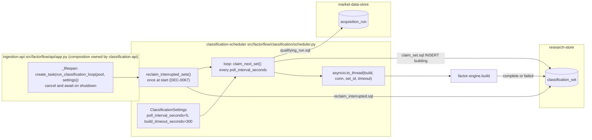

# Component: Classification Scheduler

**Status:** draft
**Capability:** CAP-002
**Owner:** Alvaro de Jodra
**Last Updated:** 2026-10-17

This design was produced in an unattended `$design-run`. Choices no artifact
fixes are recorded as decisions under `projects/factorflow-v2/decisions/`
(DEC-0064 to DEC-0067) and marked **PROVISIONAL**; DEC-0054, which placed the
scheduler in the application container at a 5-second poll, is honoured, not
re-decided. One reliability gap in the system design is surfaced in section
14 for the owner's assessment (AGT-SPEC-002), with a provisional mitigation
recorded as DEC-0067.

**Version 2 (2026-10-17)** is the consistency pass the owner directed on
specification review v2 (`specifications-review-report-v2.md`), and it applies
one finding to this design: FINDING-15, which found that this v1 still pinned
system design v1 and STD-UI v4 after both moved. The pins now name system
design v3 and STD-UI v6, and add the review as a source. Nothing
else in the design changes, because none of the changes in system design v2 and
v3 lands on this component. Version 2 of the system design (DEC-0068 to
DEC-0071) aligned the interface half with the product UX blueprint: the
Research screens and routes (Sections 2, 4.1, 4.2, question 4), the `later`
block and the summary read the interface renders from, and the compare bound
(Sections 3.3 and 4.2); all of that is `classification-ui`, `classification-api`
and `classification-reader`. Version 3 (DEC-0081 to DEC-0084) changed what a
threshold excludes (3.3 step 15), the one `set` + `later` shape on both reads
(3.3, 4.2), `hide_incomplete` and the *Find a stock* prefix in the saved filter
and its provenance (3.2, 3.3, 4.2, 4.4), the download named by its start time
(3.3, 4.2, question 11) and the complete edit list for delivered files
(question 4); each of those lands on the reader, the API, the UI or
`universe-service`, and none touches a row this scheduler reads or writes. The
rows this design relies on are unchanged: Section 3.1 steps 4 to 7a and 19 to 31
(only the interface steps 15 to 18 were rewritten), constraints 1, 10 and 17,
the `Qualifying-run read`, `Set claim` and `Set build` rows of Section 4.2, and
the `classification_set` row of Section 4.4 (this component inserts the set;
`factor-engine` transitions it). The `later` block the reader serves is read
from the `classification_set` rows this component inserts, in the shape it
already inserts them, so the claim, the 5-second poll and the interrupted-set
reclaim (DEC-0067) are unaffected. STD-UI v5 and v6 changed display labels; the
only owner-facing string this component writes is the fixed reclaim
`failure_reason`, and it uses none of the relabelled terms (*stock*, *download*,
*Incomplete*, *score*). Review v2's other findings naming
this component, FINDING-1 (the first-deployment backlog), FINDING-19
(`SEC-ENC-001` bookkeeping in Section 4), FINDING-20 (the build timeout equals
the budget) and FINDING-34 (provenance timestamp), are carried, not fixed:
FINDING-1 is the owner's decision, and the rest of the design is as version 1
left it.

## 1. Overview

The classification scheduler is the asyncio loop in the application container
that turns a finished acquisition run into a classification set without the
owner asking. Every poll interval it reads the run journal table for the oldest
run in `succeeded` or `partial` that has no `classification_set`, claims it by
inserting a set in `building`, hands the set to `factor-engine` off the event
loop, and records the outcome. It never classifies a `failed`, `cancelled` or
`abandoned` run, never classifies a run twice, never runs two builds at once,
and never retries a failed set: the next qualifying run creates the next set
(AC-10, AC-20; system design 3.1 steps 4 to 7a and 19 to 27).

It follows the one pattern the application container already runs, the reclaim
sweep in `src/factorflow/api/app.py` lines 104 to 199: a coroutine started as a
task in the FastAPI lifespan, dispatching synchronous database work through
`asyncio.to_thread`, logging a failed iteration and continuing, cancelled on
shutdown. The handoff from the ingestion container is a row read from the
shared store, never a call (tech stack C1; system design constraint 1).

Use cases addressed:

- Bring classifications up to date after every run that ends succeeded or
  partial, without user action (AC-10, flow 1 steps 2 to 3).
- Start work within the poll interval so the 5-minute budget is almost
  entirely computation (AC-11; DEC-0054).
- Leave the previous set current and show the failure when a build fails
  (AC-20, flow 1 and the currency region).
- Recover from an application restart during a build, so one crash cannot
  stop classification for good (DEC-0067, PROVISIONAL).

Support matrix: the application container's uvicorn process, one instance
(C8). The loop is not started by the ingestion process and not by tests that
construct the app without a lifespan.

Dependencies: `factor-engine`; `research-store` migration `0006`;
`market-data-store` table `acquisition_run` (migration `0004`); the
application connection pool `app.state.db_pool`; `pydantic-settings` for
`ClassificationSettings`; the lifespan composition point in
`src/factorflow/api/app.py`, which `classification-api` owns (DEC-0064).

## 2. Design Details

### 2.1 Placement

```
src/factorflow/classification/settings.py      ClassificationSettings (FACTORFLOW_CLASSIFICATION_*)
src/factorflow/classification/scheduler.py     run_classification_loop, claim_next_set, reclaim_interrupted_sets
src/factorflow/classification/sql/qualifying_run.sql
src/factorflow/classification/sql/claim_set.sql
src/factorflow/classification/sql/reclaim_interrupted.sql
tests/unit/test_classification_settings.py
tests/unit/test_classification_scheduler_loop.py     loop mechanics with injected doubles, as test_api_reclaim_lifespan.py
tests/integration/test_scheduler_claim.py
tests/integration/test_scheduler_restart.py
```

The two lines in `src/factorflow/api/app.py` that create and cancel the task
are `classification-api`'s edit (DEC-0064, PROVISIONAL); this component exports
the coroutine they call.

### 2.2 Component block diagram

The diagram below shows the scheduler between the delivered application
lifespan on one side and the engine and the two stores on the other. The
lifespan creates the task once, beside the reclaim task, with the pool and
settings; the loop performs its start-up reclaim, then alternates a claim
attempt and a sleep. A claim is one short transaction; a build is the engine's
own transaction on a connection the loop checks out for the duration. The
decision points are whether a qualifying run exists and whether the claim
insert succeeds against the partial unique index. The expected outcome is at
most one build in flight and every terminal run classified exactly once.



### 2.3 Settings

```python
# src/factorflow/classification/settings.py
from pydantic import Field
from pydantic_settings import SettingsConfigDict

from factorflow.config.settings import _EnvNamedSettings   # the base every FactorFlow settings model uses


class ClassificationSettings(_EnvNamedSettings):
    """FACTORFLOW_CLASSIFICATION_* (system design constraint 10; DEC-0054, DEC-0067)."""

    model_config = SettingsConfigDict(env_prefix="FACTORFLOW_CLASSIFICATION_")

    poll_interval_seconds: float = Field(default=5.0, ge=1)
    build_timeout_seconds: float = Field(default=300.0, ge=1)
```

| Variable | Process | Required | Default | Source |
|----------|---------|----------|---------|--------|
| `FACTORFLOW_CLASSIFICATION_POLL_INTERVAL_SECONDS` | application | no | 5 | DEC-0054, PROVISIONAL: the owner's 2026-09-05 idle-poll decision in `component-design-runtime-config.md` section 2.2a, reused |
| `FACTORFLOW_CLASSIFICATION_BUILD_TIMEOUT_SECONDS` | application | no | 300 | DEC-0067, PROVISIONAL: AC-11's 5-minute budget, owner decision 2026-10-12 |

The model follows `runtime-config`'s conventions, the `FACTORFLOW_` prefix, a
nested prefix group, env-named load errors, without editing `runtime-config`
(system design constraint 10). `_EnvNamedSettings` is the base class every
settings model in `src/factorflow/config/settings.py` already derives from; it
is imported, not copied, so a load failure here names the variable and never
its value, as DAC-E1-7 requires of every variable. One invariant is enforced at
load: `poll_interval_seconds < build_timeout_seconds`, because a poll that
outlasts a build makes the loop observe its own work late.

### 2.4 The loop

```python
# src/factorflow/classification/scheduler.py
async def run_classification_loop(
    pool: ConnectionPool,
    settings: ClassificationSettings,
    wait_fn: Callable[[float], Awaitable[None]] | None = None,
    dispatch_fn: Callable[..., Awaitable[Any]] | None = None,
    stop_event: asyncio.Event | None = None,
) -> None:
    """Poll the run journal for a qualifying run, claim it, build it (DEC-0054)."""
    wait = wait_fn or asyncio.sleep
    dispatch = dispatch_fn or asyncio.to_thread
    log = logging.getLogger(__name__)

    await dispatch(reclaim_interrupted_sets, pool)              # DEC-0067, once
    for name in line_items.unresolved():
        log.warning("line item %s has no payload key; its inputs will be missing", name)

    while True:
        try:
            claimed = await dispatch(claim_next_set, pool)        # None, or (set_id, run_id)
            if claimed is not None:
                result = await dispatch(build_claimed_set, pool, claimed.set_id,
                                        settings.build_timeout_seconds)
                log.info("classification set %s for run %s ended %s",
                         claimed.set_id, claimed.run_id, result.state)
                continue                                          # look again at once: another run may be waiting
        except Exception:
            log.exception("classification scheduler iteration failed")
        if stop_event is not None and stop_event.is_set():
            break
        await wait(settings.poll_interval_seconds)
        if stop_event is not None and stop_event.is_set():
            break
```

`claim_next_set` runs one transaction:

```sql
-- src/factorflow/classification/sql/qualifying_run.sql
SELECT r.run_id
  FROM acquisition_run r
 WHERE r.state IN ('succeeded', 'partial')
   AND NOT EXISTS (SELECT 1 FROM classification_set s WHERE s.run_id = r.run_id)
 ORDER BY r.ended_at ASC
 LIMIT 1;

-- src/factorflow/classification/sql/claim_set.sql
INSERT INTO classification_set (run_id, state, classification_date)
VALUES (%(run_id)s, 'building', (CURRENT_TIMESTAMP AT TIME ZONE 'America/Chicago')::date)
RETURNING set_id;
```

A `UniqueViolation` on the insert means either a set is already `building`
(the partial unique index) or the run acquired a set between the two
statements (the unique `run_id`); both are handled by returning `None` and
polling again, not by raising. `build_claimed_set` checks out one connection
for the whole build and calls `factor_engine.build(conn, set_id,
timeout_seconds)`; the engine records the terminal state itself (section 2.3
of its design), so the scheduler only logs. After a build the loop looks again
immediately, so several runs that ended while a set was building are taken
oldest first, each producing its own set (system design 3.1 step 21).

`reclaim_interrupted_sets` runs once before the first poll:

```sql
-- src/factorflow/classification/sql/reclaim_interrupted.sql
UPDATE classification_set
   SET state = 'failed',
       ended_at = now(),
       failure_reason = 'interrupted: the application restarted during the build'
 WHERE state = 'building'
RETURNING set_id, run_id;
```

Every reclaimed set is logged at `warning`. The statement is the
`building`-to-terminal transition `research-store` section 2.5 admits and
carries its guard; it is safe at start because the application container is
the only builder (system design constraint 1), so a `building` row at its own
start is provably orphaned, and the engine's rows died with the transaction
that was writing them (DEC-0067, PROVISIONAL; section 14).

### 2.5 Sequence

The diagram below traces one iteration from a run ending to the set being
complete, and it is system design 3.1 steps 4 to 14b from this component's
side. The claim and the build are two transactions on purpose: the claim must
be visible at once so the interface can show *Updating*, and the build must be
all or nothing. The decision point at the claim is the partial unique index;
the decision point at the end is the engine's commit. The expected outcome is
that the interface, polling `GET /api/classifications`, sees `building` within
one poll interval of the run ending and `complete` or `failed` when the engine
finishes.

```mermaid
sequenceDiagram
    participant J as acquisition_run (run-journal)
    participant S as classification-scheduler
    participant T as classification_set
    participant E as factor-engine

    J->>J: finalise: state := succeeded | partial, ended_at
    loop every poll_interval_seconds (5 s)
        S->>J: qualifying_run.sql
        alt none
            S->>S: sleep
        else run found
            S->>T: claim_set.sql INSERT building
            alt UniqueViolation (one building, or run already claimed)
                S->>S: return None, sleep
            else set_id
                S->>E: to_thread(build, conn, set_id, 300 s)
                E->>T: complete, or failed with reason
                E-->>S: BuildResult
                S->>J: look again at once
            end
        end
    end
```



### 2.6 Messages

N/A, not applicable for this component. The run journal table is the handoff,
as system design constraint 1 requires; no topic, queue or `LISTEN/NOTIFY`
(DEC-0054 rejected it).

## 3. Constraints and Assumptions

- **Application container only** (system design constraint 1; DEC-0054). The
  ingestion process never imports this module; `tests/unit/test_api_isolation.py`'s
  pattern is extended to assert that `factorflow.ingestion_main` imports
  nothing under `factorflow.classification`.
- **Qualifying runs only, once each** (AC-10; constraint 10). `succeeded` and
  `partial` qualify; `failed`, `cancelled` and `abandoned` never do, even when
  they wrote observations; `classification_set.run_id` is unique.
- **One build at a time** (3.1 step 21), enforced by the partial unique index,
  not by process state, so a second application process started by mistake
  could not build concurrently either.
- **No retry of a failed set** (3.1 step 27; DEC-0054). The next qualifying run
  is the retry.
- **Cadence is DEC-0054's**: 5 seconds default, reused from the owner's
  2026-09-05 idle-poll decision; detection costs at most one interval of the
  AC-11 budget.
- **Timeout is DEC-0067's** (PROVISIONAL): 300 seconds default, from AC-11.
- **Start-up reclaim is DEC-0067's** (PROVISIONAL) and is surfaced for the
  owner's assessment in section 14.
- **Settings follow `runtime-config` conventions without editing it**
  (constraint 10): own model, `FACTORFLOW_CLASSIFICATION_` prefix, env-named
  errors.
- **Errors are logged and the loop continues** (OPS-ERR-001; constraint 17),
  as the reclaim loop does; the loop never exits on an iteration failure and
  never swallows one silently.
- **The composition edit is `classification-api`'s** (DEC-0064): this
  component exports `run_classification_loop` and does not edit `app.py`.
- **Python 3.12, asyncio, `psycopg_pool`, `pydantic-settings`, `pytest`**
  (tech stack). No new library; `APScheduler` is not used because the pattern
  the container already runs is a lifespan task, and one more scheduler
  framework would be a tech-stack addition this design may not make.
- **Assumption:** `app.state.db_pool` is opened before the task starts, as it
  is for the reclaim task (`app.py` lines 176 to 193).
- **Assumption:** the pool's maximum of 4 connections (`runtime-config`)
  leaves 3 for the API while a build holds one.

## 4. Security

- **No network surface.** The scheduler listens on nothing and calls nothing
  outside PostgreSQL on the host-local channel (`SEC-ENC-001 host-local
  loopback exception`, DEC-0050, DEC-0058).
- **Input validation (SEC-INP-001).** The only inputs are two environment
  variables validated by `pydantic-settings` (`ge=1`, the ordering invariant)
  and rows read from the store; `run_id` and `set_id` are `uuid` columns.
- **Injection (SEC-INP-002).** Three parameterised statements; no dynamic SQL.
- **Error disclosure (SEC-ERR-001).** The reclaim `failure_reason` is a fixed
  sentence; build failures are the engine's one-line class and message; stack
  traces go to the structured log only (SA-LOG-001).
- **Credentials.** The scheduler reads no credential. The database URL is
  the pool's, loaded by `runtime-config` and redacted from logs by its filter.
- **Audit (SEC-AUD-001).** None of the listed event classes occur. Every claim
  and outcome is a row in `classification_set`, which is the durable record;
  the log carries the same facts with `set_id` and `run_id`.
- **Data classification.** Internal throughout.
- **Dependency posture.** No new dependency.
- **Crypto usage: none. Privacy impact: none.**

## 5. Scalability and Performance

- **Poll cost.** One indexed query every 5 seconds over `acquisition_run`
  filtered by state with an anti-join to `classification_set` on its unique
  `run_id`; negligible against a store sized for 3000 instruments, which is
  the derivation DEC-0054 reuses from the owner's 2026-09-05 decision.
- **Detection latency.** At most one poll interval, 5 seconds, of the AC-11
  budget; a run ending during a build waits for the build and is taken at the
  next iteration without sleeping.
- **Concurrency.** One build in flight, guaranteed by the store; the loop is a
  single task; no shared mutable state in process (SA-CONC-001).
- **Connections.** One for a claim, released at once; one for the whole build.
  The pool bound of 4 is `runtime-config`'s (SA-RES-001).
- **Timeouts.** `statement_timeout` on the build connection (DEC-0067); the
  claim and reclaim statements are sub-second.
- **Backlog.** Several runs ending in quick succession produce sets in order,
  each within its own budget from its own `ended_at`; AC-11 is stated per run,
  and a backlog of n runs completes within about n budgets. No artifact bounds
  the backlog; recorded in section 14.

## 6. Upgrade

- **No previous release** of this component.
- **Data migration: none.**
- **Behaviour change after upgrade.** Runs that ended succeeded or partial
  before the upgrade and have no set are qualifying runs: the first poll after
  deployment claims the oldest and works forward, so the owner's history of
  earlier runs is classified from the store as it stands at build time, each
  set dated the day it is built, not the day the run ended (AC-19). The
  interface shows *Updating* during the backlog.
- **Manual actions required: none.** Both variables have defaults.
- **Rollback (OPS-MIG-003).** Reverting the image stops the loop; a set left
  `building` by the stopped process is reclaimed `failed` when a build carrying
  this component next starts. Store rollback is `runtime-config` section
  2.8.4's.
- **Settings compatibility.** Both variables are new and optional; a
  deployment definition without them runs the defaults.

## 7. Testing

Loop mechanics are tested with injected `wait_fn`, `dispatch_fn` and
`stop_event`, exactly as `tests/unit/test_api_reclaim_lifespan.py` tests the
reclaim loop, under `asyncio.run` without an async test plugin; store
behaviour with `testcontainers[postgres]` under the `postgres` marker.

| Test | File | What it proves |
|------|------|----------------|
| Settings load and default | `tests/unit/test_classification_settings.py` | Defaults 5 and 300; `FACTORFLOW_CLASSIFICATION_POLL_INTERVAL_SECONDS=0.5` fails naming the variable and not the value; poll not less than timeout fails (DAC-E1-7 pattern) |
| Loop dispatches off the event loop | `tests/unit/test_classification_scheduler_loop.py` | Claim and build run through the injected dispatcher; the loop requests `poll_interval_seconds` between idle iterations and no sleep after a build |
| Iteration failure does not stop the loop | `tests/unit/test_classification_scheduler_loop.py` | A raising claim is logged with `exception` and the loop continues (OPS-ERR-001) |
| Reclaim runs once at start | `tests/unit/test_classification_scheduler_loop.py` | `reclaim_interrupted_sets` is dispatched before the first claim and never again |
| Unresolved line items are warned | `tests/unit/test_classification_scheduler_loop.py` | A warning per unresolved item at start |
| Qualifying runs only | `tests/integration/test_scheduler_claim.py` | Runs in `failed`, `cancelled`, `abandoned`, `running`, `requested` are never claimed; `succeeded` and `partial` are (AC-10) |
| Oldest first, once each | `tests/integration/test_scheduler_claim.py` | Three qualifying runs are claimed in `ended_at` order across three iterations; a run with a set is never claimed again |
| One building set | `tests/integration/test_scheduler_claim.py` | With a set `building`, a claim attempt returns `None` and inserts nothing (3.1 step 21) |
| Classification date is the Chicago date | `tests/integration/test_scheduler_claim.py` | A claim at 23:30 America/Chicago stamps that date, not the next UTC date (STD-UI-5) |
| Failed set is not retried | `tests/integration/test_scheduler_claim.py` | After a `failed` set for run A, no new set for A is created; a later qualifying run B is (3.1 step 27) |
| Interrupted build is reclaimed | `tests/integration/test_scheduler_restart.py` | A `building` row with no classification rows becomes `failed` with the fixed reason at start, and the next qualifying run is then claimable (DEC-0067) |
| Reclaim touches only building | `tests/integration/test_scheduler_restart.py` | `complete` and `failed` sets are unchanged by reclaim |
| Build timeout is passed through | `tests/integration/test_scheduler_restart.py` | `build_timeout_seconds` reaches the engine and a too-short value yields a `failed` set with a timeout reason |
| No ingestion import | `tests/unit/test_api_isolation.py` pattern, new assertion in `tests/unit/test_classification_scheduler_loop.py` | `factorflow.ingestion_main` imports nothing under `factorflow.classification` (constraint 1) |

End-to-end: `tests/e2e/classifications-after-run.spec.ts` (specified in
`classification-ui`) drives a stub-provider run to `succeeded` and asserts the
interface shows the new set, which exercises this loop in the real container
stack.

## 8. Acceptance Criteria

1. Within one poll interval of a run ending `succeeded` or `partial`, a
   `classification_set` in `building` names it; a run ending `failed`,
   `cancelled` or `abandoned` never acquires a set.
2. No run acquires a second set, and no two sets are `building` at once.
3. Runs are classified oldest `ended_at` first.
4. A failed set is not retried; the next qualifying run produces the next set.
5. At scheduler start every `building` set becomes `failed` with the
   interruption reason, and classification resumes.
6. The build runs under the configured timeout, and a timed-out build is
   recorded `failed` with its reason.
7. A failing iteration is logged and the loop continues.
8. The ingestion process starts no classification loop.
9. Failure scenario: the database is unreachable for several polls; each
   iteration logs and the loop resumes claiming when it returns, with no set
   lost and no duplicate.
10. Failure scenario: the application is stopped during a build; on the next
    start the set is `failed`, no partial rows exist, and the next qualifying
    run is built.

## 9. Workflows

- **See stocks classified after an acquisition** (flow 1 steps 2 to 3): this
  loop is the "without any further action".
- **Understand and fix insufficient evidence** (flow 5 step 4): the next
  qualifying run's set is produced by this loop.
- **Operate and upgrade.** The owner reads a failed set's reason in the
  currency region and the set history; a reclaimed set reads *interrupted*,
  which tells the owner the application restarted during a build.
- **Intersection with CAP-001.** The loop reads `acquisition_run` only and
  writes nothing to it; it is started beside the reclaim loop in the same
  lifespan and shares its pool.

## 10. UX / GUI

N/A, not applicable for this component: it renders nothing. Its observable
effects are the set states the currency region renders (UX design section
1.2): `building` within 5 seconds of a run ending, then `complete` or `failed`
with the reason the engine or the reclaim wrote, and the 10-second interface
poll (DEC-0054) sees each within one of its own intervals. No
internationalization.

## 11. API Endpoints

This component exposes no HTTP endpoint. It provides the `Scheduler start`
interface of system design section 4.2 and consumes `Set build`,
`Qualifying-run read` and `Set claim`.

| Endpoint | Method/Operation | Auth/Privilege | Request | Response | Notes |
|----------|-----------------|----------------|---------|----------|-------|
| `run_classification_loop` | Python coroutine | in-process | `pool`, `settings`, test doubles | runs until cancelled | consumer: the lifespan in `app.py`, edited by `classification-api` (DEC-0064) |
| Qualifying-run read | SQL `SELECT` over `acquisition_run` anti-joined to `classification_set` | database credential | none | oldest qualifying `run_id` or none | read-only on `acquisition_run` (migration `0004` shape) |
| Set claim | SQL `INSERT` into `classification_set` in `building` | database credential | `run_id` | `set_id`, or unique-violation handled as no claim | `research-store` section 11 |
| Interrupted-set reclaim | SQL `UPDATE classification_set ... WHERE state = 'building'` | database credential | none | reclaimed ids | once at start (DEC-0067) |
| `factor_engine.build` | Python call via `to_thread` | in-process | `conn`, `set_id`, `timeout_seconds` | `BuildResult` | |

## 12. References

| Type | Document Name | Description | Link |
|------|---------------|-------------|------|
| Capability | CAP-002 v1 | AC-10, AC-11, AC-20; section 2 refresh rules | `docs/capabilities/CAP-002-universe-and-factor-classification/Capability-CAP-002.md` |
| System design | CAP-002 system design v3 | Section 3.1 steps 4 to 7a, 19 to 31; constraints 1, 10, 17; section 4.4 set states | `docs/capabilities/CAP-002-universe-and-factor-classification/design/system-design.md` |
| Component design | CAP-001 runtime config v14 | Sections 2.2, 2.2a settings conventions and the 5-second idle poll; 2.8.4 rollback | `docs/capabilities/CAP-001-market-data-acquisition-foundation/design/component-design-runtime-config.md` |
| Component design | CAP-001 run journal | Terminal states; section 2.6 reclaim sweep, the precedent for reclaiming a dead process's claim | `docs/capabilities/CAP-001-market-data-acquisition-foundation/design/component-design-run-journal.md` |
| Component design | CAP-002 factor engine v2 | `build` contract | `docs/capabilities/CAP-002-universe-and-factor-classification/design/component-design-factor-engine.md` |
| Implemented code | `src/factorflow/api/app.py` lines 104 to 203 | The reclaim loop and lifespan this design mirrors | `src/factorflow/api/app.py` |
| Implemented code | `src/factorflow/config/settings.py` | `_EnvNamedSettings`, `RunSettings` | `src/factorflow/config/settings.py` |
| Implemented tests | `tests/unit/test_api_reclaim_lifespan.py` | The loop-testing pattern reused | `tests/unit/` |
| Decision records | DEC-0054, DEC-0064, DEC-0067 | Scheduler placement and cadence; seam ownership; resilience | `projects/factorflow-v2/decisions/` (harness repository) |

## 13. Traceability

| Capability AC | System Design Element | Component Design Element | Section |
|--------------|----------------------|--------------------------|---------|
| AC-10 | Steps 4 to 7a, 19 to 21; `run_id` unique | `qualifying_run.sql` state filter and anti-join; `claim_set.sql`; unique-violation handling | 2.4 |
| AC-11 | Steps 28 to 29; 5-second poll | `poll_interval_seconds` default 5; look-again after a build; `build_timeout_seconds` | 2.3, 2.4, 5 |
| AC-19 | Step 22, `classification_date` at set creation | `claim_set.sql` stamps the America/Chicago date | 2.4 |
| AC-20 | Steps 14a, 25 to 27; one building set | Engine records failure; no retry; reclaim of an interrupted set | 2.4, 3 |

## 14. Open Questions

1. **System-design gap, surfaced for owner assessment (AGT-SPEC-002): a build
   interrupted by an application restart.** System design 3.1 handles any
   error inside a build (step 14) but not the process dying mid-build; the
   `building` set row survives in the store while the engine's transaction
   does not, and section 4.4's partial unique index would then refuse every
   later set. This design records the set `failed` at scheduler start
   (DEC-0067, PROVISIONAL) and recommends adding that step to system design
   3.1 and constraint 10. *Owner: capability owner, to assess the risk and
   uphold or replace the mitigation. Blocks: nothing; the design proceeds on
   the provisional mitigation.*
2. **The build timeout default of 300 seconds** (DEC-0067, PROVISIONAL) is
   AC-11's budget reused as a bound no artifact states. *Owner: capability
   owner, to uphold or set another value.*
3. **The poll cadence of 5 seconds** (DEC-0054, PROVISIONAL) is reused from
   another loop's decision. *Owner: capability owner, to uphold or set another
   value.*
4. **No artifact bounds a backlog of qualifying runs.** AC-11 is per run; n
   runs ending together complete in about n budgets. *Owner: capability
   owner. Blocks: nothing.*
