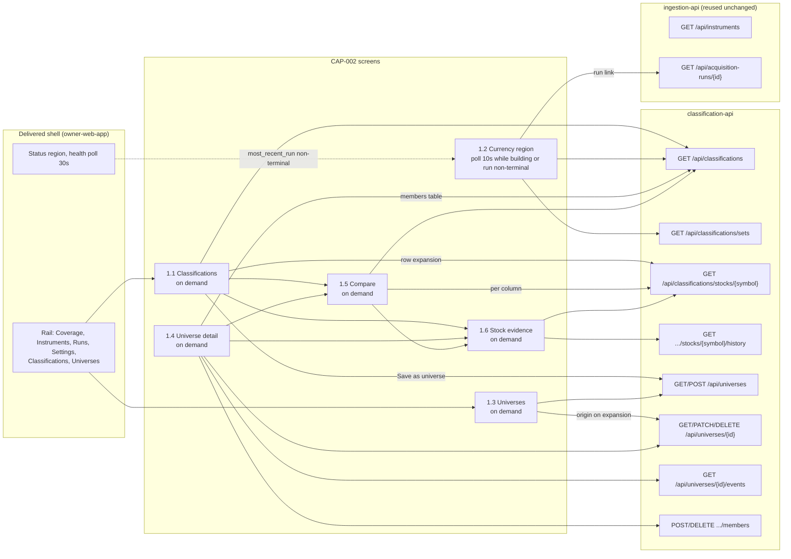

# Component: Classification UI

**Status:** draft
**Capability:** CAP-002
**Owner:** Alvaro de Jodra
**Last Updated:** 2026-10-16

This design was produced in an unattended `$design-run`. Choices no artifact
fixes are recorded as decisions under `projects/factorflow-v2/decisions/`
(DEC-0064 to DEC-0067) and marked **PROVISIONAL**; the UX decisions DEC-0059
to DEC-0063 are honoured, not re-decided. Two owner questions are carried, not
answered: the Compare cap and the universe name length (section 14).

## 1. Overview

The classification UI is the set of React screens and the fetch layer through
which the owner reads classifications, builds and maintains universes,
compares stocks and inspects the evidence behind every result. It is six
screens, five client routes and two rail destinations mounted into the shell
CAP-001 delivered: Classifications (`/classifications`), the classification
currency region composed into every classification-bearing screen, Universes
(`/universes`), Universe detail (`/universes/:universeId`), Compare
(`/compare`) and Stock evidence (`/stocks/:symbol`). It is built from the UX
design, which fixes every screen, state, component and token; this design
translates that into a file structure, a data-fetching strategy, the
composition into the delivered shell and a test plan, and changes nothing the
UX design decided.

CAP-002 is the first FactorFlow surface that renders a derived number. The
acceptance criteria that exist because a plausible interface would lie,
AC-12, AC-14, AC-20, AC-22, AC-23, and the STD-UI rules that carry the same
obligations decide more of this component than any layout does: a cell that
is not a measured value says so in text, in shape and in token, never in
colour alone, and nothing is asserted beyond a recorded row.

Use cases addressed:

- See every active stock classified after an acquisition, or told plainly
  why not, under a dated currency statement (AC-9, AC-12, AC-14, AC-20 to
  AC-23; flow 1).
- Build a universe by hand or save a reviewed filter result (AC-1, AC-2, AC-5;
  flows 2, 3).
- Sort, filter, compare and open the evidence, across all stocks or within a
  universe (AC-16, AC-17; flow 4).
- Understand and fix insufficient evidence (AC-13; flow 5).
- Maintain universes over time with history kept and visible (AC-3, AC-4,
  AC-6, AC-15; flow 6).

Support matrix: a modern desktop browser on the owner's machine, reaching
`http://127.0.0.1:8000` only, as CAP-001 fixed; no mobile layout is specified.
No authentication, no account area (capability section 5.3).

Dependencies: React 18, Vite, TypeScript 5.x, Tailwind CSS, `react-router-dom`,
shadcn/ui on Radix primitives, the twelve component specifications under
`design-system/components/` and `design-system/theme.css`; the delivered
shell, `ScreenState` union, fetch helpers and windowed-table pattern of
`owner-web-app`; the `classification-api` contract; CAP-001's `GET
/api/instruments` and `GET /api/acquisition-runs/{id}` unchanged. TradingView
`lightweight-charts` is in the stack and **not used**: CAP-002 commits to no
chart (STD-UI-9, 27, 28 not applicable).

## 2. Design Details

### 2.1 Placement

```
web/src/app/shell.tsx                               + two DESTINATIONS entries (DEC-0064)
web/src/app/routes.tsx                              + five Route elements (DEC-0064)
web/src/api/client.ts                               + export on requestJson (DEC-0064)
web/src/api/classification-client.ts                typed fetch layer for /api/universes and /api/classifications
web/src/api/classification-types.ts                 response types mirroring classification-api section 2.7
web/src/screens/classifications/index.tsx           UX design 1.1
web/src/screens/classifications/classification-table.tsx   the shared composition, used by 1.1 and 1.4
web/src/screens/classifications/factor-cells.tsx    classified, not-classified, not-ranked, retired cell renderings
web/src/screens/classifications/threshold-panel.tsx twelve bounds, Apply, summary, Clear
web/src/screens/classifications/selection-bar.tsx   Compare selected, Create universe from selected, Clear
web/src/screens/classifications/save-filter-dialog.tsx
web/src/screens/classifications/currency-region.tsx UX design 1.2, composed into 1.1, 1.4, 1.5, 1.6
web/src/screens/classifications/set-history.tsx
web/src/screens/classifications/use-classification-poll.ts  the 10-second poll and refresh-once (DEC-0054, DEC-0062)
web/src/screens/classifications/format.ts           DEC-0063 precision, sign, dates, zone
web/src/screens/classifications/copy.ts             every owner-facing string, keyed by error code and state
web/src/screens/universes/index.tsx                 UX design 1.3
web/src/screens/universes/universe-table.tsx
web/src/screens/universes/create-dialog.tsx         name + textarea list; prefill from a selection
web/src/screens/universes/detail/index.tsx          UX design 1.4
web/src/screens/universes/detail/summary-header.tsx inline rename, Add stocks, Retire
web/src/screens/universes/detail/members-tab.tsx    classification-table scoped + As of + Remove
web/src/screens/universes/detail/history-tab.tsx
web/src/screens/universes/detail/add-stocks-dialog.tsx
web/src/screens/universes/detail/remove-dialog.tsx  confirm, never destructive
web/src/screens/universes/detail/retire-dialog.tsx  confirm, never destructive
web/src/screens/compare/index.tsx                   UX design 1.5
web/src/screens/compare/compare-table.tsx           native table composition, pinned row headers
web/src/screens/stocks/index.tsx                    UX design 1.6
web/src/screens/stocks/factor-card.tsx
web/src/screens/stocks/history-tab.tsx
tests/e2e/classifications-after-run.spec.ts
tests/e2e/universe-by-hand.spec.ts
tests/e2e/universe-from-filter.spec.ts
tests/e2e/compare-and-evidence.spec.ts
tests/e2e/fix-insufficient-evidence.spec.ts
tests/e2e/universe-maintenance.spec.ts
tests/e2e/classifications-accessibility.spec.ts
tests/e2e/classifications-volume.spec.ts
```

Bulk symbol parsing reuses `web/src/screens/instruments/parse-bulk-symbols.ts`
by import, so the recognised and rejected counts behave as CAP-001's *Add
many* does (UX design section 1.3). Vendored shadcn/ui components live where
`owner-web-app` placed them; none is added or overridden at a call site
(STD-UI-29).

### 2.2 Composition into the delivered shell

The three edits to delivered files are this component's (DEC-0064,
PROVISIONAL) and change no delivered behaviour:

```typescript
// web/src/app/shell.tsx: two entries appended to DESTINATIONS, order fixed by DEC-0061
const DESTINATIONS = [
  { label: "Coverage", to: "/coverage" },
  { label: "Instruments", to: "/instruments" },
  { label: "Runs", to: "/runs" },
  { label: "Settings", to: "/settings" },
  { label: "Classifications", to: "/classifications" },
  { label: "Universes", to: "/universes" },
] as const;

// web/src/app/routes.tsx: five routes added before the catch-all
<Route path="/classifications" element={<ClassificationsScreen />} />
<Route path="/universes" element={<UniversesScreen />} />
<Route path="/universes/:universeId" element={<UniverseDetailScreen />} />
<Route path="/compare" element={<CompareScreen />} />
<Route path="/stocks/:symbol" element={<StockEvidenceScreen />} />

// web/src/api/client.ts: one keyword, so the envelope handling is shared, not copied
export async function requestJson<T>(input: string, init?: RequestInit): Promise<T> { ... }
```

The landing redirect, the status region, the 30-second health poll, the
unreachable state and the `ScreenState` union are untouched (UX design section
0; AGT-SCOPE-002). The currency region is a CAP-002 composition inside CAP-002
screens, never a third line in the shell's status region.

### 2.3 Screen and data-fetch map

The diagram below shows which screen reads which endpoint and at what cadence,
because cadence is specified behaviour under STD-UI-25. Only the currency
region polls, every 10 seconds while a set is building or any run is
non-terminal, and it stops otherwise (DEC-0054); universe, compare and
evidence reads are on demand; row expansion and the origin line fetch once per
interaction. The status region's 30-second health poll is CAP-001's and tells
the region whether a run is non-terminal through `most_recent_run`. The
expected outcome is an interface that is current where a set is being built
and quiet everywhere else.



### 2.4 State rendering and the fetch layer

Every fetched region renders the `ScreenState` union `owner-web-app` section
2.4 fixed, reused by import from `web/src/api/types.ts`: `loading`,
`empty-never-populated`, `empty-no-match`, `populated`, `partial`,
`unavailable`, `error`, `unreachable`. The two empty variants are kept apart
everywhere both can occur: `never_classified: true` is `empty-never-populated`
and a threshold or search matching nothing is `empty-no-match` (AC-22). A
not-ranked factor is `unavailable` per column pair, never per screen (AC-14,
STD-UI-14). A `not_current` set is rendered as `populated` with the currency
region in its stale state, because the data is real and marked (AC-20).

`classification-client.ts` wraps every CAP-002 endpoint over the exported
`requestJson`, so a transport failure is `ApiUnreachableError` (the shell's
unreachable state) and a non-2xx status is `ApiError` with its `code`, never
conflated. It maps snake_case to camelCase field by field, as `client.ts`
does, and keeps dates as the wire's `YYYY-MM-DD` strings, never parsed into
`Date` (STD-UI-5). `ApiError` is read by `code` only; `message` is never
rendered (UX design section 4), and `copy.ts` holds one owner-facing sentence
per code and state. The `instrument_not_acquired` envelope's `symbols` field is
exposed on the error so the dialogs name every uncovered stock.

```typescript
// web/src/api/classification-types.ts (excerpt)
export type FactorName = "value" | "growth" | "momentum";
export type ReasonCode =
  | "input_missing" | "input_outdated" | "input_not_computable" | "not_enough_stocks" | "retired";

export interface FactorCell {
  status: "classified" | "not_classified";
  score: string | null;          // decimal string at stored precision; rendered by format.ts (DEC-0063)
  percentile: string | null;
  reasonCode: ReasonCode | null;
  reasonInput: string | null;
  reasonDetail: string | null;
  restatedPossible: boolean;
}

export interface CurrentSet {
  setId: string;
  classificationDate: string;    // YYYY-MM-DD, never converted
  runId: string;
  runOutcome: "succeeded" | "partial";
  startedAt: string;
  endedAt: string;
  notCurrent: { setId: string; state: "building" | "failed"; runId: string;
                startedAt: string; endedAt: string | null; failureReason: string | null } | null;
}

export interface FactorSummary { qualifiedCount: number; ranked: boolean; minPeerSetSize: number }
```

`format.ts` is the one place numbers and dates become text (STD-UI-3,
DEC-0063): `formatScore` gives two decimals with an explicit `+` or `−` and
`0.00` unsigned; `formatPercentile` a whole number 0 to 100 with no sign and
no `%`; `formatRatio` two decimals; `formatRate` a signed percentage at two
decimals; `formatAmount` whole currency units with thousands separators and no
abbreviation (STD-UI-6); `formatTimestamp` America/Chicago with the zone shown;
dates pass through unconverted. Sorting and thresholds never touch rendered
text: they are requests.

### 2.5 The classification table and its cells

`classification-table.tsx` is the one composition behind Classifications and
the Members tab (UX design section 1.4: *the Section 1.1 composition scoped to
this universe*), parameterised by scope (`universeId` or none), the extra
Member since column and Remove action, and whether Save as universe is
offered. It is the `data-table` `expandable` variant with row selection,
rendered as a keyset-paginated list with windowed rendering over the loaded
pages, exactly as `owner-web-app` section 2.6 implemented the coverage table,
at `DEFAULT_PAGE_SIZE` 50 and `MAX_PAGE_SIZE` 500 (STD-UI-30; the
specification's pagination-not-virtualisation gap is inherited and recorded in
section 14). Sort, thresholds, scope and search are URL state and become
request parameters; nothing is sorted or filtered in the browser.

`factor-cells.tsx` renders the four cell kinds the UX design fixes, and
`tests/unit`-level Vitest tests pin each:

| Cell | Rendering | Tokens |
|------|-----------|--------|
| Classified | score cell `formatScore`, percentile cell `formatPercentile`, both `--font-numeric`, right- and decimal-aligned; `badge` `outline` *Possibly restated* with icon on value and growth cells where `restatedPossible` (AC-23, STD-UI-17) | `--foreground`, `--border` |
| Not classified (`input_missing`, `input_outdated`, `input_not_computable`) | the pair merged (`colspan` 2, headed by both headers): em dash in `--value-missing`, `badge` `status-warning` *Not classified*, the input named from `reasonDetail` in product vocabulary; never `0.00` (AC-12, STD-UI-4) | `--status-warning` on `--status-warning-muted`, `--value-missing` |
| Retired (`retired`) | the pair merged: `badge` `status-neutral` *Retired* and *Not classified, retired* (AC-15, DEC-0059) | `--status-neutral` on `--status-neutral-muted` |
| Not ranked (`ranked: false` for the factor) | stated once in the pair's header: `badge` `status-serious` *Not ranked*, *18 of 30 stocks qualified* from `qualifiedCount` and `minPeerSetSize`; every cell in the pair merged with `--pattern-indeterminate` over `--value-indeterminate-muted` and the text *Not ranked*; the pair's sort controls removed (AC-14, STD-UI-14) | `--status-serious`, `--value-indeterminate`, `--pattern-indeterminate` |

A measured zero renders `0.00`; blank means only that a column does not apply
to the row (Lifecycle on an active instrument). No `--gain`, `--loss` or
`--factor-*` token is used anywhere (DEC-0060; UX design section 1.1).

### 2.6 Polling, currency and refresh-once

The sequence below shows the currency region's behaviour from a run ending to
the screen showing the new set, which is flow 1 step 3's *without any further
action* and AC-20's honesty made concrete. The region starts polling when the
set block reports `notCurrent.state === "building"` or the shell's health
reports a non-terminal `most_recent_run`, and stops when neither holds; while
polling it shows *Last checked* with the zone (STD-UI-25). The decision point
is the poll that reports the building set complete: the region announces
politely, and the host table dims, reloads once from its first page with sort,
thresholds, scope, expansion and selection preserved by symbol (DEC-0062), and
no further automatic replacement happens until another set completes. A failed
attempt leaves the previous set, the warning mark and adds the critical badge
with the recorded reason and the next-run sentence; nothing is offered to
retry (system design 3.1 step 27, STD-UI-2).

```mermaid
sequenceDiagram
    participant R as acquisition run
    participant C as currency-region (use-classification-poll)
    participant A as classification-api
    participant T as classification-table

    R->>R: ends succeeded | partial
    Note over C: health poll reports most_recent_run terminal; set block not yet building
    C->>A: GET /api/classifications (poll 10 s)
    A-->>C: set, notCurrent {state: building, startedAt}
    C->>C: badges Not reflecting the latest acquisition + Updating; Last checked hh:mm:ss America/Chicago
    loop every 10 s while building
        C->>A: GET /api/classifications
    end
    alt building set complete
        A-->>C: set is the new set, notCurrent null
        C->>C: announce politely: Classifications updated to <date>, from acquisition run ...
        C->>T: refresh once (dim, reload page 1, keep sort, thresholds, scope, expansion, selection by symbol)
        C->>C: stop polling
    else attempt failed
        A-->>C: previous set, notCurrent {state: failed, failureReason}
        C->>C: keep warning; add Classification failed with the reason and the next-run sentence; stop polling
    end
```

A poll that fails leaves the displayed set and its mark in place and sets the
region's own Error state with a retry; it never clears a mark (UX design
section 1.2).

### 2.7 Dialogs and refusals

Every write follows the UX design's wording and tier (UX brief section 3,
STD-UI-19): creating, renaming and adding members are routine; removing a
member and retiring a universe are consequential and take `dialog` `confirm`,
never `destructive` (STD-UI-2). Every precondition the interface can know
renders `button` `blocked` with its reason, focusable and exposed through
`aria-describedby`, with the server's code as the backstop: no symbol
entered, no stock matching the filter, the sole member, more than 1000
symbols, more than 500 compared. Refusals from the server render by code
through `copy.ts`: `instrument_not_acquired` names every symbol from the
envelope's `symbols` and links to Instruments; `universe_name_in_use` attaches
to the Name field; `classification_set_changed` keeps the dialog open and
replaces Save with *Review new result*; `last_member` keeps the dialog open
with a *Retire universe* action; `universe_retired` states that the universe
cannot be changed and that its history is viewable. Success routes or changes
the table in view, so no `toast` is used (UX design section 3, the disagreement
with the brief recorded there and honoured here).

### 2.8 Messages

N/A, not applicable for this component. There is no push channel; the
interface learns of state change by polling at the cadence in section 2.6
(STD-UI-25).

## 3. Constraints and Assumptions

- **Loopback only, no authentication** (capability section 5.3). Nothing in
  these screens assumes a principal.
- **STD-UI v4 is binding.** The capability's section 5.4 and the UX brief's
  section 12 record which rules apply and where each is satisfied; this design
  implements that record.
- **The UX design is the contract.** Screens, states, components, variants,
  tokens, copy and accessibility are the UX design's; where this design names
  a file or a hook it changes none of them.
- **Composition, not amendment** (AGT-SCOPE-002; DEC-0064). Two destinations
  appended after Settings in the order Classifications, Universes (DEC-0061);
  five routes; one export. Nothing else in `owner-web-app` changes.
- **No chart** (STD-UI-9, 27, 28 not applicable). `lightweight-charts` is not
  imported.
- **No `toast`** in this capability (UX design section 3).
- **Numbers render at DEC-0063's precision**, signed scores, whole-number
  percentiles, no polarity colour (DEC-0060), tabular figures (STD-UI-3).
- **Dates and timestamps**: ISO-8601, America/Chicago with the zone shown,
  session and period dates unconverted (STD-UI-5).
- **Server-side everything**: sort, thresholds, search, scope, paging are
  requests (STD-UI-30); nothing is computed in the browser beyond formatting.
- **Interim threshold composition.** The threshold panel is `input` `numeric`
  fields in a `form` `inline` disclosed from a toolbar control, the brief's
  interim for the one COMPONENT-SPEC-GAP; when the design system gains a
  numeric toolbar filter the panel maps to it and nothing else changes.
- **Density tier is inherited** (OQ-UI-4), as CAP-001 did; no token is
  introduced (STD-UI-29).
- **Bounds are the API's**: 1000 symbols per submission, 500 compared, pages
  of 50 to 500; the universe name length is open (section 14).
- **Assumption: one browser tab**, as CAP-001 assumed.
- **Assumption: `parse-bulk-symbols.ts` is importable** from the universes
  screens; it is a pure module.
- **TypeScript 5.x, React 18, Vite, Tailwind, shadcn/ui on Radix, Vitest with
  React Testing Library, Playwright, Biome** (tech stack); accessibility is
  enforced by review, since Biome has no `jsx-a11y` equivalent.

## 4. Security

- **No authentication, by owner decision**, sound solely because the interface
  is loopback-bound; this component adds no dependency on that absence.
- **Output encoding.** React escapes text; `dangerouslySetInnerHTML` is used
  nowhere, which `web/src/api/render.test.tsx` already asserts across the
  tree. Universe names are owner text and `reasonDetail`, `failureReason` and
  `detail` are product-written text; all render as text (AGT-PROHIB-003:
  provider-derived text is data).
- **Same-origin only.** The bundle is served by the same process as the API;
  every request is relative; no cross-origin configuration exists to widen.
  The browser's own requests carry the API's origin and pass H9's Origin check.
- **No client-side storage of anything sensitive.** URL state only; no
  `localStorage` beyond, at most, interface preferences.
- **No credential anywhere.** No field, no value, no presence indicator in
  CAP-002 screens.
- **Data classification.** Everything rendered is Internal.
- **Dependency posture (SEC-DEP-001, SEC-DEP-003).** No new npm dependency;
  the vendored shadcn/ui sources are reviewed as first-party code.
- **Input validation at the boundary.** Symbols are parsed and shape-checked
  before a request; threshold bounds are validated on blur (percentiles 0 to
  100, finite scores) so the server's `422` is a backstop; dates are checked
  for the ISO-8601 shape.
- **Privacy impact: none.** No PII, no analytics, no telemetry.
- **Accessibility enforcement is human review**, as the tech stack records.

## 5. Scalability and Performance

- **The sizing case is 3000 rows** in the classified-stock list and a
  3000-member universe (AC-11, CAP-001 AC-4). Keyset pagination plus windowed
  rendering bounds the DOM regardless of result size (STD-UI-30).
- **Every filter is a request.** Sort, thresholds, search and scope run in SQL
  over the whole set; the interface never sorts or filters a loaded page.
- **Rows stay visible and dimmed during a refresh** under the `data-table`
  contract, which also avoids a full re-render on every poll.
- **Row expansion fetches once per expansion**, `GET /api/classifications/stocks/{symbol}`,
  rather than pre-loading inputs for 3000 rows; the origin line fetches once
  per universe row expansion.
- **Polling cost.** 10 seconds while a set is building, on one bounded read;
  stopped otherwise. The health poll is CAP-001's.
- **Compare** reads one list call and one evidence call per column, bounded
  at 500 columns by the API; the layout degrades honestly with horizontal
  scroll inside the table and pinned row headers (UX design section 1.5).
- **Bundle.** One Vite bundle, code-split by route; no size target is stated
  by any artifact, so none is asserted.
- **Concurrency: none.** One user, one tab.

## 6. Upgrade

- **Previous release.** CAP-001's interface. This component adds screens and
  touches the shell only at the composition points; every delivered screen is
  unchanged.
- **The bundle ships with the API in one image**, so an upgrade replaces both
  together and there is no skew between the interface and the contracts it
  consumes (`owner-web-app` section 6).
- **Data migration: none.** The interface stores nothing durable.
- **Behaviour change after upgrade.** Two new rail destinations; the landing
  screen is unchanged.
- **Manual actions required: none.** The owner reloads the page.
- **Rollback (OPS-MIG-003).** Reverting the application image reverts the
  interface and the API together.
- **A response-shape change in a later capability** is a breaking change for
  this component and must be treated as one in that capability's design.
- **Forward compatibility.** The status region's reserved third line stays
  reserved for STD-UI-11; CAP-002 does not use it.

## 7. Testing

Vitest with React Testing Library for component and screen tests; Playwright
for end to end against the real API, a real PostgreSQL container and the stub
provider the delivered E2E stack already runs (`tests/e2e/support/`). Fixture
responses mirror `classification-api` section 2.7.

| Test | File | What it proves |
|------|------|----------------|
| Three renderings never confused | `web/src/screens/classifications/factor-cells.test.tsx` | `0.00` for a measured zero; em dash plus *Not classified* and the input for an absent score; hatch plus *Not ranked* for a not-determinable one; blank only where the column does not apply (STD-UI-4, STD-UI-14, AC-12, AC-14) |
| Score and percentile precision | `web/src/screens/classifications/format.test.ts` | `+1.27`, `−0.45`, `0.00` unsigned; percentile `84` with no sign or `%`; ratios 2 dp; rates `+12.40%`; amounts in full with separators; timestamps in America/Chicago with zone; dates unconverted (DEC-0063, STD-UI-3, STD-UI-5, STD-UI-6) |
| Not ranked stated once | `web/src/screens/classifications/classification-table.test.tsx` | The header carries *Not ranked* and *18 of 30 stocks qualified* from `qualifiedCount` and `minPeerSetSize`; every cell in the pair is the indeterminate marker; the pair's sort controls are absent |
| Status without colour | `web/src/screens/classifications/factor-cells.test.tsx` | Every status badge carries text and an icon or pattern; no `--gain` or `--loss` class on any value (STD-UI-8, DEC-0060) |
| Restatement mark propagates | `web/src/screens/classifications/factor-cells.test.tsx`, `web/src/screens/stocks/factor-card.test.tsx` | *Possibly restated* on value and growth cells, inputs, compare cells and history rows where `restatedPossible`; never on momentum (AC-23) |
| Never classified is not nothing found | `web/src/screens/classifications/classifications.test.tsx` | `neverClassified` replaces table and currency with the stated sentence and a Runs link; a filter matching nothing renders the reset state (AC-22) |
| Currency headline states | `web/src/screens/classifications/currency-region.test.tsx` | Current; building with *Updating* and start time; failed with the recorded reason and the next-run sentence; run outcome badge `succeeded` good, `partial` warning (AC-20, AC-21, DEC-0059) |
| Poll cadence and stop | `web/src/screens/classifications/use-classification-poll.test.ts` | 10-second interval while building or a run is non-terminal; stops otherwise; *Last checked* with zone; a failed poll keeps the mark (STD-UI-25) |
| Refresh once on completion | `web/src/screens/classifications/use-classification-poll.test.ts` | On the poll reporting complete: one announcement, one reload, sort, thresholds, scope, expanded rows and selection preserved by symbol; no second reload (DEC-0062) |
| Sorting is a request | `web/src/screens/classifications/classification-table.test.tsx` | Activating a column sort issues a request with `sort` and `order`; focus does not move; the new row count is announced; the header describes that unclassified rows sort last (STD-UI-24, STD-UI-4) |
| Thresholds validate on blur and submit at once | `web/src/screens/classifications/threshold-panel.test.tsx` | Percentile 101 and a non-finite score are field errors before any request; Apply sends all twelve bounds; the summary line and Clear render; `Enter` applies |
| Save as universe | `web/src/screens/classifications/save-filter-dialog.test.tsx` | Offered only with thresholds active and scope all stocks; `blocked` when nothing matches; request carries thresholds and `setId`; `201` routes to detail; `universe_name_in_use` attaches to the field; `classification_set_changed` swaps Save for *Review new result* (AC-2, AC-5) |
| Selection and Compare | `web/src/screens/classifications/selection-bar.test.tsx` | Selection survives sort, thresholds, scope and refresh; Compare selected routes with the symbols in the query; `blocked` above 500 (AC-16) |
| Create by hand | `web/src/screens/universes/create-dialog.test.tsx` | `blocked` until one symbol parses and above 1000; recognised and rejected counts as CAP-001's parse; `instrument_not_acquired` names every symbol, links to Instruments and keeps the list; `201` routes to detail (AC-1, AC-5) |
| Universes list | `web/src/screens/universes/universes.test.tsx` | Active default, retired separated by the lifecycle select, counts; never-populated and nothing-found distinct; origin line on expansion |
| Remove uses confirm, not destructive | `web/src/screens/universes/detail/remove-dialog.test.tsx` | Variant `confirm`, wording that history stays, initial focus on Cancel; `blocked` on the sole member with Retire adjacent; `last_member` keeps the dialog with a Retire action (AC-5, AC-6, STD-UI-2) |
| Retire uses confirm | `web/src/screens/universes/detail/retire-dialog.test.tsx` | Variant `confirm`; after `200` the header shows retired and the actions leave (AC-4, AC-6) |
| Rename inline | `web/src/screens/universes/detail/summary-header.test.tsx` | `Enter` submits `PATCH`, `Esc` cancels; `universe_name_in_use` as a field error; empty after trimming is a field error (AC-4) |
| Add stocks | `web/src/screens/universes/detail/add-stocks-dialog.test.tsx` | `already_member` reported politely, not as an error; `universe_retired` wording; whole-request refusal names every symbol (AC-4) |
| As-of membership | `web/src/screens/universes/detail/members-tab.test.tsx` | *View members as of this event* sets `as_of` and the label; a typed date works; before creation renders the did-not-exist sentence; malformed date is a field error (AC-6) |
| Retired member stays | `web/src/screens/universes/detail/members-tab.test.tsx` | A retired instrument remains in the table marked and `status-neutral` on every factor (AC-15) |
| Compare keeps columns | `web/src/screens/compare/compare-table.test.tsx` | A stock not classified on a factor keeps its column with status and input; not ranked stated once per group; row and column headers programmatic; unknown symbol is a field error and no column (AC-16, flow 4 step 5) |
| Evidence three-part statements | `web/src/screens/stocks/factor-card.test.tsx` | Outdated names the period end and the 6-month rule against the classification date with the next-run recovery; provider holds no data offers no recovery; STD-UI-18 sentence once per screen; restatement meaning beside the first mark (AC-12, AC-13, AC-17, STD-UI-17, STD-UI-18) |
| History as recorded | `web/src/screens/stocks/history-tab.test.tsx` | Newest first, each row one set's result, the later-data sentence once; no earlier set is distinct from never classified (AC-18, AC-19) |
| Shell composition | `web/src/app/shell.test.tsx`, `web/src/app/routes.test.tsx` | Six destinations in the fixed order; five routes render inside the shell; landing unchanged; the unreachable state takes every CAP-002 route (DEC-0061, AGT-SCOPE-002) |
| No raw HTML | existing `web/src/api/render.test.tsx` | `dangerouslySetInnerHTML` appears nowhere, including the new screens |
| After an acquisition | `tests/e2e/classifications-after-run.spec.ts` | A stub-provider run ends succeeded; Classifications shows *Updating*, then the new set without any owner action; the run link opens run detail (flow 1, AC-10, AC-21) |
| Universe by hand | `tests/e2e/universe-by-hand.spec.ts` | Create with a covered and an uncovered symbol, refusal naming it, fix, create, detail shows members with classifications (flow 2) |
| Universe from a filter | `tests/e2e/universe-from-filter.spec.ts` | Thresholds, review, save, detail shows the origin line and exactly the reviewed members; a later set does not change them (flow 3) |
| Compare and evidence | `tests/e2e/compare-and-evidence.spec.ts` | Sort, thresholds, select, Compare, open evidence, read inputs and dates (flow 4) |
| Fix insufficient evidence | `tests/e2e/fix-insufficient-evidence.spec.ts` | A missing input named, a second run, the input present and the earlier result in History (flow 5) |
| Maintain universes | `tests/e2e/universe-maintenance.spec.ts` | Add, remove, rename, retire, history, as-of view, last-member refusal (flow 6) |
| Keyboard-only traversal | `tests/e2e/classifications-accessibility.spec.ts` | Every CAP-002 operation reachable and operable by keyboard; focus returned after dialogs; polled updates announced; `blocked` controls focusable with their reason (STD-UI-24) |
| Volume | `tests/e2e/classifications-volume.spec.ts` | 3000 classified stocks render, sort, filter and scroll without the DOM growing with the result set or the page scrolling horizontally (AC-11, STD-UI-30) |

## 8. Acceptance Criteria

1. Before any classification exists, Classifications states that no stocks
   have been classified, with a Runs link, and this is visibly different from
   a filter that matched nothing.
2. A classified cell shows a signed two-decimal score and a whole-number
   percentile; an absent score shows the em dash, *Not classified* and the
   input named; a not-ranked factor shows the hatch and the count once in its
   header; a measured zero shows `0.00`.
3. Every status carries a word and an icon or pattern, and no value carries a
   polarity colour.
4. While a later set builds, the current set stays on every screen with the
   not-current mark, *Updating*, the start time and *Last checked*; when it
   completes the screen refreshes once, announced, with sort, thresholds,
   scope, expansion and selection kept.
5. When the latest attempt failed, the previous set stays with its mark, the
   failure and its recorded reason are shown, and nothing offers to retry.
6. The rail reads Coverage, Instruments, Runs, Settings, Classifications,
   Universes, and the landing screen is unchanged.
7. Create and Add refuse the whole request on an uncovered symbol, naming every
   such symbol with an Instruments link and keeping the entered list.
8. Remove and Retire use the confirm dialog with wording that history stays;
   Remove on the sole member is blocked with Retire beside it.
9. A retired instrument stays in its universe marked retired with
   `status-neutral` on every factor.
10. Compare keeps a column for a stock not classified on a factor and states
    its reason; Compare selected is blocked above 500.
11. Evidence states, per factor, whether the stock is classified and which
    input fell short and why, with the recovery where one exists, the
    STD-UI-18 statement once, and the restatement meaning beside the first
    mark.
12. Failure scenario: a `500` from any endpoint leaves the screen's title,
    toolbar and currency region rendered and replaces the body with an error
    and a retry.
13. Failure scenario: 3000 classified stocks render and filter without the DOM
    growing with the result set.

## 9. Workflows

Every user flow in the capability passes through this component.

- **See stocks classified after an acquisition** (flow 1): Classifications
  with the currency region; the run link crosses into CAP-001's run detail.
- **Build a universe by hand** (flow 2): Universes, Create universe, detail.
- **Build a universe from a factor filter** (flow 3): Classifications,
  Thresholds, Save as universe, detail with the origin line.
- **Compare stocks and inspect the evidence** (flow 4): Classifications or
  Universe detail, sort and thresholds, selection, Compare, Stock evidence.
- **Understand and fix insufficient evidence** (flow 5): Stock evidence names
  the input and the recovery and links to Runs; CAP-002 never starts a run.
- **Maintain universes over time** (flow 6): Universe detail's header
  actions, Members tab, History tab, as-of view.
- **Intersection with CAP-001.** Instruments is where an uncovered stock is
  added; Runs is where a run is started; both are reached by link. The
  unreachable state is CAP-001's and takes every CAP-002 route.

## 10. UX / GUI

This component is the UX surface, so the whole UX design applies; this section
records the mapping an implementer needs in one place.

**Shell and type.** Six destinations in the rail of `--space-7`; main region
padding `--space-5`; dense table regions at `--space-3` internally and
`--space-5` between stacked regions; `--text-base` default, `--text-sm` for
dense table bodies, `--text-xs` for timestamps and table metadata, `--text-lg`
for region and row-group headings, `--text-xl` for screen titles. Every table
consumes `--row-height`, `--cell-padding-x` and `--cell-padding-y`; the
density tier is inherited (OQ-UI-4). No spacing, size or colour literal appears
anywhere (STD-UI-29).

**Component mapping**, the UX design's, reproduced because it is the contract
this component implements:

| Screen | Element | Component | Variant |
|--------|---------|-----------|---------|
| 1.1 Classifications | Classified-stock table | `data-table` | `expandable`, with row selection |
| 1.1 | Symbol search | `data-table` toolbar filter | n/a |
| 1.1 | Scope, all stocks or one universe | `select` | `inline` |
| 1.1 | Thresholds control | `button` | `outline` |
| 1.1 | Threshold panel, twelve bounds | `form` + `input` | `inline` + `numeric` |
| 1.1 | Apply thresholds | `button` | `secondary` |
| 1.1 | Clear thresholds; Clear selection | `button` | `ghost` |
| 1.1 | Save as universe; Compare selected | `button` | `default`, or `blocked` with the reason |
| 1.1 | Create universe from selected | `button` | `secondary` |
| 1.1 | Save as universe dialog | `dialog` + `form` + `input` | `standard` + `dialog` + `text` |
| 1.1, 1.4, 1.5, 1.6 | Not classified; Retired, in a merged cell | `badge` | `status-warning`; `status-neutral` |
| 1.1, 1.4, 1.5, 1.6 | Not ranked, in a column-pair or group header | `badge` | `status-serious` |
| 1.1, 1.4, 1.5, 1.6 | Possibly restated | `badge` | `outline`, with icon and label |
| 1.1, 1.3, 1.4, 1.5, 1.6 | Retired instrument or universe marker | `badge` | `secondary` |
| 1.1, 1.3, 1.4, 1.5 | Symbol or name, opening evidence or detail | link | n/a, per the `button` specification |
| 1.2 Currency | Region | composition | `design-system/intake.md` step 1.3 |
| 1.2 | Not reflecting the latest acquisition; Updating; Classification failed | `badge` | `status-warning`; `status-active`; `status-critical` |
| 1.2 | Run outcome the set reflects | `badge` | `status-good` or `status-warning` |
| 1.2 | Set history control; set history list | `button`; `data-table` | `ghost`; `history` |
| 1.3 Universes | Universe list | `data-table` | `expandable` |
| 1.3 | Lifecycle filter | `select` | `inline` |
| 1.3 | Create universe; create dialog | `button`; `dialog` + `form` | `default`; `standard` + `dialog` |
| 1.3, 1.4 | Universe name; bulk symbol entry | `input`; `textarea` | `text`; `list` |
| 1.3, 1.4 | Create or Add with no stock or beyond the bound | `button` | `blocked` |
| 1.4 Universe detail | Summary header | `card` | `summary` |
| 1.4 | Inline rename; Rename | `form` + `input`; `button` | `inline` + `text`; `secondary` |
| 1.4 | Add stocks; Retire universe | `button` | `default`; `secondary` |
| 1.4 | Members and History | `tabs` | `default`, active tab in the URL |
| 1.4 | Members as of | `form` + `input` | `inline` + `text` |
| 1.4 | Remove, in row; on the sole member | `button` | `ghost`; `blocked` |
| 1.4 | Remove and Retire confirmations | `dialog` | `confirm`, never `destructive` |
| 1.4 | Event history | `data-table` | `history` |
| 1.5 Compare | Comparison table | composition on native `<table>` with the `data-table` token set | n/a |
| 1.5 | Add a stock; Add; Remove from comparison | `form` + `input`; `button`; `button` | `inline` + `text`; `secondary`; `ghost` |
| 1.6 Stock evidence | Current evidence and History | `tabs` | `default`, active tab in the URL |
| 1.6 | Per-factor evidence group | `card` | `summary` |
| 1.6 | Input missing; outdated or not computable | `badge` | `coverage-absent`; `status-warning` |
| 1.6 | Input detail disclosure | `button` | `ghost`, `aria-expanded` |
| 1.6 | Classification history | `data-table` | `history` |

Ten of the twelve components are used; `chart` and `toast` are not, for the
reasons the UX design section 3 records. Four usages are load-bearing and must
survive implementation unchanged: `blocked`, not `disabled`, for every
precondition-gated action; `confirm`, never `destructive`, for removal and
retirement; links, not row clicks or buttons, for navigation; the threshold
panel as the interim composition for the one COMPONENT-SPEC-GAP.

**Tokens.** Status uses the six tiers as `--status-<tier>` on
`--status-<tier>-muted`; presence uses `--value-missing`,
`--value-indeterminate` on `--value-indeterminate-muted` with
`--pattern-indeterminate`; numerals use `--font-numeric`; table separators
`--border`, header text `--muted-foreground`, hover and selected rows
`--muted`; primary actions `--primary` on `--primary-foreground`; secondary
`--secondary` on `--secondary-foreground`; dialogs `--popover`; fields
`--input` and `--ring`; field errors `--destructive`; cards `--card` and
`--card-foreground`. `--gain`, `--loss`, `--neutral-value` and the
`--factor-*` tokens are not used (DEC-0060). No token is introduced.

**Numbers and dates** (DEC-0063, STD-UI-3, STD-UI-5, STD-UI-6). Scores signed
at two decimals, `0.00` unsigned; percentiles whole numbers with no sign or
`%`; ratios two decimals; rates signed percentages at two decimals; amounts in
whole currency units with separators, never abbreviated; every numeric column
right- and decimal-aligned at one precision per column or per Compare row.
Dates ISO-8601 unconverted; timestamps America/Chicago with the zone shown.

**State tiers** (DEC-0059): classified renders as its value; not classified
`warning`; not enough stocks to rank `serious` with the indeterminate marker in
cells; retired `neutral`; updating `active`; not reflecting the latest
acquisition `warning`; classification failed `critical`; run outcome
`succeeded` good, `partial` warning.

**Accessibility (STD-UI-24, WCAG 2.1 AA).** Column and row headers
programmatically associated on every table, merged cells headed by both of
their pair's headers, the not-ranked count in the header so it is heard once;
every status carries text plus icon or pattern; sorting, filtering, scope
change and the set refresh never move focus and announce the new row count and
the new classification date politely; the currency region is a polite live
region; dialogs trap focus and return it to their trigger, with Cancel first
in DOM order for confirmations; `blocked` controls stay focusable and expose
their reason through `aria-describedby`; accessible names identify their row
(*Select AAPL*, *Show inputs for AAPL*, *Remove AAPL from Tech*, *Open
acquisition run ... on the Runs screen*); controls are at least 24 by 24 CSS
pixels (`--control-min-target`); wide tables scroll horizontally inside their
own focusable container, never the page; the evidence page outline reads
Symbol, Value, Growth, Momentum as headings. Text at 4.5:1, large text and
boundaries at 3:1; the warm tiers read dark, as `design-system/theme-validation.md`
darkened them.

**Internationalization.** None. One locale, one owner, one zone; ISO-8601 is
the format STD-UI-5 fixes, not a locale default.

## 11. API Endpoints

This component consumes the API and exposes none.

| Endpoint | Method/Operation | Auth/Privilege | Request | Response | Notes |
|----------|-----------------|----------------|---------|----------|-------|
| `/api/classifications` | GET | none, loopback | scope, search, sort, thresholds, `symbols`, cursor | set, currency, factors, stocks | Classifications and Members tab on demand; currency region every 10 s while building or a run is non-terminal (STD-UI-25); Compare with `symbols` |
| `/api/classifications/sets` | GET | none | cursor | sets newest first | Set history disclosure |
| `/api/classifications/stocks/{symbol}` | GET | none | path symbol | cells and inputs | Row expansion; Compare per column; Stock evidence |
| `/api/classifications/stocks/{symbol}/history` | GET | none | cursor | earlier sets | Stock evidence History tab, loaded on first activation |
| `/api/universes` | GET, POST | none | lifecycle, name, cursor; `{name, symbols}` or `{name, filter, set_id}` | list; the universe | Universes screen; Create universe; Save as universe; Create from selected |
| `/api/universes/{id}` | GET, PATCH, DELETE | none | `as_of`; `{name}`; none | universe with members, cells, origin; universe; retired | Universe detail; inline rename; Retire |
| `/api/universes/{id}/events` | GET | none | cursor | events newest first | History tab |
| `/api/universes/{id}/members` | POST | none | `{symbols}` | added, already_member | Add stocks dialog |
| `/api/universes/{id}/members/{symbol}` | DELETE | none | path | `removed_at` | Remove dialog |
| `/api/instruments` | GET | none | prefix, cursor | instruments | Reused unchanged; not required by any CAP-002 screen in the UX design, available for symbol entry |
| `/api/acquisition-runs/{id}` | GET | none | path id | run detail | Reused unchanged; the currency region's run link opens CAP-001's run detail screen |
| `/api/health` | GET | none | none | liveness, `most_recent_run` | CAP-001's 30-second poll, read to know whether a run is non-terminal |

## 12. References

| Type | Document Name | Description | Link |
|------|---------------|-------------|------|
| Capability | CAP-002 v1 | All 23 acceptance criteria; six flows; section 5.4 STD-UI conformance | `docs/capabilities/CAP-002-universe-and-factor-classification/Capability-CAP-002.md` |
| UX design | CAP-002 UX design v1 | Sections 0 to 7: composition, six screens, navigation, gaps, EDG, traceability, open questions | `docs/capabilities/CAP-002-universe-and-factor-classification/design/ux-design.md` |
| UX brief | CAP-002 UX brief v1 | Interactions and tiers (section 3), conformance record (section 12), state coverage (12.4) | `docs/capabilities/CAP-002-universe-and-factor-classification/design/ux-brief.md` |
| System design | CAP-002 system design v1 | Section 4.2 screen registration and interfaces; constraint 18 cadence; section 8 question 4 | `docs/capabilities/CAP-002-universe-and-factor-classification/design/system-design.md` |
| Standard | STD-UI v4 | Thirty owner-interface rules | `docs/constitution/standards/ui-conventions.md` |
| Design system | Component specifications and theme | Twelve specifications, ten used; every token named | `design-system/components/`, `design-system/theme.css`, `design-system/theme-validation.md` |
| Component design | CAP-001 owner web app v4 | Shell, `ScreenState`, fetch layer, windowed rendering, desktop target, open questions inherited | `docs/capabilities/CAP-001-market-data-acquisition-foundation/design/component-design-owner-web-app.md` |
| Component design | CAP-002 classification API v1 | Section 2.7 response shapes; 2.5 error codes | `docs/capabilities/CAP-002-universe-and-factor-classification/design/component-design-classification-api.md` |
| Implemented code | `web/src/app/shell.tsx`, `web/src/app/routes.tsx`, `web/src/api/client.ts`, `web/src/api/types.ts`, `web/src/screens/instruments/parse-bulk-symbols.ts` | The composition points, the fetch helpers and union reused, the parser reused | `web/src/` |
| Constitution | Tech stack v5 | React 18, Vite, Tailwind, shadcn/ui on Radix, `react-router-dom`, Vitest, Playwright, Biome; a11y by review | `docs/constitution/tech-stack.md` |
| Decision records | DEC-0054, DEC-0059 to DEC-0064 | Cadence; tiers; no polarity colour; rail order; refresh once; precision; seam ownership | `projects/factorflow-v2/decisions/` (harness repository) |

## 13. Traceability

| Capability AC | System Design Element | Component Design Element | Section |
|--------------|----------------------|--------------------------|---------|
| AC-1 | `POST /api/universes` with `symbols`; whole refusal | Create dialog with bulk entry; `instrument_not_acquired` naming every symbol; Create from selected | 2.7, 10 |
| AC-2 | Filter save with `set_id`; `classification_set_changed` | Save as universe dialog; origin line read as history | 2.7, 10 |
| AC-3 | `GET /api/universes` | Universes list; scope select listing universes | 2.3, 10 |
| AC-4 | Rename, members, retire routes | Summary header actions, Add stocks, Remove, History tab | 2.7, 10 |
| AC-5 | `empty_universe`, `last_member` | `blocked` on no symbol, zero matches and the sole member; server backstops | 2.7 |
| AC-6 | Events read; `as_of` | History tab, *View members as of this event*, Members as of | 10 |
| AC-9 | Score and percentile | `formatScore`, `formatPercentile`, classified cell | 2.4, 2.5 |
| AC-10 | Scheduler and poll | Currency region refresh without owner action | 2.6 |
| AC-11 | 3000 rows; 10-second poll | Windowed rendering over keyset pages; poll while building | 2.5, 2.6, 5 |
| AC-12 | `not_classified` with reason and input | Merged not-classified cell; evidence three-part statement | 2.5, 10 |
| AC-13 | Outdated rules | Evidence statement naming the rule and the date | 7, 10 |
| AC-14 | `qualified_count`, `ranked`, `min_peer_set_size` | Not-ranked header and hatched cells | 2.5 |
| AC-15 | Lifecycle on stocks and members | Retired marker and `status-neutral` cells; member kept | 2.5, 10 |
| AC-16 | Sort, thresholds, scope, `symbols` | Sort controls, threshold panel, scope select, selection bar, Compare | 2.5, 2.7, 10 |
| AC-17 | Evidence read | Row expansion; factor cards with inputs, dates and detail disclosure | 2.3, 10 |
| AC-18 | History read | Stock evidence History tab | 10 |
| AC-19 | Rows as recorded | History sentence; nothing recomputed in the browser | 2.4, 10 |
| AC-20 | `not_current` | Currency region's three headline states; previous set kept | 2.6 |
| AC-21 | `classification_date`, `run_id`, run outcome; sets | Dated sentence with run link and outcome badge; set history | 2.6, 10 |
| AC-22 | `never_classified` | `empty-never-populated` replacing table and region | 2.4 |
| AC-23 | `restated_possible` | *Possibly restated* on every presentation; meaning stated once per screen | 2.5, 10 |

## 14. Open Questions

1. **Is there a maximum number of stocks in the side-by-side view?** Carried
   from the UX brief section 9 and UX design section 7, **abstained in those
   runs and in this one**. `[REQUIRES INPUT: maximum number of stocks compared
   side by side, or confirmation that the API bound of 500 is the only one]`.
   *Owner: capability owner. Blocks: nothing; Compare proceeds with no cap
   below 500, horizontal scroll inside the table and pinned row headers, and
   the `blocked` reason changes to the cap if one is given.*
2. **What is the maximum length of a universe name?** Carried from system
   design section 8 question 2. `[REQUIRES INPUT: maximum universe name length
   in characters]`. *Owner: capability owner. Blocks: the name field's stated
   bound and client-side check in the create, save and rename forms; nothing
   else.*
3. **STD-UI-30 is only partially discharged**, inherited from CAP-001: the
   `data-table` specification offers pagination and not virtualisation, so the
   component does not discharge the rule alone; this design implements
   windowed rendering over keyset pages as CAP-001 did. *Owner: design system
   owner with the capability owner. Blocks: a clean conformance record, not
   the implementation.*
4. **The numeric threshold toolbar filter is a COMPONENT-SPEC-GAP** (UX design
   section 3); the interim composition is implemented here. *Owner: design
   system owner, through `design-system/intake.md`. Blocks: nothing.*
5. **Which density tier is the default?** Carried from CAP-001 and STD-UI's
   OQ-UI-4; inherited. *Owner: design system owner. Blocks: nothing.*
6. **No mobile or narrow-viewport layout is specified**, as CAP-001 recorded.
   *Owner: capability owner. Blocks: nothing.*
7. **The composition edits to `shell.tsx`, `routes.tsx` and `client.ts`** are
   this component's by DEC-0064 (PROVISIONAL), pending the owner's
   confirmation of the system design's reading of AGT-SCOPE-002 (section 8
   question 4). *Owner: capability owner. Blocks: the story that makes those
   edits, not the screens.*
