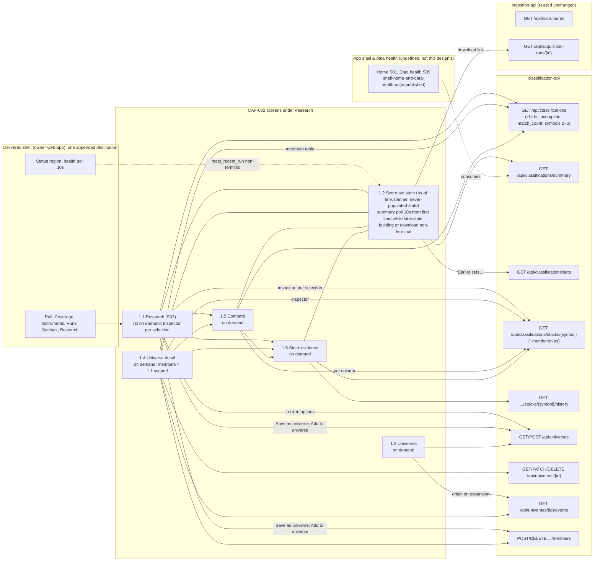

# Component: Classification UI

**Status:** draft
**Capability:** CAP-002
**Owner:** Alvaro de Jodra
**Last Updated:** 2026-10-17

This design was produced in an unattended `$design-run`. Choices no artifact
fixes are recorded as decisions under `projects/factorflow-v2/decisions/` and
marked **PROVISIONAL**; the UX decisions DEC-0060, DEC-0062, DEC-0063 and
DEC-0072 to DEC-0078 are honoured, not re-decided.

**Version 2 (2026-10-16)** aligns this design with the product UX blueprint
(`PRODUCT-UX` v6) and its Research screen specification (`PRODUCT-UX-S03` v4),
both approved on 2026-10-16 after version 1 was written, with STD-UI v6, and
with the system design v2, UX brief v2 and UX design v2 refined for the same
reason. Version 1's six screens, five routes and two rail destinations become
S03 Research at `/research` plus four restyled pages under `/research/*`
behind one rail destination (DEC-0068); the Classifications screen and its
Classification currency region are folded into S03's Results pane, banner and
as-of line (UX design v2 §1.1, §1.2); the `data-table` `expandable` list with
its Marks column becomes the `virtualised` variant with the blueprint §4.4
factor cell; the threshold toolbar panel becomes S03's Filters pane; the
composition seam is re-stated per DEC-0069; the fetch layer follows the v2
reads (`hide_incomplete`, `match_count`, `memberships`, compare 2 to 6, the
summary read); Section 10 is regenerated from UX design v2; the tests follow.
Version 1's open Compare cap is closed (DEC-0070). The two decisions this
version records are DEC-0079 (read-side mechanics the system design leaves to
the component designs) and DEC-0080 (test placement), both **PROVISIONAL**.

**Version 3 (2026-10-17)** is the consistency pass the owner directed on
specification review v2
(`docs/capabilities/CAP-002-universe-and-factor-classification/specifications-review-report-v2.md`)
and applies seven of its findings to this design, each exactly as the system
design v3 and the UX design v3 (both pinned here) resolved it: FINDING-3
(`hide_incomplete` excludes input reasons only and the unscoped list is the
active roster, now stated by the system design, which supersedes DEC-0071 (1)
on this point by DEC-0079 (a) and (b); sections 3, 14), FINDING-4 (the saved
`filter` reaches `universe-service` as one object; section 2.7; DEC-0085),
FINDING-5 (the save posts the *Find a stock* `symbol` prefix with the
thresholds and `hide_incomplete`, the dialog names the search, the origin line
reads it back; sections 2.4, 2.7, 7, 8), FINDING-6 (a threshold excludes only
stocks classified on that factor that fail it; a stock incomplete on it stays
listed as *Incomplete* unless the checkbox is on; sections 2.5, 3, 7;
DEC-0081), FINDING-7 (`ClassificationSummary` and `ClassificationList` gain
`later`, the poll runs from first load, the never-populated state renders
*Updating* or *Score update failed*; sections 2.3, 2.4, 2.6, 7, 8; DEC-0082),
FINDING-8 (a download is named by its start time in America/Chicago linked to
`/runs/:runId`, never by a number and never by the raw `run_id`; sections 2.2,
2.6, 7, 10, 14; DEC-0083) and FINDING-12 (every delivered file this component
edits, the three sources and the four shell tests, listed from the one list
the owner confirms; sections 2.1, 2.2, 3, 7; DEC-0084). The records are the
system design v3's and are cited, not re-decided: DEC-0081 follows from the
approved S03-1 and supersedes the threshold-exclusion statements of DEC-0071
and DEC-0076; DEC-0082, DEC-0083 (superseding DEC-0079 (e)), DEC-0084
(superseding DEC-0069's "nothing else in the shell is edited" and extending
DEC-0064) and DEC-0085 (the filter as one object end to end, superseding
DEC-0079 (f)) are **PROVISIONAL**. Review v2's other findings naming this
design (FINDING-9, FINDING-10, FINDING-26, FINDING-28, FINDING-29,
FINDING-31) are carried, not fixed; FINDING-10's poll stop rule is untouched
beyond what FINDING-7's start rule requires. This version records no decision
of its own.

## 1. Overview

The classification UI is the set of React screens and the fetch layer through
which the owner reads scores, builds and maintains universes, compares stocks
and inspects the evidence behind every result. It is the Research area of the
product UX blueprint: one screener-and-inspector screen, S03 Research at
`/research` (Filters pane, virtualised results table with selection tray,
Inspector, not-current banner and as-of line), and the three pages blueprint
§2.2 calls "CAP-002 page, restyled into this shell": Universes
(`/research/universes`) and Universe detail (`/research/universes/:universeId`),
Compare (`/research/compare?symbols=`) and Stock evidence
(`/research/stocks/:symbol`), reached from a single rail destination, Research
(blueprint §2.1, §2.2, §10 M1; DEC-0068). It is built from the UX design v2,
which fixes every screen, state, component and token starting from S03; this
design translates that into a file structure, a data-fetching strategy, the
composition into the shell and a test plan, and changes nothing the UX design
decided.

CAP-002 is the first FactorFlow surface that renders a derived number. The
acceptance criteria that exist because a plausible interface would lie,
AC-12, AC-14, AC-20, AC-22, AC-23, and the STD-UI rules that carry the same
obligations decide more of this component than any layout does: a cell that
is not a measured value says so in text, in shape and in token, never in
colour alone, and nothing is asserted beyond a recorded row.

Use cases addressed:

- See every followed stock scored after a download, or told plainly why not,
  under a dated as-of line naming the download (AC-9, AC-12, AC-14, AC-20 to
  AC-23; flow 1).
- Build a universe by hand or save a reviewed result as a universe (AC-1,
  AC-2, AC-5; flows 2, 3).
- Sort, filter, search, compare and open the evidence, across all followed
  stocks or within a universe (AC-16, AC-17; flow 4).
- Understand and fix insufficient evidence (AC-13; flow 5).
- Maintain universes over time with history kept and visible (AC-3, AC-4,
  AC-6, AC-15; flow 6).

Support matrix: a modern desktop browser on the owner's machine, reaching
`http://127.0.0.1:8000` only, as CAP-001 fixed; the design width is at least
1280 px, the inspector moves below the list between 1024 and 1279 px and
nothing is unreachable below 768 px (blueprint §3.1). No authentication, no
account area (capability section 5.3).

Dependencies: React 18, Vite, TypeScript 5.x, Tailwind CSS, `react-router-dom`,
shadcn/ui on Radix primitives, the eighteen component specifications under
`design-system/components/` as of 2026-10-15 (twelve used, UX design v2 §3) and
`design-system/theme.css`; the delivered shell, `ScreenState` union, fetch
helpers and windowed-table pattern of `owner-web-app`; the `classification-api`
contract (its section 2.7); CAP-001's `GET /api/instruments`,
`GET /api/acquisition-runs/{id}` and `GET /api/health` unchanged. TradingView
`lightweight-charts` is in the stack and **not used**: CAP-002 commits to no
chart (STD-UI-9, 27, 28 not applicable).

**Vocabulary.** User-visible text uses the STD-UI-1 v6 display labels
(blueprint §7; DEC-0072): *stock*, *followed stock*, *stop following* and *Not
followed*, *download*, *Complete* and *Partial*, *Incomplete*, *Not enough to
rank*, and a factor's *score* shown as a *percentile* and a *standardised
score* (never shortened to *score*). Code, API fields, URL query keys and this
document keep the domain terms (`instrument`, `acquisition_run`,
`not_classified`, `classification`); `copy.ts` is the one place the two meet.

## 2. Design Details

### 2.1 Placement

```
web/src/app/shell.tsx                               + one DESTINATIONS entry, Research (DEC-0069, PROVISIONAL; DEC-0084)
web/src/app/routes.tsx                              + five Route elements under /research (DEC-0068; DEC-0084)
web/src/api/client.ts                               + export on requestJson (DEC-0064, stands; DEC-0084)
web/src/app/shell.test.tsx                          delivered; navigation-item count four -> five (line 71; DEC-0084)
web/src/app/shell.a11y.test.tsx                     delivered; navigation-item count four -> five (line 36; DEC-0084)
web/src/app/routes.test.tsx                         delivered; count four -> five (line 75); path enumeration gains the five /research paths (lines 105-118; DEC-0084)
web/src/app/shell.unreachable.test.tsx              delivered; navigation-item count four -> five (line 58; DEC-0084)
web/src/api/classification-client.ts                typed fetch layer for /api/universes and /api/classifications
web/src/api/classification-types.ts                 response types mirroring classification-api section 2.7
web/src/api/research-query.ts                       URL query <-> ResearchQuery (thresholds, scope, hide_incomplete, symbol, sort), S03 §5
web/src/components/patterns/factor-cell.tsx         blueprint §4.4 cell: percentile, bar, Incomplete, Not enough to rank, Not followed
web/src/components/patterns/restated-mark.tsx       the Possibly restated mark (DEC-0075)
web/src/components/patterns/inspector-panel.tsx     blueprint §4.5
web/src/components/patterns/selection-tray.tsx      blueprint §4.6
web/src/components/patterns/as-of-line.tsx          blueprint §4.8, specialised by DEC-0073
web/src/components/patterns/not-current-banner.tsx  S03 §3, §4; DEC-0073
web/src/components/patterns/comparison-table.tsx    UX design 1.5, native <table> composition
web/src/screens/research/index.tsx                  UX design 1.1 (S03)
web/src/screens/research/filters-pane.tsx           Find a stock, Look in, threshold sentences, Hide incomplete, Clear filters
web/src/screens/research/threshold-sentence.tsx     blueprint §4.7 sentence builder, one per factor
web/src/screens/research/results-pane.tsx           banner, h1, as-of line, Save as universe, table, STD-UI-18 footnote
web/src/screens/research/results-table.tsx          data-table virtualised composition, shared with 1.4
web/src/screens/research/save-as-universe-dialog.tsx
web/src/screens/research/add-to-universe-dialog.tsx
web/src/screens/research/set-history-dialog.tsx     DEC-0073, DEC-0078
web/src/screens/research/use-score-set-poll.ts      the 10-second summary poll and refresh-once (DEC-0054, DEC-0062)
web/src/screens/research/format.ts                  DEC-0063 precision, sign, dates, zone
web/src/screens/research/copy.ts                    every owner-facing string, keyed by error code and state; display labels only
web/src/screens/research/universes/index.tsx        UX design 1.3
web/src/screens/research/universes/universe-table.tsx
web/src/screens/research/universes/create-dialog.tsx
web/src/screens/research/universes/detail/index.tsx UX design 1.4
web/src/screens/research/universes/detail/summary-header.tsx   inline rename, Add stocks, Retire
web/src/screens/research/universes/detail/members-tab.tsx      results-table scoped + Members as of + Remove
web/src/screens/research/universes/detail/history-tab.tsx
web/src/screens/research/universes/detail/add-stocks-dialog.tsx
web/src/screens/research/universes/detail/remove-dialog.tsx    confirm, never destructive
web/src/screens/research/universes/detail/retire-dialog.tsx    confirm, never destructive
web/src/screens/research/compare/index.tsx          UX design 1.5
web/src/screens/research/stocks/index.tsx           UX design 1.6
web/src/screens/research/stocks/factor-card.tsx
web/src/screens/research/stocks/history-tab.tsx
tests/e2e/research-after-download.spec.ts
tests/e2e/universe-by-hand.spec.ts
tests/e2e/universe-from-result.spec.ts
tests/e2e/compare-and-evidence.spec.ts
tests/e2e/fix-insufficient-evidence.spec.ts
tests/e2e/universe-maintenance.spec.ts
tests/e2e/research-url-state.spec.ts
tests/e2e/research-accessibility.spec.ts
tests/e2e/research-volume.spec.ts
```

`web/src/components/patterns/` is where UX design v2 §3 places the six
compositions built once from existing components and tokens
(`design-system/intake.md` step 1.3). The directory does not exist in the
delivered tree today (`owner-web-app` §2.1 names `web/src/components/` for the
vendored shadcn/ui sources; the delivered screens keep their cells and badges
beside them), so this component creates it; nothing delivered moves. Bulk
symbol parsing reuses `web/src/screens/instruments/parse-bulk-symbols.ts` by
import, so the recognised and rejected counts behave as CAP-001's *Add many*
does (UX design §1.3). Vendored shadcn/ui components live where
`owner-web-app` placed them; none is overridden at a call site (STD-UI-29).

### 2.2 Composition into the shell

The blueprint's §3 shell, its rail and the routes of §2 belong to the *App
shell & data health* capability (§12 D-8), which is not yet defined. Until it
lands, this component composes into the delivered CAP-001 shell at two seams
and one export, as system design v3 §4.2 (Screen registration) and §8 question
4 state (DEC-0068; DEC-0069, PROVISIONAL; DEC-0064's `requestJson` assignment
stands). The three source edits change no delivered behaviour, label, order or
route; four delivered test files change with them (DEC-0084, below):

```typescript
// web/src/app/shell.tsx: exactly one entry appended to DESTINATIONS (DEC-0069).
// The shell capability removes or replaces this line when it delivers the blueprint's rail.
const DESTINATIONS = [
  { label: "Coverage", to: "/coverage" },
  { label: "Instruments", to: "/instruments" },
  { label: "Runs", to: "/runs" },
  { label: "Settings", to: "/settings" },
  { label: "Research", to: "/research" },
] as const;

// web/src/app/routes.tsx: five routes added before the catch-all (DEC-0068, blueprint §2.2)
<Route path="/research" element={<ResearchScreen />} />
<Route path="/research/stocks/:symbol" element={<StockEvidenceScreen />} />
<Route path="/research/compare" element={<CompareScreen />} />
<Route path="/research/universes" element={<UniversesScreen />} />
<Route path="/research/universes/:universeId" element={<UniverseDetailScreen />} />

// web/src/api/client.ts: one keyword, so the envelope handling is shared, not copied (DEC-0064)
export async function requestJson<T>(input: string, init?: RequestInit): Promise<T> { ... }
```

**Delivered files this component edits** (DEC-0084, PROVISIONAL, superseding
DEC-0069's "nothing else in the shell is edited" and extending DEC-0064; the
one list the owner confirms under AGT-SCOPE-002 is system design v3 §8
question 4, and review v2 FINDING-13 stays the owner's): seven of CAP-002's
nine. The three sources above, `web/src/app/shell.tsx` (one `DESTINATIONS`
entry), `web/src/app/routes.tsx` (five `Route` elements) and
`web/src/api/client.ts` (the `export` keyword); and the four delivered shell
tests whose assertions count navigation items, `web/src/app/shell.test.tsx`
(line 71), `web/src/app/shell.a11y.test.tsx` (line 36),
`web/src/app/routes.test.tsx` (line 75) and
`web/src/app/shell.unreachable.test.tsx` (line 58), where each
`expect(items).toHaveLength(4)` becomes five, and `routes.test.tsx`'s
route-source assertion at lines 105 to 118, which reads `routes.tsx` and
enumerates the delivered `path` attributes, gains the five `/research` paths
because it reads the file this component edits. No other assertion in the
four files changes. The other two delivered files CAP-002 edits,
`src/factorflow/api/app.py` and `tests/unit/test_api_no_secrets.py`, are
`classification-api`'s (review v2 FINDING-12).

The landing redirect, the status region, the 30-second health poll, the
unreachable state and the `ScreenState` union are untouched (UX design §0;
AGT-SCOPE-002). Score-set state is shown where scores are shown, never in the
shell (blueprint §3.5): no third line in the status region.

**When the blueprint's shell lands** (UX design §0), nothing in this
component's routes changes, because they are already the blueprint's. The shell
capability removes the one appended `DESTINATIONS` entry, provides the top-bar
title or breadcrumb (*Research*, *Research › Universes › Tech*, *Research ›
AAPL*, *Research › Compare*) from the route, and migrates three link targets
this component points at CAP-001 routes meanwhile: the download's start time
in the as-of line (DEC-0083) and *Open Data health* (`/runs/:runId`, `/runs`
today; `/data/downloads/:id`, `/data` then) and the followed-stocks link in refusals (`/instruments` today;
`/data/followed` then). Those targets live in one map in `copy.ts`
(`SHELL_ROUTES`), so the migration is one edit by the shell capability, not a
search. Under the delivered shell the page ground is `--background`; under the
blueprint's it is `hsl(var(--muted) / 0.5)`; the regions sit on `card`s in
both, so no layout changes.

### 2.3 Screen and data-fetch map

The diagram below shows which screen reads which endpoint and at what cadence,
because cadence is specified behaviour under STD-UI-25. Only the score-set
state polls, `GET /api/classifications/summary` every 10 seconds from first
load, including before any set exists, while `later.state` is `building` or
the latest download is non-terminal, and it stops otherwise (DEC-0054;
DEC-0082; system design v3 constraint 18 and §3.3 step 14; UX design v3 §1.2).
The list read, the universe reads, compare and evidence are on demand; the
inspector reads one stock on each selection after the 150 ms debounce (S03
§6), because the list read carries no input rows (system design v3 §3.3 step
17). The status region's 30-second health poll is CAP-001's and tells the poll
hook whether a download is non-terminal through `most_recent_run`. `GET
/api/classifications/summary` is also the read the shell capability's Home and
Data health screens consume (system design v3 §4.2, §8 question 10); this
component consumes it for S03's header, banner and poll and does not render
those screens. The expected outcome is an interface that is current where a
set is being built and quiet everywhere else.



### 2.4 State rendering and the fetch layer

Every fetched region renders the `ScreenState` union `owner-web-app` section
2.4 fixed, reused by import from `web/src/api/types.ts`: `loading`,
`empty-never-populated`, `empty-no-match`, `populated`, `partial`,
`unavailable`, `error`, `unreachable`, as UX design v2 enumerates them per
screen (S03 §7 for Research). The two empty variants are kept apart
everywhere both can occur: `never_classified: true` is `empty-never-populated`,
rendering the first set's *Updating* or *Score update failed* with its reason
from `later` (DEC-0082), and thresholds or a search matching nothing is
`empty-no-match` (AC-22). A
not-ranked factor is `unavailable` per column, never per screen (AC-14,
STD-UI-14). A `not_current` set is rendered as `populated` with the banner in
its stale state, because the data is real and marked (AC-20).

`classification-client.ts` wraps every CAP-002 endpoint over the exported
`requestJson`, so a transport failure is `ApiUnreachableError` (the shell's
unreachable state) and a non-2xx status is `ApiError` with its `code`, never
conflated. It maps snake_case to camelCase field by field, as `client.ts`
does, and keeps dates as the wire's `YYYY-MM-DD` strings, never parsed into
`Date` (STD-UI-5). `ApiError` is read by `code` only; `message` is never
rendered (UX design §4), and `copy.ts` holds one owner-facing sentence per code
and state in display labels. The `instrument_not_acquired` envelope's `symbols`
field is exposed on the error so the dialogs name every unfollowed stock.

```typescript
// web/src/api/classification-types.ts (excerpt; mirrors classification-api section 2.7)
export type FactorName = "value" | "growth" | "momentum";
export type ReasonCode =
  | "input_missing" | "input_outdated" | "input_not_computable" | "not_enough_stocks" | "retired";

export interface FactorCell {
  status: "classified" | "not_classified";
  score: string | null;          // decimal string at stored precision; rendered by format.ts (DEC-0063)
  percentile: string | null;
  reasonCode: ReasonCode | null;
  reasonInput: string | null;
  reasonDetail: string | null;
  restatedPossible: boolean;
}

export interface CurrentSet {
  setId: string;
  classificationDate: string;    // YYYY-MM-DD, never converted
  runId: string;
  runStartedAt: string;          // the download's start time: how every surface names it (DEC-0083)
  runOutcome: "succeeded" | "partial";
  startedAt: string;
  endedAt: string;               // the as-of line's "Scores from {date} {time}" (DEC-0073)
  activeInstruments: number;     // peerCounts.followed (S03 §5)
  notCurrent: boolean;           // true exactly when the read's `later` is non-null (DEC-0082)
}

export interface LaterSet {                       // the newer building or failed set, or the first while none is complete (DEC-0082)
  setId: string;
  state: "building" | "failed";
  startedAt: string;
  endedAt: string | null;
  failureReason: string | null;
  runId: string;
  runStartedAt: string;
}

export interface FactorSummary { qualifiedCount: number; ranked: boolean; minPeerSetSize: number }

export interface ClassificationList {
  neverClassified: boolean;      // true exactly when set is null
  set: CurrentSet | null;
  later: LaterSet | null;        // one shape with the summary read (DEC-0082)
  factors: Record<FactorName, FactorSummary>;
  matchCount: number;            // over the whole filtered set, never the page (S03-2)
  stocks: StockRow[];
  unknownSymbols: string[];      // compare only
  nextCursor: string | null;
}

export interface ClassificationSummary {          // GET /api/classifications/summary (DEC-0071)
  neverClassified: boolean;      // true exactly when set is null
  set: CurrentSet | null;
  later: LaterSet | null;        // the same block as on the list read (DEC-0082)
  factors: Record<FactorName, FactorSummary>;
  stocksCurrent: { currentCount: number; followedCount: number } | null;
}

export interface Membership { universeId: string; name: string }

export interface StockEvidence {
  symbol: string; name: string; lifecycle: "active" | "retired";
  set: CurrentSet | null;
  factors: Record<FactorName, FactorCell>;
  inputs: InputRow[];            // factor, inputName, label, status, value, asOf, knownOn, restatedPossible, detail
  memberships: Membership[];     // the inspector's "In Tech and Dividend growers" line
}
```

**URL query state** (`research-query.ts`; S03 §5, S03-5; UX design §0). On
Research and on a universe's Members tab, every filter is in the URL query and
nowhere else: `scope` (`all`, or a `universe_id`; absent on universe detail,
where the route is the scope), the three threshold sentences as
`{factor}.measure`, `{factor}.direction`, `{factor}.value`, `hide_incomplete`,
`symbol` (the *Find a stock* prefix, DEC-0074) and `sort`/`order`. The module
is a pure, round-trippable codec from `URLSearchParams` to a `ResearchQuery`
and to the list read's request parameters: a sentence `{measure, direction,
value}` becomes exactly one of the twelve bounds (`percentile` + `atLeast` →
`{factor}_percentile_min`, `standardisedScore` + `atMost` →
`{factor}_score_max`, and so on; system design v3 §3.3 step 15), so no new
filter model exists and the saved `filter` of a universe is the same object
the URL carried: the twelve bounds, `hide_incomplete` and the `symbol` prefix,
null when no search is active (DEC-0076; DEC-0085; review v2 FINDING-5). Checked rows (`checked: symbol[]`) and the selected
row are client state kept by symbol across filter, sort and scope changes and
across the set refresh (S03 §5; DEC-0062); the as-of date and active tab on
universe detail and the active tab on evidence are in the URL per the `tabs`
contract; the compared symbols are the `symbols` query on compare.

`format.ts` is the one place numbers and dates become text (STD-UI-3,
DEC-0063): `formatScore` gives two decimals with an explicit `+` or `−` and
`0.00` unsigned; `formatPercentile` a whole number 0 to 100 with no sign and
no `%`; `formatRatio` two decimals; `formatRate` a signed percentage at two
decimals; `formatAmount` whole currency units with thousands separators and no
abbreviation (STD-UI-6); `formatTimestamp` America/Chicago with the zone shown
(*CDT* or *CST* as the instant falls); dates pass through unconverted. Sorting
and thresholds never touch rendered text: they are requests.

### 2.5 The results table, the factor cell and the panes

`results-table.tsx` is the one composition behind S03's Results pane and the
Members tab (UX design §1.4: *S03's results pane and inspector scoped to the
universe*), parameterised by scope (`universeId` or none), the extra **Member
since** column and in-row **Remove…**, and whether **Save these {n} as a
universe…** is offered. It is the `data-table` `virtualised` variant with the
base contract's row checkboxes (S03 §4; design system `data-table` §2):
windowed rows over keyset pages at `DEFAULT_PAGE_SIZE` 50 and `MAX_PAGE_SIZE`
500, sorting, filtering and counting server-side over the full set (S03 §6;
STD-UI-30, now discharged by the variant, UX brief v2 §12.1). Columns: checkbox
(*Select {SYMBOL}*, 24 px target) · Symbol (row header, `--font-numeric`,
sortable, default ascending; not a link, because click and `Enter` on the row
select it into the inspector) · Name · Value · Growth · Momentum, each factor
header carrying its swatch (`--factor-*`) and name, sortable on percentile and
through the allowlist on standardised score, with the arrow and `aria-sort`.
The `h1` reads *{n} stocks match* from `matchCount` (S03 §3, S03-2), or *{n} of
{m} members match* on universe detail.

`factor-cell.tsx` (`web/src/components/patterns/`) renders blueprint §4.4, and
Vitest tests pin each rendering:

| Cell | Rendering | Tokens |
|------|-----------|--------|
| Scored (`classified`) | the percentile in `--font-numeric` weight 600, right-aligned in a fixed 22 px box, then a 52 px bar filled to the percentile, `aria-hidden`; the standardised score never appears in the list (inspector and evidence only); the *Possibly restated* mark after the number where `restatedPossible` (AC-23, S03-6) | `--foreground`; `--seq-4` on `--seq-1` |
| Incomplete (`not_classified`, reason `input_missing`, `input_outdated`, `input_not_computable`) | `badge` `coverage-absent` *Incomplete* in place of number and bar; the S03 §8 sentence as the cell's tooltip (*Incomplete: revenue for the quarter ending 2025-06-27 is missing, so growth can't be compared fairly. It isn't guessed.*, with *is outdated* or *couldn't be computed*), inputs named in product vocabulary from `reasonInput`; never a number, never `0`; the row stays listed under a threshold on that factor unless *Hide stocks with an incomplete score* is on (AC-12, S03-1, STD-UI-4, STD-UI-14; DEC-0072, DEC-0081) | `--value-missing` on `--value-missing-muted` |
| Not enough to rank (`ranked: false` for the factor; reason `not_enough_stocks`) | `badge` `coverage-unknown` *Not enough to rank* in every cell of the column; the column header adds *{n} qualified, 30 needed* from `qualifiedCount` and `minPeerSetSize`, so a screen reader hears the count once; the column's sort control is removed (AC-14, S03-4, S03 §7 *Unavailable*) | `--value-indeterminate` on `--value-indeterminate-muted` with `--pattern-indeterminate` |
| Not followed (`lifecycle` retired; reason `retired`) | `badge` `status-neutral` *Not followed* in every factor cell, tooltip *Not followed since {date}. Earlier scores stand.*; neutral, never a fault (AC-15; DEC-0073). Such a stock appears only under a universe scope, on universe detail, compare and evidence, never under *All followed stocks* | `--status-neutral` on `--status-neutral-muted` |

`restated-mark.tsx` is the DEC-0075 composition (PROVISIONAL, resolving review
v4 FINDING-56): an inline element carrying the `badge` `status-neutral` tokens
(`--status-neutral` on `--status-neutral-muted`, `--radius`, `--text-xs`) whose
text content is *Possibly restated*, rendered visually hidden, with the glyph
*R* drawn `aria-hidden` beside it. Its accessible name is therefore the words,
no `badge` component is used and no accessible-name override is needed (badge
specification §5). It renders on every percentile that carries the mark, in
the results, the inspector, universe detail, compare, evidence and history
(S03-6, STD-UI-17); the explanation sentence lives in the inspector and on the
evidence page, never in the cell. A measured `0.00` renders as such in the
inspector and evidence; blank means only that a column does not apply (Member
since on Research). No `--gain`, `--loss` or `--factor-*` token is applied to a
value (DEC-0060); the swatch is identity in headers only (STD-UI-7).

**The Filters pane** (`filters-pane.tsx`; S03 §3; UX design §1.1), top to
bottom: *Find a stock* (`input` `text`, placeholder *Symbol*, DEC-0074,
PROVISIONAL, a recorded departure from S03 for STD-UI-30, matching the symbol
prefix through the list read's `symbol` parameter); *Look in* (`select`
`inline`, *All followed stocks · {n}* from `activeInstruments` and each active
universe from `GET /api/universes`); three `threshold-sentence.tsx` rows
(blueprint §4.7: swatch and name, then `select` `inline` *percentile* |
*standardised score*, `select` `inline` *at least* | *at most*, `input`
`numeric` 56 px placeholder *any*, accessible names *Measure for value*,
*Direction for value*, *Value threshold*), validated on blur (percentile 0 to
100, finite standardised score; field error in `--destructive` before any
request; system design v3 constraint 15), a blank value meaning no threshold on
that measure; `checkbox` `default` *Hide stocks with an incomplete score*
(default off, helper *They're shown by default so nothing disappears
silently.*, a sentence that is true because a threshold excludes only stocks
classified on that factor that fail it, never one incomplete on it; DEC-0081);
**Clear filters** (`button` `ghost`, DEC-0078) at the foot,
rendered whenever any filter is active, resetting the URL query to the defaults
and leaving the sort. On universe detail the pane has no *Look in* and gains
*Members as of* (`form` `inline`, `input` `text`, ISO-8601) above **Clear
filters**. Every change applies on selection or blur as a request; rows stay
visible and dimmed while the new result loads; focus does not move; the new
match count is announced politely (`data-table` contract).

**Selecting and checking** (S03 §6) never interfere: click or `Enter` on a row
selects it into the inspector (`aria-selected`, 3 px inset `--status-active`
edge on `--status-active-muted`); `Space` on its checkbox checks it (the
table's `--muted` background); `↑`/`↓` move the selection and the inspector
follows after a 150 ms debounce, which is when the stock read is issued, so
holding an arrow key does not issue a request per row. Checking never selects.

**The selection tray** (`selection-tray.tsx`; blueprint §4.6) pins to the foot
of the Results card when one or more rows are checked: `--foreground` fill
with `--background` text, `role="region"` labelled *Selection*, announced
politely as *{n} selected*; **Compare side by side** is enabled while 2 to 6
rows are checked (S03 §6; DEC-0070) and otherwise renders `button` `blocked`
with *Check 2 to 6 stocks to compare them.*; **Add to universe…** opens its
dialog (section 2.7).

**The inspector** (`inspector-panel.tsx`; blueprint §4.5; S03 §3; `card`
`summary`, `section` labelled *Selected stock*) renders *Select a stock to see
why it scores as it does.* when nothing is selected and otherwise, from one
`GET /api/classifications/stocks/{symbol}` per selection: the symbol at
`--text-xl` `--font-numeric` and name (with `badge` `status-neutral` *Not
followed* where it applies); the memberships line *In Tech and Dividend
growers* with each name a link to `/research/universes/:universeId`, or *In no
universe* (`memberships`, DEC-0071); one block per factor with the percentile
in weight 600 (and the mark), the standardised score in `--muted-foreground`
signed at two decimals (DEC-0063), and one `--text-xs` line naming the inputs
and their `as_of` and `known_on` dates (S03-3); the *Incomplete* explanation
box when any factor is incomplete, carrying the S03 §8 sentence per factor,
the *Not followed since {date}. Earlier scores stand.* sentence for a stock no
longer followed, and the STD-UI-17 sentence where a mark appears; **See every
input and its date** (`button` `outline` rendered as a link to
`/research/stocks/:symbol`); the S03 §8 footnote. The holdings line and **Start
a strategy from this screen** are M2 and absent, not disabled (UX design
§1.1). Below 1280 px the panel moves below the list (blueprint §4.5).

### 2.6 Score-set state, polling and refresh-once

The sequence below shows the as-of line and banner's behaviour from a download
ending to the screen showing the new set, which is flow 1 step 3's *without
any further action* and AC-20's honesty made concrete (UX design v3 §1.2;
DEC-0054; DEC-0062, PROVISIONAL; DEC-0073, PROVISIONAL; DEC-0082,
PROVISIONAL). `use-score-set-poll.ts` polls `GET /api/classifications/summary`
every 10 seconds **from first load**, including before any set exists, while
the read's `later.state === "building"` or the shell's health reports a
non-terminal `most_recent_run`, and stops when neither holds; while polling
the as-of line shows *checked {time}* (STD-UI-25; system design v3 §3.3 step
14). The decision point is the poll that reports the building set complete (a
new `set`, `later` null): the as-of line announces politely *Scores updated to
{date} {time} {zone} from the download started {date} {time} {zone}*, the
banner leaves, and the host table dims and reloads once from its first page
with sort, thresholds, scope, hide-incomplete, search, the selected row and
the checked rows preserved by symbol (DEC-0062), and no further automatic
replacement happens until another set completes. A failed attempt leaves the
previous set, replaces the warning banner with the `status-critical` *Score
update failed {time}: {reason}. Showing scores produced {time} from the
download started {date} {time} {zone}. The next complete download will try
again.* banner (DEC-0073; DEC-0083), and offers nothing to retry (system
design 3.1 step 27, STD-UI-2). The summary read is chosen for the poll because
it carries the `set` and `later` blocks and no stock rows (DEC-0071), so the
poll never reloads the page it is watching.

```mermaid
sequenceDiagram
    participant R as download (acquisition run)
    participant P as use-score-set-poll (as-of line, banner)
    participant A as classification-api
    participant T as results-table / host screen

    Note over P: polling since first load, every 10 s, because most_recent_run is non-terminal (DEC-0082)
    R->>R: ends succeeded | partial
    Note over P: health poll reports most_recent_run terminal; later not yet building
    P->>A: GET /api/classifications/summary (poll 10 s)
    A-->>P: set {notCurrent: true}, later {state: building, startedAt, runStartedAt}
    P->>P: banner status-warning Not reflecting the latest download; as-of line adds Updating + checked hh:mm:ss CDT
    loop every 10 s while later.state is building
        P->>A: GET /api/classifications/summary
    end
    alt building set complete
        A-->>P: set is the new set (runStartedAt), later null
        P->>P: announce politely: Scores updated to <date> <time> <zone> from the download started <date> <time> <zone>; banner leaves
        P->>T: refresh once (dim, reload page 1, keep sort, thresholds, scope, hide-incomplete, search, selection, checked by symbol)
        P->>P: stop polling
    else attempt failed
        A-->>P: previous set {notCurrent: true}, later {state: failed, failureReason, runStartedAt}
        P->>P: banner status-critical Score update failed <time>: <reason>; stop polling
    end
```

A poll that fails leaves the displayed set and its banner in place and adds
*Could not check for newer scores.* with **Try again** under the as-of line;
it never clears a mark (UX design §1.2). On the universes list, which shows no
score, no poll runs; a set completing or failing while the owner is there
surfaces once as `toast` `info` or `error`.

**Before any set exists** the same hook drives the never-populated state
(section 2.4; UX design v3 §1.1 States; AC-20, AC-22; DEC-0082): with
`neverClassified` true the results body reads *No stocks have been scored
yet.* and then, from `later`, `badge` `status-active` *Updating* with *The
first set of scores is being produced from the download started {time}.*
while `later.state` is `building`, or `badge` `status-critical` *Score update
failed* with *Score update failed {time}: {reason}. The next complete download
will try again.* when it is `failed`; beneath it the latest download's state
with its start time linked to its detail, and *Open Data health*. Polling runs
from first load, so the first completion refreshes into the populated state
without a reload (flow 1 step 3) and a failed first set shows its reason;
never an empty table, never the download's state in place of the set's.

**The as-of line** (`as-of-line.tsx`; blueprint §4.8; DEC-0073; DEC-0083,
PROVISIONAL) reads *Scores from 2026-10-15 17:46 CDT · from the download
started 2026-10-15 17:30 CDT · sorted by value*, from `endedAt`,
`runStartedAt` and the current sort, with the download's outcome as `badge`
`status-good` *Complete* or `status-warning` *Partial* (`runOutcome`), the
*sorted by* clause omitted on compare and evidence, and **Earlier sets…**
(`button` `ghost`, DEC-0078) at its end opening `set-history-dialog.tsx`
(`dialog` `standard` with a `data-table` `history` over `GET
/api/classifications/sets`: State, Scores date, Download (its start time,
linked to its detail, with its outcome badge), Started, Ended, three qualified
counts, Reason). The download's start time, `formatTimestamp(runStartedAt)` in
America/Chicago with the zone (STD-UI-5), is the link to the run detail
(`SHELL_ROUTES`, `/runs/:runId` today), accessible name *Open the download
started {time}*. **A download is named by its start time** on every CAP-002
surface, never by a number and never by the raw `run_id`: no artifact or table
numbers downloads (`acquisition_run.run_id` is a UUID, migration `0004`), so
S03 §3's *#{n}* is a recorded departure, the UUID the destination page titles
itself by stays reachable through the link without being printed (AC-21), and
whether downloads gain a short visible number, and which capability owns it,
is the owner's (DEC-0083, superseding DEC-0079 (e); system design v3 §3.3
step 18, §8 question 11; UX design v3 §1.2; section 14). The `set` and `later`
blocks carry `runStartedAt` for this.

### 2.7 Dialogs, confirmations and refusals

Every write follows the UX design's wording and the blueprint's tier (§9;
DEC-0072; STD-UI-19): saving a result as a universe, selecting, comparing,
creating, renaming and adding members are routine with no confirmation;
removing a member and retiring a universe are consequential and take `dialog`
`confirm`, never `destructive` (STD-UI-2). Every precondition the interface
can know renders `button` `blocked` with its reason, focusable and exposed
through `aria-describedby`, with the server's code as the backstop: no symbol
entered, zero matches (*No stocks match these filters, so there is nothing to
save.*, DEC-0076), the sole member, more than 1000 symbols, fewer than 2 or
more than 6 compared (DEC-0070).

**Save these {n} as a universe…** (`save-as-universe-dialog.tsx`; AC-2, S03
§6, S03-7; DEC-0076, PROVISIONAL) is `dialog` `standard` with `form` `dialog`:
title *Save these {n} stocks as a universe*, the description *{n} stocks,
including {m} with an incomplete score* when m > 0 plus the thresholds, the
search when one is active and the hide-incomplete state in words (*value
percentile at least 80 · momentum standardised score at least 0.00 · search
"AA" · stocks with an incomplete score hidden*, each clause only when it
applies; UX design v3 §1.1), one name field, confirm **Save**. The request
posts `{"name", "filter", "set_id"}` where `filter` is the `ResearchQuery`'s
thresholds, `hide_incomplete` **and the `symbol` prefix** (null when no search
is active), the one object `research-query.ts` built for the list read, and
`set_id` is the set on screen, so the server's snapshot equals the displayed
result: a stock incomplete on an unthresholded factor is a member, so is one
incomplete on a thresholded factor (DEC-0081), hidden stocks are not, and
under a search only the stocks the header counted are (system design v3 §3.3
step 15, §4.2; DEC-0085; review v2 FINDING-5). On `201` the dialog
closes and `toast` `success` *Saved {n} stocks as {name}* links to the new
universe (STD-UI-24). `409 universe_name_in_use` attaches to the name field;
`409 classification_set_changed` keeps the dialog open with *Could not save
these stocks as a universe: the scores changed while you were reviewing them.
Review the new result, then save again.* and replaces the confirm with
**Review new result**, which closes onto the already-refreshed table. The
control is not offered under a universe scope (the save carries the filter,
not the scope; system design v3 §4.2). `m` is counted client-side over the loaded rows
only when every matching row is loaded; otherwise the sentence omits the
*including* clause rather than guessing (STD-UI-15).

**Add to universe…** (`add-to-universe-dialog.tsx`) is `dialog` `standard` with
a `select` `default` of active universes plus *New universe* (revealing a name
field); it posts `POST /api/universes/{id}/members` or `POST /api/universes`;
`toast` `success` *Added {n} stocks to {name}* with *, and {m} were already
members* when m > 0 (AC-4; `already_member` is reported, never errored).

Refusals render by code through `copy.ts`: `instrument_not_acquired` names
every symbol from the envelope's `symbols` (*Could not create the universe:
FactorFlow doesn't follow MSFT, TSLA. Follow them on Data health, then try
again.*) and links to the followed-stocks page, keeping the entered list;
`universe_name_in_use` attaches to the Name field; `last_member` keeps the
remove dialog open with a **Retire…** action; `universe_retired` reads *This
universe is retired and can't be changed. Its members and history are still
viewable.*; `instrument_not_found` on compare is the field error *FactorFlow
doesn't follow a stock named XYZ.*. Creating by hand routes to the new
universe's detail with no toast, because the result is on screen (`toast`
contract); removal, retirement and the two bulk actions confirm by `toast`
`success` (DEC-0076). Version 1's no-toast position is withdrawn with the UX
design's (its §3).

### 2.8 Messages

N/A, not applicable for this component. There is no push channel; the
interface learns of state change by polling at the cadence in section 2.6
(STD-UI-25).

## 3. Constraints and Assumptions

- **Loopback only, no authentication** (capability section 5.3). Nothing in
  these screens assumes a principal.
- **STD-UI v6 is binding.** The capability's section 5.4 and the UX brief v3's
  section 12 record which rules apply and where each is satisfied against v6,
  citing blueprint §11 where the blueprint discharges a rule; this design
  implements that record. STD-UI-30 is discharged, not partial: the
  `data-table` `virtualised` variant plus *Find a stock* and the Filters pane.
- **The UX design v3 is the contract, and S03 beneath it.** Screens, states,
  components, variants, tokens, copy and accessibility are the UX design's;
  departures from S03 are the UX design's recorded ones (DEC-0073 to
  DEC-0078, and DEC-0083 for the download named by its start time), and this
  design adds none. The M2 controls S03 names (**Use in a
  strategy**, **Start a strategy from this screen**, the holdings line) are
  absent, not disabled.
- **Composition, not amendment** (AGT-SCOPE-002; DEC-0069, PROVISIONAL;
  DEC-0084, PROVISIONAL). One destination appended after Settings; five routes
  under `/research`; one export; and the four delivered shell tests whose
  navigation-item count goes from four to five, `routes.test.tsx`'s path
  enumeration included (section 2.2). No delivered behaviour, label, order or
  route changes, and the shell capability removes the appended entry. The dependency on that capability
  is the owner's to record in the capability's §5.1 (section 14).
- **Display labels, never domain terms, in user-visible text** (STD-UI-1 v6;
  DEC-0072). `copy.ts` is reviewed against blueprint §7; code, URL keys and
  API fields keep the domain terms.
- **No chart** (STD-UI-9, 27, 28 not applicable). `lightweight-charts` is not
  imported.
- **Numbers render at DEC-0063's precision**, signed standardised scores,
  whole-number percentiles, no polarity colour (DEC-0060), tabular figures
  (STD-UI-3); the standardised score renders in `--muted-foreground` and never
  in a list cell (blueprint §4.4).
- **Dates and timestamps**: ISO-8601, America/Chicago with the zone shown,
  session and period dates unconverted (STD-UI-5).
- **Server-side everything**: sort, thresholds, search, scope, hide-incomplete,
  count and paging are requests (STD-UI-30, S03 §6); nothing is computed in
  the browser beyond formatting.
- **URL query is the filter state** (S03 §5, S03-5): a request parameter and a
  URL key exist for every filter; checked rows and the selected row are client
  state.
- **Density tier is inherited** (OQ-UI-4), as CAP-001 did; no token is
  introduced (STD-UI-29); the pixel widths S03 fixes (220 to 250, 300 to 340,
  22, 52, 56 px) bind the layout, not the theme.
- **Bounds are the API's**: 1000 symbols per submission, 2 to 6 compared
  (DEC-0070), pages of 50 to 500; the universe name length is open (section
  14).
- **Three read semantics the system design v3 states** (§3.3 step 15, §4.2)
  and this design renders: `hide_incomplete` hides stocks whose
  `not_classified` reason is an input reason (`input_missing`,
  `input_outdated`, `input_not_computable`), not `not_enough_stocks` and not
  `retired`, otherwise one unranked factor would empty the list; the unscoped
  list excludes retired instruments (DEC-0073), while a universe scope keeps
  them (DEC-0079 (a), (b), PROVISIONAL, which supersede DEC-0071 (1) on this
  point); and a threshold excludes only stocks classified on that factor that
  fail it, so a stock incomplete on it stays listed as *Incomplete* unless the
  checkbox is on (DEC-0081, from the approved S03-1).
- **Polling runs from first load** (DEC-0082, PROVISIONAL): every scored
  surface polls the summary read every 10 seconds, before any set exists
  included, while `later.state` is `building` or the latest download is
  non-terminal, and stops otherwise; the never-populated state renders
  *Updating* or *Score update failed* from the same `later` block.
- **A download is named by its start time** in America/Chicago, linked to its
  detail, never by a number and never by the raw `run_id` (DEC-0083,
  PROVISIONAL).
- **Assumption: one browser tab**, as CAP-001 assumed.
- **Assumption: `parse-bulk-symbols.ts` is importable** from the universes
  screens; it is a pure module.
- **Assumption: `web/src/components/patterns/` is new** and this component
  creates it (section 2.1).
- **TypeScript 5.x, React 18, Vite, Tailwind, shadcn/ui on Radix, Vitest with
  React Testing Library, Playwright, Biome** (tech stack); accessibility is
  enforced by review, since Biome has no `jsx-a11y` equivalent.

## 4. Security

- **No authentication, by owner decision**, sound solely because the interface
  is loopback-bound; this component adds no dependency on that absence.
- **Output encoding.** React escapes text; `dangerouslySetInnerHTML` is used
  nowhere, which `web/src/api/render.test.tsx` already asserts across the
  tree. Universe names are owner text and `reasonDetail`, `failureReason` and
  `detail` are product-written text; all render as text (AGT-PROHIB-003:
  provider-derived text is data).
- **Same-origin only.** The bundle is served by the same process as the API;
  every request is relative; no cross-origin configuration exists to widen.
  The browser's own requests carry the API's origin and pass H9's Origin check.
- **No client-side storage of anything sensitive.** URL query state only; no
  `localStorage` beyond, at most, interface preferences.
- **No credential anywhere.** No field, no value, no presence indicator in
  CAP-002 screens.
- **Data classification.** Everything rendered is Internal.
- **Dependency posture (SEC-DEP-001, SEC-DEP-003).** No new npm dependency;
  the vendored shadcn/ui sources, including the `checkbox` added for the
  blueprint, are reviewed as first-party code.
- **Input validation at the boundary.** Symbols are parsed and shape-checked
  before a request; threshold values are validated on blur (percentiles 0 to
  100, finite standardised scores) so the server's `422` is a backstop; dates
  are checked for the ISO-8601 shape; a URL query that decodes to an invalid
  `ResearchQuery` is rendered as the defaults with the offending key dropped,
  never sent.
- **Privacy impact: none.** No PII, no analytics, no telemetry.
- **Accessibility enforcement is human review**, as the tech stack records.

## 5. Scalability and Performance

- **The sizing case is 3000 rows** in the results and a 3000-member universe
  (AC-11, CAP-001 AC-4). The `virtualised` variant's windowed rows over keyset
  pages bound the DOM regardless of result size (STD-UI-30).
- **Every filter is a request.** Sort, thresholds, search, scope and
  hide-incomplete run in SQL over the whole set and `match_count` is counted
  there (S03-2); the interface never sorts, filters or counts a loaded page.
- **Rows stay visible and dimmed during a refresh** under the `data-table`
  contract, which also avoids a full re-render on every poll; the poll reads
  the summary, not the list.
- **The inspector fetches once per selection**, after the 150 ms debounce,
  rather than pre-loading inputs for 3000 rows; the origin line fetches once
  per universe row expansion.
- **Polling cost.** 10 seconds from first load while `later.state` is
  `building` or a download is non-terminal, on one bounded read with no stock
  rows; stopped otherwise (DEC-0082). The health poll is CAP-001's.
- **Compare** reads one list call with 2 to 6 `symbols` and one evidence call
  per column; six columns fit the design width with no horizontal scroll
  (UX design §1.5).
- **Bundle.** One Vite bundle, code-split by route; no size target is stated
  by any artifact, so none is asserted.
- **Concurrency: none.** One user, one tab.

## 6. Upgrade

- **Previous release.** CAP-001's interface. This component adds screens and
  touches the shell only at the composition points and in the four shell
  tests that count them (DEC-0084); every delivered screen is unchanged.
- **The bundle ships with the API in one image**, so an upgrade replaces both
  together and there is no skew between the interface and the contracts it
  consumes (`owner-web-app` section 6).
- **Data migration: none.** The interface stores nothing durable.
- **Behaviour change after upgrade.** One new rail destination, Research; the
  landing screen is unchanged.
- **Manual actions required: none.** The owner reloads the page.
- **Rollback (OPS-MIG-003).** Reverting the application image reverts the
  interface and the API together.
- **The shell capability's arrival** removes the appended destination and
  migrates the three link targets in `SHELL_ROUTES` (section 2.2); CAP-002's
  routes and screens do not change.
- **A response-shape change in a later capability** is a breaking change for
  this component and must be treated as one in that capability's design.
- **Forward compatibility.** The status region's reserved third line stays
  reserved for STD-UI-11; CAP-002 does not use it.

## 7. Testing

Vitest with React Testing Library for pattern, component and screen tests;
Playwright for end to end against the real API, a real PostgreSQL container
and the stub provider the delivered E2E stack already runs
(`tests/e2e/support/`). Fixture responses mirror `classification-api` section
2.7. S03's seven acceptance checks are placed as follows (DEC-0080,
PROVISIONAL): checks about one rendering or one request (S03-1, S03-3, S03-4,
S03-6) are Vitest component tests with doubled reads; checks that cross the
API or the browser's history (S03-2 against a real set, S03-5, S03-7) are
Playwright specs, each also pinned at the component level where a unit can be
isolated. Pattern tests sit beside their pattern in
`web/src/components/patterns/`.

| Test | File | What it proves |
|------|------|----------------|
| Four cell renderings never confused | `web/src/components/patterns/factor-cell.test.tsx` | Percentile and bar for a scored factor, the bar `aria-hidden`; `coverage-absent` *Incomplete* with the reason tooltip for an absent score; `coverage-unknown` *Not enough to rank* for a not-determinable one; `status-neutral` *Not followed* for a retired stock; never `0`, never a bare number for an unscored factor (STD-UI-4, STD-UI-14, AC-12, AC-14, AC-15; DEC-0072, DEC-0073) |
| The mark's accessible name | `web/src/components/patterns/restated-mark.test.tsx` | The element's accessible name and text content are *Possibly restated*; the *R* glyph is `aria-hidden`; the `status-neutral` tokens are applied; it renders wherever `restatedPossible` and never on momentum (AC-23, S03-6, STD-UI-17; DEC-0075) |
| Score and percentile precision | `web/src/screens/research/format.test.ts` | `+1.27`, `−0.45`, `0.00` unsigned; percentile `84` with no sign or `%`; ratios 2 dp; rates `+12.40%`; amounts in full with separators; timestamps in America/Chicago with zone; dates unconverted (DEC-0063, STD-UI-3, STD-UI-5, STD-UI-6) |
| Display labels only | `web/src/screens/research/copy.test.ts` | No owner-facing string in `copy.ts` contains *instrument*, *acquisition run*, *not classified*, *retire* or a bare *score* where *percentile* or *standardised score* is meant (STD-UI-1 v6, blueprint §7; DEC-0072) |
| URL query round trip | `web/src/api/research-query.test.ts` | Every `ResearchQuery` encodes to a query and decodes back equal; each threshold sentence maps to exactly one of the twelve bounds and back; `hide_incomplete`, `symbol`, `scope`, `sort` and `order` survive; the save payload built from it is the twelve bounds, `hide_incomplete` and `symbol`; an invalid key is dropped, not sent (S03-5; system design v3 §3.3 step 15) |
| Threshold sentences validate on blur | `web/src/screens/research/threshold-sentence.test.tsx` | Percentile 101 and a non-finite standardised score are field errors before any request; a blank value is no threshold; accessible names read as the blanks (blueprint §4.7; constraint 15) |
| Filters are requests, in the URL | `web/src/screens/research/filters-pane.test.tsx` | Changing scope, a threshold, hide-incomplete or the search issues one list request with the mapped parameters and updates the URL; **Clear filters** resets all of them and keeps the sort; the pane on universe detail has no *Look in* (S03 §5, §6; DEC-0074, DEC-0078) |
| Not enough to rank stated once | `web/src/screens/research/results-table.test.tsx` | The header carries *{n} qualified, 30 needed* from `qualifiedCount` and `minPeerSetSize`; every cell in the column is *Not enough to rank*; the column's sort control is absent (S03-4, AC-14) |
| Incomplete stocks listed unless hidden | `web/src/screens/research/results-table.test.tsx` | A stock incomplete on one factor renders with two percentiles and one *Incomplete*, with a threshold on that factor active and the checkbox off included; with the checkbox on, the request carries `hide_incomplete=true` and the row is absent from the doubled response (S03-1, AC-12; DEC-0081) |
| Match count is the server's | `web/src/screens/research/results-pane.test.tsx` | The `h1` renders `matchCount`, not the loaded row count, and *{n} of {m} members match* on universe detail (S03-2) |
| Sorting is a request | `web/src/screens/research/results-table.test.tsx` | Activating a column sort issues a request with `sort` and `order`; `aria-sort` follows; focus does not move; the new match count is announced; the header describes that incomplete rows sort last (STD-UI-24, STD-UI-4) |
| Selecting and checking never interfere | `web/src/screens/research/results-table.test.tsx` | Click and `Enter` select (`aria-selected`) and do not check; `Space` on the checkbox checks and does not select; `↑`/`↓` move the selection and one stock read is issued after 150 ms with fake timers; checked rows survive sort, filter, scope and refresh (S03 §6, §5) |
| Selection tray and Compare bound | `web/src/components/patterns/selection-tray.test.tsx` | The region appears at one checked row and announces *{n} selected*; **Compare side by side** is `blocked` with its reason at 1 and at 7 checked, enabled at 2 and 6, and routes to `/research/compare?symbols=` with the checked symbols (DEC-0070, AC-16) |
| Inspector content | `web/src/components/patterns/inspector-panel.test.tsx` | Memberships line with links or *In no universe*; per factor the percentile, signed standardised score and the inputs' `as_of` and `known_on` line; the explanation box with the S03 §8 sentence; **See every input and its date** is a link; the empty sentence when nothing is selected (S03-3, AC-17; DEC-0071) |
| Never scored is not nothing found | `web/src/screens/research/research.test.tsx` | `neverClassified` replaces the results body with *No stocks have been scored yet.*, then *Updating* from `later.state` building or *Score update failed {time}: {reason}* from failed, the latest download's state with its start time linked and an *Open Data health* link; with `later` null neither badge renders; a filter matching nothing renders *No stocks match these filters.* with **Clear filters** (AC-20, AC-22, S03 §7; DEC-0082) |
| Banner and as-of line states | `web/src/components/patterns/not-current-banner.test.tsx`, `as-of-line.test.tsx` | No banner when `later` is null; `status-warning` *Not reflecting the latest download* with *Showing scores produced {time} from the download started {time}. A newer set is being produced and replaces this one when complete.* and *Updating* on the line while `later.state` is building; `status-critical` *Score update failed {time}: {reason}* with the previous set kept when failed; the line reads *Scores from {time} · from the download started {time}* with the start time in America/Chicago linked to run detail, and no `#`, no number and no UUID appears; outcome badge *Complete* good, *Partial* warning; **Earlier sets…** opens the history dialog and focus returns to it (AC-20, AC-21; DEC-0072, DEC-0073, DEC-0078, DEC-0082, DEC-0083) |
| Poll cadence and stop | `web/src/screens/research/use-score-set-poll.test.ts` | 10-second interval on the summary read from first load, with `set` null included, while `later.state` is building or a download is non-terminal; stops otherwise; *checked {time}* with zone; a failed poll keeps the banner and offers **Try again** (STD-UI-25; DEC-0082) |
| Refresh once on completion | `web/src/screens/research/use-score-set-poll.test.ts` | On the poll reporting complete (new `set`, `later` null): one announcement naming the new date and the download's start time, one reload, sort, thresholds, scope, hide-incomplete, search, selection and checked rows preserved by symbol; no second reload; from the never-populated state the first completion renders the populated state (DEC-0062, DEC-0082) |
| Save as universe | `web/src/screens/research/save-as-universe-dialog.test.tsx` | Offered only under *All followed stocks*; `blocked` with its reason at zero matches; the request carries the thresholds, `hide_incomplete`, the `symbol` prefix when a search is active and null otherwise, and `setId`; the description names the search; `201` closes and toasts with a link; `universe_name_in_use` attaches to the field; `classification_set_changed` swaps Save for **Review new result** (AC-2, AC-5, S03-7; DEC-0076; review v2 FINDING-5) |
| Add to universe | `web/src/screens/research/add-to-universe-dialog.test.tsx` | Lists active universes plus *New universe*; posts members or creates; toasts *Added {n} stocks to {name}* with the already-member clause; `universe_retired` wording (AC-4; DEC-0076) |
| Create by hand | `web/src/screens/research/universes/create-dialog.test.tsx` | `blocked` until one symbol parses and above 1000; recognised and rejected counts as CAP-001's parse; `instrument_not_acquired` names every symbol, links to the followed-stocks page and keeps the list; `201` routes to detail without a toast (AC-1, AC-5) |
| Universes list | `web/src/screens/research/universes/universes.test.tsx` | Active default, retired separated by the lifecycle select with `badge` `secondary` *Retired*; never-populated and nothing-found distinct; origin line incl. *search "AA"* and *stocks with an incomplete score hidden* on expansion, each clause only when it applies (DEC-0076; review v2 FINDING-5) |
| Remove uses confirm, not destructive | `web/src/screens/research/universes/detail/remove-dialog.test.tsx` | Variant `confirm`, wording that history stays, initial focus on Cancel; `blocked` on the sole member with **Retire…** adjacent; `last_member` keeps the dialog with a Retire action; success toasts (AC-5, AC-6, STD-UI-2) |
| Retire uses confirm | `web/src/screens/research/universes/detail/retire-dialog.test.tsx` | Variant `confirm`; after `200` the header shows *Retired* and the actions leave (AC-4, AC-6) |
| Rename inline | `web/src/screens/research/universes/detail/summary-header.test.tsx` | `Enter` submits `PATCH`, `Esc` cancels; `universe_name_in_use` as a field error; empty after trimming is a field error (AC-4) |
| Add stocks | `web/src/screens/research/universes/detail/add-stocks-dialog.test.tsx` | `already_member` reported politely, not as an error; `universe_retired` wording; whole-request refusal names every symbol (AC-4) |
| As-of membership | `web/src/screens/research/universes/detail/members-tab.test.tsx` | *View members as of this event* sets `as_of` and the label; a typed date works; before creation renders the did-not-exist sentence; malformed date is a field error (AC-6) |
| Not followed member stays | `web/src/screens/research/universes/detail/members-tab.test.tsx` | A retired instrument remains in the member table with *Not followed* on every factor; the same row never appears under *All followed stocks* (AC-15; DEC-0073) |
| Compare keeps columns | `web/src/components/patterns/comparison-table.test.tsx` | A stock incomplete on a factor keeps its column with *Incomplete* and the input named; not enough to rank stated once per group; per-input status per DEC-0077 (*Missing* badge, *Outdated* badge, *Couldn't be computed* text); row and column headers programmatic; the dates disclosure expands a row (AC-16, flow 4 step 5; DEC-0077, DEC-0078) |
| Compare entry bound | `web/src/screens/research/compare/compare.test.tsx` | **Add** is `blocked` at six columns with *A comparison holds up to 6 stocks.*; `instrument_not_found` is a field error and no column; fewer than two symbols renders *Choose 2 to 6 stocks to compare.* (DEC-0070) |
| Evidence three-part statements | `web/src/screens/research/stocks/factor-card.test.tsx` | Outdated names the period end and the 6-month rule against the scores' date with the next-download recovery; provider holds no data offers no recovery; STD-UI-18 sentence once per screen; restatement meaning beside the first mark; per-input status per DEC-0077 (AC-12, AC-13, AC-17, STD-UI-17, STD-UI-18) |
| History as recorded | `web/src/screens/research/stocks/history-tab.test.tsx` | Newest first, each row one set's result with the mark where it applied, the later-data sentence once; *No earlier scores* distinct from never scored (AC-18, AC-19) |
| Shell composition | delivered `web/src/app/shell.test.tsx`, `web/src/app/shell.a11y.test.tsx`, `web/src/app/routes.test.tsx`, `web/src/app/shell.unreachable.test.tsx`, each edited (DEC-0084) | The four navigation-item counts read five (lines 71, 36, 75, 58), in the fixed order ending in Research; `routes.test.tsx`'s route-source assertion (lines 105 to 118) enumerates the delivered paths plus the five `/research` paths, which render inside the shell; landing unchanged; the unreachable state takes every CAP-002 route; `SHELL_ROUTES` targets the delivered routes; no other assertion in the four files changes (DEC-0068, DEC-0069, DEC-0084, AGT-SCOPE-002; review v2 FINDING-12) |
| No raw HTML | existing `web/src/api/render.test.tsx` | `dangerouslySetInnerHTML` appears nowhere, including the new screens and patterns |
| After a download | `tests/e2e/research-after-download.spec.ts` | From a never-scored store, Research shows *Updating* before any set exists and the first set appears without a reload (DEC-0082); a later stub-provider download ends Complete, Research shows the banner and *Updating*, then the new set without any owner action; the as-of line names the download by its start time and that link opens run detail (flow 1, AC-10, AC-21; DEC-0083) |
| Universe by hand | `tests/e2e/universe-by-hand.spec.ts` | Create with a followed and an unfollowed symbol, refusal naming it, fix, create, detail shows members with scores (flow 2) |
| Universe from a result | `tests/e2e/universe-from-result.spec.ts` | Thresholds and hide-incomplete at a real set of more than one page, **Save these {n} as a universe…**, the detail's member count equals the header's `match_count`, the origin line names the filter, a later set does not change the members; then with *Find a stock* active the saved member count again equals the header's count and the origin line names the search (flow 3, S03-7, S03-2; review v2 FINDING-5) |
| URL state survives | `tests/e2e/research-url-state.spec.ts` | Set thresholds, scope, hide-incomplete, search and sort; reload; navigate to compare and back: every filter restored from the URL (S03-5) |
| Compare and evidence | `tests/e2e/compare-and-evidence.spec.ts` | Sort, thresholds, check 3 rows, Compare, open evidence from a column header, read inputs and dates (flow 4) |
| Fix insufficient evidence | `tests/e2e/fix-insufficient-evidence.spec.ts` | A missing input named, a second download, the input present and the earlier result under Earlier scores (flow 5) |
| Maintain universes | `tests/e2e/universe-maintenance.spec.ts` | Add, remove, rename, retire, history, as-of view, last-member refusal (flow 6) |
| Keyboard-only traversal | `tests/e2e/research-accessibility.spec.ts` | Every CAP-002 operation reachable and operable by keyboard; selection by arrows and checking by `Space` independent; focus returned after dialogs; polled updates and the tray announced; `blocked` controls focusable with their reason (STD-UI-24, S03 §9) |
| Volume | `tests/e2e/research-volume.spec.ts` | 3000 scored stocks render, sort, filter, search and scroll in the `virtualised` table without the DOM growing with the result set or the page scrolling horizontally; the `h1` reads 3000 (AC-11, STD-UI-30, S03-2) |

## 8. Acceptance Criteria

1. Before any score exists, Research states that no stocks have been scored,
   with the first set's *Updating* or *Score update failed* and its reason
   from `later`, the latest download's state and a Data health link, polled
   from first load so the first scores appear without a reload, and this is
   visibly different from a filter that matched nothing.
2. A scored factor cell shows a whole-number percentile and a bar; the
   standardised score appears signed at two decimals in the inspector and on
   evidence; an incomplete factor shows *Incomplete* and names its input; a
   factor below 30 qualifying stocks shows *Not enough to rank* in every cell
   and the count once in its header; a measured `0.00` renders as such.
3. Every status carries a word and a shape or pattern, the *Possibly restated*
   mark exposes its words, and no value carries a polarity colour.
4. The `h1` *{n} stocks match* is the server's count over the whole filtered
   set, and thresholds, scope, hide-incomplete, search and sort survive reload
   and back navigation from the URL.
5. While a later set builds, the current set stays on every scored surface
   with the *Not reflecting the latest download* banner, *Updating* and
   *checked {time}*; when it completes the screen refreshes once, announced,
   with sort, thresholds, scope, hide-incomplete, search, selection and
   checked rows kept; the as-of line and banner name the download by its
   start time in America/Chicago, linked to its detail, never by a number or
   a UUID.
6. When the latest attempt failed, the previous set stays with the *Score
   update failed* banner and its recorded reason, and nothing offers to retry.
7. The rail reads Coverage, Instruments, Runs, Settings, Research, the four
   delivered shell tests assert five items, and the landing screen is
   unchanged.
8. Click or `Enter` selects a row into the inspector and `Space` checks it;
   the two never interfere; the inspector shows each factor's inputs and their
   as-of dates and the stock's universe memberships.
9. **Save these {n} as a universe…** is blocked at zero matches, posts the
   thresholds, `hide_incomplete`, the `symbol` prefix and the set on screen,
   and the saved universe holds exactly the counted stocks, under a search
   included.
10. Create and Add refuse the whole request on an unfollowed symbol, naming
    every such symbol with a followed-stocks link and keeping the entered
    list.
11. Remove and Retire use the confirm dialog with wording that history stays;
    Remove on the sole member is blocked with Retire beside it.
12. A stock the owner stopped following stays in its universe marked *Not
    followed* on every factor and is not listed under *All followed stocks*.
13. Compare keeps a column for a stock incomplete on a factor and states its
    reason; **Compare side by side** and **Add** are blocked outside 2 to 6
    stocks.
14. Evidence states, per factor, whether the stock is scored and which input
    fell short and why, with the recovery where one exists, the STD-UI-18
    statement once, and the restatement meaning beside the first mark.
15. Failure scenario: a `500` from any endpoint leaves the screen's title,
    Filters pane, banner and as-of line rendered and replaces the body with
    the operation, resource, reason and **Try again**.
16. Failure scenario: 3000 scored stocks render and filter without the DOM
    growing with the result set.

## 9. Workflows

Every user flow in the capability passes through this component.

- **See stocks scored after a download** (flow 1): Research with the banner
  and as-of line; the download link crosses into CAP-001's run detail
  (the blueprint's downloads detail once the shell capability lands).
- **Build a universe by hand** (flow 2): Universes, **New universe…**, detail.
- **Build a universe from a factor filter** (flow 3): Research, the Filters
  pane, **Save these {n} as a universe…**, the toast's link to detail with the
  origin line.
- **Compare stocks and inspect the evidence** (flow 4): Research or Universe
  detail, sort and thresholds, checked rows, **Compare side by side**, the
  inspector, Stock evidence.
- **Understand and fix insufficient evidence** (flow 5): Stock evidence names
  the input and the recovery and links to Data health; CAP-002 never starts a
  download.
- **Maintain universes over time** (flow 6): Universe detail's header
  actions, Members tab, History tab, as-of view.
- **Intersection with CAP-001.** Instruments (the followed-stocks page) is
  where an unfollowed stock is followed; Runs (Data health) is where a download
  is started; both are reached by link through `SHELL_ROUTES`. The unreachable
  state is CAP-001's and takes every CAP-002 route.
- **Intersection with the App shell & data health capability.** Its Home and
  Data health screens consume `GET /api/classifications/summary`; this
  component consumes the same read for S03's header, banner and poll and
  renders neither screen.

## 10. UX / GUI

This component is the UX surface, so the whole UX design v3 applies; this
section records the mapping an implementer needs in one place, regenerated
from UX design v2 and aligned with v3 (§0, §1.1 to §1.6, §5).

**Shell and type.** Five destinations in the delivered rail of `--space-7`
until the shell capability's 208 px rail replaces it; main region padding
`--space-5`; the Research screen, the universe tables and compare use the full
width, the evidence page caps at 1180 px (blueprint §3.1); panes `--space-4`
apart, stacked regions `--space-5`; `--text-base` default, `--text-sm` for
dense table bodies, `--text-xs` for the as-of line, helpers, footnotes and
table metadata, `--text-lg` for the results `h1` and row-group headings,
`--text-xl` for page titles and the inspector symbol. Every table consumes
`--row-height`, `--cell-padding-x` and `--cell-padding-y`; the density tier is
inherited (OQ-UI-4). No spacing, size or colour literal appears anywhere
(STD-UI-29).

**Component mapping**, the UX design's, reproduced because it is the contract
this component implements:

| Screen | Element | Component | Variant |
|--------|---------|-----------|---------|
| 1.1 Research | Filters, Results and Inspector panes | `card` | `default`; `summary` for the inspector |
| 1.1 | Find a stock (DEC-0074) | `input` | `text` |
| 1.1 | Look in; threshold measure and direction | `select` | `inline` |
| 1.1 | Threshold value, 56 px, placeholder *any* | `input` | `numeric` |
| 1.1 | Hide stocks with an incomplete score | `checkbox` | `default` |
| 1.1, 1.4 | Clear filters; Earlier sets… (DEC-0078) | `button` | `ghost` |
| 1.1, 1.4 | Results table | `data-table` | `virtualised`, with the base contract's row checkboxes |
| 1.1, 1.4 | Row selection | `checkbox` | `default`, named *Select {SYMBOL}* |
| 1.1, 1.4, 1.5, 1.6 | Factor cell, incl. the Possibly restated mark | composition, blueprint §4.4 (DEC-0075) | `web/src/components/patterns/factor-cell.tsx`, `restated-mark.tsx` |
| 1.1, 1.4, 1.5, 1.6 | Incomplete; Missing (input) | `badge` | `coverage-absent` |
| 1.1, 1.4, 1.5, 1.6 | Not enough to rank | `badge` | `coverage-unknown` |
| 1.1 (universe scope), 1.4, 1.5, 1.6 | Not followed (DEC-0073) | `badge` | `status-neutral` |
| 1.5, 1.6 | Outdated (input) (DEC-0077) | `badge` | `status-warning` |
| 1.5, 1.6 | Couldn't be computed (input) (DEC-0077) | plain text in `--status-warning` with the tier's triangle `aria-hidden` | n/a |
| 1.1 | Save these {n} as a universe… | `button` | `outline`; `blocked` at zero matches (DEC-0076) |
| 1.1, 1.4 | Save-as-universe; Add-to-universe dialogs | `dialog` + `form` | `standard` + `dialog` |
| 1.1 | Universe to add to | `select` | `default` |
| 1.1, 1.4 | Selection tray | composition, blueprint §4.6 | `selection-tray.tsx` |
| 1.1, 1.4 | Compare side by side; Add to universe… | `button` | `outline`; `blocked` outside 2 to 6 checked |
| 1.1, 1.4 | Inspector | composition, blueprint §4.5 | `inspector-panel.tsx` on `card` `summary` |
| 1.1 | See every input and its date | `button` | `outline`, rendered as a link |
| 1.1 to 1.6 | Memberships; the download's start time as the link to its detail (DEC-0083); symbol links | link | n/a, per the `button` specification |
| 1.2 | As-of line | composition, blueprint §4.8 (DEC-0073) | `as-of-line.tsx` |
| 1.2 | Not-current banner | `badge` inside a `card` | `status-warning` / `status-critical` inside `default` |
| 1.2, and 1.1 and 1.6 never-populated (DEC-0082) | Updating; Score update failed; download outcome | `badge` | `status-active`; `status-critical`; `status-good` *Complete* / `status-warning` *Partial* |
| 1.2 | Set history dialog; set history list | `dialog`; `data-table` | `standard`; `history` |
| 1.1, 1.3, 1.4 | Saved, added, removed, retired; set completed or failed on an unscored route | `toast` | `success`; `info`, `error` |
| 1.3 Universes | Universe list | `data-table` | `expandable` |
| 1.3 | Lifecycle filter | `select` | `inline` |
| 1.3 | New universe…; create dialog | `button`; `dialog` + `form` | `default`; `standard` + `dialog` |
| 1.3, 1.4 | Universe name; bulk symbol entry | `input`; `textarea` | `text`; `list` |
| 1.3, 1.4 | Create or Add with no stock or beyond the bound | `button` | `blocked` |
| 1.3, 1.4 | Retired universe | `badge` | `secondary` |
| 1.4 Universe detail | Summary header | `card` | `summary` |
| 1.4 | Inline rename; Rename | `form` + `input`; `button` | `inline` + `text`; `secondary` |
| 1.4 | Add stocks…; Retire… | `button` | `default`; `secondary` |
| 1.4 | Members and History | `tabs` | `default`, active tab in the URL |
| 1.4 | Members as of | `form` + `input` | `inline` + `text` |
| 1.4 | Remove…, in row; on the sole member | `button` | `ghost`; `blocked` |
| 1.4 | Remove and Retire confirmations | `dialog` | `confirm`, never `destructive` |
| 1.4 | Event history | `data-table` | `history` |
| 1.5 Compare | Comparison table | composition on native `<table>` with the `data-table` token set | `comparison-table.tsx` |
| 1.5 | Add a stock; Add; Remove from comparison; dates disclosure | `form` + `input`; `button`; `button` | `inline` + `text`; `secondary` or `blocked` at six; `ghost` |
| 1.6 Stock evidence | Now and Earlier scores | `tabs` | `default`, active tab in the URL |
| 1.6 | Per-factor evidence group | `card` | `summary` |
| 1.6 | Input detail disclosure | `button` | `ghost`, `aria-expanded` |
| 1.6 | Earlier scores | `data-table` | `history` |

Twelve of the eighteen components are used; `chart`, `command`, `progress`,
`stepper`, `radio-group` and `toggle-group` are not, for the reasons UX design
§3 records. Of the used ones, the `badge` factor variants, `badge` `outline`
for the mark (version 1), `dialog` `destructive`, `input` `percentage` and
`data-table` `expandable` for any list that can reach 3000 rows are not used.
Five usages are load-bearing and must survive implementation unchanged:
`blocked`, not `disabled`, for every precondition-gated action; `confirm`,
never `destructive`, for removal and retirement; links, not row clicks or
buttons, for navigation; `virtualised`, not `expandable`, for the results and
member tables; the mark as a composition with the words as its text, not a
`badge` with an accessible-name override.

**Tokens.** Status uses the tiers as `--status-<tier>` on
`--status-<tier>-muted`; presence uses `--value-missing` on
`--value-missing-muted` (*Incomplete*, *Missing*) and `--value-indeterminate`
on `--value-indeterminate-muted` with `--pattern-indeterminate` (*Not enough
to rank*); the percentile bar is `--seq-4` on `--seq-1`; factor identity is
`--factor-value`, `--factor-growth`, `--factor-momentum` in headers and
threshold rows only; numerals use `--font-numeric`; table separators
`--border`, header text `--muted-foreground`, hover and checked rows
`--muted`; the selected row `--status-active` edge on `--status-active-muted`;
the tray `--foreground` fill with `--background` text; primary actions
`--primary` on `--primary-foreground`; secondary `--secondary` on
`--secondary-foreground`; dialogs and toasts `--popover` /
`--popover-foreground` with the success accent `--status-good`; fields
`--input` and `--ring`; field errors `--destructive`; cards `--card` and
`--card-foreground`; the page ground `hsl(var(--muted) / 0.5)` under the
blueprint's shell and `--background` under the delivered one. `--gain`,
`--loss` and `--neutral-value` are not used (DEC-0060). No token is
introduced.

**Numbers and dates** (DEC-0063, STD-UI-3, STD-UI-5, STD-UI-6). Percentiles
whole numbers with no sign or `%`; standardised scores signed at two decimals,
`0.00` unsigned, in `--muted-foreground`; ratios two decimals; rates signed
percentages at two decimals; amounts in whole currency units with separators,
never abbreviated; every numeric column right- and decimal-aligned at one
precision per column or per compare row. Dates ISO-8601 unconverted;
timestamps America/Chicago with the zone shown; the as-of line reads *Scores
from {date} {time} {zone} · from the download started {date} {time} {zone} ·
sorted by {column}*, the download's start time being its name and its link
(DEC-0083), and adds *checked {time}* while polling.

**State tiers** (blueprint §8; DEC-0072, DEC-0073, DEC-0077; UX design §5):
*Updating* active; *Not reflecting the latest download* warning; *Score update
failed* critical, the first set included while none is complete (DEC-0082);
the download the set reflects *Complete* good or *Partial* warning; a scored factor carries no badge; *Incomplete* and *Missing* are
presence-absent (`coverage-absent`); *Not enough to rank* is presence-not-
determinable (`coverage-unknown`); *Not followed* neutral; *Outdated* warning;
*Couldn't be computed* warning as text; a retired universe *Retired* is a
lifecycle (`secondary`), not a status; *Possibly restated* neutral tokens on
the composition.

**Accessibility (S03 §9; STD-UI-24, WCAG 2.1 AA).** The three panes are
`section`s labelled *Filters*, *Results* and *Selected stock*; the table
follows the `data-table` contract with row headers on Symbol, `aria-sort` on
the sorted column, `aria-selected` on the selected row and every column header
programmatically associated with its cells; factor bars are `aria-hidden` and
the percentile is the text; the mark exposes *Possibly restated*; the *{n}
qualified, 30 needed* count lives in the header so it is heard once; the tray
is a `role="region"` labelled *Selection* announced politely as *{n}
selected*; every threshold control's accessible name reads as its blank;
sorting, filtering, scope change and the set refresh never move focus and
announce the new match count and, on refresh, the new date and download
politely; the as-of line is a polite live region; dialogs trap focus and
return it to their trigger, with Cancel first in DOM order for confirmations;
`blocked` controls stay focusable and expose their reason through
`aria-describedby`; accessible names identify their row (*Select AAPL*,
*Remove AAPL from Tech*, *Remove AAPL from comparison*, *Show dates for
book-to-price*, *Open the download started 2026-10-15 17:30 CDT*); controls are at least 24 by 24 CSS pixels
(`--control-min-target`); wide tables scroll horizontally inside their own
focusable container, never the page; the evidence page outline reads Symbol,
Value, Growth, Momentum as headings. Text at 4.5:1, large text and boundaries
at 3:1; the warm tiers read dark, as `design-system/theme-validation.md`
darkened them.

**Internationalization.** None. One locale, one owner, one zone; ISO-8601 is
the format STD-UI-5 fixes, not a locale default.

## 11. API Endpoints

This component consumes the API and exposes none.

| Endpoint | Method/Operation | Auth/Privilege | Request | Response | Notes |
|----------|-----------------|----------------|---------|----------|-------|
| `/api/classifications` | GET | none, loopback | `universe_id`, `symbol` prefix, `sort`, `order`, the twelve threshold bounds, `hide_incomplete`, `symbols` (2 to 6), `limit`, `cursor` | `set`, `later`, factors, `match_count`, stocks, `next_cursor` | Research and the Members tab on demand, every filter from the URL query; Compare with `symbols` |
| `/api/classifications/summary` | GET | none | none | `never_classified`, the `set` and `later` blocks (one shape, DEC-0082), factors, `stocks_current` | The as-of line, banner and never-populated state, polled every 10 s from first load while `later.state` is building or a download is non-terminal (STD-UI-25); also consumed by the shell capability's Home and Data health (`shell-home-and-data-health-ui (unpublished)`, system design v3 §4.2, §8 question 10), which this component does not render |
| `/api/classifications/sets` | GET | none | cursor | sets newest first, each with `run_started_at` | **Earlier sets…** dialog, naming each download by its start time (DEC-0083) |
| `/api/classifications/stocks/{symbol}` | GET | none | path symbol | cells, inputs, `memberships` | Inspector per selection after 150 ms; Compare per column; Stock evidence |
| `/api/classifications/stocks/{symbol}/history` | GET | none | cursor | earlier sets | Earlier scores tab, loaded on first activation |
| `/api/universes` | GET, POST | none | lifecycle, cursor; `{name, symbols}` or `{name, filter (thresholds + hide_incomplete + symbol prefix), set_id}` | list; the universe with `origin` incl. `hide_incomplete`, `symbol`, `classification_date` | *Look in* options; Universes screen; **New universe…**; **Save these {n} as a universe…**; **Add to universe…** with *New universe* |
| `/api/universes/{id}` | GET, PATCH, DELETE | none | `as_of`; `{name}`; none | universe with members, cells, origin; universe; retired | Universe detail; inline rename; **Retire…** |
| `/api/universes/{id}/events` | GET | none | cursor | events newest first | History tab; the origin line on the universes list |
| `/api/universes/{id}/members` | POST | none | `{symbols}` | added, already_member | **Add stocks…**; **Add to universe…** |
| `/api/universes/{id}/members/{symbol}` | DELETE | none | path | `removed_at` | **Remove…** |
| `/api/instruments` | GET | none | prefix, cursor | instruments | Reused unchanged; not required by any CAP-002 screen in the UX design, available for symbol entry |
| `/api/acquisition-runs/{id}` | GET | none | path id | run detail | Reused unchanged; the as-of line's download link, the start time, opens CAP-001's run detail meanwhile (DEC-0083) |
| `/api/health` | GET | none | none | liveness, `most_recent_run` | CAP-001's 30-second poll, read to know whether a download is non-terminal |

## 12. References

| Type | Document Name | Description | Link |
|------|---------------|-------------|------|
| Capability | CAP-002 v1 | All 23 acceptance criteria; six flows; section 5.4 STD-UI conformance | `docs/capabilities/CAP-002-universe-and-factor-classification/Capability-CAP-002.md` |
| UX design | CAP-002 UX design v3 | §0 composition into both shells; §1.1 S03 delivered, the save under a search, the never-populated state from `later`; §1.2 score-set state from `set` and `later`, the download named by its start time, polling from first load; §1.3 to §1.6 restyled pages; §2 navigation; §3 compositions and unused components; §4 EDG; §5 traceability incl. S03-1 to S03-7; §7 open questions | `docs/capabilities/CAP-002-universe-and-factor-classification/design/ux-design.md` |
| UX brief | CAP-002 UX brief v3 | §2.1 the ten items CAP-002 adds to S03, the save carrying the prefix; §3 interactions and tiers; §4 components and compositions; §5 constraints; §12 conformance record against STD-UI v6 | `docs/capabilities/CAP-002-universe-and-factor-classification/design/ux-brief.md` |
| System design | CAP-002 system design v3 | §3.3 steps 13 to 18 (the `set` and `later` blocks, polling from first load, the never-populated state, the filter as one object with its three rules, `run_started_at`); §4.2 interfaces and screen registration; constraint 18 cadence; §8 questions 4 (the delivered-file list), 10 and 11 | `docs/capabilities/CAP-002-universe-and-factor-classification/design/system-design.md` |
| Specification review | CAP-002 specification review v2 | FINDING-3 to FINDING-8 and FINDING-12 applied here; FINDING-9, 10, 26, 28, 29, 31 carried | `docs/capabilities/CAP-002-universe-and-factor-classification/specifications-review-report-v2.md` |
| Screen specification | `PRODUCT-UX-S03` v4 (approved) | §3 layout; §4 components; §5 view model; §6 interactions; §7 states; §8 copy; §9 accessibility; §10 checks S03-1 to S03-7 | `docs/ux/screens/S03-research.md` |
| Product UX blueprint | `PRODUCT-UX` v6 (approved) | §2.1, §2.2 destination and routes; §3 shell and §3.5; §4.4 to §4.8 patterns; §7 vocabulary; §8 status map; §9 action tiers; §12 D-8 | `docs/ux/product-ux-blueprint.md` |
| Standard | STD-UI v6 | Thirty owner-interface rules; STD-UI-1 display labels; STD-UI-30 virtualised with search and filter | `docs/constitution/standards/ui-conventions.md` |
| Design system | Component specifications and theme | Eighteen specifications, twelve used; `data-table` `virtualised`; `checkbox`; every token named | `design-system/components/`, `design-system/theme.css`, `design-system/theme-validation.md`, `design-system/intake.md` |
| Component design | CAP-001 owner web app v4 | Shell, `ScreenState`, fetch layer, windowed rendering, desktop target, open questions inherited | `docs/capabilities/CAP-001-market-data-acquisition-foundation/design/component-design-owner-web-app.md` |
| Component design | CAP-002 classification API v3 | Section 2.7 response shapes incl. `match_count`, `memberships`, the `set` and `later` blocks, `run_started_at`, the summary, `origin` with `symbol`; 2.4 bounds and the `Thresholds` model with `symbol`; 2.5 error codes | `docs/capabilities/CAP-002-universe-and-factor-classification/design/component-design-classification-api.md` |
| Implemented code | `web/src/app/shell.tsx`, `web/src/app/routes.tsx`, `web/src/api/client.ts`, `web/src/app/shell.test.tsx`, `web/src/app/shell.a11y.test.tsx`, `web/src/app/routes.test.tsx`, `web/src/app/shell.unreachable.test.tsx`, `web/src/api/types.ts`, `web/src/screens/instruments/parse-bulk-symbols.ts`, `web/src/screens/runs/detail/index.tsx` | The composition points and the delivered tests that count them (DEC-0084), the fetch helpers and union reused, the parser reused, how a run is titled | `web/src/` |
| Implemented schema | `src/factorflow/db/migrations/0004_runs.sql` | `acquisition_run.run_id` is a UUID; no download number exists | `src/factorflow/db/migrations/` |
| Constitution | Tech stack v5 | React 18, Vite, Tailwind, shadcn/ui on Radix, `react-router-dom`, Vitest, Playwright, Biome; a11y by review | `docs/constitution/tech-stack.md` |
| Decision records | DEC-0054, DEC-0060, DEC-0062, DEC-0063, DEC-0064, DEC-0068 to DEC-0085 | Cadence; no polarity colour; refresh once; precision; `requestJson` export; routes and destination; interim seam (superseded on "nothing else" by DEC-0084); compare bound; read surface (superseded on `hide_incomplete`'s meaning and the threshold rule); labels and tiers; unspecified renderings; search; the mark; save rules; input status; placements; read-side mechanics ((e) and (f) superseded); test placement; the threshold rule from approved S03-1; one `set` plus `later` shape and polling from first load; a download named by its start time; the delivered files CAP-002 edits; the filter as one object end to end | `projects/factorflow-v2/decisions/` (harness repository) |

## 13. Traceability

| Capability AC | System Design Element | Component Design Element | Section |
|--------------|----------------------|--------------------------|---------|
| AC-1 | `POST /api/universes` with `symbols`; whole refusal | Create dialog with bulk entry; `instrument_not_acquired` naming every symbol; **Add to universe…** from checked rows | 2.7, 10 |
| AC-2 | Filter save with `set_id`; `classification_set_changed`; S03-7 | **Save these {n} as a universe…** posting thresholds, `hide_incomplete`, the `symbol` prefix and `set_id` as one object; origin line read as history, the search named when one applied | 2.4, 2.7 |
| AC-3 | `GET /api/universes` | Universes list; *Look in* listing universes; memberships line | 2.3, 2.5, 10 |
| AC-4 | Rename, members, retire routes | Summary header actions, **Add stocks…**, **Remove…**, History tab; toasts confirming | 2.7, 10 |
| AC-5 | `empty_universe`, `last_member` | `blocked` on no symbol, zero matches and the sole member; server backstops | 2.7 |
| AC-6 | Events read; `as_of` | History tab, *View members as of this event*, *Members as of* | 2.5, 10 |
| AC-9 | Score and percentile | `factor-cell.tsx` percentile and bar; `formatScore` in inspector and evidence | 2.4, 2.5 |
| AC-10 | Scheduler and poll | Summary poll and refresh once without owner action | 2.6 |
| AC-11 | 3000 rows; 10-second poll | `virtualised` table over keyset pages; summary poll while building; *Find a stock* | 2.5, 2.6, 5 |
| AC-12 | `not_classified` with reason and input; S03-1 | *Incomplete* cell with tooltip, listed under a threshold on that factor unless hidden (DEC-0081); inspector explanation box; evidence three-part statement; hide-incomplete default off | 2.5, 10 |
| AC-13 | Outdated rules; summary's current-stock rule | Evidence statement naming the rule and the date; *Outdated* on the input; the summary read consumed for the header and banner | 2.6, 7, 10 |
| AC-14 | `qualified_count`, `ranked`, `min_peer_set_size`; S03-4 | *Not enough to rank* cells and the header count once | 2.5 |
| AC-15 | Lifecycle on stocks and members | *Not followed* on every factor under a universe scope, detail, compare, evidence; excluded from *All followed stocks* | 2.5, 10 |
| AC-16 | Sort, thresholds, scope, `symbols` 2 to 6; S03-2 | Sort controls, threshold sentences, *Look in*, tray, Compare; `match_count` in the `h1` | 2.4, 2.5, 2.7, 10 |
| AC-17 | Evidence read with `memberships`; S03-3 | Inspector per selection with inputs' as-of; factor cards with inputs, dates and detail disclosure | 2.3, 2.5, 10 |
| AC-18 | History read | Earlier scores tab | 10 |
| AC-19 | Rows as recorded | History sentence; nothing recomputed in the browser | 2.4, 10 |
| AC-20 | `set` and `later` blocks, one shape on list and summary (DEC-0082) | Banner's warning and critical states from `later`; previous set kept; the never-populated state's *Updating* or *Score update failed* from the same block | 2.4, 2.6 |
| AC-21 | `classification_date`, `ended_at`, `run_id`, `run_started_at`, run outcome; sets (DEC-0083) | As-of line naming the download by its start time, linked to its detail, with the outcome badge; **Earlier sets…** dialog | 2.6, 10 |
| AC-22 | `never_classified`, the first set in `later` | `empty-never-populated` replacing the results body, polled from first load | 2.4, 2.6, 7 |
| AC-23 | `restated_possible`; S03-6 | `restated-mark.tsx` on every percentile that carries it; meaning stated once per screen | 2.5, 10 |

| S03 check | Component Design Element | Section |
|-----------|--------------------------|---------|
| S03-1 | Hide-incomplete checkbox default off mapping to `hide_incomplete`; incomplete rows rendered with *Incomplete* cells, a threshold never removing them (DEC-0081) | 2.5, 7 |
| S03-2 | `h1` from `matchCount`, never the loaded rows | 2.4, 2.5, 7 |
| S03-3 | Inspector line per factor naming the inputs and their `as_of` and `known_on` | 2.5, 7 |
| S03-4 | *Not enough to rank* in every cell, the count in the header, sort control removed | 2.5, 7 |
| S03-5 | `research-query.ts` round trip; every filter a URL key and a request parameter | 2.4, 7 |
| S03-6 | `restated-mark.tsx` in the results and the inspector, and on every other percentile | 2.5, 7 |
| S03-7 | The save posts thresholds, `hide_incomplete`, the `symbol` prefix and `set_id`; the e2e check compares the detail's member count to the header, with and without a search | 2.7, 7 |

## 14. Open Questions

1. **What is the maximum length of a universe name?** Carried from system
   design section 8 question 2 through the brief and the UX design.
   `[REQUIRES INPUT: maximum universe name length in characters]`. *Owner:
   capability owner. Blocks: the name field's stated bound and client-side
   check in the create, save and rename forms; nothing else.* **Abstained in
   this run.**
2. **The dependency on the *App shell & data health* capability** (blueprint
   §12 D-8; system design v3 §8 question 10). Whether it belongs in
   `Capability-CAP-002.md` §5.1 (most likely `requires-runtime` for the rail
   entry) is the owner's; only the owner edits that table. Meanwhile the
   interim composition of DEC-0069 holds (section 2.2). `[REQUIRES INPUT: the
   §5.1 row for the App shell & data health capability, if any]`. *Owner:
   capability owner. Blocks: nothing in this design.* **Abstained in this
   run.**
3. **Closed in version 3** (the download's visible identifier; see below).
4. **Closed in version 3** (the two read semantics; see below).
5. **Which density tier is the default?** Carried from CAP-001 and STD-UI's
   OQ-UI-4; inherited. *Owner: design system owner. Blocks: nothing.*
6. **No narrow-viewport layout below 768 px is specified beyond
   reachability** (blueprint §3.1). *Owner: capability owner. Blocks:
   nothing.*
7. **Reaching a universe's `created` event for the origin line** uses the
   events read, which is newest first; a universe with many events pages to
   its oldest. This design reads `origin` from `GET /api/universes/{id}`
   (classification-api §2.7, DEC-0065) on detail and pages the events only on
   the list's row expansion. *Owner: none; recorded so the UX design's §7 note
   has an answer.*

**Closed in version 2.** The Compare cap (DEC-0070, from approved S03 §6: 2 to
6); the numeric threshold toolbar COMPONENT-SPEC-GAP (resolved by S03's
Filters pane, UX design §3); the STD-UI-30 partial (resolved by the
`data-table` `virtualised` variant); the restatement mark's accessible name
(DEC-0075, as a composition); the composition seam (DEC-0069 supersedes
DEC-0064's shell part; the `requestJson` export stands).

**Closed in version 3.** Question 3, the download's visible identifier:
version 2 rendered *download {run_id}* while S03 and the UX design printed a
number no artifact defines. Every CAP-002 surface now names a download by its
start time in America/Chicago, linked to the run detail (DEC-0083,
PROVISIONAL, superseding DEC-0079 (e); UX design v3 §1.2), S03 §3's *#{n}* is
a recorded departure, and whether downloads gain a short visible number, and
which capability owns it, is the owner's abstention in system design v3 §8
question 11, not this design's question. Question 4, the two read semantics:
version 2 asked which rule wins between the system design v2's "any factor
`not_classified`" and DEC-0079 (a), (b); the system design v3 §3.3 step 15 and
§4.2 now state them and record that DEC-0071 (1) is superseded on this point
by DEC-0079 (review v2 FINDING-3).
