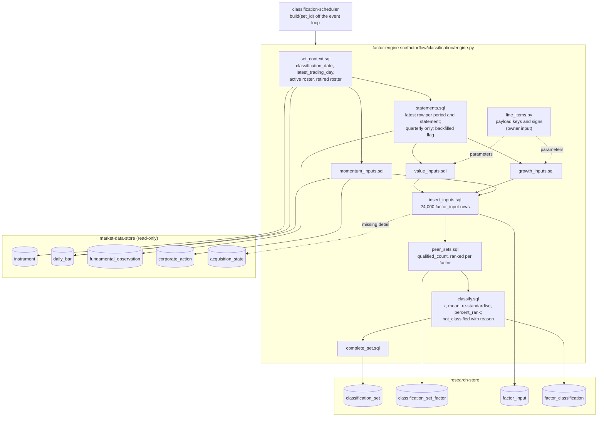

# Component: Factor Engine

**Status:** draft
**Capability:** CAP-002
**Owner:** Alvaro de Jodra
**Last Updated:** 2026-10-17

This design was produced in an unattended `$design-run`. Choices no artifact
fixes are recorded as decisions under `projects/factorflow-v2/decisions/`
(DEC-0064 to DEC-0067) and marked **PROVISIONAL**; the system design's
DEC-0052 (SQL window functions), DEC-0053 (composite construction), DEC-0055
(input derivation) and DEC-0056 (backfill rule) are honoured, not re-decided.
One owner question blocks part of this component and is carried, not answered:
the Massive payload keys for the seven line items (section 14).

**Version 2 (2026-10-17)** is the consistency pass the owner directed on
specification review v2 (`specifications-review-report-v2.md`), and it applies
one finding to this design: FINDING-15, which found that this v1 still pinned
system design v1 and STD-UI v4 after both moved. The pins now name system
design v3 and STD-UI v6, and add the review as a source. Nothing
else in the design changes, because none of the changes in system design v2 and
v3 lands on this component. Version 2 of the system design (DEC-0068 to
DEC-0071) aligned the interface half with the product UX blueprint: the
Research screens and routes (Sections 2, 4.1, 4.2, question 4), the `later`
block and the summary read the interface renders from, and the compare bound
(Sections 3.3 and 4.2); all of that is `classification-ui`, `classification-api`
and `classification-reader`. Version 3 (DEC-0081 to DEC-0084) changed what a
threshold excludes (3.3 step 15), the one `set` + `later` shape on both reads
(3.3, 4.2), `hide_incomplete` and the *Find a stock* prefix in the saved filter
and its provenance (3.2, 3.3, 4.2, 4.4), the download named by its start time
(3.3, 4.2, question 11) and the complete edit list for delivered files
(question 4); each of those lands on the reader, the API, the UI or
`universe-service`. The reader applies the new threshold and `hide_incomplete`
rules to `factor_classification` rows exactly as this component already writes
them (`classified` and `not_classified`, with `reason_code` in `input_missing`,
`input_outdated`, `input_not_computable`, `not_enough_stocks`, `retired`), so
no row, status or reason this component appends changes. The rows this design
relies on are unchanged: Section 3.1 steps 8 to 14b and 22 to 31 (only the
interface steps 15 to 18 were rewritten), constraints 2 and 4 to 10, assumptions 1 to 6
of Section 6 (7 and 8 are new and concern the shell and the summary read),
questions 1, 6, 7 and 9 of Section 8, the `Observation read`, `Set build` and
`Classification append` rows of Section 4.2, and the `classification_set_factor`,
`factor_input` and `factor_classification` rows of Section 4.4. STD-UI v5 and
v6 changed display labels (*stock*, *download*, *Incomplete*, *score* split from
*percentile* and *standardised score*); the owner-facing strings this component
writes (`reason_detail`, `failure_reason`, `detail`) already use that vocabulary
or are carried by FINDING-11 below. Review v2's other findings naming this
component, FINDING-1 (first-deployment backlog, Section 6), FINDING-2 (the
Massive line-item mapping), FINDING-11 (the failure reason is the exception
class and message), FINDING-17 (append-only scan scope), FINDING-19
(`SEC-ENC-001` bookkeeping in Section 4), FINDING-21 (arithmetic definitions),
FINDING-30 (`hypothesis` is not in `tech-stack.md` v5) and FINDING-34
(provenance timestamp), are carried, not fixed: FINDING-1 and FINDING-2 are the
owner's, and the rest of the design is as version 1 left it.

## 1. Overview

The factor engine builds one classification set for one qualifying acquisition
run. Given a `classification_set` row in `building`, it derives every factor
input for every actively acquired stock with the date it was known, decides
per input whether it is `present`, `missing`, `outdated` or `not_computable`,
forms each factor's peer set, computes standardised scores and percentiles
with PostgreSQL window functions, marks value and growth classifications built
on backfilled fundamentals as possibly restated, appends every row, and turns
the set `complete` in the same transaction. Nothing is overwritten, nothing
incomplete is shown, and the arithmetic is reviewable SQL (system design
section 1; DEC-0052).

It is a synchronous Python function, `build(set_id)`, that
`classification-scheduler` dispatches off the event loop. It reads
`market-data-store` only, never the provider (capability section 5.2), and
writes `research-store` only. Its correctness is the capability's: AC-7, AC-8,
AC-9, AC-12, AC-13, AC-14, AC-15, AC-19 and AC-23 are all statements about
what this component computes.

Use cases addressed:

- Classify every active stock on value, growth and momentum against one peer
  set per factor, identically in every universe (AC-7, AC-8, AC-9).
- Score a factor only when every input is present and current, otherwise name
  the input that fell short (AC-12, AC-13).
- Rank a factor only when at least 30 stocks qualify (AC-14).
- Record a retired stock as not classified because it is retired, outside
  every peer set (AC-15).
- Date every input by when it was known, so a later backfill changes nothing
  recorded (AC-17, AC-19).
- Mark classifications built on backfilled fundamentals (AC-23).
- Finish 3000 stocks inside the 5-minute budget (AC-11).

Support matrix: the application container's Python 3.12 process, one build at
a time, against PostgreSQL 16 on the host-local channel.

Dependencies: `research-store` migration `0006`; `market-data-store` tables
`instrument`, `daily_bar`, `fundamental_observation`, `corporate_action`,
`acquisition_state` (migrations `0001` to `0003`); `psycopg` 3; the
`classification-scheduler` settings model for the build timeout; the owner's
answer to the payload-key question for the value and growth inputs (section
14).

## 2. Design Details

### 2.1 Placement

```
src/factorflow/classification/__init__.py
src/factorflow/classification/engine.py            build(conn, set_id, timeout_seconds) -> BuildResult
src/factorflow/classification/line_items.py        LINE_ITEMS: the seven line items and their payload keys (owner input)
src/factorflow/classification/constants.py         MIN_PEER_SET_SIZE = 30, FUNDAMENTALS_STALE_AFTER_MONTHS = 6,
                                                   MOMENTUM_LAG_MONTHS = 1, MOMENTUM_WINDOWS_MONTHS = (3, 6, 12),
                                                   FACTORS, INPUT_NAMES
src/factorflow/classification/sql/set_context.sql          run, classification date, latest trading day, active roster
src/factorflow/classification/sql/statements.sql           latest observation per period and statement, quarterly, with backfill flag
src/factorflow/classification/sql/value_inputs.sql         book_to_price, earnings_yield, fcf_yield
src/factorflow/classification/sql/growth_inputs.sql        revenue_growth, eps_growth
src/factorflow/classification/sql/momentum_inputs.sql      return_3m, return_6m, return_12m
src/factorflow/classification/sql/insert_inputs.sql        INSERT INTO factor_input ... SELECT
src/factorflow/classification/sql/peer_sets.sql            INSERT INTO classification_set_factor
src/factorflow/classification/sql/classify.sql             z-scores, composite, re-standardise, percent_rank; not_classified rows
src/factorflow/classification/sql/complete_set.sql         UPDATE ... WHERE state = 'building'
src/factorflow/classification/sql/fail_set.sql
tests/unit/test_engine_sql_safety.py                       parameterised, no mutation of observation tables
tests/unit/test_line_items_resolved.py                     every LINE_ITEMS key resolved, or the gap is reported
tests/unit/test_composite_arithmetic.py                    DEC-0053 on hand-built peer sets through a test double
tests/integration/test_engine_inputs_fundamentals.py
tests/integration/test_engine_inputs_momentum.py
tests/integration/test_engine_currency.py
tests/integration/test_engine_peer_set.py
tests/integration/test_engine_restatement.py
tests/integration/test_engine_transaction.py
tests/integration/test_engine_volume.py                    3000 instruments, slow marker (AC-11)
```

### 2.2 Component block diagram

The diagram below shows the engine as a pipeline of SQL stages run on one
connection inside one transaction, fed by the set row the scheduler created
and by the delivered observation tables. The stages run in order: context,
statements, the three input families, the input append, the peer sets, the
classification append, and the completion. The one external input the
pipeline cannot derive is the payload-key mapping in `line_items.py`, which
the value and growth stages read as parameters. The expected outcome is a
single commit that leaves a whole set, or a rollback that leaves none and a
second short transaction that records the failure.



### 2.3 Interface

```python
# src/factorflow/classification/engine.py
from dataclasses import dataclass
from uuid import UUID

import psycopg


@dataclass(frozen=True)
class BuildResult:
    set_id: UUID
    state: str                 # complete | failed
    failure_reason: str | None
    active_instruments: int
    qualified_counts: dict[str, int]   # factor -> qualified_count


def build(conn: psycopg.Connection, set_id: UUID, timeout_seconds: float) -> BuildResult:
    """Build one classification set. Synchronous; the caller dispatches it off
    the event loop. Returns the terminal state and never raises for a build
    failure: the failure is recorded on the set and returned (system design 3.1
    steps 13 to 14b; DEC-0066).
    """
```

`build` performs, in order:

1. `BEGIN`, then `SET LOCAL statement_timeout = %(ms)s` from `timeout_seconds`
   (DEC-0067, PROVISIONAL), so a build that overruns fails inside the
   transaction rather than running on.
2. `set_context.sql`: reads the set's `classification_date` and `run_id`;
   computes `latest_trading_day` as `max(session_date)` over `daily_bar` joined
   to active instruments (DEC-0055 (5)); lists the active roster
   (`instrument.lifecycle = 'active'`) and the retired roster.
3. `statements.sql` into a temporary table `stmt`: for each active instrument,
   statement type and fiscal period end on or before `classification_date`
   with `fiscal_period <> 'FY'` (the quarterly marker `observation-writer`
   derives), the single latest observation by `(observed_on DESC, recorded_at
   DESC)`, with its `payload`, `observed_on`, `provider_filing_date` and a
   `backfilled` flag computed per DEC-0056 as `provider_filing_date <
   min(observed_on) over the instrument's fundamental rows`.
4. `value_inputs.sql`, `growth_inputs.sql`, `momentum_inputs.sql` into a
   temporary table `inputs(instrument_id, factor, input_name, status, value,
   as_of, known_on, restated_possible, detail)`, section 2.4.
5. `insert_inputs.sql`: `INSERT INTO factor_input SELECT ... FROM inputs`,
   enriching a `missing` input's `detail` with the instrument's latest
   `acquisition_state` outcome for the data type concerned, so the evidence
   screen can say *the last acquisition of fundamentals for AAPL ended
   not_found* (AC-12, flow 5 step 5).
6. `peer_sets.sql`: per factor, `qualified_count` = instruments with every
   input of the factor `present`; `ranked = qualified_count >=
   MIN_PEER_SET_SIZE` (30, owner decision 2026-10-12); `INSERT INTO
   classification_set_factor`.
7. `classify.sql`: section 2.5; `INSERT INTO factor_classification` for every
   active and retired instrument and every factor.
8. `complete_set.sql`: `UPDATE classification_set SET state = 'complete',
   ended_at = now(), latest_trading_day = %(ltd)s, active_instruments = %(n)s
   WHERE set_id = %(set_id)s AND state = 'building'`; a rowcount other than 1
   raises, because it means the set is no longer this build's.
9. `COMMIT`.

On any exception the transaction is rolled back and `fail_set.sql` runs in a
new transaction: `UPDATE classification_set SET state = 'failed', ended_at =
now(), failure_reason = %(reason)s WHERE set_id = %(set_id)s AND state =
'building'`, with `reason` the exception class name and message, truncated to
one line, never a stack trace (system design 3.1 step 25; SEC-ERR-001). The
exception is logged with the structured logger and `set_id` (SA-LOG-001,
OPS-ERR-001) and `BuildResult(state="failed")` is returned.

### 2.4 Input derivation

Every rule below is DEC-0055, applied to the stored rows. `D` is
`classification_date`, `L` is `latest_trading_day`. Dates compared as
calendar months use PostgreSQL `interval` arithmetic, `D - interval '6
months'`, which is the only reading "months" has over a `date`.

**Currency.** A fundamental input is `outdated` when the latest fiscal period
end it uses is earlier than `D - FUNDAMENTALS_STALE_AFTER_MONTHS months` (AC-13,
6 months, owner decision 2026-10-12). A price-dependent input is `outdated`
when the stock's latest `daily_bar.session_date` is earlier than `L` (AC-13,
DEC-0055 (5)); every value input and every momentum input depends on price.

**Statements.** The trailing-twelve-month window for an instrument and
statement type is the four most recent distinct quarterly `fiscal_period_end`
values P1 > P2 > P3 > P4 on or before `D` with P4 later than P1 minus 12
months; the prior-year window is the four most recent on or before P1 minus 12
months under the same span rule (DEC-0055 (1)). Fewer than four periods in
either window, or a line item absent from a period's payload, makes the input
`missing`, with `detail.periods_found` listing what exists. Balance-sheet items
use the single most recent quarterly statement.

**Line items.** The seven line items are read as `payload ->> key` with the
key and sign from `line_items.py` (DEC-0066, PROVISIONAL):

```python
# src/factorflow/classification/line_items.py
from dataclasses import dataclass

REQUIRES_INPUT = "[REQUIRES INPUT: Massive payload key]"   # system design section 8 question 1

@dataclass(frozen=True)
class LineItem:
    label: str            # product vocabulary, rendered by the interface (STD-UI-1)
    statement_type: str   # balance_sheet | income_statement | cash_flow_statement
    payload_key: str      # the Massive statement field, owner input
    sign: int             # +1, or -1 when the provider reports an outflow negative

LINE_ITEMS: dict[str, LineItem] = {
    "book_equity":        LineItem("book equity", "balance_sheet", REQUIRES_INPUT, 1),
    "shares_outstanding": LineItem("shares outstanding", "balance_sheet", REQUIRES_INPUT, 1),
    "net_income":         LineItem("net income", "income_statement", REQUIRES_INPUT, 1),
    "diluted_eps":        LineItem("diluted earnings per share", "income_statement", REQUIRES_INPUT, 1),
    "revenue":            LineItem("revenue", "income_statement", REQUIRES_INPUT, 1),
    "operating_cash_flow": LineItem("operating cash flow", "cash_flow_statement", REQUIRES_INPUT, 1),
    "capital_expenditure": LineItem("capital expenditure", "cash_flow_statement", REQUIRES_INPUT, 1),
}

def unresolved() -> list[str]:
    return [name for name, item in LINE_ITEMS.items() if item.payload_key == REQUIRES_INPUT]
```

While any key is unresolved, every input depending on it is `missing` with
`detail.cause = "line_item_mapping_unresolved"` and the input named, so
momentum still classifies and value and growth show honestly as not
classified rather than failing the set (AC-12). `tests/unit/test_line_items_resolved.py`
fails while any key is unresolved, so the gap cannot be forgotten once the
owner answers, and `classification-scheduler` logs a warning at start naming
the unresolved items. The seven keys are the stories' blocker, not the
architecture's (system design section 8 question 1).

**The eight inputs.** `MC` is market capitalisation, `close(L) ×
shares_outstanding(P1)` (DEC-0055 (6)).

| Input | Factor | Formula | Statements | Price | `not_computable` when |
|-------|--------|---------|------------|-------|-----------------------|
| `book_to_price` | value | `book_equity(P1) / MC` | balance sheet, most recent | yes | `MC <= 0` |
| `earnings_yield` | value | `TTM(net_income) / MC` | income, TTM | yes | `MC <= 0` |
| `fcf_yield` | value | `(TTM(operating_cash_flow) - TTM(capital_expenditure)) / MC` | cash flow, TTM | yes | `MC <= 0` |
| `revenue_growth` | growth | `TTM(revenue) / TTM_prior(revenue) - 1` | income, TTM and prior | no | `TTM_prior(revenue) <= 0` |
| `eps_growth` | growth | `TTM(diluted_eps) / TTM_prior(diluted_eps) - 1` | income, TTM and prior | no | `TTM_prior(diluted_eps) <= 0` |
| `return_3m` | momentum | total return over `(S_3, E]` | none | yes | never (prices are positive by acquisition) |
| `return_6m` | momentum | total return over `(S_6, E]` | none | yes | never |
| `return_12m` | momentum | total return over `(S_12, E]` | none | yes | never |

A growth input whose prior-year base is zero or negative is `not_computable`
(DEC-0055 (2)); a market capitalisation that is not positive makes the ratio
undefined and is treated by the same rule, with `detail.cause =
"market_capitalisation_not_positive"`. `as_of` is P1 for a fundamental input
and `E` for a momentum input; `known_on` is the latest `observed_on` across
every statement, bar and corporate-action row the input used (DEC-0055 (7));
`restated_possible` is true when any statement row used is `backfilled`
(DEC-0056). `detail` records, for a fundamental input, each period end used
with its `observed_on`, `provider_filing_date` and `backfilled` flag plus the
market-capitalisation components; for a momentum input, `E`, `S_k`, the two
closes, and every split and dividend applied.

**Momentum** (DEC-0055 (3), (4)). Per stock, `E` is the latest
`session_date <= D - MOMENTUM_LAG_MONTHS months` among its bars, and `S_k` is
the latest `session_date <= E - k months` for k in 3, 6, 12. A stock with no
bar on or before a boundary has that input `missing` with `detail.boundary`
naming it. The total return over `(S_k, E]`:

```sql
-- src/factorflow/classification/sql/momentum_inputs.sql (one window; k is a parameter)
WITH bars AS (
    SELECT b.instrument_id, b.session_date, b.close_price,
           -- bars acquired unadjusted (DEC-0001); adjust every price before a split
           -- by the product of split_from/split_to over splits after it and on or before E
           b.close_price * COALESCE((
               SELECT exp(sum(ln((ca.payload ->> 'split_from')::numeric
                                 / (ca.payload ->> 'split_to')::numeric)))
                 FROM corporate_action ca
                WHERE ca.instrument_id = b.instrument_id
                  AND ca.action_type = 'split'
                  AND ca.effective_on >  b.session_date
                  AND ca.effective_on <= w.window_end), 1) AS adj_close
      FROM daily_bar_latest b                  -- latest observation per (instrument, session_date)
      JOIN windows w USING (instrument_id)
     WHERE b.session_date BETWEEN w.window_start AND w.window_end
),
dividends AS (
    -- compound each cash dividend with ex-date in (S_k, E] against the prior session's adjusted close
    SELECT d.instrument_id,
           exp(sum(ln(1 + (d.payload ->> 'cash_amount')::numeric * d.split_factor / p.adj_close))) AS div_factor
      FROM dividends_in_window d
      JOIN prior_adjusted_close p ON p.instrument_id = d.instrument_id AND p.before = d.effective_on
     GROUP BY d.instrument_id
)
SELECT w.instrument_id,
       (e.adj_close / s.adj_close) * COALESCE(dv.div_factor, 1) - 1 AS total_return
  FROM windows w
  JOIN bars s  ON s.instrument_id = w.instrument_id AND s.session_date = w.window_start
  JOIN bars e  ON e.instrument_id = w.instrument_id AND e.session_date = w.window_end
  LEFT JOIN dividends dv USING (instrument_id);
```

The split factor applied to a dividend is the same cumulative factor as for
the price on its ex-date, so a dividend declared before a later split is
scaled with the prices around it. `daily_bar_latest` selects, per
`(instrument_id, session_date)`, the row with the latest `observed_on`, as the
statements stage does for periods, so a re-acquired bar is used as currently
known and the earlier observation stays in the store (C5). Payload keys for
corporate actions are the ones `component-design-massive-client.md` section 2.5
records and the `CorporateAction` model carries into the JSONB payload
(`split_from`, `split_to`, `cash_amount`); they are not part of the owner's
open question.

### 2.5 Classification

`classify.sql` implements DEC-0053 for each ranked factor over its peer set,
the active instruments with every input of the factor `present`:

```sql
-- src/factorflow/classification/sql/classify.sql (one factor; the factor and its input names are parameters)
WITH peer AS (
    SELECT i.instrument_id, i.input_name, i.value
      FROM inputs i
      JOIN active_roster a USING (instrument_id)
     WHERE i.factor = %(factor)s
       AND NOT EXISTS (SELECT 1 FROM inputs x
                        WHERE x.instrument_id = i.instrument_id AND x.factor = i.factor
                          AND x.status <> 'present')
),
z AS (
    SELECT instrument_id, input_name,
           CASE WHEN stddev_samp(value) OVER (PARTITION BY input_name) = 0 THEN 0
                ELSE (value - avg(value) OVER (PARTITION BY input_name))
                     / stddev_samp(value) OVER (PARTITION BY input_name) END AS z
      FROM peer
),
composite AS (
    SELECT instrument_id, avg(z) AS c FROM z GROUP BY instrument_id
),
scored AS (
    SELECT instrument_id,
           CASE WHEN stddev_samp(c) OVER () = 0 THEN 0
                ELSE (c - avg(c) OVER ()) / stddev_samp(c) OVER () END AS score
      FROM composite
)
INSERT INTO factor_classification
       (set_id, instrument_id, factor, status, score, percentile, restated_possible)
SELECT %(set_id)s, s.instrument_id, %(factor)s, 'classified',
       s.score,
       100 * percent_rank() OVER (ORDER BY s.score),
       bool_or(i.restated_possible)
  FROM scored s JOIN inputs i ON i.instrument_id = s.instrument_id AND i.factor = %(factor)s
 GROUP BY s.instrument_id, s.score;
```

Then, for the same factor, `not_classified` rows: for every active instrument
not in the peer set, `reason_code` is the status of the first input of the
factor that is not `present`, in the factor's input order (`input_missing`,
`input_outdated`, `input_not_computable`), with `reason_input` that input's
name and `reason_detail` an owner-facing sentence built from the input label
and cause (*operating cash flow missing*, *fundamentals outdated: latest period
ended 2026-03-31*, *prior-year revenue not positive*); `restated_possible` is
`bool_or` over the factor's inputs. For an unranked factor
(`qualified_count < 30`), every active instrument gets `not_classified` with
`reason_code = 'not_enough_stocks'`, `reason_input` null and `reason_detail`
`'18 of 30 stocks qualified'` (AC-14), and no score is written for anyone.
Every retired instrument gets `not_classified` with `reason_code = 'retired'`
on all three factors and no `factor_input` rows, because nothing was computed
for it (AC-15). A classified row's percentile is `percent_rank() * 100`, 0 to
100 inclusive (AC-9, DEC-0053); no winsorisation or other step is applied
(DEC-0053; system design section 8 question 7).

### 2.6 Build sequence

The diagram below shows the engine's transaction boundary and the two ways it
ends, and it is the component-level form of system design 3.1 steps 8 to 14b.
Everything between `BEGIN` and `COMMIT` is one transaction with a local
statement timeout; the temporary tables live and die with it. The decision
point is the completion `UPDATE`, which must affect exactly one row; if the
set is no longer `building` the build raises rather than commit over another
state. The expected outcome is that `research-store` holds either a complete,
whole set or a failed set with its reason and no classification rows.

```mermaid
sequenceDiagram
    participant S as classification-scheduler
    participant E as factor-engine
    participant DB as PostgreSQL

    S->>E: build(conn, set_id, timeout_seconds)
    E->>DB: BEGIN; SET LOCAL statement_timeout
    E->>DB: set_context.sql (D, L, active and retired rosters)
    E->>DB: statements.sql into temp stmt
    E->>DB: value_inputs, growth_inputs, momentum_inputs into temp inputs
    E->>DB: insert_inputs.sql (factor_input)
    E->>DB: peer_sets.sql (classification_set_factor)
    loop per factor
        E->>DB: classify.sql: classified rows if ranked, not_classified rows, retired rows
    end
    E->>DB: complete_set.sql WHERE state = 'building'
    alt rowcount = 1
        E->>DB: COMMIT
        E-->>S: BuildResult(complete)
    else exception, timeout or rowcount != 1
        E->>DB: ROLLBACK
        E->>DB: fail_set.sql (new transaction)
        E-->>S: BuildResult(failed, reason)
    end
```

### 2.7 Messages

N/A, not applicable for this component. The engine is called in-process and
reports through the set row and its return value.

## 3. Constraints and Assumptions

- **Reads observations, never the provider** (capability section 5.2). No
  module under `src/factorflow/classification/` imports
  `factorflow.ingestion.massive`; a repository test asserts it, as
  `tests/unit/test_api_isolation.py` does for the API.
- **Never updates or deletes an observation** (C5). `tests/unit/test_sql_is_append_only.py`
  already scans every Python source under `src/factorflow/`, so this
  component's SQL is covered the day it is written.
- **Computation in SQL window functions, no numeric library** (DEC-0052,
  PROVISIONAL). `avg`, `stddev_samp`, `percent_rank`, `exp`, `ln` and
  `interval` arithmetic are the whole toolkit. The owner's amendment to
  `tech-stack.md` closing OQ-TS-3 is not this design's.
- **The composite is DEC-0053's**, exactly: z-score per input with
  `stddev_samp`, equal-weight mean, re-standardise, `percent_rank × 100`; zero
  dispersion contributes zero; nothing else.
- **Inputs are DEC-0055's**, exactly: quarterly TTM sums, prior-year
  comparison, most recent balance sheet, read-time split and dividend
  adjustment of unadjusted bars (DEC-0001), per-stock window boundaries,
  latest-trading-day price currency, latest `observed_on` as `known_on`.
- **The backfill rule is DEC-0056's**: `provider_filing_date` earlier than the
  instrument's first fundamentals `observed_on`.
- **Classification date and inputs are fixed at build time (AC-19).** Every
  query selects rows as they exist during the transaction; nothing recorded
  later changes a set.
- **One transaction, one builder** (constraint 2, DEC-0066, PROVISIONAL). The
  partial unique index on `building` guarantees no second engine writes the
  same set.
- **Timeout** (DEC-0067, PROVISIONAL): `statement_timeout` set locally from
  `FACTORFLOW_CLASSIFICATION_BUILD_TIMEOUT_SECONDS`, default 300, the AC-11
  budget.
- **Quantitative constants and their sources.** 30 stocks (AC-14, owner
  2026-10-12); 6 months (AC-13, owner 2026-10-12); 1-month lag and 3, 6, 12
  month windows (capability section 2, owner 2026-10-12); 5 minutes (AC-11,
  owner 2026-10-12); 3000 instruments (CAP-001 AC-4); 252 sessions a year
  (`component-design-market-data-store.md` section 5). No other number appears.
- **The payload keys are the owner's** (section 14). Until supplied, value and
  growth inputs are `missing` with the cause named; momentum is unaffected.
- **Assumption (system design 6.1):** the acquired statements carry the seven
  line items under stable keys and quarterly statements exist for every
  quarter. Where they do not, inputs are `missing`, never wrong.
- **Assumption (system design 6.4):** dividend payloads carry `cash_amount`
  and split payloads `split_from` and `split_to`, as the `CorporateAction`
  model records.
- **Assumption:** `fiscal_period = 'FY'` marks an annual statement and every
  other value a quarter, as `observation-writer` derives it (owner decision
  2026-09-20).

## 4. Security

- **Data classification (SEC-DAT-001).** Inputs and classifications derive
  from Internal market data and are Internal. No Restricted data is read or
  written; no PII.
- **Injection (SEC-INP-002).** Every statement is parameterised. Payload keys
  from `line_items.py` are passed as parameters to `payload ->> %(key)s`,
  never interpolated, and are constants of the repository, not external input.
  Factor and input names in `classify.sql` are parameters drawn from
  `constants.py` enumerations.
- **Input validation (SEC-INP-001).** The engine's only external input is a
  `set_id` from the scheduler, validated as a `UUID` and required to name a
  `building` set.
- **Error disclosure (SEC-ERR-001).** `failure_reason` is the exception class
  and message on one line; the stack trace goes to the structured log only.
  A `psycopg` error message may name a table or column; it names no
  credential and never leaves the loopback API, which carries it to the one
  owner (system design 3.1 step 25).
- **Authentication and authorization.** None; in-process, called only by the
  scheduler.
- **Transport.** PostgreSQL at `127.0.0.1:5432` under the
  `SEC-ENC-001 host-local loopback exception` (DEC-0050, DEC-0058).
- **Dependency posture (SEC-DEP-001).** No new dependency. `psycopg` 3 is
  already scanned.
- **SAST.** `ruff`, `mypy` blocking; SQL covered by review and the
  `*_sql_safety` tests.
- **Crypto usage: none.**
- **Privacy impact: none.**

## 5. Scalability and Performance

- **Sizing (AC-11; system design 3.1 steps 28 to 31).** 3000 active
  instruments. Momentum reads about 3000 × 273 bars, 820 thousand rows,
  through `idx_daily_bar_instrument_session`; statements read 3000 × 8
  quarters × 3 types, 72 thousand rows, through
  `idx_fundamental_instrument_period`; corporate actions a few thousand rows
  through `idx_corporate_action_instrument`. Output is 24,000 input rows and
  about 9,000 classification rows, written by `INSERT ... SELECT` without
  leaving the database.
- **Budget.** 5 minutes from `acquisition_run.ended_at` (AC-11), of which
  detection costs at most the 5-second poll (DEC-0054); the build timeout is
  the whole budget (DEC-0067). The volume test asserts the build, not the
  budget, because it cannot control the poll.
- **Verified, not asserted.** `tests/integration/test_engine_volume.py` under
  the `slow` marker builds a set over 3000 synthetic instruments with 273 bars
  and 8 quarters each and asserts completion within the budget less the poll
  interval.
- **Temporary tables** keep intermediate inputs out of process memory and let
  the planner index them; they are dropped at commit.
- **Connection use.** One pooled connection for the duration of the build,
  from the pool bounded at 4 (`runtime-config`); three remain for the API.
  The scheduler holds no second connection while a build runs.
- **CPU.** The arithmetic runs in PostgreSQL; the Python process issues a
  dozen statements and waits (system design assumption 5).
- **Concurrency.** One build at a time by the partial unique index; no shared
  mutable state in process (SA-CONC-001).

## 6. Upgrade

- **No previous release** of this component.
- **Data migration: none.** It reads delivered tables and writes `0006`'s.
- **Behaviour change after upgrade.** Classification sets appear after the
  first qualifying run following deployment. A set built before the owner
  supplies the payload keys shows value and growth as not classified with the
  cause named; sets built afterwards classify them. Earlier sets are not
  rebuilt, by C5; the next qualifying run produces the first classified set.
- **Manual actions required.** The owner's answer to section 14 question 1,
  recorded in `line_items.py` by the implementing story.
- **Rollback (OPS-MIG-003).** Reverting the image stops builds; the store
  rollback is `runtime-config` section 2.8.4's. A set built by a newer engine
  and left in the store after an image rollback is still readable by the
  older reader, because the row shapes are `0006`'s and do not change within
  this capability.
- **Forward compatibility (AGT-SCOPE-005).** Backtesting at M4 replays sets by
  `classification_date`; every row this engine writes carries the set it
  belongs to and the dates it was computed from, so a later capability reads
  history without this engine changing. A change to the composite or the
  backfill rule would be a capability revision (system design section 8
  question 9), not a silent change here.

## 7. Testing

`pytest`; `testcontainers[postgres]` for every test that runs SQL, with the
`postgres` marker; `hypothesis` for the composite arithmetic properties, both
already in the tech stack. Fixtures declare their own payload keys and pass
them to the engine, so the tests do not wait on the owner's answer.

| Test | File | What it proves |
|------|------|----------------|
| TTM sums four quarters, prior year the four before | `tests/integration/test_engine_inputs_fundamentals.py` | With 8 quarters, `revenue_growth` equals the ratio of the two sums minus one; `as_of` is P1 (AC-7, DEC-0055) |
| A missing quarter makes the input missing | `tests/integration/test_engine_inputs_fundamentals.py` | Seven quarters: growth inputs `missing`, `detail.periods_found` lists seven; value inputs unaffected (AC-12) |
| Annual statements are not used | `tests/integration/test_engine_inputs_fundamentals.py` | `fiscal_period = 'FY'` rows do not enter any TTM sum |
| Latest observation per period wins | `tests/integration/test_engine_inputs_fundamentals.py` | Two observations of one period use the later `observed_on`; `known_on` equals it; the earlier row is untouched (C5) |
| Outdated fundamentals | `tests/integration/test_engine_currency.py` | Latest period end 6 months and a day before D: `outdated`; exactly 6 months: `present` (AC-13) |
| Outdated prices | `tests/integration/test_engine_currency.py` | A stock whose latest bar precedes `latest_trading_day`: every value and momentum input `outdated`; growth unaffected (AC-13, DEC-0055 (5)) |
| Non-positive growth base | `tests/integration/test_engine_inputs_fundamentals.py` | Prior-year revenue zero or negative: `not_computable`, stock not classified on growth, `reason_input = revenue_growth` (DEC-0055 (2)) |
| Market capitalisation | `tests/integration/test_engine_inputs_fundamentals.py` | `close(L) × shares_outstanding(P1)` in `detail`; non-positive shares: value inputs `not_computable` |
| Momentum boundaries per stock | `tests/integration/test_engine_inputs_momentum.py` | E is the latest bar on or before D minus one month; S_k the latest on or before E minus k months; a stock lacking a bar before S_12 has `return_12m` missing and the others present |
| Split adjustment | `tests/integration/test_engine_inputs_momentum.py` | A 2-for-1 split inside the window halves pre-split prices; the return equals the unsplit series' return (DEC-0001, DEC-0055 (4)) |
| Dividend compounding | `tests/integration/test_engine_inputs_momentum.py` | One dividend of 1 against a prior close of 100 multiplies the return factor by 1.01 |
| Known-on is the latest observation | `tests/integration/test_engine_inputs_momentum.py` | `known_on` equals the max `observed_on` over bars and actions used (AC-17) |
| Composite arithmetic | `tests/unit/test_composite_arithmetic.py` | On a hand-built peer set, z-scores, equal-weight mean, re-standardisation to mean 0 and sd 1, `percent_rank × 100` in 0 to 100; zero-dispersion input contributes 0 (AC-9, DEC-0053); `hypothesis` over random peer sets |
| One peer set | `tests/integration/test_engine_peer_set.py` | Scores for a stock are identical whether or not it belongs to any universe; universes are never read (AC-8) |
| Fewer than 30 qualify | `tests/integration/test_engine_peer_set.py` | 29 qualifying stocks: `ranked = false`, every active stock `not_enough_stocks` with `reason_detail` `29 of 30 stocks qualified`, no score written; 30 qualify: ranked (AC-14) |
| Like for like | `tests/integration/test_engine_peer_set.py` | A stock with two of three value inputs present is excluded from the value peer set and classified on growth and momentum (AC-12) |
| Retired instruments | `tests/integration/test_engine_peer_set.py` | A retired instrument is outside every peer set, gets `retired` on all three factors and no `factor_input` rows (AC-15) |
| Restatement mark | `tests/integration/test_engine_restatement.py` | A statement with `provider_filing_date` before the first fundamentals `observed_on` marks its inputs and the value and growth classifications `restated_possible`; momentum is never marked (AC-23, DEC-0056) |
| One transaction | `tests/integration/test_engine_transaction.py` | An injected failure after inputs are written leaves zero rows in the four classification tables and the set `failed` with the exception class in `failure_reason` (AC-20) |
| Completion requires building | `tests/integration/test_engine_transaction.py` | A set already `failed` by another writer: `build` raises inside the transaction, rolls back, writes nothing |
| Timeout | `tests/integration/test_engine_transaction.py` | `timeout_seconds` of 0.001 against a populated store yields `failed` with a timeout reason and no rows (DEC-0067) |
| Later data changes nothing | `tests/integration/test_engine_transaction.py` | After a set completes, inserting a backfilled statement leaves every row of that set unchanged; the next set sees it (AC-19) |
| Unresolved line items | `tests/unit/test_line_items_resolved.py`, `tests/integration/test_engine_inputs_fundamentals.py` | While a key is `REQUIRES_INPUT`, its inputs are `missing` with `detail.cause = line_item_mapping_unresolved` and momentum still classifies; the unit test fails until every key is resolved |
| No provider import, no mutation | `tests/unit/test_engine_sql_safety.py` | Nothing under `classification/` imports `factorflow.ingestion.massive`; every statement is parameterised; no UPDATE or DELETE names an observation or history table |
| Volume | `tests/integration/test_engine_volume.py` (`slow`) | 3000 instruments, 273 bars and 8 quarters each: the build completes within 295 seconds and writes 24,000 inputs and 9,000 classifications (AC-11) |

## 8. Acceptance Criteria

1. Every value, growth and momentum input is computed from exactly the
   statements, periods, windows and equal weights sections 2.4 and 2.5 state.
2. A stock's score and percentile on a factor are measured against every
   active stock whose inputs on that factor are all `present`, and nothing
   about universes enters the computation.
3. A classified factor carries a score and a percentile in 0 to 100; no score
   is written for a stock missing any input of the factor, and the row names
   the input and the cause.
4. A fundamental whose latest period end is more than 6 months before the
   classification date, and a price not from the latest trading day, make
   their inputs `outdated`.
5. When fewer than 30 stocks qualify on a factor, no stock is scored on it and
   every row states `not_enough_stocks` with the count.
6. A retired instrument is in no peer set and is `not_classified` with reason
   `retired` on every factor.
7. Every input records `as_of`, `known_on` and its components in `detail`.
8. A value or growth classification built on a backfilled statement, and each
   such input, carries `restated_possible`.
9. A set becomes `complete` in the same transaction as its last row; a failure
   leaves no classification row and a `failed` set with its reason.
10. Data recorded after a set completes changes no row of that set.
11. A build over 3000 instruments completes within the AC-11 budget.
12. Failure scenario: the database connection drops mid-build; the transaction
    is lost, the set is recorded `failed` on reconnection by the scheduler's
    start-up reclaim or by the next poll's failure path, and no partial row
    exists.
13. Failure scenario: a payload key is unresolved; the dependent inputs are
    `missing` with the cause named, the set completes, and momentum is
    classified.

## 9. Workflows

- **See stocks classified after an acquisition** (flow 1): steps 3 to 5 are
  this component's output read back.
- **Understand and fix insufficient evidence** (flow 5): the `missing` or
  `outdated` input with its `detail`, including the acquisition outcome,
  is step 2; the next build's `present` row is step 4; a provider holding no
  such data remains `missing` with the `not_found` outcome in `detail`, step 5.
- **Compare stocks and inspect the evidence** (flow 4 step 4): the
  `factor_input` rows per stock.
- **Intersection with CAP-001.** The engine reads the five observation tables
  and the `acquisition_run` row the set names; it writes none of them. It
  starts only when `classification-scheduler` finds a succeeded or partial run
  (AC-10).

## 10. UX / GUI

N/A, not applicable for this component: it renders nothing. Three strings it
writes are owner-facing and follow the UX design: `reason_detail` is a
sentence in product vocabulary built from `LineItem.label` and the cause,
never a payload key (STD-UI-1; UX design section 1.6); `failure_reason` is the
one-line reason the currency region shows (section 1.2); and `detail` carries
the periods, sessions and actions the evidence disclosure renders (section
1.6). No internationalization.

## 11. API Endpoints

This component exposes no HTTP endpoint. It provides the `Set build` interface
of system design section 4.2 and consumes the SQL interfaces of
`market-data-store` and `research-store`.

| Endpoint | Method/Operation | Auth/Privilege | Request | Response | Notes |
|----------|-----------------|----------------|---------|----------|-------|
| `build` | Python call, synchronous | in-process | `conn`, `set_id`, `timeout_seconds` | `BuildResult` with terminal state | consumer `classification-scheduler`; never raises for a build failure |
| Observation read | SQL `SELECT` | database credential | set context | rows of `instrument`, `daily_bar`, `fundamental_observation`, `corporate_action`, `acquisition_state` | read-only, never UPDATE or DELETE |
| Classification append | SQL `INSERT ... SELECT` | database credential | temp tables | rows in `classification_set_factor`, `factor_input`, `factor_classification` | **critical, C5** |
| Set state transition | SQL `UPDATE classification_set ... WHERE state = 'building'` | database credential | terminal state and sizing | rowcount 1 | the only UPDATE |

## 12. References

| Type | Document Name | Description | Link |
|------|---------------|-------------|------|
| Capability | CAP-002 v1 | Section 2 factor definitions; AC-7 to AC-15, AC-17, AC-19, AC-23; section 6 assumptions | `docs/capabilities/CAP-002-universe-and-factor-classification/Capability-CAP-002.md` |
| System design | CAP-002 system design v3 | Section 3.1 steps 8 to 14b, 22 to 31; constraints 2, 4 to 10; section 6; section 8 questions 1, 6, 7, 9 | `docs/capabilities/CAP-002-universe-and-factor-classification/design/system-design.md` |
| Component design | CAP-001 market data store v9 | Table shapes, sizing basis, append-only enforcement | `docs/capabilities/CAP-001-market-data-acquisition-foundation/design/component-design-market-data-store.md` |
| Component design | CAP-001 massive client | Section 2.5 statement and corporate-action fields; line items not enumerated | `docs/capabilities/CAP-001-market-data-acquisition-foundation/design/component-design-massive-client.md` |
| Component design | CAP-002 research store v2 | Migration `0006` | `docs/capabilities/CAP-002-universe-and-factor-classification/design/component-design-research-store.md` |
| Implemented code | `src/factorflow/ingestion/writer.py`, `src/factorflow/ingestion/massive/models.py` | `fiscal_period` derivation; payload shapes for statements and actions | `src/factorflow/ingestion/` |
| Implemented schema | Migrations `0001` to `0003` | Columns read | `src/factorflow/db/migrations/` |
| Decision records | DEC-0001, DEC-0052, DEC-0053, DEC-0055, DEC-0056, DEC-0066, DEC-0067 | Unadjusted bars; SQL arithmetic; composite; inputs; backfill; engine mechanics; timeout | `projects/factorflow-v2/decisions/` (harness repository) |

## 13. Traceability

| Capability AC | System Design Element | Component Design Element | Section |
|--------------|----------------------|--------------------------|---------|
| AC-7 | Constraints 7, 8; `factor_input` per named input | The eight inputs table; `value_inputs.sql`, `growth_inputs.sql`, `momentum_inputs.sql`; `classify.sql` | 2.4, 2.5 |
| AC-8 | Constraint 5, peer set is the active roster | `peer` CTE over `active_roster`; universes never read | 2.5 |
| AC-9 | Constraint 7, `percent_rank() × 100` | `scored` CTE and the classified `INSERT` | 2.5 |
| AC-10 | Scheduler qualifying-run read | `build` runs only for a set the scheduler created | 2.3 |
| AC-11 | Steps 28 to 31; volume test | Sizing, `statement_timeout`, `test_engine_volume.py` | 5, 7 |
| AC-12 | Constraint 6; `not_classified` with reason and input | Peer set requires every input `present`; reason from the first non-present input | 2.5 |
| AC-13 | Constraint 6; 6-month and latest-trading-day rules | Currency rules; `FUNDAMENTALS_STALE_AFTER_MONTHS`; `latest_trading_day` | 2.4 |
| AC-14 | `qualified_count`, `ranked`; `not_enough_stocks` | `peer_sets.sql`; `MIN_PEER_SET_SIZE`; unranked rows with the count | 2.3, 2.5 |
| AC-15 | Constraint 5, retired excluded | Retired roster gets `retired` rows and no inputs | 2.5 |
| AC-17 | `factor_input` with value, `as_of`, `known_on`, `detail` | Input derivation and `detail` contents | 2.4 |
| AC-19 | Constraint 4; steps 22 to 24 | Rows selected within the build transaction; later data affects later sets only | 2.3, 3 |
| AC-20 | Steps 13 to 14b, 25 | One transaction; `complete_set.sql`; `fail_set.sql` with the exception class | 2.3, 2.6 |
| AC-23 | Constraint 9, `restated_possible` | `backfilled` flag in `statements.sql`; `bool_or` onto classifications | 2.4, 2.5 |

## 14. Open Questions

1. **Which Massive statement payload keys supply each line item, with what
   sign conventions, and do quarterly statements exist for every quarter?**
   Carried from system design section 8 question 1, **abstained in that run
   and in this one**. `[REQUIRES INPUT: the payload key, statement type and
   sign convention for each of the seven line items, book equity, shares
   outstanding, net income, diluted earnings per share, revenue, operating
   cash flow and capital expenditure, confirmed against statements acquired
   by a real run with the Financials add-on]`. *Owner: capability owner,
   against acquired data. Blocks: the values in `line_items.py` and the
   stories that implement value and growth inputs; not the momentum inputs,
   the peer sets, the composite, the transaction or the volume test, which
   section 2.4 isolates from the answer.*
2. **Growth with a non-positive prior-year base** is `not_computable`
   (DEC-0055 (2), PROVISIONAL; system design section 8 question 6). This
   design applies the same rule to a non-positive market capitalisation,
   which makes every value ratio undefined. *Owner: capability owner, to
   uphold DEC-0055 and confirm the extension, or to define the factor for
   those cases; a different answer is a capability revision.*
3. **Outlier treatment is not applied** (DEC-0053; system design section 8
   question 7). *Owner: capability owner; a change is a capability revision.*
4. **The build timeout default of 300 seconds** is derived from AC-11
   (DEC-0067, PROVISIONAL) and set in `classification-scheduler`. *Owner:
   capability owner, to uphold or set another value. Blocks: nothing.*
5. **Should earlier sets be rebuilt once the payload keys are supplied?** C5
   forbids altering a recorded set, and the system design makes the next
   qualifying run the only path to a new set. This design does not rebuild.
   *Owner: capability owner. Blocks: nothing; recorded because a reader may
   expect it.*
