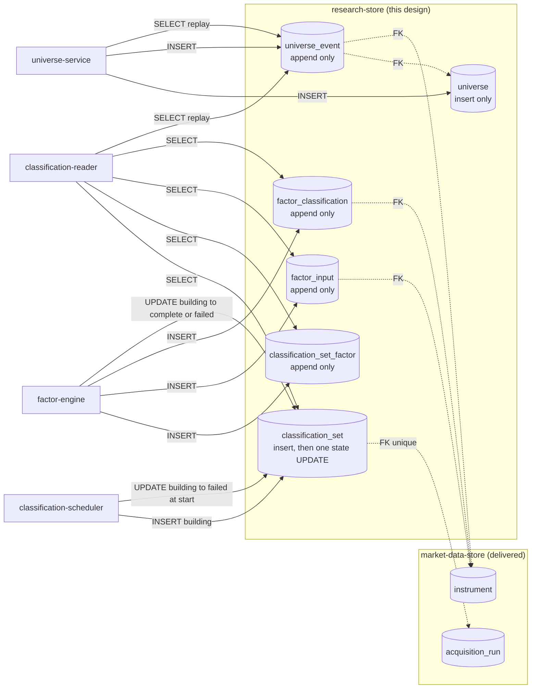

# Component: Research Store

**Status:** draft
**Capability:** CAP-002
**Owner:** Alvaro de Jodra
**Last Updated:** 2026-10-17

This design was produced in an unattended `$design-run`. Choices no artifact
fixes are recorded as decisions under `projects/factorflow-v2/decisions/`
(DEC-0064 to DEC-0067) and marked **PROVISIONAL**; the system design's own
decisions (DEC-0052 to DEC-0058) and the UX decisions (DEC-0059 to DEC-0063)
are honoured, not re-decided.

**Version 2 (2026-10-17)** is the consistency pass the owner directed on
specification review v2
(`docs/capabilities/CAP-002-universe-and-factor-classification/specifications-review-report-v2.md`).
It applies FINDING-15, re-pinning this design to system design v3, UX design v3
and STD-UI v6, and FINDING-4 in the one place it names this component: the
`COMMENT ON COLUMN universe_event.filter_provenance` in section 2.3, and the
sentence beneath it, now name what the saved filter records, the twelve
threshold bounds, `hide_incomplete`, the *Find a stock* `symbol` prefix, the
`set_id` and the set's `classification_date` (system design v3 section 4.2
`POST /api/universes`, section 4.4; DEC-0076, DEC-0085, which supersedes
DEC-0079 (f)). No table, column,
constraint, index or test changes: the column was already `jsonb`, so the
richer object is a content change in `universe-service`, not a schema change.
Review v2's other findings naming this component, FINDING-1, FINDING-17,
FINDING-19, FINDING-33 and FINDING-34, are carried, not fixed, here.

## 1. Overview

The research store is the PostgreSQL schema that holds what CAP-002 produces:
universes and their append-only event log, classification sets, the per-set
factor counts, every factor input with the date it was known, and every
factor classification. It is two numbered migrations, `0005_universes.sql` and
`0006_classifications.sql`, applied by the delivered `schema-migrator` at
application container start exactly as the first four were, in the same
PostgreSQL 16 database as `market-data-store` (tech stack C2). It has no code of
its own beyond the DDL; `universe-service`, `factor-engine`,
`classification-scheduler` and `classification-reader` are its only writers and
readers.

Its one job that cannot be repaired later is the point-in-time history (tech
stack C5, system design constraint 3): universe membership and classification
results are appended with the date they were produced and never updated or
deleted, so a backtest at M4 can replay what was known on any date. Everything
in this design that looks like ceremony, the check constraints, the partial
unique indexes, the two enforcement mechanisms, exists because a wrong write
here is permanent.

Use cases addressed:

- Hold several named universes at once, each change an appended event (AC-3,
  AC-4, AC-6).
- Refuse by shape what the capability refuses by rule: an event type outside
  the five, a member event without an instrument, a second `created` or
  `retired` event for one universe (AC-5 is enforced by `universe-service`,
  since emptiness is a replay property, not a row property).
- Hold one classification set per qualifying acquisition run, exactly one
  `building` at a time, in `building`, `complete` or `failed` (AC-10, AC-20).
- Hold every factor input and classification per set, so a stock's
  classification history and the evidence behind each result are readable for
  any set (AC-17, AC-18, AC-19, AC-23).
- Carry the counts behind "not enough stocks to rank" per factor per set
  (AC-14).

Support matrix: PostgreSQL 16 in the deployment `runtime-config` section 2.8
specifies, reached by the application container at `127.0.0.1:5432`. The
ingestion container never reads or writes these tables.

Dependencies: migrations `0001` to `0004` (the `instrument` and
`acquisition_run` tables these tables reference), `schema-migrator` and its
`applied_migrations` table, and the `gen_random_uuid()` that PostgreSQL 16
provides natively, as `0004_runs.sql` already uses.

## 2. Design Details

### 2.1 Placement

```
src/factorflow/db/migrations/0005_universes.sql         universe, universe_event
src/factorflow/db/migrations/0006_classifications.sql   classification_set, classification_set_factor,
                                                         factor_input, factor_classification
tests/unit/test_research_sql_is_append_only.py          static guard over the four append-only tables
tests/unit/test_migration_0005_matches_design.py        DDL text matches sections 2.3 and 2.4
tests/unit/test_migration_0006_matches_design.py
tests/integration/test_research_constraints.py          every CHECK and partial unique index refuses what it should
tests/integration/test_research_migrations_apply.py     0005 and 0006 apply on a store holding 0001 to 0004 and data
```

The two migration files are the only artefacts this component owns. Ownership
of the addition to `src/factorflow/db/migrations/` is CAP-002's (DEC-0064,
PROVISIONAL): a new numbered file is an addition to the sequence
`schema-migrator` applies, not an amendment to a delivered migration.

### 2.2 Component block diagram

The diagram below shows the six new tables, the delivered tables they reference
and the four CAP-002 components that touch them, with the direction and kind of
every access. The two tables on the left are the universe side, written only
by `universe-service` and only by `INSERT`. The four on the right are the
classification side: `classification-scheduler` inserts the set row and
`factor-engine` appends everything else and performs the one permitted
`UPDATE`, the set's state transition. `classification-reader` reads all six.
The expected outcome is that every arrow into an append-only table is an
`INSERT`, which is what the static guard in section 2.5 asserts.



### 2.3 Migration `0005_universes.sql`

```sql
CREATE TABLE universe (
    universe_id uuid        PRIMARY KEY DEFAULT gen_random_uuid(),
    created_at  timestamptz NOT NULL DEFAULT now()
);

CREATE TABLE universe_event (
    event_id          bigint      GENERATED ALWAYS AS IDENTITY PRIMARY KEY,
    universe_id       uuid        NOT NULL REFERENCES universe (universe_id),
    event_type        text        NOT NULL,
    instrument_id     bigint      REFERENCES instrument (instrument_id),
    name              text,
    filter_provenance jsonb,
    recorded_at       timestamptz NOT NULL DEFAULT now(),
    recorded_on       date        NOT NULL
                      DEFAULT (CURRENT_TIMESTAMP AT TIME ZONE 'America/Chicago')::date,
    CONSTRAINT universe_event_type_known
        CHECK (event_type IN ('created', 'renamed', 'member_added',
                              'member_removed', 'retired')),
    CONSTRAINT universe_event_member_has_instrument
        CHECK ((event_type IN ('member_added', 'member_removed'))
               = (instrument_id IS NOT NULL)),
    CONSTRAINT universe_event_name_agrees
        CHECK ((event_type IN ('created', 'renamed')) = (name IS NOT NULL)),
    CONSTRAINT universe_event_name_trimmed
        CHECK (name IS NULL OR (name = btrim(name) AND name <> '')),
    CONSTRAINT universe_event_provenance_only_on_created
        CHECK (filter_provenance IS NULL OR event_type = 'created')
);

CREATE INDEX idx_universe_event_universe
    ON universe_event (universe_id, event_id);
CREATE INDEX idx_universe_event_instrument
    ON universe_event (instrument_id, event_id) WHERE instrument_id IS NOT NULL;
CREATE UNIQUE INDEX idx_universe_event_single_created
    ON universe_event (universe_id) WHERE event_type = 'created';
CREATE UNIQUE INDEX idx_universe_event_single_retired
    ON universe_event (universe_id) WHERE event_type = 'retired';

COMMENT ON COLUMN universe_event.recorded_on IS
    'The America/Chicago date the event was recorded; the as-of grain for AC-6 (DEC-0065).';
COMMENT ON COLUMN universe_event.filter_provenance IS
    'Only on a created event taken from a filter: the filter as evaluated and the set it was evaluated against, '
    '{"set_id": uuid, "classification_date": date, "thresholds": {the twelve bounds that were set, '
    '{factor}_score_min/_max and {factor}_percentile_min/_max, by query-parameter name}, '
    '"hide_incomplete": bool, "symbol": text or null (the Find a stock prefix)} (AC-2, S03-7).';
```

Column meanings follow system design section 4.4. `universe` holds identity
only (DEC-0057). `event_id` is the replay order and the cursor for the events
read (DEC-0065, PROVISIONAL): it is monotonic within the single writer and
cannot tie, where `recorded_at` can. `recorded_on` is stamped by the same rule
as `observed_on` in migration `0002` (STD-UI-5) and is the grain at which AC-6's
"on any past date" is answered. `filter_provenance` carries the whole filter a
universe was saved from and the set it was evaluated against, as
`{"set_id": "...", "classification_date": "2026-10-15", "thresholds":
{"value_percentile_min": 80, ...}, "hide_incomplete": true, "symbol": "AA"}`:
the bounds that were set, under the query-parameter names of
`GET /api/classifications` so the provenance reads back with the same
vocabulary the owner used, `hide_incomplete` always, `symbol` (the *Find a
stock* prefix) null when no search was active, and the set's
`classification_date` so the origin line is rendered from the event alone
(system design v3 section 4.4; `universe-service` section 2.4 writes it;
review v2 FINDING-4, FINDING-5). Two partial unique indexes make a second `created`
or `retired` event for one universe impossible by shape. The name's maximum
length is the owner's open question (system design section 8 question 2) and
is enforced at the API boundary once known; this migration adds no length
`CHECK`, because a bound written here would be an invented quantitative value
(AGT-EVIDENCE-002). See section 14.

### 2.4 Migration `0006_classifications.sql`

```sql
CREATE TABLE classification_set (
    set_id              uuid        PRIMARY KEY DEFAULT gen_random_uuid(),
    run_id              uuid        NOT NULL UNIQUE REFERENCES acquisition_run (run_id),
    state               text        NOT NULL,
    classification_date date        NOT NULL,
    latest_trading_day  date,
    active_instruments  integer,
    started_at          timestamptz NOT NULL DEFAULT now(),
    ended_at            timestamptz,
    failure_reason      text,
    CONSTRAINT classification_set_state_known
        CHECK (state IN ('building', 'complete', 'failed')),
    CONSTRAINT classification_set_terminal_has_end
        CHECK ((state IN ('complete', 'failed')) = (ended_at IS NOT NULL)),
    CONSTRAINT classification_set_failed_has_reason
        CHECK ((state = 'failed') = (failure_reason IS NOT NULL)),
    CONSTRAINT classification_set_complete_is_sized
        CHECK (state <> 'complete'
               OR (latest_trading_day IS NOT NULL AND active_instruments IS NOT NULL))
);

CREATE UNIQUE INDEX idx_classification_set_single_building
    ON classification_set ((true)) WHERE state = 'building';
CREATE INDEX idx_classification_set_complete_recent
    ON classification_set (ended_at DESC) WHERE state = 'complete';
CREATE INDEX idx_classification_set_started
    ON classification_set (started_at DESC);

CREATE TABLE classification_set_factor (
    set_id          uuid    NOT NULL REFERENCES classification_set (set_id),
    factor          text    NOT NULL,
    qualified_count integer NOT NULL,
    ranked          boolean NOT NULL,
    PRIMARY KEY (set_id, factor),
    CONSTRAINT classification_set_factor_known
        CHECK (factor IN ('value', 'growth', 'momentum')),
    CONSTRAINT classification_set_factor_count_nonnegative
        CHECK (qualified_count >= 0)
);

CREATE TABLE factor_input (
    set_id            uuid            NOT NULL REFERENCES classification_set (set_id),
    instrument_id     bigint          NOT NULL REFERENCES instrument (instrument_id),
    factor            text            NOT NULL,
    input_name        text            NOT NULL,
    status            text            NOT NULL,
    value             numeric(30, 10),
    as_of             date,
    known_on          date,
    restated_possible boolean         NOT NULL DEFAULT false,
    detail            jsonb           NOT NULL,
    PRIMARY KEY (set_id, instrument_id, factor, input_name),
    CONSTRAINT factor_input_factor_known
        CHECK (factor IN ('value', 'growth', 'momentum')),
    CONSTRAINT factor_input_name_matches_factor CHECK (
           (factor = 'value'    AND input_name IN ('book_to_price', 'earnings_yield', 'fcf_yield'))
        OR (factor = 'growth'   AND input_name IN ('revenue_growth', 'eps_growth'))
        OR (factor = 'momentum' AND input_name IN ('return_3m', 'return_6m', 'return_12m'))),
    CONSTRAINT factor_input_status_known
        CHECK (status IN ('present', 'missing', 'outdated', 'not_computable')),
    CONSTRAINT factor_input_present_is_dated
        CHECK (status <> 'present'
               OR (value IS NOT NULL AND as_of IS NOT NULL AND known_on IS NOT NULL))
);

CREATE INDEX idx_factor_input_instrument ON factor_input (instrument_id, set_id);

CREATE TABLE factor_classification (
    set_id            uuid           NOT NULL REFERENCES classification_set (set_id),
    instrument_id     bigint         NOT NULL REFERENCES instrument (instrument_id),
    factor            text           NOT NULL,
    status            text           NOT NULL,
    score             numeric(18, 6),
    percentile        numeric(9, 6),
    reason_code       text,
    reason_input      text,
    reason_detail     text,
    restated_possible boolean        NOT NULL DEFAULT false,
    PRIMARY KEY (set_id, instrument_id, factor),
    CONSTRAINT factor_classification_factor_known
        CHECK (factor IN ('value', 'growth', 'momentum')),
    CONSTRAINT factor_classification_status_known
        CHECK (status IN ('classified', 'not_classified')),
    CONSTRAINT factor_classification_reason_known
        CHECK (reason_code IS NULL OR reason_code IN (
            'input_missing', 'input_outdated', 'input_not_computable',
            'not_enough_stocks', 'retired')),
    CONSTRAINT factor_classification_shape CHECK (
           (status = 'classified'     AND score IS NOT NULL AND percentile IS NOT NULL
                                      AND reason_code IS NULL AND reason_input IS NULL)
        OR (status = 'not_classified' AND score IS NULL AND percentile IS NULL
                                      AND reason_code IS NOT NULL)),
    CONSTRAINT factor_classification_reason_input_agrees
        CHECK ((reason_code IN ('input_missing', 'input_outdated', 'input_not_computable'))
               = (reason_input IS NOT NULL)),
    CONSTRAINT factor_classification_percentile_range
        CHECK (percentile IS NULL OR (percentile >= 0 AND percentile <= 100))
);

CREATE INDEX idx_factor_classification_instrument
    ON factor_classification (instrument_id, set_id);
CREATE INDEX idx_factor_classification_set_factor_score
    ON factor_classification (set_id, factor, score);
CREATE INDEX idx_factor_classification_set_factor_percentile
    ON factor_classification (set_id, factor, percentile);

COMMENT ON COLUMN classification_set.classification_date IS
    'The America/Chicago date at set creation; what dates the classification (AC-18, AC-19).';
COMMENT ON COLUMN factor_input.known_on IS
    'The latest observed_on among the rows the input was computed from (AC-17).';
COMMENT ON COLUMN factor_input.detail IS
    'The line items, statements, sessions and corporate actions used, or the acquisition outcome when missing (DEC-0066).';
```

What each table means, beyond system design section 4.4:

- **`classification_set`.** `run_id` is unique, so a run is classified at most
  once (AC-10); the partial unique index on `(true) WHERE state = 'building'`
  is the same device `0004_runs.sql` uses for the single active run, and it is
  what refuses a second concurrent build (system design 3.1 step 21). The state
  fields move once, `building` to `complete` or `failed`, and
  `classification_set_terminal_has_end` and `classification_set_failed_has_reason`
  make a terminal row without a timestamp or a failed row without a reason
  impossible (AC-20). `latest_trading_day` and `active_instruments` are
  written by the engine with the `complete` transition and are required on a
  complete set, because the first is the price-currency boundary (constraint
  6, DEC-0055) and the second the peer-set universe (constraint 5).
- **`classification_set_factor`.** One row per factor per set with
  `qualified_count` and `ranked`, which is `qualified_count >= 30` (AC-14,
  owner decision 2026-10-12). The 30 is a constant of `factor-engine`
  (`MIN_PEER_SET_SIZE`), not a check constraint, because it is a rule about
  computation rather than a property no row may violate.
- **`factor_input`.** One row per stock per input per set, at the grain of the
  eight named inputs AC-17 and the UX design render (DEC-0066, PROVISIONAL);
  the component line items live in `detail`. A `present` input carries a
  value, an `as_of` (the fiscal period end or session date it came from) and
  a `known_on` (the latest `observed_on` of the rows used); a `missing`,
  `outdated` or `not_computable` input may carry a value and dates where they
  exist (an outdated statement still has a value and a period end) and always
  carries in `detail` what made it so. `numeric(30, 10)` holds a
  free-cash-flow yield near 0.03 and a market capitalisation near three
  trillion in one column without rounding either; it is CAP-001's
  `numeric(18, 6)` convention widened for the currency amounts.
- **`factor_classification`.** One row per stock per factor per set.
  `factor_classification_shape` is the check system design section 4.4 asks
  for: a classified row carries score and percentile and no reason, an
  unclassified row the reverse. `reason_input` is required exactly when the
  reason is an input (`input_missing`, `input_outdated`,
  `input_not_computable`) and names one of the eight inputs;
  `not_enough_stocks` and `retired` carry no input (AC-12, AC-14, AC-15).
  `reason_detail` is owner-facing text the engine writes, for example `18 of 30
  stocks qualified`. `percentile` is `percent_rank() * 100` (constraint 7,
  DEC-0053), bounded 0 to 100 by check; `numeric(9, 6)` holds `100.000000`.
  `score` uses CAP-001's `numeric(18, 6)`.

### 2.5 Append-only enforcement

The four append-only tables are `universe_event`, `classification_set_factor`,
`factor_input` and `factor_classification` (system design constraint 3).
`universe` and `classification_set` are insert-only in content; the latter's
state fields move once. The first capability's two mechanisms
(`component-design-market-data-store.md` section 2.5) are applied as the
system design section 4.4 requires:

1. **No `UPDATE` or `DELETE` statement is written** against the four tables,
   in any migration, service module or query. `classification_set` admits
   exactly one `UPDATE` shape, of `state`, `ended_at`, `failure_reason`,
   `latest_trading_day` and `active_instruments`, guarded by
   `WHERE set_id = %(set_id)s AND state = 'building'`, issued by
   `factor-engine` (complete or failed) and `classification-scheduler` (failed
   at start, DEC-0067).
2. **A repository test asserts it.**
   `tests/unit/test_research_sql_is_append_only.py` reuses the matching logic
   of the delivered `tests/unit/test_sql_is_append_only.py` by importing its
   `prohibited_observation_mutations` helper with this capability's table
   list, scans every `.sql` file under `src/factorflow/db/migrations/` and every
   Python source under `src/factorflow/` for `UPDATE`, `DELETE FROM` or
   `INSERT ... ON CONFLICT DO UPDATE` naming one of the four tables, and fails
   on a match. It also asserts that every `UPDATE classification_set` in the
   tree carries the `state = 'building'` guard. The test is a new module, so
   the delivered test file is not edited (DEC-0064).

Database role grants were considered and rejected by the owner on 2026-09-05
for the first capability's tables, for reasons that apply unchanged here
(one owner-operator, C8, and the cost of a third credential against reach that
does not include the superuser). This design does not reopen that decision.

### 2.6 Write-path data flow

The diagram below follows one acquisition run from its terminal state to the
rows this schema holds for it, showing which component writes which table in
which transaction. The scheduler's `INSERT` of the set row is its own short
transaction, so the `building` row is visible to the interface at once. The
engine's writes, roughly 24,000 `factor_input` rows and 9,000
`factor_classification` rows at 3000 instruments, and the `UPDATE` to
`complete`, are one transaction, so a reader sees a whole set or none of it
(constraint 2). The decision point is whether that transaction commits; if it
does not, a second short transaction records `failed` and no classification
row for the set exists. The expected outcome is a store in which every
`complete` set is whole and every `failed` set is explained.

```mermaid
sequenceDiagram
    participant S as classification-scheduler
    participant E as factor-engine
    participant DB as research-store

    S->>DB: TX1: INSERT classification_set (run_id, state=building, classification_date)
    Note over DB: partial unique index refuses a second building row
    S->>E: build(set_id)
    E->>DB: TX2 BEGIN; SET LOCAL statement_timeout
    E->>DB: INSERT factor_input (8 rows per active stock)
    E->>DB: INSERT classification_set_factor (3 rows)
    E->>DB: INSERT factor_classification (3 rows per stock, active and retired)
    alt every row written
        E->>DB: UPDATE classification_set SET state=complete, ended_at, latest_trading_day, active_instruments WHERE state=building; COMMIT
    else any error
        E->>DB: ROLLBACK TX2
        E->>DB: TX3: UPDATE classification_set SET state=failed, failure_reason, ended_at WHERE state=building
    end
```

### 2.7 Messages

N/A, not applicable for this component. No broker, topic or queue; the run
journal table remains the only cross-container handoff (system design
constraint 1), and this schema is read only by the application container.

## 3. Constraints and Assumptions

- **Append-only and point-in-time (C5, constraint 3).** The four history
  tables are never updated or deleted, in any migration, story or query path.
  Current universe state is a replay of `universe_event` (DEC-0057), never a
  maintained row.
- **Additive, forward-only migrations (constraint 20, OPS-MIG-001).** `0005`
  and `0006` create tables and indexes only. No delivered table, column, index
  or constraint changes, and no data moves.
- **One transactional store (C2).** The research tables live beside the
  observations they are computed from, so a set's rows and its `complete`
  transition commit together.
- **One builder, one building set (constraints 1, 10).** Only the application
  container writes classification rows, and the partial unique index allows
  one `building` set. A set orphaned by a restart is recorded `failed` at
  scheduler start (DEC-0067, PROVISIONAL).
- **Dates are America/Chicago dates (STD-UI-5).** `recorded_on` and
  `classification_date` use the rule `observed_on` uses; `as_of` is a fiscal
  period end or session date and is never converted.
- **Identifiers.** `universe_id` and `set_id` are `uuid`, as `acquisition_run.run_id`
  is, so they travel in API paths the same way run ids do; `event_id` is a
  `bigint` identity, as `instrument_id` is.
- **The universe name length bound is not in this schema** until the owner
  states it (section 14). The API refuses over-long names once it is known; the
  store enforces trimmed, non-empty names today.
- **No code sample here is a library choice.** Plain SQL executed through
  `psycopg` 3 with parameter binding, no ORM (tech stack).
- **Assumption: `gen_random_uuid()` is available** without an extension, as it
  is in PostgreSQL 13 and later and as `0004_runs.sql` already relies on.
- **Assumption: the 2026-10-12 rollback posture holds** (`runtime-config`
  section 2.8.4): a `pg_dump` precedes every upgrade, so a failed `0005` or
  `0006` on a store holding data is recoverable by restore.

## 4. Security

- **Data classification (SEC-DAT-001).** Universe names and membership
  describe the owner's research intent over public companies; classification
  sets, inputs and classifications derive from market data already classified
  Internal (`component-design-market-data-store.md` section 4). Every column in
  this schema is **Internal**. No Restricted or Confidential data is created,
  so SEC-DAT-002 and SEC-DAT-003 do not engage; no PII is stored.
- **Threat model.** No new network surface. The schema is reached only
  through the application process's connection pool on the host-local channel
  to PostgreSQL at `127.0.0.1:5432`, which relies on the
  `SEC-ENC-001 host-local loopback exception` of CONST-SEC 1.3 (DEC-0050,
  extended to CAP-002 by DEC-0058); `runtime-config` section 2.8.1 maps
  conditions H1 to H9 to the deployment, and PostgreSQL authenticates with
  `scram-sha-256` on every `pg_hba.conf` line. The exception is in force only
  once CONST-SEC 1.3 is approved and merged, as DEC-0050 states.
- **Injection (SEC-INP-002).** Every statement against this schema is issued
  with `psycopg` 3 parameter binding. The only dynamic SQL element in the
  capability, the sort column of `GET /api/classifications`, is resolved
  through an allowlist in `classification-reader`, never interpolated.
- **Input validation (SEC-INP-001).** Enumerations are check constraints;
  names are trimmed and non-empty by constraint; percentiles are bounded 0 to
  100 by constraint. Length bounds and request shapes are the API's
  (`classification-api` section 2.4).
- **Authentication and authorization.** None at the application level, by the
  owner's decisions of 2026-09-03 and 2026-10-12 (capability section 5.3). The
  database credential is supplied by `runtime-config` from the environment and
  never committed (SEC-SEC-001).
- **No credential, no secret, in any column.** `filter_provenance` and
  `detail` are JSONB written by the product from its own values; neither ever
  carries a provider credential or a connection string.
- **SAST and SCA.** The SQL files are covered by review and by the two
  `*_matches_design.py` tests; `psycopg` 3 and the PostgreSQL image are
  covered by dependency scanning on the Python and container manifests
  (SEC-DEP-001).
- **Crypto usage: none.** No hash is computed in this schema; identity is
  `gen_random_uuid()` and identity columns.
- **Privacy impact: none.**

## 5. Scalability and Performance

- **Sizing basis (AC-11, CAP-001 AC-4).** 3000 active instruments. One set
  writes 3000 × 8 = 24,000 `factor_input` rows, up to 3000 × 3 = 9,000
  `factor_classification` rows for active instruments plus 3 per retired
  instrument, and 3 `classification_set_factor` rows. A set per qualifying
  run, at one run a day, is about 6 million `factor_input` rows and 2.3
  million `factor_classification` rows a year, a modest PostgreSQL workload on
  one machine beside the 3.8 million `daily_bar` rows the first capability
  sized for five years.
- **Index strategy.** `idx_factor_classification_set_factor_score` and
  `_percentile` serve the sorted, threshold-filtered list over the current set
  (AC-16) without a sort step; `idx_factor_classification_instrument` and
  `idx_factor_input_instrument` serve a stock's evidence and history (AC-17,
  AC-18); `idx_classification_set_complete_recent` resolves the current set in
  one index probe; `idx_universe_event_universe` serves replay and the events
  cursor; `idx_universe_event_instrument` answers which universes a stock
  belongs to. No index is speculative; each is named by a query in
  `classification-reader` or `universe-service`.
- **Write path.** One transaction per set, with `psycopg` 3 `executemany` over
  a prepared statement for the two large tables, following
  `component-design-market-data-store.md` section 5; the arithmetic itself
  runs as `INSERT ... SELECT` with window functions, so most rows never leave
  the database (DEC-0052).
- **Universe writes** are a handful of rows each and are serialised by a
  transaction advisory lock (DEC-0065, PROVISIONAL), which costs nothing
  measurable for one owner-operator (C8).
- **Replay cost.** Current membership is a `DISTINCT ON (instrument_id)`
  over a universe's member events ordered by `event_id DESC`; at 3000 members
  and a few hundred changes this is one index range scan.
- **Resource utilization.** The schema adds no process, no pool and no
  connection; it is reached through the bounded pool `runtime-config`
  configures (SA-RES-001).
- **No read-latency target exists** for the classified-stock list at 3000
  rows (system design section 8 question 8), so none is asserted here;
  section 14 carries it.

## 6. Upgrade

- **Previous release.** CAP-001's store, migrations `0001` to `0004`, holding
  acquired observations. `0005` and `0006` are the first migrations applied to
  a non-empty store, which is why both are purely additive (OPS-MIG-001,
  OPS-MIG-002).
- **Forward evolution.** `schema-migrator` applies `0005` then `0006`, each in
  its own transaction, and records each in `applied_migrations`; an older
  build refusing a newer store (AC-16 of CAP-001) is unchanged.
- **Data migration: none.** No existing row is read or moved; the new tables
  start empty. The first classification set is created by the first qualifying
  acquisition run after deployment (AC-10), and the interface shows
  `never_classified` until then (AC-22).
- **Behaviour change after upgrade.** Classification begins automatically
  after the next succeeded or partial run; universes can be created. Nothing
  in CAP-001's behaviour changes.
- **Manual actions required: none** beyond the upgrade procedure itself.
- **Rollback (OPS-MIG-003).** There is no down migration, by the tech stack's
  forward-only rule. The rollback path is `runtime-config` section 2.8.4's:
  `pg_dump` before deploying, and on failure restore the dump into an emptied
  database and redeploy the previous immutable image tag, which an older build
  accepts because the restored store carries no `0005` or `0006`. Universes and
  classifications written between upgrade and rollback are lost by a restore;
  classifications are reproduced by the next qualifying run, universes are
  not, which is the accepted cost the system design section 4.4 names.

## 7. Testing

`pytest` with `testcontainers[postgres]` for every test that needs a store;
plain `pytest` for the static guards. Database-backed tests carry the
`postgres` marker (tech stack validation notes).

| Test | File | What it proves |
|------|------|----------------|
| Migrations apply on a populated store | `tests/integration/test_research_migrations_apply.py` | `0005` and `0006` apply after `0001` to `0004` on a store holding instruments, bars, statements and a run; `applied_migrations` records 5 and 6; no CAP-001 row changes (OPS-MIG-001) |
| Migrations are idempotent under the migrator | `tests/integration/test_research_migrations_apply.py` | A second migrator run applies nothing and exits 0 |
| Event type and shape constraints | `tests/integration/test_research_constraints.py` | An unknown `event_type`, a `member_added` without `instrument_id`, a `created` without `name`, a `renamed` with `filter_provenance`, an untrimmed or empty name each fail with the named constraint |
| One created, one retired per universe | `tests/integration/test_research_constraints.py` | A second `created` or second `retired` event for one universe violates the partial unique index (AC-4, AC-6) |
| One building set | `tests/integration/test_research_constraints.py` | A second `building` row is refused; a `complete` or `failed` row beside a `building` one is allowed (AC-20) |
| One set per run | `tests/integration/test_research_constraints.py` | A second set naming the same `run_id` is refused (AC-10) |
| Terminal set shape | `tests/integration/test_research_constraints.py` | `complete` without `ended_at`, `latest_trading_day` or `active_instruments`, and `failed` without `failure_reason`, are refused |
| Classification shape | `tests/integration/test_research_constraints.py` | A classified row with a reason, an unclassified row with a score, an `input_missing` row without `reason_input`, a `retired` row with one, and a percentile of 100.5 or -1 are refused (AC-9, AC-12, AC-14, AC-15) |
| Input name matches factor | `tests/integration/test_research_constraints.py` | `return_3m` under `value` is refused; `present` without value, `as_of` or `known_on` is refused (AC-17) |
| Append-only guard | `tests/unit/test_research_sql_is_append_only.py` | No `UPDATE`, `DELETE FROM` or upsert names `universe_event`, `classification_set_factor`, `factor_input` or `factor_classification` anywhere under `src/factorflow/`; every `UPDATE classification_set` carries the `state = 'building'` guard (C5) |
| DDL matches this design | `tests/unit/test_migration_0005_matches_design.py`, `tests/unit/test_migration_0006_matches_design.py` | The committed migration text contains every table, column, constraint and index named in sections 2.3 and 2.4, following `tests/unit/test_migration_0001_matches_design.py` |
| Dump and restore round trip | `tests/integration/test_research_migrations_apply.py` | A `pg_dump` of a store with one complete set and one universe restores into an empty database and the current set and membership read back unchanged (OPS-MIG-003) |

Volume behaviour at 3000 instruments is exercised by `factor-engine`'s `slow`
test, which writes into this schema; it is specified there.

## 8. Acceptance Criteria

1. Applying `0005` and `0006` to a store at migration `0004` holding acquired
   data succeeds, records both in `applied_migrations`, and leaves every
   CAP-001 row unchanged.
2. No statement anywhere under `src/factorflow/` updates or deletes a row of
   `universe_event`, `classification_set_factor`, `factor_input` or
   `factor_classification`.
3. A universe cannot carry two `created` events or two `retired` events.
4. A member event without an instrument, a name event without a name, or an
   unknown event type is refused by constraint.
5. At most one `classification_set` is `building` at any time, and no two sets
   name the same `run_id`.
6. A `complete` set carries `ended_at`, `latest_trading_day` and
   `active_instruments`; a `failed` set carries `failure_reason`.
7. A `factor_classification` row is either classified with a score and a
   percentile in 0 to 100 and no reason, or not classified with a reason and
   no score; an input reason names an input and a non-input reason names none.
8. A `present` input carries its value, `as_of` and `known_on`.
9. Failure scenario: a migration failing midway on a populated store leaves
   `applied_migrations` without the failed number and every CAP-001 table
   intact, so the migrator can be rerun after the cause is fixed.
10. Failure scenario: a `pg_dump` taken before the upgrade restores into an
    emptied database and an older image starts against it.

## 9. Workflows

Every user flow in the capability ends in this schema.

- **See stocks classified after an acquisition.** The scheduler's `INSERT` of
  a `building` set and the engine's one transaction (section 2.6) are what
  flow 1 steps 3 to 5 read.
- **Build a universe by hand, or from a filter.** A `universe` row and a
  `created` event, carrying `filter_provenance` on the filter path, plus one
  `member_added` event per member, in one transaction (flows 2 and 3).
- **Compare stocks and inspect the evidence.** Reads over
  `factor_classification` and `factor_input` for the current set (flow 4).
- **Understand and fix insufficient evidence.** The `missing` or `outdated`
  input row with its `detail`, then a later set's `present` row for the same
  input; the earlier set's rows stand (flow 5).
- **Maintain universes over time.** `renamed`, `member_added`,
  `member_removed` and `retired` events appended; nothing removed (flow 6).
- **Intersection with CAP-001.** `classification_set.run_id` references
  `acquisition_run`, and `factor_input` and `factor_classification` reference
  `instrument`; neither delivered table changes.

## 10. UX / GUI

N/A, not applicable for this component. The schema renders nothing. Two
properties exist for the interface's sake: `classification_date` and
`recorded_on` are America/Chicago dates so the interface renders them
unconverted (STD-UI-5), and `reason_detail` is owner-facing text the engine
writes in product vocabulary, never a payload key (STD-UI-1). No
internationalization: one locale, one owner.

## 11. API Endpoints

This component exposes no HTTP endpoint. Its interfaces are the SQL contracts
system design section 4.2 names, consumed in-process.

| Endpoint | Method/Operation | Auth/Privilege | Request | Response | Notes |
|----------|-----------------|----------------|---------|----------|-------|
| Universe event append | SQL `INSERT` into `universe` and `universe_event` | database credential, loopback | rows per section 2.3 | inserted `universe_id`, `event_id` | consumer `universe-service`; no UPDATE or DELETE, **critical, C5** |
| Universe event read | SQL `SELECT` over `universe_event` | as above | `universe_id`, optional `recorded_on` bound, cursor on `event_id` | events | consumers `universe-service`, `classification-reader` |
| Set claim | SQL `INSERT` into `classification_set` in `building` | as above | `run_id`, `classification_date` | `set_id`, or unique-violation when one is building or the run already has a set | consumer `classification-scheduler` |
| Set state transition | SQL `UPDATE classification_set ... WHERE set_id = ... AND state = 'building'` | as above | terminal state, `ended_at`, `failure_reason` or sizing columns | rowcount 1 | consumers `factor-engine`, `classification-scheduler`; the only UPDATE this schema admits |
| Classification append | SQL `INSERT` into `classification_set_factor`, `factor_input`, `factor_classification` | as above | rows per section 2.4 | none | consumer `factor-engine`; **critical, C5** |
| Classification read | SQL `SELECT` over the four classification tables joined to `instrument` and the replayed membership | as above | `set_id`, filters, cursor | rows | consumer `classification-reader` |
| Migration application | numbered files `0005_universes.sql`, `0006_classifications.sql` | as above | none | recorded in `applied_migrations` | consumer `schema-migrator` |

## 12. References

| Type | Document Name | Description | Link |
|------|---------------|-------------|------|
| Capability | CAP-002 v1 | AC-3 to AC-6, AC-9, AC-10, AC-12, AC-14, AC-15, AC-17 to AC-20, AC-23; section 5.3 point-in-time constraint | `docs/capabilities/CAP-002-universe-and-factor-classification/Capability-CAP-002.md` |
| System design | CAP-002 system design v3 | Section 4.4 persistent data and migration strategy, `filter_provenance`; 4.2 `POST /api/universes`; constraints 2, 3, 10, 20; section 8 questions 2 and 8 | `docs/capabilities/CAP-002-universe-and-factor-classification/design/system-design.md` |
| Specification review | CAP-002 specification review v2 | FINDING-4 (provenance comment) and FINDING-15 applied in version 2; FINDING-1, FINDING-17, FINDING-19, FINDING-33 and FINDING-34 carried | `docs/capabilities/CAP-002-universe-and-factor-classification/specifications-review-report-v2.md` |
| Standard | STD-UI v6 | America/Chicago dates (STD-UI-5) for `recorded_on` and `classification_date`; product vocabulary in `reason_detail` (STD-UI-1) | `docs/constitution/standards/ui-conventions.md` |
| Component design | CAP-001 market data store v9 | Schema conventions, append-only enforcement (2.5), sizing (5), rollback (6) | `docs/capabilities/CAP-001-market-data-acquisition-foundation/design/component-design-market-data-store.md` |
| Component design | CAP-001 runtime config v14 | Section 2.8.4 upgrade, backup and rollback | `docs/capabilities/CAP-001-market-data-acquisition-foundation/design/component-design-runtime-config.md` |
| Implemented schema | Migrations `0001` to `0004` | The `instrument` and `acquisition_run` tables referenced here; the partial-unique-index device | `src/factorflow/db/migrations/` |
| Constitution | Tech stack v5 | C2, C5, C8; PostgreSQL 16, no ORM, forward-only migrations | `docs/constitution/tech-stack.md` |
| Decision records | DEC-0052, DEC-0055, DEC-0056, DEC-0057, DEC-0064, DEC-0065, DEC-0066, DEC-0067 | SQL arithmetic; input derivation; backfill rule; event log; seam ownership; replay semantics; engine mechanics; scheduler resilience | `projects/factorflow-v2/decisions/` (harness repository) |

## 13. Traceability

| Capability AC | System Design Element | Component Design Element | Section |
|--------------|----------------------|--------------------------|---------|
| AC-3 | `universe` identity per universe; member events without exclusivity | `universe` table; `universe_event.instrument_id` with no uniqueness across universes | 2.3 |
| AC-4 | `renamed` event changes nothing else | `name` only on `created` and `renamed`; identity in `universe` | 2.3 |
| AC-5 | `422 empty_universe`, `409 last_member` | Emptiness is a replay property enforced by `universe-service`; the schema records the refusal nowhere, by design | 1, 2.3 |
| AC-6 | Append-only `universe_event`; as-of read | `recorded_on`, `event_id` order, partial unique `created` and `retired` indexes; no UPDATE or DELETE | 2.3, 2.5 |
| AC-9 | Score and `percent_rank() × 100` | `score numeric(18, 6)`, `percentile numeric(9, 6)` bounded 0 to 100 | 2.4 |
| AC-10 | `classification_set.run_id` unique | `UNIQUE` on `run_id`; one `building` row | 2.4 |
| AC-12 | `factor_input.status`; `not_classified` with reason and input | `factor_input_status_known`; `factor_classification_shape`; `reason_input_agrees` | 2.4 |
| AC-14 | `classification_set_factor.qualified_count`, `ranked` | The table and its checks; `not_enough_stocks` reason | 2.4 |
| AC-15 | `reason_code retired` | Allowed reason; no `reason_input` for it | 2.4 |
| AC-17 | `factor_input` with `value`, `as_of`, `known_on`, `detail` | Columns and `factor_input_present_is_dated` | 2.4 |
| AC-18 | Append-only `factor_classification` per set | Primary key `(set_id, instrument_id, factor)`; no UPDATE or DELETE | 2.4, 2.5 |
| AC-19 | `classification_date` fixed at set creation | `classification_date NOT NULL`, written once at `INSERT` | 2.4 |
| AC-20 | Set rows committed with `complete` in one transaction; `failed` with reason | `classification_set` state checks; write-path data flow | 2.4, 2.6 |
| AC-23 | `restated_possible` on input and classification | Columns on both tables, `NOT NULL DEFAULT false` | 2.4 |

## 14. Open Questions

1. **The universe name length bound** (system design section 8 question 2,
   abstained; carried unchanged). `[REQUIRES INPUT: maximum universe name
   length in characters]`. *Owner: capability owner. Blocks: a `CHECK
   (octet_length(name) <= N)` on `universe_event.name` in a later additive
   migration, and the API constant in `classification-api`; nothing else. The
   store enforces trimmed, non-empty names today.*
2. **No read-latency target for the classified-stock list at 3000 rows**
   (system design section 8 question 8). The indexes in section 2.4 are named
   by the queries they serve; no latency is asserted. *Owner: capability
   owner. Blocks: a performance acceptance criterion, not the implementation.*
3. **Retention.** No artifact states how many classification sets are kept.
   Point-in-time history is append-only by C5 and the M4 backtest depends on
   it, so this design retains every set indefinitely and sizes for it (section
   5); a retention rule would be a capability decision. *Owner: capability
   owner. Blocks: nothing.*
