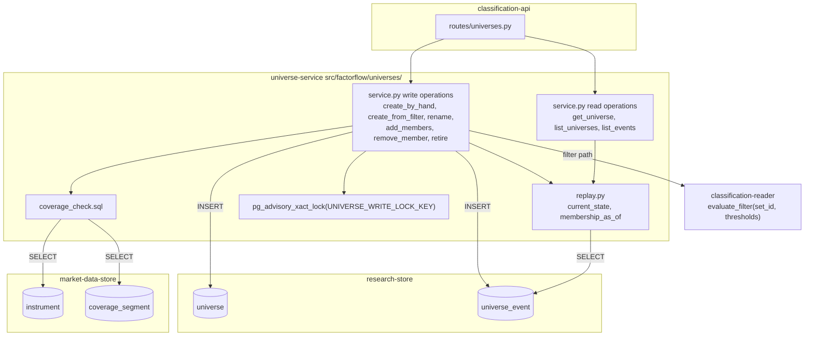
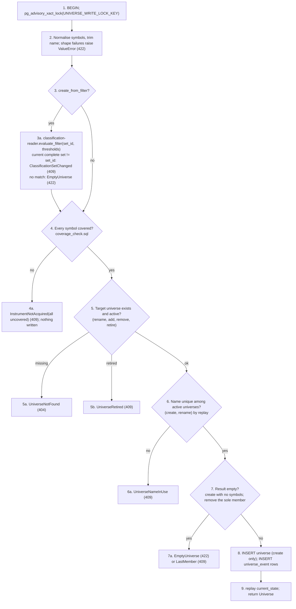

# Component: Universe Service

**Status:** draft
**Capability:** CAP-002
**Owner:** Alvaro de Jodra
**Last Updated:** 2026-10-16

This design was produced in an unattended `$design-run`. Choices no artifact
fixes are recorded as decisions under `projects/factorflow-v2/decisions/`
(DEC-0064 to DEC-0067) and marked **PROVISIONAL**; DEC-0057, which fixed the
universe semantics in the system design, is honoured, not re-decided.

## 1. Overview

The universe service is the Python module that owns every universe write and
every universe read that is a replay. It creates, renames and retires
universes, adds and removes members, takes the server-side filter snapshot
that saves a reviewed threshold result as a universe, and derives current and
as-of membership and event history from the append-only `universe_event` log.
It refuses what the capability refuses: a stock acquisition does not cover
(AC-1), an empty universe (AC-5), the removal of a last member (AC-5), a name
already in use by an active universe (DEC-0057), and any write to a retired
universe. It issues no `UPDATE` and no `DELETE`.

It is the universe counterpart of CAP-001's `instrument-list-service`: a domain
module under `src/factorflow/universes/` that `classification-api` calls with a
`psycopg` connection, that raises typed exceptions the API maps to the error
envelope, and that holds every business rule so the HTTP layer re-implements
none. The one thing it reads outside its own tables is coverage: whether an
`instrument` row with at least one `coverage_segment` exists for a symbol
(system design 3.2 step 10).

Use cases addressed:

- Build a universe by hand from stocks acquisition covers (AC-1, AC-3, flow 2).
- Save a reviewed filter result as a universe whose membership never changes
  afterwards (AC-2, flow 3).
- Add and remove members, rename, retire, each as appended events, with
  history retained (AC-4, AC-6, flow 6).
- Refuse an empty universe and the removal of a last member in favour of
  retirement (AC-5, flow 6 step 6).
- Answer which stocks belonged to a universe on any past date (AC-6).
- Keep a retired instrument as a member, shown as not classified because it is
  retired (AC-15, flow 6 step 5).

Support matrix: the application container's Python 3.12 process, against
PostgreSQL 16 through the pool `runtime-config` configures. No other process
writes universes.

Dependencies: `research-store` migration `0005`; `market-data-store` tables
`instrument` and `coverage_segment` (migrations `0001`, `0003`); `psycopg` 3;
`classification-reader` for the threshold evaluation behind the filter
snapshot (section 2.4); the symbol shape helper of
`src/factorflow/instruments/symbols.py`, imported, not copied.

## 2. Design Details

### 2.1 Placement

```
src/factorflow/universes/__init__.py
src/factorflow/universes/service.py          create_by_hand, create_from_filter, rename, add_members,
                                             remove_member, retire, get_universe, list_universes,
                                             list_events; typed exceptions
src/factorflow/universes/replay.py           membership_as_of, current_state: the replay queries
src/factorflow/universes/sql/current_state.sql
src/factorflow/universes/sql/membership_as_of.sql
src/factorflow/universes/sql/coverage_check.sql
src/factorflow/universes/sql/list_universes.sql
src/factorflow/universes/sql/events_page.sql
tests/unit/test_universe_replay.py           replay semantics on in-memory event sequences
tests/unit/test_universe_sql_safety.py       every statement parameterised; no UPDATE or DELETE
tests/integration/test_universe_create.py
tests/integration/test_universe_filter_snapshot.py
tests/integration/test_universe_maintenance.py
tests/integration/test_universe_as_of.py
tests/integration/test_universe_volume.py    3000-member universe, slow marker
```

SQL lives in `.sql` files loaded once at import, as `src/factorflow/coverage/sql/`
does, so the statements are reviewable as SQL (tech stack, no ORM).

### 2.2 Component block diagram

The diagram below shows the service's three layers and the two stores it
touches. The public functions at the top are what `classification-api` calls;
each validates its arguments, acquires the universe write lock where it writes,
runs the checks the capability names in the order system design 3.2 fixes,
appends events, and returns the replayed state. The replay module beneath is
the only reader of `universe_event`, so there is exactly one definition of
"current membership" and one of "membership as of a date" (DEC-0065). The
coverage check reaches into `market-data-store` read-only. The expected
outcome is that every rule lives in one place and the API layer carries none.



### 2.3 Interface

```python
# src/factorflow/universes/service.py
from dataclasses import dataclass
from datetime import date, datetime
from decimal import Decimal
from uuid import UUID

import psycopg

UNIVERSE_WRITE_LOCK_KEY = 2002_0001  # one key for every universe write (DEC-0065)


class UniverseNotFound(LookupError): ...
class UniverseRetired(ValueError): ...
class UniverseNameInUse(ValueError): ...
class EmptyUniverse(ValueError): ...
class LastMember(ValueError): ...
class NotAMember(LookupError): ...
class InstrumentNotAcquired(ValueError):
    def __init__(self, symbols: list[str]) -> None: ...   # every uncovered symbol, sorted
class ClassificationSetChanged(ValueError):
    def __init__(self, requested_set_id: UUID, current_set_id: UUID | None) -> None: ...


@dataclass(frozen=True)
class Member:
    instrument_id: int
    symbol: str
    lifecycle: str                 # instrument.lifecycle: active | retired
    member_since: datetime


@dataclass(frozen=True)
class Origin:
    kind: str                      # by_hand | from_filter
    set_id: UUID | None
    thresholds: dict[str, Decimal] | None


@dataclass(frozen=True)
class Universe:
    universe_id: UUID
    name: str
    lifecycle: str                 # active | retired
    created_at: datetime
    retired_at: datetime | None
    members: list[Member]
    origin: Origin
    as_of: date
    as_of_before_creation: bool


@dataclass(frozen=True)
class UniverseEvent:
    event_id: int
    event_type: str
    name: str | None
    symbol: str | None
    recorded_at: datetime
    recorded_on: date


def create_by_hand(conn: psycopg.Connection, name: str, symbols: list[str]) -> Universe: ...
def create_from_filter(conn: psycopg.Connection, name: str, set_id: UUID,
                       thresholds: dict[str, Decimal]) -> Universe: ...
def rename(conn: psycopg.Connection, universe_id: UUID, name: str) -> Universe: ...
def add_members(conn: psycopg.Connection, universe_id: UUID,
                symbols: list[str]) -> tuple[list[str], list[str]]:      # added, already_member
    ...
def remove_member(conn: psycopg.Connection, universe_id: UUID, symbol: str) -> datetime: ...
def retire(conn: psycopg.Connection, universe_id: UUID) -> Universe: ...
def get_universe(conn: psycopg.Connection, universe_id: UUID,
                 as_of: date | None = None) -> Universe: ...
def list_universes(conn: psycopg.Connection, lifecycle: str, name_prefix: str | None,
                   limit: int, cursor: str | None) -> tuple[list[Universe], str | None]: ...
def list_events(conn: psycopg.Connection, universe_id: UUID,
                limit: int, cursor: str | None) -> tuple[list[UniverseEvent], str | None]: ...
```

Every write function runs inside `with conn.transaction():`, takes
`SELECT pg_advisory_xact_lock(%s)` with `UNIVERSE_WRITE_LOCK_KEY` as its first
statement, performs its checks by replay, appends its events, and returns the
replayed result from the same transaction. The caller commits. Names are
validated as trimmed and non-empty here and at the API; the maximum length is
the owner's (section 14). Symbols are normalised to upper case and checked
against the instrument symbol shape through
`factorflow.instruments.symbols`, the same helper CAP-001's service uses, so
the two never disagree.

### 2.4 Write flow

The flowchart below is system design 3.2 made concrete for this module: one
shape for all six operations, with the checks in the order that makes each
refusal name exactly one cause. The write lock comes first so that two
concurrent creates cannot both find a name free. The filter path calls
`classification-reader.evaluate_filter` inside the same transaction so the
membership saved is the result against the named set, and refuses when that
set is no longer the current complete set (AC-2, DEC-0057). The last-member
check is a replay of current membership after the proposed removal. The
expected outcome is one transaction of appended events per successful call
and nothing written on any refusal.



Event rows per operation:

| Operation | Events appended, in `event_id` order |
|-----------|--------------------------------------|
| `create_by_hand` | `created` (name), then one `member_added` per distinct symbol |
| `create_from_filter` | `created` (name, `filter_provenance = {"set_id", "thresholds"}`), then one `member_added` per matching instrument, in symbol order |
| `rename` | `renamed` (name) |
| `add_members` | one `member_added` per symbol not already a member; symbols already members are returned as `already_member`, not errored (AC-4) |
| `remove_member` | one `member_removed`; `NotAMember` when the symbol is not a current member |
| `retire` | `retired` |

A symbol that acquisition covers but whose `instrument.lifecycle` is `retired`
may be added and remains a member (AC-15, system design 3.2 step 10); the
service never consults the instrument lifecycle for a write, only coverage.

### 2.5 Replay

```sql
-- src/factorflow/universes/sql/membership_as_of.sql
-- Members of one universe as of the end of day %(as_of)s (America/Chicago), DEC-0065.
WITH member_events AS (
    SELECT DISTINCT ON (instrument_id)
           instrument_id, event_type, recorded_at
      FROM universe_event
     WHERE universe_id = %(universe_id)s
       AND event_type IN ('member_added', 'member_removed')
       AND recorded_on <= %(as_of)s
     ORDER BY instrument_id, event_id DESC
)
SELECT i.instrument_id, i.symbol, i.lifecycle, m.recorded_at AS member_since
  FROM member_events m
  JOIN instrument i USING (instrument_id)
 WHERE m.event_type = 'member_added'
 ORDER BY i.symbol;
```

`current_state.sql` reads a universe's `created` event (name, provenance),
latest `renamed` event (name), and `retired` event (lifecycle, `retired_at`)
in one query. Current membership is `membership_as_of.sql` with `as_of` equal to
the current America/Chicago date. `member_since` is the `recorded_at` of the
`member_added` event the `DISTINCT ON` selects (DEC-0065). An `as_of` earlier
than the `created` event's `recorded_on` returns no members with
`as_of_before_creation = true` and the creation date, which the interface
renders as *Tech did not exist on 2026-01-01. It was created on 2026-10-15*
(UX design section 1.4). `list_universes` pages by `(created_at, universe_id)`
with the versioned opaque cursor contract CAP-001 uses, filtered by lifecycle
and name prefix after replay of each universe's current name; `list_events`
pages by `event_id DESC`.

`coverage_check.sql` is one statement for the whole batch:

```sql
SELECT s.symbol
  FROM unnest(%(symbols)s::text[]) AS s(symbol)
 WHERE NOT EXISTS (
       SELECT 1 FROM instrument i
         JOIN coverage_segment c USING (instrument_id)
        WHERE i.symbol = s.symbol);
```

It returns every uncovered symbol, so the refusal names all of them at once
(system design constraint 13, DEC-0057).

### 2.6 Messages

N/A, not applicable for this component. No broker, topic or queue. The
interface learns of a write from the response it receives.

## 3. Constraints and Assumptions

- **Append-only (C5, system design constraint 3).** This module issues `INSERT`
  only. Current state is always a replay; no cached or maintained row exists
  (DEC-0057).
- **Writes are serialised by one transaction advisory lock** (DEC-0065,
  PROVISIONAL). With one owner-operator (C8) the lock never contends in
  practice; it exists so the uniqueness check by replay is correct under
  concurrency rather than merely likely.
- **Coverage, not lifecycle, decides whether a stock may be added.** "Covered"
  is an `instrument` row with at least one `coverage_segment` of any data type
  (system design 3.2 step 10). A retired instrument may be a member (AC-15).
- **A write naming any uncovered symbol is refused whole** (constraint 13,
  DEC-0057), unlike `POST /api/instruments`, which accepts per symbol.
- **Names are unique among active universes**, compared exactly after
  trimming; a retired universe's name may be reused (DEC-0057).
- **The filter snapshot is evaluated on the server against the named set**
  (constraint 14, DEC-0057), inside the writing transaction, through
  `classification-reader`, so the saved members equal what the owner reviewed
  and the two components share one definition of a threshold match.
- **As-of membership is end-of-day in America/Chicago** (DEC-0065,
  PROVISIONAL); the service accepts a date, never a timestamp.
- **Bounds are the first capability's.** At most `MAX_SYMBOLS_PER_REQUEST`
  (1000) symbols per call, enforced by the API before the service is reached;
  the service re-checks it so a direct caller cannot bypass it.
- **The name length bound is open** (system design section 8 question 2); the
  service enforces trimmed and non-empty only, and gains the bound when the
  owner states it (section 14).
- **Python 3.12, `psycopg` 3, plain SQL, `pytest` with
  `testcontainers[postgres]`** (tech stack). No ORM, no new library.
- **Assumption: `classification-reader.evaluate_filter` is synchronous** and
  runs on the caller's connection, so the snapshot and the events share one
  transaction.

## 4. Security

- **Input validation (SEC-INP-001).** Symbols are validated against
  `^[A-Z][A-Z0-9.-]{0,15}$`, the shape migration `0001` enforces, after upper
  casing; names are trimmed and non-empty; list sizes are bounded at 1000;
  `as_of` is a parsed `date`; `lifecycle` filters are an enumeration;
  thresholds are `Decimal` values validated by the API model before reaching
  this module. The length bound on names is pending the owner (section 14).
- **Injection (SEC-INP-002).** Every statement is parameterised; symbol lists
  are passed as a `text[]` parameter to `unnest`, never interpolated. No
  dynamic SQL exists in this module. `tests/unit/test_universe_sql_safety.py`
  asserts that every `.sql` file and every SQL string uses placeholders only.
- **Authentication and authorization.** None at this layer; the API is
  loopback-only and unauthenticated by owner decision (capability section
  5.3). There is no per-user ownership of universes (C8).
- **Data classification (SEC-DAT-001).** Universe names and membership are
  Internal. A name is owner-supplied free text and is stored and returned as
  text; the interface renders it as text, never as markup (React escaping,
  `owner-web-app` section 4).
- **Error disclosure (SEC-ERR-001).** Every refusal is a typed exception
  carrying only what the envelope needs: a code, the symbols or set ids
  concerned. No driver message or stack trace reaches a caller; an unexpected
  database error propagates to the API's `internal_error_handler`.
- **Audit events (SEC-AUD-001): none of the listed classes occur.** No
  authentication, no privilege, no configuration change. Every write is
  itself an appended, timestamped event, which is a stronger record than a
  log line.
- **SAST and SCA.** `ruff` and `mypy` as blocking checks; `psycopg` 3 scanned
  through `pyproject.toml`.
- **Crypto usage: none.**
- **Privacy impact: none.** No PII.

## 5. Scalability and Performance

- **Sizing (AC-3, CAP-001 AC-4).** A universe may hold every active instrument,
  3000 members; the number of universes is unbounded by any artifact and
  expected to be tens. A create by hand with 1000 symbols appends 1001 rows in
  one `executemany`; adding the full roster is three calls.
- **Replay cost.** `membership_as_of.sql` is one index range scan on
  `idx_universe_event_universe` followed by a `DISTINCT ON` over the universe's
  member events, which at 3000 members and a few hundred changes is a few
  thousand rows. `list_universes` replays current name and lifecycle per
  universe on the page, at most 500 universes per response.
- **Coverage check** is one statement for the whole batch, an index probe per
  symbol on `idx_instrument_symbol` and `idx_coverage_instrument`.
- **Filter snapshot** delegates to `classification-reader`, whose threshold
  query runs over the current set's indexes and is not paginated for this
  purpose; at most 3000 rows result.
- **Concurrency.** One owner, one write lock; no shared mutable state in
  process (SA-CONC-001).
- **Resource utilization.** The caller's pooled connection; no thread, no
  task, no cache.
- **No latency target is stated** for any universe operation; none is
  asserted.

## 6. Upgrade

- **No previous release** of this component; CAP-002 introduces it.
- **Data migration: none.** It reads and writes tables `0005` creates.
- **Behaviour change after upgrade.** Universes exist from the first
  deployment carrying this capability; nothing in CAP-001 changes.
- **Manual actions required: none.**
- **Rollback (OPS-MIG-003).** Reverting the application image removes the
  routes that call this module; the store rollback is `runtime-config`
  section 2.8.4's dump and restore. Universes created after the upgrade are
  lost by a restore, as `research-store` section 6 records.
- **Forward compatibility.** A later capability that adds standing-rule
  universes (capability section 2, out of scope) adds event types; this
  module's replay reads only the five it knows and would be extended, not
  rewritten.

## 7. Testing

`pytest`; database-backed tests use `testcontainers[postgres]` and carry the
`postgres` marker; replay semantics are also tested on in-memory sequences so
the rules are exercised without a container.

| Test | File | What it proves |
|------|------|----------------|
| Create by hand appends created plus members | `tests/integration/test_universe_create.py` | One `created` and n `member_added` events; replay returns the n members with `member_since` (AC-1, AC-3) |
| Uncovered symbol refuses the whole request | `tests/integration/test_universe_create.py` | A batch with one uncovered symbol raises `InstrumentNotAcquired` naming it and writes nothing (AC-1, constraint 13) |
| Empty create is refused | `tests/integration/test_universe_create.py` | No symbols raises `EmptyUniverse`; nothing written (AC-5) |
| Name in use among active universes | `tests/integration/test_universe_create.py` | Creating a second active universe with the same trimmed name raises `UniverseNameInUse`; after retiring the first, the name is accepted (DEC-0057) |
| Concurrent creates cannot share a name | `tests/integration/test_universe_create.py` | Two connections creating the same name serialise on the lock and exactly one succeeds (DEC-0065) |
| A retired instrument may be a member | `tests/integration/test_universe_create.py` | A covered, retired symbol is accepted and replays with `lifecycle: retired` (AC-15) |
| Filter snapshot equals the reviewed result | `tests/integration/test_universe_filter_snapshot.py` | Members equal `evaluate_filter`'s result for the named set; `filter_provenance` carries thresholds and `set_id` (AC-2) |
| Snapshot refused when the set changed | `tests/integration/test_universe_filter_snapshot.py` | With a newer complete set, the named `set_id` raises `ClassificationSetChanged`; nothing written (AC-2, constraint 14) |
| Snapshot of nothing is refused | `tests/integration/test_universe_filter_snapshot.py` | Thresholds matching no stock raise `EmptyUniverse` (AC-5, flow 3 step 5) |
| Membership does not follow later classifications | `tests/integration/test_universe_filter_snapshot.py` | After a new set changes which stocks match, the universe's members are unchanged (AC-2) |
| Rename keeps identity and history | `tests/integration/test_universe_maintenance.py` | `universe_id`, every earlier event and membership unchanged; one `renamed` event appended (AC-4) |
| Add reports already-member | `tests/integration/test_universe_maintenance.py` | Adding a current member returns it in `already_member` and appends no event (AC-4) |
| Remove keeps the record | `tests/integration/test_universe_maintenance.py` | After removal the stock is absent from current members and the `member_added` and `member_removed` events both remain (AC-6) |
| Last member cannot be removed | `tests/integration/test_universe_maintenance.py` | Removing the sole member raises `LastMember`; nothing written (AC-5) |
| Retire leaves history readable | `tests/integration/test_universe_maintenance.py` | After `retire`, `get_universe` returns `lifecycle: retired` with members and events; a second retire raises `UniverseRetired`; add, remove and rename raise `UniverseRetired` (AC-4, AC-6) |
| As-of is end of day | `tests/unit/test_universe_replay.py`, `tests/integration/test_universe_as_of.py` | A stock added and removed on the same `recorded_on` is not a member as of that date; added on D is a member as of D and every later date until removed (AC-6, DEC-0065) |
| As-of before creation | `tests/integration/test_universe_as_of.py` | Returns no members, `as_of_before_creation: true`, and the creation date |
| Events page newest first | `tests/integration/test_universe_maintenance.py` | `list_events` orders by `event_id DESC` with a stable cursor across pages |
| No mutation statement | `tests/unit/test_universe_sql_safety.py` | No `UPDATE` or `DELETE` in any SQL this module issues; every statement parameterised (C5, SEC-INP-002) |
| Volume | `tests/integration/test_universe_volume.py` (`slow`) | A 3000-member universe is created in three calls and replays within the test's own budget; membership as of a mid-history date is correct |

## 8. Acceptance Criteria

1. Creating a universe from covered symbols appends one `created` and one
   `member_added` per symbol and returns those members.
2. A create or add naming any uncovered symbol raises `InstrumentNotAcquired`
   listing every uncovered symbol and writes nothing.
3. A create with no symbols, or a filter matching nothing, raises
   `EmptyUniverse` and writes nothing.
4. A create or rename to a name held by an active universe raises
   `UniverseNameInUse`; the name of a retired universe may be reused.
5. A filter snapshot against the current complete set saves exactly its
   matching stocks with the thresholds and `set_id` as provenance, and raises
   `ClassificationSetChanged` when that set is no longer current.
6. Renaming appends one event and changes no identity, membership or history.
7. Removing a member keeps both membership events; removing the sole member
   raises `LastMember`.
8. Retiring appends one `retired` event; the universe's members and events
   remain readable, and every later write raises `UniverseRetired`.
9. `get_universe(as_of=D)` returns the members after every event recorded on
   or before D in America/Chicago, and an empty membership flagged
   `as_of_before_creation` for a date before creation.
10. Failure scenario: a database error during a write rolls back every event
    of that call and propagates; no partial universe exists.
11. Failure scenario: two concurrent creates with one name produce exactly one
    universe.

## 9. Workflows

- **Build a universe by hand** (flow 2): `create_by_hand`; step 4's refusal is
  `InstrumentNotAcquired`.
- **Build a universe from a factor filter** (flow 3): `create_from_filter`;
  step 5's refusal is `EmptyUniverse`; step 4's fixed membership is the
  snapshot.
- **Compare stocks and inspect the evidence** (flow 4 step 1): `get_universe`
  supplies the members `classification-reader` scopes to.
- **Maintain universes over time** (flow 6): `add_members`, `remove_member`,
  `rename`, `retire`, `list_events`, `get_universe(as_of)`; step 6's refusal
  is `LastMember`.
- **Intersection with CAP-001.** The coverage check reads `instrument` and
  `coverage_segment`; nothing is written to either, and the acquisition list
  is never edited (capability section 5.2).

## 10. UX / GUI

N/A, not applicable for this component: it renders nothing. Three couplings
with the UX design are recorded so they survive implementation: the whole
request is refused when any symbol is uncovered, and the exception carries
every such symbol so the dialog can name them all (UX design section 1.3);
`already_member` is returned, not raised, so the interface reports it in a
polite line rather than an error (section 1.4); and `Origin` is returned on
every `get_universe` so the origin line needs no walk of the event log
(section 1.3, DEC-0065). No internationalization.

## 11. API Endpoints

This component exposes no HTTP endpoint. It provides the `Universe operations`
interface of system design section 4.2 to `classification-api` and consumes
the SQL interfaces of `research-store` and `market-data-store`.

| Endpoint | Method/Operation | Auth/Privilege | Request | Response | Notes |
|----------|-----------------|----------------|---------|----------|-------|
| `create_by_hand` | Python call | in-process | `name`, `symbols` | `Universe` | raises `InstrumentNotAcquired`, `EmptyUniverse`, `UniverseNameInUse` |
| `create_from_filter` | Python call | in-process | `name`, `set_id`, `thresholds` | `Universe` | raises `ClassificationSetChanged`, `EmptyUniverse`, `UniverseNameInUse` |
| `rename` | Python call | in-process | `universe_id`, `name` | `Universe` | raises `UniverseNotFound`, `UniverseRetired`, `UniverseNameInUse` |
| `add_members` | Python call | in-process | `universe_id`, `symbols` | `(added, already_member)` | raises `UniverseNotFound`, `UniverseRetired`, `InstrumentNotAcquired` |
| `remove_member` | Python call | in-process | `universe_id`, `symbol` | `removed_at` | raises `UniverseNotFound`, `UniverseRetired`, `NotAMember`, `LastMember` |
| `retire` | Python call | in-process | `universe_id` | `Universe` | raises `UniverseNotFound`, `UniverseRetired` |
| `get_universe` | Python call | in-process | `universe_id`, `as_of` | `Universe` with members and origin | raises `UniverseNotFound` |
| `list_universes` | Python call | in-process | `lifecycle`, `name_prefix`, `limit`, `cursor` | page, `next_cursor` | |
| `list_events` | Python call | in-process | `universe_id`, `limit`, `cursor` | page newest first, `next_cursor` | raises `UniverseNotFound` |
| Coverage check | SQL read | database credential | symbols | uncovered symbols | `instrument`, `coverage_segment`; read-only |
| Universe event append and read | SQL | database credential | rows | rows | `research-store` section 11 |

## 12. References

| Type | Document Name | Description | Link |
|------|---------------|-------------|------|
| Capability | CAP-002 v1 | AC-1 to AC-6, AC-15; flows 2, 3, 6 | `docs/capabilities/CAP-002-universe-and-factor-classification/Capability-CAP-002.md` |
| System design | CAP-002 system design v1 | Section 3.2 universe writes; 4.2 universe operations; constraints 13, 14; section 8 question 2 | `docs/capabilities/CAP-002-universe-and-factor-classification/design/system-design.md` |
| UX design | CAP-002 UX design v1 | Sections 1.3, 1.4: refusal wording, already-member, origin line, as-of before creation | `docs/capabilities/CAP-002-universe-and-factor-classification/design/ux-design.md` |
| Component design | CAP-001 instrument list service | The domain-module shape, symbol normalisation, per-symbol disposition this design deliberately departs from | `docs/capabilities/CAP-001-market-data-acquisition-foundation/design/component-design-instrument-list-service.md` |
| Component design | CAP-002 research store v1 | Migration `0005`, replay indexes | `docs/capabilities/CAP-002-universe-and-factor-classification/design/component-design-research-store.md` |
| Component design | CAP-002 classification reader v1 | `evaluate_filter` | `docs/capabilities/CAP-002-universe-and-factor-classification/design/component-design-classification-reader.md` |
| Implemented code | `src/factorflow/instruments/symbols.py`, `src/factorflow/runs/queries.py` | Symbol shape helper; the versioned opaque cursor contract (owner, 2026-09-17) | `src/factorflow/` |
| Decision records | DEC-0057, DEC-0065 | Universe semantics; replay semantics | `projects/factorflow-v2/decisions/` (harness repository) |

## 13. Traceability

| Capability AC | System Design Element | Component Design Element | Section |
|--------------|----------------------|--------------------------|---------|
| AC-1 | Coverage check; `409 instrument_not_acquired` refusing whole | `coverage_check.sql` over the batch; `InstrumentNotAcquired` with every symbol | 2.4, 2.5 |
| AC-2 | Server-side snapshot; `409 classification_set_changed`; `filter_provenance` | `create_from_filter` calling `evaluate_filter` in the writing transaction; provenance on `created` | 2.4 |
| AC-3 | Universe identity; member events without exclusivity | `create_by_hand` per universe; no cross-universe check on members | 2.4 |
| AC-4 | `PATCH`, members add and remove, retire; `renamed` changes nothing else | `rename`, `add_members`, `remove_member`, `retire`; `already_member` | 2.4 |
| AC-5 | `422 empty_universe`, `409 last_member` | `EmptyUniverse`; `LastMember` by replay after the proposed removal | 2.4 |
| AC-6 | Append-only log; as-of read; events read | `membership_as_of.sql` end of day; `list_events`; no UPDATE or DELETE | 2.5 |
| AC-15 | Retired instrument may be a member | Coverage, not lifecycle, gates membership; `Member.lifecycle` returned | 2.4, 3 |

## 14. Open Questions

1. **Maximum universe name length** (system design section 8 question 2,
   abstained; carried). `[REQUIRES INPUT: maximum universe name length in
   characters]`. *Owner: capability owner. Blocks: the length check in this
   module and the API constant; nothing else.*
2. **Which Massive payload keys supply the factor inputs** bears on this
   module only through `evaluate_filter`, which compares stored scores and
   percentiles and is unaffected by how they were derived. Carried in
   `factor-engine` section 14; not a question for this component.
