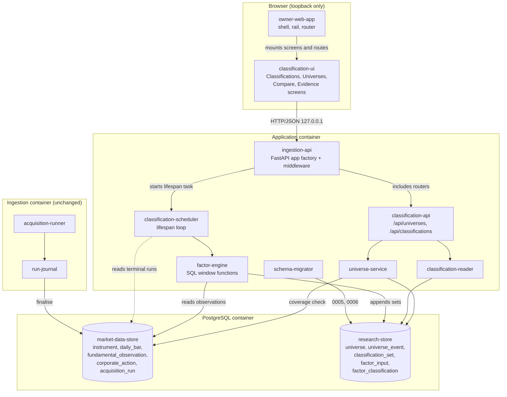
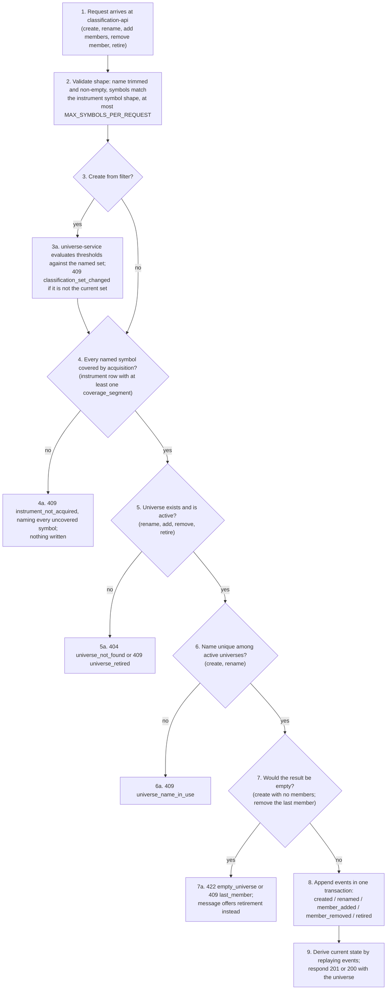

# System Design: Universe & Factor Classification

This design was produced in an unattended `$design-run`. Every choice the
skill would otherwise have asked the owner about is recorded as a decision
under `projects/factorflow-v2/decisions/` (DEC-0052 to DEC-0058) and marked
**PROVISIONAL** where it rests on a derivation rather than an approved
artifact. The owner upholds or reverts each with `scripts/sdd decisions`.

## 1. Design Overview

This design turns the point-in-time market data the running product already
holds into research evidence. It adds four things to the application process
and nothing to the ingestion process: a universe model whose every change is an
appended event, a factor engine that classifies every actively acquired stock by
value, growth and momentum against one peer set, a scheduler that runs that
engine after every acquisition run that ends succeeded or partial, and the JSON
routes and screens through which the owner builds universes, compares stocks
and inspects the inputs behind each result.

The shape follows the charter's modular monolith and the two-container topology
the first capability delivered. Universe Definition and Factor Classification
are modules of the application (charter §3), so every new component runs in the
**application container**; the ingestion container is untouched. The only thing
the two containers share remains the PostgreSQL store (tech stack C1, C2): the
`classification-scheduler` learns that a run has ended by reading the run
journal table, in the same way the existing reclaim sweep reads it for stale
claims, and never by a call from ingestion.

Three commitments carry the correctness risk. **Nothing is overwritten.**
Universe membership is an event log and classifications are appended per set,
so what was known on any date can be replayed later (C5, AC-6, AC-18, AC-19).
**Nothing incomplete is shown as complete.** A factor is scored for a stock only
when every input it needs is present and current, a factor is ranked only when
at least 30 stocks qualify, and a new set is never visible until it is whole
(AC-12, AC-14, AC-20). **Computation stays in the store.** Inputs, standardised
scores and percentiles are computed with PostgreSQL window functions through
`psycopg` 3, so the point-in-time arithmetic is reviewable SQL and no numeric
library is added; this resolves tech-stack OQ-TS-3 for classification
**provisionally** (DEC-0052), and the amendment to `tech-stack.md` is the
owner's.

The owner interface stays bound to loopback with no authentication, as the
capability's Section 5.3 constrains and as the first capability's constraint
5.11 established. The new routes sit on the same listener behind the same
middleware and rely on the same `SEC-ENC-001 host-local loopback exception`
(DEC-0050, extended to this design by DEC-0058).

Read Section 4 first: it is the vocabulary the rest of this document uses.

## 2. Architectural Block Diagram

The diagram shows the three deployed units and where this design's seven
components sit among the twelve the architecture inventory already lists. In
the browser, `classification-ui` is mounted inside the `owner-web-app` shell and
talks only to the loopback JSON API. In the application container,
`classification-api` registers its routers on the application `ingestion-api`
builds, and delegates to `universe-service` and `classification-reader`;
`classification-scheduler` runs as a lifespan task beside the existing reclaim
sweep and drives `factor-engine`. Every component that touches persistent state
reaches the single PostgreSQL database: the new tables are `research-store`,
the acquired observations and run journal are `market-data-store`, and
`schema-migrator` applies this design's migrations at container start exactly as
it applies the first four. The ingestion container appears only to show what
this design does not touch, and the dashed edge is the one cross-container fact
this design depends on: a run's terminal state, read from the journal table.



## 3. Architectural Control Flow

### 3.1 Classification after an acquisition run

The sequence below traces the path from a run reaching a terminal state in the
ingestion container to the owner seeing the new classifications, and it is the
path AC-10, AC-11 and AC-20 bound. Steps 1 to 3 belong to the first
capability's components and are shown only to anchor the handoff. From step 4
the `classification-scheduler` polls the journal table and, finding a succeeded
or partial run with no classification set, creates one in state `building` and
hands it to `factor-engine`, which runs entirely in SQL against the store. The
two decision points that matter are step 9, where a factor with fewer than 30
qualifying stocks is marked unranked for every stock rather than scored, and
step 13, where the set becomes `complete` in one transaction so no reader can
see half of it. The dashed return shows the interface learning of completion by
polling, which is the only way it learns anything.

```mermaid
sequenceDiagram
    participant R as 1. acquisition-runner
    participant J as 2. run-journal
    participant S as 3. market-data-store
    participant C as 4. classification-scheduler
    participant E as 5. factor-engine
    participant T as 6. research-store
    participant A as 7. classification-api
    participant U as 8. classification-ui

    R->>J: 1. finalise(run_id)
    J->>S: 2. acquisition_run.state := succeeded | partial, ended_at := now()
    Note over J,S: 3. failed, cancelled, abandoned never qualify (AC-10)

    loop 4. every FACTORFLOW_CLASSIFICATION_POLL_INTERVAL_SECONDS
        C->>S: 5. SELECT oldest run WHERE state IN (succeeded, partial)<br/>AND no classification_set row exists
        alt 6. none, or a set is already building
            Note over C: 6a. sleep and poll again
        else 7. qualifying run found
            C->>T: 7a. INSERT classification_set (run_id, state=building,<br/>classification_date = today America/Chicago)
            C->>E: 8. build(set_id) off the event loop
            E->>S: 8a. read active instruments, latest trading day,<br/>bars, statements, actions, acquisition_state
            E->>T: 8b. INSERT factor_input rows: value, known_on,<br/>present | missing | outdated | not_computable, restated_possible
            E->>T: 9. per factor: count qualifying stocks;<br/>INSERT classification_set_factor (qualified_count, ranked = count >= 30)
            alt 10. ranked
                E->>T: 10a. INSERT factor_classification with score and percentile<br/>(z-scores, equal-weight mean, re-standardise, percent_rank)
            else 11. not ranked
                E->>T: 11a. INSERT factor_classification not_classified,<br/>reason not_enough_stocks, with qualified_count
            end
            E->>T: 12. INSERT not_classified rows for every stock missing an input<br/>(reason + input named) and every retired stock (reason retired)
            alt 13. every factor written
                E->>T: 13a. UPDATE classification_set SET state = complete, ended_at = now()<br/>(same transaction as the last insert)
            else 14. any error
                E->>T: 14a. ROLLBACK the set's rows; UPDATE classification_set<br/>SET state = failed, failure_reason, ended_at
                Note over C,T: 14b. no retry for this run; the next qualifying run creates the next set
            end
        end
    end

    U->>A: 15. GET /api/classifications (poll 10 s while building)
    A->>T: 16. current set = latest complete; later set building or failed?
    A-->>U: 17. set status, run id, classification date, stocks
    U-->>U: 18. render previous set with not-current mark, or the new set, or the failure
```

Four rules complete this flow.

**What qualifies, and once (AC-10).** 19. A run qualifies when its state is
`succeeded` or `partial` and no `classification_set` row names its `run_id`;
`classification_set.run_id` is unique, so each run is classified at most once.
20. A run in `failed`, `cancelled` or `abandoned` never acquires a set, even if
it wrote observations before stopping. 21. Only one set may be `building` at a
time, enforced by a partial unique index; when several runs end while a set is
building, they are taken oldest first, each producing its own set.

**The classification date (AC-18, AC-19).** 22. `classification_date` is the
calendar date in America/Chicago at the moment the set is created, the same
zone and rule under which `observed_on` is stamped (STD-UI-5). 23. Every input
is selected from observations as they exist at that moment; nothing recorded
later changes a set, and a later backfill becomes visible only in later sets.
24. `started_at` and `ended_at` are timestamps; the date, not the timestamp, is
what dates the classification.

**Failure (AC-20).** 25. A failure anywhere in step 8 to 13 rolls back every
row written for the set and records the set `failed` with the exception class
and message as `failure_reason`, never a stack trace (SEC-ERR-001 posture
inherited from `ingestion-api` §2.3). 26. The previous complete set remains
current, marked as not reflecting the latest acquisition, and the interface
shows the failure and its reason. 27. The scheduler does not retry that run;
the next qualifying run creates a new set (capability Section 2, DEC-0054).

**Timeliness (AC-11).** 28. The budget is 5 minutes from `ended_at` for 3000
active instruments. 29. Detection costs at most one poll interval, 5 seconds by
default (DEC-0054, reusing the owner's 2026-09-05 idle-poll decision in
`component-design-runtime-config.md` §2.2a), so the remainder is computation.
30. The sizing basis is the first capability's: 3000 instruments, 252 sessions a
year (`component-design-market-data-store.md` §5), so momentum reads about
3000 × 273 ≈ 820 thousand bars and growth reads 3000 × 8 quarters × 3
statements ≈ 72 thousand statement rows, both through existing indexes
(`idx_daily_bar_instrument_session`, `idx_fundamental_instrument_period`). 31.
The budget is verified by a volume test at 3000 instruments under the existing
`slow` pytest marker, not asserted.

### 3.2 Universe writes

The flowchart below shows one universe write, from the request reaching
`classification-api` to the events appended in `research-store`, and it covers
all six owner operations because they share one shape: validate, check against
the store, append, derive, respond. The two refusals the capability names are
decision points 4 and 7: a stock acquisition does not cover (AC-1) and a write
that would leave a universe empty (AC-5). The filter path at step 3 is the
server-side snapshot of AC-2: the server evaluates the thresholds against the
set the owner reviewed, so the saved membership is exactly what was shown. The
expected outcome is that every successful write is one transaction of appended
events and every refusal names the operation, the resource and the reason
(STD-UI-19).



Three consequences are worth stating. 10. A symbol that acquisition covers but
whose instrument is retired may be added and is shown as not classified because
it is retired (AC-15); "covered" means an instrument row exists and at least one
coverage segment of any data type has been written for it (coverage is derived,
never asserted — the first capability's constraint 5.9). 11. Renaming appends a
`renamed` event and changes nothing else, so identity (`universe_id`) and
membership history are untouched (AC-4). 12. Retiring appends a `retired` event;
the universe leaves the active list and its events remain readable (AC-6).

### 3.3 Reading classifications and evidence

13. `GET /api/classifications` resolves the **current set** as the latest
`classification_set` in state `complete`, and reports alongside it whether a
later set is `building` or the latest attempt is `failed`, so the interface can
mark the current set as not reflecting the latest acquisition and show the
failure (AC-20, AC-21). 14. When no complete set exists the response says so
(`never_classified: true`) and carries no stocks, which the interface renders as
"no stocks have been classified yet" rather than an empty table (AC-22). 15.
Sorting and threshold filters are applied in SQL over the whole current set,
never over a loaded page, with keyset pagination at the first capability's
`DEFAULT_PAGE_SIZE` and `MAX_PAGE_SIZE` bounds (`component-design-ingestion-api.md`
§2.4a); restricting to a universe joins the replayed current membership
(AC-16). 16. Side-by-side comparison is the same read with an explicit `symbols`
list, bounded by `MAX_PAGE_SIZE`, so a stock that is not classified on a factor
appears with its reason rather than being dropped (AC-16, flow 4 step 5). 17.
`GET /api/classifications/stocks/{symbol}` returns every `factor_input` row of
the current set for the stock — value, status, the period or session it came
from, and the `known_on` date — and `/history` pages through the stock's rows in
earlier sets (AC-17, AC-18).

## 4. Components, Interfaces and Technology

### 4.1 Components Introduced

| Component ID | Name | Responsibility | Owned by |
|--------------|------|----------------|----------|
| `universe-service` | Universe service | Creates, renames and retires universes and adds or removes members by appending events to the universe event log; derives current and as-of membership by replay; refuses empty universes, last-member removal and stocks acquisition does not cover; takes the server-side filter snapshot | this design |
| `factor-engine` | Factor engine | Builds one classification set for one qualifying acquisition run: derives every factor input with its known-on date, decides present, missing, outdated or not computable per input, forms each factor's peer set, computes standardised scores and percentiles with SQL window functions, marks possible restatement, and appends the results | this design |
| `classification-scheduler` | Classification scheduler | Asyncio loop in the application container that polls the run journal table for a succeeded or partial run without a classification set, creates the set, drives the factor engine off the event loop, records failure with its reason, and enforces one building set at a time | this design |
| `classification-reader` | Classification reader | Read side of classification: resolves the current set and its currency, serves sorted and threshold-filtered lists over all classified stocks or one universe with keyset pagination, side-by-side comparison, per-stock evidence and classification history | this design |
| `classification-api` | Classification JSON API | FastAPI routers for `/api/universes` and `/api/classifications`, registered on the application the ingestion API factory builds and therefore behind its request-id, Host and Origin middleware and error envelope | this design |
| `classification-ui` | Classification interface | React screens and fetch layer for Classifications, Universes, universe detail, Compare and stock evidence, mounted in the owner interface shell as navigation destinations and client routes | this design |
| `research-store` | Research store | The PostgreSQL schema additions holding universes and their event log, classification sets, per-set factor counts, factor inputs and factor classifications; append-only history applied by numbered migrations `0005` onward | this design |

Components reused from the architecture inventory, by their published
identifiers: `owner-web-app`, `ingestion-api`, `schema-migrator`,
`market-data-store`, `run-journal`, `acquisition-runner` and `runtime-config`
(whose variable conventions `classification-scheduler` follows). None of them
is redesigned here; where this design needs a composition point in one of
them, Section 8 records it.

### 4.2 Interfaces

Every HTTP operation below is unauthenticated by deliberate design, for the
reason the capability's Section 5.3 and the first capability's constraint 5.11
give: the API binds loopback only, the deployment publishes no port, and the
channel relies on the `SEC-ENC-001 host-local loopback exception` (Section 5,
constraint 12). Every non-2xx response uses the error envelope of
`component-design-ingestion-api.md` §2.3 (`code`, `message`, `resource`,
`request_id`). The Host and Origin checks of its §2.5a apply to every route
because the routers are registered behind that middleware; every state-changing
route here uses `POST`, `PATCH` or `DELETE`, so the Origin check covers all of
them. Pagination reuses `DEFAULT_PAGE_SIZE` (50) and `MAX_PAGE_SIZE` (500) and
member lists reuse `MAX_SYMBOLS_PER_REQUEST` (1000) from its §2.4a; no new
request bound is introduced except the universe name length, which is open
(Section 8, question 2). The full request and response schemas are the
component design's to fix; the rows below are the contract they must satisfy.

| Interface | Provider component | Consumer component | Shape | Auth | Status codes | Stability |
|-----------|--------------------|--------------------|-------|------|--------------|-----------|
| `GET /api/universes` | `classification-api` | `classification-ui` | Request: `lifecycle` (`active` default, `retired`, `all`), `limit`, `cursor`. Response: universes with `universe_id`, `name`, `lifecycle`, `member_count`, `created_at`, `retired_at`, and `next_cursor` | none, loopback only | `200` | stable within this capability |
| `POST /api/universes` | `classification-api` | `classification-ui` | Request: `{"name": ..., "symbols": [...]}` to build by hand, or `{"name": ..., "filter": {thresholds}, "set_id": ...}` to save a filter result (AC-2). Response: the universe with its members | none, loopback only | `201`; `422` `empty_universe` (no symbols, or the filter matched nothing) or malformed; `409` `universe_name_in_use`; `409` `instrument_not_acquired` naming every uncovered symbol; `409` `classification_set_changed` | stable within this capability |
| `GET /api/universes/{id}` | `classification-api` | `classification-ui` | Request: path `id`; optional `as_of` date. Response: the universe, its members on `as_of` (default now) each with instrument lifecycle and `member_since`, and each member's classification per factor from the current set (status, score, percentile, reason, restatement mark) | none, loopback only | `200`; `404` `universe_not_found`; `422` malformed date | stable within this capability |
| `GET /api/universes/{id}/events` | `classification-api` | `classification-ui` | Request: path `id`, `limit`, `cursor`. Response: events newest first — type, name or symbol, `recorded_at` — and `next_cursor` (AC-6, flow 6 step 3) | none, loopback only | `200`; `404` | stable within this capability |
| `PATCH /api/universes/{id}` | `classification-api` | `classification-ui` | Request: `{"name": ...}`. Response: the universe (AC-4) | none, loopback only | `200`; `404`; `409` `universe_retired`; `409` `universe_name_in_use`; `422` | stable within this capability |
| `POST /api/universes/{id}/members` | `classification-api` | `classification-ui` | Request: `{"symbols": [...]}`, at most `MAX_SYMBOLS_PER_REQUEST`. Response: `added`, `already_member` | none, loopback only | `200`; `404`; `409` `universe_retired`; `409` `instrument_not_acquired`; `422` empty or oversize list | stable within this capability |
| `DELETE /api/universes/{id}/members/{symbol}` | `classification-api` | `classification-ui` | Request: path `id`, `symbol`. Response: `removed_at` | none, loopback only | `200`; `404` `universe_not_found` or `not_a_member`; `409` `last_member` (message offers retirement, AC-5); `409` `universe_retired` | stable within this capability |
| `DELETE /api/universes/{id}` | `classification-api` | `classification-ui` | Request: path `id`. Response: `lifecycle: retired`, `retired_at`. Retires, never deletes (AC-6, STD-UI-2) | none, loopback only | `200`; `404`; `409` `universe_retired` | stable within this capability |
| `GET /api/classifications` | `classification-api` | `classification-ui` | Request: `universe_id`, `symbol` prefix, `symbols` explicit list (compare; at most `MAX_PAGE_SIZE`), `sort` from an allowlist (`symbol`, `{factor}_score`, `{factor}_percentile`), `order`, thresholds `{factor}_score_min`/`_max` and `{factor}_percentile_min`/`_max` (percentile 0–100), `limit`, `cursor`. Response: `set` (id, `classification_date`, `run_id`, `state`, `not_current` flag with the building or failed later set and its `failure_reason`) or `never_classified: true`; `factors` with `qualified_count` and `ranked` per factor; `stocks` each with lifecycle and per-factor status, score, percentile, `reason_code`, `reason_input`, `restated_possible`; `next_cursor` | none, loopback only | `200`; `404` `universe_not_found`; `422` malformed filter | stable within this capability |
| `GET /api/classifications/sets` | `classification-api` | `classification-ui` | Request: `limit`, `cursor`. Response: sets newest first with `state`, `classification_date`, `run_id`, `started_at`, `ended_at`, `failure_reason`, per-factor counts (AC-20, AC-21) | none, loopback only | `200` | stable within this capability |
| `GET /api/classifications/sets/{set_id}` | `classification-api` | `classification-ui` | Request: path `set_id`. Response: one set as above | none, loopback only | `200`; `404` | stable within this capability |
| `GET /api/classifications/stocks/{symbol}` | `classification-api` | `classification-ui` | Request: path `symbol`. Response: the stock's classification in the current set per factor, and every `factor_input` row — name, status, value, the period end or session date it came from, `known_on`, `restated_possible`, and the reason detail when missing (AC-17, AC-12) | none, loopback only | `200` (with `set: null` before any set exists); `404` `instrument_not_found` | stable within this capability |
| `GET /api/classifications/stocks/{symbol}/history` | `classification-api` | `classification-ui` | Request: path `symbol`, `limit`, `cursor`. Response: the stock's classifications in earlier sets, newest first, each with its set's `classification_date` and `run_id` (AC-18) | none, loopback only | `200`; `404` | stable within this capability |
| `GET /api/instruments` | `ingestion-api` | `classification-ui` | Reused unchanged for picking members by symbol; see `component-design-ingestion-api.md` §11 | none, loopback only | `200` | stable, published by the first capability's design |
| `GET /api/acquisition-runs/{id}` | `ingestion-api` | `classification-ui` | Reused unchanged to open the run a set reflects (AC-21) | none, loopback only | `200`; `404` | stable, published by the first capability's design |
| Router registration | `classification-api` | `ingestion-api` | The application factory includes this design's two routers under `/api` before the static mount, so they sit behind the request-id, Host and Origin middleware and the error envelope | n/a — in-process | n/a | the one composition point in the API process; see Section 8 question 4 |
| Scheduler start | `classification-scheduler` | `ingestion-api` | The application lifespan creates the scheduler task beside the reclaim loop and cancels it on shutdown | n/a — in-process | n/a | composition point; see Section 8 question 4 |
| Screen registration | `classification-ui` | `owner-web-app` | Client routes `/classifications`, `/universes`, `/universes/:universeId`, `/compare`, `/stocks/:symbol` and two rail destinations, Classifications and Universes, added to the shell | n/a — in-browser | n/a | composition point; see Section 8 question 4 |
| Universe operations | `universe-service` | `classification-api` | Python calls: create, rename, add members, remove member, retire, read current, read as-of, read events; refusals raised as typed exceptions mapped to the codes above | n/a — in-process | n/a | stable within this capability |
| Classification queries | `classification-reader` | `classification-api` | Python calls: current set and currency, list with sort and thresholds, compare, stock evidence, stock history, set list | n/a — in-process | n/a | stable within this capability |
| Set build | `factor-engine` | `classification-scheduler` | `build(set_id)`: synchronous, dispatched off the event loop; returns the terminal set state | n/a — in-process | n/a | stable within this capability |
| Qualifying-run read | `market-data-store` | `classification-scheduler` | SQL read of `acquisition_run` rows in `succeeded` or `partial` with no `classification_set` row, oldest `ended_at` first; read-only | n/a — in-process | n/a | depends on the published `acquisition_run` shape (migration `0004`) |
| Observation read | `market-data-store` | `factor-engine` | SQL reads of `instrument`, `daily_bar`, `fundamental_observation`, `corporate_action` and `acquisition_state`; read-only, never an UPDATE or DELETE | n/a — in-process | n/a | depends on the published observation shapes (migration `0002`, `0003`) |
| Coverage check | `market-data-store` | `universe-service` | SQL read: does an `instrument` row with at least one `coverage_segment` exist for the symbol | n/a — in-process | n/a | depends on migration `0001`, `0003` |
| Universe event append | `research-store` | `universe-service` | SQL `INSERT` into `universe` and `universe_event`; no UPDATE or DELETE | n/a — in-process | n/a | **critical — C5, unrecoverable if wrong** |
| Universe event read | `research-store` | `universe-service` | SQL reads over `universe_event` for replay | n/a — in-process | n/a | stable within this capability |
| Classification append | `research-store` | `factor-engine` | SQL `INSERT` into `classification_set_factor`, `factor_input`, `factor_classification`; `UPDATE` of `classification_set` state fields only (`building` to `complete` or `failed`) | n/a — in-process | n/a | **critical — C5, unrecoverable if wrong** |
| Set claim | `research-store` | `classification-scheduler` | SQL `INSERT` of one `classification_set` in `building`, refused by the partial unique index when one is already building | n/a — in-process | n/a | stable within this capability |
| Classification read | `research-store` | `classification-reader` | SQL reads over the five research tables joined to `instrument` and the replayed membership | n/a — in-process | n/a | stable within this capability |
| Migration application | `research-store` | `schema-migrator` | Numbered files `0005_universes.sql` and `0006_classifications.sql`, applied and recorded in `applied_migrations` like the first four | n/a — in-process | n/a | stable within this capability |

### 4.3 Technology Selections

| Component repo | Language | Framework | Store | Key libraries | Source |
|----------------|----------|-----------|-------|---------------|--------|
| FactorFlow-v2 (application: `classification-api`, `universe-service`, `classification-reader`, `classification-scheduler`, `factor-engine`, `research-store`) | Python 3.12+ | FastAPI on uvicorn (ASGI); asyncio lifespan task for the scheduler | PostgreSQL 16, no ORM, numbered forward-only SQL migrations; **factor arithmetic in SQL window functions (`avg`, `stddev_samp`, `percent_rank`) — PROVISIONAL, DEC-0052** | `psycopg` 3, `psycopg_pool`, Pydantic, `pydantic-settings`, `ruff`, `mypy`, `pytest`, `hypothesis`, `testcontainers[postgres]` | tech-stack v5 |
| FactorFlow-v2 (owner interface: `classification-ui`) | TypeScript 5.x | React 18 with Vite, `react-router-dom` | — | Tailwind CSS with `autoprefixer`, shadcn/ui on Radix primitives, `vitest`, `@testing-library/react`, `@playwright/test`, `biome`; TradingView `lightweight-charts` is available but unused — this capability commits to no chart (STD-UI-9, 27, 28 recorded as not applicable) | tech-stack v5 |

**OQ-TS-3.** `tech-stack.md` v5 defers the numeric library for factor
computation and backtest replay to the system design of the first capability
requiring it, which is this one. The design uses SQL window functions and adds
no library, because the stated shape — a cross-section of at most 3000 stocks,
three composites of stored ratios, series of about 13 months of bars and eight
quarters of statements — is a join and a window over data already in PostgreSQL,
and because a library with no tech-stack entry is not something this design may
introduce (skill constraint 6a). The choice is **PROVISIONAL** (DEC-0052): it
resolves OQ-TS-3 for classification only, the amendment to `tech-stack.md` is
the owner's, and backtest replay decides its own approach at M4 against its own
volumes.

No third-party repository is touched. Massive is not read: this capability makes
no provider request (capability Section 5.2).

### 4.4 Persistent Data and Migration Strategy

This subsection is added to the template's Section 4 because OPS-MIG-001
requires a tech spec that adds persistent structures to state its migration
strategy, and the tables below are the contract every other row in this section
depends on. Column-level DDL is the `research-store` component design's.

| Table | Rows | Written by | Mutability |
|-------|------|------------|------------|
| `universe` | identity: `universe_id`, `created_at` | `universe-service` | insert only |
| `universe_event` | `universe_id`, `event_type` in `created`, `renamed`, `member_added`, `member_removed`, `retired`; `instrument_id` for member events; `name` for `created` and `renamed`; `filter_provenance` (thresholds and `set_id`) for a `created` event taken from a filter; `recorded_at`, `recorded_on` (America/Chicago date) | `universe-service` | **append only** — no UPDATE, no DELETE (C5) |
| `classification_set` | `set_id`, `run_id` (unique, references `acquisition_run`), `state` in `building`, `complete`, `failed`; `classification_date`; `latest_trading_day`; `active_instruments`; `started_at`, `ended_at`, `failure_reason`; partial unique index allowing one `building` row | `classification-scheduler` (insert), `factor-engine` (state transition) | state fields updated once, `building` to a terminal state, as `acquisition_run` is; never deleted |
| `classification_set_factor` | `set_id`, `factor` in `value`, `growth`, `momentum`; `qualified_count`; `ranked` | `factor-engine` | append only |
| `factor_input` | `set_id`, `instrument_id`, `factor`, `input_name`; `status` in `present`, `missing`, `outdated`, `not_computable`; `value`; `as_of` (period end or session date); `known_on` (latest `observed_on` of the rows used); `restated_possible`; `detail` (the component periods, sessions and actions, and the acquisition outcome when missing) | `factor-engine` | **append only** (C5) |
| `factor_classification` | `set_id`, `instrument_id`, `factor`; `status` in `classified`, `not_classified`; `score`, `percentile`; `reason_code` in `input_missing`, `input_outdated`, `input_not_computable`, `not_enough_stocks`, `retired`; `reason_input`; `reason_detail`; `restated_possible`; check: classified rows carry score and percentile and no reason, unclassified rows the reverse | `factor-engine` | **append only** (C5) |

**Migration strategy (OPS-MIG-001, OPS-MIG-002).** Two new numbered files,
`0005_universes.sql` and `0006_classifications.sql`, purely additive: no
existing table, column, index or constraint changes, and no data is moved. The
first deployment carrying this capability applies both at application container
start through `schema-migrator`, which records them in `applied_migrations`;
the store is non-empty by then, and the additive shape is what keeps that safe.
The known constraint is honoured rather than worked around: there is no down
migration, so the rollback path is the one `component-design-runtime-config.md`
§2.8.4 specifies for every upgrade — `pg_dump` before deploying, restore and
redeploy the previous immutable image tag on failure (OPS-MIG-003 branch (a)).
Append-only enforcement follows the first capability's two mechanisms
(`component-design-market-data-store.md` §2.5): no UPDATE or DELETE statement is
written against the four append-only tables, and a repository test in this
capability's own test module scans every `.sql` file and SQL string for one.

## 5. Architectural Constraints

1. **Every new component runs in the application container.** Universe
   Definition and Factor Classification are modules of the application
   (charter §3); the ingestion container is the single separate process (tech
   stack C1) and this design changes nothing in it. The handoff from a finished
   run to classification is a row read from the shared store, never a call.
2. **One transactional store (C2).** The research tables live in the same
   PostgreSQL database as the observations they are computed from. A set's
   rows and its `complete` transition commit together, so a reader sees a whole
   set or none of it (AC-20).
3. **Universe and classification history is append-only and point-in-time
   (C5).** `universe_event`, `factor_input`, `factor_classification` and
   `classification_set_factor` are never updated or deleted, in any migration,
   story or query path. Current universe state is a replay of events, not a
   maintained row (DEC-0057). This is the constraint that cannot be repaired
   retrospectively.
4. **A classification is dated when it was produced, from inputs as known
   then (AC-18, AC-19).** `classification_date` is the America/Chicago date at
   set creation; every input records the `observed_on` dates it was computed
   from as `known_on`. Nothing acquired later alters a recorded set; a backfill
   is visible only in sets created after it was observed.
5. **One peer set per factor, and it is the actively acquired roster (AC-8,
   AC-15).** Scores and percentiles are measured against every instrument
   active at set creation that qualifies on the factor. A retired instrument
   is excluded from every peer set and recorded `not_classified` with reason
   `retired`; its earlier rows stand. Universes never enter the computation,
   so a stock's classification is identical in every universe.
6. **Like for like, or not at all (AC-7, AC-12, AC-13, AC-14).** A factor is
   scored for a stock only when every input the factor's definition names is
   `present` — neither missing, nor outdated, nor not computable. A fundamental
   is outdated when its latest fiscal period end is more than 6 months before
   the classification date; a price is outdated when the stock's latest bar is
   not from the latest trading day held across active instruments (DEC-0055).
   A factor is ranked only when at least 30 stocks qualify; below that every
   stock is `not_classified` with reason `not_enough_stocks` and the count.
   The 6 months and the 30 are the capability's owner decisions of 2026-10-12.
7. **Scores are formed by standardising within the peer set (AC-7, AC-9;
   DEC-0053, PROVISIONAL).** Each input is z-scored with the sample mean and
   `stddev_samp` over the peer set; the composite is the equal-weight mean of
   the input z-scores; the factor score is the composite re-standardised over
   the peer set; the percentile is `percent_rank()` of the score times 100. No
   winsorisation or other step the capability does not define is applied.
8. **Inputs are derived from stored rows, never re-requested (capability
   Section 5.2; DEC-0055, PROVISIONAL).** Trailing-twelve-month figures sum the
   four most recent quarterly statements; the year-earlier comparison sums the
   four before them; balance-sheet inputs use the most recent quarterly
   statement; market capitalisation is the latest close times shares
   outstanding. Momentum windows end at the latest session on or before one
   calendar month before the classification date and start 3, 6 and 12
   calendar months before that end, each resolved against the stock's own
   bars. Total return is computed from the **unadjusted** bars the store holds
   (DEC-0001, owner) by applying splits and compounding dividends from
   `corporate_action` at read time. A growth input whose prior-year base is not
   positive is `not_computable` and leaves the stock not classified on growth
   with the input named.
9. **The restatement mark follows the data (AC-23; DEC-0056, PROVISIONAL).** A
   fundamental row is backfilled when its `provider_filing_date` precedes the
   instrument's earliest fundamentals `observed_on`; any value or growth
   classification built on one carries `restated_possible = true`, appended
   with the classification and propagated to every presentation (STD-UI-17).
10. **Automatic, once per qualifying run, within budget (AC-10, AC-11;
    DEC-0054, PROVISIONAL).** `classification-scheduler` polls the journal
    table every `FACTORFLOW_CLASSIFICATION_POLL_INTERVAL_SECONDS` (default 5,
    reused from the owner's idle-poll decision), classifies each `succeeded`
    or `partial` run exactly once, never classifies a `failed`, `cancelled` or
    `abandoned` run, and does not retry a failed set until the next qualifying
    run. One set builds at a time. The setting lives in this capability's own
    `pydantic-settings` model under the `FACTORFLOW_` prefix, following
    `runtime-config`'s conventions without editing it.
11. **Honest currency (AC-20, AC-21, AC-22).** The current set is the latest
    `complete` set. While a later set is `building`, or the latest attempt is
    `failed`, the current set is served with a not-current mark and the
    building or failed set's identity and reason; before any set exists the
    API says so explicitly rather than returning an empty list.
12. **Loopback-only interface, no authentication, same channels as before.**
    The capability's Section 5.3 inherits the first capability's posture and
    the owner's decisions of 2026-09-03 and 2026-10-12. The plaintext channels
    this design uses — the owner's browser to the API at `http://127.0.0.1:8000`
    for `/api/universes` and `/api/classifications`, and the application
    process to PostgreSQL at `127.0.0.1:5432` for the research tables — rely on
    the `SEC-ENC-001 host-local loopback exception` of CONST-SEC 1.3 under
    DEC-0050, extended to this design by DEC-0058. No bind, port or listener is
    added, and conditions H1 to H9 are met by the deployment definition and
    middleware the first capability delivered (`component-design-runtime-config.md`
    §2.8.1, `component-design-ingestion-api.md` §2.5a), which the new routes
    inherit by registration. Reliance holds only while CONST-SEC 1.3 is in
    force, as DEC-0050 states.
13. **Every write names an acquired stock or is refused whole (AC-1, AC-5;
    DEC-0057, PROVISIONAL).** A create or add-members request naming any symbol
    acquisition does not cover is refused entirely with every such symbol named;
    an empty universe is never created; removing the last member is refused in
    favour of retirement. Universe names are unique among active universes.
14. **Filter snapshots are taken on the server against a named set (AC-2;
    DEC-0057).** The request carries the thresholds and the `set_id` the owner
    reviewed; the server evaluates against that set, refuses if it is no longer
    current, and appends the membership in one transaction with the filter as
    provenance. Membership never changes afterwards except by the owner.
15. **All external input is validated at the boundary (SEC-INP-001).** Symbols
    match the instrument symbol shape the store enforces
    (`^[A-Z][A-Z0-9.-]{0,15}$`, migration `0001`); names are trimmed and
    non-empty with a maximum length that is open (Section 8, question 2);
    percentile thresholds lie in 0–100; score thresholds are finite decimals;
    `sort` resolves through an allowlist of column names, never interpolated;
    dates are ISO-8601; list sizes and page sizes reuse the published bounds.
    Every query is parameterised (SEC-INP-002).
16. **Data classification: Internal (SEC-DAT-001).** Universe names and
    membership describe the owner's research intent over public companies;
    classifications and inputs derive from market data already classified
    Internal (`component-design-market-data-store.md` §4). No Restricted data
    is created, so SEC-DAT-002 and SEC-DAT-003 do not engage; no PII is stored.
    No security event of the SEC-AUD-001 classes occurs on these routes: there
    is no authentication, no privilege and no configuration change.
17. **Errors are surfaced, never swallowed (OPS-ERR-001).** A failed set is
    recorded with its reason and shown; a failed universe write returns the
    envelope with a stable code; a failed scheduler iteration is logged with
    the structured logger and the loop continues, as the reclaim loop does.
    Structured logging only (SA-LOG-001).
18. **The interface conforms to STD-UI as the capability's Section 5.4 maps
    it.** Of consequence to this design: polled regions state their cadence
    here — the classification currency region polls every 10 seconds while a
    set is building or a run is non-terminal and stops otherwise (reused from
    the owner's 2026-09-05 run-progress cadence, DEC-0054, PROVISIONAL), and
    every polled region shows its last-updated time (STD-UI-25); the
    classified-stock list is sized for 3000 rows with server-side sort and
    filter and keyset pagination (STD-UI-30, inheriting the first capability's
    partial conformance record for virtualisation); `not classified`,
    `not enough stocks to rank`, `retired`, `updating`, `not reflecting the
    latest acquisition` and `classification failed` are states mapped to
    existing tiers in the UX brief (STD-UI-12); no chart is committed.
19. **One owner-operator (C8).** No per-user ownership of universes, no
    sharing, no multi-tenancy, no horizontal scale.
20. **Forward-only, additive schema evolution.** Migrations `0005` and `0006`
    add tables and never alter the first capability's; the rollback posture is
    `runtime-config` §2.8.4's dump-and-restore.

## 6. Architectural Assumptions

1. **The acquired statements carry the line items the factors need** — book
   equity, net income, diluted earnings per share, revenue, operating cash
   flow, capital expenditure and shares outstanding — under stable Massive field
   names, and quarterly statements exist for every fiscal quarter including the
   fourth. The capability's own Section 6 carries this assumption and asked for
   it to be validated during system design; it **could not be validated**: the
   committed fixtures hold only `shareholders_equity`, `total_assets`,
   `total_liabilities` and `current_ratio`
   (`tests/fixtures/massive/financial_annual.json`,
   `tests/fixtures/massive/financial_quarterly.json`), the massive-client design
   enumerates no statement line items (`component-design-massive-client.md`
   §2.5), and this design makes no provider call. The mapping from input names
   to payload keys is therefore an open question (Section 8, question 1). The
   architecture does not depend on it: an absent item leaves a stock not
   classified with the input named (AC-12), and a widespread absence leaves a
   factor unranked (AC-14) rather than wrong.
2. **The stated history depth is deep enough**: at least 13 months of bars for
   momentum and at least two years of quarterly statements for growth, as the
   capability assumes. Shallower depth yields `missing` inputs, not wrong
   scores.
3. **US-listed equities**, one session per calendar day, as both capabilities
   assume; `observed_on`, `recorded_on` and `classification_date` share the
   America/Chicago rule (STD-UI-5).
4. **Dividends in `corporate_action` carry `cash_amount` and splits carry
   `split_from` and `split_to`** in their JSONB payloads, as the massive-client
   design §2.5 and §11 record for the provider's endpoints.
5. **The application container has the capacity to compute a set within the
   AC-11 budget while serving the API.** The engine runs off the event loop and
   its arithmetic executes in PostgreSQL; Section 3.1 steps 28 to 31 give the
   sizing and the test that verifies it rather than asserting a duration.
6. **One owner-operator runs the containers on one machine they control**, as
   the first capability assumes; the SEC-ENC-001 exception's condition H6 rests
   on it.

## 7. Traceability

| AC # | Acceptance Criterion | Design Element(s) | Section |
|------|---------------------|--------------------|---------|
| AC-1 | Universe by hand; no uncovered stock | `POST /api/universes` with `symbols`; `universe-service` coverage check against `instrument` and `coverage_segment`; `409 instrument_not_acquired` refusing the whole request | 3.2 steps 4, 4a; 4.2; 5.13 |
| AC-2 | Universe from a filter, membership fixed | `POST /api/universes` with `filter` and `set_id`; server-side snapshot; `409 classification_set_changed`; `filter_provenance` on the `created` event | 3.2 step 3a; 4.2; 4.4; 5.14 |
| AC-3 | Several universes; a stock in many | `universe` identity per universe; `member_added` events reference `instrument_id` without exclusivity; `GET /api/universes` | 4.2; 4.4 |
| AC-4 | Add, remove, rename, retire without touching the store; rename keeps history | `PATCH`, `POST .../members`, `DELETE .../members/{symbol}`, `DELETE /api/universes/{id}`; `renamed` event changes nothing else | 3.2 steps 8, 11, 12; 4.2 |
| AC-5 | No empty universe; last member not removable | `422 empty_universe`; `409 last_member` offering retirement | 3.2 step 7, 7a; 4.2; 5.13 |
| AC-6 | Membership history; members on any past date | Append-only `universe_event`; `GET /api/universes/{id}?as_of=`; `GET /api/universes/{id}/events` | 4.2; 4.4; 5.3 |
| AC-7 | Factor definitions | `factor-engine` input derivation (constraint 8) and composite construction (constraint 7); `factor_input` rows per named input | 3.1 steps 8a to 10a; 5.7; 5.8 |
| AC-8 | One peer set | Peer set per factor = active instruments qualifying on the factor; universes never enter the computation | 5.5 |
| AC-9 | Score and percentile | Re-standardised composite and `percent_rank() × 100` on `factor_classification` | 3.1 step 10a; 5.7 |
| AC-10 | Automatic refresh; never after failed, cancelled, abandoned | `classification-scheduler` qualifying-run read; `classification_set.run_id` unique | 3.1 steps 4 to 7a, 19 to 21; 5.10 |
| AC-11 | Up to date within 5 minutes for 3000 stocks | Poll interval default 5 s; SQL window functions over existing indexes; volume test at 3000 instruments | 3.1 steps 28 to 31; 4.3; 5.10 |
| AC-12 | Like for like only; missing or outdated input named | `factor_input.status`; `factor_classification` `not_classified` with `reason_code` and `reason_input`; `GET /api/classifications/stocks/{symbol}` | 3.1 step 12; 4.4; 5.6 |
| AC-13 | Outdated inputs | 6-month rule on latest fiscal period end; latest-trading-day rule on prices | 5.6; 5.8 |
| AC-14 | Enough stocks to rank | `classification_set_factor.qualified_count`, `ranked`; `not_enough_stocks` rows carrying the count | 3.1 steps 9, 11a; 4.4; 5.6 |
| AC-15 | Retired stocks | Excluded from peer sets; `reason_code retired`; shown in universes as such; may still be a member | 3.2 step 10; 5.5 |
| AC-16 | Sort, filter, side by side; all stocks or one universe | `GET /api/classifications` with `sort`, thresholds, `universe_id`, `symbols`; `classification-reader` applies them in SQL over the whole set | 3.3 steps 15, 16; 4.2 |
| AC-17 | Evidence behind a result | `factor_input` rows with `value`, `as_of`, `known_on`, `detail`; `GET /api/classifications/stocks/{symbol}` | 3.3 step 17; 4.2; 4.4 |
| AC-18 | Classification history, never overwritten | Append-only `factor_classification` per set; `GET /api/classifications/stocks/{symbol}/history` | 4.2; 4.4; 5.3 |
| AC-19 | No backdating | `classification_date` fixed at set creation; inputs selected as known then; later observations affect later sets only | 3.1 steps 22 to 24; 5.4 |
| AC-20 | Previous set while not current; failure shown | Current = latest `complete`; `building` and `failed` reported with reason; set rows committed with `complete` in one transaction | 3.1 steps 13 to 14b, 25 to 27; 3.3 step 13; 5.2; 5.11 |
| AC-21 | Classification currency | `classification_date`, `run_id` on every set; `GET /api/classifications/sets`; reuse of `GET /api/acquisition-runs/{id}` | 3.3 step 13; 4.2 |
| AC-22 | Honest empty state | `never_classified: true` before any complete set | 3.3 step 14; 5.11 |
| AC-23 | Restatement mark | `restated_possible` on `factor_input` and `factor_classification`, derived from `provider_filing_date` against first fundamentals `observed_on`, retained in history | 4.4; 5.9 |

## 8. Open Questions

1. **Which Massive statement payload keys supply each factor input, with what
   sign conventions, and do quarterly statements exist for every quarter?**
   The inputs are book equity, net income, diluted earnings per share, revenue,
   operating cash flow, capital expenditure and shares outstanding. The
   committed fixtures and the massive-client design do not enumerate them
   (Section 6, assumption 1) and this design cannot read the provider.
   `[REQUIRES INPUT: the payload key, statement type and sign convention for
   each of the seven factor inputs, confirmed against statements acquired by a
   real run with the Financials add-on]`. *Owner: capability owner, against
   acquired data. Blocks: the `factor-engine` component design's input SQL and
   the stories that implement it; not the architecture, which treats an absent
   key as a missing input (AC-12).* **Abstained in this run.**
2. **What is the maximum length of a universe name?** SEC-INP-001 requires a
   bound and no artifact states one. `[REQUIRES INPUT: maximum universe name
   length in characters]`. *Owner: capability owner. Blocks: the API bounds
   constant in `classification-api` only.* **Abstained in this run.**
3. **Amending `tech-stack.md` to close OQ-TS-3 for factor classification.**
   This design uses SQL window functions and adds no numeric library
   (DEC-0052, PROVISIONAL). Only the owner edits the tech stack; this design
   does not. *Owner: capability owner, via `$tech-stack`. Blocks: nothing in
   this design; specification review should read DEC-0052 as the record.*
4. **The composition points in delivered components.** This design needs the
   application factory to include two routers and start one lifespan task
   (`src/factorflow/api/app.py`, owned by `ingestion-api`), and the shell to
   add two rail destinations and five client routes (`web/src/app/shell.tsx`,
   `web/src/app/routes.tsx`, owned by `owner-web-app`). AGT-SCOPE-002 forbids
   writing an obligation into one capability that requires editing a delivered
   one; registration of a new module into an existing composition root is read
   here as this capability's own work at the seam, not an amendment to the
   delivered behaviour, and every other touch is avoided (settings live in this
   capability's own model; the append-only test is a new module). *Owner:
   capability owner, to confirm the reading or to name a different seam.
   Blocks: design decomposition's ownership of those two edits.*
5. **DEC-0058 extends DEC-0050's loopback-exception bookkeeping to this
   design.** The owner may uphold it or instead amend DEC-0050's `artifacts`
   and supersede DEC-0058. *Owner: capability owner. Blocks: nothing.*
6. **Growth with a non-positive prior-year base** is treated as a not
   computable input (DEC-0055, PROVISIONAL), leaving the stock not classified
   on growth with the input named. The capability names only missing and
   outdated inputs. *Owner: capability owner, to uphold or to define growth for
   that case; a capability revision would follow a different answer.*
7. **Outlier treatment** is not applied, because AC-7 fixes the computation to
   the defined inputs and equal weights (DEC-0053). A composite without
   winsorisation is sensitive to extreme ratios in small peer sets. *Owner:
   capability owner; a change is a capability revision, not a design choice.*
8. **No read-latency target exists for the classified-stock list at 3000
   rows**, mirroring the unresolved question 3 in
   `component-design-market-data-store.md` §14. The design sizes the read and
   paginates it without asserting a latency. *Owner: capability owner. Blocks:
   a performance acceptance criterion, not the implementation.*
9. **A cross-capability decision record under skill constraint 6d.** The
   composite construction (DEC-0053) and the backfill rule (DEC-0056) will bind
   the backtesting and promotion capabilities, which must read and carry the
   same scores and marks. They are kept in this design and in their decision
   records meanwhile; the owner may promote either to a `decision-record`
   constitution artifact via `$constitution`. *Owner: capability owner. Blocks:
   nothing now.*

## 9. Source Documents

| Document | Path | Key findings used |
|----------|------|-------------------|
| Capability CAP-002 v1 (draft) | `docs/capabilities/CAP-002-universe-and-factor-classification/Capability-CAP-002.md` | 23 acceptance criteria; factor definitions, 30-stock threshold, 6-month and latest-trading-day outdatedness, 5-minute budget, all owner decisions of 2026-10-12; universes by hand or one-time filter snapshot; classification measured against all active instruments; loopback posture inherited; `requires-runtime` on the first capability's criteria; STD-UI conformance for 30 rules; assumption 1 unvalidated |
| Product charter v2 | `docs/constitution/product-charter.md` | Modular monolith with ingestion split out; Universe Definition and Factor Classification are application modules; point-in-time append-only factor and universe history; one owner-operator; M1 Universe & Factors 2026-Q4; M4 backtesting depends on this history |
| Tech stack v5 | `docs/constitution/tech-stack.md` | C1–C11; Python 3.12 / FastAPI / PostgreSQL 16 without ORM / numbered migrations; React 18 / Vite / Tailwind / shadcn/ui; `psycopg` 3, `pydantic-settings`; OQ-TS-3 deferred to this design; fundamentals not as-reported, restatement obligation; append-only factor and universe writes; validation commands |
| STD-UI v4 | `docs/constitution/standards/ui-conventions.md` | Thirty rules; status tiers; America/Chicago; polled cadence must be recorded in the design (STD-UI-25); known limitations propagate (STD-UI-17); lists at committed volume (STD-UI-30) |
| Architecture inventory | `docs/architecture.md` | Twelve components and sixteen interfaces published by the first capability's design; identifiers reused here: `owner-web-app`, `ingestion-api`, `schema-migrator`, `market-data-store`, `run-journal`, `acquisition-runner`, `runtime-config` |
| CAP-001 system design v8 | `docs/capabilities/CAP-001-market-data-acquisition-foundation/design/system-design.md` | Two containers plus PostgreSQL; claimed-row handoff; `observed_on` is FactorFlow's date; trading days derived from acquired bars (constraint 5.5); loopback-only no-auth posture (5.11); reclaim sweep in the application container; terminal run states |
| Component design: market data store v9 | `docs/capabilities/CAP-001-market-data-acquisition-foundation/design/component-design-market-data-store.md` | Schema and sizing (3000 instruments, 252 sessions a year); append-only enforcement mechanisms (§2.5); data classified Internal (§4); dump-and-restore rollback (§6); open read-latency question (§14) |
| Component design: ingestion API | `docs/capabilities/CAP-001-market-data-acquisition-foundation/design/component-design-ingestion-api.md` | Error envelope (§2.3); canonical request bounds `DEFAULT_PAGE_SIZE` 50, `MAX_PAGE_SIZE` 500, `MAX_SYMBOLS_PER_REQUEST` 1000 (§2.4a); Host and Origin checks for H9 (§2.5a); endpoint table (§11) |
| Component design: owner web app | `docs/capabilities/CAP-001-market-data-acquisition-foundation/design/component-design-owner-web-app.md` | Shell with rail destinations and status region; polling cadences 10 s run progress, 30 s health (§2.2, §2.3); `ScreenState` union (§2.4); server-side filtering at volume (§2.6) |
| Component design: run journal | `docs/capabilities/CAP-001-market-data-acquisition-foundation/design/component-design-run-journal.md` | State machine and terminal states; `finalise` derives `succeeded` or `partial` from written results (§2.2, §2.5) |
| Component design: runtime config | `docs/capabilities/CAP-001-market-data-acquisition-foundation/design/component-design-runtime-config.md` | `FACTORFLOW_` variables and the owner's 2026-09-05 timing decisions, including the 5 s idle poll (§2.2, §2.2a); host-network deployment and H1–H9 mapping (§2.8.1); backup and rollback (§2.8.4) |
| Component design: massive client | `docs/capabilities/CAP-001-market-data-acquisition-foundation/design/component-design-massive-client.md` | Statement endpoints and the fact that line items are not enumerated (§2.5, §11); split and dividend fields; ratios not acquired; `adjusted` resolved to unadjusted by DEC-0001 (`src/factorflow/ingestion/massive/client.py` lines 92–99) |
| Implemented schema | `src/factorflow/db/migrations/0001_extensions_owner_state.sql` to `0004_runs.sql` | Exact table and column names this design reads: `instrument`, `daily_bar`, `fundamental_observation` (`fiscal_period_end`, `statement_type`, `provider_filing_date`, `payload`), `corporate_action`, `coverage_segment`, `acquisition_state`, `acquisition_run` |
| Application factory | `src/factorflow/api/app.py` lines 37–42, 104–199 | The reclaim loop pattern (lifespan task, work dispatched off the event loop, 5 s owner-confirmed cadence) this design's scheduler mirrors |
| Fixtures | `tests/fixtures/massive/financial_annual.json`, `tests/fixtures/massive/financial_quarterly.json` | Only four line items present; the factor inputs could not be validated from committed data |
| Decision records | `projects/factorflow-v2/decisions/DEC-0001.md`, `DEC-0050.md` (harness repository) | Unadjusted bars with read-time adjustment (owner); loopback-exception reliance and its bookkeeping requirement (owner) |
| Decision records written by this design | `projects/factorflow-v2/decisions/DEC-0052.md` to `DEC-0058.md` (harness repository) | OQ-TS-3 provisional resolution; composite method; scheduler and cadences; input derivation; backfill rule; universe semantics; loopback-exception extension |

## 10. Design Readiness

**Design Readiness Score: 82/100**

All ten sections carry substantive content. Section 4 declares seven
components with stable identifiers, records every cross-boundary interface with
a named provider and consumer component — reusing seven of the first
capability's published identifiers rather than declaring parallel ones — and
names concrete approved technologies for both halves of the repository, so the
design is implementable rather than technology-agnostic. Every acceptance
criterion traces to a design element.

What keeps it below 90 is that two inputs are genuinely missing and are marked
rather than invented: the mapping from the seven factor inputs to the
provider's statement payload keys, which the capability itself asked to be
validated during system design and which no committed artifact can settle, and
the universe name bound. Neither changes the architecture; both block specific
implementation work and are handed to the owner.

What keeps it below 100 is that seven design choices rest on derivations rather
than approved artifacts and are recorded as **PROVISIONAL** agent decisions
(DEC-0052 to DEC-0058), and that the design has been read by nobody but its
author. Specification review, and the owner's verdict on each record, earn the
remaining points.
