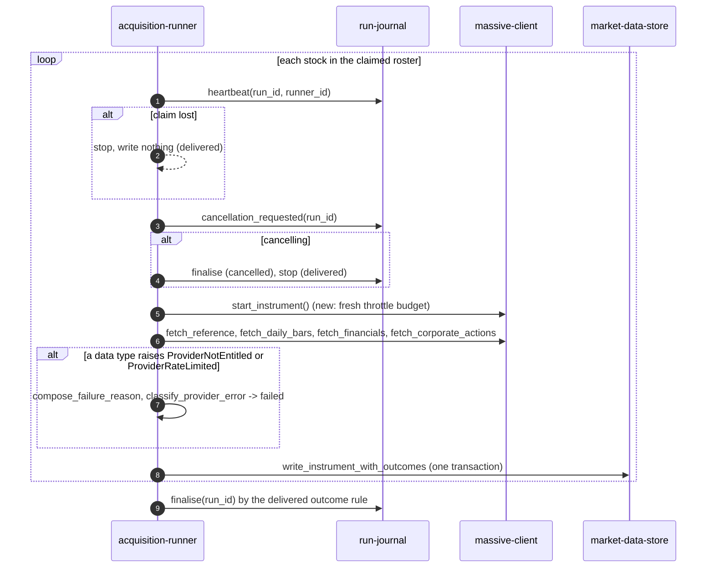

# Component: Acquisition Runner (CAP-003 changes)

**Status:** draft
**Capability:** CAP-003
**Owner:** Alvaro de Jodra
**Last Updated:** 2026-11-07

This design records only what CAP-003 changes in `acquisition-runner`, the
component CAP-001 delivered. Its approved design,
`docs/capabilities/CAP-001-market-data-acquisition-foundation/design/component-design-acquisition-runner.md`
(v9), stays as it is (AGT-SCOPE-002; owner's answer to CAP-001 review v14
FINDING-56). The change is the runner's part of AC-29 and AC-30, as system
design v2 §3.6 notes 4 and 5, §4.1 and §4.2 *Stock boundary* and *Typed
provider refusals* assign it. The abandoned CAP-001 draft (`git show 90b4ff0`,
runner v10) was read as source material; its outcome table row that did not
render (review v14 FINDING-62) and its claim that the run continues under
persistent throttling at the delivered per-request budget (FINDING-55) are not
carried.

## 1. Overview

The runner downloads one stock at a time, four data types each, and records a
result per data type (CAP-001 v9 §2.2, §2.4). CAP-003 changes two things here,
and nothing else:

1. **The stock boundary.** At the top-of-stock checkpoint, after the heartbeat
   and the cancellation check, the runner calls
   `self._client.start_instrument()`, which starts the governor's per-stock
   throttle wait budget (AC-30; system design §4.2 *Stock boundary*). The
   heartbeat and the budget start at the same point, which is what keeps a
   throttled stock inside the staleness window (section 2.3).
2. **Two more refusals recorded per data type.** `classify_provider_error`
   maps `ProviderNotEntitled` to `failed`; `ProviderRateLimited`, a
   `ProviderUnavailable`, already maps to `failed` through the delivered
   `isinstance` check. The reason recorded is the one `compose_failure_reason`
   composed, `[not_entitled] …` or `[rate_limited] …`, unreworded (AC-29,
   AC-30; system design §3.6 note 5).

The runner's `except` clauses already catch every `MassiveError`, so neither
refusal stops the download: it goes on to the stock's next data type and the
next stock, and `run-journal.finalise` decides the outcome by the delivered
rule (system design §3.6 note 4).

Use cases addressed: a plan refusal and a persistent rate limit are each
recorded under their own reason while the download still finishes (AC-29,
AC-30).

Support matrix: the ingestion container, as CAP-001 v9. Dependencies:
`massive-client` (`start_instrument()`, the two new error types),
`run-journal` (`heartbeat`, `cancellation_requested`, `finalise`, unchanged).

## 2. Design Details

### 2.1 Delivered files this change edits

```
src/factorflow/ingestion/runner.py     + self._client.start_instrument() after the cancellation check
src/factorflow/ingestion/outcomes.py   classify_provider_error maps ProviderNotEntitled to failed; import;
                                         docstring and TypeError text name the accepted types
tests/unit/test_outcomes.py            + rows for the two new types
tests/integration/test_runner_provider_refusals.py   new (section 7)
```

`journal.py`, `reclaim.py`, `writer.py`, `plan.py` and `ingestion_main.py` are
untouched: no timing value, outcome value, column or finalisation rule changes
(system design §4.1).

### 2.2 The top-of-stock checkpoint

The sequence shows one stock's iteration after the change. The actors are the
runner, `run-journal`, `massive-client` and the store. The decision points are
the delivered ones, whether the claim still holds and whether cancellation was
requested, and then, per data type, whether the read returned data or raised
a typed refusal. The expected outcome is that each stock starts with a fresh
throttle budget at the moment its heartbeat is refreshed, that each refused
data type is recorded `failed` with its composed reason, and that the stock's
results are written in one transaction before the next stock begins.



```python
# src/factorflow/ingestion/runner.py, in execute_claimed's loop
            if cancellation_requested(self._connection, run_id):
                ...  # delivered
                return

            # Start this stock's throttle wait budget at the same checkpoint the
            # heartbeat was refreshed (CAP-003 system design §3.6 note 4).
            self._client.start_instrument()

            # --- Fetch symbol --- (delivered, unchanged)
```

The call sits after the cancellation check so a stock that is never fetched
starts no budget, and before the symbol lookup so every provider request of the
stock, all four data types, is charged to one budget.

### 2.3 Per-data-type outcomes after the change

CAP-001 v9 §2.4's table with the two new rows; every other row is unchanged.

| Provider result | Recorded outcome | Reason kind | Run effect | Source |
|-----------------|------------------|-------------|------------|--------|
| Transport or server error, attempts exhausted (`ProviderUnavailable`) | `failed` | `unavailable` | download continues | CAP-001 constraint 5.13 (delivered) |
| The owner's plan is not entitled to this data type (`ProviderNotEntitled`), sent once | `failed` | `not_entitled` | download continues | AC-29 (new) |
| Throttled past the stock's throttle wait budget (`ProviderRateLimited`) | `failed` | `rate_limited` | download continues | AC-30 (new) |

```python
# src/factorflow/ingestion/outcomes.py
from factorflow.ingestion.massive.errors import (
    CredentialRejected, InstrumentNotFound, MassiveError, ProviderContractViolation,
    ProviderNotEntitled, ProviderUnavailable,
)

    # ProviderUnavailable includes its subclass ProviderRateLimited.
    if isinstance(error, (ProviderUnavailable, ProviderContractViolation, ProviderNotEntitled)):
        return InstrumentOutcomeRecord(data_type=data_type, outcome="failed", reason=reason)
```

Ordinary throttling still never appears in the table: a `429` the governor
waits out is not an attempt and leaves no row. Only throttling that outlasts
the stock's budget reaches the runner. `ProviderNotEntitled` is per data type
rather than run-level because a plan can include prices and exclude
financials, so the data types it includes are still downloaded;
`CredentialRejected` stays the one run-level refusal.

**Under persistent throttling, the download finishes** (system design §3.6
note 4; AC-30). The heartbeat is refreshed only at the top of each stock, and
the stock's budget starts there. When every request answers `429`, the time
between two heartbeats is the throttle waits, at most 300 s
(`FACTORFLOW_MASSIVE_MAX_THROTTLE_WAIT_SECONDS`), plus the time to send the
stock's requests under the configured pace. That is inside the 900 s staleness
window (`FACTORFLOW_RUN_STALE_AFTER_SECONDS`) that `runtime-config` §2.2a
derives for one throttle wait per stock (invariant 2, `660 < 900`), so the
sweeper never reclaims the download as `abandoned`. The download is then
finalised by the delivered rule (`src/factorflow/runs/journal.py` lines
302-340): `partial` when anything was stored, `failed` when nothing was, which
is AC-30's "finish with its recorded outcome" as the owner worded it on
2026-11-07 (system design open question 13, answered).

### 2.4 Messages

N/A, not applicable for this component. The run journal table is the handoff,
as delivered.

## 3. Constraints and Assumptions

- **No timing value, invariant, outcome value or column changes** (system
  design §4.1, constraint 16 (d)). `runtime-config`, `run-journal` and
  `market-data-store` are untouched.
- **The reason is recorded as composed** (CAP-001 v9 §2.4): the runner never
  rewords it, so the leading kind `data-health-reader` reads is the one
  `massive-client` wrote (system design assumption 8).
- **Cancellation timing is unchanged**: it takes effect after the current
  stock, which under persistent throttling may now include up to one budget of
  waiting (system design constraint 17 (a)).
- **Assumption:** the delivered client factory gives one `MassiveClient`, with
  one governor, to one runner (`src/factorflow/ingestion_main.py` lines
  88-90, 140-161), so `start_instrument()` resets the only budget the stock's
  requests spend.
- **Assumption:** the test doubles that stand in for the client in the
  delivered runner integration tests are `MagicMock`s
  (`tests/integration/test_runner_*.py`), which accept `start_instrument()`
  without change.

## 4. Security

- **No provider free text is stored** by this change: the two new reasons are
  composed by `massive-client` from a fixed description and the governor's
  fixed text (AGT-PROHIB-003).
- **No credential handling changes.** The redaction callable the entrypoint
  passes is applied by `compose_failure_reason`, as delivered (CAP-001 AC-13).
- **No new dependency.**

## 5. Scalability and Performance

- One more in-process call per stock; no query added.
- A throttled stock may take up to one budget (300 s) longer; system design
  open question 14 states the whole-download consequence.
- A plan refusal saves two requests per refused data type per stock compared
  with release 0.2.0.

## 6. Upgrade

- **Upgrades from release 0.2.0** (deployed 2026-11-07,
  `factorflow:0.2.0-829c9e1`; first shipped in 0.1.0 on 2026-10-16) (system
  design constraint 17; review v14 FINDING-58).
- **Behaviour change after upgrade:** a refused data type is recorded with
  kind `not_entitled` after one request, and a throttled stock waits to the
  minute boundary for up to one budget before its data types are recorded
  with kind `rate_limited`; downloads on a throttled plan take longer. Results
  recorded before the upgrade keep `[unavailable]` and are not rewritten.
- **Resumability is unchanged** (CAP-001 v9 §6): a download interrupted by the
  redeploy is reclaimed as `abandoned` and the next one fetches what is
  missing.
- **Data migration:** none. **Manual actions:** none.
- **Rollback (OPS-MIG-003):** redeploy the previous image; rows with the new
  kinds stay readable as text, and an older runner resumes against them.

## 7. Testing

pytest; database-backed tests use `testcontainers[postgres]` and carry the
`postgres` marker, as the delivered runner integration tests do.

| Test | File | What it proves |
|------|------|----------------|
| Refusals map to `failed` | `tests/unit/test_outcomes.py` | `classify_provider_error(ProviderNotEntitled("x"), data_type="fundamentals", reason=r)` and the same with `ProviderRateLimited("x")` each return outcome `failed` with `reason` exactly `r`, unchanged |
| One budget start per stock, after the checkpoint | `tests/integration/test_runner_provider_refusals.py` | With a `MagicMock` client over a two-stock roster, `start_instrument` is called twice, each call after that stock's `heartbeat` and `cancellation_requested` and before its first `fetch_*` call (ordering read from one `Mock` the journal spies and the client are attached to); with cancellation requested before the second stock, it is called once |
| A plan refusal is sent once and the download goes on | `tests/integration/test_runner_provider_refusals.py` | Real `MassiveClient` and governor over `tests/unit/massive_transport_fakes.py` (the `massive-client` CAP-003 §7 harness). Two followed stocks, `AAPL` and `KO`; every `/stocks/financials/v1/*` request answers `403` with `{"status": "ERROR", "request_id": "req_403_<n>", "message": "You are not entitled to this data. Please upgrade your plan"}`, the reference request `200` with the `reference_active.json` envelope, its `ticker` set to the requested symbol, and every other read `200` with an empty result set. Each stock records `fundamentals` `failed` with a reason starting `[not_entitled] symbol=<symbol> data_type=fundamentals request_id=req_403_` and ending `the provider plan is not entitled to this data`; exactly one request per stock reached `/stocks/financials/v1/balance-sheets` and none the income or cash-flow paths; the other three data types are `written` or `unchanged`; the run is finalised `partial` (AC-29) |
| Persistent 429 under the default timing set | `tests/integration/test_runner_provider_refusals.py` | Real `MassiveClient` and governor; settings at every default with `FACTORFLOW_MASSIVE_REQUESTS_PER_MINUTE=60` (CAP-002 manifest B2): `max_throttle_wait_seconds` 300, `stale_after_seconds` 900, `max_attempts` 3. One `FakeClock` started at a multiple of 60 is the governor's `monotonic` and `now`, a `FakeSleeper` on it is `sleep`, and `factorflow.ingestion.runner.heartbeat` and `factorflow.ingestion.runner.finalise` are wrapped to record the clock at each call before delegating. Roster `KO` then `AAPL`: every request for `KO` answers `429` with the `error_rate_limited.json` body; `AAPL` answers as in the previous row. Parametrised over jitter `[0.0]` and `[0.999]`. Asserts: (a) the sum of `FakeSleeper` calls between consecutive recorded heartbeats, and between the last heartbeat and `finalise`, is at most 300 s, and every interval is below 900 s, the reclaim predicate's window (`reclaim.py` line 44); (b) `KO` records all four data types `failed` with reasons starting `[rate_limited] symbol=KO data_type=<type> request_id=unavailable: `; (c) after `KO`'s budget is spent, its prices, fundamentals and corporate-actions reads each sent exactly one request; (d) `AAPL`'s throttle budget started fresh, its reference, prices and corporate actions are `written` or `unchanged`, and its fundamentals `failed` with a reason starting `[not_entitled] symbol=AAPL data_type=fundamentals ` (the previous row's fixture); (e) the run is finalised `partial`, never `abandoned` (AC-30; review v14 FINDING-55) |
| Everything throttled finishes `failed`, not abandoned | `tests/integration/test_runner_provider_refusals.py` | As the previous row with jitter `[0.0]` and a roster of `KO` alone: four `[rate_limited]` rows and the run finalised `failed` by the outcome rule, never `abandoned`. The expected `failed` is AC-30's recorded outcome when nothing was stored (system design open question 13, answered 2026-11-07) |
| Delivered isolation still holds | `tests/integration/test_runner_isolation.py`, `test_runner_outcomes.py`, `test_runner_cancel.py`, `test_runner_reclaim.py` (delivered, unchanged) | The `MagicMock` clients accept `start_instrument()`; every delivered outcome, cancellation and reclaim assertion holds |

## 8. Acceptance Criteria

1. At the top of each stock, after the heartbeat and the cancellation check
   and before any provider request for that stock, the runner calls
   `start_instrument()` exactly once (AC-30).
2. A data type refused as not entitled is recorded `failed` with the reason
   `massive-client` composed, beginning `[not_entitled] `, after one request,
   and the download continues to the stock's remaining data types and the
   remaining stocks (AC-29).
3. A data type throttled past the stock's budget is recorded `failed` with a
   reason beginning `[rate_limited] `, and the download continues (AC-30).
4. Under a provider answering `429` to every request of a stock, at the
   default timing set, no interval between two heartbeats holds more than
   300 s of throttle waits or reaches 900 s, and the download is finalised by
   the delivered outcome rule, never reclaimed as `abandoned` (AC-30).
5. No new outcome value, column or timing value is introduced, and the
   recorded reason is never reworded.
6. Failure scenario: a rejected credential still fails the whole download at
   once, as delivered, whichever refusal preceded it.

## 9. Workflows

- **Intersecting: every download** (capability flow 1; **Download now**).
  Refused data types are recorded and the download goes on.
- **Intersecting: diagnose a failed download.** The new reasons reach *Needs
  fixing* and the download detail, which state each failure's fix by its
  cause (`component-design-data-health-ui.md`,
  `component-design-owner-web-app.md`).

## 10. UX / GUI

N/A, not applicable for this component.

## 11. API Endpoints

No HTTP surface. Interfaces consumed, as CAP-003 changes them:

| Endpoint | Method/Operation | Auth/Privilege | Request | Response | Notes |
|----------|-----------------|----------------|---------|----------|-------|
| `MassiveClient.start_instrument()` | Python call, consumed | in process | none | `None` | §4.2 *Stock boundary* |
| `MassiveClient.fetch_*` | Python call, consumed | in process | as delivered | data, or a typed error including `ProviderNotEntitled` and `ProviderRateLimited` | §4.2 *Typed provider refusals* |
| `classify_provider_error(error, *, data_type, reason)` | Python call | in process | a typed error and its composed reason | `InstrumentOutcomeRecord` | Now also accepts `ProviderNotEntitled` |
| `run-journal` `heartbeat`, `cancellation_requested`, `finalise` | SQL through the journal | in process | as delivered | as delivered | Unchanged |

## 12. References

| Type | Document Name | Description | Link |
|------|---------------|-------------|------|
| Capability | CAP-003 v2 | AC-29, AC-30 | `docs/capabilities/CAP-003-app-shell-and-data-health/Capability-CAP-003.md` |
| System design | CAP-003 v2 | §3.6 notes 4, 5; §4.1; §4.2 *Stock boundary*, *Typed provider refusals*; constraints 16, 17; open questions 13 to 15 | `docs/capabilities/CAP-003-app-shell-and-data-health/design/system-design.md` |
| Component design | CAP-001 acquisition runner v9 (approved, not edited) | Run loop, outcome table, heartbeat and cancellation | `docs/capabilities/CAP-001-market-data-acquisition-foundation/design/component-design-acquisition-runner.md` |
| Component design | CAP-001 runtime config v14 (approved, not edited) | §2.2a staleness derivation and invariant 2 | `docs/capabilities/CAP-001-market-data-acquisition-foundation/design/component-design-runtime-config.md` |
| Component design | CAP-003 massive client, rate-limit governor | `start_instrument()`, the error types, the per-stock budget, the test harness | `docs/capabilities/CAP-003-app-shell-and-data-health/design/` |
| Review | CAP-001 specification review v14 | FINDING-55, 58, 62 | `git show b69facd:docs/capabilities/CAP-001-market-data-acquisition-foundation/specifications-review-report-v14.md` |
| Code | Delivered runner and outcomes | `runner.py` lines 202-214 (checkpoint), 233-317 (per-data-type `except`); `outcomes.py` lines 112-159 | `src/factorflow/ingestion/` |

## 13. Traceability

| Capability AC | System Design Element | Component Design Element | Section |
|--------------|----------------------|--------------------------|---------|
| AC-29 | §3.6 note 5; `Typed provider refusals` | `ProviderNotEntitled` recorded `failed` with the composed `[not_entitled]` reason; download continues | 2.3 |
| AC-30 | §3.6 note 4; `Stock boundary` | `start_instrument()` at the heartbeat checkpoint | 2.2 |
| AC-30 | §3.6 notes 4, 5 | `ProviderRateLimited` recorded `failed` with `[rate_limited]`; finalised by the outcome rule, never abandoned | 2.3 |
| AC-30 | Constraint 16 (e) | Persistent-`429` integration test at the default timing set | 7 |
| AC-29, AC-30 | Constraint 17 | Upgrade from 0.2.0 | 6 |

## 14. Open Questions

1. **AC-30's outcome when nothing was stored** (system design open question
   13): **answered 2026-11-07 by the owner** (capability `0febf60`): the
   download finishes with its recorded outcome, `failed` by the delivered
   outcome rule; the test expectation stands.
2. **The staleness derivation's attempt term** (system design open question
   15): a stock whose requests all time out is the delivered worst case and is
   not touched here. *Owner: capability owner. Blocks: nothing here.*
