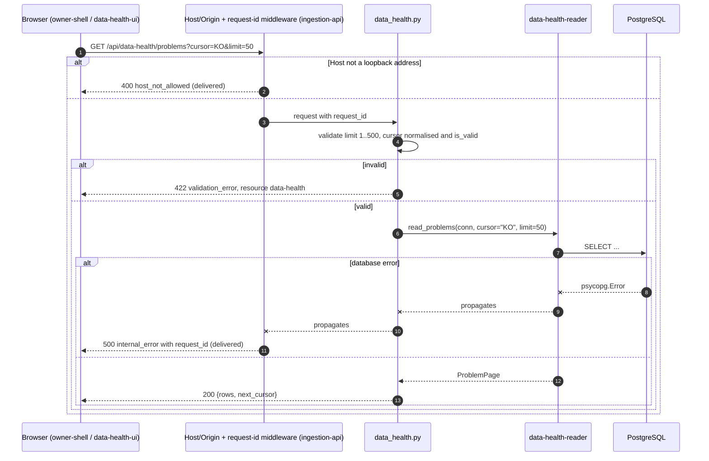

# Component: Data Health API

**Status:** draft
**Capability:** CAP-003
**Owner:** Alvaro de Jodra
**Last Updated:** 2026-10-25

This design was produced in an unattended `$design-run`. It applies DEC-0200,
DEC-0201, DEC-0203 and DEC-0208 without re-deciding them, DEC-0211 for the
delivered files it does not edit, and DEC-0220 for the one field it adds to
the system design's response shape; decisions live under
`projects/factorflow-v2/decisions/` in the harness repository. Positions
resting on a decision are marked **PROVISIONAL**.

## 1. Overview

`data-health-api` is the FastAPI router that serves the three new reads the
shell, Home and Data health need: `GET /api/attention`, `GET /api/data-health`
and `GET /api/data-health/problems` (system design §4.1, §4.2; DEC-0200,
PROVISIONAL). It is registered on the application `ingestion-api` builds, so
every request passes the delivered request-id, Host and Origin middleware and
leaves through the delivered error envelope, exactly as `classification-api`
does (DEC-0208). It validates the two query parameters, opens one pooled
connection, delegates to `data-health-reader` and shapes the result with
Pydantic models. It holds no SQL and no derivation.

Use cases addressed:

- The rail counts and Home's data items and data tile, on the shell's
  attention cadence (AC-8, AC-9, AC-16).
- Data health's verdict counts, check cards and the first *Needs fixing* page,
  on demand (AC-11, AC-13, AC-14, AC-21).
- Further *Needs fixing* pages by keyset (STD-UI-30).

Support matrix: the application container's single uvicorn worker bound to
`127.0.0.1:8000`, one browser client, no authentication (capability §5.3).

Dependencies: FastAPI, Starlette and Pydantic as delivered; the delivered
`app.state.db_pool`; `factorflow.api.errors.error_response`;
`factorflow.api.bounds.DEFAULT_PAGE_SIZE` and `MAX_PAGE_SIZE`;
`factorflow.instruments.symbols.normalise` and `is_valid`; and
`data-health-reader`.

## 2. Design Details

### 2.1 Placement

```
src/factorflow/api/routes/data_health.py     the router: three GET handlers
src/factorflow/api/data_health_models.py     Pydantic response models for the three reads
tests/unit/test_api_data_health_routes.py
tests/unit/test_api_data_health_models.py
tests/integration/test_api_data_health.py
tests/integration/test_api_data_health_host_origin.py
```

`data_health_models.py` is a new module rather than an addition to the
delivered `api/models.py`, following the `classification_models.py`
precedent, so this component edits no delivered file. The one line in
`src/factorflow/api/app.py` that includes this router, and the extension of
`tests/unit/test_api_no_secrets.py` to these routes, are `ingestion-api`'s
(DEC-0211, PROVISIONAL; `component-design-ingestion-api.md` in this
directory).

### 2.2 Request flow

The sequence shows one request through the delivered middleware into this
router and out again. The actors are the browser, the two delivered
middlewares, this router, `data-health-reader` and PostgreSQL. The decision
points are the delivered Host check, query validation on the problems route,
and whether the database answers. The outcome is a `200` with the response
model, a `422` validation envelope for a bad bound or cursor, or the delivered
`500` `internal_error` envelope with its request id, never a partial body
presented as complete.



### 2.3 Handlers

```python
# src/factorflow/api/routes/data_health.py
router = APIRouter()
_RESOURCE = "data-health"

@router.get("/api/attention", response_model=AttentionResponse)
def get_attention(request: Request) -> AttentionResponse:
    pool: ConnectionPool = request.app.state.db_pool
    with pool.connection() as conn:
        return AttentionResponse.from_reader(read_attention(conn))

@router.get("/api/data-health", response_model=DataHealthResponse)
def get_data_health(request: Request) -> DataHealthResponse:
    pool: ConnectionPool = request.app.state.db_pool
    with pool.connection() as conn:
        return DataHealthResponse.from_reader(read_data_health(conn))

@router.get("/api/data-health/problems", response_model=None)
def get_problems(
    request: Request,
    limit: int = Query(default=DEFAULT_PAGE_SIZE, gt=0, le=MAX_PAGE_SIZE),
    cursor: str | None = Query(default=None),
) -> JSONResponse | ProblemPageResponse:
    cursor_symbol = normalise(cursor) if cursor is not None else None
    if cursor_symbol is not None and not is_valid(cursor_symbol):
        return error_response(
            status_code=422,
            code="validation_error",
            message="`cursor` must be a stock symbol.",
            request_id=getattr(request.state, "request_id", "unknown"),
            resource=_RESOURCE,
        )
    pool: ConnectionPool = request.app.state.db_pool
    with pool.connection() as conn:
        return ProblemPageResponse.from_reader(
            read_problems(conn, cursor=cursor_symbol, limit=limit)
        )
```

A `limit` outside 1 to 500 is refused with `422` by the `Query` bound through
the delivered application-wide validation handler, never clamped, as
`GET /api/coverage` does. The message never echoes the submitted value
(DEC-0011 precedent in `app.py`).

### 2.4 Response models

The models mirror system design §4.2 field for field, plus each check's
`exception_count` (DEC-0220, PROVISIONAL), and keep the domain vocabulary: no
tier, no sentence (DEC-0200, PROVISIONAL; constraint 3).
Timestamps serialise as ISO-8601 with offset; session dates as `YYYY-MM-DD`.

| Model | Fields |
|-------|--------|
| `AttentionResponse` | `checked_at`; `followed_count`; `prices_as_of` (date or null); `credential_present` (bool); `problems {stock_count, symbols[≤3], newest_completed_at}`; `latest_download {run_id, state, requested_at, started_at, ended_at, progress {done, total or null}}` or null; `latest_terminal_download {run_id, state (the recorded terminal state: succeeded, partial, failed, cancelled or abandoned), ended_at, failure_reason}` or null; `items[] {kind, recorded_at, run_id or null}` |
| `DataHealthResponse` | `checked_at`; `never_acquired`; `followed_count`; `affected_count`; `checks {daily_prices, company_financials}`, each null exactly when `never_acquired` is true; `problems {rows, next_cursor}` |
| `DailyPricesCheckResponse` | `status` (`ok`, `exceptions`, `not_determinable`); `absent_count`; `gap_stock_count` (int or null); `behind_count`; `latest_session` (date or null); `gap_detection {available, reason}`; `exception_count`; `exception_symbols[≤5]` |
| `CompanyFinancialsCheckResponse` | `status` (`ok`, `exceptions`); `absent_count`; `problem_count`; `as_of` (timestamp or null); `exception_count`; `exception_symbols[≤5]` |
| `ProblemRowResponse` | `symbol`; `failures[] {data_type, outcome (failed or not_found), reason, attempts, completed_at, run_id}`; `retryable` |
| `ProblemPageResponse` | `rows[]`; `next_cursor` (symbol or null) |

`gap_stock_count` and the nullable dates are serialised as `null`, never
omitted and never `0`, so the interface can render not determinable and
absent apart from zero (STD-UI-4, STD-UI-14; DEC-0213). The checks are null
before anything was acquired so no check can read as passed (AC-21):
`never_acquired` gives the check cards their null state and is not the
screen's empty-state trigger. Data health's never-downloaded empty state is
triggered by `AttentionResponse.latest_terminal_download` being null, because
no download has ever ended (review v1 FINDING-10). That field's `state` is
also the data verdict's download input, read with the problem set by the
interface (DEC-0210, DEC-0217 as the owner amended them); the API passes it
through as recorded.

### 2.5 Messages

N/A, not applicable for this component. There is no push channel; the browser
polls `GET /api/attention` at the cadences `owner-shell` owns.

## 3. Constraints and Assumptions

- **Every route is `GET` and changes no state** (system design constraint 9),
  so the delivered Origin check, which applies to state-changing methods,
  never refuses them, and the Host check always applies.
- **No delivered request or response model changes** (constraint 2).
- **The domain vocabulary stays in the API** (constraint 3): field names are
  `instrument`-level facts and run states; nothing user-facing is composed
  here.
- **`200` whenever the database answers.** An empty store is a `200` with
  `never_acquired` true and zero counts on attention, not an error (AC-21).
- **Route order.** `/api/data-health/problems` and `/api/data-health` are
  literal paths with no parameter, so neither captures the other.
- **Canonical bounds** come from `api/bounds.py`; this component declares no
  new bound.

## 4. Security

- **Loopback, no authentication.** The routes inherit the delivered bind and
  the Host and Origin middleware, and rely on the `SEC-ENC-001 host-local
  loopback exception` for the browser-to-API channel under DEC-0050 as
  extended to this design by DEC-0208 (constraint 9); that exception's
  conditions H1 to H9, which CAP-001 delivered, govern the channel's
  transport. The basis for serving the routes without authentication
  (SEC-AUTH-001) is separate: they are not externally reachable, because the
  application binds to loopback only, and the owner's loopback decision
  (DEC-0050, DEC-0208) covers them. The exception does not by itself meet
  SEC-AUTH-001.
- **Input validation** (SEC-INP-001): `limit` is bounded, `cursor` is
  normalised and validated as a symbol before it reaches SQL, where it is a
  bound parameter (SEC-INP-002).
- **No secret in any response.** `credential_present` is a boolean; the
  delivered no-secrets test is extended to all three routes by
  `ingestion-api` (constraint 10; AC-4).
- **No internal detail in errors** (SEC-ERR-001): failures reach the delivered
  `internal_error` envelope, whose message is fixed and whose `request_id` the
  interface never shows.
- **Logging:** the delivered request-id stamping covers these routes; the
  handlers log nothing of their own beyond what the middleware does.
- **Dependencies:** none added.

## 5. Scalability and Performance

- `GET /api/attention` is safe to poll at 10 seconds: a handful of indexed
  aggregates (`data-health-reader` §5).
- `GET /api/data-health` runs the coverage derivation over the active roster
  and is called only on demand, by `data-health-ui` alone, never on an
  interval (system design §3.4 note 1); Home does not read it (DEC-0219,
  withdrawn by the owner on 2026-10-25). With 3,000 followed stocks it
  answers within 2 seconds at the 95th percentile (AC-28), asserted by the
  volume test `tests/integration/test_data_health_volume.py`
  (`data-health-reader` §7), which times this route.
- Each request holds one pooled connection for the duration of its read and
  releases it; no request opens a second.

## 6. Upgrade

- New routes only; existing clients are unaffected.
- No migration. Rollback is redeploying the previous image, which removes the
  routes; the interface of the same image is removed with them because the
  bundle ships in the same image.
- Manual actions: none.

## 7. Testing

| Test | File | What it proves |
|------|------|----------------|
| Shapes | `tests/unit/test_api_data_health_models.py` | Each model serialises every §4.2 field; nullable counts and dates serialise as `null`, never omitted, never 0 |
| Problems validation | `tests/unit/test_api_data_health_routes.py` | `limit` 0 and 501 give `422 validation_error`; a malformed cursor gives `422` with `resource` `data-health` and does not echo the value |
| Delegation | `tests/unit/test_api_data_health_routes.py` | Each handler calls its reader function once with one connection and returns its value unchanged |
| Database down | `tests/unit/test_api_data_health_routes.py` | A reader raising `psycopg.Error` yields the `500` `internal_error` envelope with `X-Request-Id` |
| End to end | `tests/integration/test_api_data_health.py` | Against a seeded PostgreSQL: attention and data-health bodies match the reader's values; `affected_count` equals the row count; keyset pages concatenate to the full problem set (AC-13, AC-16) |
| Empty store | `tests/integration/test_api_data_health.py` | `200` with `never_acquired` true and both checks `null` (AC-21) |
| Host and Origin | `tests/integration/test_api_data_health_host_origin.py` | A foreign `Host` gets `400 host_not_allowed` on all three routes; a foreign `Origin` on a `GET` is not refused (GET changes no state) |
| Latency | `tests/integration/test_data_health_volume.py` (`data-health-reader` §7) | With 3,000 followed stocks, `GET /api/data-health` has a 95th percentile of at most 2 seconds (AC-28) |

The no-credential assertion over these routes lives in the delivered
`tests/unit/test_api_no_secrets.py`, extended by `ingestion-api`.

## 8. Acceptance Criteria

1. The three routes answer `200` with the §4.2 shapes whenever the database
   answers, including on an empty store.
2. `limit` outside 1 to 500 and a cursor that is not a symbol are refused with
   `422 validation_error`, never clamped or ignored.
3. A database failure answers the delivered `500` envelope with a request id.
4. No response carries the credential's value or any sentence or tier.
5. A request whose `Host` is not a loopback address is refused by the
   delivered middleware before reaching a handler.
6. With 3,000 followed stocks, `GET /api/data-health` answers within 2
   seconds at the 95th percentile, measured by the volume test (AC-28).

## 9. Workflows

- **Every screen:** `owner-shell` polls `GET /api/attention` for the counts.
- **Home:** the data tile and the server items come from the same read.
- **Data health:** `GET /api/data-health` on load, on **Try again**, once when
  a download ends and after **Stop following**; **Show more** calls
  `GET /api/data-health/problems`. Data health is the only reader of
  `GET /api/data-health`; Home does not read it on mount (DEC-0219,
  withdrawn by the owner on 2026-10-25).
- **Setup step 4:** progress from the shell's attention read.

## 10. UX / GUI

N/A, not applicable for this component. It returns facts the interface words;
see `component-design-home-ui.md`, `component-design-data-health-ui.md` and
`component-design-owner-shell.md`.

## 11. API Endpoints

| Endpoint | Method/Operation | Auth/Privilege | Request | Response | Notes |
|----------|-----------------|----------------|---------|----------|-------|
| `/api/attention` | GET | none, loopback (DEC-0208) | none | `200 AttentionResponse`; `500` envelope | Polled by `owner-shell` every 60 s, every 10 s while a download is non-terminal (DEC-0200, PROVISIONAL) |
| `/api/data-health` | GET | none, loopback | none | `200 DataHealthResponse` with the first 50 problem rows; `500` envelope | On demand only (system design §3.4 note 1); sole consumer `data-health-ui` (DEC-0219 withdrawn); p95 ≤ 2 s at 3,000 stocks (AC-28) |
| `/api/data-health/problems` | GET | none, loopback | `limit` (default 50, max 500), `cursor` (last symbol) | `200 ProblemPageResponse`; `422 validation_error`; `500` envelope | Keyset by symbol (STD-UI-30) |

Interfaces consumed: `data-health-reader`'s `read_attention`,
`read_data_health` and `read_problems`; `ingestion-api`'s middleware, error
envelope and pool.

## 12. References

| Type | Document Name | Description | Link |
|------|---------------|-------------|------|
| System design | CAP-003 v1 | §3.3, §3.4, §4.2, constraints 2, 3, 7, 9, 10 | `docs/capabilities/CAP-003-app-shell-and-data-health/design/system-design.md` |
| Component design | CAP-001 ingestion API v8 | Middleware, error envelope, bounds, `app.state.db_pool` | `docs/capabilities/CAP-001-market-data-acquisition-foundation/design/component-design-ingestion-api.md` |
| Component design | CAP-003 data health reader | The functions and dataclasses this router serves | `docs/capabilities/CAP-003-app-shell-and-data-health/design/component-design-data-health-reader.md` |
| Component design | CAP-003 ingestion API changes | The `include_router` line and the no-secrets test | `docs/capabilities/CAP-003-app-shell-and-data-health/design/component-design-ingestion-api.md` |
| Decisions | DEC-0050, DEC-0200, DEC-0201, DEC-0203, DEC-0208, DEC-0210, DEC-0211, DEC-0213, DEC-0217, DEC-0219 (withdrawn), DEC-0220 | Owner's loopback decision, reads, definitions, items, loopback extension, the verdict's inputs (as amended), ownership, count rules, Home's on-demand read (withdrawn), exception count | `projects/factorflow-v2/decisions/` (harness repository) |
| Constitution | Harness security constitution | SEC-ENC-001 host-local loopback exception, SEC-INP-001, SEC-INP-002, SEC-ERR-001 | `docs/constitutions/security.constitution.md` (harness repository) |

## 13. Traceability

| Capability AC | System Design Element | Component Design Element | Section |
|--------------|----------------------|--------------------------|---------|
| AC-4 | No secret in new responses | `credential_present` boolean only | 4 |
| AC-8 | `prices_as_of`, `followed_count` | `AttentionResponse` | 2.4 |
| AC-9 | Items from current state | `items[]` passed through | 2.4 |
| AC-11 | `GET /api/data-health` | `DataHealthResponse` with `affected_count` and checks | 2.4 |
| AC-13 | Problem rows | `ProblemRowResponse` | 2.4 |
| AC-14 | `retryable` | `ProblemRowResponse.retryable` | 2.4 |
| AC-16 | `problems.stock_count` | `AttentionResponse.problems` | 2.4 |
| AC-21 | `never_acquired`; `latest_terminal_download` | Checks null, `never_acquired` true (check cards' null state); `latest_terminal_download` null is the screen's empty-state trigger | 2.4 |
| AC-23 | Health answers independently | These routes play no part in liveness; health stays the delivered route | 3 |
| AC-28 | `GET /api/data-health` at 3,000 stocks | p95 ≤ 2 s, asserted by the volume test | 5, 7 |

## 14. Open Questions

1. **Latency target for `GET /api/data-health`: answered.** The owner set
   AC-28 on 2026-10-25 (review v1 FINDING-4): p95 within 2 seconds at 3,000
   followed stocks, asserted by the volume test (section 5). *Owner:
   capability owner. Blocks: nothing.*
