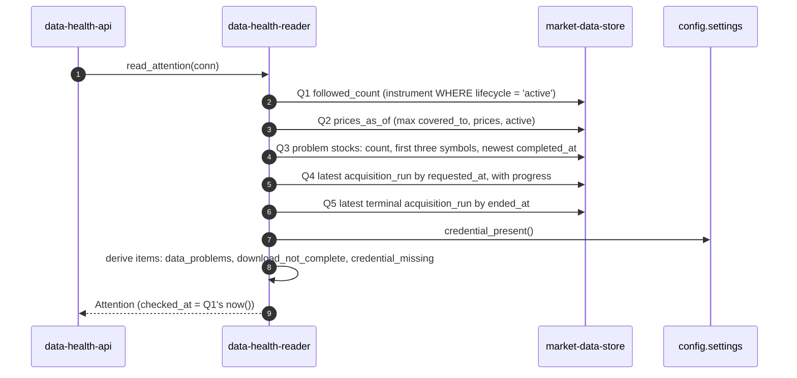
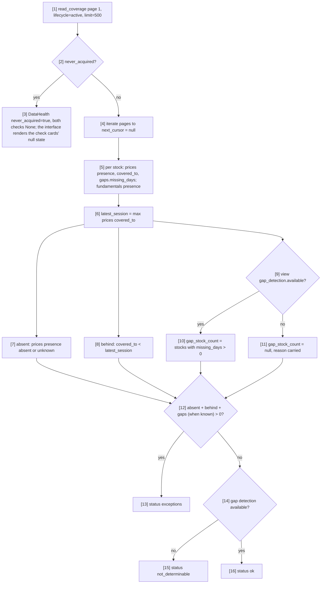

# Component: Data Health Reader

**Status:** draft
**Capability:** CAP-003
**Owner:** Alvaro de Jodra
**Last Updated:** 2026-10-25

This design was produced in an unattended `$design-run`. It applies the system
design's decisions DEC-0200 and DEC-0201 without re-deciding them, and records
two of its own, DEC-0213 (how each count treats absence, currency, gaps and
download progress) and DEC-0220 (each check carries its distinct exception
count), under `projects/factorflow-v2/decisions/` in the harness
repository. Positions resting on a decision are marked **PROVISIONAL**.

## 1. Overview

`data-health-reader` is the read-only Python module that turns what CAP-001
already recorded into the aggregates Home, the rail and Data health need: the
set of followed stocks with problems, the latest and latest-terminal
downloads with progress, the followed count, the prices as-of, the three
server-derived attention items, and the Daily prices and Company financials
checks (system design §4.1; DEC-0200, DEC-0201, PROVISIONAL). It is called only
by `data-health-api`, on a connection from the application container's
existing pool, and returns frozen dataclasses that mirror the three responses
in system design §4.2.

It writes nothing, defines no table and reads no provider (system design
constraint 1). It composes facts in the domain vocabulary (`instrument`,
`acquisition_run`, outcome) and never a sentence or a tier: the interface does
both (constraint 3; DEC-0200).

Use cases addressed:

- The rail's Data health count and Home's *Needs you* data items, read on the
  shell's attention cadence (AC-9, AC-16; capability flow 3).
- Data health's verdict counts, check cards and *Needs fixing* rows, read on
  demand (AC-11, AC-13, AC-14; capability flow 2).
- Setup's and Home's download progress (AC-7).
- The honest empty state before any download (AC-21): Data health's
  never-downloaded empty state is triggered by the attention read's
  `latest_terminal_download` being absent (no download has ever ended), and
  `coverage-service`'s `never_acquired` gives the check cards their null
  state (review v1 FINDING-10).

Support matrix: the application container, Python 3.12, PostgreSQL 16, one
owner, at most 3000 active instruments (STD-UI-30; CAP-001 AC-4).

Dependencies: `psycopg` 3 through the delivered `psycopg_pool`;
`factorflow.coverage.service.read_coverage` called in process, unchanged;
`factorflow.config.settings.credential_present`; the tables of migrations
`0001`, `0003` and `0004` (`instrument`, `coverage_segment`,
`acquisition_state`, `acquisition_run`, `run_instrument_result`).

## 2. Design Details

### 2.1 Placement

```
src/factorflow/data_health/__init__.py      exports read_attention, read_data_health, read_problems
src/factorflow/data_health/models.py        frozen dataclasses mirroring the three responses
src/factorflow/data_health/queries.py       parameterised SELECT statements, one constant each
src/factorflow/data_health/reader.py        the three functions, the check derivations, the item rules
tests/unit/test_data_health_sql_is_read_only.py
tests/unit/test_data_health_checks.py
tests/unit/test_data_health_items.py
tests/integration/test_data_health_problems.py
tests/integration/test_data_health_attention.py
tests/integration/test_data_health_checks.py
tests/integration/test_data_health_volume.py
```

Every file is new. No delivered file is edited (DEC-0211).

### 2.2 Interface

```python
# src/factorflow/data_health/__init__.py
def read_attention(conn: psycopg.Connection) -> Attention: ...
def read_data_health(conn: psycopg.Connection) -> DataHealth: ...
def read_problems(
    conn: psycopg.Connection, *, cursor: str | None, limit: int
) -> ProblemPage: ...
```

```python
# src/factorflow/data_health/models.py (abridged; every field is in system design §4.2)
@dataclass(frozen=True)
class Progress:
    done: int
    total: int | None            # None while instruments_named is 0 (DEC-0213 f)

@dataclass(frozen=True)
class LatestDownload:
    run_id: UUID
    state: str                   # requested | running | cancelling | succeeded | partial | failed | cancelled | abandoned
    requested_at: datetime
    started_at: datetime | None
    ended_at: datetime | None
    progress: Progress

@dataclass(frozen=True)
class LatestTerminalDownload:
    run_id: UUID
    state: str                   # succeeded | partial | failed | cancelled | abandoned, as recorded (2.6)
    ended_at: datetime
    failure_reason: str | None

@dataclass(frozen=True)
class Problems:
    stock_count: int
    symbols: tuple[str, ...]     # first three by symbol
    newest_completed_at: datetime | None

@dataclass(frozen=True)
class AttentionItem:
    kind: Literal["data_problems", "download_not_complete", "credential_missing"]
    recorded_at: datetime
    run_id: UUID | None          # set only for download_not_complete

@dataclass(frozen=True)
class Attention:
    checked_at: datetime
    followed_count: int
    prices_as_of: date | None
    credential_present: bool
    problems: Problems
    latest_download: LatestDownload | None
    latest_terminal_download: LatestTerminalDownload | None
    items: tuple[AttentionItem, ...]

@dataclass(frozen=True)
class Failure:
    data_type: str               # reference | prices | fundamentals | corporate_actions
    outcome: Literal["failed", "not_found"]
    reason: str | None
    attempts: int
    completed_at: datetime
    run_id: UUID

@dataclass(frozen=True)
class ProblemRow:
    symbol: str
    failures: tuple[Failure, ...]
    retryable: bool              # any failure with outcome failed (DEC-0201; AC-14)

@dataclass(frozen=True)
class ProblemPage:
    rows: tuple[ProblemRow, ...]
    next_cursor: str | None

@dataclass(frozen=True)
class GapDetectionState:
    available: bool
    reason: str | None

@dataclass(frozen=True)
class DailyPricesCheck:
    status: Literal["ok", "exceptions", "not_determinable"]
    absent_count: int
    gap_stock_count: int | None  # None when gap detection is unavailable (DEC-0213 c)
    behind_count: int
    latest_session: date | None
    gap_detection: GapDetectionState
    exception_count: int                 # distinct stocks in the union (DEC-0220)
    exception_symbols: tuple[str, ...]   # first five by symbol

@dataclass(frozen=True)
class CompanyFinancialsCheck:
    status: Literal["ok", "exceptions"]
    absent_count: int
    problem_count: int
    as_of: datetime | None
    exception_count: int                 # distinct stocks in the union (DEC-0220)
    exception_symbols: tuple[str, ...]

@dataclass(frozen=True)
class DataHealth:
    checked_at: datetime
    never_acquired: bool
    followed_count: int
    affected_count: int          # equals Problems.stock_count, one set (DEC-0201)
    daily_prices: DailyPricesCheck | None        # None exactly when never_acquired
    company_financials: CompanyFinancialsCheck | None
    problems: ProblemPage        # first page of 50
```

### 2.3 Reading the attention aggregate

The sequence shows `read_attention`, the cheap read the shell polls every 60
seconds and every 10 seconds while a download is non-terminal. Its actors are
`data-health-api`, this module and the market data store; every step is one
indexed `SELECT` on the same connection, and none calls `coverage-service`,
because the full coverage derivation is too expensive to poll (system design
constraint 7). The decision points are whether a download was ever requested,
whether the latest terminal download failed or was interrupted, and whether
the credential is present. The outcome is one `Attention` value whose three
item kinds exist exactly while their causes hold (AC-9).



### 2.4 The problem set (DEC-0201, PROVISIONAL)

A followed stock has a problem when it is active and any of its
`acquisition_state` rows has `last_outcome` `failed` or `not_found`. Each
failure's reason, attempts and completion time come from the
`run_instrument_result` row that outcome was recorded by, matched on
`(last_run_id, instrument_id, data_type)`, which is that table's primary key.
The same set is the rail count, `affected_count`, the attention `problems`
block and the *Needs fixing* rows, so every counted stock has a row with its
fix (AC-13, AC-16). A problem resolves only when a later download records
`written` for that data type or the owner stops following the stock; nothing
here records that a row was viewed (AC-9).

```sql
-- queries.py: PROBLEM_ROWS_SQL (keyset page by symbol)
SELECT i.symbol,
       s.data_type,
       s.last_outcome            AS outcome,
       r.reason,
       r.attempts,
       r.completed_at,
       s.last_run_id             AS run_id
  FROM instrument i
  JOIN acquisition_state s      ON s.instrument_id = i.instrument_id
  JOIN run_instrument_result r  ON r.run_id = s.last_run_id
                               AND r.instrument_id = s.instrument_id
                               AND r.data_type = s.data_type
 WHERE i.lifecycle = 'active'
   AND s.last_outcome IN ('failed', 'not_found')
   AND i.symbol IN (
         SELECT DISTINCT i2.symbol
           FROM instrument i2
           JOIN acquisition_state s2 ON s2.instrument_id = i2.instrument_id
          WHERE i2.lifecycle = 'active'
            AND s2.last_outcome IN ('failed', 'not_found')
            AND (%(cursor)s::text IS NULL OR i2.symbol > %(cursor)s)
          ORDER BY i2.symbol
          LIMIT %(limit_plus_one)s)
 ORDER BY i.symbol, s.data_type;
```

`read_problems` groups the rows by symbol, keeps `limit` stocks and returns
the last kept symbol as `next_cursor` only when a `limit + 1`th stock exists,
the lookahead `read_coverage` already uses, so a full final page carries no
cursor. `retryable` is true when any of the row's failures is `failed`; a row
whose failures are all `not_found` is never retryable (AC-14). The count query
`PROBLEM_COUNT_SQL` is the same predicate with `count(DISTINCT
i.instrument_id)`, the first three symbols and `max(r.completed_at)`.

### 2.5 The checks (DEC-0201, DEC-0213, PROVISIONAL)

The flowchart shows how `read_data_health` derives the two checks this module
owns from one pass over `coverage-service`'s pages. The actors are this module
and `read_coverage`, called with `lifecycle="active"` and `limit=500` until
`next_cursor` is null, which is six pages at 3000 stocks. The decision points
are whether anything was ever acquired, whether gap detection is available,
and whether any count is above zero. The outcome is two check values whose
status is `ok` only when every part could run and found nothing, and
`not_determinable`, never `ok`, when the gap part could not run and nothing
else is wrong (system design constraint 5).



**Never acquired.** When `read_coverage` reports `never_acquired`, it returns
no instruments, so there is nothing to count: both checks are `None` and the
interface renders the check cards' null state in their place. A check is never
returned with zero counts that could read as passed (AC-21; STD-UI-4).
`never_acquired` is not the screen's empty-state trigger: Data health shows
its never-downloaded empty state when the attention read's
`latest_terminal_download` is absent, because no download has ever ended
(2.6). A download that ended having stored nothing therefore still shows its
*Needs fixing* rows and Recent downloads (review v1 FINDING-10).

**Daily prices.** `absent_count` counts active stocks with no prices stored,
whether coverage reports the presence as `absent` (attempted, nothing stored)
or `unknown` (never attempted), because a followed stock that was never
downloaded holds no prices (DEC-0213 a). `behind_count` counts stocks with
prices whose `covered_to` is earlier than `latest_session`, the latest prices
`covered_to` over active stocks (DEC-0213 b; DEC-0201). `gap_stock_count`
counts stocks whose `gaps.missing_days` is above zero and is `null` when the
view reports gap detection unavailable (DEC-0213 c; STD-UI-4).
`exception_symbols` is the first five symbols of the union of the three
groups and `exception_count` the size of that union, because the groups
overlap (a stock can have gaps and be behind) and the browser cannot compute
the union from the part counts (DEC-0220, PROVISIONAL). The scope sentence the interface prints under the card (STD-UI-18) is
the interface's; this module returns only the facts.

**Company financials.** `absent_count` counts active stocks with no
fundamentals stored, on the same presence rule; `problem_count` counts active
stocks whose fundamentals `acquisition_state.last_outcome` is `failed` or
`not_found`, so a stock may be in both and `exception_symbols` is their union
(DEC-0213 e), with `exception_count` its size (DEC-0220). `as_of` is the latest fundamentals `last_acquired_at` whose
`last_outcome` is `written` over active stocks, `null` when none. The status
is `exceptions` when either count is above zero, else `ok`.

**Factor scores** is not derived here: the interface reads it from
`classification-api`'s summary through the shell (system design §3.4 note 4).

### 2.6 Downloads and progress

`LATEST_DOWNLOAD_SQL` selects the `acquisition_run` with the greatest
`requested_at`, and its progress in the same statement: `done` is the number
of instruments with a `run_instrument_result` row for all four data types in
that run (`GROUP BY instrument_id HAVING count(*) = 4`), and `total` is
`instruments_named`, returned as `None` while it is 0, before a runner has
claimed the download, so the interface shows indeterminate progress rather
than *0 of 0* (DEC-0213 f; system design assumption 3).
`LATEST_TERMINAL_SQL` selects the run with the greatest `ended_at` among the
five terminal states, with its `failure_reason`. Its `state` is the recorded
terminal state, returned as stored: `succeeded` (displayed *Complete*),
`partial`, `failed`, `cancelled` or `abandoned` (displayed *Interrupted*).
The interface reads it, with the problem set, as the data verdict's download
input (DEC-0210, DEC-0217 as the owner amended them: `failed` is critical,
`abandoned` serious), and reads its absence as "no download has ever ended",
Data health's never-downloaded empty state (AC-21). This module returns the
state and no tier (DEC-0200).

### 2.7 Attention items (DEC-0203, PROVISIONAL)

| Kind | Present when | `recorded_at` | `run_id` |
|------|--------------|---------------|----------|
| `data_problems` | `problems.stock_count > 0` | `problems.newest_completed_at` | none |
| `download_not_complete` | `latest_terminal_download.state` is `failed` or `abandoned` | its `ended_at` | its `run_id` |
| `credential_missing` | `credential_present()` is false | `checked_at` | none |

The two score-derived kinds of DEC-0203 are composed in the browser from the
classification summary, not here. Items carry no tier and no copy (DEC-0200).
Because the latest terminal download is by definition the newest one that
ended, "no later download ended succeeded or partial" in DEC-0203 holds
whenever kind 2 is present.

### 2.8 Database schema

No schema change, no migration, no index (system design §4.4). The reads use
the delivered indexes: `idx_instrument_active`, the `acquisition_state` and
`run_instrument_result` primary keys, `idx_run_result_failures` and
`idx_coverage_instrument`. The latest-run selections scan `acquisition_run`,
which holds one row per download the owner requested.

### 2.9 Messages

N/A, not applicable for this component. It publishes and consumes no message;
callers poll.

## 3. Constraints and Assumptions

- **Read-only by construction** (system design constraint 1). Every statement
  in `queries.py` is a `SELECT`; a unit test asserts the module's source
  contains no `INSERT`, `UPDATE`, `DELETE`, `TRUNCATE`, `ALTER` or `DROP`
  token, the pattern `tests/unit/test_sql_is_append_only.py` established.
- **No transaction is left open.** Each function runs its statements on the
  connection it is given and leaves commit and rollback to the caller's
  `with pool.connection()` block, which rolls back a read-only transaction on
  exit.
- **`coverage-service` is called unchanged** through its public
  `read_coverage`, page by page, with the canonical maximum of 500
  (`MAX_LIMIT`). A `ValueError` from it would be a programming error and is
  not caught.
- **Assumption: `acquisition_state` is current** (system design assumption
  2): the run journal and observation writer keep it as the latest outcome
  per instrument and data type.
- **Assumption: results are written as the download proceeds** (system
  design assumption 3), so `done` advances while a download runs.
- **The domain vocabulary stays here** (constraint 3): no field is named
  *stock* or *download*, and no sentence is composed.
- **Volume** (constraint 7): at most 3000 active instruments times four data
  types for the attention read, and six coverage pages for the on-demand
  aggregate.

## 4. Security

- **No input from the browser reaches SQL except the validated cursor and
  limit** of `read_problems`, both bound as parameters (SEC-INP-002); the
  cursor is validated as a symbol by `data-health-api` before the call
  (SEC-INP-001).
- **No secret is read or returned.** `credential_present()` returns a
  boolean; the key's value never enters this module (AC-4; AGT-PROHIB-001).
- **Provider text is data.** `reason` and `failure_reason` are returned as
  stored; the interface renders them as text (AGT-PROHIB-003).
- **Data classification:** Internal (SEC-DAT-001), as all CAP-001 data. No
  PII. System design §4.2 now carries the same classification for the new
  response elements it introduces.
- **No new dependency.** `psycopg` 3 and the delivered pool only, so no OSS
  inventory change.
- **Loopback reliance.** This design relies on the `SEC-ENC-001 host-local
  loopback exception` for one channel: the application process to
  PostgreSQL at `127.0.0.1:5432`, which every query of this module travels.
  The owner's loopback decision DEC-0050, as extended by DEC-0208, covers it,
  and DEC-0208's `artifacts` name this design.

## 5. Scalability and Performance

- **Attention read:** five aggregate statements over at most 3000 active
  instruments and their 12,000 `acquisition_state` rows, plus one progress
  aggregate over the latest run's results; safe at the 10 second cadence.
- **Data health read:** six `read_coverage` pages at 3000 stocks plus the
  problem page; read on demand only, by Data health alone, never polled
  (system design §3.4 note 1). With 3,000 followed stocks,
  `GET /api/data-health` answers within 2 seconds at the 95th percentile
  (AC-28), and the volume test asserts it.
- **Memory:** `read_data_health` folds each coverage page into running counts
  and keeps at most five exception symbols per check, so memory does not grow
  with the roster.
- **Concurrency:** one owner; requests share the delivered pool.

## 6. Upgrade

- **No migration and no data step.** Rollback is redeploying the previous
  image (system design §4.4; OPS-MIG-003).
- **Behaviour change after upgrade:** none in stored data; the module is new.
- **Manual actions:** none.

## 7. Testing

pytest with `testcontainers[postgres]` for database-backed tests, per the
tech stack.

| Test | File | What it proves |
|------|------|----------------|
| Read-only source | `tests/unit/test_data_health_sql_is_read_only.py` | No write or DDL keyword in `queries.py` or `reader.py` (constraint 1) |
| Daily prices status | `tests/unit/test_data_health_checks.py` | `exceptions` when any count is above zero; `not_determinable` when gaps are unavailable and nothing else is wrong; `ok` only when every part ran clean; `gap_stock_count` is `None`, never 0, when unavailable (DEC-0213 c, d) |
| Absent includes never attempted | `tests/unit/test_data_health_checks.py` | A stock with presence `unknown` counts in `absent_count`, not in `behind_count` (DEC-0213 a, b) |
| Financials overlap | `tests/unit/test_data_health_checks.py` | A stock both absent and failed counts in both, appears once in `exception_symbols` and once in `exception_count` (DEC-0213 e, DEC-0220) |
| Union count | `tests/unit/test_data_health_checks.py` | A stock with gaps that is also behind counts once in Daily prices' `exception_count` (DEC-0220) |
| Item rules | `tests/unit/test_data_health_items.py` | Each kind present exactly while its cause holds; `download_not_complete` only for `failed` and `abandoned`, never `partial` or `cancelled` (DEC-0203) |
| One problem set | `tests/integration/test_data_health_problems.py` | `affected_count`, `problems.stock_count` and the number of distinct row symbols are equal on the same data (DEC-0201; AC-13, AC-16) |
| Not found is not retryable | `tests/integration/test_data_health_problems.py` | A stock whose failures are all `not_found` has `retryable` false; a `failed` one true (AC-14) |
| Resolution | `tests/integration/test_data_health_problems.py` | A later run recording `written` for the data type removes the row; retiring the stock removes it; nothing else does (AC-9) |
| Keyset paging | `tests/integration/test_data_health_problems.py` | Pages of 2 over 5 problem stocks return 2, 2, 1 with cursors, and a full final page has no cursor |
| Progress | `tests/integration/test_data_health_attention.py` | `done` counts instruments with all four results; `total` is `None` while `instruments_named` is 0 (DEC-0213 f; AC-7) |
| Latest terminal | `tests/integration/test_data_health_attention.py` | A running download does not displace the latest terminal one; an `abandoned` latest terminal yields the item with its `run_id` |
| Never acquired | `tests/integration/test_data_health_checks.py` | An empty store returns `never_acquired` true and both checks `None`, so no check reports `ok` (AC-21); a store where a download ended and every request failed returns `never_acquired` true with `affected_count` and the problem rows populated, and a non-null `latest_terminal_download` (FINDING-10) |
| Retired stocks excluded | `tests/integration/test_data_health_checks.py` | A retired stock with a failure is in no count and no row |
| Volume | `tests/integration/test_data_health_volume.py` | 3000 active instruments with failures on 300: correct counts, keyset pages, memory bounded; after one warm-up request, 20 timed `GET /api/data-health` requests through the in-process application against that store have a 95th percentile of at most 2 seconds (AC-28) |

## 8. Acceptance Criteria

1. `affected_count`, `problems.stock_count` and the set of *Needs fixing* row
   symbols are always the same set of active stocks with a `failed` or
   `not_found` latest outcome.
2. Every problem row carries, per failure, the data type, the outcome, the
   reason, the attempts and the completion time of the result that recorded
   it.
3. A row whose failures are all `not_found` is never `retryable`.
4. A problem leaves every read only when a later download writes that data
   type or the stock is retired.
5. A check that could not run is `not_determinable` and never `ok`; a count
   that could not be computed is `null` and never 0.
6. `latest_download.progress.total` is `null` until the download is claimed,
   and `done` never exceeds `total`.
7. No statement writes to the store.
8. Failure scenario: a database error propagates to `data-health-api`, which
   answers the error envelope; no partial aggregate is returned as complete.
9. With 3,000 followed stocks, `GET /api/data-health` answers within 2
   seconds at the 95th percentile in the volume test (AC-28).

## 9. Workflows

- **Decide whether the data can be trusted** (capability flow 2): this module
  supplies the verdict counts, the two checks and the rows.
- **See what needs you today** (flow 3): the attention read supplies the data
  item, the failed-download item, the missing-key item and the rail count.
- **First download** (flow 1): progress of the download setup started.

## 10. UX / GUI

N/A, not applicable for this component. It renders nothing; every
user-visible string is composed by `home-ui`, `data-health-ui` and
`owner-shell` from its fields (DEC-0200).

## 11. API Endpoints

This component exposes no HTTP endpoint. Its Python interface is consumed by
`data-health-api`.

| Endpoint | Method/Operation | Auth/Privilege | Request | Response | Notes |
|----------|-----------------|----------------|---------|----------|-------|
| `read_attention(conn)` | Python call | in process | a pooled connection | `Attention` | Backs `GET /api/attention` |
| `read_data_health(conn)` | Python call | in process | a pooled connection | `DataHealth` | Backs `GET /api/data-health`; first problem page of 50 |
| `read_problems(conn, cursor, limit)` | Python call | in process | validated symbol cursor, `limit` 1 to 500 | `ProblemPage` | Backs `GET /api/data-health/problems` |
| `read_coverage(conn, lifecycle="active", cursor, limit=500)` | Python call, consumed | in process | as delivered | `CoverageView` | `coverage-service`, unchanged |

## 12. References

| Type | Document Name | Description | Link |
|------|---------------|-------------|------|
| Capability | CAP-003 v1 | AC-7, AC-9, AC-11, AC-13, AC-14, AC-16, AC-21, AC-28 | `docs/capabilities/CAP-003-app-shell-and-data-health/Capability-CAP-003.md` |
| System design | CAP-003 v1 | §3.3, §3.4, §4.1, §4.2, constraints 1, 3, 5, 7 | `docs/capabilities/CAP-003-app-shell-and-data-health/design/system-design.md` |
| Component design | CAP-001 coverage service | `read_coverage` contract, presence and gap semantics | `docs/capabilities/CAP-001-market-data-acquisition-foundation/design/component-design-coverage-service.md` |
| Schema | Migrations 0001, 0003, 0004 | The tables read | `src/factorflow/db/migrations/` |
| Decisions | DEC-0200, DEC-0201, DEC-0203, DEC-0208, DEC-0210, DEC-0213, DEC-0217, DEC-0220 | Server-side aggregates, problem and check definitions, item kinds, loopback, the verdict's inputs (as amended), count rules, exception count | `projects/factorflow-v2/decisions/` (harness repository) |
| Constitution | Tech stack v5 | Python 3.12, `psycopg` 3, pytest, testcontainers | `docs/constitution/tech-stack.md` |

## 13. Traceability

| Capability AC | System Design Element | Component Design Element | Section |
|--------------|----------------------|--------------------------|---------|
| AC-7 | `latest_download.progress` | Progress query and `total` null before claim | 2.6 |
| AC-9 | Items derived from current state only | Item rules; resolution only by a later write or retirement | 2.4, 2.7 |
| AC-11 | `checks`, `affected_count` | Daily prices and Company financials derivations | 2.5 |
| AC-12 | Recorded states only | Run state returned as recorded; checks carry exceptions | 2.5, 2.6 |
| AC-13 | One problem set with reasons | Problem rows from `acquisition_state` and `run_instrument_result` | 2.4 |
| AC-14 | `retryable` false for `not_found` | `retryable` rule | 2.4 |
| AC-16 | `problems.stock_count` | Same set as the rows | 2.4 |
| AC-21 | `never_acquired`; `latest_terminal_download` | `never_acquired` passed through from `coverage-service` for the check cards' null state; an absent `latest_terminal_download` is the screen's empty-state trigger | 2.5, 2.6 |
| AC-24 | Not determinable is a value | `null` counts and `not_determinable` status | 2.5 |
| AC-28 | `GET /api/data-health` at 3,000 stocks | Volume test asserts p95 ≤ 2 s | 5, 7 |

## 14. Open Questions

1. **Latency target for the on-demand aggregate at 3000 stocks: answered.**
   The owner set AC-28 on 2026-10-25 (review v1 FINDING-4): p95 within 2
   seconds at 3,000 followed stocks, which the volume test asserts (section
   7). *Owner: capability owner. Blocks: nothing.*
2. **DEC-0213 awaits the owner's verdict.** If the owner wants a never
   attempted stock shown apart from one the provider returned nothing for,
   the Daily prices card gains a fourth count and the response a field.
   *Owner: capability owner. Blocks: nothing now.*
