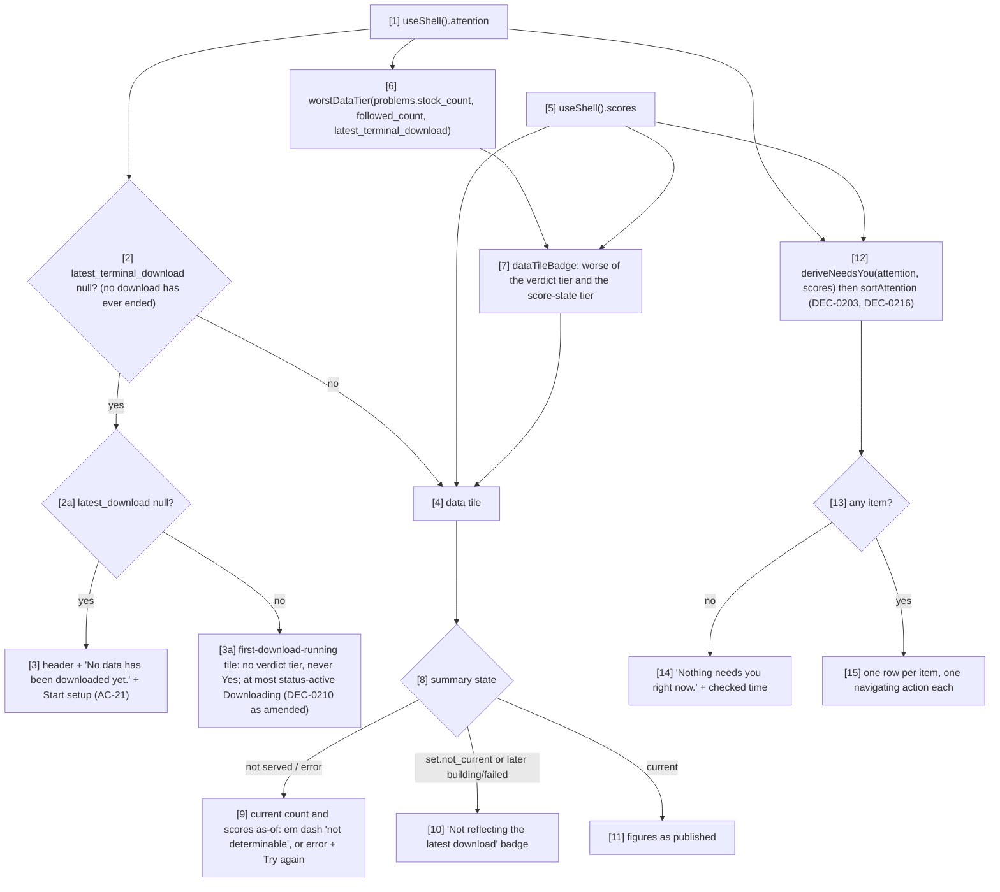

# Component: Home UI

**Status:** draft
**Capability:** CAP-003
**Owner:** Alvaro de Jodra
**Last Updated:** 2026-10-25

This design was produced in an unattended `$design-run`. It applies DEC-0202,
DEC-0203, DEC-0206, DEC-0209, DEC-0210 and DEC-0217 without re-deciding them,
DEC-0210 and DEC-0217 as the owner amended them on 2026-10-25, and records
DEC-0216 (the first-download item before the score read exists), under
`projects/factorflow-v2/decisions/` in the harness repository. DEC-0219, which
had Home read the data-health aggregate for its tile badge, was withdrawn by
the owner on 2026-10-25 (specification review v1 FINDING-4). Positions
resting on a decision are marked **PROVISIONAL**.

## 1. Overview

`home-ui` is the Home screen at `/home`: S01's M1 regions, which are the
header with the date and market state, the data tile alone in the summary row,
and *Needs you* beside it (system design §3.3; UX design 1.3). It answers
"what needs me today?" and "how current is the data?" in one look, and offers
exactly one navigating action per item. It renders no strategy, paper or live
region and no placeholder for one (AC-10; S01-7).

Nothing on Home mutates state (S01 §6). It reads only the shell's attention
and summary reads through `useShell()` and never `GET /api/data-health`. The
tile's badge is the worse of the verdict tier, which `worstDataTier` computes
from attention's problem set and latest terminal download exactly as Data
health's verdict does, and the summary's score-state tier (DEC-0210, DEC-0217
as amended, PROVISIONAL). While attention's `latest_terminal_download` is null
(no download has ever ended) the tile shows no verdict tier and never *Yes*:
AC-21's empty state before any download is requested, then the
first-download-running state until one ends (DEC-0210 as the owner amended it
on 2026-10-25: never-acquired replaces both with the empty state;
specification review v2 FINDING-2).

Use cases addressed: capability flow 3 and its alternates; AC-7 (the first
download's progress), AC-8, AC-9, AC-10, AC-12, AC-21, AC-24, AC-25.

Support matrix: as the shell. Dependencies: `owner-shell` (`useShell`),
`ui-components` (`deriveNeedsYou`, `sortAttention`, `worstDataTier`,
`dataTileBadge`, `StatusBadge`, `NotDeterminable`, `Absent`, `AsOfLine`,
formatters, `StateRegion`).

## 2. Design Details

### 2.1 Placement

```
web/src/screens/home/index.tsx           HomeScreen: header, summary row, Needs you; empty state
web/src/screens/home/header.tsx          h1 date (DEC-0209) and the as-of line with the market state
web/src/screens/home/market-state.ts     marketState(now): "closed" | "not_determinable" (DEC-0206)
web/src/screens/home/data-tile.tsx       the data tile
web/src/screens/home/needs-you-card.tsx  the card, its header and the list
web/src/screens/home/copy.ts             item titles, bodies, actions and every other string
web/src/screens/home/*.test.ts(x)
tests/e2e/home-needs-you.spec.ts
```

All new; no delivered file is edited.

### 2.2 From reads to regions

The flowchart is system design §3.3 at the component level. Its actors are the
shell's attention and summary reads and the three regions. The decision
points are whether any download has ever ended, whether any was ever
requested, whether the summary is served and current, and whether any item
applies. The outcome is a Home that names what needs the owner with one
action each, a tile that gives no verdict until a download has ended and then
carries Data health's verdict tier unless the score state is worse, and
counts and as-of lines that never present an absent or undetermined figure as
a value.



### 2.3 Header (DEC-0206, DEC-0209, PROVISIONAL)

- `h1`: *{Weekday}, {YYYY-MM-DD}*, today's calendar date in
  America/Chicago, the weekday in English (DEC-0209).
- As-of line (`AsOfLine`, `--text-xs` `--muted-foreground`): *{market state} ·
  prices current to {prices_as_of} · checked {time}*.
- `marketState(now)` returns `closed` on Saturdays and Sundays and on weekdays
  before 08:30 or from 15:00 America/Chicago, and `not_determinable` inside
  weekday 08:30 to 15:00, where a holiday or an early close cannot be told
  from an open session without a trading calendar (DEC-0206). `closed`
  renders *Market closed*; `not_determinable` renders `badge`
  `coverage-unknown` *Market state not determinable* with the tooltip and
  visually hidden text *FactorFlow has no trading calendar, so it can't tell
  a session from a holiday.* It is recomputed each minute from the clock with
  no read.
- `prices_as_of` renders as a session date, unconverted, or *prices not
  downloaded yet* when null; while the attention read fails it renders an em
  dash with *not determinable*.
- *checked {time}* is attention's `checked_at` as `HH:MM:SS zone`.

### 2.4 Data tile (AC-8; S01-6)

A `card` `metric` whose whole surface is one link to `/data`, titled *Data*.

| Part | Source | Rendering |
|------|--------|-----------|
| Badge | `dataTileBadge` over the verdict tier, `worstDataTier` from attention's `problems.stock_count`, `followed_count` and `latest_terminal_download`, and the summary's score-state tier (DEC-0210, DEC-0217 as amended); none of it while `latest_terminal_download` is null (below) | the verdict's `status-good` *Yes*, `status-warning` *Mostly yes*, `status-serious` *Mostly yes* or `status-critical` *No*, or, when the score state is worse, its own badge and label (`status-critical` *Score update failed*, `status-warning` *Not reflecting the latest download*); skeleton while attention loads; while attention fails the tile renders 1.3's Error state (*Couldn't read the data summary: {reason}.* with **Try again**) and no badge |
| Hero line | both figures from the summary's `stocks_current`: `current_count` of `followed_count` (the set's `active_instruments`) | *{current} of {followed} stocks current* at `--text-2xl` `--font-numeric`; only while the summary is not served or carries no `stocks_current` (never classified), `followed` is attention's `followed_count` and the current count an em dash with hidden *not determinable* |
| *Scores {YYYY-MM-DD HH:MM zone}* | summary `set.ended_at` | em dash with *not determinable* while not served; *No scores yet* when `never_classified` |
| *Prices {YYYY-MM-DD}* | attention `prices_as_of` | em dash with *not determinable* while attention fails |
| Scope sentence | static | *Every other number on this page is as of those times.* |
| Lag badge | summary `set.not_current` true, or `later` building or failed | `badge` `status-warning` *Not reflecting the latest download* under the as-of lines (AC-8) |

The score-state tier given to `dataTileBadge` is `tierOf({ of: "scores",
... })` over the summary's state, the tier Data health's Factor scores card
shows, and contributes no tier while the summary is not served. The verdict
tier comes from the same problem set (DEC-0201) and latest download Data
health's verdict uses, so the tile never reads better than the verdict and
reads worse only when the score state is.

**No download has ended yet** (DEC-0210 as the owner amended it on
2026-10-25: never-acquired replaces both with the empty state). The tile's
states are keyed on attention's `latest_terminal_download`. While it is null
no download has ever ended, so the tile shows no verdict tier and never
*Yes*: `worstDataTier` and `dataTileBadge` return no answer (`ui-components`
2.4), and neither the verdict nor the score-state badge renders. Before any
download is requested (`latest_download` null too) Home renders AC-21's empty
state (2.2), as before. From the first request until a download ends, the
tile renders the first-download-running state: the title *Data*, the body
*Your first download, started {YYYY-MM-DD HH:MM zone}, is running.* from
`latest_download`'s `started_at`, or its `requested_at` while it is queued,
and at most a `StatusBadge` `status-active` *Downloading*, shown only while
`latest_download.state` is `running`; never a verdict word, no hero count, no
as-of lines and no lag badge. The tile does not render the download's
progress, so none is added; the *Needs you* `first_download` item carries it
(2.5). The tile stays one link to `/data`. Once `latest_terminal_download` is
set, the table above applies.

### 2.5 *Needs you* (DEC-0203, DEC-0216, PROVISIONAL)

The list is `sortAttention(deriveNeedsYou(attention, scores))` from
`ui-components`, the same call the shell makes for the Home chip (AC-16). The
header is *Needs you · {n}* with the sub-line *Most important first. Nothing
here is urgent unless marked.* and *checked {time}* right-aligned. Copy per
kind (UX design 1.3):

| Kind | Tag, tier | Title | Body | Action, target |
|------|-----------|-------|------|----------------|
| `data_problems` | *Data*, warning | *{A} is missing data*; *{A}, {B} and {C} are missing data* for two or three; *{A}, {B}, {C} and {k} more stocks are missing data* beyond three | *Its scores show as Incomplete until the data is complete.* (one) or *Their scores show as Incomplete until the data is complete.* | **Fix data**, `/data` |
| `download_not_complete` | *Download*, critical (*Failed*) or serious (*Interrupted*) | *The last download failed* / *The last download was interrupted* | *{failure_reason}. Ended {ended_at}.* / *FactorFlow restarted mid-download. Download again to pick up the rest. Ended {ended_at}.* | **See download**, `/data/downloads/{run_id}` |
| `credential_missing` | *Setup*, critical | *The market data key is missing* | *Set `FACTORFLOW_MASSIVE_API_KEY` and restart FactorFlow. Downloads fail until then.* | **Open Settings**, `/settings` |
| `first_download` | *Download*, active | *Your first download is running* | *{done} of {total} stocks so far. Scores appear when it finishes.* | **See download**, `/data/downloads/{run_id}` |
| `first_scores` | *Scores*, active | *Your first scores are being produced* | *Scores appear when this finishes.* | **See download**, `/data/downloads/{run_id}` |
| `score_failed` | *Scores*, critical | *The latest score update failed* | *{reason}. Scores still show the set from the download started {start time}.*; when no set exists yet, *{reason}.* alone, because the second sentence would assert a set that is not recorded (capability §5.3) | **See details**, `/data` |

While the download's total is null (not yet claimed, DEC-0213 f), the
`first_download` body drops its count clause and reads *Scores appear when it
finishes.* alone, rather than showing a count it does not have. Each action is a link styled `button` `outline` whose accessible
name names the item (*Fix data for KO, TSLA and FBXX*, *See the download that
failed*, *Open Settings to set the market data key*). An item is present
exactly while its cause holds in the latest read, so it leaves only when the
cause is resolved, never because it was viewed (AC-9; S01-4).

### 2.6 Messages

N/A, not applicable for this component.

## 3. Constraints and Assumptions

- **No mutation from Home** (S01 §6): every action navigates.
- **Nothing unshipped** (AC-10; constraint 11): the summary row's second and
  third columns are empty, not placeholders; no *+ New strategy*, no *next
  rebalance*, no right-hand header action.
- **Not determinable is a value** (constraint 5): the current count, the
  scores as-of, the market state inside session hours and any figure whose
  read fails render through `NotDeterminable` or `Absent`, never as `0`.
- **No aggregate read** (review v1 FINDING-4): Home never reads
  `GET /api/data-health`; the badge comes from the shell's polled attention
  and summary reads, so the first screen waits on no coverage derivation.
- **Assumption:** the summary's `set.ended_at` is the time scores were
  produced, as `classification-api` publishes it.
- **The weekday is English** (DEC-0209); there is one locale.

## 4. Security

- Renders `credential_present` only through the `credential_missing` item;
  never the key's value.
- `failure_reason` and score `reason` are provider or engine text, rendered as
  text (AGT-PROHIB-003).
- No storage, no request beyond the shell's reads.

## 5. Scalability and Performance

- The list holds at most six items; the data item names at most three symbols
  and a count.
- No read of its own; the shell's polling drives every update.

## 6. Upgrade

- New screen. `/` opens Home once a download has been requested; until the
  redirects are removed, a bookmark to `/coverage` still lands on Coverage,
  not Home.
- M2 adds the paper and live tiles, strategy items and the strategy list in
  the empty grid columns and below; nothing is reserved.

## 7. Testing

| Test | File | What it proves |
|------|------|----------------|
| Empty state | `web/src/screens/home/home.test.tsx` | `latest_download` null renders *No data has been downloaded yet.* with **Start setup**; no tile, no list (AC-21) |
| First download running | `web/src/screens/home/data-tile.test.tsx` | With `latest_download` `requested` or `running` and `latest_terminal_download` null, `problems.stock_count` 0 and the summary at `404` or `never_classified`, the tile shows *Your first download, started {time}, is running.* and no *Yes*, *Mostly yes*, *No* or score-state badge; `status-active` *Downloading* only while `running`, none while `requested`; once `latest_terminal_download` is set the verdict badge renders (DEC-0210 as amended; STD-UI-18) |
| Tile figures | `web/src/screens/home/data-tile.test.tsx` | Current of followed, both from `stocks_current` when served and never more current than followed; attention's `followed_count` only while the summary is not served; both as-of lines; em dash with *not determinable* for each figure whose source is not served; never `0` (AC-8; STD-UI-4) |
| Lag | `web/src/screens/home/data-tile.test.tsx` | `set.not_current` or `later` building or failed shows *Not reflecting the latest download* (AC-8) |
| Tile matches verdict | `web/src/screens/home/data-tile.test.tsx` | For the same problem set and latest download, the tile's verdict tier equals `data-health-ui`'s verdict badge; a worse score state wins with its own label; *No scores yet* and *Updating* never displace the answer; no request to `/api/data-health` is made (DEC-0210, DEC-0217) |
| Item catalogue | `web/src/screens/home/needs-you-card.test.tsx` | Each kind's tag, tier, title, body and single action; plural forms; `score_failed` without a set drops the second sentence (AC-9) |
| Order and resolution | `web/src/screens/home/needs-you-card.test.tsx` | Critical before serious before warning, newest first within a tier; an item leaves only when the next read lacks its cause (AC-9; S01-4) |
| First download before scores | `web/src/screens/home/needs-you-card.test.tsx` | With the summary at `404` and no terminal download, the first-download item shows its progress (AC-7; DEC-0216) |
| Nothing unshipped | `web/src/screens/home/home.test.tsx` | No element with strategy, paper or live text or role (AC-10; S01-7) |
| Market state | `web/src/screens/home/market-state.test.ts` | Saturday, Sunday, weekday 08:29 and 15:00 are closed; weekday 08:30 to 14:59 is not determinable, in America/Chicago across a DST change (DEC-0206) |
| Date heading | `web/src/screens/home/header.test.tsx` | *Thursday, 2026-10-15* (DEC-0209; STD-UI-5) |
| Journey | `tests/e2e/home-needs-you.spec.ts` | A partial download leaving three stocks failed shows the data item and the Data health chip; **Fix data** opens Data health; after a clean download the item leaves (capability flow 3) |

## 8. Acceptance Criteria

1. Home shows the date and market state, a data tile with current of followed
   and the scores and prices as-of times, and *Needs you*.
2. The tile says when scores do not reflect the latest download.
3. Every item has exactly one navigating action; items sort by tier then
   recency and leave only on resolution.
4. Before any download, Home states that no data has been downloaded and
   offers setup; until a download has ended, the data tile gives no verdict
   and never *Yes*.
5. No strategy, paper or live region or placeholder renders.
6. Failure scenario: a failed attention read keeps the header, replaces the
   card bodies with *Couldn't read {what needs you / the data summary}:
   {reason}.* and **Try again**, and ages *checked {time}*.

## 9. Workflows

Capability flow 3 in full, and the end of flow 1 (Home showing the first
download's progress). Intersects Data health (**Fix data**, **See details**,
the tile), the download detail (**See download**), Settings (**Open
Settings**) and setup (**Start setup**).

## 10. UX / GUI

From UX design §1.3.

**Layout.** Main region capped at 1180 px, regions `--space-5` apart:
(1) the header row; (2) the summary row, a three-column grid with the data
tile in the first column and the other two empty; (3) the *Needs you* `card`
`default` beside the tile, spanning the remaining two columns of the summary
row and the full width below it. Each item row: a 28 px severity tile (tier
fill and shape, `aria-hidden`), the tier `badge` with the item's tag, a
one-line title at weight 600, one or two sentences of body, and the action at
the right; rows separated by `--border`.

**Component mapping.**

| UI Element | Component | Variant | Design Spec Reference |
|------------|----------|---------|-----------------------|
| Data tile | `card` | `metric`, the whole card one link | `design-system/components/card/design-spec.md` |
| Tile badge; lag badge | `badge` | `status-good` / `status-warning` / `status-serious` / `status-critical`; `status-warning` | `design-system/components/badge/design-spec.md` |
| Undetermined figures; market state inside hours | `badge` and em dash | `coverage-unknown`; `--value-missing` em dash | `design-system/components/badge/design-spec.md` |
| Needs you card | `card` | `default` | `design-system/components/card/design-spec.md` |
| Needs-you item | `ui-components` `NeedsYouItem` pattern | `badge` + `button` | `design-system/components/badge/design-spec.md`, `design-system/components/button/design-spec.md` |
| Item tag | `badge` | `status-<tier>` | `design-system/components/badge/design-spec.md` |
| Item action | `button` | `outline`, a link | `design-system/components/button/design-spec.md` |
| Start setup | `button` | `default`, a link to `/setup` | `design-system/components/button/design-spec.md` |
| Try again | `button` | `outline` | `design-system/components/button/design-spec.md` |

**States** (UX design 1.3). Loading: skeleton header line, tile and three
item rows. Empty, never populated: `latest_download` null, one `card`
`default` with `h2` *No data has been downloaded yet.*, *Set up FactorFlow to
name the stocks to follow and start the first download.* and **Start setup**;
the header still renders. From the first request until a download ends
(`latest_terminal_download` null), the tile is in its first-download-running
state (2.4) with no verdict tier, and *Needs you* renders. Empty, nothing found: *Nothing needs you right
now.* with *checked {time}*. Partial: the tile at its warning tier with
counts; the affected stocks named in an item. Stale: the lag badge; *checked
{time}* ages while attention fails. Unavailable: score figures and the
score-derived items while the summary answers `404` (server items still
render, the first-download item per DEC-0216); market state inside session
hours; the price as-of while attention fails. Error: per card, header kept,
body replaced by *Couldn't read {what needs you / the data summary}:
{reason}.* and **Try again**; a summary error other than `404` renders inside
the tile the same way. Unreachable: the shell state.

**Tokens.** `--card` / `--card-foreground`, `--border`; `h1` `--text-xl`;
card titles `--text-lg`; the hero count `--text-2xl` in `--font-numeric`;
as-of lines and *checked* `--text-xs` `--muted-foreground` (4.5:1 on
`--card`, checked not assumed); tier badges `--status-<tier>` on
`--status-<tier>-muted`; the severity tile `--status-<tier>` with its shape
in `--status-foreground`; not determinable `--value-indeterminate` on
`--value-indeterminate-muted` with `--pattern-indeterminate`; the em dash
`--value-missing`; item action `--input` border and `--ring` focus; grid gaps
`--space-5`; item padding `--space-3` by `--space-4`. No `--gain` or `--loss`.

**Accessibility.** `main` with the date `h1`; each card a `section` labelled
by its `h2`. The tile is one link named by its title, tier and figures (*Data:
mostly yes. 1,233 of 1,236 stocks current. Scores 2026-10-15 17:46 CDT,
prices 2026-10-15.*); in the first-download-running state, by its title and
sentence (*Data: your first download, started 2026-10-15 16:02 CDT, is
running.*). The list is a `ul` of `li`s; the severity tile is
`aria-hidden` and the tag carries the tier in words. A changed count is
announced politely through the card's live region and focus never moves. The
em dash carries hidden *not determinable* so a screen reader never hears a
bare dash.

**Internationalization.** None; the weekday is English, the date ISO-8601.

## 11. API Endpoints

Consumed; none exposed.

| Endpoint | Method/Operation | Auth/Privilege | Request | Response | Notes |
|----------|-----------------|----------------|---------|----------|-------|
| `/api/attention` (via `useShell`) | GET | none, loopback | none | `AttentionResponse` | Shell cadence |
| `/api/classifications/summary` (via `useShell`) | GET | none, loopback | none | `ClassificationSummaryResponse` or `404` | Shell cadence |

## 12. References

| Type | Document Name | Description | Link |
|------|---------------|-------------|------|
| UX design | CAP-003 v1 | §1.3 Home, §0.8 date departure | `docs/capabilities/CAP-003-app-shell-and-data-health/design/ux-design.md` |
| Screen spec | PRODUCT-UX-S01 v4 | M1 regions, item, states, S01-3 to S01-7 | `docs/ux/screens/S01-home.md` |
| System design | CAP-003 v1 | §3.3 and notes | `docs/capabilities/CAP-003-app-shell-and-data-health/design/system-design.md` |
| Decisions | DEC-0202, DEC-0203, DEC-0206, DEC-0209, DEC-0210, DEC-0216, DEC-0217 | Completion, items, market state, date, worst tier (as amended 2026-10-25), first download, the full tier order (as amended 2026-10-25) | `projects/factorflow-v2/decisions/` (harness repository) |

## 13. Traceability

| Capability AC | System Design Element | Component Design Element | Section |
|--------------|----------------------|--------------------------|---------|
| AC-7 | Needs-you kind 4 | `first_download` item with progress | 2.5 |
| AC-8 | Tile from summary and `prices_as_of` | Data tile, lag badge | 2.4 |
| AC-9 | `sortAttention`; items from current state | The list | 2.5 |
| AC-10 | M1 regions only | Empty grid columns, no strategy region | 3 |
| AC-12 | Recorded states only | *Interrupted* serious; never shown complete | 2.5 |
| AC-21 | `latest_download` null; `latest_terminal_download` null | Empty state with **Start setup**; first-download-running tile with no verdict | 2.2, 2.4 |
| AC-24 | States per region | States paragraph | 10 |
| AC-25 | *checked {time}*; keyboard | As-of line; links and buttons only | 2.3, 10 |
| AC-26 | `ui-components` | Component mapping | 10 |
| AC-16 | Home count = list length | Same `deriveNeedsYou` call as the chip | 2.5 |

## 14. Open Questions

1. **The tile's answer word on Home** (*Yes*, *Mostly yes*): UX design §7
   notes the question it answers is not on screen. *Owner: capability owner.
   Blocks: one row of copy.*
2. **DEC-0203's five item kinds have not been seen rendered by the owner.**
   *Owner: capability owner. Blocks: nothing.*
