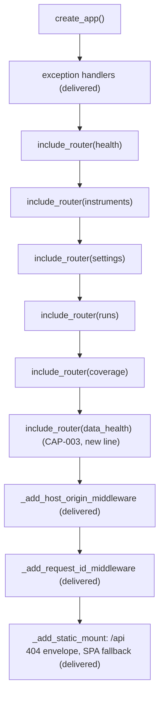

# Component: Ingestion API (CAP-003 changes)

**Status:** draft
**Capability:** CAP-003
**Owner:** Alvaro de Jodra
**Last Updated:** 2026-10-25

This design records only what CAP-003 changes in `ingestion-api`, the
component CAP-001 delivered and whose approved design,
`docs/capabilities/CAP-001-market-data-acquisition-foundation/design/component-design-ingestion-api.md`
(v8), stays as it is (AGT-SCOPE-002: the new capability owns the change, the
delivered one is not reopened). It was produced in an unattended
`$design-run`; the allocation of these two edits to this component rather than
to `data-health-api` is DEC-0211 (**PROVISIONAL**), recorded under
`projects/factorflow-v2/decisions/` in the harness repository.

## 1. Overview

CAP-003 adds three read routes in a new router, `data-health-api`, and
registers it on the application `ingestion-api`'s factory builds, so the new
routes sit behind the delivered request-id, Host and Origin middleware and the
delivered error envelope (system design §1, §4.1, §4.2 *Router registration*;
DEC-0208). Two delivered files change, and nothing else in this component:

1. `src/factorflow/api/app.py` gains one `include_router` call and one import.
2. `tests/unit/test_api_no_secrets.py` gains the no-credential assertion for
   the three new routes (system design constraint 10).

Every delivered endpoint is consumed by the new screens unchanged: no request
model, response model, status code, refusal or middleware rule changes
(constraint 2; AC-17). The endpoints setup, Data health and the palette call
are listed in section 11 with the consumer each now has.

Use cases addressed: the new routes are reachable (AC-11, AC-16) and inherit
the loopback posture and the envelope; the credential stays out of every
response (AC-4).

Support matrix and dependencies: unchanged from the CAP-001 design §1.

## 2. Design Details

### 2.1 Delivered files this component edits (DEC-0211, PROVISIONAL)

```
src/factorflow/api/app.py               + import of data_health; + app.include_router(data_health.router)
tests/unit/test_api_no_secrets.py       + one test: the three new routes never echo the credential
```

No other `ingestion-api` file changes. `api/models.py`, `api/bounds.py`,
`api/errors.py` and every route module are untouched;
`data-health-api` brings its own `data_health_models.py`.

### 2.2 Router registration

The diagram shows the application factory after the change. The actors are
`create_app`, the delivered routers, the new router and the static mount.
The one decision point is order: the new router is included with the
delivered routers, before `_add_static_mount`, so its `/api` paths are matched
before the SPA fallback and an unknown `/api` path still answers the
`not_found` envelope. The outcome is that the three routes run every
delivered middleware in the delivered order and nothing else about the
application changes.



```python
# src/factorflow/api/app.py (the two changed lines)
from factorflow.api.routes import coverage, data_health, health, instruments, runs, settings
...
    app.include_router(coverage.router)
    app.include_router(data_health.router)   # CAP-003: GET /api/attention, /api/data-health[/problems]
```

If CAP-002's `classification-api` has already added its two
`include_router` calls when this change lands, the new line goes after them;
order among the `/api` routers does not matter because no path overlaps.

### 2.3 The no-secrets test

```python
# tests/unit/test_api_no_secrets.py (added test)
@pytest.mark.parametrize(
    "path", ["/api/attention", "/api/data-health", "/api/data-health/problems"]
)
def test_data_health_routes_never_echo_credential(
    monkeypatch: pytest.MonkeyPatch, path: str
) -> None:
    secret_value = "sk-super-secret-massive-key-0123456789"
    monkeypatch.setenv("FACTORFLOW_MASSIVE_API_KEY", secret_value)
    monkeypatch.setenv("FACTORFLOW_DATABASE_URL", "postgresql://unused@127.0.0.1/unused")
    # The reader is replaced by fixtures returning populated values, and the pool
    # by a stub whose connection() yields a dummy, so each route answers 200
    # without a database and without waiting on the pool's 30 s checkout timeout.
    stub_reader_functions(monkeypatch, credential_present=True)

    app = create_app()
    with TestClient(app, base_url="http://127.0.0.1:8000") as client:
        app.state.db_pool = StubPool()
        response = client.get(path)

    assert response.status_code == 200
    assert secret_value not in response.text
```

`stub_reader_functions` and `StubPool` are small helpers added in the same
test file. The assertion is that a populated `200` body never carries the
value, which is the case the delivered health test proves for its route.
`credential_present` against a real database is covered by
`data-health-api`'s integration test.

### 2.4 Messages

N/A, not applicable for this component. Unchanged from CAP-001.

## 3. Constraints and Assumptions

- **Delivered endpoints are consumed unchanged** (system design constraint 2).
  This component's CAP-003 change adds a line; it alters no behaviour any
  CAP-001 acceptance criterion depends on.
- **Middleware order is the delivered order.** Starlette runs the request-id
  middleware outside the Host and Origin middleware, so every refusal on the
  new routes carries a request id, as on the delivered ones.
- **`_resource_for_path` is not extended.** A `422` raised by FastAPI's own
  `limit` bound on `/api/data-health/problems` reports `resource` as
  `problems`, the delivered fallback (the last path segment); the router's
  own cursor refusal names `data-health`. Neither is shown to the owner, so
  no edit to `app.py` beyond the router line is warranted.
- **Assumption:** CAP-002's two `include_router` calls and this one may land
  in either order (system design open question 2); none conflicts.

## 4. Security

- **Loopback exception.** The new routes are reached only through the
  delivered bind and the Host and Origin checks, so the `SEC-ENC-001
  host-local loopback exception` conditions H1 to H9 continue to hold for the
  browser-to-API channel, as DEC-0208 records for this design.
- **No secret in any response** (AC-4; SEC-ERR-001): enforced by the extended
  test in 2.3.
- **No dependency change.**

## 5. Scalability and Performance

Unchanged. The new routes share the delivered single worker and pool; their
load is described in `component-design-data-health-api.md` section 5.

## 6. Upgrade

- One added router; no route, model or middleware removed.
- Rollback is redeploying the previous image; the route disappears with it.
- Manual actions: none.

## 7. Testing

| Test | File | What it proves |
|------|------|----------------|
| No credential in the new routes | `tests/unit/test_api_no_secrets.py` (delivered, extended) | The key's value appears in no body or error of the three routes (AC-4; constraint 10) |
| Router is registered | `tests/integration/test_api_data_health.py` (`data-health-api`'s) | The three paths answer through the delivered application, not `404 not_found` |
| Static fallback intact | `tests/integration/test_api_static_mount.py` (delivered, unchanged) | Unknown `/api` paths still answer the envelope; non-API paths still fall back to `index.html` |
| Host and Origin intact | `tests/unit/test_api_host_origin.py` (delivered, unchanged) | The delivered refusals still hold |

## 8. Acceptance Criteria

1. `GET /api/attention`, `GET /api/data-health` and
   `GET /api/data-health/problems` are served by the application `create_app`
   builds, behind the delivered middleware and envelope.
2. No delivered route's request, response, status or refusal changes.
3. None of the three new routes ever returns the credential's value.

## 9. Workflows

Every CAP-001 workflow is unchanged. The new screens reach the delivered
endpoints listed in section 11 for following stocks, setting the history
depth, starting, queueing and cancelling downloads and stopping following,
with the delivered confirmations and refusals (AC-17).

## 10. UX / GUI

N/A, not applicable for this component. It serves the interface's bundle as
CAP-001 delivered it; the interface itself is `owner-shell`'s and the screen
components'.

## 11. API Endpoints

The new routes are `data-health-api`'s (its section 11). The delivered
endpoints below gain CAP-003 consumers and are used unchanged (system design
§4.2).

| Endpoint | Method/Operation | Auth/Privilege | Request | Response | Notes |
|----------|-----------------|----------------|---------|----------|-------|
| `/api/health` | GET | none, loopback | none | `status`, `database`, `credential_present`, `schema_version`, `most_recent_run` | `owner-shell` polls every 30 s; `/` redirect and the unreachable state |
| `/api/settings/history-depth` | GET, PUT | none, loopback | `{"years": n}`, 1 to 50 | `years` or null; `422` beyond | `setup-ui` step 2; `data-health-ui` What you follow; Settings (`owner-web-app`) |
| `/api/instruments` | GET | none, loopback | `symbol` prefix, `lifecycle`, `limit`, `cursor` | instruments, `active_count`, `retired_count`, `next_cursor` | `setup-ui` (`limit=1`), `data-health-ui` (`limit=1`), `command-palette` (`limit=8`, `lifecycle=active`) |
| `/api/instruments` | POST | none, loopback | `{"symbols": [...]}`, at most 1000 | `added`, `reactivated`, `rejected`; `409` all duplicate; `422` all malformed | `setup-ui` step 3 |
| `/api/instruments/{symbol}` | DELETE | none, loopback | path symbol | `200` retired; `404`, `409` | `data-health-ui` **Stop following** |
| `/api/acquisition-runs` | POST | none, loopback | none | `202 {run_id, queued_behind}`; `409 history_depth_not_set`, `no_active_instruments` | `setup-ui` **Start download**; `data-health-ui` **Download now** (AC-15) |
| `/api/acquisition-runs` | GET | none, loopback | `limit=5` | runs, newest first | `data-health-ui` Recent downloads |

## 12. References

| Type | Document Name | Description | Link |
|------|---------------|-------------|------|
| Component design | CAP-001 ingestion API v8 (approved, not edited) | Factory, middleware, envelope, endpoint table | `docs/capabilities/CAP-001-market-data-acquisition-foundation/design/component-design-ingestion-api.md` |
| System design | CAP-003 v1 | §1, §4.1 (existing components changed), §4.2, constraints 2, 9, 10 | `docs/capabilities/CAP-003-app-shell-and-data-health/design/system-design.md` |
| Component design | CAP-003 data health API | The router included here | `docs/capabilities/CAP-003-app-shell-and-data-health/design/component-design-data-health-api.md` |
| Decisions | DEC-0208, DEC-0211 | Loopback exception reliance; ownership of the two edits | `projects/factorflow-v2/decisions/` (harness repository) |
| Constitution | Agent governance | AGT-SCOPE-002, delivered capabilities are not reopened | `docs/constitutions/agent-governance.constitution.md` (harness repository) |

## 13. Traceability

| Capability AC | System Design Element | Component Design Element | Section |
|--------------|----------------------|--------------------------|---------|
| AC-4 | Constraint 10, no-secrets test extended | Added parametrised test | 2.3 |
| AC-11 | `Router registration` | `include_router(data_health.router)` | 2.2 |
| AC-16 | `Router registration` | As above, serving `/api/attention` | 2.2 |
| AC-17 | Constraint 2, endpoints unchanged | No delivered model or route edited | 2.1, 11 |

## 14. Open Questions

1. **Landing order with CAP-002** (system design open question 2): both
   capabilities add `include_router` lines to `app.py`. Either order works;
   whichever lands second places its line after the other's. *Owner:
   capability owner (sequencing). Blocks: nothing.*
