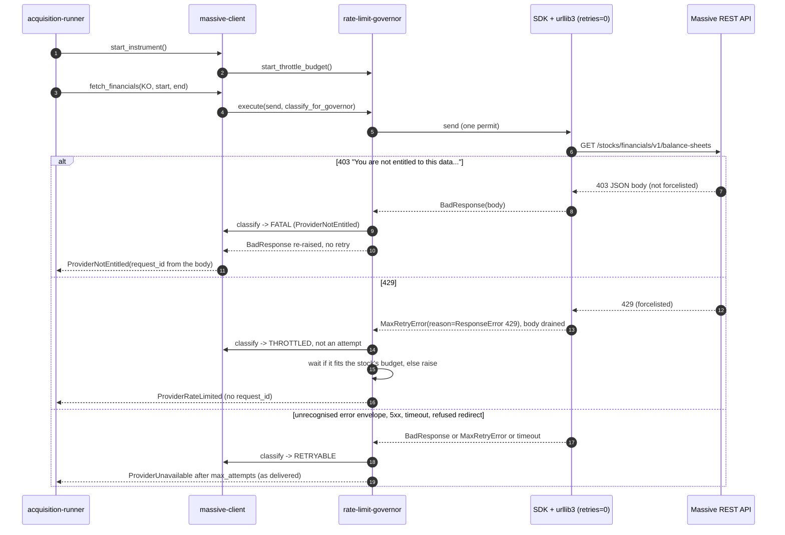

# Component: Massive Client (CAP-003 changes)

**Status:** draft
**Capability:** CAP-003
**Owner:** Alvaro de Jodra
**Last Updated:** 2026-11-07

This design records only what CAP-003 changes in `massive-client`, the
component CAP-001 delivered. Its approved design,
`docs/capabilities/CAP-001-market-data-acquisition-foundation/design/component-design-massive-client.md`
(v15), stays as it is: the new capability owns the change and the delivered one
is not reopened (AGT-SCOPE-002; owner's answer to CAP-001 specification review
v14 FINDING-56, recorded in capability v2's revision note and system design v2
§4.1). The change is the `massive-client` part of capability v2's *Provider
refusals reported by cause* (AC-29, AC-30), as system design v2 §3.6 notes 1,
2 and 5, §4.1 and constraint 16 assign it.

The abandoned CAP-001 draft of this change (`git show 90b4ff0`,
massive-client v16) was read as source material only. Two of its passages are
not carried: its entitlement rule read the failure text "from `error` or, when
`error` is absent, `message`", which review v14 FINDING-59 showed reads two
ways (this design searches both fields, system design §3.6 note 1), and it
attributed the refused redirect to the status forcelist, which FINDING-63 (a)
corrected (section 3).

## 1. Overview

On 2026-11-07 production stored every provider refusal, a plan not entitled to
company financials and a rate limit alike, as
`[unavailable] symbol=… data_type=… request_id=unavailable: The provider failed 3 consecutive attempts.`
(CAP-002 release manifest B1, B2 and follow-up F1; system design §1). Two
causes sit in this component, both reproduced socket-free through the locked
SDK 2.8.0 and urllib3 2.7.0 (review v14, Supplementary Evidence):

1. Under the SDK's `retries=0`, a `429` is in the SDK's `status_forcelist`, so
   urllib3 exhausts its `Retry`, drains the body and raises
   `urllib3.exceptions.MaxRetryError` whose `reason` is
   `ResponseError("too many 429 error responses")`. The SDK never builds a
   `BadResponse`. The classifier in `MassiveClient._through_governor` mapped
   every non-`BadResponse` to `RETRYABLE`, so a `429` cost an attempt and the
   governor's throttle path never ran
   (`src/factorflow/ingestion/massive/client.py` lines 289-295).
2. `classify_error_body` recognises no entitlement marker, so the `403` "You
   are not entitled to this data" body fell to `ProviderUnavailable`, which is
   retryable (`src/factorflow/ingestion/massive/errors.py` lines 154-189).

CAP-003 changes five things here, and nothing else:

1. **A `429` is throttling.** The classifier maps the `429` `MaxRetryError` to
   `THROTTLED`, compared against urllib3's own constant (AC-30).
2. **A plan refusal is its own error.** A body whose `error` or `message`
   contains `not entitled` is `ProviderNotEntitled`, which the governor never
   retries, so the request is sent once (AC-29).
3. **Two new error types.** `ProviderNotEntitled(MassiveError)` and
   `ProviderRateLimited(ProviderUnavailable)`; the governor raises the second
   (`component-design-rate-limit-governor.md`).
4. **Two new reason kinds.** `compose_failure_reason` gains `not_entitled` and
   `rate_limited`, so the stored reason names the cause (AC-29, AC-30).
5. **A stock boundary.** `MassiveClient.start_instrument()` starts the
   governor's per-stock throttle wait budget; `acquisition-runner` calls it
   once per stock (AC-30).

Use cases addressed: a download the owner's plan is not entitled to is sent
once and recorded as `[not_entitled]`; a rate limit is waited out without
costing an attempt and, past the stock's wait budget, recorded as
`[rate_limited]` (capability §2 *Provider refusals reported by cause*).

Support matrix: the ingestion container only, as CAP-001 v15 §1. Dependencies:
the locked `massive` 2.8.0 and `urllib3` 2.7.0 (`uv.lock`; system design §4.3,
assumption 10); no new package.

## 2. Design Details

### 2.1 Delivered files this change edits

```
src/factorflow/ingestion/massive/errors.py   + ProviderNotEntitled, ProviderRateLimited; entitlement rule in
                                               classify_error_body; two rows in _ERROR_KIND_BY_TYPE; fixed
                                               not_entitled description; __all__; CredentialRejected docstring
src/factorflow/ingestion/massive/client.py   classifier lifted to module-level classify_for_governor with the
                                               429 MaxRetryError rule; + start_instrument()
src/factorflow/ingestion/massive/__init__.py + re-export of the two new error types, as it re-exports the others
tests/unit/test_massive_retry.py             the 429 test that patched RESTClient is replaced by real-transport
                                               rows; the timeout row is kept (section 7)
tests/unit/test_massive_error_classification.py  + entitlement rows
tests/unit/test_massive_failure_reasons.py       + the two kinds
tests/unit/test_massive_client_governor_integration.py  + start_instrument delegation row
```

`models.py`, `paging.py`, the SDK construction (`retries=0`, `pagination=False`,
`trace=False`, `base=`) and every endpoint path are untouched.

### 2.2 Request flow after the change

The sequence shows one read meeting each provider answer this change
distinguishes, through the unpatched SDK and urllib3 path. The actors are
`acquisition-runner`, this component, `rate-limit-governor`, the SDK with its
urllib3 transport, and the provider. The decision points are the answer's
shape as it reaches `classify_for_governor`: a `429` `MaxRetryError`, a
`BadResponse` carrying `not entitled`, an unrecognised `BadResponse`, or any
other transport error. The expected outcome is that a plan refusal costs one
request and raises `ProviderNotEntitled` with its `request_id`, a `429` costs
no attempt and ends as `ProviderRateLimited` only past the stock's budget, and
everything else behaves as CAP-001 v15 delivered it.



### 2.3 The classifier (system design §3.6 note 2; §4.2 *Throttle classification*)

The classifier moves from a closure inside `_through_governor` to a
module-level function, so its rules are unit-testable without a client and
without a socket. Its rules, the first match winning:

1. A `MaxRetryError` whose `reason` is a `ResponseError` equal to
   `ResponseError.SPECIFIC_ERROR.format(status_code=429)` is `THROTTLED`. The
   comparison uses urllib3's constant (`urllib3/exceptions.py` 2.7.0 line 220,
   `"too many {status_code} error responses"`), never a hand-typed copy, so a
   urllib3 release that rewords it changes both sides together (assumption
   10).
2. Any other exception that is not a `BadResponse` is `RETRYABLE`. That covers
   every other `MaxRetryError`: the other forcelisted statuses (`413`, `499`,
   `500`, `502`, `503`, `504`, whose `reason` names their own status), a
   refused redirect (`reason` "too many redirects", raised by
   `PoolManager.urlopen`'s redirect branch under the same `Retry(total=0)`,
   not by the forcelist) and connection errors, whose `reason` is not a
   `ResponseError`. DEC-0038 and DEC-0042's redirect and proxy controls are
   therefore unchanged (review v14 FINDING-63 (a)).
3. A `BadResponse` whose body `is_rate_limited_body` recognises is
   `THROTTLED`. The locked SDK never produces one under `retries=0`; the rule
   is kept so an SDK that dropped `429` from its forcelist still throttles
   (assumption 10).
4. Any other `BadResponse` is classified by `classify_error_body` (2.4) and is
   `FATAL` unless the result is a `ProviderUnavailable`, which stays
   `RETRYABLE` (constraint 16 (c)).

```python
# src/factorflow/ingestion/massive/client.py
from urllib3.exceptions import MaxRetryError, ResponseError

_THROTTLED_RETRY_REASON = ResponseError.SPECIFIC_ERROR.format(status_code=429)


def classify_for_governor(exc: BaseException) -> Outcome:
    """The `classify` callable every governed request passes to
    `RateLimitGovernor.execute` (CAP-003 system design §3.6 note 2)."""
    if (
        isinstance(exc, MaxRetryError)
        and isinstance(exc.reason, ResponseError)
        and str(exc.reason) == _THROTTLED_RETRY_REASON
    ):
        return Outcome.THROTTLED
    if not isinstance(exc, BadResponse):
        return Outcome.RETRYABLE
    if is_rate_limited_body(str(exc)):
        return Outcome.THROTTLED
    error = classify_error_body(str(exc))
    return Outcome.FATAL if is_fatal_for_governor(error) else Outcome.RETRYABLE


class MassiveClient:
    def _through_governor(self, send: Callable[[], HTTPResponse]) -> HTTPResponse:
        try:
            return self._governor.execute(send, classify_for_governor)
        except BadResponse as exc:  # a FATAL re-raise: typed from the one response
            raise classify_error_body(str(exc)) from exc
```

The `except BadResponse` branch is the delivered one. A `FATAL` outcome is the
only path on which the governor re-raises the SDK's exception, so a
`ProviderNotEntitled` is built from the one response that carried it, with its
`request_id`. A `ProviderRateLimited` or `ProviderUnavailable` raised by the
governor passes through unchanged.

### 2.4 Error taxonomy (system design §3.6 note 1; §4.2 *Typed provider refusals*)

`classify_error_body` gains one rule, after the delivered not-found and
credential rules and before the default:

| Order | Rule | Result | Delivered or new |
|-------|------|--------|------------------|
| 1 | `status` is `"NOT_FOUND"`, or `error or message` contains `ticker not found` | `InstrumentNotFound` | delivered |
| 2 | `error or message` contains `api key` or `authorization header` | `CredentialRejected` | delivered |
| 3 | `error` **or** `message` contains `not entitled`, case-insensitively, each field searched on its own | `ProviderNotEntitled` | new (AC-29) |
| 4 | anything else, and any body that is not a JSON object | `ProviderUnavailable` | delivered |

Rule 3 searches both fields independently because the field the production
`403` used was not captured (system design assumption 9; review v14
FINDING-59): a body with an unrelated `error` and the marker in `message` is
still a plan refusal. Rules 1 and 2 keep reading `error or message` as
delivered, because constraint 16 changes only the two refusals in scope. Rule
3 follows rule 2 so a body naming the API key still stops the run: a key
problem is shared by every endpoint, and recording it as a per-data-type
`not_entitled` would hide one cause behind thousands of rows. On the observed
bodies the order decides nothing, because the entitlement text carries neither
credential marker.

```python
# src/factorflow/ingestion/massive/errors.py
_NOT_ENTITLED_MARKER = "not entitled"  # production 403 text, 2026-11-07 (CAP-002 manifest B1)


class ProviderNotEntitled(MassiveError):
    """The owner's plan is not entitled to this endpoint (the observed 403
    body, marker "not entitled" in `error` or `message`). Fatal for the
    governor: sent once, never retried. Per data type, not per run: prices may
    succeed while financials are refused, so the data type is recorded failed
    and the run continues. Carries the provider request_id when the body has
    one (AC-29)."""


class ProviderRateLimited(ProviderUnavailable):
    """Raised by the rate-limit governor when the provider keeps throttling
    past the stock's throttle wait budget (AC-30). A ProviderUnavailable, so
    every delivered `except ProviderUnavailable` still catches it. Never built
    from a response: under retries=0 urllib3 drains the 429 body, so it never
    carries a provider request_id."""


def _mentions_not_entitled(fields: dict[str, str | None]) -> bool:
    return any(
        _NOT_ENTITLED_MARKER in (fields[name] or "").lower() for name in ("error", "message")
    )

# in classify_error_body, after the credential rule:
    if _mentions_not_entitled(fields):
        return ProviderNotEntitled(
            "The provider plan is not entitled to this data.",
            provider_request_id=request_id,
        )
```

`is_fatal_for_governor` is unchanged: it marks every type except
`ProviderUnavailable` fatal, so `ProviderNotEntitled` is `FATAL` and
`ProviderRateLimited` would be retryable, which never arises because the
classifier never sees one (the governor raises it). The `CredentialRejected`
docstring loses "(401/403)": the taxonomy discriminates on the body, and the
only `403` body observed is an entitlement refusal.

### 2.5 Failure reasons (system design §3.6 note 5)

`compose_failure_reason` keeps its format,
`[<kind>] symbol=<symbol> data_type=<data_type> request_id=<id or unavailable>: <variable segment>`,
with the kind first and taken from a closed table by the error's exact class,
so provider text can never occupy the leading position (system design
assumption 8). `_ERROR_KIND_BY_TYPE` grows from four rows to six:

| Class | Kind | Variable segment | Recorded outcome |
|-------|------|------------------|------------------|
| `InstrumentNotFound` | `not_found` | the error's message, redacted then bounded | `not_found` |
| `CredentialRejected` | `credential_rejected` | fixed: *the provider rejected the configured credential* | run finalised `failed` |
| `ProviderUnavailable` | `unavailable` | the error's message, redacted then bounded | `failed` |
| `ProviderContractViolation` | `contract_violation` | the error's message, redacted then bounded | `failed` |
| `ProviderNotEntitled` (new) | `not_entitled` | fixed: *the provider plan is not entitled to this data* | `failed` |
| `ProviderRateLimited` (new) | `rate_limited` | the governor's fixed message, redacted then bounded | `failed` |

The lookup is by exact class, so `ProviderRateLimited` composes
`rate_limited`, never its parent's `unavailable`. A class not in the table
still raises `TypeError`. "Redacted then bounded" is the delivered
`_bound_variable_text(redact(str(error)))` with
`MAX_FAILURE_REASON_VARIABLE_TEXT` (500 characters, owner decision of
2026-09-11 recorded in `errors.py`).

```python
_NOT_ENTITLED_DESCRIPTION = "the provider plan is not entitled to this data"

    if isinstance(error, CredentialRejected):
        variable_segment = _CREDENTIAL_REJECTED_DESCRIPTION
    elif type(error) is ProviderNotEntitled:
        variable_segment = _NOT_ENTITLED_DESCRIPTION   # never the provider's text; redact not called
    else:
        variable_segment = _bound_variable_text(redact(str(error)))
```

The two new reasons read, for example:

```
[not_entitled] symbol=KO data_type=fundamentals request_id=req_403_001: the provider plan is not entitled to this data
[rate_limited] symbol=KO data_type=reference request_id=unavailable: The provider kept rate-limiting requests until this stock's throttle wait budget was spent.
```

`not_entitled` uses a fixed description because the provider's text ("Please
upgrade your plan") tells the owner nothing the kind and the data type do not,
arrives in an unconfirmed field, and is provider free text the stored reason
should not carry (AGT-PROHIB-003). The same fixed text for every refused stock
is also what lets *Needs fixing* show one cause. `rate_limited` records
`request_id=unavailable` because the `429` body never reaches this component.
The leading kind is now read by `data-health-reader` as the failure's cause, so
the prefix is a read contract (system design open question 16).

### 2.6 The stock boundary (system design §4.2 *Stock boundary*)

```python
# src/factorflow/ingestion/massive/client.py
class MassiveClient:
    def start_instrument(self) -> None:
        """Begin a new stock: the governor's throttle wait budget is spent per
        stock, across all of that stock's requests (CAP-003 system design §3.6
        note 3). `acquisition-runner` calls this once per stock, at the
        top-of-stock checkpoint."""
        self._governor.start_throttle_budget()
```

One governor belongs to one client (`ingestion_main._build_client_for_key`),
and one runner per ingestion process drives stocks one at a time, so the
budget is never shared between stocks.

### 2.7 Messages

N/A, not applicable for this component. Unchanged from CAP-001 v15 §2.7.

## 3. Constraints and Assumptions

- **Only the two refusals in scope change** (system design constraint 16;
  capability §2 *Out of Scope*). Not found, credential rejection, contract
  violations, timeouts, `5xx` and refused redirects classify and are recorded
  exactly as CAP-001 v15 delivered them.
- **An unrecognised error envelope is still retried** (constraint 16 (c);
  review v14 FINDING-57, decided in the system design). A `4xx` refusal worded
  without any of the three markers is retried to `max_attempts` and recorded
  `[unavailable]`. A real-transport test pins this so it is deliberate (section
  7). Whether to stop retrying it is system design open question 12.
- **`retries=0`, the forcelist and the redirect refusal are kept.** No
  construction path replaces the SDK's `Retry` to reach the `429` body,
  because that would reopen the redirect and proxy controls DEC-0038 and
  DEC-0042 depend on (system design §3.6 note 2).
- **No persistent-schema change.** Both refusals are recorded with outcome
  `failed`, which the store already allows; the cause is the reason's leading
  kind (constraint 16 (d)).
- **Assumption: the plan refusal says "not entitled"** (system design
  assumption 9). Another wording falls to rule 4 and is retried.
- **Assumption: the SDK and urllib3 stay as locked** (`massive` 2.8.0,
  `urllib3` 2.7.0; assumption 10). A version bump re-runs section 7's
  real-transport rows, which fail if either side changes how a `429` arrives.
- **Each refused data type costs one request per stock.** Short-circuiting a
  refused endpoint for the rest of a download is not designed (system design
  §3.6 note 1, open question 14).

## 4. Security

- **No provider free text in a stored reason** (AGT-PROHIB-003): the
  `not_entitled` segment is fixed and never passed to `redact`; the
  `rate_limited` segment is the governor's own text.
- **The credential stays out of every reason** (CAP-001 AC-13): the delivered
  redaction and bound apply to every variable segment; the fixed segments
  cannot carry it.
- **`_safe_fields` still reads only `status`, `message`, `error` and
  `request_id`** (SEC-INP-001); rule 3 reads two of them.
- **Redirect and proxy controls unchanged** (DEC-0038, DEC-0041, DEC-0042):
  the `429` rule matches only the `429` `ResponseError`, and a section 7 row
  proves a refused redirect is still retried to the configured host and
  refused.
- **No new dependency** (SEC-DEP-001, SEC-DEP-003): `urllib3` is already
  imported by `client.py` and locked at 2.7.0.
- **Data classification:** Internal (SEC-DAT-001), as all CAP-001 data. No
  PII.

## 5. Scalability and Performance

- A plan refusal costs one request instead of `max_attempts` (3, CAP-001
  owner decision 2026-09-04) per refused data type per stock.
- A throttled request now waits to the next minute boundary instead of
  failing within the backoff delays; the time a stock may spend waiting is
  bounded by the governor's per-stock budget, 300 s
  (`FACTORFLOW_MASSIVE_MAX_THROTTLE_WAIT_SECONDS`; system design §3.6 note 3).
- With throttling that persists for a whole download, the download takes up
  to one budget longer per followed stock; system design open question 14
  states the 3,000-stock consequence and leaves it with the owner.

## 6. Upgrade

- **Upgrades from release 0.2.0** (deployed 2026-11-07,
  `factorflow:0.2.0-829c9e1`); the component first shipped in 0.1.0
  (2026-10-16) (system design constraint 17; review v14 FINDING-58).
- **Behaviour changes after upgrade:**
  - a `429` waits to the minute boundary, for up to the 300 s budget per
    stock, instead of failing within seconds, so a download on a plan whose
    request limit is below `FACTORFLOW_MASSIVE_REQUESTS_PER_MINUTE` takes
    longer (constraint 17 (a));
  - a plan refusal costs one request instead of three (17 (b));
  - stored reasons gain the kinds `not_entitled` and `rate_limited`; results
    recorded before the upgrade keep `[unavailable]` and are not rewritten
    (17 (c)).
- **Data migration:** none.
- **Manual actions:** none. Setting `FACTORFLOW_MASSIVE_REQUESTS_PER_MINUTE`
  to the plan's limit closes the production cause B2, as before.
- **Rollback (OPS-MIG-003):** redeploy the previous image; no data step. Rows
  written with the new kinds stay readable as reason text (17 (d)).

## 7. Testing

pytest, as the tech stack approves. **The real SDK and urllib3 path:** every
row marked *real transport* builds a `MassiveClient` as CAP-001 v15 §2.2b does,
with production `MassiveSettings` (env `FACTORFLOW_MASSIVE_REQUESTS_PER_MINUTE=60`,
the rate production ran at, CAP-002 manifest B2, and every timing value at its
default) and drives it through the delivered socket-free harness
`tests/unit/massive_transport_fakes.py`: `forbid_sockets` plus
`RecordingMakeRequest` with a responder keyed on the request path, so only
`HTTPConnectionPool._make_request` is replaced and the SDK, urllib3's `Retry`
and `PoolManager.urlopen` run unpatched. The governor is built with
`GovernorSettings.from_massive_settings(settings)` and the collaborators from
`tests/unit/governor_fakes.py`: one `FakeClock` started at a multiple of 60 is
passed as **both** `monotonic` and `now`, and a `FakeSleeper` on that clock as
`sleep`, so every sleep advances the pacing clock and the wall clock together
and each boundary wait is exactly computable (review v14 FINDING-60);
`jitter` is a `SequenceJitter`. No row patches `RESTClient` to raise a
`BadResponse` for a `429`, which the real SDK cannot raise under `retries=0`
(system design constraint 16 (e)).

| Test | File | What it proves |
|------|------|----------------|
| A real 429 is throttled, not an attempt (replaces the patched TC-INT-025 test and keeps its marker) | `tests/unit/test_massive_retry.py` | Real transport. The responder answers `429` with the body of `tests/fixtures/massive/error_rate_limited.json` to the first five requests of `fetch_reference("AAPL")` (`max_attempts + 2`), then `200` with the `reference_active.json` envelope. The read returns the reference; six requests were recorded; the sleeper recorded five waits of 60.0 s, each the boundary wait and none a backoff delay; no `ProviderUnavailable` was raised although five exceeds `max_attempts` (AC-30) |
| A persistent real 429 is `rate_limited` | `tests/unit/test_massive_retry.py` | Real transport, every request answered `429`, jitter `[0.0]`. After `start_instrument()`, `fetch_reference("AAPL")` raises `ProviderRateLimited`, which `isinstance` `ProviderUnavailable`, has `provider_request_id` `None` and a `__cause__` that is a `MaxRetryError`; six requests and five 60.0 s waits were recorded, totalling 300 s, the budget, never more; `compose_failure_reason(err, symbol="AAPL", data_type="reference", redact=...)` starts `[rate_limited] symbol=AAPL data_type=reference request_id=unavailable: ` (AC-30) |
| The budget is the stock's, across its requests | `tests/unit/test_massive_retry.py` | Continuing the previous row without `start_instrument()`, `fetch_daily_bars("AAPL", ...)` raises `ProviderRateLimited` after exactly one request and no further sleep; after `start_instrument()`, a `fetch_reference` waits again (system design §3.6 note 3) |
| Jitter never takes the budget past its bound | `tests/unit/test_massive_retry.py` | Real transport, every request `429`, jitter `[0.999]`, so each boundary wait is nearly doubled: `ProviderRateLimited` is raised, the recorded sleeps total at most 300 s, and the total plus the next computed delay, which the governor declined to sleep, exceeds 300 s (review v14 FINDING-55, the overrun a check made after the wait allowed) |
| A real 403 plan refusal is sent once | `tests/unit/test_massive_retry.py` | Real transport. `/stocks/financials/v1/balance-sheets` answers `403` with `{"status": "ERROR", "request_id": "req_403_001", "message": "You are not entitled to this data. Please upgrade your plan"}`. `fetch_financials("KO", ...)` raises `ProviderNotEntitled` with `provider_request_id` `req_403_001`; exactly one request was recorded, none to the income or cash-flow paths, and the sleeper recorded no wait; `compose_failure_reason` gives exactly `[not_entitled] symbol=KO data_type=fundamentals request_id=req_403_001: the provider plan is not entitled to this data`. Parametrised with the text in `error`, and with `error` `"Forbidden"` plus the text in `message` (AC-29; FINDING-59) |
| An unrecognised 4xx refusal is retried to the limit | `tests/unit/test_massive_retry.py` | Real transport, `403` with `{"status": "ERROR", "request_id": "r1", "error": "Forbidden"}`: three requests (`max_attempts`), then `ProviderUnavailable` that is neither `ProviderNotEntitled` nor `ProviderRateLimited`, composing kind `unavailable` (constraint 16 (c)) |
| A refused redirect and a forcelisted 5xx stay retryable | `tests/unit/test_massive_retry.py` | Real transport: a `302` to `https://198.51.100.7/` and, separately, a `503` each give three requests to the configured host and `ProviderUnavailable`, not `ProviderRateLimited`; no request reaches `198.51.100.7`. The delivered redirect rows in `test_massive_redirects.py` stay the security proof; this row proves the `429` rule did not widen (FINDING-63 (a)) |
| Timeouts retry to the limit (TC-INT-026) | `tests/unit/test_massive_retry.py` (delivered, kept) | Unchanged: a timeout or unrecognised envelope is retried three times, then `ProviderUnavailable` |
| The 429 rule uses urllib3's constant | `tests/unit/test_massive_retry.py` | `classify_for_governor` returns `THROTTLED` for `MaxRetryError(pool, url, ResponseError(ResponseError.SPECIFIC_ERROR.format(status_code=429)))`, and `RETRYABLE` for the same with status `503`, for `ResponseError("too many redirects")` and for a `NewConnectionError` reason |
| The defensive body check still throttles | `tests/unit/test_massive_retry.py` | `classify_for_governor(BadResponse(<error_rate_limited.json>))` is `THROTTLED`. The only row that builds a `BadResponse` for a `429`, and it stands for an SDK that dropped the forcelist entry, not for production |
| Entitlement rule | `tests/unit/test_massive_error_classification.py` | A body with `not entitled` in `message`, in `error`, in upper case, and in `message` beside an unrelated `error`, each classifies `ProviderNotEntitled` with the body's `request_id`; a body without it stays `ProviderUnavailable` |
| Rule order | `tests/unit/test_massive_error_classification.py` | `error` "Unknown API Key" with `not entitled` in `message` is `CredentialRejected`; `status` `NOT_FOUND` with `not entitled` is `InstrumentNotFound` |
| Fatal and subclass | `tests/unit/test_massive_error_classification.py` | `is_fatal_for_governor(ProviderNotEntitled("x"))` is true; `issubclass(ProviderRateLimited, ProviderUnavailable)` and `issubclass(ProviderNotEntitled, MassiveError)` |
| Six kinds, by exact class | `tests/unit/test_massive_failure_reasons.py` | Each of the six classes composes its own kind; `ProviderRateLimited` composes `rate_limited`, never `unavailable`; `ProviderNotEntitled` composes the fixed description when its message holds other text, and the `redact` spy is never called with it; the reason starts with `[<kind>] ` for all six; an unlisted `MassiveError` subclass raises `TypeError` |
| No credential in the new reasons | `tests/unit/test_massive_failure_reasons.py` | With the credential fixture inside a `ProviderRateLimited` message, the composed reason does not contain it (CAP-001 AC-13) |
| Stock boundary delegates | `tests/unit/test_massive_client_governor_integration.py` | `MassiveClient.start_instrument()` calls the governor's `start_throttle_budget()` once and sends no request |

`acquisition-runner`'s integration test drives the default-timing persistent
`429` case through this component end to end
(`component-design-acquisition-runner.md` section 7).

## 8. Acceptance Criteria

1. A `403` whose body carries `not entitled` in `error` or in `message`
   produces `ProviderNotEntitled` carrying the body's `request_id`, after
   exactly one request and no retry (AC-29).
2. A `429`, arriving as urllib3's `MaxRetryError` under `retries=0`, is
   classified `THROTTLED` and never consumes an attempt (AC-30).
3. When the stock's throttle wait budget is spent, the read raises
   `ProviderRateLimited`, a `ProviderUnavailable` with no provider
   `request_id` (AC-30).
4. Every other `MaxRetryError`, a refused redirect and a forcelisted `5xx`
   included, and every unrecognised error envelope are still retried to the
   attempt limit and then produce `ProviderUnavailable` with kind
   `unavailable`.
5. Every stored reason begins `[<kind>] ` with one of six kinds,
   `not_found`, `credential_rejected`, `unavailable`, `contract_violation`,
   `not_entitled` or `rate_limited`, chosen by the error's exact class;
   `not_entitled` carries the fixed description and `rate_limited` carries
   `request_id=unavailable` (AC-29, AC-30).
6. `start_instrument()` starts the governor's per-stock budget and sends
   nothing (AC-30).
7. No stored reason contains provider free text from a plan refusal or the
   credential's value.
8. Failure scenario: a body naming the API key and `not entitled` together
   still stops the run as `CredentialRejected`.

## 9. Workflows

- **Intersecting: every download** (capability flow 1 and Data health's
  **Download now**). A refused data type is recorded and the download goes on
  to the next data type and stock.
- **Intersecting: decide whether the data can be trusted** (capability flow
  2). *Needs fixing* and the download detail read the reason's kind as the
  failure's cause (`component-design-data-health-reader.md`,
  `component-design-ui-components.md`).

## 10. UX / GUI

N/A, not applicable for this component. The reasons it composes reach the
owner as stored text, and the fix shown beside them is `ui-components`'
`failureRecovery` (system design §3.6 note 7).

## 11. API Endpoints

No HTTP endpoint is exposed. The provider endpoints called are CAP-001 v15
§2.5's, unchanged. The in-process interface CAP-003 changes:

| Endpoint | Method/Operation | Auth/Privilege | Request | Response | Notes |
|----------|-----------------|----------------|---------|----------|-------|
| `MassiveClient.start_instrument()` | Python call | in process | none | `None` | New; called by `acquisition-runner` once per stock (§4.2 *Stock boundary*) |
| `MassiveClient.fetch_reference / fetch_daily_bars / fetch_financials / fetch_corporate_actions` | Python call | in process | as delivered | as delivered, or raises `ProviderNotEntitled` / `ProviderRateLimited` in addition to the delivered types | §4.2 *Typed provider refusals* |
| `classify_for_governor(exc)` | Python call | in process | a raised exception | `Outcome` | The `classify` the governor receives (§4.2 *Throttle classification*) |
| `compose_failure_reason(error, *, symbol, data_type, redact)` | Python call | in process | a typed error | reason string with six kinds | Consumed by `acquisition-runner`; its prefix is read by `data-health-reader` |
| `RateLimitGovernor.start_throttle_budget()`, `execute(send, classify)` | Python call, consumed | in process | as `component-design-rate-limit-governor.md` | | §4.2 *Per-stock throttle budget* |

## 12. References

| Type | Document Name | Description | Link |
|------|---------------|-------------|------|
| Capability | CAP-003 v2 | AC-29, AC-30; §2 *Provider refusals reported by cause*; §5.1, §5.2 | `docs/capabilities/CAP-003-app-shell-and-data-health/Capability-CAP-003.md` |
| System design | CAP-003 v2 | §1 last paragraph, §3.6 notes 1, 2, 5, §4.1, §4.2, §4.3, constraints 16, 17, assumptions 8 to 10, open questions 12, 14, 16 | `docs/capabilities/CAP-003-app-shell-and-data-health/design/system-design.md` |
| Component design | CAP-001 massive client v15 (approved, not edited) | SDK construction, taxonomy, envelope, reason format as delivered | `docs/capabilities/CAP-001-market-data-acquisition-foundation/design/component-design-massive-client.md` |
| Component design | CAP-003 rate-limit governor, acquisition runner | The per-stock budget and the runner's stock boundary | `docs/capabilities/CAP-003-app-shell-and-data-health/design/component-design-rate-limit-governor.md`, `component-design-acquisition-runner.md` |
| Review | CAP-001 specification review v14 | Root cause; FINDING-55, 57, 58, 59, 60, 63 | `git show b69facd:docs/capabilities/CAP-001-market-data-acquisition-foundation/specifications-review-report-v14.md` |
| Source material | Abandoned CAP-001 draft (massive-client v16) | Not adopted; corrected per FINDING-59, 63 | `git show 90b4ff0` |
| Release | CAP-002 release manifest v1 | B1 (`403` on financial statements), B2 (`429` at 60 requests per minute), follow-up F1 | `docs/releases/CAP-002-release-v1.md` (branch `usr/alvaro-de-jodra/CAP-002-automation-rework`) |
| Code | Delivered ingestion code | `client.py` lines 288-300, `errors.py` lines 154-313 | `src/factorflow/ingestion/massive/` |
| Library | urllib3 2.7.0 | `ResponseError.SPECIFIC_ERROR` | `urllib3/exceptions.py` line 220 |
| Test harness | Socket-free transport | `RecordingMakeRequest`, `forbid_sockets`, `json_answer` | `tests/unit/massive_transport_fakes.py` |
| Constitution | Agent governance | AGT-SCOPE-002, AGT-PROHIB-003 | `docs/constitutions/agent-governance.constitution.md` (harness repository) |

## 13. Traceability

| Capability AC | System Design Element | Component Design Element | Section |
|--------------|----------------------|--------------------------|---------|
| AC-29 | §3.6 note 1; constraint 16 (a); `Typed provider refusals` | Rule 3 over both fields; `ProviderNotEntitled` `FATAL`, one request, `request_id` | 2.3, 2.4 |
| AC-29 | §3.6 note 5; constraint 16 (d) | Kind `not_entitled` with the fixed description | 2.5 |
| AC-30 | §3.6 note 2; `Throttle classification` | `429` `MaxRetryError` rule against urllib3's constant | 2.3 |
| AC-30 | §3.6 notes 3, 5; `Typed provider refusals` | `ProviderRateLimited(ProviderUnavailable)`; kind `rate_limited`, `request_id=unavailable` | 2.4, 2.5 |
| AC-30 | `Stock boundary`; `Per-stock throttle budget` | `start_instrument()` | 2.6 |
| AC-29, AC-30 | Constraint 16 (e) | Real-transport tests through `massive_transport_fakes.py` with `now` and `monotonic` advanced together | 7 |
| AC-29, AC-30 | Constraint 17 | Upgrade from 0.2.0 and its behaviour changes | 6 |

## 14. Open Questions

1. **Should an unrecognised provider refusal also be sent once?** (system
   design open question 12; review v14 FINDING-57). This design keeps the
   delivered retry and pins it with a test. *Owner: capability owner; a yes is
   a new criterion. Blocks: nothing here.*
2. **Short-circuiting a refused endpoint for the rest of a download** (system
   design open question 14) is not designed: each stock sends one refused
   request per excluded data type. *Owner: capability owner. Blocks: nothing
   in AC-29 or AC-30.*
3. **The production `403` body was not captured** (system design assumption
   9): its field, `status` and `request_id` are unconfirmed, which is why rule
   3 reads both fields and `request_id` when present. A captured body, from a
   manual live probe outside CI as CAP-001 v15 §7 prescribes, would confirm
   them. *Owner: capability owner. Blocks: nothing.*
4. **Recording the cross-capability rules** (system design open question 16):
   the reason prefix as a read contract and the owner's answer to FINDING-56
   are not yet decision records. *Owner: capability owner. Blocks: nothing in
   this design.*
