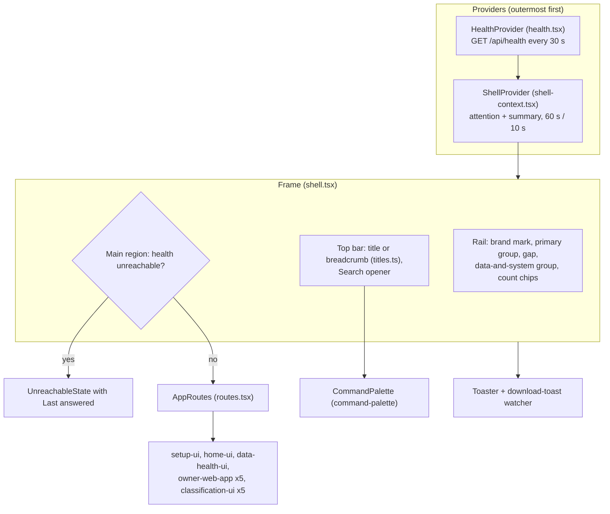

# Component: Owner Shell

**Status:** draft
**Capability:** CAP-003
**Owner:** Alvaro de Jodra
**Last Updated:** 2026-10-25

This design was produced in an unattended `$design-run`. It applies DEC-0202,
DEC-0203, DEC-0204, DEC-0207 and DEC-0208 without re-deciding them, and
records DEC-0211 (the delivered `web/src/app/` files it owns, and the move of
`HealthProvider` to `health.tsx`), DEC-0212 (the health poll pauses while the
page is hidden), DEC-0214 (a top-bar crumb the route cannot name comes from
the routed screen) and DEC-0219 (the on-demand aggregate hook Home shares
with Data health), all under `projects/factorflow-v2/decisions/` in the
harness repository and all **PROVISIONAL**.

## 1. Overview

`owner-shell` is the composition root of the owner interface: the rail in two
groups listing only shipped destinations with their attention counts, the
sticky top bar with the route-derived title and the palette opener, the route
map with the `/` redirect and the four legacy redirects, the unreachable and
not-found states, and the three shell-wide polled reads (health, attention,
classification summary) shared with the screens through one React context
(system design §4.1; UX design §0; blueprint §3). It replaces the delivered
shell and route composition in `web/src/app/` and retires CAP-001's status
region, whose two facts move to the unreachable state and to Home and Data
health (DEC-0204).

Use cases addressed:

- One shell for every route, groups in order, unshipped destinations absent
  (AC-1), and CAP-002's routes kept and reachable (AC-27).
- Setup first, Home after (AC-2), through the `/` redirect (DEC-0202).
- The two attention counts, absent at zero (AC-16).
- Old bookmarks arrive at the new paths for one release (AC-18).
- The command palette from the keyboard and the top bar on every screen
  (AC-22), opened here and implemented by `command-palette`.
- The designed unreachable state with the time the product last answered,
  and recovery without a reload (AC-23).
- Polling cadences recorded and shown as *checked {time}* (AC-25; STD-UI-25).

Support matrix: the owner's desktop browser at `http://127.0.0.1:8000`, design
width 1280 px and above; below 768 px the rail stacks above the content and
nothing becomes unreachable (UX design 0.1). No sign-in, user menu or account
area (capability §5.3).

Dependencies: React 18, `react-router-dom` 6 (`NavLink` `aria-current`,
`Navigate replace`), `ui-components`, `command-palette`, the delivered
`web/src/api/client.ts` (`fetchHealth`, `requestJson`, `ApiError`,
`ApiUnreachableError`), `data-health-api`'s `GET /api/attention`,
`classification-api`'s `GET /api/classifications/summary` (consumed as
published, `404` before it is deployed), and the screens it mounts:
`setup-ui`, `home-ui`, `data-health-ui`, `owner-web-app`'s five and, when
registered, `classification-ui`'s five.

## 2. Design Details

### 2.1 Placement

```
web/src/app/shell.tsx                    rewritten: rail, top bar, main region, Toaster, palette mount, keydown listener
web/src/app/routes.tsx                   rewritten: the route map
web/src/app/legacy-redirects.tsx         new: the four Navigate replace routes, query kept (AC-18); deleted one release later
web/src/app/destinations.ts              new: the static ordered destination list (DEC-0204)
web/src/app/titles.ts                    new: the route-to-title table (DEC-0214)
web/src/app/health.tsx                   new: HealthProvider, useHealth, formatTimestamp, UNREACHABLE_MESSAGE moved from
                                         status-region.tsx; + lastAnsweredAt (AC-23); + pause while hidden (DEC-0212)
web/src/app/shell-context.tsx            new: ShellProvider and useShell()
web/src/app/use-polled-read.ts           new: interval read paused while the document is hidden
web/src/app/shell-client.ts              new: fetchAttention(), fetchScoreSummary() (404 -> not_served),
                                         fetchDataHealth(), fetchProblems(cursor, limit)
web/src/app/shell-types.ts               new: Attention, DataHealth, ProblemPage, ScoreSummary, ScoreState, ReadState
web/src/app/use-data-health.ts           new: the on-demand aggregate hook home-ui and data-health-ui share (DEC-0219)
web/src/app/count-chip.tsx               new: the rail count chip
web/src/app/unreachable-state.tsx        new: the designed unreachable state (moved and extended)
web/src/app/not-found.tsx                new: the not-found state
web/src/app/download-toast.ts            new: the completion toast watcher
web/src/app/status-region.tsx            deleted (DEC-0204, DEC-0211)
web/src/app/status-region.test.tsx       deleted; its HealthProvider polling cases move to health.test.tsx
web/src/app/status-region.a11y.test.tsx  deleted
web/src/app/status-region.integration.test.tsx  deleted
web/src/app/shell.status-region.test.tsx deleted
web/src/app/shell.test.tsx               delivered; rewritten for the new rail (see 2.10)
web/src/app/shell.a11y.test.tsx          delivered; rewritten for the new rail
web/src/app/shell.layout.test.tsx        delivered; rewritten for rail, top bar and main region
web/src/app/shell.unreachable.test.tsx   delivered; status-region case replaced by the Last answered line
web/src/app/routes.test.tsx              delivered; rewritten for the new route map
web/src/app/shell.tokens.test.tsx        delivered; unchanged
web/src/app/build-output.test.tsx        delivered; unchanged
web/src/app/health.test.tsx              new
web/src/app/shell-context.test.tsx       new
web/src/app/legacy-redirects.test.tsx    new
web/src/app/titles.test.tsx              new
web/src/app/download-toast.test.tsx      new
tests/e2e/startup-health.spec.ts         delivered; status-region test ids replaced (DEC-0211)
tests/e2e/startup-refusal.spec.ts        delivered; status-region test ids replaced (DEC-0211)
tests/e2e/shell-navigation.spec.ts       new
tests/e2e/legacy-redirects.spec.ts       new
tests/e2e/unreachable-recovery.spec.ts   new
```

`web/src/main.tsx` is unchanged: it still renders `<Shell />` inside
`BrowserRouter`.

### 2.2 Composition

The block diagram shows how the shell is assembled. Its actors are the three
providers, the frame (rail, top bar, main region), the palette and the
routed screens. The decision point is the main region's: while health is
unreachable it renders the unreachable state, otherwise the route map. The
outcome is that the rail, its chips and the top bar render on every route in
every state, and that every screen reads the shared reads from one context
instead of opening its own intervals.



### 2.3 Shell context (system design §4.2 *Shell context*)

```typescript
// web/src/app/shell-types.ts
export type ReadState<T> =
  | { kind: "loading" }
  | { kind: "ok"; data: T; checkedAt: Date }
  | { kind: "error"; error: ApiError | ApiUnreachableError; last: { data: T; checkedAt: Date } | null };

export type ScoreState =
  | { kind: "loading" }
  | { kind: "served"; data: ScoreSummary; checkedAt: Date }
  | { kind: "not_served" }                                  // GET /api/classifications/summary answered 404
  | { kind: "error"; error: ApiError | ApiUnreachableError; last: ScoreSummary | null };

// web/src/app/shell-context.tsx
export interface ShellContextValue {
  health: HealthState;                 // liveness, health, lastUpdated, lastAnsweredAt
  attention: ReadState<Attention>;
  scores: ScoreState;
  refresh(kind: "health" | "attention" | "scores"): void;   // re-read once after an action
  setTitleDetail(text: string | null): void;                // DEC-0214
}
export function useShell(): ShellContextValue;
```

`Attention` mirrors `data-health-api`'s `AttentionResponse` field for field;
`ScoreSummary` mirrors `classification-api`'s `ClassificationSummaryResponse`
as published (`never_classified`, `set`, `later`, `factors`,
`stocks_current`) and is not redefined here (capability §5.1). `refresh`
re-reads at once and keeps the cadence; `data-health-ui` calls
`refresh("attention")` after **Download now** and **Stop following** so the
rail chip and Home follow without waiting a full interval.

`shell-client.ts` is the one fetch module for `data-health-api`'s three routes
and the summary, so the screens share one mapping from the wire shapes.
`useDataHealth()` is not part of the context: each caller mounts its own
on-demand read of `GET /api/data-health`, which reads once on mount, on its
`retry()`, and once when the context's attention read shows
`latest_download` turning terminal, and never on an interval (system design
§3.4 note 1). `data-health-ui` and `home-ui` both use it (DEC-0219,
PROVISIONAL).

### 2.4 Reads and cadences (STD-UI-25; system design constraint 8)

| Read | Owner here | Cadence | Paused while hidden |
|------|------------|---------|---------------------|
| `GET /api/health` | `HealthProvider` | every 30 s | yes, with an immediate read on show (DEC-0212) |
| `GET /api/attention` | `ShellProvider` | every 60 s; every 10 s while `latest_download.state` is `requested`, `running` or `cancelling`, or the summary's `later.state` is `building` | yes |
| `GET /api/classifications/summary` | `ShellProvider` | the same as attention; `404` is `not_served`, not an error, and is re-read on the 60 s cadence so a later deployment is picked up | yes |

```typescript
// web/src/app/use-polled-read.ts
export function usePolledRead<T>(
  read: () => Promise<T>,
  intervalMs: (last: T | null) => number,       // 60_000 or 10_000 from the last answer
): { state: ReadState<T>; refresh(): void };
```

The hook reads on mount, schedules the next read with `setTimeout` from the
interval the last answer implies, clears it on `visibilitychange` to hidden
and reads at once on visible, and never overlaps two reads of the same kind.
A failed read keeps the last value in `error.last`, so a chip or a card shows
its last value as stale rather than vanishing (UX design 0.2, brief §12.4).

`HealthProvider` keeps its delivered states (`unknown`, `answering`,
`unreachable`) and its 30 s cadence, and gains `lastAnsweredAt`, set on each
successful answer, and the same visibility rule (DEC-0212, PROVISIONAL).

### 2.5 Opening the product and resolving a route

The sequence is system design §3.1 at the component level. Its actors are the
browser, `HealthProvider`, `ShellProvider`, the route map and the screens. The
decision points are whether health has answered yet, whether it answers at
all, whether a download has ever been requested, and whether the path is a
legacy one. The outcome is setup on an empty install, Home otherwise, the same
screen as before for an old bookmark, and the unreachable state in the main
region alone when the API does not answer.

```mermaid
sequenceDiagram
    autonumber
    participant B as Browser
    participant HP as HealthProvider
    participant SP as ShellProvider
    participant RT as routes.tsx
    participant API as ingestion-api / data-health-api / classification-api

    B->>HP: mount on any path
    HP->>API: GET /api/health
    SP->>API: GET /api/attention
    SP->>API: GET /api/classifications/summary
    alt path is "/" and liveness unknown
        RT-->>B: skeleton main region (one card at the 1180 px cap)
    end
    alt health fetch fails
        HP-->>B: main region = UnreachableState; rail and top bar stay
    else path is "/"
        alt health.most_recent_run is null
            RT-->>B: Navigate replace /setup (DEC-0202)
        else
            RT-->>B: Navigate replace /home
        end
    else /coverage, /instruments, /runs, /runs/:runId
        RT-->>B: Navigate replace to /data/coverage, /data/followed, /data/downloads, /data/downloads/:runId, search kept
    else registered path
        RT-->>B: the screen; focus moves to its h1
    else
        RT-->>B: NotFound inside the shell, title "Page not found"
    end
    alt summary answers 404
        SP-->>B: scores = not_served; score figures render not determinable
    end
```

### 2.6 Route map, destinations and titles

```typescript
// web/src/app/destinations.ts (DEC-0204, PROVISIONAL)
export const DESTINATIONS = [
  { group: "primary", label: "Home", to: "/home", count: "needs-you" },
  // Research is added here in the same change that registers classification-ui's routes.
  { group: "data", label: "Data health", to: "/data", count: "problems" },
  { group: "data", label: "Settings", to: "/settings" },
] as const;
```

Strategies and Portfolio are absent, never disabled (AC-1; S01 §2). If
CAP-002's screens are registered when this lands, this change replaces
CAP-002's appended `DESTINATIONS` entry in the delivered `shell.tsx` with
`{ group: "primary", label: "Research", to: "/research" }` after Home, and
keeps CAP-002's five `Route` elements unchanged in the new `routes.tsx`
(AC-27; DEC-0204). If this lands first, CAP-002 adds that entry and those
routes here instead.

| Route | Element | Top-bar title (`titles.ts`) |
|-------|---------|-----------------------------|
| `/` | `RootRedirect`: skeleton until health answers, then `/setup` or `/home` | none |
| `/setup` | `setup-ui` `SetupScreen` | *Setup* |
| `/home` | `home-ui` `HomeScreen` | *Home* |
| `/data` | `data-health-ui` `DataHealthScreen` | *Data health* |
| `/data/coverage` | `owner-web-app` `CoverageScreen` | *Data health › Coverage* |
| `/data/followed` | `owner-web-app` `InstrumentsScreen` | *Data health › Followed stocks* |
| `/data/downloads` | `owner-web-app` `RunsScreen` | *Data health › Downloads* |
| `/data/downloads/:id` | `owner-web-app` `RunDetailScreen` | *Data health › Downloads › {detail, else "Download"}* |
| `/settings` | `owner-web-app` `SettingsScreen` | *Settings* |
| `/research` and its four children, when registered | `classification-ui` screens, unchanged | *Research*; *Research › {symbol}*; *Research › Compare*; *Research › Universes*; *Research › Universes › {detail, else "Universe"}* |
| `/coverage`, `/instruments`, `/runs`, `/runs/:runId` | `legacy-redirects.tsx` | none |
| `*` | `NotFound` | *Page not found* |

Each ancestor crumb is a link (*Data health* to `/data`, *Downloads* to
`/data/downloads`, *Research* to `/research`, *Universes* to
`/research/universes`); the last crumb is text; the separator is *›* with
`--space-2` either side in `--muted-foreground` (UX design 0.3). A crumb the
route cannot name (the download's start time, the universe's name) is set by
the screen through `setTitleDetail`, cleared on unmount, and reads the
generic noun until set (DEC-0214, PROVISIONAL). The symbol in
`/research/stocks/:symbol` is the route parameter itself.

```typescript
// web/src/app/legacy-redirects.tsx (AC-18; removed one release after this ships)
function KeepSearch({ to }: { to: string }): JSX.Element {
  const { search } = useLocation();
  return <Navigate to={`${to}${search}`} replace />;
}
function LegacyRunDetail(): JSX.Element {
  const { runId } = useParams();
  const { search } = useLocation();
  return <Navigate to={`/data/downloads/${runId}${search}`} replace />;
}
export const legacyRoutes = [
  <Route key="coverage" path="/coverage" element={<KeepSearch to="/data/coverage" />} />,
  <Route key="instruments" path="/instruments" element={<KeepSearch to="/data/followed" />} />,
  <Route key="runs" path="/runs" element={<KeepSearch to="/data/downloads" />} />,
  <Route key="run" path="/runs/:runId" element={<LegacyRunDetail />} />,
];
```

### 2.7 Rail, chips and top bar

- **Rail** (UX design 0.1): 208 px, `--border` right edge; the brand mark
  *FactorFlow* as text; the primary group; a flexible gap; the data-and-system
  group pinned to the bottom. Each item is a `NavLink` with a 16 px
  `lucide-react` stroke icon and its label, `aria-current="page"` on the
  current one. The `nav` is labelled *Main*.
- **Count chip** (UX design 0.2; AC-16): `badge` `status-warning` at
  `--text-xs`. Home's count is `deriveNeedsYou(attention, scores).length`
  from `ui-components`, the same call `home-ui` makes (DEC-0203); Data
  health's is `attention.problems.stock_count`. A zero count renders no chip.
  The item's accessible name includes the count in words (*Home, 4 items need
  you*; *Data health, 3 stocks with problems*); while the attention read
  fails the chip keeps its last value and its name gains *, as of {time}*. A
  changed count is announced through one polite live region in the rail.
- **Top bar** (UX design 0.1): sticky, `--background`, bottom `--border`;
  left the title or breadcrumb at `--text-base` weight 600; right the opener,
  `button` `outline` *Search* with the shortcut as trailing `--text-xs` text,
  *⌘K* when `navigator.platform` reports a Mac and *Ctrl+K* otherwise, named
  *Open the command palette*. Nothing between them in M1: the environment
  region and the kill switch ship with paper trading and no space is reserved
  (D-7; system design constraint 14).
- **Keyboard** (blueprint §3.4): one `keydown` listener on `document` opens
  the palette on `⌘K` or `Ctrl+K` and ignores the event when its target is an
  `input`, `textarea`, `select` or `contenteditable` element. The palette
  restores focus to the opener, or to the element focused before, on close.
- **Focus on route change**: focus moves to the routed screen's `h1`
  (rendered with `tabIndex={-1}`), not to the rail (UX design 0.6).

### 2.8 Shell states (UX design 0.5)

| State | Rendering |
|-------|-----------|
| Unreachable | The main region alone is replaced by a `card` `default` holding a `section` `role="status"`: `h2` *FactorFlow is not answering.*, the delivered paragraph *The application container may have stopped, or a database migration may have failed and prevented it from starting. Check the container logs.*, and *Last answered {YYYY-MM-DD HH:MM:SS zone}* from `lastAnsweredAt`, or *Not yet answered since this page opened*. Announced once on entry and once on recovery; when a later health read answers, the routed screen mounts again at the same URL and refetches, with no reload (AC-23) |
| Not found | A `card` `default` holding a `section` `role="status"`: `h1` *There's no page at this address.* and *Check the address, or go to* **Home** (a link to `/home`) |
| Loading | Until the first health answer `/` renders one card-shaped skeleton; every other route renders its own screen's skeleton at once |
| Setup incomplete | Not a lock: `/` opens setup, and every destination stays reachable with its honest empty state (DEC-0202; AC-21) |

### 2.9 Completion toast (UX design 0.6, §2)

`download-toast.ts` watches the attention read. When `latest_download.state`
was non-terminal in the previous answer and is terminal in this one, it raises
one `toast`: `success` for *Complete*, `warning` for *Partial* and
*Interrupted*, `error` for *Failed*; none for *Cancelled by you*, which the
owner did. It raises none when the current route already shows that outcome:
`/data/downloads/{that id}`, `/data/downloads` and `/data`, which render the
download's outcome badge (UX design 0.6 *never for a result already visible
on the current screen*). The toast names the download by its start time and
links to its detail. `error` and `warning` toasts persist until dismissed;
none takes focus.

### 2.10 Delivered tests this component changes (DEC-0211)

| File | Change |
|------|--------|
| `web/src/app/shell.test.tsx` | The four-item order and labels become Home, (Research,) Data health, Settings in two groups; the forbidden-vocabulary and no-account-area cases stay; the liveness wait reads `useHealth` through a test hook, not the status region |
| `web/src/app/shell.a11y.test.tsx` | Tab order over the new rail; `nav` named *Main*; `aria-current` on the current item; chips named in words |
| `web/src/app/shell.layout.test.tsx` | Asserts rail, top bar and main region; the status-region slot assertions are removed |
| `web/src/app/shell.unreachable.test.tsx` | The three main-region cases stay; the status-region case becomes the *Last answered* line; the restore case stays |
| `web/src/app/routes.test.tsx` | The route enumeration becomes the table in 2.6; the not-found case asserts the new state inside the frame; the four screen cases visit the new paths |
| `web/src/app/status-region*.test.tsx`, `shell.status-region.test.tsx` | Deleted with the status region; HealthProvider's polling, unknown-state and cleanup cases move to `health.test.tsx` |
| `tests/e2e/startup-health.spec.ts` | `liveness-state` and `run-outcome` are no longer rendered; the spec asserts `/` lands on setup or Home and that Home's data tile or Data health's Recent downloads shows the latest outcome |
| `tests/e2e/startup-refusal.spec.ts` | Asserts the unreachable state's text and its *Last answered* line instead of `status-region` and `liveness-state` |

### 2.11 Messages

N/A, not applicable for this component. There is no push channel; the
interface learns by polling at the cadences in 2.4.

## 3. Constraints and Assumptions

- **Only shipped destinations** (constraint 11; AC-1, AC-10): a destination
  enters `DESTINATIONS` only in the change that registers its screen; no
  runtime detection (DEC-0204).
- **No kill switch, no environment region, no reserved space** in M1
  (constraint 14).
- **No browser storage** (system design §4.4): nothing is kept between
  visits; setup's progress is re-derived from the server (DEC-0202).
- **Every cadence is recorded** (2.4) and every polled region shows its
  *checked {time}* (constraint 8; AC-25).
- **Static titles** (system design §3.5 note 4), with the screen-supplied
  detail of DEC-0214 as the one exception.
- **Assumption:** the classification summary keeps the published shape and
  answers `404 not_found` until its route is deployed (system design
  assumption 1).
- **Assumption:** "one release" for the redirects is the next release image
  after the one carrying this change (capability assumption 3).

## 4. Security

- **Loopback, no authentication** (capability §5.3; DEC-0208): no sign-in,
  user menu or account area; nothing assumes a principal.
- **Credential presence only.** The shell passes `credential_present`
  through the context and never a value (AC-4).
- **No storage, no third-party request.** Same-origin reads only.
- **Output encoding.** React escapes text; no `dangerouslySetInnerHTML`
  (delivered `web/src/api/render.test.tsx`).
- **No new dependency of its own** beyond `ui-components`' (DEC-0205,
  DEC-0215).

## 5. Scalability and Performance

- Three intervals for the whole interface, none per screen; 10 s only while a
  download runs or scores build; paused while hidden.
- `GET /api/attention` is bounded aggregates (`data-health-reader` §5); the
  summary read has no stock rows.
- Route-level code splitting by `React.lazy` per screen keeps the first load
  to the shell and the landing screen.

## 6. Upgrade

- **Behaviour change after upgrade:** the rail changes from Coverage,
  Instruments, Runs, Settings to Home, (Research,) Data health, Settings; the
  status region is gone; `/` opens setup or Home instead of `/coverage`; old
  paths redirect for one release (AC-18).
- **Redirect removal** one release later deletes `legacy-redirects.tsx`, its
  import in `routes.tsx` and `legacy-redirects.test.tsx` and
  `tests/e2e/legacy-redirects.spec.ts` (system design §3.1 note 4); that is a
  later change, out of this capability's scope.
- **No data migration;** rollback is redeploying the previous image.
- **Manual actions:** none; the owner reloads the page.

## 7. Testing

| Test | File | What it proves |
|------|------|----------------|
| Rail order and absence | `web/src/app/shell.test.tsx` | Groups in order; Strategies and Portfolio absent, not disabled; Research present exactly when its routes are (AC-1, AC-27) |
| Chips | `web/src/app/shell.test.tsx` | Home chip equals `deriveNeedsYou(...).length`; Data health chip equals `problems.stock_count`; both absent at zero; named in words; stale name while attention fails (AC-16) |
| Root redirect | `web/src/app/routes.test.tsx` | `/` waits for health, then `/setup` when `most_recent_run` is null and `/home` otherwise (AC-2; DEC-0202) |
| Legacy redirects | `web/src/app/legacy-redirects.test.tsx` | Each of the four paths lands on its new path with `replace` and the query kept (AC-18) |
| Titles | `web/src/app/titles.test.tsx` | Every registered route has its title; the detail crumb shows the generic noun until set and the set text after; cleared on unmount (DEC-0214) |
| Cadences | `web/src/app/shell-context.test.tsx` | 60 s idle, 10 s while a download is non-terminal or scores build, back to 60 s after; no read while hidden and one at once on show (constraint 8; DEC-0212) |
| Summary not served | `web/src/app/shell-context.test.tsx` | A `404` yields `not_served`, not `error`, and is re-read |
| On-demand aggregate | `web/src/app/use-data-health.test.tsx` | One read on mount, one on `retry()`, one when the latest download turns terminal, none on a timer (DEC-0219) |
| Unreachable | `web/src/app/shell.unreachable.test.tsx` | Main region replaced on every route; rail and top bar stay; *Last answered* line from the last success; recovery remounts the same URL without reload (AC-23) |
| Health provider | `web/src/app/health.test.tsx` | The delivered polling, unknown-state and cleanup cases, plus `lastAnsweredAt` and the pause (DEC-0212) |
| Palette shortcut | `web/src/app/shell.test.tsx` | `⌘K` and `Ctrl+K` open the palette outside text fields; ignored inside an input; the top-bar opener opens it on every route (AC-22) |
| Focus on navigation | `web/src/app/shell.a11y.test.tsx` | Focus lands on the new screen's `h1` (STD-UI-24) |
| Toast | `web/src/app/download-toast.test.tsx` | One toast per terminal transition with the right variant; none for *Cancelled by you*; none on the three routes that show the outcome |
| Shell journey | `tests/e2e/shell-navigation.spec.ts` | Empty install opens setup; after a download is requested `/` opens Home; every rail item and the palette reach their screens by keyboard alone (AC-1, AC-2, AC-22, AC-25) |
| Old bookmarks | `tests/e2e/legacy-redirects.spec.ts` | The four paths arrive with the query kept (AC-18) |
| Stop and recover | `tests/e2e/unreachable-recovery.spec.ts` | Stopping the application container shows the unreachable state with *Last answered*; restarting it returns the same screen with no reload (AC-23) |

## 8. Acceptance Criteria

1. Every route renders inside the rail, top bar and main region; the rail
   lists Home, (Research,) Data health, Settings in two groups, nothing else.
2. `/` opens setup until a download has been requested and Home after.
3. The two chips show their counts and are absent at zero.
4. Each of `/coverage`, `/instruments`, `/runs`, `/runs/:runId` lands on its
   new path with the query kept.
5. The palette opens from `⌘K` or `Ctrl+K` outside text fields and from the
   top bar on every route.
6. When health stops answering, only the main region changes, to the
   unreachable state with the last answered time; when it answers again the
   same screen returns without a reload.
7. No interval runs while the page is hidden.
8. Failure scenario: an attention or summary read that fails leaves the chips
   at their last value marked stale and never removes the rail.

## 9. Workflows

All five capability flows start here: the first run (the `/` redirect), the
data trust decision and the daily check (rail items and chips), reaching
CAP-001's surfaces (rail, breadcrumbs, palette, redirects), and the product
stopping and recovering (unreachable state). Existing workflows that
intersect: every CAP-001 screen and every CAP-002 route is mounted here.

## 10. UX / GUI

From UX design §0 (Application Shell), which this component builds.

**Layout** (0.1). Rail 208 px | top bar sticky over the main region. Page
ground `hsl(var(--muted) / 0.5)` over `--background`; content on `card`s on
`--background`. Main region `--space-5` padding, regions `--space-5` apart;
Home, Setup and Data health cap content at 1180 px; the four table screens
use the full width and Settings `--measure-prose`. Below 768 px the rail is a
horizontal list above the content and the opener wraps under the title.

**Destinations and chips** (0.2). Drawn for both landing orders: three items
(Home; Data health, Settings) or four (Home, Research; Data health,
Settings). Chip `badge` `status-warning` at `--text-xs`, right-aligned in the
item, its warning shape `aria-hidden`, its text the accessible meaning.

**Routes and titles** (0.3): the table in 2.6. A download is named by its
start time in America/Chicago with the zone (*Download 2026-10-15 17:31 CDT*)
until capability OQ-1 is answered.

**Cadences** (0.4): the table in 2.4; *checked {time}* renders `HH:MM:SS
zone`.

**States** (0.5): the table in 2.8.

**Component mapping** (0.6):

| UI Element | Component | Variant | Design Spec Reference |
|------------|----------|---------|-----------------------|
| Rail items, breadcrumb ancestors, the not-found **Home** link | `NavLink` / `Link` styled from `button` `ghost` tokens | n/a | `design-system/components/button/design-spec.md` §1 |
| Count chip | `badge` | `status-warning` at `--text-xs` | `design-system/components/badge/design-spec.md` |
| Palette opener | `button` | `outline`, trailing shortcut text | `design-system/components/button/design-spec.md` |
| Unreachable and not-found states | `card` | `default` | `design-system/components/card/design-spec.md` |
| Completion toast | `toast` | `success`, `warning`, `error` | `design-system/components/toast/design-spec.md` |

**Tokens** (0.6). Rail and top bar `--background` with `--border` edges;
labels `--foreground`; inactive icons `--muted-foreground`; current item
`--background` fill with a 1 px `--border` ring and its icon `--foreground`;
focus `--ring` at `--focus-ring-width`; chip `--status-warning` on
`--status-warning-muted`, its contrast against the rail ground checked in
`design-system/theme-validation.md`, not assumed; state cards `--card` and
`--card-foreground`; toast accents `--status-good`, `--status-warning`,
`--status-critical`; type `--text-base`, with `--text-xs` for the shortcut
hint and *checked {time}*; spacing from `--space-*` only (AC-26).

**Accessibility** (0.6; STD-UI-24). `nav` labelled *Main* with
`aria-current="page"`; the top bar is a `banner` whose first text is the
title; one `main` with one `h1` per screen; focus to the `h1` on route
change; the single keydown listener ignores text fields; toasts never steal
focus and `error` and `warning` persist until dismissed; visible focus never
suppressed; contrast 4.5:1 text, 3:1 large text and boundaries.

**Internationalization.** None; ISO-8601 dates and America/Chicago times
(STD-UI-5).

## 11. API Endpoints

This component exposes none. It consumes:

| Endpoint | Method/Operation | Auth/Privilege | Request | Response | Notes |
|----------|-----------------|----------------|---------|----------|-------|
| `/api/health` | GET | none, loopback | none | `status`, `database`, `credential_present`, `schema_version`, `most_recent_run` | `ingestion-api`, unchanged; every 30 s, paused while hidden |
| `/api/attention` | GET | none, loopback | none | `AttentionResponse` | `data-health-api`; 60 s, 10 s while a download runs or scores build |
| `/api/classifications/summary` | GET | none, loopback | none | `ClassificationSummaryResponse`; `404 not_found` before deployment | `classification-api`, as published; same cadence |
| `/api/data-health`, `/api/data-health/problems` | GET | none, loopback | none; `cursor`, `limit` | `DataHealthResponse`; `ProblemPageResponse` | `data-health-api`; fetched here for `home-ui` and `data-health-ui`, on demand only |

## 12. References

| Type | Document Name | Description | Link |
|------|---------------|-------------|------|
| UX design | CAP-003 v1 | §0 Application Shell, §2 Cross-Screen Navigation | `docs/capabilities/CAP-003-app-shell-and-data-health/design/ux-design.md` |
| System design | CAP-003 v1 | §3.1, §3.3, §3.5, §4.1, §4.2, constraints 8, 11, 13, 14 | `docs/capabilities/CAP-003-app-shell-and-data-health/design/system-design.md` |
| Blueprint | PRODUCT-UX v6 | §2.1, §2.2, §3.1, §3.4, §3.5 | `docs/ux/product-ux-blueprint.md` |
| Component design | CAP-001 owner web app v4 (approved, not edited) | The delivered shell, status region and HealthProvider | `docs/capabilities/CAP-001-market-data-acquisition-foundation/design/component-design-owner-web-app.md` |
| Component design | CAP-002 classification UI v3 (approved) | §2.2 composition into the shell, research titles | `docs/capabilities/CAP-002-universe-and-factor-classification/design/component-design-classification-ui.md` |
| Decisions | DEC-0202, DEC-0203, DEC-0204, DEC-0207, DEC-0208, DEC-0211, DEC-0212, DEC-0214, DEC-0219 | Setup completion, items, shell and destinations, palette, loopback, ownership, health pause, crumbs, the shared on-demand aggregate | `projects/factorflow-v2/decisions/` (harness repository) |

## 13. Traceability

| Capability AC | System Design Element | Component Design Element | Section |
|--------------|----------------------|--------------------------|---------|
| AC-1 | Static destination list in two groups | `destinations.ts`, rail | 2.6, 2.7 |
| AC-2 | `/` redirect on `most_recent_run` | `RootRedirect` | 2.5, 2.6 |
| AC-16 | Counts from the merged list and `problems.stock_count` | Count chips | 2.7 |
| AC-18 | `legacy-redirects.tsx` | Four `Navigate replace` routes, query kept | 2.6 |
| AC-22 | Shell keydown listener, top-bar opener | Listener and opener | 2.7 |
| AC-23 | Main-region swap, last answered time | `UnreachableState`, `lastAnsweredAt` | 2.8 |
| AC-24 | Shell states | Loading, unreachable, not-found states | 2.8 |
| AC-25 | Cadences and *checked {time}*; keyboard | 2.4 cadences; listener, focus management | 2.4, 2.7 |
| AC-26 | Built from `ui-components` | Component mapping and tokens | 10 |
| AC-27 | `classification-ui` screen registration | Research entry and five routes kept | 2.6 |
| AC-10 | Only shipped destinations | No Strategies or Portfolio item | 2.6 |

## 14. Open Questions

1. **Research screens' links to `/runs/:runId` and `/instruments`.** System
   design open question 6 assigns migrating them to CAP-002's owner, while
   CAP-002's approved `component-design-classification-ui.md` §2.2 assigns it
   to the shell capability as one edit to `SHELL_ROUTES` in
   `web/src/screens/research/copy.ts`. The redirects carry those links for one
   release, so nothing breaks now. *Owner: capability owner, with CAP-002's
   owner. Blocks: the redirect-removal change.*
2. **Icons per destination.** UX design 0.1 specifies a 16 px `lucide-react`
   stroke icon per rail item and names none. *Owner: capability owner, or the
   implementing story's review. Blocks: nothing structural.*
3. **CAP-002's universe-detail crumb** reads *Universe* until
   `classification-ui` calls `setTitleDetail` with the universe's name
   (DEC-0214). *Owner: CAP-002's owner (in flight). Blocks: nothing.*
4. **Promoting DEC-0203 and DEC-0204 to a decision-record constitution
   artifact** (system design open question 10). *Owner: capability owner via
   `$constitution`. Blocks: nothing now.*
