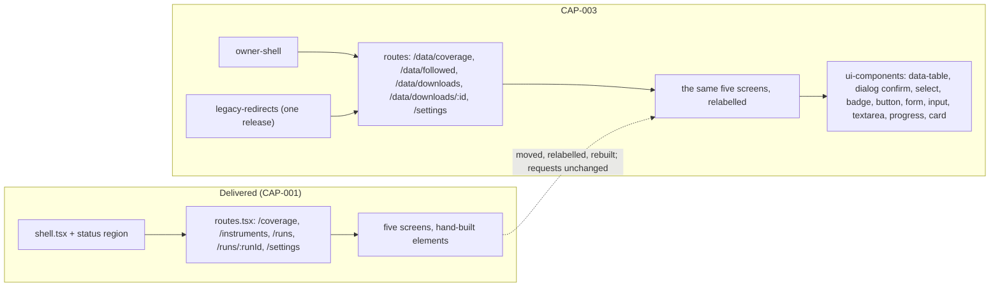

# Component: Owner Web App (CAP-003 changes)

**Status:** draft
**Capability:** CAP-003
**Owner:** Alvaro de Jodra
**Last Updated:** 2026-10-25

This design records only what CAP-003 changes in `owner-web-app`, the
component CAP-001 delivered. Its approved design,
`docs/capabilities/CAP-001-market-data-acquisition-foundation/design/component-design-owner-web-app.md`
(v4), is not edited: CAP-003 takes over the five screens and owns the change
(AGT-SCOPE-002; capability §2 *CAP-001's surfaces under the shell*). It was
produced in an unattended `$design-run`; it applies DEC-0204 and DEC-0205 and
records DEC-0211 (which delivered files this component owns) and DEC-0214
(the download detail supplies its top-bar crumb), all **PROVISIONAL**, under
`projects/factorflow-v2/decisions/` in the harness repository.

## 1. Overview

The five screens CAP-001 delivered, Coverage, Instruments, Runs, Run detail
and Settings, move under `owner-shell` at the blueprint's paths and in the
product's words, and are rebuilt from `ui-components`; what they do does not
change (system design §4.1 *Existing components this design changes*; UX
design 1.5 to 1.9; AC-17). Concretely:

1. **Paths**: `/data/coverage`, `/data/followed`, `/data/downloads`,
   `/data/downloads/:id`, `/settings`; every internal link and navigation
   follows (AC-17, AC-18). The routes are registered in `owner-shell`'s map.
2. **Labels**: every user-visible string uses the STD-UI-1 v6 display label
   and never shows the domain term beside it (AC-19).
3. **Tiers**: every download state, result outcome and stock state renders
   through `ui-components`' one tier function with its label and shape
   (AC-20).
4. **Components**: the hand-built elements are replaced by the vendored
   design-system components (AC-26; DEC-0205).
5. **Two entry hints**: Coverage seeds its symbol filter from `?symbol=`;
   Followed stocks focuses its add field when opened with router state
   `{ focusAdd: true }` (system design §3.5 note 3). Neither changes an
   action's outcome.
6. **Settings** gains **Open setup** (S02 §6) and its credential region is
   relabelled *Market data key*.
7. **Download detail** supplies its top-bar crumb, *Download {start time}*,
   through `useShell().setTitleDetail` (DEC-0214).

Every action, confirmation and refusal CAP-001 accepted is kept with the same
outcome: following and stopping following stocks, starting, queueing and
cancelling downloads, reading coverage and gaps, diagnosing a failed
download, setting the history depth, and credential presence (capability
§5.1; CAP-001 AC-1, AC-2, AC-4, AC-7 to AC-11, AC-13, AC-17, AC-19 to AC-26).

Support matrix and dependencies: as CAP-001 v4 §1, plus `ui-components` and
`owner-shell`.

## 2. Design Details

### 2.1 Delivered files this component edits (DEC-0211, PROVISIONAL)

```
web/src/screens/coverage/*            labels in copy.ts; ?symbol= seeding; data-table virtualised; links to /data/*
web/src/screens/instruments/*         labels; Stop following dialog via dialog confirm; focusAdd; data-table virtualised
                                      (parse-bulk-symbols.ts unchanged; setup-ui imports it)
web/src/screens/runs/*                labels; Started column; StatusBadge in place of outcome-badge.tsx and
                                      detail/result-outcome-badge.tsx; links and navigate() to /data/downloads/*
web/src/screens/runs/detail/*         labels; progress determinate; confirm wording; Not found sentence; setTitleDetail
web/src/screens/settings/*            labels; Open setup link; Market data key region; coverage-unknown while unreachable
web/src/screens/**/*.test.ts(x)       the delivered screen tests: label, path and component assertions follow (2.6)
web/src/api/client.ts                 + export on requestJson, unless CAP-002 has already added it (DEC-0064)
tests/e2e/first-run.spec.ts, diagnose-failure.spec.ts, cancel-run.spec.ts, cancel-in-progress.spec.ts,
  coverage-empty.spec.ts, coverage-expansion.spec.ts, instrument-changes.spec.ts,
  instruments-add-retire.spec.ts, run-detail.spec.ts, runs-start-cancel.spec.ts,
  unrecognised-instrument.spec.ts     paths and label locators follow (2.6)
tests/e2e/support/acquisition.ts      its three page.goto paths follow
web/src/screens/vocabulary.test.tsx   new: AC-19 sweep over the five screens
web/src/screens/coverage/entry-hint.test.tsx   new
web/src/screens/instruments/entry-hint.test.tsx new
```

The screen directories keep their delivered names (`instruments`, `runs`):
code and paths may keep the domain terms; only user-visible text changes
(system design constraint 3). `web/src/api/types.ts` is not edited.
`web/src/screens/runs/outcome-badge.tsx` and
`detail/result-outcome-badge.tsx` are deleted with their tests once every
caller uses `StatusBadge`, whose tests carry the same tier assertions
(`ui-components` §7).

### 2.2 Before and after

The diagram shows the screens' place before and after the change. Its actors
are the delivered shell, the new shell, the five screens and `ui-components`.
The one structural change is the parent: the screens stop being mounted by
CAP-001's route file and are mounted by `owner-shell`'s, under new paths, and
they import their controls from `ui-components` instead of building them. The
outcome is the same five screens with the same requests, in the product shell
and vocabulary.



### 2.3 Screen deltas (UX design 1.5 to 1.9)

**Coverage, `/data/coverage`** (h1 *Coverage*; top bar *Data health ›
Coverage*). *instrument* becomes *stock* throughout (*Stock* column, *No
stock matches this filter.*); **Start acquisition run** becomes **Download
now**; *Last acquired* becomes *Last downloaded*; *Retired* becomes *Stopped
following*; *Coverage*, *gap*, *history depth*, *trading day*, *Covered
from*, *Covered to*, *Depth*, *Reference*, *Prices*, *Fundamentals* and
*Corporate actions* are unchanged because the domain term is the display
label (STD-UI-1). Blocked reasons: *History depth is not set. Set it in
Settings before downloading.* (with *Settings* a link to `/settings`) and *No
stocks are followed. Follow stocks before downloading.*, depth first. Queued:
*A download is running. This starts when it finishes.* The table becomes
`data-table` `virtualised` with the per-row expansion v5 specified, its
windowing moving from `coverage-table.tsx` into the vendored component (DEC-0215).
`?symbol={SYMBOL}` seeds the symbol filter on load; editing or clearing the
filter updates or clears the query with `replace`. Starting a download routes
to `/data/downloads/{run_id}`.

**Followed stocks, `/data/followed`** (h1 *Followed stocks*). **Add
instrument** becomes **Follow a stock**; **Add many** becomes **Follow
many**; **Retire** becomes **Stop following**; *Retired* becomes *Stopped
following*; *active* becomes *followed*; *No instruments named yet.* becomes
*No stocks followed yet.*; the add field is named *Symbol of the stock to
follow*. The confirmation is `dialog` `confirm` with *Stop following
{SYMBOL}? Its history is kept, and strategies holding it keep holding it. You
can follow it again later.* and **Stop following**, plus v5's conditional
sentences relabelled (*A download is running and will still download {SYMBOL}
this time. Stopping takes effect from the next download.*, CAP-001 AC-25, and
the gap-detection consequence when it applies). A stock the provider does not
recognise carries `badge` `status-warning` *Not found*. Opened with
`location.state.focusAdd`, the add field takes focus on mount. Coverage
links read `/data/coverage?symbol={SYMBOL}`.

**Downloads, `/data/downloads`** (h1 *Downloads*). *Runs* becomes
*Downloads*; the first column is *Started*, the start time with the zone as
the link to the detail, replacing the run id link because no raw `run_id`
appears on any surface (CAP-002's DEC-0083); *Instruments written* and
*Instruments failed* become *Stocks downloaded* and *Stocks failed*; the
empty and nothing-found copy say *download*. Outcomes render through the one
tier function: *Queued* neutral, *Downloading* active, *Stopping* warning,
*Complete* good, *Partial* warning, *Failed* critical, *Cancelled by you*
neutral, *Interrupted* serious (AC-12, AC-20). The 10 second poll while any
download is non-terminal is v5's and unchanged.

**Download detail, `/data/downloads/:id`** (h1 *Download {start time}*;
top-bar crumb set by `setTitleDetail(formatDownloadName(...))` once the run is
read, cleared on unmount, DEC-0214). **Cancel run** becomes **Cancel
download**; per-stock reason lines say *downloading* for *acquiring*. Progress
while running is `progress` `determinate` *{done} of {total} stocks*, polled
at 10 seconds with its last-updated time and no estimated time remaining
(`indeterminate` only while the total is unknown), closing the gap CAP-001
v4 §14 question 1 left open. Cancel a running download: *Stop this download?
Stocks already downloaded keep their coverage. Stocks not yet started will be
skipped. The download stops after the stock it is working on now.*, confirm
**Stop download**, then *Stopping* (warning) until it ends. Cancel a queued
download: *Cancel this queued download? It has not started, so nothing has
been downloaded. The download in progress is not affected.*, confirm
**Cancel download**, straight to *Cancelled by you* (CAP-001 AC-26). Already
finished: *This download had already finished.* with its outcome (CAP-001
AC-19). Interrupted: *FactorFlow stopped before this download finished, and
the download was picked up as interrupted. Coverage written before it stopped
is kept. Download again to continue.* (serious). Not found: `status-warning`
*Not found* with *The provider doesn't recognise this symbol. Downloading
again won't help; stop following it or follow a different symbol.* and
**Open Data health** to `/data`. The completion toast for a download that ends
while the owner is elsewhere is `owner-shell`'s watcher, not this screen's,
and is suppressed on this route.

**Settings, `/settings`** (h1 *Settings*). Under the `h1`, *Walk through
setup again to check the market data key, history depth and followed stocks.*
with **Open setup** (a link to `/setup`, `button` `outline`). The history
depth form is unchanged. The *Provider credential* region becomes *Market
data key*: *Market data key:* with *Found* or *Missing*, never the value; when
missing, *Set the environment variable `FACTORFLOW_MASSIVE_API_KEY` to your
Massive API key, then restart FactorFlow.*; while health is unreachable
`coverage-unknown` *Not determinable*, never *Missing* (AC-4).

### 2.4 Entry hints

```typescript
// web/src/screens/coverage/index.tsx (entry hint)
const [params, setParams] = useSearchParams();
const [symbolFilter, setSymbolFilter] = useState(params.get("symbol") ?? "");
// on change: setParams(next ? { symbol: next } : {}, { replace: true })

// web/src/screens/instruments/index.tsx (entry hint)
const { state } = useLocation() as { state: { focusAdd?: boolean } | null };
useEffect(() => { if (state?.focusAdd) addFieldRef.current?.focus(); }, [state]);
```

A seeded symbol that matches nothing renders v5's nothing-found state with
its reset. Router state is not persisted, so a reload does not re-focus.

### 2.5 State rendering

Each screen keeps v5's eight-state table, relabelled (UX design 1.5 to 1.9),
and renders it through `ui-components`' `StateRegion` over the delivered
`ScreenState` union, which is unchanged. The unreachable kind is the shell's
(AC-23).

### 2.6 Delivered tests that change

| Test files | Change |
|------------|--------|
| `web/src/screens/coverage/*.test.tsx` | Label assertions (*stock*, **Download now**, *Last downloaded*, *Stopped following*); start routes to `/data/downloads/{id}`; table assertions against the `virtualised` variant; the blocked and queued sentences |
| `web/src/screens/instruments/*.test.tsx` | Labels (**Follow a stock**, **Follow many**, **Stop following**, *Stopped following*); `retire-dialog.test.tsx` asserts the `confirm` variant, the blueprint wording, cancel first and focused; the row action's name *Stop following AAPL* |
| `web/src/screens/runs/*.test.tsx`, `runs/detail/*.test.tsx` | *Started* link to `/data/downloads/{id}`; the eight labels and tiers through `StatusBadge`; `outcome-badge.test.tsx` and `result-outcome-badge.test.tsx` deleted with their components; cancel wording; progress as `progressbar` |
| `web/src/screens/settings/*.test.tsx` | *Market data key* region, **Open setup** link, `coverage-unknown` while unreachable |
| `web/src/api/client.*.test.ts`, `web/src/api/render.test.tsx` | Unchanged |
| The eleven e2e specs and `tests/e2e/support/acquisition.ts` | `page.goto("/coverage" / "/instruments" / "/runs")` become the new paths; locators by the old labels become the new labels; the behaviour each spec proves is unchanged (AC-17) |

### 2.7 Messages

N/A, not applicable for this component. Polling cadences are v5's,
unchanged.

## 3. Constraints and Assumptions

- **Behaviour preserved** (AC-17; system design constraint 2): no request,
  query parameter, confirmation step, refusal or cadence changes; only paths,
  words, tier rendering and components do.
- **`dialog` `confirm`, never `destructive`,** for stopping following and
  cancelling (STD-UI-2); **`button` `blocked`, never `disabled`** (CAP-001
  v4 §2.5).
- **No raw run id on any surface**: a download is named by its start time
  until capability OQ-1 is answered (DEC-0083's interim rendering).
- **The delivered parser is shared, not changed**: `setup-ui` imports
  `parse-bulk-symbols.ts`; **Follow many** keeps it (AC-5).
- **Assumption:** the five screens' delivered behaviour matches CAP-001 v4 and
  UX design v5, which the delivered tests assert; this design changes those
  tests only where a label, path or component changes.

## 4. Security

- Unchanged from CAP-001 v4 §4: no credential field anywhere, presence only,
  `coverage-unknown` rather than *Missing* when health is unreachable (AC-4);
  no `dangerouslySetInnerHTML`; no storage; same origin.
- Replacing the native `<dialog>` with Radix AlertDialog keeps focus trapping
  and return, now supplied by Radix.

## 5. Scalability and Performance

- Unchanged volume handling: keyset pages with windowed rendering at 3000
  stocks (CAP-001 AC-4; STD-UI-30), now inside the `virtualised` variant.
- The Downloads and detail polls stay at 10 seconds while non-terminal.

## 6. Upgrade

- **Behaviour change visible to the owner:** new paths and words; old paths
  redirect for one release (AC-18), after which bookmarks to them reach the
  not-found state.
- **No data migration.** Rollback is redeploying the previous image, which
  restores the old paths and words together.
- **Manual actions:** none.

## 7. Testing

| Test | File | What it proves |
|------|------|----------------|
| Vocabulary sweep | `web/src/screens/vocabulary.test.tsx` | Rendering each of the five screens in its populated, empty, error and dialog states shows none of *instrument*, *acquisition*, *acquire*, *run*, *runs*, *Retire*, *Retired*, *Provider credential*, matched as whole words regardless of case, in visible text or accessible names (AC-19) |
| Coverage hint | `web/src/screens/coverage/entry-hint.test.tsx` | `?symbol=KO` seeds the filter and the server request; clearing it clears the query |
| Followed hint | `web/src/screens/instruments/entry-hint.test.tsx` | `focusAdd` focuses the add field; without it focus is unchanged |
| Behaviour preserved | the delivered screen tests, relabelled | Every CAP-001 confirmation and refusal still renders with the same outcome (AC-17) |
| Tiers | `web/src/screens/runs/runs-screen.test.tsx` | Each of the eight states renders its label and shape through `StatusBadge`; *Partial* warning, *Cancelled by you* neutral (AC-12, AC-20) |
| Detail crumb | `web/src/screens/runs/run-detail.test.tsx` | After the run is read the shell's crumb reads *Download {start time}*; cleared on unmount (DEC-0214) |
| Settings | `web/src/screens/settings/credential-status.test.tsx` | *Market data key* with *Found*, *Missing* and *Not determinable*; **Open setup** links to `/setup`; no value anywhere (AC-4) |
| Journeys | the eleven delivered e2e specs at the new paths | First run, diagnose, cancel, coverage, followed-stock changes and the unrecognised-symbol flow behave as CAP-001 accepted (AC-17) |

## 8. Acceptance Criteria

1. The five screens open at `/data/coverage`, `/data/followed`,
   `/data/downloads`, `/data/downloads/:id` and `/settings` inside the shell.
2. Every action, confirmation and refusal CAP-001 accepted has the same
   outcome there.
3. No visible label or accessible name shows a domain term in place of, or
   beside, its display label.
4. Every status renders its blueprint tier with label and shape.
5. `?symbol=` seeds Coverage's filter and `focusAdd` focuses the add field.
6. Settings offers **Open setup** and states key presence, never the value.
7. Failure scenario: a refused start still names the operation and the reason
   (*Couldn't start the download: ...*), with the same two non-interchangeable
   reasons CAP-001 defined.

## 9. Workflows

Capability flow 4 (reaching CAP-001's surfaces) in full, and the hand-offs
from flow 2 (**Full coverage table**, **Manage followed stocks**, a row's
symbol, **Follow a different symbol**, a Recent downloads row) and flow 3
(**See download**, **Open Settings**). Every CAP-001 workflow intersects:
following, starting and cancelling downloads, diagnosing, setting depth.

## 10. UX / GUI

From UX design 1.5 to 1.9, which record the deltas against CAP-001 UX design
v5 and restate nothing v5 settled.

**Component mapping after the rebuild.**

| Screen | UI Element | Component | Variant | Design Spec Reference |
|--------|------------|----------|---------|-----------------------|
| Coverage | Coverage table | `data-table` | `virtualised`, with row expansion | `design-system/components/data-table/design-spec.md` |
| Coverage | Symbol filter | `data-table` toolbar filter | n/a | `design-system/components/data-table/design-spec.md` |
| Coverage, Followed, Downloads, Detail | Lifecycle or outcome filter | `select` | `inline` | `design-system/components/select/design-spec.md` |
| Coverage | Data type presence | `badge` | `coverage-present` / `coverage-absent` / `coverage-unknown` | `design-system/components/badge/design-spec.md` |
| Coverage, Followed | Stopped-following marker; *Short by {n} years* | `badge` | `secondary`; `status-warning` | `design-system/components/badge/design-spec.md` |
| Coverage, Downloads | Download now | `button` | `default` or `blocked` | `design-system/components/button/design-spec.md` |
| Followed | Followed-stock table | `data-table` | `virtualised`, with row expansion | `design-system/components/data-table/design-spec.md` |
| Followed | Add field | `form` + `input` | `inline` + `text` | `design-system/components/form/design-spec.md`, `design-system/components/input/design-spec.md` |
| Followed | Follow many | `textarea` | `list` | `design-system/components/textarea/design-spec.md` |
| Followed | Follow a stock; Stop following (row) | `button` | `default`; `ghost` | `design-system/components/button/design-spec.md` |
| Followed, Detail | Stop following and cancel confirmations | `dialog` | `confirm` | `design-system/components/dialog/design-spec.md` |
| Followed | Not found | `badge` | `status-warning` | `design-system/components/badge/design-spec.md` |
| Downloads | Downloads table | `data-table` | `history` | `design-system/components/data-table/design-spec.md` |
| Downloads, Detail | Outcome | `badge` via `StatusBadge` | the six `status-*` variants | `design-system/components/badge/design-spec.md` |
| Detail | Download summary | `card` | `summary` | `design-system/components/card/design-spec.md` |
| Detail | Stock roster | `data-table` | `expandable` | `design-system/components/data-table/design-spec.md` |
| Detail | Progress | `progress` | `determinate` | `design-system/components/progress/design-spec.md` |
| Detail | Cancel download | `button` | `secondary` | `design-system/components/button/design-spec.md` |
| Settings | History depth form; Save | `form` + `input`; `button` | `stacked` + `numeric`; `default` | `design-system/components/form/design-spec.md`, `design-system/components/input/design-spec.md` |
| Settings | Open setup | `button` | `outline`, a link | `design-system/components/button/design-spec.md` |
| Settings | Market data key region; presence | `card`; `badge` | `summary`; `status-good` / `status-critical` / `coverage-unknown` | `design-system/components/card/design-spec.md`, `design-system/components/badge/design-spec.md` |

**Layout.** As v5 for each screen: Coverage, Followed stocks, Downloads and
the detail at full width for their tables, Settings at `--measure-prose`; now
inside the shell's main region with `--space-5` padding and the page ground
`hsl(var(--muted) / 0.5)`, each table on a `card`.

**States.** v5's eight-state tables relabelled (UX design 1.5 to 1.9): for
example Coverage's never populated *No data has been downloaded yet.* with
**Download now** or its blocked reason, nothing found *No stock matches this
filter.* with a reset, error *Couldn't read coverage: {reason}.* with **Try
again**; Downloads' *No download has been requested yet.* and *Couldn't read
downloads: {reason}.*; the detail's *Couldn't read this download's stocks:
{reason}.*; unreachable is the shell state everywhere.

**Tokens.** v5's, unchanged: `--border`, `--muted-foreground`,
`--foreground` on `--background`; the presence pairs; `--secondary`;
`--font-numeric`; `--row-height`; `--cell-padding-x` and `--cell-padding-y`;
`--text-sm` table bodies; the six tier pairs; progress `--seq-1` and
`--status-active`.

**Accessibility.** v5's, unchanged, with the display labels in every
accessible name: programmatic row and column headers and `aria-sort`; every
presence state carrying its word; the expander named for its row (*Expand
AAPL*); filtering that does not move focus and announces the new count
politely; the row action *Stop following AAPL*; the start-time link *Download
started 2026-10-15 17:31 CDT, open details*; dialog focus trapped and returned
to the triggering control; polled regions that announce politely and never
steal focus.

**Internationalization.** None.

## 11. API Endpoints

Consumed, all delivered and unchanged (CAP-001 v4 §11). The table lists them
with the screen that now calls each.

| Endpoint | Method/Operation | Auth/Privilege | Request | Response | Notes |
|----------|-----------------|----------------|---------|----------|-------|
| `/api/coverage` | GET | none, loopback | `symbol` (now seedable from `?symbol=`), `lifecycle`, range, cursor | coverage rows, `never_acquired`, `gap_detection` | Coverage |
| `/api/instruments` | GET, POST | none, loopback | filters; symbol array | rows and counts; dispositions | Followed stocks |
| `/api/instruments/{symbol}` | DELETE | none, loopback | path symbol | retired | **Stop following** |
| `/api/settings/history-depth` | GET, PUT | none, loopback | years | depth | Settings |
| `/api/acquisition-runs` | GET, POST | none, loopback | filters, cursor; none | history; `202` | Downloads, **Download now** |
| `/api/acquisition-runs/{id}` | GET | none, loopback | path id, filters | run and per-stock results | Download detail |
| `/api/acquisition-runs/{id}/cancel` | POST | none, loopback | path id | `202` or `409` | **Cancel download** |
| `/api/health` (via `useShell`) | GET | none, loopback | none | `credential_present` | Settings' key presence |

## 12. References

| Type | Document Name | Description | Link |
|------|---------------|-------------|------|
| Component design | CAP-001 owner web app v4 (approved, not edited) | The five screens as delivered | `docs/capabilities/CAP-001-market-data-acquisition-foundation/design/component-design-owner-web-app.md` |
| UX design | CAP-001 v5 | §1.1 to §1.5, the screens' source | `docs/capabilities/CAP-001-market-data-acquisition-foundation/design/ux-design.md` |
| UX design | CAP-003 v1 | §1.5 to §1.9 deltas; §0.7 conventions | `docs/capabilities/CAP-003-app-shell-and-data-health/design/ux-design.md` |
| System design | CAP-003 v1 | §3.5 note 3, §4.1, §4.2 *Screen registration* | `docs/capabilities/CAP-003-app-shell-and-data-health/design/system-design.md` |
| Standard | STD-UI v6 | STD-UI-1 display labels, STD-UI-2, STD-UI-12 | `docs/constitution/standards/ui-conventions.md` |
| Decisions | DEC-0083 (CAP-002), DEC-0204, DEC-0205, DEC-0211, DEC-0214, DEC-0215 | Download name, shell, packages, ownership, crumb, windowing | `projects/factorflow-v2/decisions/` (harness repository) |
| Constitution | Agent governance | AGT-SCOPE-002 | `docs/constitutions/agent-governance.constitution.md` (harness repository) |

## 13. Traceability

| Capability AC | System Design Element | Component Design Element | Section |
|--------------|----------------------|--------------------------|---------|
| AC-4 | Settings unchanged in substance | *Market data key* presence, never the value | 2.3 |
| AC-12 | Recorded states only | Eight states through the tier function | 2.3 |
| AC-14 | Not found distinguished | Detail's *Not found* sentence and **Open Data health** | 2.3 |
| AC-15 | `queued_behind` | Queued sentence on Coverage and Downloads | 2.3 |
| AC-17 | Screens at `/data/*`, `/settings`; endpoints unchanged | Paths, links, preserved behaviour, relabelled tests | 2.1, 2.3, 2.6 |
| AC-18 | Legacy redirects | Internal links all point at the new paths | 2.3 |
| AC-19 | Display vocabulary | Label deltas; vocabulary sweep test | 2.3, 7 |
| AC-20 | One tier function | `StatusBadge` everywhere | 2.3 |
| AC-24 | Every region's states | v5 tables through `StateRegion` | 2.5 |
| AC-26 | Built from `ui-components` | Component mapping | 10 |
| AC-5 | Shared parser | **Follow many** keeps `parse-bulk-symbols` | 3 |

## 14. Open Questions

1. **The owner confirms the delivered-file list** (system design open question
   8; DEC-0211): reading the takeover of these screens and the edits above as
   CAP-003's own work rather than an amendment to CAP-001. *Owner: capability
   owner. Blocks: the stories that edit these files.*
2. **The download's name** (capability OQ-1): the detail's `h1`, the crumb and
   the *Started* column. *Owner: capability owner. Blocks: copy only.*
