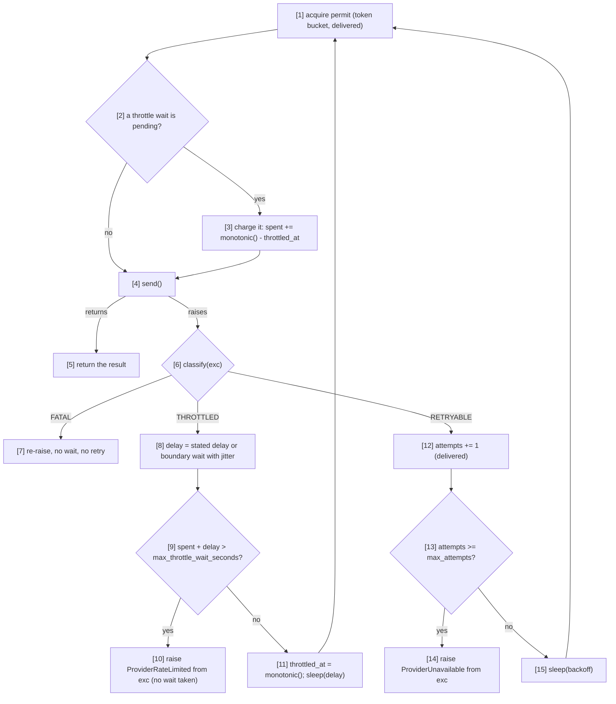

# Component: Rate-Limit Governor (CAP-003 changes)

**Status:** draft
**Capability:** CAP-003
**Owner:** Alvaro de Jodra
**Last Updated:** 2026-11-07

This design records only what CAP-003 changes in `rate-limit-governor`, the
component CAP-001 delivered. Its approved design,
`docs/capabilities/CAP-001-market-data-acquisition-foundation/design/component-design-rate-limit-governor.md`
(v8), stays as it is (AGT-SCOPE-002; owner's answer to CAP-001 review v14
FINDING-56). The change is the governor's part of AC-30, as system design v2
§3.6 note 3, §4.1, §4.2 *Per-stock throttle budget* and constraint 16 (b)
assign it: one throttle wait budget per stock, checked before each wait, and a
distinct `ProviderRateLimited` when it is spent (owner decision on review v14
FINDING-55, option (a)). The abandoned CAP-001 draft (`git show 90b4ff0`,
governor v9) kept the per-request budget FINDING-55 rejected and is not
carried.

## 1. Overview

Until this change a `429` never reached the governor's throttle path in
production, because `massive-client` classified it `RETRYABLE`
(`component-design-massive-client.md` CAP-003 section 1). Once it does, the
delivered throttle budget is wrong in two ways review v14 FINDING-55 showed:

1. **It is per request.** `throttle_wait_started_at` is local to `execute`
   (`src/factorflow/ingestion/rate_limit.py` line 141), so persistent
   throttling spends a full 300 s budget on each of a stock's data types, up to
   four per stock, while the runner refreshes its heartbeat only between
   stocks and `runtime-config` §2.2a sizes the 900 s staleness window for one
   throttle wait per stock. The sweeper would reclaim a live download as
   `abandoned`.
2. **It is checked after the wait.** The check at line 160 follows a boundary
   wait of up to twice the boundary with additive jitter, so a budget can
   overrun by up to 120 s.

CAP-003 changes three things here, and nothing else:

1. **`start_throttle_budget()`** sets the spent throttle wait to zero. The
   budget persists across `execute` calls until the next call, so it is spent
   across all of one stock's requests (`massive-client` calls it from
   `start_instrument()`).
2. **The check comes before the wait.** A wait that would take the spent total
   past `max_throttle_wait_seconds` is not taken.
3. **`ProviderRateLimited`** is raised on budget exhaustion instead of plain
   `ProviderUnavailable`, from the last exception, with the governor's fixed
   message and no provider `request_id`. Attempt exhaustion keeps raising plain
   `ProviderUnavailable`.

Pacing, the token bucket, the `RETRYABLE` attempt bound, backoff, the
`FATAL` re-raise and the stated-delay path are unchanged.

Use cases addressed: a rate limit is waited out without costing an attempt;
when it persists past the stock's wait budget, the data type is recorded under
its own reason and the download continues and finishes, never abandoned
(AC-30).

Support matrix: the ingestion container, as CAP-001 v8. Dependencies:
`factorflow.ingestion.massive.errors` for `ProviderUnavailable` (delivered)
and `ProviderRateLimited` (new, defined by `massive-client`).

## 2. Design Details

### 2.1 Delivered files this change edits

```
src/factorflow/ingestion/rate_limit.py   + self._throttle_spent; + start_throttle_budget(); execute's THROTTLED branch
                                           checks before it waits and raises ProviderRateLimited; docstrings
tests/unit/test_governor_retry.py        three delivered budget tests take the new expectations; new rows (section 7)
```

`GovernorSettings` and `from_massive_settings` are unchanged: the budget is
still `max_throttle_wait_seconds`, now spent per stock
(`FACTORFLOW_MASSIVE_MAX_THROTTLE_WAIT_SECONDS`, default 300 s, CAP-001
runtime-config §2.2a).

### 2.2 The throttle branch

The flowchart shows `execute` after the change. The actors are the caller's
`send` and `classify`, the token bucket and the per-stock budget. The decision
points are the outcome `classify` returns and, for `THROTTLED`, whether the
spent budget plus the computed wait still fits. The expected outcome is that a
throttled request waits only when the whole wait fits the stock's remaining
budget, that the time it waits, including the permit the retry then takes, is
charged to the stock, and that a wait that does not fit raises
`ProviderRateLimited` at once; `RETRYABLE` and `FATAL` behave as delivered.



```python
# src/factorflow/ingestion/rate_limit.py
from factorflow.ingestion.massive.errors import ProviderRateLimited, ProviderUnavailable

_THROTTLE_BUDGET_SPENT_MESSAGE = (
    "The provider kept rate-limiting requests until this stock's throttle wait "
    "budget was spent."
)


class RateLimitGovernor:
    def __init__(self, settings, *, monotonic=time.monotonic, sleep=time.sleep,
                 jitter=random.random, now=time.time) -> None:
        ...  # delivered
        self._throttle_spent = 0.0  # seconds of throttle wait charged to the current stock

    def start_throttle_budget(self) -> None:
        """Start a new stock's throttle wait budget (CAP-003 system design §3.6
        note 3). The budget is spent across every `execute` call until the next
        call, never per request."""
        self._throttle_spent = 0.0

    def execute(self, send, classify, stated_delay_seconds=None):
        """... Raises ProviderUnavailable when attempts are exhausted, and
        ProviderRateLimited, a ProviderUnavailable, when a throttle wait would
        take the stock's spent throttle wait past the budget."""
        attempts = 0
        throttled_at: float | None = None

        while True:
            self._acquire_permit()
            if throttled_at is not None:
                self._throttle_spent += self._monotonic() - throttled_at
                throttled_at = None

            try:
                result = send()
            except BaseException as exc:  # noqa: BLE001 - classify decides, not this module
                outcome = classify(exc)

                if outcome is Outcome.FATAL:
                    raise

                if outcome is Outcome.THROTTLED:
                    delay = self._throttle_delay(exc, stated_delay_seconds)
                    if self._throttle_spent + delay > self._settings.max_throttle_wait_seconds:
                        raise ProviderRateLimited(_THROTTLE_BUDGET_SPENT_MESSAGE) from exc
                    throttled_at = self._monotonic()
                    self._sleep(delay)
                    continue

                attempts += 1  # RETRYABLE, delivered
                if attempts >= self._settings.max_attempts:
                    raise ProviderUnavailable(
                        f"The provider failed {attempts} consecutive attempts."
                    ) from exc
                self._sleep(self._backoff_delay(attempts))
                continue
            else:
                return result
```

### 2.3 What is charged to the budget (decided here)

The system design charges "every `THROTTLED` wait in `execute`" to the stock's
budget (§4.2 *Per-stock throttle budget*). This design measures a throttle
wait as the monotonic time from the start of the throttle sleep to the moment
the retried request holds its permit: the sleep itself plus any permit wait
the retry then needs. Three reasons:

1. **The check stays exact for the sleep.** The governor checks
   `spent + delay` before it sleeps, so the sum of the throttle sleeps between
   two `start_throttle_budget()` calls never exceeds the budget, jitter
   included (system design §3.6 note 3; review v14 FINDING-55).
2. **The provider-agnostic stated-delay path stays bounded** (OPS-LOOP-001). A
   provider stating a zero delay would otherwise never charge anything and
   could throttle forever. With the retry's permit wait charged, the delivered
   test `test_zero_stated_delay_throttle_wait_is_bounded` keeps holding. The
   Massive path never takes this branch (Massive sends no `Retry-After`,
   CAP-001 v8 §2.5), and its boundary wait is always above zero.
3. **It is never looser than the system design.** Charging the permit wait can
   only spend the budget sooner. The retry's permit wait is zero whenever the
   bucket holds a token, which a throttled stock's few requests leave it doing
   at the configured rate (capacity `requests_per_minute`, CAP-001 v8 §2.4), so
   on the Massive path the charge is the sleep in practice; the section 7 rows
   assert the bound on the sleeps, which holds either way.

The successful and `RETRYABLE` paths' permit waits and backoff sleeps are not
charged: they are the pacing and attempt terms of `runtime-config` §2.2a,
unchanged.

### 2.4 Why per stock is enough (system design §3.6 note 4)

`acquisition-runner` refreshes its heartbeat once per stock and calls
`start_instrument()` at the same checkpoint
(`component-design-acquisition-runner.md` CAP-003 §2.2). Under persistent
throttling every request answers `429` without a timeout, so the time between
two heartbeats is at most the budget, 300 s, plus the time to send that stock's
requests under the configured pace. That is the one throttle wait per stock
`runtime-config` §2.2a already reserves (invariant 2,
`(3 × 30 × 4) + 300 = 660 < 900`, `src/factorflow/config/settings.py` lines
305-314), so no timing value or invariant changes and the sweeper never
reclaims a download that is waiting out a rate limit. After the budget is
spent, every further `429` for that stock raises at once, so the stock's
remaining data types each cost one request and no wait.

### 2.5 Messages

N/A, not applicable for this component. Unchanged from CAP-001 v8 §2.6.

## 3. Constraints and Assumptions

- **Throttling is never an attempt** (CAP-001 constraint 5.13, kept; AC-30).
- **The governor retries exactly what the caller classifies `RETRYABLE`**
  (system design constraint 16 (c); review v14 FINDING-57). CAP-001 v8
  criterion 8, "a `4xx` other than `429` is returned to the caller without
  retry", holds only for the refusals `massive-client` recognises: an
  unrecognised envelope is `RETRYABLE` and is retried to `max_attempts`. This
  design restates the criterion that way (section 8, criterion 5) and leaves
  CAP-001 v8 unedited.
- **One governor per client, one runner per process** (system design §4.2):
  the budget is instance state with no lock, as the token bucket is. CAP-001
  v8 criterion 11's concurrency statement concerns the bucket and is
  unchanged.
- **Before the first `start_throttle_budget()`** the budget starts at zero
  from construction, so a caller that never starts a stock gets one budget for
  the client's life, which is the conservative reading.
- **The governor still never inspects an exception**; it imports
  `ProviderRateLimited` only to raise it, as it already imports
  `ProviderUnavailable` (`rate_limit.py` module docstring).
- **Assumption:** `massive-client` classifies a `429` as `THROTTLED`
  (`component-design-massive-client.md` CAP-003 §2.3). Without that, this
  change is unreachable, as the delivered budget was.

## 4. Security

- **Fixed messages only.** Both exhaustion messages are this module's own
  text, never provider text, and `ProviderRateLimited` carries no
  `request_id`; the reason composed from it is `[rate_limited] …
  request_id=unavailable: <this text>` (AGT-PROHIB-003).
- **No log record carries a URL or credential** (CAP-001 v8 criterion 9,
  unchanged): the governor logs nothing new.
- **No new dependency.**

## 5. Scalability and Performance

- **A throttled stock waits up to 300 s** (the budget), instead of failing
  within the backoff delays of three attempts. Ordinary per-minute throttling
  resolves at the next minute boundary and costs one boundary wait.
- **Under throttling that persists for a whole download**, the download takes
  up to one budget longer per followed stock; at 3,000 stocks that is about
  250 hours (system design open question 14). Cancelling takes effect after
  the current stock, as delivered.
- **Memory and CPU:** one float of state.

## 6. Upgrade

- **Upgrades from release 0.2.0** (deployed 2026-11-07,
  `factorflow:0.2.0-829c9e1`; first shipped in 0.1.0 on 2026-10-16) (system
  design constraint 17; review v14 FINDING-58).
- **Behaviour change after upgrade:** the throttle wait budget is per stock
  and checked before each wait, and its exhaustion raises
  `ProviderRateLimited`, recorded as `[rate_limited]` rather than
  `[unavailable]`. Because `massive-client` now classifies a `429` as
  throttling, a throttled stock now waits to the minute boundary, for up to
  300 s, where 0.2.0 failed it within seconds (constraint 17 (a)).
- **Configuration:** no new variable and no new default.
  `FACTORFLOW_MASSIVE_MAX_THROTTLE_WAIT_SECONDS` keeps its meaning, now per
  stock.
- **Data migration:** none. **Manual actions:** none.
- **Rollback (OPS-MIG-003):** redeploy the previous image; the governor holds
  no persistent state.

## 7. Testing

pytest without a container or network, with `tests/unit/governor_fakes.py`
(`FakeClock`, `FakeSleeper`, `FlakySender`, `SequenceJitter`). Every row passes
one `FakeClock` as both `monotonic` and `now`, so a `FakeSleeper` sleep
advances the pacing clock and the wall clock together (review v14
FINDING-60), except the delivered rows that pin a fixed wall-clock phase.

| Test | File | What it proves |
|------|------|----------------|
| The budget is checked before the wait (delivered `test_boundary_throttle_wait_exhausts_the_budget_and_raises`, expectation changed) | `tests/unit/test_governor_retry.py` | Budget 90 s, unjittered 60 s boundary waits: one wait is taken, the second would reach 120 s and is not; `sleeper.calls == [60.0]` (was `[60.0, 60.0]`), and the raised error is `ProviderRateLimited` |
| Stated delay checked before the wait (delivered `test_stated_delay_throttle_wait_exhausts_the_budget_and_raises`, expectation changed) | `tests/unit/test_governor_retry.py` | Budget 25 s, stated delay 10 s: `sleeper.calls == [10.0, 10.0]` (was three), then `ProviderRateLimited` |
| Zero stated delay stays bounded (delivered, unchanged) | `tests/unit/test_governor_retry.py` | One request per minute and a zero stated delay: the retry's 60 s permit wait is charged, so the second throttle raises and `send.calls == 2` (section 2.3) |
| Exhaustion is `ProviderRateLimited` | `tests/unit/test_governor_retry.py` | With a classifier always `THROTTLED`, the raised error is a `ProviderRateLimited`, an instance of `ProviderUnavailable`, with `provider_request_id` `None`, the fixed message, and `__cause__` the last exception `send` raised; with a classifier always `RETRYABLE`, the raised error is a `ProviderUnavailable` that is not a `ProviderRateLimited`, after `max_attempts` sends |
| One budget across a stock's requests | `tests/unit/test_governor_retry.py` | Budget 300 s, unjittered: a first `execute` throttled three times then succeeding spends 180 s; a second `execute` on the same governor, always throttled, takes two more 60 s waits and raises on the third, so the stock's sleeps total 300 s; after `start_throttle_budget()`, a third `execute` waits again |
| Never crossed with jitter | `tests/unit/test_governor_retry.py` | Budget 300 s, `SequenceJitter([0.999])`, always throttled: the sum of `sleeper.calls` is at most 300 s and the sum plus the next computed delay exceeds it (review v14 FINDING-55) |
| Throttling still costs no attempt | `tests/unit/test_governor_retry.py` (delivered `test_repeated_throttled_outcomes_do_not_consume_attempts`, `test_throttled_outcomes_do_not_share_the_retry_attempt_counter`) | Unchanged: with the budget not reached, throttled sends beyond `max_attempts` succeed (AC-30) |
| Retry bound unchanged | `tests/unit/test_governor_retry.py`, `tests/unit/test_governor_backoff.py` (delivered) | Unchanged |

The persistent-`429` case under the default timing set, end to end through the
real SDK path and the runner, is `acquisition-runner`'s integration test
(`component-design-acquisition-runner.md` CAP-003 section 7).

## 8. Acceptance Criteria

1. A `THROTTLED` outcome never increments the attempt counter (AC-30).
2. The throttle wait budget is spent across every request between two calls
   of `start_throttle_budget()`, never per request (AC-30).
3. The governor never takes a throttle wait that would take the spent total
   past `max_throttle_wait_seconds`; the throttle sleeps between two calls of
   `start_throttle_budget()` total at most that budget, jitter included.
4. When a wait does not fit, the governor raises `ProviderRateLimited`, a
   `ProviderUnavailable`, from the last exception, with its fixed message and
   no provider `request_id`, without waiting (AC-30).
5. The governor retries exactly the outcomes its caller classifies
   `RETRYABLE`, up to `max_attempts`, then raises `ProviderUnavailable` that
   is not a `ProviderRateLimited`; a `FATAL` outcome is re-raised at once
   (restates CAP-001 v8 criterion 8 per system design constraint 16 (c)).
6. Failure scenario: a provider answering `429` to every request of a
   download leaves each stock's throttle waits within one budget, each
   throttled data type recorded `failed` with kind `rate_limited`, and the
   download finalised by the outcome rule rather than reclaimed or hanging
   (restates CAP-001 v8 criterion 10 per system design §3.6 note 4).

## 9. Workflows

- **Intersecting: every download.** The governor sits on every provider
  request, as delivered. The stock boundary is new: `acquisition-runner`
  starts each stock's budget through `massive-client`.

## 10. UX / GUI

N/A, not applicable for this component.

## 11. API Endpoints

No HTTP surface. The in-process interface CAP-003 changes:

| Endpoint | Method/Operation | Auth/Privilege | Request | Response | Notes |
|----------|-----------------|----------------|---------|----------|-------|
| `RateLimitGovernor.start_throttle_budget()` | Python call | in process | none | `None` | New; called only by `MassiveClient.start_instrument()` (§4.2 *Per-stock throttle budget*) |
| `RateLimitGovernor.execute(send, classify, stated_delay_seconds=None)` | Python call | in process | as delivered | the send's result; raises `ProviderUnavailable` or, new, `ProviderRateLimited` | Throttle budget per stock, checked before each wait |

## 12. References

| Type | Document Name | Description | Link |
|------|---------------|-------------|------|
| Capability | CAP-003 v2 | AC-30 | `docs/capabilities/CAP-003-app-shell-and-data-health/Capability-CAP-003.md` |
| System design | CAP-003 v2 | §3.6 notes 3, 4; §4.1; §4.2 *Per-stock throttle budget*; constraints 16 (b), (c), (e), 17; open questions 14, 15 | `docs/capabilities/CAP-003-app-shell-and-data-health/design/system-design.md` |
| Component design | CAP-001 rate-limit governor v8 (approved, not edited) | Bucket, throttle path, criteria 8 and 10 as delivered | `docs/capabilities/CAP-001-market-data-acquisition-foundation/design/component-design-rate-limit-governor.md` |
| Component design | CAP-001 runtime config v14 (approved, not edited) | §2.2a staleness derivation, invariant 2 | `docs/capabilities/CAP-001-market-data-acquisition-foundation/design/component-design-runtime-config.md` |
| Component design | CAP-003 massive client, acquisition runner | `ProviderRateLimited`, `start_instrument()`, the stock checkpoint | `docs/capabilities/CAP-003-app-shell-and-data-health/design/` |
| Review | CAP-001 specification review v14 | FINDING-55 (per-request budget against the per-stock window), 57, 58, 60 | `git show b69facd:docs/capabilities/CAP-001-market-data-acquisition-foundation/specifications-review-report-v14.md` |
| Code | Delivered governor | `execute` lines 115-180, `_boundary_wait_with_jitter` lines 213-229 | `src/factorflow/ingestion/rate_limit.py` |
| Constitution | Operational safety | OPS-LOOP-001 | `docs/constitutions/operational-safety.constitution.md` (harness repository) |

## 13. Traceability

| Capability AC | System Design Element | Component Design Element | Section |
|--------------|----------------------|--------------------------|---------|
| AC-30 | §3.6 note 3; constraint 16 (b); `Per-stock throttle budget` | `start_throttle_budget()`; spent budget persisting across `execute` | 2.2 |
| AC-30 | §3.6 note 3 (check before the wait) | `spent + delay > budget` raises without waiting | 2.2, 2.3 |
| AC-30 | `Typed provider refusals` | `ProviderRateLimited` on exhaustion; plain `ProviderUnavailable` on attempts | 2.2 |
| AC-30 | §3.6 note 4 (finishes, never abandoned) | Throttle wait between heartbeats within one budget | 2.4 |
| AC-30 | Constraint 16 (c) | Retries exactly what is `RETRYABLE` | 3, 8 |
| AC-30 | Constraint 17 | Upgrade from 0.2.0 | 6 |

## 14. Open Questions

1. **Persistent throttling now costs time per stock** (system design open
   question 14): a download-level bound or short-circuit is not designed.
   *Owner: capability owner. Blocks: nothing in AC-30.*
2. **The staleness derivation's attempt term predates this change** (system
   design open question 15): `runtime-config` §2.2a counts four requests per
   stock where the client sends nine first-page requests. This design changes
   only the throttle term, which stays one budget per stock. *Owner:
   capability owner. Blocks: nothing here.*
3. **Charging the retry's permit wait** (section 2.3) is this design's reading
   of "every `THROTTLED` wait"; it is stricter than charging the sleep alone
   and identical on the Massive path. *Owner: capability owner, at
   specification review. Blocks: nothing.*
