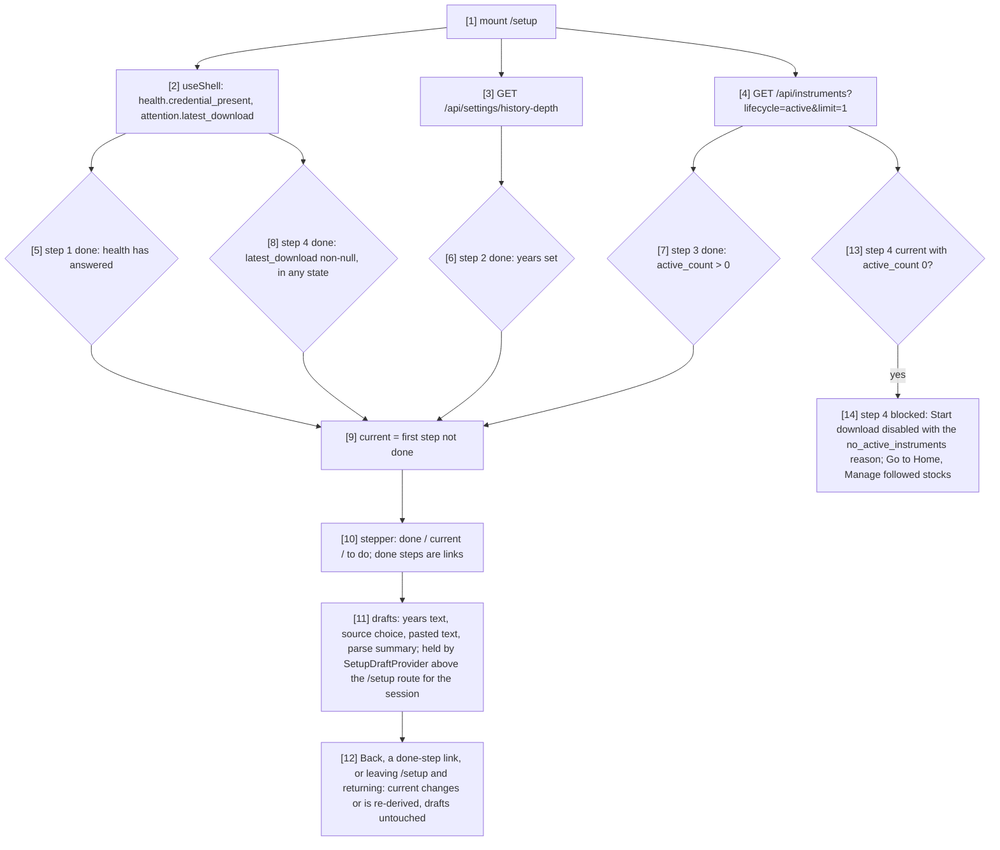

# Component: Setup UI

**Status:** draft
**Capability:** CAP-003
**Owner:** Alvaro de Jodra
**Last Updated:** 2026-10-25

This design was produced in an unattended `$design-run`. It applies DEC-0202,
DEC-0203 and DEC-0205 without re-deciding them, DEC-0202 as the owner amended
it on 2026-10-25 (specification review v2 FINDING-1), and records DEC-0218 (what
step 3 reports as a duplicate and when it suggests a fix), under
`projects/factorflow-v2/decisions/` in the harness repository. Positions
resting on a decision are marked **PROVISIONAL**.

## 1. Overview

`setup-ui` is the first-run setup screen at `/setup`: S02 steps 1 to 4 for M1
(the paper trading step is M2), as one visible multi-step operation the owner
can leave and return to (capability flow 1; AC-3; STD-UI-26). It shows
whether the market data key was found (never its value), saves the history
depth, follows a pasted list of stocks, and starts the first download, each
through the delivered `ingestion-api` endpoint, so the confirmations and
refusals are CAP-001's (system design §3.2; AC-17).

Setup counts as complete once CAP-001's run journal holds at least one
download in any state (requested, queued, running, terminal or cancelled); the
shell reads this from `GET /api/health`'s `most_recent_run` (`owner-shell`
2.5) and no setup flag is stored (DEC-0202 as the owner amended it on
2026-10-25). Each step's values are saved on **Continue** through CAP-001's
endpoints (`PUT /api/settings/history-depth`, `POST /api/instruments`), and on
every visit the step list and current step are re-derived from settings, the
followed list and downloads (S02 5). Input not yet saved, and values of later
steps when the owner goes back, are held in app memory by
`SetupDraftProvider`, a React state holder this component owns and the shell
mounts above the `/setup` route, so they survive leaving `/setup` and
returning within the session; they are never written to browser storage
(system design §4.4).

*Add later* lets **Continue** past step 3 with no symbols. Step 4 then shows
**Start download** `blocked` with CAP-001's `no_active_instruments` reason and
two exits, **Go to Home** and **Manage followed stocks**. Setup stays
incomplete, so `/` keeps opening `/setup` until a download is started from
setup or Data health (DEC-0202 as the owner amended it on 2026-10-25).

Use cases addressed: AC-2 (with the shell's redirect), AC-3, AC-4, AC-5,
AC-6, AC-7, AC-21 (*Add later*), AC-24, AC-25.

Support matrix: as the shell. Dependencies: `owner-shell`'s `useShell()`
(`health.credential_present`, `attention.latest_download`), and its mounting
of `SetupDraftProvider` among its providers, inside `ShellProvider` and
outside the main region's route map, so neither a route change nor the
unreachable state unmounts it; the delivered
client functions `getHistoryDepth`, `setHistoryDepth`, `listInstruments`,
`addInstruments`, `startAcquisitionRun`; the delivered
`web/src/screens/instruments/parse-bulk-symbols.ts`, imported unchanged;
`factorflow`'s `MAX_SYMBOLS_PER_REQUEST` of 1000 mirrored as a constant;
`ui-components`.

## 2. Design Details

### 2.1 Placement

```
web/src/screens/setup/index.tsx              SetupScreen: loads, re-derives steps, reads the drafts
web/src/screens/setup/draft.tsx              SetupDraftProvider, useSetupDrafts: session drafts above /setup (DEC-0202)
web/src/screens/setup/use-setup-state.ts     step derivation over the server facts and the drafts (DEC-0202)
web/src/screens/setup/step-list.tsx          stepper vertical as nav "Setup steps"
web/src/screens/setup/step-card.tsx          the step card composition (UX design §3)
web/src/screens/setup/step-market-data.tsx   step 1
web/src/screens/setup/step-history-depth.tsx step 2
web/src/screens/setup/step-stocks.tsx        step 3
web/src/screens/setup/summarise-paste.ts     duplicates and near-miss fixes over parseBulkSymbols (DEC-0218)
web/src/screens/setup/post-in-batches.ts     POST /api/instruments in batches of at most 1000
web/src/screens/setup/step-download.tsx      step 4
web/src/screens/setup/copy.ts                every owner-facing string
web/src/screens/setup/*.test.ts(x)
tests/e2e/setup-first-run.spec.ts
```

All new. No delivered file is edited; the parser is imported, not changed
(DEC-0218).

### 2.2 Step state

The flowchart shows how the screen decides each step's state when it loads
and how the drafts survive moving between steps and leaving `/setup`. The
actors are the shell context, the two delivered reads this screen makes and
`SetupDraftProvider`, the session draft store mounted above the `/setup`
route. The decision points are each step's done condition, taken from the
server, which step is current, and whether step 4 is blocked. The outcome is a
stepper showing every step as done, current or to do, opened on the first
step not done, with every draft kept while the owner moves back and forth or
leaves `/setup` and returns within the session (AC-3; S02-1, S02-2, S02-5).



```typescript
// web/src/screens/setup/draft.tsx (DEC-0202 as the owner amended it on 2026-10-25)
export interface SetupDrafts {
  yearsText: string;                       // step 2 input as typed
  source: "paste" | "later" | null;        // step 3 radio
  pasted: string;                          // step 3 textarea
  unposted: string[];                      // entries left after a failed batch
}
// React state only, never browser storage (system design §4.4); owner-shell mounts it
// inside ShellProvider and outside the route map, so it outlives every route change.
export function SetupDraftProvider(props: { children: React.ReactNode }): JSX.Element;
export function useSetupDrafts(): {
  drafts: SetupDrafts;
  setDraft<K extends keyof SetupDrafts>(key: K, value: SetupDrafts[K]): void;
};

// web/src/screens/setup/use-setup-state.ts
type StepId = 1 | 2 | 3 | 4;
interface SetupState {
  current: StepId;
  done: Record<StepId, boolean>;           // re-derived from the server on every visit
  step4: "ready" | "blocked";              // blocked while active_count is 0 (no_active_instruments)
  drafts: SetupDrafts;                     // from useSetupDrafts()
  goTo(step: StepId): void;
  setDraft<K extends keyof SetupDrafts>(key: K, value: SetupDrafts[K]): void;
}
```

### 2.3 Committing each step

The sequence follows system design §3.2. Its actors are the owner, this
screen, the shell and the delivered API. The decision points are the depth's
validity, the parse result, each batch's response, and the download's
acceptance, queueing or refusal. The outcome is a requested download with its
progress on screen, after which `/` opens Home (AC-2, AC-7; S02-6).

```mermaid
sequenceDiagram
    autonumber
    participant O as Owner
    participant SU as setup-ui
    participant SH as owner-shell
    participant API as ingestion-api

    O->>SU: step 2, years, Continue
    SU->>API: PUT /api/settings/history-depth {years}
    alt 422
        SU-->>O: field error, value kept
    else 200
        SU-->>O: step 2 done "{y} years of history"; step 3 current
    end
    alt step 3, Paste a list
        O->>SU: paste
        SU->>SU: parseBulkSymbols + summarisePaste on paste and blur (DEC-0218)
        O->>SU: Continue
        loop batches of at most 1000 accepted symbols
            SU->>API: POST /api/instruments {symbols}
            alt 201, or 409 every symbol already followed
                SU-->>O: added, reactivated, rejected with reasons
            else 422 every entry malformed
                SU-->>O: each entry named with its reason; nothing discarded
            else network or 500
                SU-->>O: posted batches counted; the rest named and kept in the textarea for a retry
            end
        end
    else step 3, Add later, Continue (DEC-0202 as amended)
        SU-->>O: step 4 current, blocked: Start download disabled with the no_active_instruments reason; Go to Home, Manage followed stocks
        Note over O,SU: nothing requested, so / keeps opening /setup; drafts kept in SetupDraftProvider
    end
    O->>SU: step 4, Start download (active_count above 0)
    SU->>API: POST /api/acquisition-runs
    alt 202 queued_behind null
        SU->>SH: refresh("attention")
        SH-->>SU: latest_download with progress, every 10 s
        SU-->>O: progress {done} of {total} stocks, "You can leave; this keeps running."
    else 202 queued_behind set
        SU-->>O: "A download is running. This starts when it finishes."
    else 409 history_depth_not_set / no_active_instruments
        SU-->>O: refusal with Go to step 2 / Go to step 3
    end
```

**Step 3 summary (DEC-0218, PROVISIONAL).** `summarisePaste(parsed)` returns
`accepted` (valid, first occurrence), `duplicates` (a normalised form already
seen earlier in the same paste, named once, never posted twice) and
`unreadable` (shape-invalid entries, each with a `fix` when replacing each run
of slash, space or underscore between letters by one dot yields a valid
symbol). A fix is a `button` `outline` *Did you mean {fix}?* that replaces the
entry in the textarea and re-parses. Already-followed entries are reported
after Continue from the response's `duplicate_active` dispositions, as
*already followed*.

**Batches.** Accepted symbols are posted in order in batches of at most 1000
(`MAX_SYMBOLS_PER_REQUEST`). A `409` on a batch means every symbol in it was
already followed and is treated as success, which is also what a repeated
Continue after going back produces (system design §3.2 note 3). If a batch
fails at the transport or with a `500`, the entries of that and later batches
stay in the textarea and are named, the posted ones are counted as followed,
and the step stays current.

**Step 4.** **Start download** is routine and not blocked by a missing key:
CAP-001 refuses a start only for an unset depth or an empty followed list,
and AC-17 preserves that; a download without a key fails and surfaces on Home
(DEC-0203). After `202` the screen calls `refresh("attention")` so the
progress appears at once, then follows the shell's 10 second cadence. While
the followed list is empty (`active_count` 0) step 4 is `blocked`, below, and
no request is sent; a `409 no_active_instruments` from a list emptied
elsewhere in the meantime is still rendered as the refusal.

**Add later** (DEC-0202 as the owner amended it on 2026-10-25; capability
flow 1 step 7). Choosing *Add later* and **Continue** saves nothing and makes
step 4 current with step 3 still to do. Step 4 is then `blocked`: **Start
download** renders `button` `blocked`, disabled for activation but focusable,
described by CAP-001's `no_active_instruments` reason in this screen's words,
*No stocks are followed. Follow stocks before downloading.*, and two exits
render beside it: **Go to Home**, a link to `/home`, and **Manage followed
stocks**, a link to `/data/followed`. **← Back: Stocks to follow** stays
available. Setup stays incomplete because no download is requested, so `/`
keeps opening `/setup` until a download is started from setup or from Data
health; on each return the steps are re-derived, so stocks followed in the
meantime make step 3 done and step 4 ready, and the drafts held by
`SetupDraftProvider` are as the owner left them.

### 2.4 Messages

N/A, not applicable for this component.

## 3. Constraints and Assumptions

- **Delivered endpoints, unchanged** (constraint 2): every save and the start
  go through `ingestion-api` with CAP-001's refusals.
- **No storage** (system design §4.4): unsaved drafts live in React state in
  `SetupDraftProvider`, mounted above the `/setup` route for the session
  (DEC-0202 as the owner amended it on 2026-10-25), so leaving `/setup` and
  returning keeps them; they are never written to browser storage, and a
  reload re-derives saved steps and loses unsaved drafts, which S02 §7
  accepts (*setup reads current configuration on load*).
- **The draft holder sits above the route** (DEC-0202 as amended):
  `owner-shell` mounts `SetupDraftProvider` inside `ShellProvider` and outside
  the main region's route map; `setup-ui` owns the provider, the shell only
  places it.
- **The key's value never appears** (AC-4): the screen receives
  `credential_present` only.
- **Four steps in M1**: the paper trading step is absent, not disabled (S02
  §2; capability §2 Out of Scope).
- **Two sources in step 3**: *Paste a list* and *Add later*; *Upload a CSV*
  is not built (capability OQ-3; UX design 0.8).
- **The plan-limit note states 5 years** for the provider plan (S02 §3;
  CAP-001 §6); it is copy, not a validation.
- **Assumption:** `instruments_named` becomes non-zero when a runner claims
  the download; until then progress is indeterminate (DEC-0213 f).

## 4. Security

- No secret is handled; presence is a boolean (AC-4; S02-4).
- Pasted text is parsed locally and posted as a JSON array the delivered route
  validates per symbol (SEC-INP-001).
- Nothing is written to browser storage.
- Server reasons render as text.

## 5. Scalability and Performance

- A 3000-symbol paste is parsed once on paste and once on blur, never per
  keystroke, and posted in three requests.
- Progress follows the shell's attention read; this screen opens no interval.

## 6. Upgrade

- New screen. Settings gains **Open setup** (`owner-web-app`) so setup can be
  reopened, with every step shown as done.
- M2 adds step 5 and moves completion to its own rule; nothing is reserved
  for it now.

## 7. Testing

| Test | File | What it proves |
|------|------|----------------|
| Steps re-derived | `web/src/screens/setup/use-setup-state.test.ts` | Each done flag follows its server fact; current is the first not done (S02-1) |
| Back keeps drafts | `web/src/screens/setup/setup.test.tsx` | Going back from step 4 to 2 and forward again keeps the years text, the radio choice and the pasted text (AC-3; S02-2) |
| Drafts survive a route change | `web/src/screens/setup/draft.test.tsx` | With `SetupDraftProvider` above a memory router, unsaved years text, radio choice and pasted text survive navigating from `/setup` to `/home` and back within the session; nothing is written to `localStorage` or `sessionStorage`; a freshly mounted provider (a reload) starts empty (AC-3; S02-2; DEC-0202 as amended) |
| Key presence | `web/src/screens/setup/step-market-data.test.tsx` | *Found* or *Missing* with the variable name and restart line; *Not determinable* while health is unreachable; no value anywhere (AC-4; S02-4) |
| Depth | `web/src/screens/setup/step-history-depth.test.tsx` | `422` renders the field error with the value kept |
| Paste summary | `web/src/screens/setup/summarise-paste.test.ts` | Duplicates within the paste named once; `BRK/B`, `BRK B` and `BRK_B` suggest `BRK.B`; `ZZZZ!` suggests nothing; accepted kept whatever else is rejected (AC-5; DEC-0218) |
| Ranking warning | `web/src/screens/setup/step-stocks.test.tsx` | Below 30 accepted the warning shows and **Continue** stays available; at zero it is `blocked` with its reason (AC-6; S02-5) |
| Batches | `web/src/screens/setup/post-in-batches.test.ts` | 2500 symbols post as 1000, 1000, 500; a `409` batch counts as success; a failed batch keeps its and later entries |
| Start | `web/src/screens/setup/step-download.test.tsx` | `202` shows progress from attention with *checked {time}* that advances on each attention answer (AC-25); `queued_behind` shows the queued line; each `409` names its step to fix |
| Blocked step 4 | `web/src/screens/setup/step-download.test.tsx` | After *Add later* and **Continue** with `active_count` 0, step 4 is current with step 3 to do; **Start download** is `blocked`, focusable and described by *No stocks are followed. Follow stocks before downloading.*, and activating it sends no request (DEC-0202 as amended) |
| Blocked exits | `web/src/screens/setup/step-download.test.tsx` | In the blocked state **Go to Home** is a link to `/home` and **Manage followed stocks** a link to `/data/followed`, each reachable by keyboard; neither renders once `active_count` is above 0 (DEC-0202 as amended) |
| First run | `tests/e2e/setup-first-run.spec.ts` | Empty install opens setup; all four steps by keyboard; after **Start download** `/` opens Home with the first-download item (AC-2, AC-7, AC-25) |
| Add later | `tests/e2e/setup-first-run.spec.ts` | *Add later* and **Continue** reach step 4 blocked; **Go to Home** lands on Home's empty state and `/` still opens setup with the drafts kept; **Manage followed stocks** opens `/data/followed`, and after following a stock there and returning, step 4 is ready; `/` opens Home only after a download is started (AC-3, AC-21; DEC-0202 as amended) |

## 8. Acceptance Criteria

1. The stepper shows four steps, the owner's position and what remains; going
   back keeps every later value.
2. Step 1 states *Found* or *Missing* and, when missing, names
   `FACTORFLOW_MASSIVE_API_KEY` and the restart; never the value.
3. A pasted list keeps every accepted entry and names each duplicate and each
   unreadable entry; below 30 accepted it warns and still continues.
4. **Start download** requests a download through the delivered endpoint and
   the progress shows until the owner leaves; with no followed stock it is
   `blocked` with its reason, and **Go to Home** and **Manage followed
   stocks** let the owner leave with setup still incomplete.
5. Failure scenario: a refused start names the operation, the reason and the
   step that fixes it; a failed save keeps the entered value.

## 9. Workflows

Capability flow 1, all steps, including both alternates (going back; *Add
later*, which reaches step 4 blocked). Intersects Settings, which reopens
setup, Home, which shows the download's progress afterwards, and Data health's
followed stocks, which **Manage followed stocks** opens.

## 10. UX / GUI

From UX design §1.2.

**Layout.** Two columns inside the 1180 px main region, `--space-6` apart.
Left, 260 to 300 px: `h1` *Get set up* at `--text-xl`; the sub-line *About 10
minutes, then the data download runs on its own. You can leave and come
back.* at `--text-xs` `--muted-foreground`; the `stepper` `vertical`, four
steps, each a 28 px dot with its number or a check, a bold title and a
one-line done summary: *Market data* (*Found* / *Missing*), *How far back*
(*{y} years of history*), *Stocks to follow* (*{n} followed stocks*),
*Download data* (*Download started {start time}*). Right, fluid: the step card,
a `card` `default` with *Step {n} of 4* at `--text-xs`, the question as `h2`
at `--text-xl`, an explanation capped at 70ch, the controls, an info note at
`--text-xs` on `--muted`, and a footer with **← Back: {previous step title}**
(`button` `ghost`) left and *Next: {next step title}* and **Continue**
(`button` `default`) right; step 1 has no Back, step 4 no Continue. The
1180 px, 260 to 300 px, 28 px and 70ch are approved-specification layout
dimensions read from `owner-shell`'s `web/src/app/layout.ts`, not theme
literals (AC-26 as narrowed by the owner; review v1 FINDING-6).

**Steps.**

| Step | Question | Controls and copy |
|------|----------|-------------------|
| 1 | *Connect market data* | *Market data key:* `badge` `status-good` *Found* or `status-critical` *Missing*; when missing, *Set the environment variable `FACTORFLOW_MASSIVE_API_KEY` to your Massive API key.* and *Restart FactorFlow after setting it.*; while health is unreachable `coverage-unknown` *Not determinable* with *FactorFlow isn't answering, so the key can't be checked.*; **Continue** always available |
| 2 | *How far back should history go?* | `form` `stacked`, *History depth*, `input` `numeric` with the suffix *years*, *Whole years, 1 to 50.*; note *Your provider plan holds 5 years. A deeper depth is requested as stated; the provider returns what it holds.*; `422` *History depth must be a whole number of years from 1 to 50.* |
| 3 | *Which stocks do you want to follow?* | The explanation of S02 §8; `radio-group` `cards` *How do you want to name them?*: **Paste a list** (*Paste symbols separated by commas or one per line.*), **Add later** (*Continue without stocks for now; you can follow them later from Data health.*); *Paste a list* reveals `form` `stacked` with `textarea` `list` *Stock symbols*, placeholder *AAPL, MSFT, NVDA or one symbol per line*, description *Whether the provider knows each one is checked during the download.*; counter *{a} symbols recognised, {d} duplicates, {r} not recognised* with `badge` `status-good` on the accepted count and one `badge` `status-warning` per duplicate or unreadable entry with its reason; *Did you mean {fix}?* as `button` `outline`; below 30, *Factor scores need at least 30 stocks with complete data. With {a}, no factor can be ranked yet.*; at zero accepted with *Paste a list* chosen, **Continue** `blocked` with *Paste at least one symbol, or choose Add later.*; info note *This is your followed list. You can add or stop following stocks any time in Data health. Stopping keeps their history; nothing is ever deleted.* |
| 4 | *Download data for {n} stocks* | `card` `summary`: *Market data key* (step 1's badge), *History depth* *{y} years*, *Followed stocks* *{n}*; **Start download** (`button` `default`); after `202`, `progress` `determinate` *{done} of {total} stocks* (`indeterminate` while the total is unknown), *Started {start time}*, *checked {time}* at `--text-xs` `--muted-foreground` from the attention read's `checkedAt`, updated on its 10 s poll (AC-25; STD-UI-25; review v1 FINDING-11), *You can leave; this keeps running.*; queued: *A download is running. This starts when it finishes.*; `409`: *Couldn't start the download: history depth isn't set.* with **Go to step 2**, or *Couldn't start the download: no stocks are followed.* with **Go to step 3**; `blocked` while no stock is followed (after *Add later*): **Start download** `button` `blocked` described by *No stocks are followed. Follow stocks before downloading.*, with **Go to Home** (link to `/home`) and **Manage followed stocks** (link to `/data/followed`), both `button` `outline` (DEC-0202 as amended) |

**Component mapping.**

| UI Element | Component | Variant | Design Spec Reference |
|------------|----------|---------|-----------------------|
| Step list | `stepper` | `vertical`, done steps as links | `design-system/components/stepper/design-spec.md` |
| Step card | `card` | `default` | `design-system/components/card/design-spec.md` |
| Key presence | `badge` | `status-good` / `status-critical` / `coverage-unknown` | `design-system/components/badge/design-spec.md` |
| History depth | `form` + `input` | `stacked` + `numeric` with suffix | `design-system/components/form/design-spec.md`, `design-system/components/input/design-spec.md` |
| Source choice | `radio-group` | `cards` | `design-system/components/radio-group/design-spec.md` |
| Symbols | `form` + `textarea` | `stacked` + `list` | `design-system/components/form/design-spec.md`, `design-system/components/textarea/design-spec.md` |
| Parse counts | `badge` | `status-good`, `status-warning` | `design-system/components/badge/design-spec.md` |
| Near-miss fix | `button` | `outline` | `design-system/components/button/design-spec.md` |
| Step 4 summary | `card` | `summary` | `design-system/components/card/design-spec.md` |
| Continue, Start download | `button` | `default`; `blocked` at zero accepted (Continue) or with no followed stock (Start download) | `design-system/components/button/design-spec.md` |
| Go to Home, Manage followed stocks | `button` | `outline`, links to `/home` and `/data/followed` | `design-system/components/button/design-spec.md` |
| Back | `button` | `ghost` | `design-system/components/button/design-spec.md` |
| Progress | `progress` | `determinate`, `indeterminate` | `design-system/components/progress/design-spec.md` |

**States** (UX design 1.2). Loading: skeleton step list and card. Empty,
never populated: step 1 current, nothing done. Empty, nothing found: step 3
at zero accepted, **Continue** `blocked`; step 4 with no followed stock,
**Start download** `blocked` with **Go to Home** and **Manage followed
stocks**. Partial: rejected or duplicate
entries counted with the accepted kept; some steps done. Stale: not
applicable, every step re-derived on load. Unavailable: key presence
`coverage-unknown` while health is unreachable; step 4's progress while
attention fails reads *Progress can't be read right now* beside the running
state, never a frozen bar. Error: a failed depth or count read shows
*Couldn't read {history depth / the followed list}: {reason}* with **Try
again** in that step only; a failed save is a field error with values kept; a
`409` on step 4 is the refusal above. Unreachable: the shell state.

**Tokens.** Stepper per its spec: done dot `--foreground` with a
`--background` check, current ring `--status-active` with
`--status-active-muted`, to-do outline and connector `--border`, step numbers
`--font-numeric` at `--text-xs`; card `--card`, `--border`; fields `--input`
(3:1), focus `--ring`, errors `--destructive`, descriptions and counter
`--muted-foreground`, rejected markers `--status-warning`; key presence on the
status pairs; not determinable `--value-indeterminate` on
`--value-indeterminate-muted` with `--pattern-indeterminate`; radio cards
`--border` with a 1 px `--foreground` selected ring; progress track `--seq-1`,
indicator `--status-active`; spacing `--space-6` between columns, `--space-4`
inside the card, `--space-5` between card regions.

**Accessibility.** The step list is a `nav` *Setup steps* holding an `ol`; the
current step `aria-current="step"`; done steps say so in text (*How far back,
done*). The step card is a `section` labelled by its `h2`; focus moves to that
`h2` when the step changes. The radio group is one tab stop with arrow keys.
The counter is a polite live region tied to the textarea by
`aria-describedby`, and rejected entries are announced with their reason. The
years suffix is part of the input's accessible name. `button` `blocked` stays
focusable with its reason described. The progress bar is a `progressbar`
labelled by its visible text and announced at the 10 second cadence, never
per frame. The key's value appears nowhere (AC-4).

**Internationalization.** None.

## 11. API Endpoints

Consumed only; all delivered and unchanged.

| Endpoint | Method/Operation | Auth/Privilege | Request | Response | Notes |
|----------|-----------------|----------------|---------|----------|-------|
| `/api/settings/history-depth` | GET | none, loopback | none | `years` or null | Step 2 done flag |
| `/api/settings/history-depth` | PUT | none, loopback | `{"years": n}` | `200`; `422` | Step 2 Continue |
| `/api/instruments` | GET | none, loopback | `lifecycle=active&limit=1` | `active_count` | Step 3 done flag and summary; step 4 `blocked` at 0 |
| `/api/instruments` | POST | none, loopback | `{"symbols": [...]}`, at most 1000 | `201` dispositions; `409`; `422` | Step 3 Continue |
| `/api/acquisition-runs` | POST | none, loopback | none | `202 {run_id, queued_behind}`; `409` | Step 4 |
| `/api/attention` (via `useShell`) | GET | none, loopback | none | `latest_download.progress` | Step 4 progress and done flag |

## 12. References

| Type | Document Name | Description | Link |
|------|---------------|-------------|------|
| UX design | CAP-003 v1 | §1.2 First-run setup, §0.8 departures | `docs/capabilities/CAP-003-app-shell-and-data-health/design/ux-design.md` |
| Screen spec | PRODUCT-UX-S02 v4 | Steps, parse rules, states, S02-1 to S02-6 | `docs/ux/screens/S02-setup.md` |
| System design | CAP-003 v1 | §3.2 and its notes | `docs/capabilities/CAP-003-app-shell-and-data-health/design/system-design.md` |
| Component design | CAP-001 owner web app v4 | `parse-bulk-symbols`, `button` `blocked` | `docs/capabilities/CAP-001-market-data-acquisition-foundation/design/component-design-owner-web-app.md` |
| Decisions | DEC-0202, DEC-0203, DEC-0213, DEC-0218 | Completion, *Add later* and session drafts (as amended 2026-10-25), items, progress total, paste summary | `projects/factorflow-v2/decisions/` (harness repository) |

## 13. Traceability

| Capability AC | System Design Element | Component Design Element | Section |
|--------------|----------------------|--------------------------|---------|
| AC-2 | `/` redirect on `most_recent_run` | Step 4 request completes setup; shell redirects | 2.3 |
| AC-3 | Stepper and in-memory drafts | `use-setup-state`, `SetupDraftProvider` above `/setup`, stepper, Back | 2.2 |
| AC-4 | `credential_present` via shell context | Step 1 badge, no value | 10 |
| AC-5 | Reused `parse-bulk-symbols`; dispositions | `summarisePaste`, batches, server dispositions | 2.3 |
| AC-6 | Warning below 30 | Step 3 warning, **Continue** available | 10 |
| AC-7 | First download from setup | Step 4 start and progress | 2.3 |
| AC-21 | Honest empty state | *Add later* to step 4 `blocked`, **Go to Home** to Home's empty state | 2.3 |
| AC-24 | Every region's states | States paragraph | 10 |
| AC-25 | Keyboard; polled freshness | Native and Radix keyboard; progress at 10 s with its *checked {time}* | 10 |
| AC-26 | `ui-components`; layout dimensions in one module | Component mapping; layout dimensions from `layout.ts` | 10 |

## 14. Open Questions

1. **CSV upload in M1** (capability OQ-3). A yes adds a third radio card, a
   `file-input` through `design-system/intake.md` and a capability criterion.
   *Owner: capability owner. Blocks: one control in step 3.*
2. **The download's name** (capability OQ-1): *Download started {start
   time}* until the owner decides on a number. *Owner: capability owner.
   Blocks: copy only.*
3. **DEC-0218's near-miss rule** awaits the owner's verdict; S02 gives one
   example and no rule. *Owner: capability owner. Blocks: nothing.*
