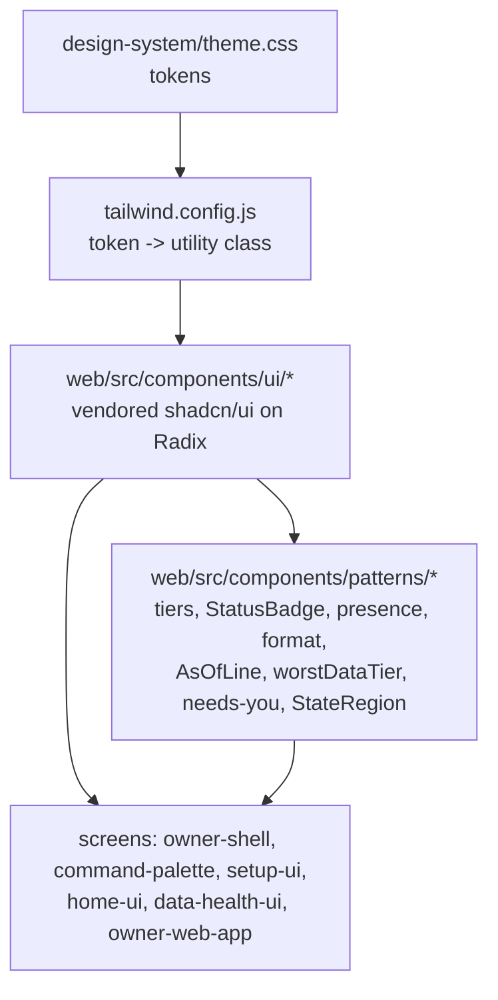
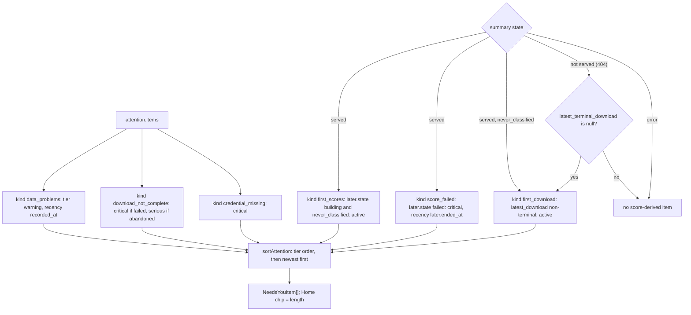

# Component: UI Components (design-system components and shared patterns)

**Status:** draft
**Capability:** CAP-003
**Owner:** Alvaro de Jodra
**Last Updated:** 2026-10-25

This design was produced in an unattended `$design-run`. It applies DEC-0203,
DEC-0205 and DEC-0210 without re-deciding them, and records DEC-0211 (it owns
`package.json` and `tailwind.config.js` edits), DEC-0215 (the packages the
vendored `data-table` and `form` need), DEC-0216 (the first-download item
before the score read exists) and DEC-0217 (`worstDataTier` over every tier),
all under `projects/factorflow-v2/decisions/`
in the harness repository and all **PROVISIONAL**. DEC-0210 and DEC-0217 are
applied as the owner amended them on 2026-10-25 (specification review v1
FINDING-8, FINDING-9).

## 1. Overview

`ui-components` is the owner interface's building-block layer: the
design-system components vendored as shadcn/ui ships them into
`web/src/components/ui/`, and the blueprint §4 patterns built once from them
in `web/src/components/patterns/` (system design §4.1; DEC-0205; blueprint
§0). Every surface CAP-003 delivers or takes over imports from here and from
nowhere else for its controls, so a later capability adds screens without
restyling shared ones (capability §5.3; AC-26).

It holds the functions whose single definition is what makes the interface
consistent: the one status-to-tier function (AC-20; system design constraint
4), `worstDataTier` shared by the verdict and the data tile (DEC-0210), the
*Needs you* derivation and `sortAttention` shared by Home and the shell's
count (DEC-0203; AC-9, AC-16), the date and time formatters (STD-UI-5), and
the presence renderings that keep present, absent and not determinable apart
(STD-UI-4, STD-UI-14).

Use cases addressed: every rendered status, count, as-of line, empty and
error state on the eight CAP-003 screens, the palette and the shell.

Support matrix: the owner's desktop browser, light theme (STD-UI OQ-UI-2),
design width 1280 px and above (blueprint §3.1).

Dependencies: React 18, Tailwind bound to `design-system/theme.css`, the
Radix primitive packages `@radix-ui/react-dialog`, `-alert-dialog`,
`-radio-group`, `-progress`, `-select`, `-checkbox`, `-slot`, and `cmdk`,
`sonner`, `clsx`, `tailwind-merge`, `class-variance-authority`,
`lucide-react` (DEC-0205), `@tanstack/react-table`, `react-hook-form`, `zod`,
`@hookform/resolvers` and `@radix-ui/react-label` (DEC-0215); the owner
confirmed all ten non-Radix packages in tech stack v6 on 2026-10-25
(OQ-TS-10).

## 2. Design Details

### 2.1 Placement

```
web/src/components/ui/utils.ts            cn(): clsx + tailwind-merge, as shadcn/ui ships it
web/src/components/ui/badge.tsx           status-<tier>, coverage-present/-absent/-unknown, secondary
web/src/components/ui/button.tsx          default, secondary, outline, ghost, blocked (asChild for links)
web/src/components/ui/card.tsx            default, metric, summary
web/src/components/ui/checkbox.tsx        default
web/src/components/ui/command.tsx         Command, CommandDialog, CommandInput, CommandList, CommandEmpty,
                                          CommandGroup, CommandItem, CommandSeparator, CommandLoading
web/src/components/ui/data-table.tsx      compact, history, virtualised, expandable
web/src/components/ui/dialog.tsx          confirm (Radix AlertDialog)
web/src/components/ui/form.tsx            stacked, inline (react-hook-form + zod resolver)
web/src/components/ui/input.tsx           text, numeric (with suffix)
web/src/components/ui/progress.tsx        determinate, indeterminate
web/src/components/ui/radio-group.tsx     cards
web/src/components/ui/select.tsx          inline
web/src/components/ui/stepper.tsx         vertical (bespoke, native <ol>)
web/src/components/ui/textarea.tsx        list
web/src/components/ui/toast.tsx           Toaster and toast(): success, warning, error (sonner)
web/src/components/patterns/tiers.ts                  Tier, tierOf(), labelOf(): the one status-to-tier function
web/src/components/patterns/status-badge.tsx          StatusBadge: label + tier shape, never colour alone
web/src/components/patterns/presence.tsx              Absent (em dash), NotDeterminable (coverage-unknown + reason)
web/src/components/patterns/format.ts                 formatInstant, formatClock, formatSessionDate, formatCount, formatDownloadName
web/src/components/patterns/as-of-line.tsx            AsOfLine: parts joined by " · " at --text-xs; taken over from CAP-002, generalised
web/src/components/patterns/worst-data-tier.ts        worstDataTier (DEC-0210)
web/src/components/patterns/needs-you.ts              NeedsYouItem, deriveNeedsYou(), sortAttention() (DEC-0203, DEC-0216)
web/src/components/patterns/needs-you-item.tsx        the blueprint §4.1 row
web/src/components/patterns/state-region.tsx          StateRegion: STD-UI-23's eight states around a body
web/src/components/patterns/*.test.ts(x)              one test file per pattern
web/src/components/ui/*.test.tsx                      contract tests per vendored component
package.json                                          delivered; dependencies above (DEC-0211, after confirmation)
tailwind.config.js                                    delivered; colour and radius keys for existing tokens (DEC-0211)
```

The vendored sources are copied as shadcn/ui ships them, with their `@/`
imports rewritten to relative paths, so neither `tsconfig.json` nor
`vite.config.ts` gains an alias (DEC-0211). They are first-party code from the
moment they are copied: reviewed, linted by Biome and scanned with the rest of
the bundle (SEC-DEP-001).

**Packages are added with their licence.** The owner confirmed all ten
non-Radix packages in tech stack v6 on 2026-10-25 (OQ-TS-10; capability OQ-4;
DEC-0205, DEC-0215). Each is added by the first story that vendors a
component needing it, and its licence is checked against the package when it
is added (SEC-DEP-003). The Radix packages are within the approved `shadcn/ui
on Radix primitives` entry and are added the same way.

**`as-of-line.tsx` is taken over from CAP-002** (owner decision 2026-10-25;
review v1 FINDING-14). CAP-002 lands first (capability OQ-2, answered
2026-10-25) and delivers `web/src/components/patterns/as-of-line.tsx`
specialised to the Research as-of line (DEC-0073). This component takes that
file over and generalises it to `AsOfLine`, and CAP-002's Research line
composes `AsOfLine`, rendering what it rendered before, so the blueprint
builds the as-of line once (§0, §4.8) and CAP-002's `as-of-line.test.tsx`
cases for the Research line keep passing. It is the one delivered pattern
file this component edits rather than creates.

### 2.2 Layers

The diagram shows the layer this component forms between the theme and the
screens. Its actors are `design-system/theme.css`, the Tailwind configuration
that maps tokens to utility classes, the vendored components, the patterns
composed from them, and the screen components that consume both. The one rule
it shows is direction: screens import components and patterns, patterns
import components, components import only the theme through Tailwind, and
nothing imports a screen. The outcome is that a token change restyles every
surface at once and no surface carries a literal of its own (AC-26).



`tailwind.config.js` gains the colour keys the vendored components reference
and the delivered file does not yet map, each to a token `theme.css` already
defines: `primary`, `primary-foreground`, `accent`, `accent-foreground`,
`popover`, `popover-foreground`, `muted`, `ring`, `destructive`,
`destructive-foreground`, `status-foreground` and `seq-1`, in the delivered
`hsl(var(--token) / <alpha-value>)` form, plus `borderRadius.DEFAULT:
"var(--radius)"` and `ringWidth.DEFAULT: "var(--focus-ring-width)"`. No token
is added (STD-UI-10, STD-UI-29). The delivered
`web/src/app/shell.tokens.test.tsx` already asserts every scale resolves to a
custom property and keeps doing so.

### 2.3 The one tier function (AC-20; constraint 4)

```typescript
// web/src/components/patterns/tiers.ts
export type Tier = "neutral" | "active" | "good" | "warning" | "serious" | "critical";

export type Status =
  | { of: "download"; state: RunState }                       // the eight acquisition_run states
  | { of: "result"; outcome: "failed" | "not_found" }
  | { of: "scores"; state: "never_classified" | "building" | "not_current" | "failed" | "current" }
  | { of: "check"; status: "ok" | "exceptions" | "not_current" }
  | { of: "credential"; present: boolean }
  | { of: "item"; kind: NeedsYouKind; failed?: boolean };     // tag tier per DEC-0203

export function tierOf(status: Status): Tier;
export function labelOf(status: Status): string;              // display label, STD-UI-1 v6
```

The table the function implements is UX brief §12.2, verbatim:

| Input | Label | Tier |
|-------|-------|------|
| download `requested` / `running` / `cancelling` | *Queued* / *Downloading* / *Stopping* | neutral / active / warning |
| download `succeeded` / `partial` / `failed` | *Complete* / *Partial* / *Failed* | good / warning (never good) / critical |
| download `cancelled` / `abandoned` | *Cancelled by you* / *Interrupted* | neutral (never critical) / serious |
| result `not_found` / `failed` | *Not found* / *Failed* | warning / critical |
| scores `building` / `not_current` / `failed` | *Updating* / *Not reflecting the latest download* / *Score update failed* | active / warning / critical |
| scores `never_classified` / `current` | *No scores yet* / *Current* | neutral / good |
| check `ok` / `exceptions` | *No missing prices or gaps* or *All financials present* / *Needs attention* | good / warning |
| credential present / missing | *Found* / *Missing* | good / critical |

Not determinable is not a tier: it renders through `NotDeterminable` (2.5),
never through `tierOf`. The delivered `web/src/screens/runs/outcome-badge.tsx`
and `web/src/screens/runs/detail/result-outcome-badge.tsx` are replaced by
`StatusBadge` calls when `owner-web-app` rebuilds those screens, so CAP-001's
mapping and this one cannot drift apart.

`StatusBadge` renders the `badge` `status-<tier>` variant with the label as
text and the tier shape as an `aria-hidden` icon: neutral hollow circle,
active ringed dot, good filled circle, warning triangle, serious diamond,
critical square (blueprint §8; STD-UI-8).

### 2.4 `worstDataTier` (DEC-0210, DEC-0217 as amended, PROVISIONAL)

```typescript
// web/src/components/patterns/worst-data-tier.ts
export type DataAnswer = {
  tier: "good" | "warning" | "serious" | "critical";
  word: "Yes" | "Mostly yes" | "No";
  downloadClause: "failed" | "interrupted" | null;   // from the latest terminal download
};

export function worstDataTier(inputs: {
  affectedCount: number;                    // the problem set: affected_count or problems.stock_count (DEC-0201)
  followedCount: number;                    // followed_count from the same response
  latestTerminalDownload: RunState | null;  // attention's latest_terminal_download?.state
}): DataAnswer;

export function dataTileBadge(
  verdict: DataAnswer,
  scores: Extract<Status, { of: "scores" }> | null,   // null while the summary is not served
): { tier: Tier; label: string; from: "verdict" | "scores" };
```

The inputs are the problem set and the latest terminal download; the checks'
tiers do not feed the answer, and each check card shows its own (DEC-0210 as
the owner amended it on 2026-10-25):

| Input | Tier | Answer word | Clause after the count clause |
|-------|------|-------------|-------------------------------|
| `affectedCount` 0 | good | *Yes* | none |
| `affectedCount` above 0, below `followedCount` | warning | *Mostly yes* | none |
| every followed stock affected (`affectedCount` ≥ `followedCount` > 0) | critical | *No* | none |
| `latestTerminalDownload` `failed` | critical | *No* | *, and the last download failed.* |
| `latestTerminalDownload` `abandoned` (*Interrupted*) | serious, rendered `status-serious` | *Mostly yes* | *, and the last download was interrupted.* |
| any other `latestTerminalDownload` state, or none | no tier | n/a | none |

The answer is the worst of the problem-set tier and the download tier by one
full tier order for all six tiers, critical, serious, warning, good, neutral,
with active ranked alongside good, the order `sortAttention` uses (2.6;
DEC-0217 as amended). The word follows the winning tier: good *Yes*, warning
and serious *Mostly yes*, critical *No*. The download clause is returned
whenever the latest terminal download failed or was interrupted, whichever
input wins, and replaces the closing full stop of the count clause the
caller composes. Not determinable is not an answer of this function: a
caller whose read of these inputs has not answered renders its skeleton, and
one whose read has failed renders its region's Error state (UX design 1.3
and 1.4 States); `NotDeterminable` is for a value no artifact can determine
(STD-UI-14), such as the score state while the summary answers `404`.

`dataTileBadge` is Home's data tile badge: the worse of the verdict tier and
the blueprint §8 score-state tier (`tierOf` over the summary's score state),
by the same order, with the label of whichever wins, the answer word for the
verdict or `labelOf` for the scores (*Score update failed*, *Not reflecting
the latest download*). A tie goes to the verdict and a null score state
contributes no tier, so neutral (*No scores yet*) and active (*Updating*)
never worsen or displace the answer. Before any download Home renders its
empty state and neither function is called. `data-health-ui`'s verdict and
`home-ui`'s tile pass the same problem set and the same latest download, so
the tile's verdict tier never disagrees with the verdict; the tile adds only
the score state, which Data health shows on its Factor scores card.

### 2.5 Presence and formatting (STD-UI-3, STD-UI-4, STD-UI-5, STD-UI-14)

- `Absent` renders an em dash in `--value-missing` with visually hidden text
  naming what is absent; never `0`, never blank.
- `NotDeterminable` renders `badge` `coverage-unknown` with *Not determinable*
  (or a caller's label) carrying
  `--pattern-indeterminate`, and its reason beside it or in its accessible
  description; never a dimmed absent, never a passed check.
- `formatInstant(date, { seconds })` renders `YYYY-MM-DD HH:MM zone`, or
  `YYYY-MM-DD HH:MM:SS zone` with `seconds` (the unreachable state's *Last
  answered*), in America/Chicago
  with the zone abbreviation the instant falls in, *CDT* or *CST*, built from
  `Intl.DateTimeFormat` parts with `timeZoneName: "short"` in `en-US`, never a
  locale format (UX design 0.7). `formatClock(date)` renders `HH:MM:SS zone`
  for *checked {time}*. `formatSessionDate(date)` renders a session date
  unconverted. `formatCount(n)` renders a whole number with thousands
  separators (*1,236*). `formatDownloadName(startedAt ?? requestedAt)` renders
  *Download {YYYY-MM-DD HH:MM zone}*, the interim name capability OQ-1 leaves
  in place.
- The delivered `formatTimestamp` in the shell's health module renders the
  zone as *America/Chicago*; it is kept for the delivered tests that assert
  it, and every CAP-003 surface uses `formatInstant` (system design assumption
  5; UX design 0.7).

### 2.6 *Needs you* derivation (DEC-0203, DEC-0216, PROVISIONAL)

The flowchart shows how one function turns the shell's two reads into the
ordered list Home renders and the count the rail shows. The actors are the
attention response, the summary state (served, not served or error) and
`deriveNeedsYou`. The decision points are each kind's cause and whether the
summary is served. The outcome is one sorted array whose length is the Home
chip, computed by the same call in `owner-shell` and `home-ui`, so the chip and
the list never disagree (AC-9, AC-16).



```typescript
// web/src/components/patterns/needs-you.ts
export type NeedsYouKind =
  | "data_problems" | "download_not_complete" | "credential_missing"
  | "first_download" | "first_scores" | "score_failed";

export interface NeedsYouItem {
  kind: NeedsYouKind;
  tier: Tier;
  recordedAt: string;          // ISO-8601, the recency key
  target: string;              // the one action's route; every action navigates (S01 §6)
  runId?: string;
}

export function deriveNeedsYou(attention: Attention, scores: ScoreState): NeedsYouItem[];
export function sortAttention(items: NeedsYouItem[]): NeedsYouItem[];
```

`sortAttention` orders by critical, serious, warning, good, neutral, with
active sorting with good (UX design 1.3), then by `recordedAt` newest first,
stable for equal keys. The first-download variant of kind 4 is present while
the summary answers `404` only when `latest_terminal_download` is null, that
is, when no download has ever ended (DEC-0216). Targets: `/data` for
`data_problems` and `score_failed`, `/data/downloads/{runId}` for
`download_not_complete`, `first_download` and `first_scores`, `/settings` for
`credential_missing`. Copy is `home-ui`'s; this function returns no
user-visible string.

### 2.7 `StateRegion` (STD-UI-23; AC-24)

`StateRegion<T>` takes the delivered `ScreenState<T>` union
(`web/src/api/types.ts`, unchanged) and one renderer per state, and refuses at
the type level a call that omits a state without naming why: a caller passes
either a renderer or `{ notApplicable: "reason" }` for each of the eight
kinds. It renders the loading skeleton, the two empty states as distinct
copy, the error with its three parts and **Try again**, and leaves the
unreachable kind to the shell, which replaces the main region (AC-23). It
never renders `empty-never-populated` as `empty-no-match` (AC-24).

### 2.8 Messages

N/A, not applicable for this component. No network access: every function
here is pure or presentational.

## 3. Constraints and Assumptions

- **Tokens only** (AC-26 as the owner narrowed it; STD-UI-29). No spacing,
  size or colour literal outside `theme.css`. The widths the blueprint and
  screen specifications quote (208, 1180, 260 to 300, 28 px, 16 px and 70ch)
  are approved-specification values, not theme literals and not new tokens
  (STD-UI-10): they are held in one layout-constants module,
  `web/src/app/layout.ts`, which `owner-shell` owns, and no component or
  pattern in this layer carries one. The one width inside a vendored
  component, the `command` dialog's 560 px, is shadcn/ui's own and is not a
  call-site literal (UX design 1.1).
- **Components as they exist.** Every variant used is one its spec defines
  (UX design §3, no COMPONENT-SPEC-GAP). Six specs are `status: beta` and this
  capability is their first consumer: `command`, `stepper`, `progress`,
  `radio-group`, `checkbox`, `textarea`.
- **`dialog` `confirm`, never `destructive`,** for stopping following and
  cancelling a download: nothing is deleted (STD-UI-2; blueprint §9).
- **`button` `blocked`, never `disabled`,** wherever a precondition gates an
  action: it stays focusable and exposes its reason through
  `aria-describedby` (CAP-001 owner-web-app §2.5, kept).
- **Windowing** for the `virtualised` `data-table` variant reuses the
  hand-built windowed rendering over keyset pages CAP-001 delivered; no
  virtualisation library is added (DEC-0215).
- **Light theme only** (STD-UI OQ-UI-2); **density inherited**
  (`--row-height` resolves to `--row-height-comfortable`, STD-UI OQ-UI-4).
- **Biome has no `jsx-a11y`.** Accessibility is enforced by review and by
  Testing Library role queries (system design constraint 13).

## 4. Security

- **No `dangerouslySetInnerHTML`** in any vendored component or pattern; the
  delivered `web/src/api/render.test.tsx` assertion covers the new
  directories. Provider reasons render as text (AGT-PROHIB-003).
- **Supply chain.** The non-Radix packages are the ten tech stack v6
  confirms (OQ-TS-10); each is recorded with its licence when added (SEC-DEP-003)
  and is scanned with `package.json` (SEC-DEP-001). Vendored sources are
  reviewed as first-party code.
- **No storage.** Nothing here reads or writes browser storage (system design
  §4.4).
- **No secret.** The credential badge receives a boolean only.

## 5. Scalability and Performance

- Patterns are pure functions over at most a few hundred items; the
  `virtualised` table keeps the DOM bounded at 3000 rows (STD-UI-30).
- One bundle, code-split by route; no target is stated by any governed
  document, so none is asserted.

## 6. Upgrade

- New directories; no delivered component is replaced until `owner-web-app`
  rebuilds its screens from these.
- A later capability adds a variant only through `design-system/intake.md`
  and the component's spec, never by restyling at a call site.
- Rollback is redeploying the previous image.

## 7. Testing

Vitest with React Testing Library, as the tech stack approves.

| Test | File | What it proves |
|------|------|----------------|
| Tier table | `web/src/components/patterns/tiers.test.ts` | Every row of UX brief §12.2 maps to its label and tier; `partial` is never good, `cancelled` never critical (AC-20; STD-UI-12) |
| Shape and words | `web/src/components/patterns/status-badge.test.tsx` | Every tier renders its label as text and its shape `aria-hidden`; no information is carried by colour alone (STD-UI-8) |
| Worst tier | `web/src/components/patterns/worst-data-tier.test.ts` | None affected gives good *Yes*; some affected gives warning *Mostly yes*; every followed stock affected (`affectedCount` ≥ `followedCount` > 0) gives critical *No*; a failed latest terminal download gives critical *No* with *, and the last download failed.*; an interrupted one gives serious *Mostly yes* with *, and the last download was interrupted.*; in `dataTileBadge` a worse score state wins with its own label, neutral and active do not worsen or displace the answer, and a null score state contributes no tier (DEC-0210, DEC-0217 as amended) |
| Derivation | `web/src/components/patterns/needs-you.test.ts` | Each kind present exactly while its cause holds; the first-download variant under a `404` summary only when no download has ended (DEC-0216); the scores variant and kind 5 absent under `404` |
| Sort | `web/src/components/patterns/needs-you.test.ts` | Tier order then newest first; active sorts with good; stable on ties (AC-9) |
| One count | `web/src/components/patterns/needs-you.test.ts` | The length of `deriveNeedsYou` is what both callers use (AC-16) |
| Presence | `web/src/components/patterns/presence.test.tsx` | Absent is an em dash with hidden words, never `0`; not determinable is the `coverage-unknown` badge with its reason (STD-UI-4, STD-UI-14) |
| Formatting | `web/src/components/patterns/format.test.ts` | `formatInstant` gives *CDT* in October and *CST* in January; session dates are not shifted; counts carry separators (STD-UI-3, STD-UI-5) |
| Eight states | `web/src/components/patterns/state-region.test.tsx` | Each `ScreenState` kind renders its renderer; omitting one without a reason fails to type-check (AC-24) |
| Component contracts | `web/src/components/ui/*.test.tsx` | `button` `blocked` stays focusable with its reason described; `dialog` `confirm` puts cancel first and focuses it; `stepper` sets `aria-current="step"`; `progress` exposes `progressbar` with its label; `command` loops and restores focus |
| Token discipline | `web/src/app/shell.tokens.test.tsx` (delivered, unchanged) | The extended Tailwind keys resolve only to custom properties (STD-UI-29) |
| No raw HTML | `web/src/api/render.test.tsx` (delivered, scope widened by glob) | No `dangerouslySetInnerHTML` under `web/src/components/` |

## 8. Acceptance Criteria

1. Every status any CAP-003 surface renders goes through `tierOf` and
   `StatusBadge`, with a text label and a shape, never colour alone.
2. The verdict and the data tile take their answer from the same problem
   set and latest download; the tile differs only when the score state is
   worse.
3. Home's list and the Home chip are the same derivation; the chip equals the
   list's length.
4. Absent and not determinable never render as `0`, blank or passed.
5. No vendored component or pattern contains a spacing, size or colour
   literal outside the theme.
6. No non-Radix package is present in `package.json` without the owner's
   recorded confirmation and its licence.
7. Failure scenario: a region whose fetch fails renders its three-part error
   and **Try again**, header kept.

## 9. Workflows

Not a workflow owner. Every capability flow renders through these components:
the first run (stepper, radio cards, textarea, progress), deciding whether
the data can be trusted (check cards' badges, presence, confirm dialog), what
needs the owner (Needs-you items, `sortAttention`), reaching the taken-over
screens (data tables, selects, dialogs) and the palette (`command`).

## 10. UX / GUI

From UX design §0.6, §0.7 and §3; the component mapping of each screen is in
that screen's component design.

**Component inventory** (UX design §3). Used: `badge` (`status-*`,
`coverage-present`, `coverage-absent`, `coverage-unknown`, `secondary`),
`button` (`default`, `secondary`, `outline`, `ghost`, `blocked`), `card`
(`default`, `metric`, `summary`), `checkbox` (`default`), `command`
(`dialog`), `data-table` (`compact`, `history`, `virtualised`, `expandable`),
`dialog` (`confirm`), `form` (`stacked`, `inline`), `input` (`text`,
`numeric`), `progress` (`determinate`, `indeterminate`), `radio-group`
(`cards`), `select` (`inline`), `stepper` (`vertical`), `textarea` (`list`),
`toast` (`success`, `warning`, `error`). Deliberately unused: `chart`, `tabs`,
`toggle-group`; variants `button` `kill-switch`, `badge` `paper` /
`real-money`, `dialog` `destructive` / `real-money`, `input` `currency` /
`percentage`, `radio-group` `default`, `progress` `meter`, `select`
`grouped`, `data-table` `ranking` / `holdings`, `checkbox`
`acknowledgement` (UX design §3).

**Tokens** (UX design 0.7). Type `--text-base` default, `--text-sm` dense
table bodies, `--text-xs` timestamps, as-of lines, sub-lines and step
counters, `--text-lg` card `h2`s, `--text-xl` screen `h1`s and the setup step
question, `--text-2xl` the data tile's hero count; `--font-numeric` for every
count and time; `--row-height` for tables; status pairs `--status-<tier>` on
`--status-<tier>-muted`; presence `--value-missing`, `--value-indeterminate`
on `--value-indeterminate-muted` with `--pattern-indeterminate`; focus
`--ring` at `--focus-ring-width`; spacing only from `--space-*`.

**Tier shapes** (blueprint §8): neutral hollow circle, active ringed dot,
good filled circle, warning triangle, serious diamond, critical square, each
`aria-hidden` beside the label.

**Accessibility** (STD-UI-24). Radix supplies the dialog, radio, select,
checkbox and progress contracts; cmdk the combobox and listbox; the stepper is
a native `ol` with `aria-current="step"`; the *Needs you* list is a `ul` of
`li`s whose severity tile is `aria-hidden` and whose tag badge carries the
tier in words; every polled change announces politely and never moves focus;
contrast 4.5:1 for text, 3:1 for large text and boundaries, the chip and
as-of pairs checked against `design-system/theme-validation.md` rather than
assumed.

**Internationalization.** None: one locale, one owner, one zone; ISO-8601
dates are the format STD-UI-5 fixes.

## 11. API Endpoints

N/A, not applicable for this component. It makes no request; the
`Attention` and `ScoreState` types it reads are defined by `owner-shell`
(`web/src/app/shell-types.ts`) and imported as types only.

| Endpoint | Method/Operation | Auth/Privilege | Request | Response | Notes |
|----------|-----------------|----------------|---------|----------|-------|
| none | ES module import | n/a | props per each component's design spec | React elements and pure values | Consumed by `owner-shell`, `command-palette`, `setup-ui`, `home-ui`, `data-health-ui`, `owner-web-app` |

## 12. References

| Type | Document Name | Description | Link |
|------|---------------|-------------|------|
| UX design | CAP-003 v1 | §0.6, §0.7, §3, §5; every screen's Component Mapping | `docs/capabilities/CAP-003-app-shell-and-data-health/design/ux-design.md` |
| UX brief | CAP-003 v1 | §12.2 status tier table | `docs/capabilities/CAP-003-app-shell-and-data-health/design/ux-brief.md` |
| Blueprint | PRODUCT-UX v6 | §0 patterns location, §4 patterns, §8 status map | `docs/ux/product-ux-blueprint.md` |
| Standard | STD-UI v6 | STD-UI-3, 4, 5, 8, 12, 14, 23, 24, 29, 30 | `docs/constitution/standards/ui-conventions.md` |
| Design system | Component specifications and theme | 18 specs, `theme.css` | `design-system/` |
| Decisions | DEC-0203, DEC-0205, DEC-0210, DEC-0211, DEC-0215, DEC-0216, DEC-0217 | Item kinds, packages, worst tier, ownership, more packages, first-download item, worst tier over every tier | `projects/factorflow-v2/decisions/` (harness repository) |
| Constitution | Tech stack v6 | `shadcn/ui` on Radix (OQ-TS-6), the ten packages it imports (OQ-TS-10), Vitest, Biome | `docs/constitution/tech-stack.md` |

## 13. Traceability

| Capability AC | System Design Element | Component Design Element | Section |
|--------------|----------------------|--------------------------|---------|
| AC-9 | `sortAttention` in `ui-components` | `deriveNeedsYou`, `sortAttention` | 2.6 |
| AC-11 | Verdict tier | `worstDataTier` | 2.4 |
| AC-12 | One tier function | `partial` warning, `abandoned` serious | 2.3 |
| AC-16 | Home count from the merged list | The derivation's length | 2.6 |
| AC-19 | Display vocabulary composed in the interface | `labelOf` returns STD-UI-1 v6 labels | 2.3 |
| AC-20 | Constraint 4 | `tierOf`, `StatusBadge` with shape | 2.3 |
| AC-24 | Constraint 5, eight states | `StateRegion`, `NotDeterminable` | 2.5, 2.7 |
| AC-25 | Constraint 13, keyboard | Radix and native contracts; component contract tests | 3, 7 |
| AC-26 | Constraint 12, tokens only | Vendored components over `theme.css`; Tailwind keys for existing tokens | 2.1, 2.2 |
| AC-7 | First download until scores exist | First-download variant under a `404` summary (DEC-0216) | 2.6 |

## 14. Open Questions

1. ~~**The non-Radix packages await the owner's `$tech-stack` confirmation**~~
   **Answered 2026-10-25:** all ten packages are confirmed in tech stack v6
   (OQ-TS-10; capability OQ-4; DEC-0205, DEC-0215); each licence is checked
   when the package is added (2.1).
2. ~~**`web/src/components/patterns/as-of-line.tsx` is also placed by CAP-002.**~~
   **Resolved 2026-10-25 by the owner:** CAP-002 lands first (capability
   OQ-2) with its Research-specialised file (DEC-0073); this component takes
   the file over and generalises it to `AsOfLine`, and CAP-002's Research line
   composes it (2.1).
