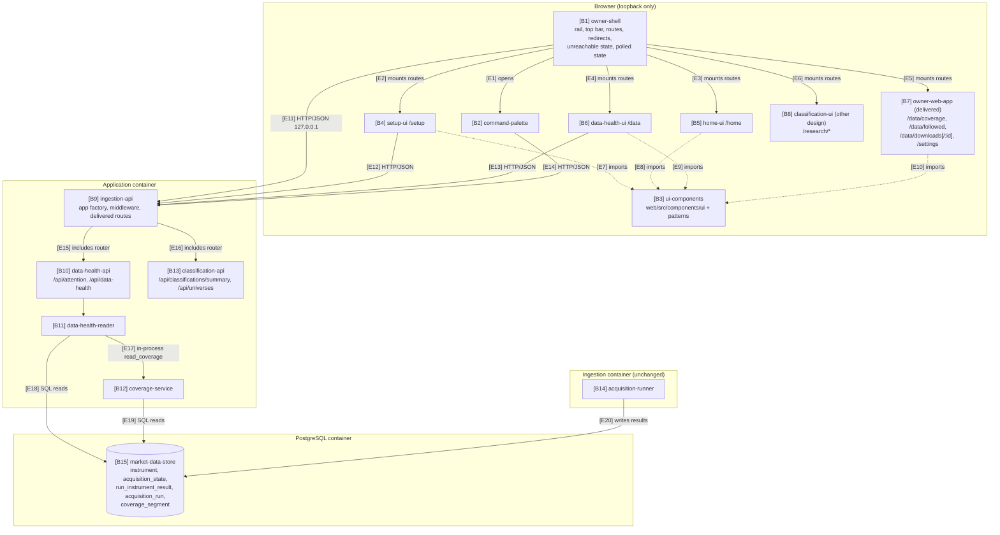
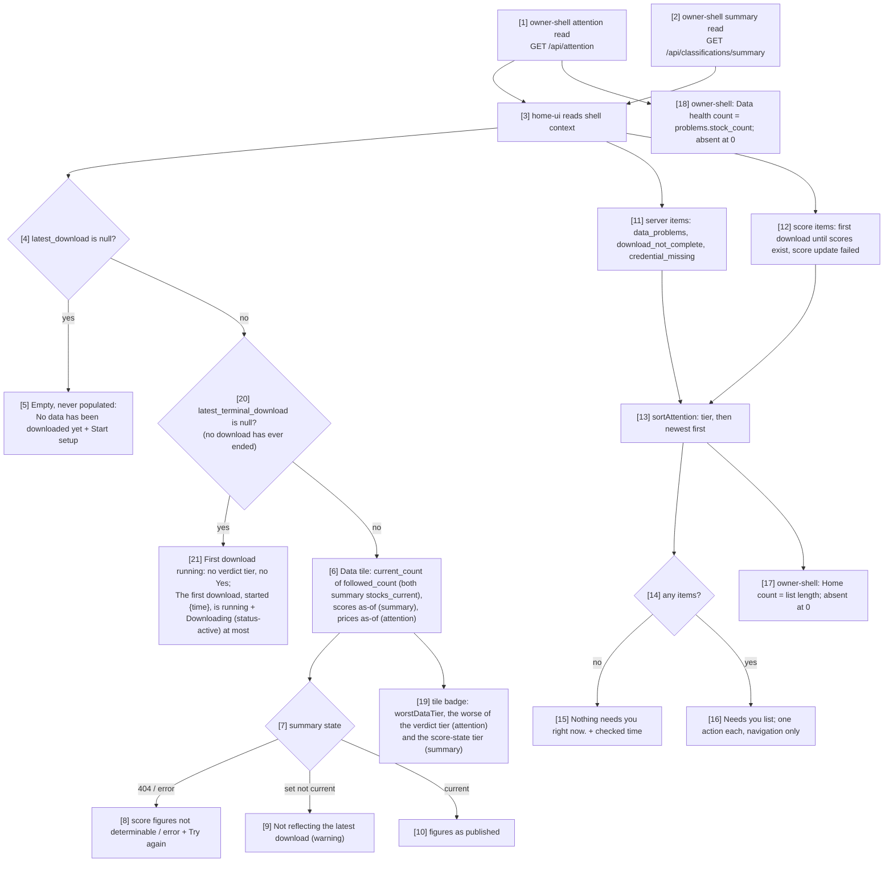
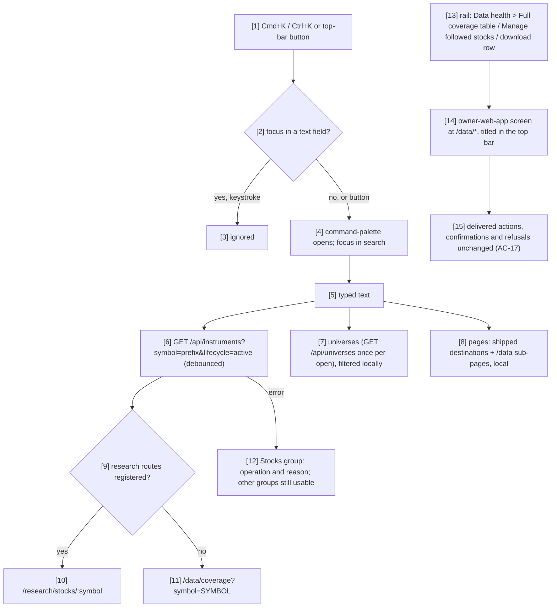

# System Design: App Shell & Data Health

**`ui_facing`** declares whether this capability delivers a user interface. It
decides whether the UX brief and UX design stages apply, so state it explicitly:
`scripts/pipeline-state.py` falls back to searching the prose for UI keywords
when the field is absent, and that fallback cannot tell a design that has a UI
from one that says it has none. **This design declares `ui_facing: true`**: it
delivers the owner interface shell, setup, Home and Data health, and takes over
five delivered screens.

This design was produced in an unattended `$design-run`. Every choice the skill
would otherwise have asked the owner about is recorded as a decision under
`projects/factorflow-v2/decisions/` (DEC-0200 to DEC-0208, harness repository)
and marked **PROVISIONAL** where it rests on a derivation rather than an
approved artifact. The owner upholds or reverts each with `scripts/sdd
decisions`. Commits carrying this design carry those `Decision-Id` trailers.

Read Section 4 first: it is the vocabulary the rest of this document uses.

## 1. Design Overview

This design gives the owner interface its product-wide shell and the three M1
screens that hang from it — first-run setup, Home and Data health — and moves
the five delivered market-data screens under that shell, at the blueprint's
routes and in its vocabulary (blueprint §2, §3, §7, §10). It adds eight
components. Six live in the browser bundle: `owner-shell` (rail, top bar, route
map, redirects, unreachable state and the shell-wide polled state),
`command-palette`, `ui-components` (the vendored design-system components and
the shared patterns), `setup-ui`, `home-ui` and `data-health-ui`. Two live in
the application container: `data-health-reader`, which computes the
aggregates Home and Data health need, and `data-health-api`, the router that
serves them. The ingestion container is not touched, no table is added, and
nothing is written by any new component (capability §1, §5.2).

The shape follows the delivered topology. The browser talks only to the
loopback JSON API that `ingestion-api` builds; `data-health-api` registers its
router on that same application, behind the same Host and Origin middleware and
error envelope, exactly as `classification-api` does (DEC-0208). Every action
the new screens offer — saving the history depth, following stocks, starting,
queueing and cancelling a download, stopping following — goes through the
delivered `ingestion-api` endpoints unchanged, so the confirmations and
refusals the owner already relies on are the ones they meet here (AC-17).

Three commitments carry the correctness risk. **One definition of a
problem.** A followed stock has a problem when its latest recorded outcome for
any data type is failed or not found (`acquisition_state`); the rail count,
the Data health verdict and the *Needs fixing* rows are that one set, so every
counted stock has a row and a fix (DEC-0201). **Nothing undetermined is shown
as a value.** A check that could not run, scores that are not yet served, and a
market state the clock cannot settle all render as not determinable (STD-UI-4,
STD-UI-14; DEC-0201, DEC-0206). **Domain terms stay in the API.** The new reads
return counts, states and outcomes in the domain vocabulary; every sentence the
owner reads is composed in the interface in the display vocabulary STD-UI-1 v6
fixes (DEC-0200; blueprint principle 7).

Aggregation happens on the server because the volume demands it: the rail
shows a count on every screen, and the followed list is committed to 3000
stocks (STD-UI-30). `GET /api/attention` is cheap and polled shell-wide;
`GET /api/data-health` runs the coverage derivation over the whole roster and
is read on demand by Data health alone, never on an interval (DEC-0200). Score
currency is not re-derived here: `owner-shell` reads the classification summary
`classification-api` publishes and shares it with Home and Data health through
the shell context (capability §5.1).

## 2. Architectural Block Diagram

The diagram shows the three deployed units and where this design's eight
components sit among those the architecture inventory already lists. In the
browser, `owner-shell` is the composition root: it renders the rail and top
bar, owns the route map into which `setup-ui`, `home-ui`, `data-health-ui`, the
five delivered screens of `owner-web-app` and the research screens of
`classification-ui` register, and holds the three polled reads (health,
attention, classification summary) every screen shares. In the application
container, `data-health-api` is included in the application `ingestion-api`
builds and delegates to `data-health-reader`, which reads the market data
store directly and calls `coverage-service` in process. The ingestion
container appears only to show that it is untouched; the outcome is that every
new read reaches PostgreSQL through the application container's existing pool
and nothing new crosses a container boundary.



## 3. Architectural Control Flow

Every flow below names components from Section 4.1 and numbers each step so a
reviewer can cite it. Cadences are stated where a region polls, because
STD-UI-25 requires the design to record them.

### 3.1 Opening the product and resolving a route

The sequence shows what happens from the first page load to a rendered screen,
including the redirects that keep old bookmarks working. `owner-shell` starts
its three shell-wide reads, waits for the first health answer before deciding
where `/` goes, and keeps the rail and top bar on screen throughout. The
decision points are whether any download has ever been requested (setup or
Home, DEC-0202 as the owner amended it on 2026-10-25), whether the path is one of the four the delivered interface
shipped (redirect, AC-18), and whether the API answers at all. The expected
outcome is that the owner lands on setup on an empty install, on Home
otherwise, and on the same screen as before when following an old bookmark.

```mermaid
sequenceDiagram
    autonumber
    participant B as Browser
    participant SH as owner-shell
    participant API as ingestion-api
    participant DHA as data-health-api
    participant CAPI as classification-api

    B->>SH: load any path
    SH->>API: GET /api/health (then every 30 s)
    SH->>DHA: GET /api/attention (then every 60 s, 10 s while a download is non-terminal)
    SH->>CAPI: GET /api/classifications/summary (same cadence; 10 s while scores are building)
    alt health request fails (network, timeout)
        SH-->>B: rail + top bar + unreachable state in main region
    else path is "/"
        alt most_recent_run is null
            SH-->>B: Navigate replace to /setup
        else a download has been requested
            SH-->>B: Navigate replace to /home
        end
    else path is /coverage, /instruments, /runs or /runs/:runId
        SH-->>B: Navigate replace to /data/coverage, /data/followed, /data/downloads, /data/downloads/:runId (query kept)
    else any other path
        SH-->>B: render the registered screen, or the not-found state inside the shell
    end
    alt summary answers 404 not_found (score routes not deployed)
        SH-->>B: score as-of and Factor scores render not determinable
    end
```

1. Steps 2 to 4 are the shell's only intervals. Polling pauses while the
   document is hidden and resumes, with an immediate read, when it is shown
   (S01 §6 *while the page is visible*).
2. Until the first health answer arrives, `/` renders a skeleton main region;
   *not yet checked* is not evidence of anything (the delivered `unknown`
   liveness behaviour, kept).
3. A health failure replaces only the main region (AC-23). When a later poll
   answers, the routed screen mounts again at the same URL and refetches;
   nothing reloads the page.
4. The redirects of step 9 are client-side `Navigate replace` routes in one
   module, `web/src/app/legacy-redirects.tsx`, so their removal one release
   later, which is out of this capability's scope, deletes one file and its
   tests (AC-18 keeps them for that release; capability assumption 3).
5. A `404` on the summary is how the interface learns the score read is not yet
   deployed; any other error renders the score regions' error state with
   **Try again**. Neither renders a value (capability §5.1).

### 3.2 First-run setup

The sequence shows the four M1 setup steps against the delivered API, from an
empty install to a started download. `setup-ui` saves each step's values
through CAP-001's endpoints when the owner continues (`PUT
/api/settings/history-depth`, `POST /api/instruments`), holds unsaved input in
app memory above the `/setup` route for the session, and re-derives the step
list and the current step from settings, the followed list and downloads on
every visit (DEC-0202; S02 §5). Setup counts as complete once CAP-001's run
journal holds at least one download in any state, read from `GET /api/health`
`most_recent_run`; no setup flag is stored. The decision points are whether
the credential was found, whether the depth and the pasted list are accepted,
whether the owner chose *Add later*, and whether the download is accepted,
queued, refused or blocked because no stock is followed. The expected outcome
is a requested download, after which `/` opens Home and Home shows its
progress; after *Add later* setup stays incomplete, and `/` keeps opening
`/setup` until a download is started from setup or Data health.

```mermaid
sequenceDiagram
    autonumber
    participant O as Owner
    participant SU as setup-ui
    participant SH as owner-shell
    participant API as ingestion-api

    O->>SU: open /setup
    SU->>SH: read shell context (health.credential_present, attention.latest_download)
    SU->>API: GET /api/settings/history-depth
    SU->>API: GET /api/instruments?lifecycle=active&limit=1 (active_count)
    SU-->>O: stepper with each step done, current or to do
    Note over SU: Step 1 shows Found or Missing, never the value; Missing names FACTORFLOW_MASSIVE_API_KEY and the restart
    O->>SU: step 2, years, Continue
    SU->>API: PUT /api/settings/history-depth {years}
    alt 422 out of range
        SU-->>O: field error naming the step and the reason; value kept
    end
    O->>SU: step 3, paste symbols
    SU->>SU: parse on paste and blur: accepted, duplicates, unreadable (AC-5)
    alt fewer than 30 accepted
        SU-->>O: ranking warning; Continue stays available (AC-6)
    else zero accepted and Paste a list chosen
        SU-->>O: Continue blocked with its reason; Add later offered
    end
    O->>SU: Continue
    SU->>API: POST /api/instruments {symbols}, batches of at most 1000
    alt 201, or 409 all already followed
        SU-->>O: accepted count; server-rejected entries named; accepted kept
    else 422 every entry malformed
        SU-->>O: each entry named with its reason; nothing discarded
    end
    O->>SU: step 4, Start download
    SU->>API: POST /api/acquisition-runs
    alt 202 with queued_behind null
        SU-->>O: progress {done} of {n} from attention, every 10 s; "You can leave; this keeps running."
    else 202 with queued_behind set
        SU-->>O: "A download is running. This starts when it finishes."
    else 409 history_depth_not_set or no_active_instruments
        SU-->>O: refusal names the operation, the step to fix and the reason
    end
    opt Add later at step 3, no stock followed
        SU-->>O: Continue passes step 3, nothing posted; step 4 shows Start download blocked with the no_active_instruments reason, and Go to Home or Manage followed stocks; "/" still opens setup
    end
```

1. Going back a step (step 6 onward), or leaving `/setup` and returning in the
   same session, never discards unsaved input: it is held in app memory, a
   React state holder in `owner-shell`'s route tree above the `/setup` route,
   for the session, and only a page reload loses it. Nothing is written to
   browser storage (Section 4.4). Saved values are re-read from the server on
   every visit, and a field shows its unsaved input when some is held
   (DEC-0202; AC-3, S02-2).
2. Step 10's parse is the delivered `parse-bulk-symbols` function, reused, so
   setup and the followed-stocks screen accept the same input (AC-5).
3. A repeated Continue on step 3 after going back re-posts the same symbols;
   the delivered endpoint reports them as already followed (`409` when all
   are), which setup treats as success rather than an error.
4. Step 18's progress comes from the shell's attention read, so setup, Home and
   Data health show the same numbers at the same 10 s cadence. While it polls,
   the progress shows *checked {time}* from the attention read's `checked_at`
   (AC-25, STD-UI-25).
5. The *Upload a CSV* source S02 §3 draws is not built: the capability scopes
   step 3 to a pasted list (capability §2, AC-5; open question 3).
6. *Add later* (step 22) lets **Continue** pass step 3 with no symbols and
   posts nothing. Step 4 then shows **Start download** `blocked` with CAP-001's
   `no_active_instruments` reason, derived from `active_count` 0 without a
   request, and two exits: **Go to Home** (`/home`, which shows its honest
   empty state) and **Manage followed stocks** (`/data/followed`). Setup stays
   incomplete, so `/` keeps opening `/setup` until a download is started from
   setup or Data health (DEC-0202).

### 3.3 Home and the rail counts

The flow shows how one set of shell-wide reads becomes Home's data tile, its
*Needs you* list and the two rail counts. `owner-shell` holds the attention
and summary reads; `home-ui` merges the three server-derived item kinds with
the two score-derived kinds into one list sorted by tier and recency, and the
shell computes the Home count with the same function (DEC-0203). The decision
points are whether any download has ever been requested (honest empty state)
or ended (first-download-running state, no verdict tier), whether scores exist and reflect the latest download, and which items apply. Home
never reads `GET /api/data-health`: the tile's badge comes from the two
shell-wide reads (DEC-0210 as amended by the owner on 2026-10-25; DEC-0219's
on-demand read is withdrawn). The expected outcome is a Home that names what
needs the owner, with exactly one navigating action per item, and counts that
leave the rail when they reach zero.



1. Box 6 states `{current} of {followed} stocks current`. When the summary is
   served, both figures come from its `stocks_current`: `current_count`
   counted over the set's `active_instruments`, and that same set's
   `followed_count`, so the two always count one population and the tile can
   never read more current than followed. Attention's `followed_count` is used
   only while the summary is not served, and the current count then renders
   not determinable (AC-8, capability §5.1).
2. Box 9 renders when the summary's `set.not_current` is true or its `later`
   block reports a newer set building or failed; Home never presents the older
   set as current (AC-8; blueprint §8 score states).
3. Box 11's kinds and box 12's kinds, their tiers and their actions are
   DEC-0203's catalogue (Section 4.2 shapes). An item exists only while its
   cause holds in the latest read, so it leaves the list when the cause is
   resolved and never because it was viewed (AC-9, S01-4).
4. The header's market state follows DEC-0206: *Market closed* when the clock
   alone settles it, not determinable inside weekday session hours.
5. The *Needs you* card shows *checked {time}* from the attention read's
   `checked_at` (STD-UI-25) and announces a changed count politely. The rail
   count chips of boxes 17 and 18 carry no time of their own: the Home and
   Data health *checked* lines stand for them (constraint 8).
6. Box 19's badge is `worstDataTier` (constraint 4) over two tiers: the
   verdict tier, computed from attention's `problems.stock_count`,
   `followed_count` and `latest_terminal_download` exactly as Data health's
   verdict is, and the blueprint §8 score-state tier from the summary. The
   badge shows the worse of the two, with the label from whichever wins.
   Never-acquired replaces both (boxes 20 and 21): while attention's
   `latest_terminal_download` is null (no download has ever ended, the signal
   Data health already uses) the tile shows no verdict tier and no *Yes*.
   Before any download is requested the empty state of box 5 replaces the
   tile, as AC-21 requires; from the first request until a download ends the
   tile shows the first-download-running state of box 21: its body says the
   first download, started {start time}, is running, and its badge is at most
   `status-active` *Downloading* (shown while `latest_download.state` is
   `running`), never a verdict word. The tile renders no progress; the *Your
   first download is running* item carries it (DEC-0210 as amended by the
   owner on 2026-10-25, DEC-0217).

### 3.4 Data health: reading, and fixing a problem

The sequence shows Data health from load to a fix. `data-health-ui` reads the
on-demand aggregate once, pages *Needs fixing* by keyset, lists the five most
recent downloads, and offers the two recoveries the delivered API supports: a
full download (AC-15) and, for a symbol the provider does not recognise,
stopping following it or following a different symbol (AC-14). The decision
points are whether anything was ever downloaded, whether gap detection could
run, whether a failure is retryable, and whether a download is already running.
The expected outcome is that every counted stock has a row naming what failed,
why and its fix, and that the checks refresh once when a running download ends.

```mermaid
sequenceDiagram
    autonumber
    participant O as Owner
    participant DHU as data-health-ui
    participant SH as owner-shell
    participant DHA as data-health-api
    participant DHR as data-health-reader
    participant COV as coverage-service
    participant MDS as market-data-store
    participant API as ingestion-api

    O->>DHU: open /data
    DHU->>DHA: GET /api/data-health
    DHA->>DHR: read_data_health(conn)
    DHR->>MDS: problem stocks from acquisition_state + run_instrument_result (active only)
    loop pages of 500 over the active roster
        DHR->>COV: read_coverage(conn, lifecycle="active", cursor, limit=500)
        COV->>MDS: coverage segments, observations
    end
    DHR-->>DHA: verdict counts, checks (each with exception_count; null when never acquired), first problem page, next_cursor
    alt database error
        DHA-->>DHU: 500 internal_error with request_id
        DHU-->>O: per-card error: operation, reason, Try again
    else attention's latest_terminal_download is null (no download has ever ended)
        DHU-->>O: No data has been downloaded yet + Start the first download or setup link (AC-21)
    else
        DHA-->>DHU: 200
        DHU-->>O: verdict, Daily prices, Company financials, Factor scores (from shell summary), Needs fixing
    end
    DHU->>API: GET /api/acquisition-runs?limit=5 (Recent downloads)
    DHU->>API: GET /api/instruments?limit=1, GET /api/settings/history-depth (What you follow)
    opt more problem rows
        DHU->>DHA: GET /api/data-health/problems?cursor=...&limit=50
    end
    O->>DHU: Download now
    DHU->>API: POST /api/acquisition-runs
    alt 202 queued_behind null
        DHU-->>O: the download heads Recent downloads with progress (attention, 10 s)
    else 202 queued_behind set
        DHU-->>O: "A download is running. This starts when it finishes." (AC-15)
    else 409 refusal
        DHU-->>O: operation, reason and the fix (Settings or Manage followed stocks)
    end
    SH-->>DHU: attention shows latest download terminal
    DHU->>DHA: GET /api/data-health (one refresh)
    O->>DHU: Stop following FBXX (not-found row)
    DHU-->>O: dialog confirm: history kept, can follow again
    DHU->>API: DELETE /api/instruments/FBXX
    alt 200 retired
        DHU->>DHA: GET /api/data-health; shell re-reads attention
    else 409 already stopped or 404
        DHU-->>O: refusal names the stock and the reason; row refreshed
    end
    O->>DHU: Follow a different symbol than FBXX
    DHU-->>O: navigate /data/followed with the add field focused
```

1. Steps 4 to 8 run only on load, on **Try again** and once at step 28; the
   aggregate is never on an interval, because the coverage derivation is the
   most expensive read in the product.
2. Step 4's problem set and step 8's checks are DEC-0201's definitions. A
   not-found row never offers **Download now** (AC-14); the *Needs fixing*
   header shows **Download now** only when at least one row is retryable.
   Each check carries `exception_count`, the number of distinct stocks in its
   exceptions (DEC-0220), and both checks are null when `never_acquired`
   (DEC-0213), which drives the check cards' null state.
3. When gap detection cannot run, the Daily prices card renders its gap result
   as not determinable with `coverage-service`'s reason, never as passed
   (capability flow 2 step 7).
4. The Factor scores card reads the shell's summary; it is not determinable
   until the summary is served (capability §5.1).
5. Recent downloads re-reads on every attention tick while a download is
   non-terminal (10 s), so the running download heads the list with its
   progress (S09 §6), and shows *checked {time}* while it polls (AC-25,
   STD-UI-25).
6. Step 31's dialog is the delivered `dialog` `confirm` wording of blueprint
   §9; stopping following goes through the delivered retire endpoint, so it
   keeps the stock's history (STD-UI-2).
7. The never-downloaded empty state is triggered by the shell's attention read
   reporting no `latest_terminal_download` (no download has ever ended), not by
   `never_acquired`; `never_acquired` drives only the check cards' null state.
   *Needs fixing* and Recent downloads are not part of the empty state: each
   renders whenever a problem or a download exists, so a download that ended
   having stored nothing still shows every failed row and its fix (AC-13,
   AC-16, AC-21).
8. The verdict is `worstDataTier` (constraint 4) over the problem set and the
   latest terminal download, with the sentence composed from `affected_count`
   and `followed_count`; the check cards do not feed it (DEC-0210 as amended
   by the owner on 2026-10-25).

### 3.5 Reaching the delivered screens and the palette

The flow shows how the owner reaches the five delivered screens and how the
command palette finds a stock, a universe or a page. `owner-shell` owns the
single keydown listener and the top-bar button; `command-palette` queries the
followed list on the server and filters pages and universes locally
(DEC-0207). The decision points are whether a keystroke came from a text field
and whether the research routes are registered. The expected outcome is that
every delivered screen opens in the shell at its new path, and that the palette
never offers an action that places or stops trading.



1. Box 2 is the blueprint §3.4 rule: the shell's only keydown listener ignores
   keystrokes in text inputs.
2. Box 7's group is present only when the universes routes are registered;
   in M1 there is no Actions group (blueprint §10; DEC-0207).
3. Box 11 needs the coverage screen to seed its symbol filter from the query,
   and the followed-stocks screen to focus its add field when opened from
   Data health; these are the only behaviours this design adds to the
   delivered screens, and neither changes an action's outcome.
4. Box 14's titles are a static route-to-title table in `owner-shell`
   (*Data health › Coverage*, *Data health › Downloads › Download*), so no
   delivered screen needs to know about the top bar.

## 4. Components, Interfaces and Technology

### 4.1 Components Introduced

| Component ID | Name | Responsibility | Owned by |
|--------------|------|----------------|----------|
| `owner-shell` | Owner interface shell | React composition root of the owner interface: the rail in two groups listing only shipped destinations with their attention counts, the sticky top bar with the route-derived title and the palette button, the route map with the `/` redirect and the four legacy redirects, the unreachable state, and the shell-wide polled reads (health 30 s; attention and classification summary 60 s, 10 s while a download is non-terminal or scores are building; all paused while the document is hidden, DEC-0212) shared through the shell context. Replaces the delivered shell and route composition in `web/src/app/` (DEC-0204) | this design |
| `command-palette` | Command palette | The `command` `dialog` opened by the shell: Stocks from the followed list (server prefix search), Universes and Pages filtered locally, targets per DEC-0207; never a trading action. `web/src/app/command-palette/` | this design |
| `ui-components` | Design-system components and shared patterns | The design-system components vendored as shadcn/ui ships them in `web/src/components/ui/` (badge, button, card, data-table, dialog, form, input, textarea, select, checkbox, radio-group, progress, stepper, command, toast; `form` per DEC-0215) and the blueprint §4 patterns in `web/src/components/patterns/` (Needs-you item and `sortAttention`, `worstDataTier`, as-of line, status badge with tier shape, state-coverage region), consuming only `theme.css` tokens (DEC-0205). The as-of line is taken over, not created: CAP-002 lands first with its Research-specialised `web/src/components/patterns/as-of-line.tsx`, and `ui-components` generalises that file to `AsOfLine`, with the Research line composing it (owner decision 2026-10-25) | this design |
| `setup-ui` | Setup screen | S02 steps 1 to 4 at `/setup`: stepper, each step's values saved on Continue through the delivered endpoints, unsaved input held in app memory above the `/setup` route for the session (never browser storage), *Add later* leading to step 4's blocked **Start download** with its two exits, the first download started and its progress shown (DEC-0202) | this design |
| `home-ui` | Home screen | S01 M1 regions at `/home`: date and market state (DEC-0206), the data tile, and the *Needs you* list merged from the attention items and the score-derived items (DEC-0203) | this design |
| `data-health-ui` | Data health screen | S09 M1 regions at `/data`: verdict, Daily prices, Company financials and Factor scores cards, *Needs fixing* with its recoveries, Recent downloads, What you follow | this design |
| `data-health-reader` | Data health reader | Read-only Python module computing the problem-stock set, the latest and latest-terminal downloads with progress, the followed count, the prices as-of, the server-derived attention items, the verdict counts and the Daily prices and Company financials checks (DEC-0200, DEC-0201). `src/factorflow/data_health/` | this design |
| `data-health-api` | Data health JSON API | FastAPI router serving `GET /api/attention`, `GET /api/data-health` and `GET /api/data-health/problems`, registered on the application `ingestion-api` builds and therefore behind its request-id, Host and Origin middleware and error envelope. `src/factorflow/api/routes/data_health.py` | this design |

**Existing components this design changes.** `owner-web-app` keeps the five
delivered screens (coverage, instruments, runs, run detail, settings) and
their behaviour; this design moves them to `/data/coverage`, `/data/followed`,
`/data/downloads`, `/data/downloads/:id` and `/settings`, relabels every
user-visible string to the display vocabulary (blueprint §7), renders every
status as its blueprint §8 tier, rebuilds them from `ui-components`, updates
their internal links to the new paths, and adds two entry hints (Section 3.5
note 3) and the *Open setup* link S02 §6 puts in Settings. It also makes the
one edit CAP-002's approved design allocates to this capability: in
`web/src/screens/research/copy.ts` `SHELL_ROUTES`, it migrates all three
targets, `/runs/:runId`, `/runs` and `/instruments`, to
`/data/downloads/:runId`, `/data/downloads` and `/data/followed` (open
question 6). Its shell and route composition pass to `owner-shell`, and its
`HealthProvider` is reused there unchanged except that it exposes the time of
the last successful answer to the unreachable state and pauses polling while
the document is hidden, with an immediate read when it is shown (DEC-0212).
`ingestion-api` gains one `include_router` call in `src/factorflow/api/app.py`
for `data-health-api`. No other delivered component changes.

### 4.2 Interfaces

| Interface | Provider component | Consumer component | Shape | Stability |
|-----------|--------------------|--------------------|-------|-----------|
| `GET /api/attention` | `data-health-api` | `owner-shell` | Request: none. Response: `checked_at`; `followed_count` (active instruments; the verdict tier's denominator, and Home's tile denominator only while the summary is not served); `prices_as_of` (latest `prices` `covered_to` over active instruments, a session date, or null); `credential_present`; `problems` `{stock_count, symbols (first three by symbol), newest_completed_at}`; `latest_download` `{run_id, state, requested_at, started_at, ended_at, progress {done, total}}` or null, where `done` counts instruments with a result for all four data types in that run and `total` is `instruments_named`; `latest_terminal_download` `{run_id, state, ended_at, failure_reason}` or null; `items` — the server-derived attention items, each `{kind, recorded_at}` plus `run_id` for `download_not_complete`, kinds `data_problems`, `download_not_complete`, `credential_missing` (DEC-0203). Domain vocabulary; no tier, no sentence. `200` always when the database answers; `500` envelope otherwise | new, provisional (DEC-0200) |
| `GET /api/data-health` | `data-health-api` | `data-health-ui` | Request: none. Response: `checked_at`; `never_acquired` (from `coverage-service`); `followed_count`; `affected_count` (= `problems.stock_count`); `checks.daily_prices` `{status: ok, exceptions or not_determinable, absent_count, gap_stock_count, behind_count, exception_count, latest_session, gap_detection {available, reason}, exception_symbols (first five)}`; `checks.company_financials` `{status, absent_count, problem_count, exception_count, as_of, exception_symbols}`, where `exception_count` is the number of distinct stocks in the check's exceptions (DEC-0220) and both checks are null when `never_acquired` (DEC-0213); `problems` `{rows, next_cursor}` — first page of 50, one row per stock `{symbol, failures: [{data_type, outcome (failed or not_found), reason, attempts, completed_at, run_id}], retryable}` ordered by symbol (DEC-0201) | new, provisional (DEC-0200) |
| `GET /api/data-health/problems` | `data-health-api` | `data-health-ui` | Request: `limit` (default 50, max 500 — the canonical bounds in `api/bounds.py`), `cursor` (the last symbol, validated as a symbol). Response: `{rows, next_cursor}` as above. `422 validation_error` on a bad bound or cursor | new, provisional (DEC-0200) |
| `Data health queries` | `data-health-reader` | `data-health-api` | Python calls on a pooled connection: `read_attention(conn)`, `read_data_health(conn)`, `read_problems(conn, cursor, limit)`, returning frozen dataclasses mirroring the three responses; read-only, no transaction left open | new |
| `Problem and download read` | `market-data-store` | `data-health-reader` | SQL reads only: `instrument` (active), `acquisition_state` (latest outcome per instrument and data type), `run_instrument_result` (reason, attempts, completed_at for that outcome's `last_run_id`), `acquisition_run` (latest by `requested_at`, latest terminal by `ended_at`), `coverage_segment` (`prices` `covered_to`). Parameterised `psycopg` 3 queries; no INSERT, UPDATE or DELETE | new consumer of an existing component |
| `Coverage page read` | `coverage-service` | `data-health-reader` | In-process Python call `read_coverage(conn, lifecycle="active", cursor=..., limit=500)`, iterated to the last page; per-instrument presence, `covered_to`, gap detection and the view-level `never_acquired` and `gap_detection` exactly as `GET /api/coverage` returns them. The delivered function, called unchanged | new consumer of an existing component |
| `Router registration` | `data-health-api` | `ingestion-api` | The application factory includes this router under `/api` before the static mount, beside the delivered routers | new |
| `Shell context` | `owner-shell` | `home-ui` | React context `useShell()`: `health` (liveness, `credential_present`, `most_recent_run`, last answered time), `attention` (the attention response and its fetch state), `scores` (the summary response, or `not_served` on `404`, or an error), and `refresh(kind)` to re-read one of them after an action | new |
| `Shell context` | `owner-shell` | `setup-ui` | As above | new |
| `Shell context` | `owner-shell` | `data-health-ui` | As above | new |
| `Screen registration` | `setup-ui` | `owner-shell` | Route `/setup` in the shell's route map | new |
| `Screen registration` | `home-ui` | `owner-shell` | Route `/home`; rail destination Home with its count | new |
| `Screen registration` | `data-health-ui` | `owner-shell` | Route `/data`; rail destination Data health with its count | new |
| `Screen registration` | `owner-web-app` | `owner-shell` | Routes `/data/coverage`, `/data/followed`, `/data/downloads`, `/data/downloads/:id`, `/settings`; rail destination Settings. `/data/coverage` accepts `?symbol=`; `/data/followed` accepts router state `{focusAdd: true}` | changed (paths) |
| `Screen registration` | `classification-ui` | `owner-shell` | The five `/research` client routes, unchanged, in the shell's route map, and the Research rail destination in the shell's static destination list; replaces the interim entry appended to the delivered rail (DEC-0204) | changed (consumer) |
| `Palette dialog` | `command-palette` | `owner-shell` | `<CommandPalette open onOpenChange />`; the shell owns the shortcut and the top-bar opener; the palette restores focus to the opener on close | new |
| `Design-system components` | `ui-components` | `owner-shell` | ES module imports from `web/src/components/ui/*` and `web/src/components/patterns/*`; props per each component's design spec; only `theme.css` tokens | new, provisional (DEC-0205) |
| `Design-system components` | `ui-components` | `command-palette` | As above | new, provisional (DEC-0205) |
| `Design-system components` | `ui-components` | `setup-ui` | As above | new, provisional (DEC-0205) |
| `Design-system components` | `ui-components` | `home-ui` | As above | new, provisional (DEC-0205) |
| `Design-system components` | `ui-components` | `data-health-ui` | As above | new, provisional (DEC-0205) |
| `Design-system components` | `ui-components` | `owner-web-app` | As above, replacing the hand-built elements of the five screens | new, provisional (DEC-0205) |
| `GET /api/health` | `ingestion-api` | `owner-shell` | Reused unchanged: `status`, `database`, `credential_present` (never the value), `schema_version`, `most_recent_run`; polled every 30 s by the delivered `HealthProvider` | existing |
| `GET /api/settings/history-depth` | `ingestion-api` | `setup-ui` | Reused unchanged: `years` or null | existing |
| `PUT /api/settings/history-depth` | `ingestion-api` | `setup-ui` | Reused unchanged: `{"years": n}`, 1 to 50; `422` beyond | existing |
| `POST /api/instruments` | `ingestion-api` | `setup-ui` | Reused unchanged: `{"symbols": [...]}`, at most 1000; `added`, `reactivated`, `rejected` with reasons; `409` all duplicate; `422` all malformed | existing |
| `GET /api/instruments` | `ingestion-api` | `setup-ui` | Reused unchanged: `active_count` for step 3's summary | existing |
| `POST /api/acquisition-runs` | `ingestion-api` | `setup-ui` | Reused unchanged: `202` with `run_id`, `queued_behind`; `409` `history_depth_not_set`, `no_active_instruments` | existing |
| `POST /api/acquisition-runs` | `ingestion-api` | `data-health-ui` | Reused unchanged, as **Download now** (AC-15) | existing |
| `GET /api/acquisition-runs` | `ingestion-api` | `data-health-ui` | Reused unchanged with `limit=5` for Recent downloads | existing |
| `GET /api/instruments` | `ingestion-api` | `data-health-ui` | Reused unchanged with `limit=1`: `active_count`, `retired_count` for What you follow | existing |
| `GET /api/settings/history-depth` | `ingestion-api` | `data-health-ui` | Reused unchanged for What you follow | existing |
| `DELETE /api/instruments/{symbol}` | `ingestion-api` | `data-health-ui` | Reused unchanged as **Stop following**: `200` retired; `404`, `409` refusals | existing |
| `GET /api/instruments` | `ingestion-api` | `command-palette` | Reused unchanged: `symbol` prefix, `lifecycle=active`, `limit=8` | existing |
| `GET /api/classifications/summary` | `classification-api` | `owner-shell` | Consumed as published, not redefined: `never_classified`, `set`, `later`, `stocks_current {current_count, followed_count}`; Home's *{current} of {followed}* takes both figures from `stocks_current` whenever the summary is served; `404 not_found` before the route is deployed renders not determinable | existing, other design |
| `GET /api/universes` | `classification-api` | `command-palette` | Consumed as published: `lifecycle=active`, names and ids | existing, other design |

**Data classification.** Every element the three new responses introduce —
counts, run states and outcomes, failure reasons, symbols, session dates and
timestamps — is Internal under SEC-DAT-001, as all CAP-001 data is; none is
personal data or a secret (component design `data-health-reader` §4).

### 4.3 Technology Selections

| Component repo | Language | Framework | Store | Key libraries | Source |
|----------------|----------|-----------|-------|---------------|--------|
| FactorFlow-v2 (`owner-shell`, `command-palette`, `ui-components`, `setup-ui`, `home-ui`, `data-health-ui`, and the changes to `owner-web-app`) | TypeScript 5.x | React 18 with Vite; `react-router-dom` 6 (routes, `NavLink` `aria-current`, `Navigate replace`) | none (no browser storage; DEC-0202) | `tailwindcss` with `autoprefixer` bound to `design-system/theme.css`; **`shadcn/ui` on Radix primitives** vendored into `web/src/components/ui/`, importing `@radix-ui/react-*` and, confirmed by the owner on 2026-10-25 in `tech-stack.md` v6 (OQ-TS-10; capability OQ-4), `cmdk`, `sonner`, `clsx`, `tailwind-merge`, `class-variance-authority`, `lucide-react` (DEC-0205) and `@tanstack/react-table`, `react-hook-form`, `zod`, `@hookform/resolvers`, `@radix-ui/react-label` (DEC-0215); tests with `vitest`, `@testing-library/react`, `@playwright/test`; `biome` | tech-stack |
| FactorFlow-v2 (`data-health-reader`, `data-health-api`, and the one line in `ingestion-api`) | Python 3.12+ | FastAPI on uvicorn, Pydantic response models | PostgreSQL 16, read only; no ORM, no migration | `psycopg` 3 through the delivered `psycopg_pool`; `pytest`, `testcontainers[postgres]`; `ruff`, `mypy` | tech-stack |

No third-party repository is involved, and no provider is read (capability
§5.2). The validation commands are the tech stack's table, unchanged.

### 4.4 Persistent Data and Migration Strategy

None. This design adds no table, column, index, setting or migration, and no
component it introduces writes to the store. Setup's completion is the
existence of a download in any state (DEC-0202); a problem is the latest
outcome already in `acquisition_state` (DEC-0201). The browser stores nothing:
setup's unsaved input lives in app memory for the session and is lost on a
page reload.
Rollback is therefore a redeploy of the previous image, with no data step.

## 5. Architectural Constraints

1. **Presentation only.** No component introduced here acquires, writes or
   redefines market data, and none reads the provider (capability §1, §5.2).
   `data-health-reader` is read-only by construction: its SQL is `SELECT` only,
   and a test asserts the module contains no `INSERT`, `UPDATE` or `DELETE`.
2. **Delivered endpoints are consumed unchanged.** Every write the new screens
   offer goes through the existing `ingestion-api` endpoint, so its
   confirmations and refusals are unchanged (AC-17). No delivered request or
   response model changes.
3. **The API keeps the domain vocabulary; the interface uses the display
   vocabulary.** New responses carry `instrument`-level facts, run states and
   result outcomes; every user-visible string is composed in the interface from
   blueprint §7 and STD-UI-1 v6, and never shows the domain term beside the
   label (AC-19).
4. **One tier per status.** Every download state, result outcome, check result
   and score state maps to the single tier of blueprint §8 in one function in
   `ui-components`, rendered as label plus tier shape, never colour alone
   (AC-20, STD-UI-8, STD-UI-12). One shared function there, `worstDataTier`,
   composes both the Data health verdict and Home's data tile badge over the
   full tier order critical, serious, warning, good, neutral, with active
   ranked alongside good; neutral and active inputs never worsen the answer.
   The verdict's tier and opening word come from the problem set and the
   latest terminal download: none affected, good, *Yes.*; some affected,
   warning, *Mostly yes.*; every followed stock affected, critical, *No.*;
   latest terminal download `failed`, critical, with the clause *, and the
   last download failed.*; latest terminal download interrupted (`abandoned`),
   serious, rendered `status-serious` with the answer word *Mostly yes*
   followed by the count clause and *, and the last download was
   interrupted.* The M1 sentences are *Mostly yes. {n} of {m} followed stocks
   need attention; their scores show as Incomplete until they're fixed.* and
   *Yes. None of the {m} followed stocks needs attention.* Home's tile badge is
   the worse of that verdict tier and the blueprint §8 score-state tier, with
   the label from whichever wins; never-acquired replaces both: while no
   download has ever ended (attention's `latest_terminal_download` null) the
   tile shows AC-21's empty state or the first-download-running state, never
   a verdict tier and never *Yes* (Section 3.3 note 6; DEC-0210 and DEC-0217
   as amended by the owner on 2026-10-25).
5. **Not determinable is a value of its own.** A check that could not run, a
   score figure before the summary is served, and the market state inside
   session hours render as not determinable with a reason; none renders as
   passed, zero or empty (STD-UI-4, STD-UI-14; DEC-0201, DEC-0206).
6. **A partial download is never complete.** Run states render from the
   recorded state only; a check built on a partial or interrupted download
   shows its exceptions (AC-12, STD-UI-15).
7. **Volume.** `GET /api/attention` is bounded by a few indexed aggregates over
   at most 3000 active instruments times four data types and is safe to poll;
   `GET /api/data-health` runs the coverage derivation over the whole active
   roster (six `read_coverage` pages at 3000), is read only on demand and only
   by Data health (Section 3.4 note 1), and MUST answer within 2 s at the 95th
   percentile with 3,000 followed stocks (AC-28). Home never reads it: its
   tile badge comes from the attention and summary reads (Section 3.3 note 6).
   *Needs fixing* pages by keyset under the canonical bounds (STD-UI-30).
8. **Polling cadences are part of the design** (STD-UI-25): health 30 s
   (delivered); attention and summary 60 s, 10 s while a download is
   non-terminal or a score set is building; Recent downloads on each 10 s tick
   while a download runs; data-health aggregate on demand and once when a
   download ends; all paused while the document is hidden. Each polled region
   shows *checked {time}*, setup step 4's progress and Recent downloads
   included while they poll. The rail count chips carry no time of their own;
   the Home and Data health *checked* lines stand for them, a permitted
   specialization of STD-UI-25 recorded here (owner decision 2026-10-25).
9. **Loopback, no authentication.** The new routes inherit the delivered bind,
   Host and Origin checks and error envelope, and rely on the `SEC-ENC-001
   host-local loopback exception` for the browser-to-API channel at
   `http://127.0.0.1:8000` and the application-to-PostgreSQL channel at
   `127.0.0.1:5432`, under DEC-0050 as extended to this design by DEC-0208. The
   shell adds no sign-in, user menu or account area (capability §5.3). All
   three routes are `GET` and change no state.
10. **Credential presence, never value.** Setup and Settings read
    `credential_present` only; no new response carries any secret, and the
    delivered no-secrets test is extended to the new routes (AC-4).
11. **Only shipped destinations.** The rail, the palette's Pages group and the
    route map list a destination only in the change that registers its screen;
    nothing unshipped renders, even disabled (AC-1, AC-10; DEC-0204). Home
    renders no strategy, paper or live region and no placeholder (S01-7).
12. **Built from the design system.** Every surface delivered or taken over is
    built from `ui-components` and consumes `theme.css` tokens only; no spacing,
    size or colour literal outside the theme (AC-26, STD-UI-29). The layout
    dimensions the approved blueprint and screen specifications fix (the 208 px
    rail, the 1180 px measure, the 260 to 300 px side column, 28 px, 16 px and
    70ch) are approved-specification values, not theme literals and not new
    tokens: they are held in one layout-constants module in `owner-shell`,
    `web/src/app/layout.ts` (AC-26 as narrowed by the owner on 2026-10-25). The
    non-Radix
    packages those components import are added only after the owner's
    `$tech-stack` confirmation (DEC-0205), and each package's licence is
    recorded when it is (SEC-DEP-003).
13. **Every operation by keyboard.** Radix primitives supply dialog, radio and
    select keyboard contracts; the stepper, the rail and the Needs-you list are
    native lists and links; the palette opens from the keyboard (AC-22, AC-25,
    STD-UI-24). Biome has no `jsx-a11y` equivalent, so this is enforced by
    review and by Testing Library role queries.
14. **The kill switch and the environment region are absent in M1** (blueprint
    D-7, §10). The top bar leaves their place empty rather than reserving a
    disabled control, and the palette offers no trading action.
15. **Delivered tests change with the routes.** The delivered shell, route and
    screen tests that assert the four old destinations, their labels or their
    paths change with them (blueprint §2.2). Design decomposition enumerates
    every delivered file and test this design edits, each with one owner,
    before any story is written (open question 8).

## 6. Architectural Assumptions

1. **The classification summary is the score source.** Home's score as-of and
   current count, and the Factor scores card, read `GET
   /api/classifications/summary` as its design publishes it. Until it is
   deployed they render not determinable, and they are verified at
   integration if that read lands after this design (capability assumption 2).
2. **`acquisition_state` is current.** The run journal and observation writer
   keep `acquisition_state` as the latest outcome per instrument and data type,
   as the delivered schema documents; DEC-0201's problem set rests on it.
3. **A download's progress can be read from its results.** `done` counts
   instruments with a result for all four data types in the run; the delivered
   journal writes results per instrument as the run proceeds.
4. **The coverage derivation is fast enough on demand at 3000 stocks.** AC-28
   bounds it at 2 s at the 95th percentile, measured by the volume test (open
   question 7); the aggregate is not polled and Home does not read it, so a
   slow read delays only Data health's first render.
5. **A download is named by its start time** in America/Chicago until the owner
   decides whether downloads get a short number (capability OQ-1; DEC-0083's
   interim rendering).
6. **"One release" for the legacy redirects** is the next release image after
   the one carrying this design (capability assumption 3).
7. **The rail in M1 holds Home, Research (once its screens are registered),
   Data health and Settings** (capability assumption 1; DEC-0204).

## 7. Traceability

| AC # | Acceptance Criterion | Design Element(s) | Section |
|------|---------------------|--------------------|---------|
| AC-1 | One shell; groups in order; unshipped absent | `owner-shell` static destination list in two groups; `Screen registration` rows; DEC-0204 | 2, 3.1, 4.1, 5.11 |
| AC-2 | Setup first, Home after | `owner-shell` `/` redirect on `most_recent_run`; DEC-0202 | 3.1 |
| AC-3 | Setup steps, position, back keeps values | `setup-ui` stepper; unsaved input held in app memory above the `/setup` route for the session; *Add later* to step 4's blocked start; DEC-0202 | 3.2 notes 1, 6 |
| AC-4 | Credential presence, never value | `credential_present` via `Shell context`; Settings unchanged; no-secrets test extended | 3.2, 5.10 |
| AC-5 | Pasted list parsed honestly | Reused `parse-bulk-symbols`; `POST /api/instruments` per-symbol dispositions | 3.2 notes 2, 3 |
| AC-6 | Fewer than 30 is a warning | `setup-ui` warning below 30 accepted; Continue available | 3.2 |
| AC-7 | First download from setup; Home shows progress | `POST /api/acquisition-runs` from `setup-ui`; `latest_download.progress`; Needs-you kind 4 | 3.2, 3.3; DEC-0203 |
| AC-8 | Home data tile, scores lag stated | `home-ui` tile: both counts from the summary's `stocks_current` when served, `prices_as_of`; not-current rendering; badge from `worstDataTier`, no tier while no download has ended | 3.3 boxes 6 to 10, 19 to 21; 5.4 |
| AC-9 | Needs you: one action, ordered, leaves on resolution | `sortAttention` in `ui-components`; items derived from current state only | 3.3 note 3; DEC-0203 |
| AC-10 | Nothing unshipped on Home | `home-ui` M1 regions only | 5.11 |
| AC-11 | Data health verdict and check cards | `GET /api/data-health` `affected_count`, `checks`; verdict from `worstDataTier` over the problem set and latest terminal download; Factor scores from summary | 3.4 note 8, 5.4; DEC-0201, DEC-0210 |
| AC-12 | A partial download is never complete | Recorded run states only; checks carry exceptions | 5.6 |
| AC-13 | Every problem names its fix | Problem rows with data type, outcome, reason, attempts; consequence text; one set with the count | 3.4; DEC-0201 |
| AC-14 | Not found is not retried | `retryable` false for `not_found`; Stop following and Follow a different symbol | 3.4 note 2 |
| AC-15 | Download now is the retry; queued when running | `POST /api/acquisition-runs`, `queued_behind` | 3.4 |
| AC-16 | Attention counts, absent at zero | `owner-shell` counts from `problems.stock_count` and the merged list | 3.3 boxes 17, 18 |
| AC-17 | Delivered behaviour preserved at new paths | `owner-web-app` screens at `/data/*`, `/settings`; endpoints unchanged | 3.5, 4.1, 5.2 |
| AC-18 | Old paths arrive for one release | `legacy-redirects.tsx` `Navigate replace` | 3.1 note 4 |
| AC-19 | Product vocabulary | Display labels composed in the interface; domain terms in the API | 5.3 |
| AC-20 | One tier per status | Blueprint §8 mapping in one `ui-components` function | 5.4 |
| AC-21 | Honest empty state | `latest_download` null on Home, and no verdict tier on Home's tile while `latest_terminal_download` is null; `latest_terminal_download` null on Data health, with `never_acquired` nulling the check cards | 3.3 boxes 5, 20, 21, 3.4 note 7 |
| AC-22 | Command palette | `command-palette`; shell keydown listener; no trading action | 3.5; DEC-0207 |
| AC-23 | Unreachable is a designed state | `owner-shell` main-region swap; last answered time; remount at same URL | 3.1 note 3; DEC-0204 |
| AC-24 | Every region defines its states | State sources named per region here; the UX brief enumerates the eight per region | 3.3, 3.4, 5.5 |
| AC-25 | Keyboard and freshness | Radix and native semantics; cadences and *checked {time}*, including setup step 4 and Recent downloads; rail chips covered by the Home and Data health lines | 3.2 note 4, 3.4 note 5, 5.8, 5.13 |
| AC-26 | Built from the design system | `ui-components`; tokens only; approved-specification layout dimensions in `owner-shell`'s `web/src/app/layout.ts` | 4.1, 5.12; DEC-0205 |
| AC-27 | CAP-002 keeps its routes | `classification-ui` `Screen registration` into `owner-shell`, routes unchanged | 4.2; DEC-0204 |
| AC-28 | With 3,000 followed stocks, `GET /api/data-health` MUST answer within 2 seconds at the 95th percentile, measured by the volume test | `data-health-reader` coverage derivation over the active roster; `data-health-api` `GET /api/data-health`; read on demand by Data health only | 3.4 note 1, 5.7, 6.4 |

Screen acceptance checks: S01-3, S01-4 (DEC-0203), S01-6 (box 6) and S01-7
(5.11); S02-1 to S02-6 (Section 3.2, DEC-0202); S09-1 to S09-5 (Sections 3.4,
5.6, 5.10). S01-1, S01-2 and S01-5 concern the paper and live tiles, which are
not in M1.

## 8. Open Questions

1. **Do downloads get a short visible number?** Capability OQ-1, carried from
   the other design's DEC-0083. This design names a download by its start time
   in America/Chicago in setup's progress line, Recent downloads and the
   download detail title. *Owner: capability owner. Blocks: copy in the UX
   design; no interface shape here changes unless a stored number is added.*
   **Answered 2026-10-25 by the owner: no.** The start time in America/Chicago
   is the permanent naming; no interface shape changes.
2. **Which lands first, this shell or the research screens?** Capability OQ-2.
   DEC-0204 makes either order work: the research screens register into
   `owner-shell`'s destination list if this lands first, and this design
   replaces their interim rail entry if it lands second. *Owner: capability
   owner (sequencing). Blocks: nothing in this design.* **Answered 2026-10-25
   by the owner: CAP-002 lands first**, so this design replaces its interim
   rail entry (AC-27).
3. **Is uploading a CSV an M1 way to name stocks?** Capability OQ-3. This
   design builds *Paste a list* and *Add later* only, because the capability
   scopes step 3 to a pasted list; S02 §3's *Upload a CSV* is a departure the UX
   design records. *Owner:
   capability owner. Blocks: one radio option and a file control; a yes adds a
   criterion and a design-system intake.* **Answered 2026-10-25 by the owner:
   no.** Setup builds *Paste a list* and *Add later* only.
4. **The npm packages the vendored components import.** Capability OQ-4.
   DEC-0205 specifies them provisionally; only the owner amends
   `tech-stack.md`. *Owner: capability owner, via `$tech-stack`. Blocks: the
   implementing stories that add the packages, not this design.*
   **Answered 2026-10-25 by the owner: all ten packages confirmed** in
   `tech-stack.md` v6 (OQ-TS-10); Section 4.3 lists them, including the four
   DEC-0215 added. The implementing stories are no longer gated.
5. **The other design's consumer name.** Its Section 4.2 names the consumer of
   `GET /api/classifications/summary` as an unpublished shell component. This
   design publishes it as `owner-shell`, which shares the read with `home-ui`
   and `data-health-ui`. *Owner: that design's owner, to replace the
   placeholder. Blocks: the architecture inventory's orphan finding only.*
6. **Links to the old paths in the research screens.** CAP-002's approved
   design allocates to this capability one edit: migrating the three link
   targets in `web/src/screens/research/copy.ts` `SHELL_ROUTES`, `/runs/:runId`,
   `/runs` and `/instruments`, to the new paths. *Owner: capability owner.
   Blocks: the redirect-removal change.* **Answered 2026-10-25 by the owner:**
   CAP-003's `owner-web-app` owns the edit and migrates all three targets to
   `/data/downloads/:runId`, `/data/downloads` and `/data/followed`
   (Section 4.1).
7. **No latency target for `GET /api/data-health` at 3000 stocks**, mirroring
   the store's unresolved read-latency question. The design reads it on demand
   and never polls it. *Owner: capability owner. Blocks: a performance
   criterion, not the implementation.* **Answered 2026-10-25 by the owner:
   AC-28, p95 ≤ 2 s at 3,000 followed stocks.**
8. **Every delivered file and test this design edits.** The five screens, the
   shell, the route map, the status region's removal (DEC-0204), `app.py`'s
   router line and the delivered tests asserting old destinations, labels and
   paths. As with the research screens' registration, editing a delivered
   composition root and taking over screens this capability's scope names is
   read as this capability's own work, not an amendment to the delivered
   capability. *Owner: capability owner, to confirm that reading over the
   list design decomposition enumerates. Blocks: design decomposition's
   ownership of the edits.* **Confirmed 2026-10-25 by the owner** over the
   DEC-0211 list: the takeover is this capability's own work and CAP-001's
   designs are not reopened.
9. **A trading calendar.** Home's market state is only partly determinable
   without one (DEC-0206), and scheduled downloads each trading day (M2,
   blueprint D-2) will need one. *Owner: capability owner, at the M2 design.
   Blocks: nothing in M1.*
10. **A cross-capability decision record under skill constraint 6d.** The rule
    that a destination enters the rail only with the change that registers its
    screen (DEC-0204) and the shape of a Needs-you item kind (DEC-0203) bind
    every later capability that adds a screen or an item. They are kept in
    this design and in their decision records; the owner may promote them to a
    `decision-record` constitution artifact via `$constitution`. *Owner:
    capability owner. Blocks: nothing now.*

## 9. Source Documents

| Document | Path | Key findings used |
|----------|------|-------------------|
| Capability CAP-003 v1 (draft) | `docs/capabilities/CAP-003-app-shell-and-data-health/Capability-CAP-003.md` | 28 acceptance criteria (AC-28 added 2026-10-25); scope (shell, setup, Home, Data health, five screens taken over, redirects, palette, interim rail replaced); out of scope (kill switch, step 5, schedules, Live prices, scoped retry, any CAP-001 change); §5.1 runtime dependencies on CAP-001 and CAP-002's summary; §5.3 constraints; §5.4 STD-UI conformance; assumptions 1 to 4; OQ-1 to OQ-4 |
| Product UX blueprint `PRODUCT-UX` v6 (approved) | `docs/ux/product-ux-blueprint.md` | §0 patterns in `web/src/components/patterns/`; principles 4, 5, 7, 8; §2.1 rail groups and count chips; §2.2 routes, `/` redirect and the four legacy redirects; §3.1 layout; §3.4 palette and the single keydown listener; §3.5 shell states; §4.1 Needs-you item and sort; §4.8 as-of line; §4.10 states; §6 first-run and data-problem flows; §7 vocabulary; §8 tiers; §9 action tiers and confirm wording; §10 M1 row (three palette groups, CAP-001 API as it is); §12 D-2, D-7, D-8, D-9 |
| Home `PRODUCT-UX-S01` v4 (approved) | `docs/ux/screens/S01-home.md` | M1 regions; view model with an attention service and server sort; 60 s polling with *checked*; data item copy; states; S01-3, S01-4, S01-6, S01-7 |
| Setup `PRODUCT-UX-S02` v4 (approved) | `docs/ux/screens/S02-setup.md` | Four M1 steps on CAP-001's API; credential variable name; parse rules and the 30-stock warning; complete when the first download is started; progress polled 10 s; reopen from Settings; S02-1 to S02-6 |
| Data health `PRODUCT-UX-S09` v4 (approved) | `docs/ux/screens/S09-data-health.md` | Verdict, check cards, Needs fixing from the latest failures, Download now as the retry, Stop following and Follow a different symbol, Recent downloads polled 10 s while running, What you follow; states; S09-1 to S09-5 |
| STD-UI v6 (approved) | `docs/constitution/standards/ui-conventions.md` | STD-UI-1 display labels; STD-UI-4, 14 not determinable; STD-UI-8, 12 tiers and shapes; STD-UI-23 eight states; STD-UI-24 keyboard and polite updates; STD-UI-25 polled freshness and recorded cadence; STD-UI-26 multi-step; STD-UI-29 tokens; STD-UI-30 volume |
| Tech stack v5 (approved) | `docs/constitution/tech-stack.md` | Single repository; Python 3.12, FastAPI, PostgreSQL 16 without ORM; React 18, Vite, `react-router-dom`, Tailwind, `shadcn/ui` on Radix (OQ-TS-6); C1, C8, C11; Massive has no historical calendar; validation commands |
| Product charter v2 | `docs/constitution/product-charter.md` | One owner-operator; modular monolith with ingestion apart; M1 2026-Q4 |
| Design system README and specs | `design-system/README.md`, `design-system/components/*/design-spec.md` | shadcn/ui vendored components over `theme.css`; `command` built on cmdk in Radix Dialog; `toast` on Sonner; `stepper` bespoke; `progress`, `radio-group` on Radix; `badge` tiers always carry an icon and label |
| Architecture inventory | `docs/architecture.md` | Published identifiers reused: `owner-web-app`, `ingestion-api`, `coverage-service`, `market-data-store`, `acquisition-runner`, `classification-api`, `classification-ui`; the summary interface's unpublished consumer |
| CAP-001 system design v8 and component designs | `docs/capabilities/CAP-001-market-data-acquisition-foundation/design/system-design.md`, `component-design-ingestion-api.md` §2.3, §2.4, §2.4a, §2.5a, §11, `component-design-owner-web-app.md` §2.1 to §2.6 | Error envelope; run start never rejects for an active run and refuses `history_depth_not_set` and `no_active_instruments`; canonical bounds; Host and Origin middleware; endpoint table; shell, status region and cadences (health 30 s, runs 10 s); `ScreenState` union |
| CAP-002 system design v3 | `docs/capabilities/CAP-002-universe-and-factor-classification/design/system-design.md` §1, §2, §8 | Router registration precedent; the summary read and its cadence; interim Research rail entry (DEC-0069) and the delivered-file edit list (DEC-0084); download named by start time (DEC-0083) |
| Implemented schema and code | `src/factorflow/db/migrations/0001` to `0004`; `src/factorflow/coverage/service.py` `read_coverage`; `src/factorflow/api/models.py`; `web/src/app/shell.tsx`, `routes.tsx`; `web/src/screens/*`; `package.json` | `acquisition_state` latest outcome per stock and data type; `run_instrument_result` reason and attempts; `read_coverage` keyset pages up to 500 with `lifecycle`; four delivered destinations and routes; no component package installed yet |
| Harness constitutions | `docs/constitutions/security.constitution.md` (SEC-ENC-001 host-local loopback exception, SEC-DEP-003, SEC-INP-001), `agent-governance.constitution.md` | Loopback exception bookkeeping; licence recording; bounded input |
| Decision records read | `projects/factorflow-v2/decisions/DEC-0050.md`, `DEC-0058.md` (harness repository) | Loopback-exception reliance and its extension to a later design |
| Decision records written by this design | `projects/factorflow-v2/decisions/DEC-0200.md` to `DEC-0208.md` (harness repository) | Server-side reads (0188); problem and check definitions (0189); setup completion (0190); Needs-you catalogue (0191); shell layout and destinations (0192); vendored packages (0193); market state (0194); palette (0195); loopback exception (0196) |

## 10. Design Readiness

**Design Readiness Score: 80/100**

All ten sections carry substantive content. Section 4 declares eight
components with stable identifiers, records every cross-boundary interface
with a named provider and consumer component — reusing seven published
identifiers and consuming every delivered endpoint unchanged — and names the
approved technologies for both halves of the repository. Every acceptance
criterion traces to a design element, and so do the M1 acceptance checks of
the three approved screen specifications.

What keeps it at 80 is that nine positions rest on recorded agent decisions
rather than approved artifacts. Of the two that carried real uncertainty at
v1, the owner settled one on 2026-10-25: the npm packages the vendored
components import are confirmed in tech-stack v6 (DEC-0205, DEC-0215, open
question 4), and the four product questions (download number, delivery
order, CSV upload, tech stack) are answered. The Needs-you catalogue still
extends S01's one data item to five kinds on a recorded decision (DEC-0203).
